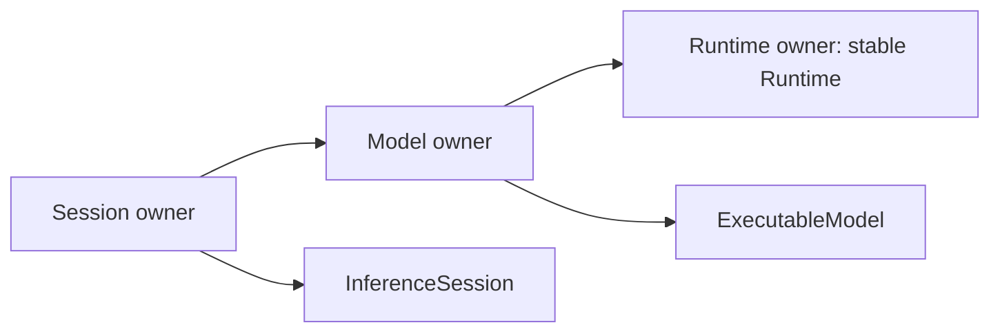

# Runtime C ABI v1 合同

- **状态**: Current
- **版本**: 1.0（M5 冻结，M6 实现；尚未发布）
- **日期**: 2026-10-22
- **声明事实源**: [include/c_api.h](../../include/c_api.h)
- **关联方案**: [10 号方案](../improvement-plan/10-upper-level-runtime-assembly.md) §4.3、§6.5
- **产品边界**: [PRD §3.4](../products/aethermind_prd.md#34-c-abi-规范)

## 1. 交付状态与边界

M5 冻结本合同、公共 C 声明与 C11/C++20 编译合同；M6 已在 [c_api_runtime.cpp](../../src/c_api_runtime.cpp) 实现 runtime/model/session 和 `am_get_abi_version`，可由纯 C 调用方链接 shared library。当前范围与验证限制见 [M6 验收报告](../tests/upper_level_runtime_assembly_m6_validation_2026-10-22.md)，不据此宣称全部 PRD 能力、零泄漏或发行门禁达成。

既有 `am_error_create/destroy/code/message` 已实现；M5 修复 message 分配失败时的对象泄漏。既有 `ObjectHandle` 引用计数接口保持不变，不用于操作下述三类 runtime handle。

首版适配范围为 CPU、scalar FP32、Llama Dense、同步、单请求、greedy、静态 KV、Token IDs I/O；显式选择 O1/plain 或 O2/packed。不增加 tokenizer、异步/streaming、并发 Session、设备切换或量化转换。

## 2. 类型、版本与布局

runtime/model/session 分别为不同 incomplete struct 的指针，类型不能互换；不暴露 C++ 布局、STL、exception 或 `TensorView`。错误类型复用 `am_error_handle`，销毁函数统一为 `am_error_destroy`；不再使用 PRD 旧草案的 `am_error_t/am_error_free`。

`AM_ABI_VERSION` 为 `(major << 16) | minor`，v1.0 为 `0x00010000`；`am_get_abi_version(void)` 返回库实际实现的版本且不分配。版本查询不等于量化、其他模型家族或其他平台已通过执行验收。

两类配置先零初始化，再设置 `struct_size = sizeof(config)`、`abi_version = AM_ABI_VERSION` 和必要字段。固定 v1 布局如下，所有 offset/size 单位为 byte，使用平台标准 C ABI、默认结构对齐；不支持改变 enum 大小或 packing 的编译开关。

| am_config_t 字段 | 类型 | Offset | 合同 |
|---|---|---:|---|
| struct_size | uint32_t | 0 | 必须等于 48 |
| abi_version | uint32_t | 4 | major=1，minor 不高于库实现 |
| num_layers | uint64_t | 8 | 正数，能安全转换为 size_t |
| num_kv_heads | uint64_t | 16 | 同上 |
| head_dim | uint64_t | 24 | 逻辑 head_dim，正数，不能填 padded_head_dim |
| max_tokens | uint64_t | 32 | 静态 KV capacity，正数，能安全转换为 size_t |
| kv_dtype | uint32_t | 40 | `AM_KV_DTYPE_FLOAT32 = 0` |
| cpu_preset | uint32_t | 44 | `AM_CPU_PRESET_O1_PLAIN = 0` 或 `AM_CPU_PRESET_O2_PACKED = 1` |

am_config_t 的固定大小为 48。CPU allocator/backend 与 64-byte KV alignment 由首版策略固定；不公开与当前交付无关的 GPU、线程池或 workspace 配置。cpu_preset 由 C adapter 的 owner 保存，供后续 model_load 编译使用；它不会让底层 Runtime 依赖 compiler。复用同一个 Runtime 加载的模型使用同一 preset。

| am_session_config_t 字段 | 类型 | Offset | 合同 |
|---|---|---:|---|
| struct_size | uint32_t | 0 | 必须等于 24 |
| abi_version | uint32_t | 4 | 同 runtime config |
| max_new_tokens | uint64_t | 8 | 非负 N，能转换为 size_t，`N * sizeof(uint32_t)` 可表示 |
| has_eos_token_id | uint32_t | 16 | 仅允许 0 或 1 |
| eos_token_id | uint32_t | 20 | has_eos_token_id=1 时启用；为 0 时忽略此字段 |

am_session_config_t 的固定大小为 24，创建 Session 时按值复制，此后不可变。N=0 是合法生成配置，不是使用默认值的标志；EOS 不从 HF 配置自动推断。

版本/字段校验先读取必需的 8-byte prefix。size 不匹配的拒绝路径仅要求 prefix 可读；size 匹配时，调用方必须提供完整 48/24-byte 可读配置对象，不能只提供 prefix 却声称完整尺寸。struct_size 不符返回 InvalidArgument，不读取后续字段；ABI major 不支持或请求 minor 高于实现返回 Unimplemented。几何无法转换为 size_t 返回 OutOfRange，元素/字节计算溢出返回 Overflow；未知 preset/dtype、非法 EOS 开关返回 InvalidArgument。

v1.x 保留上述原始类型、大小、offset、状态码和函数签名，不往这两类结构尾部追加字段；新能力使用另命名的结构/函数，并继续接受旧调用方。major 破坏性变更采用显式 `_v2` 接口。该规则替代旧草案中“结构体大小不变，但在尾部增加字段”的矛盾表述。

## 3. 句柄所有权与线程合同



每个成功 create/load 返回一个独立 caller-owned handle，调用方释放一次。model 保活 Runtime owner；session 保活 model 及其 Runtime。外部 runtime handle 可先 destroy，model handle 可先 unload，已创建的 Session 仍能完成请求。Runtime 从 Prepare 起保持地址稳定，直至最后一个 owner 销毁。

内部销毁顺序为 InferenceSession → ExecutableModel → Runtime：am_session 先销毁 session 再释放 model owner，ModelState 先销毁 executable 再释放 Runtime owner。handle wrapper 的释放与底层资源最后释放不是同一时刻；不使用全局 registry 或循环引用来保活。

`am_runtime_destroy(NULL)`、`am_model_unload(NULL)`、`am_session_destroy(NULL)` 为 no-op；非空 handle 只能释放一次，之后调用方应自行置 NULL。伪造、错类型、已释放 handle 和重复释放属于调用方违约，不承诺可靠报错。

所有共享 Runtime 的 load/create/generate/destroy 都须由宿主串行化；shared ownership 只保证生命周期，不增加并发执行支持。不同 error handle 独立拥有，借用的 message 指针仅存活到该 error 被销毁。

## 4. API、错误与异常

精确函数签名见公共头；新接口集合为：

| 接口 | 成功 | 可报告失败 |
|---|---|---|
| am_get_abi_version | packed uint32_t 版本 | 无分配、无异常 |
| am_runtime_create(config, error) | 非 NULL runtime handle | NULL；配置错误、Runtime 注册/KV 初始化失败等 |
| am_model_load(runtime, path, error) | 非 NULL model handle | NULL；Load/FP32 准入/Compile/KV 一致性/Prepare 失败等 |
| am_session_create(model, config, error) | 非 NULL session handle | NULL；配置、模型/Runtime 身份或 plan I/O 合同失败等 |
| am_session_generate(...) | AM_STATUS_OK 与完整新 IDs | 直接返回 am_status_code；buffer 和失败输出规则见 §6 |
| destroy/unload | 释放一个 caller handle，无返回值 | NULL no-op；不得传播异常 |

三种创建接口的 config/handle/path 按其签名必填；NULL 或空 path 返回 InvalidArgument，不选择隐式默认配置。config 与 path 仅借用到调用结束；path 使用平台文件系统编码，含空格保持字面路径。

所有接受 `am_error_handle* error` 的函数遵循同一规则：

1. error 可为 NULL。若提供槽位，进入后先写 `*error = NULL`，不读取或销毁旧值；调用方须先释放旧错误，槽位必须可写。
2. 成功保持 NULL；失败时尽力创建独立错误 handle，保留底层状态码，调用方以 am_error_destroy 释放。
3. 错误对象或 message 自身 OOM 时不再次构造诊断，不抛出异常，error 仍为 NULL。创建接口仍返回 NULL，Generate 仍返回原失败码；因此错误 handle 为空不能被视为成功。
4. `am_error_code(NULL) == AM_STATUS_UNKNOWN`，`am_error_message(NULL)` 返回非 NULL 空字符串；不增加 TLS last-error 或第二套错误对象。

`std::bad_alloc` 映射 ResourceExhausted，其余未识别的 C++ 异常映射 Internal；wrapper 封闭异常，在所有临时资源清理后返回。错误对象初始化失败也遵循此边界。底层 AM_CHECK/noexcept 终止无法由 wrapper catch 恢复；不能将本合同描述为任意内部故障均可恢复。

## 5. Runtime 与模型的时序/一致性

Runtime 创建时立即校验显式 KV 配置并分配 K/V plane。模型未知时不能判断几何是否与模型一致，也不能先猜测模型再修改 Runtime storage。模型路径为：

```text
Load → 共享 FP32 准入 → Compile → adapter 私有 ValidateRuntimeModelKV
  → PrepareExecutableModel → 发布 model handle
```

[共享策略](../../include/aethermind/inference/model_execution_policy.h) 只有两个入口：ValidateFp32ExecutionInputs 检查 hint 与所有必需 resolved weight roles；MakeFp32KVCacheOptions 读取已验证 HfModelConfig，安全转换维度、处理 absent head_dim=0 的整除 fallback、校验显式 capacity，返回已有 KVCacheRuntimeOptions 值类型。CLI 与 C adapter 直接复用同一实现，不复制 dtype 遍历或归一化规则。两者也共用 [cpu_inference_options.h](../../include/aethermind/inference/cpu_inference_options.h) 的 CpuInferencePreset/MakeCpuCompileOptions，应用旧类型与映射实现已删除。

MakeFp32KVCacheOptions 不验证现有 Runtime，也不代替已编译 state dtype 检查。adapter 私有 ValidateRuntimeModelKV 比较既有 KV layout 与通过 Compile 的模型：

| 字段 | 规则 | 失败码 |
|---|---|---|
| manager/storage | 存在且已初始化 | FailedPrecondition |
| num_layers | 等于规范化模型层数 | InvalidArgument |
| num_kv_heads | 等于规范化模型 KV heads | InvalidArgument |
| head_dim | 等于逻辑 head_dim，不比较 padded_head_dim | InvalidArgument |
| kv_dtype | 扫描已编译图所有层 K/V state，要求一致且为首版 Float32，再与 layout 比较 | InvalidArgument |
| max_tokens | 1 至模型 context 上限，允许小于上限 | OutOfRange（上限）；零容量在 Runtime 创建时已拒绝 |

alignment、padding、stride、plane 字节合法性归 KVCacheLayout/Manager，不与模型字段比较。失败不发布 model handle，清理本次 loaded/artifact/packed 等临时资源；已存在的 Runtime/KV 保持不变。C ABI 已在模型加载前分配 KV，因此不继承 CLI 的“非法模型拒绝前零 KV 分配”结论。

校验遍历全部 StateValue，包括 KVCacheUpdate 的 alias output；每层每个 K/V slot 只要求一个独立根，alias 输出不算额外根，但同样校验 binding/layer/slot 与 scalar Float32。alias 的结构与同 binding 关系由已验证 LoweredGraph 保证，不把合法更新输出误判为重复状态。

## 6. Generate 的 buffer、长度与状态

输入/输出按 uint32_t 元素计数；output_len 指向 size_t。调用方提供足够的可读/写、正确对齐内存，输入、输出及 error/output_len 槽不得相互重叠；无效指针/实际区域长度不符属于调用方违约。函数不会保留这些借用。

检查与发布顺序固定如下：

1. 清空可选 error 槽。output_len 必填；提供时先置 0。必要 session/input 为 NULL、input_len=0，或 output_tokens=NULL 且 output_capacity>0，返回 InvalidArgument。
2. 对已复制配置中的正数 N，若 output_capacity<N，则返回 OutOfRange，写 `*output_len=N`。此值是**安全容量上界，不是已生成的实际长度**；不调用 Generate、不预约 KV，也不验证 prompt token/EOS/context 语义。即使 EOS 可能更早结束，也要求预留 N。
3. `(output_tokens=NULL, output_capacity=0)` 在 N>0 时采用相同上界查询规则；仍要求步骤 1 的非空 prompt 形态，不读取 token 值。无需 pending-result 状态或先生成再重跑。
4. 容量满足时，调用现有 InferenceSession::Generate，沿用非空/词表/EOS/context、checked `prompt_len + N - 1`、模型与物理 KV capacity 检查，以及请求级 reservation RAII。
5. 全部成功后才复制拥有的结果至 output_tokens，再写实际 output_len。结果只含新 tokens，包含生成 EOS。执行或分配失败时 output_len 保持 0，token buffer 内容不变。

N=0 允许 NULL/0 输出，但仍调用既有 Generate 校验有效 prompt/EOS/model context，成功时长度 0；不计算 N−1，不查询/预约 KV，不因 prompt 长于物理 capacity 拒绝空生成。模型加载阶段的 Runtime/model KV 一致性要求仍成立。

| 情况 | 返回码 | output_len | token buffer | KV/模型执行 |
|---|---|---|---|---|
| 正常成功 | OK | 实际新 token 数，至多 N | 完整复制结果 | 执行并按请求清理 |
| N>0 且短 buffer/NULL0 查询 | OUT_OF_RANGE | N，上界 | 不变 | 不执行 |
| 参数/模型/资源/执行失败 | 相应失败码 | 0（槽位存在时） | 不变 | 在失败边界清理 |
| N=0 且语义有效 | OK | 0 | 不变 | 不执行、不预约 |

拒绝“先执行获取精确 required-size，再由调用方重试”的方案：EOS 使实际长度依赖执行，这会增加重复计算或隐式结果缓存。首版选择可由 max_new_tokens 确定的容量上界；调用方通常可以直接分配 N，无需查询。

## 7. 实施与验收

M5 编译合同由 [C11 translation unit](../../tests/unit/c_api/test_c_api_contract.c) 检查签名、状态值、宏、size/offset；[C++ 测试](../../tests/unit/c_api/test_c_api_contract.cpp) 检查 opaque 类型和 C/C++ 布局一致。M6 的 [C consumer](../../tests/unit/c_api/test_c_api_runtime_consumer.c) 实际调用全部版本/生命周期/生成符号，[对照矩阵](../../tests/unit/c_api/test_c_api_runtime_integration.cpp) 逐 fixture/preset 与独立配置的 C++ Session 比较完整 IDs，[边界测试](../../tests/unit/c_api/test_c_api_runtime.cpp) 验证下列合同：

- ABI query 与 create→load→create→generate→destroy 的纯 C 调用链，逐 preset 对照同 HF 的直接 C++ Session。
- Runtime 配置/version/size、各 KV 几何/dtype/context 不匹配，所有层 state 检查与失败不发布 handle。
- Runtime/KV、加载/准备/Session/request、error 对象/message 的确定性 OOM、清理、状态保留、error=NULL 与诊断 OOM 降级。
- 短 buffer 上界查询无执行、N=0、EOS、精确容量、溢出、输出不部分发布、null 合同。
- 外部 runtime/model handle 提前释放后 Session 仍可用，无 UAF/double-free；ASAN/UBSAN/LSAN 结果与既有基线分别记录。

实际数量、执行环境、故障命中、sanitizer 与既有泄漏基线分别记录于 M6 验收报告。M5 编译通过不替代 M6 的动态证据；模型/设备/精度与 PRD 性能范围仍以独立生产路径证据为准。
