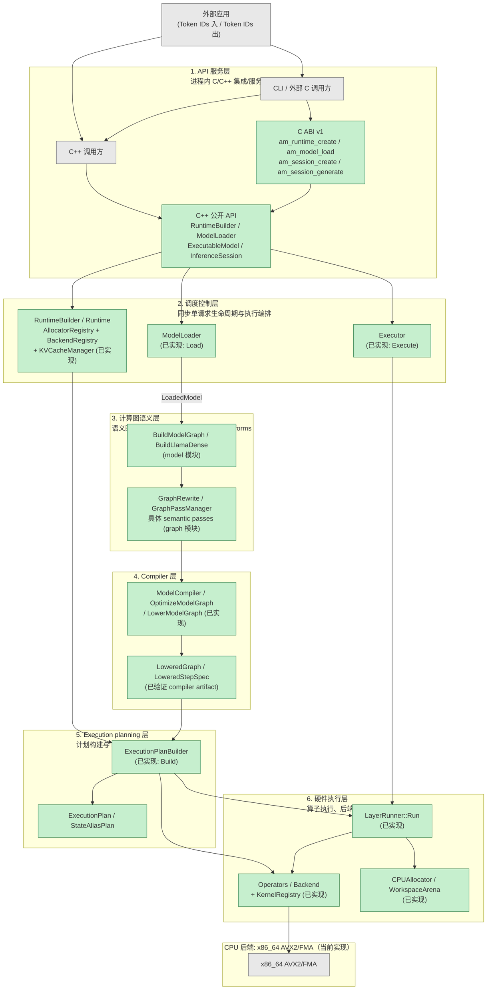
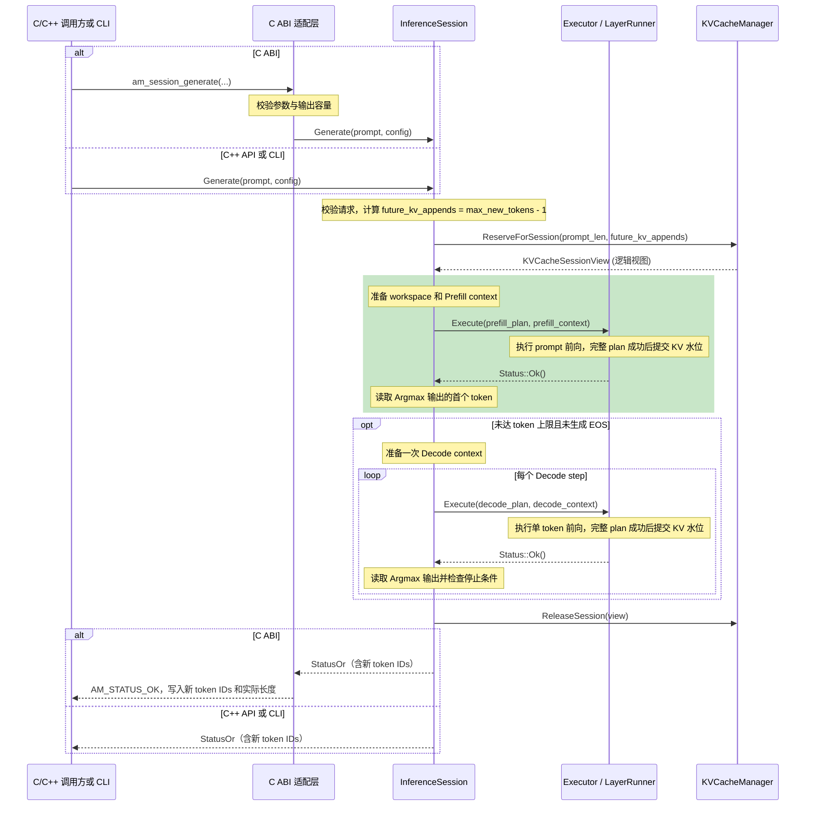
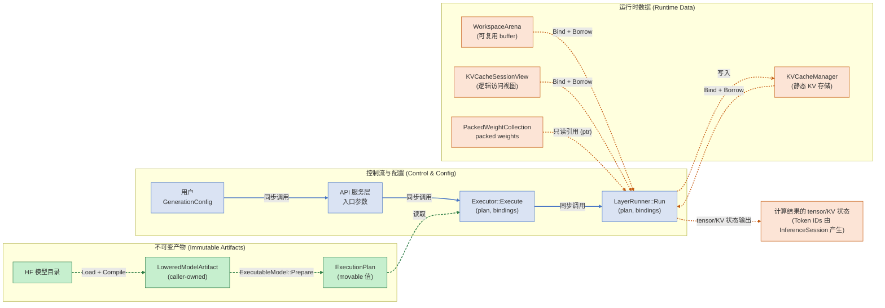
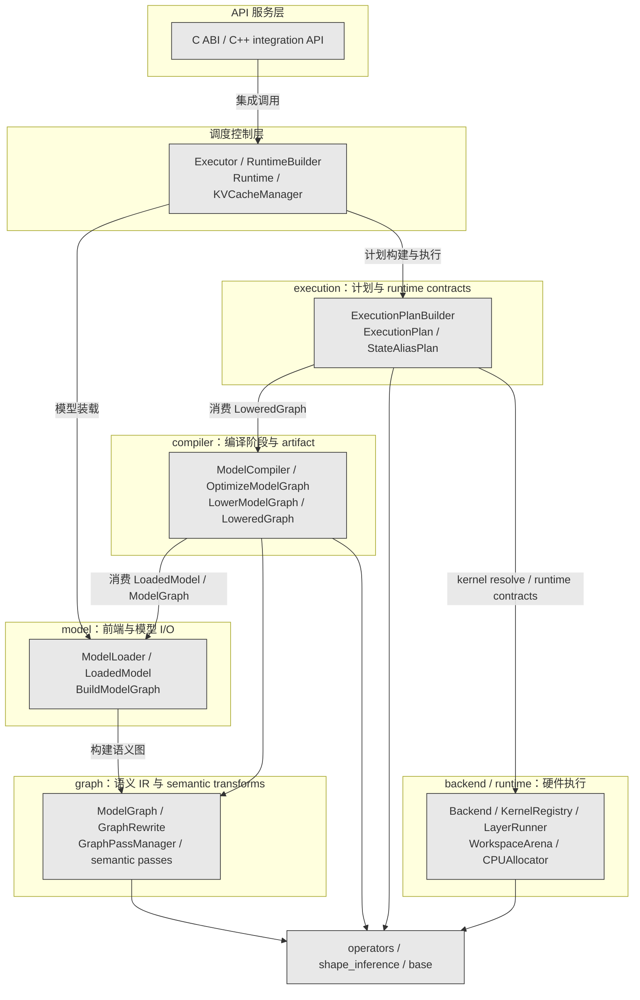

# AetherMind 系统架构

> 本文档描述已验证实现，是全系统唯一的架构权威。产品范围与验收标准见 [product.md](product.md)。其他文档引用本文档章节，不复制内容。

## 系统架构总览

AetherMind 当前产品的代码组织遵循六个**概念责任层**。这些层是逻辑责任边界，**不是**源文件目录结构的一对一映射；其中 `compiler/` 负责 semantic graph 之后、execution plan 之前的编译 artifact 与阶段编排。

---

> 说明：上图刻意省略"结果向上回传"的虚线边，以突出**单一方向的数据流**。`LoweredGraph` 由 compiler 产出，`ExecutionPlan` 由 execution planning 产出后交调度控制层持有；它们的上游所有权关系详见第五节与第六节的依赖规则图。

---

## 一、API 服务层 (API Service Layer)

### 定位

API 服务层是 AetherMind **进程内**集成/服务边界。它不是 HTTP/gRPC 服务端点，也不是网络协议层。它定义的是外部应用（C/C++ 宿主程序）如何通过 Token IDs 接口调用推理引擎。

> **重中之重"不是"**：API 服务层不包含 HTTP/gRPC 服务、不包含异步/流式 API、不包含 tokenizer。所有输入输出均为 `uint32_t` Token ID 数组。

### 职责

| 维度 | 说明 |
|------|------|
| **责任** | 定义生命周期契约（Runtime、Model、Session 的创建与销毁）；暴露同步生成入口；封装内部错误为稳定错误码；维护 ABI 稳定性 |
| **当前模块** | `include/c_api.h`（Runtime/Model/Session opaque handle、config/version、error、buffer 与 generate）；C++ 公开入口（`RuntimeBuilder`、`ModelLoader`、`ExecutableModel::Load`/`Prepare`、`InferenceSession::Create`/`Generate`） |
| **主要输入** | 模型路径、`GenerationConfig` / `am_session_config_t`（max_new_tokens、eos_token_id）、Prompt Token ID 数组 |
| **主要输出** | 输出 Token ID 数组、`am_error_handle` / `am_status_code` |
| **当前缺口** | C ABI 与同步 Generate 主路径已实现；多 Session/并发 Generate、跨调用 KV 复用、采样策略（temperature/top-k/top-p）与 tokenizer 不在当前范围 |
| **禁止责任泄漏** | 不得包含 HTTP/gRPC 服务、不得做 tokenizer 操作、不得做请求排队、不得做异步回调、不得暴露推理内部状态机 |

> 当前 API 已提供一站式同步生成：C ABI 的 `am_session_generate` 与 C++ 的 `InferenceSession::Generate`；CLI 走同一公共路径。底层构建块（`RuntimeBuilder`、`ModelLoader`、`Executor`）仍公开，用于自定义运行时装配与低层调用。

---

## 二、调度控制层 (Dispatch & Control Layer)

### 定位

调度控制层负责**同步单请求生命周期管理与执行编排**。它不处理请求调度、admission control、队列或批处理。它的核心任务是在一次推理请求的生命周期内，协调资源绑定、执行计划调度和状态推进。

> **关键区分**：此处的"调度"是指执行步骤的编排调度（单请求内如何按序执行 Prefill/Decode 及其子步骤），而非多请求间的负载调度。

### 职责

| 维度 | 说明 |
|------|------|
| **责任** | 装配 Runtime 资源（Allocator、Backend、KVCacheManager）；在冷路径将 `ExecutionPlan` specialize 为 `PreparedExecutionBindings`，并以 `ExecutionContext` 聚合 bindings、borrowed workspace 和 KV view |
| **当前模块** | `RuntimeBuilder`、`Runtime`、`Executor`、`KVCacheManager`、`PreparedExecutionBindings`、`ExecutionContext`、`ModelLoader`、`ExecutableModel::Prepare`/`ExecutableModel`、`InferenceSession` |
| **主要输入** | 已编译的 `ExecutionPlan`、其对应的模型 artifact（必要时含 `PackedWeightCollection`）、Prompt Token 序列、`GenerationConfig{max_new_tokens, eos_token_id}` |
| **主要输出** | 执行步骤结果（tensor 写入 workspace / KV cache 位置）；`InferenceSession::Generate` 返回本次新生成的 Token IDs（含 Prefill 预测的首 token 与触发停止的 EOS） |
| **当前缺口** | C ABI 与同步 Generate 已闭环（session reservation → Prefill → Decode loop → Argmax/stop → 释放预约），见 [InferenceSession 模块设计](handbook/API%20参考文档/C++%20公开%20API/InferenceSession%20API.md)。仓库中不存在独立的 `PrefillPath`/`DecodePath` 类型：phase 区分由 `ExecutableModel::plan(phase)` 与 Session 的两份 `PhaseContract` 承担。剩余缺口为跨调用 KV 复用、多 Session/并发 Generate、采样策略与算子覆盖扩展 |
| **禁止责任泄漏** | 不得承担请求排队/批处理、不得处理网络 IO、不得承担算子级 dispatch 决策（仅为调用方） |

> 当前生命周期为 `RuntimeBuilder::Build → Runtime`、`ModelCompiler::Compile → LoweredModelArtifact`、`ExecutableModel::Prepare → ExecutableModel`（内含 `ExecutionPlanBuilder::Build → ExecutionPlan`）、`InferenceSession::Create/Generate`，其请求内为 `PrepareExecutionBindings → PreparedExecutionBindings`、`ExecutionContext::Create → Executor::Execute`。shape/layout/aliasing premise、deferred shape constraints 和 kernel params 均在 `PrepareExecutionBindings` 冷路径验证；`LayerRunner` 只读取已准备的 bindings，绑定 step workspace 并调用冻结的 `step.kernel.fn`。Generate 状态机（session reservation → Prefill → Decode loop → Argmax/stop）与 C ABI 均已实现（v1.0 尚未发布）；跨调用 KV 复用、多 Session 并发与采样策略仍未承诺。

---

## 三、计算图语义层 (Computational Graph Layer)

### 定位

计算图语义层定义 backend-independent 的 `ModelGraph` IR 与 semantic transforms。HF → 语义图的构建入口由 `model` 模块提供；`graph` 只拥有 IR、rewrite framework 与 semantic passes，不依赖 model。优化 pipeline 的组装、lowering 和 compiler artifact 归独立 compiler 层；execution planning 不属于 graph。

### 职责

| 维度 | 说明 |
|------|------|
| **责任** | 基于已解析的模型配置与权重语义构建 Llama dense 语义图；提供 GraphRewrite/GraphPassManager 与常量折叠、语义融合、DCE 等 semantic passes |
| **当前模块** | `model`：`BuildModelGraph` 及 per-family builders（`BuildLlamaDense`）；`graph`：`ModelGraph`、GraphRewrite/GraphPassManager、具体 semantic passes |
| **主要输入** | `LoadedModel` 中的模型配置与 resolved weights |
| **主要输出** | validated `ModelGraph`；compiler 接收它来生成 `LoweredGraph` |
| **当前缺口** | Llama Dense 的 `Load → Compile → Prepare → Generate` 主路径已闭环；其他模型家族、更完整的算子覆盖与性能优化仍在推进 |
| **禁止责任泄漏** | 不得承担执行期资源绑定（如 workspace 地址绑定是调度控制层的职责）；不得承担运行时算子调度；不得处理 Token IDs |

> compiler 产出不可变且结构验证过的 `LoweredGraph`；`ExecutionPlanBuilder` 位于 execution，消费该 artifact，将 state alias 转换为 runtime `StateAliasPlan`，然后向 Backend 发起 kernel resolve 请求并冻结 `ExecutionPlan`。graph 不依赖 execution 或 backend。

### 模型加载 + 图编译数据流

```mermaid
flowchart LR
    A["HF 模型目录<br/>(config.json + *.safetensors)"] -->|"Load"| B["ModelLoader::Load"]
    B --> C["LoadedModel<br/>(config + resolved weights)"]
    C --> D["ModelCompiler::Compile"]
    D --> E["BuildModelGraph → BuildLlamaDense"]
    E --> F["ModelGraph<br/>(语义 DAG)"]
    F --> G["OptimizeModelGraph<br/>(O0/O1/O2+ passes)"]
    G --> H["LowerModelGraph"]
    H --> I["LoweredGraph<br/>(steps + dense value metadata)"]
    I --> J["LoweredModelArtifact<br/>(owns LoadedModel + LoweredGraph)"]
    J --> K["ExecutableModel::Prepare<br/>(ExecutionPlanBuilder::Build)"]
    K --> L["ExecutionPlan<br/>(kernel resolved, weight bound,<br/>workspace frozen)"]
    L --> M["InferenceSession::Generate"]

    classDef impl fill:#c6efce,stroke:#2d7d46
    class A,B,C,D,E,F,G,H,I,J,K,L,M impl
```

---

## 四、硬件执行层 (Hardware Execution Layer)

### 定位

硬件执行层是距离 CPU 硬件最近的层次。它不关心模型拓扑或请求语义，只负责一件事：**在给定的后端（目前是 CPU）上，按照已经冻结的执行计划，高效地执行算子 kernel**。

### 职责

| 维度 | 说明 |
|------|------|
| **责任** | 暴露 kernel resolve 能力（供 `ExecutionPlanBuilder` 在 plan-build-time 调用）；注册与选择后端 kernel；在工作空间绑定和 shape 校验后执行逐步骤算子调用；提供 workspace 复用与 KV cache 物理访问契约 |
| **当前模块** | `LayerRunner`（执行私有）、`KernelInvoker`、`CpuBackend`、`KernelRegistry`（全局 singleton + `AM_REGISTER_KERNEL` 静态注册）、`CPUAllocator`；`WorkspaceArena`/`WorkspaceBinding` 为 base 层共享契约，backend 与 execution 均单向依赖 |
| **主要输入** | `ExecutionPlan`（已 resolve 的 `ExecutionStep` 序列）、`ExecutionContext`（workspace base、KV view 等动态绑定） |
| **主要输出** | 各 step 计算结果的 tensor 写入（workspace + KV cache 位置）；Token IDs 由 `InferenceSession::Generate` 经 Argmax 产生 |
| **当前覆盖** | CPU backend 在 plan-build-time resolve。各精度的算子覆盖与验证状态见 [产品能力表](product.md#14-当前能力与验证状态) |
| **禁止责任泄漏** | 不得感知模型拓扑、不得承担请求编排、不得在热路径做 registry/hash/string lookup 或对象虚调用、不得将宽对象（`Runtime*`）下放给 kernel |

> kernel prepare 能力由硬件执行层通过 `Backend::PrepareKernel` 暴露，但 prepare 的发起方是执行数据契约层的 `ExecutionPlanBuilder`；它将 selector 与 typed OpParams 交给 backend，并将返回的 `ResolvedKernel` 冻结在计划中。

### 执行阶段调用序列

下图展示 `max_new_tokens > 0` 时的同步成功路径。C++ API 和 CLI 直接调用 `InferenceSession::Generate`，C ABI 经适配层调用。零生成请求在校验后直接返回，C ABI 的短 buffer 及其他失败规则见 [Runtime C ABI](api/runtime-c-abi.md#6-generate-的-buffer长度与状态)。

---

## 五、控制流/配置 vs 产物 vs 运行时数据

系统中有三类本质不同的信息，它们的来源、生命周期和访问方式各不相同。以下流程图用三种不同的箭头区分它们：

箭头含义：

| 箭头样式 | 含义 | 示例 |
|----------|------|------|
| 蓝色实线 | 控制流 — 同步函数调用/参数传递 | App → API → Executor → LayerRunner |
| 绿色虚线 | 计算 — 产物产生过程（一次性编译） | HF 目录 → `LoweredModelArtifact` → `ExecutionPlan` |
| 橙色点线 | 运行期绑定/借用 — 不拥有生命周期 | workspace binding、KV view 绑定、packed weight 指针引用 |

### 所有权与生命周期宏观规则

| 类别 | 生命周期 | 可变性 | 持有者 |
|------|----------|--------|--------|
| `LoadedModel` (config + resolved raw weights) | 模型生命周期（长） | 构造后只读 | `LoweredModelArtifact` 按值持有其 `unique_ptr`，负责 RawWeightView backing storage |
| `PackedWeightCollection` (legacy packed-weight store) | 过渡性 backend artifact 生命周期 | 准备阶段可写，执行阶段按只读使用 | 调用方持有；不由 `ModelLoader` 创建 |
| `ExecutionPlan`（`ExecutionStep[]`） | 模型生命周期（长） | 构建后不可变 | 模型管理侧持有；必须比使用它的 `ExecutionContext` 和 `Executor::Execute` 活得久 |
| `Runtime`（AllocatorRegistry + BackendRegistry + KVCacheManager） | Runtime 生命周期（最长） | 装配后基本不可变 | 调用方持有 `RuntimeBuilder::Build()` 返回的值对象；必须比由其 backend resolve 的 plan 活得久，因为 `ResolvedKernel::name` 借用 backend-owned storage |
| `PreparedExecutionBindings` | plan specialization 生命周期（中） | 构建后只读 | `ExecutionContext` 按值拥有 activation storage、metadata 与 prepared params；external TensorView 的 data backing 由调用方借出且必须保持有效 |
| Workspace arena | Session 生命周期（中） | 可变（session 显式 reset 后复用） | Session/调用方持有；`ExecutionContext` 仅借用，`Clear()` 不得 reset |
| `KVCacheSessionView` | Session 生命周期（中） | 视图可复制，底层 KV 状态可变 | `ExecutionContext` 保存 view；存储由 `Runtime` 的 `KVCacheManager` 持有，`Clear()` 不得 release reservation |
| 单次 kernel 调用的 tensor view / binding | step 执行期间（短） | 可变（不拥有存储） | 栈帧 / `KernelContext` |

---

## 六、层依赖规则与不变量

### 依赖方向

下图展示概念层之间的调用和产物关系。源码模块的单向依赖及例外见下方 [依赖规则](#跨模块依赖规则)。

### 规则说明

- 入口通过公开构建块完成编排。执行层与调用来源解耦，kernel 使用窄执行资源，禁止持有 `Runtime*`、`InferenceSession*` 等宽对象指针。
- 上游持有不可变产物。`LoweredModelArtifact` 拥有 `LoadedModel` 和 `LoweredGraph`，`ExecutionPlan` 由调用方或模型管理侧持有。execution/backend 消费借用的引用或按值冻结的 plan 数据。
- 结果向上回传，依赖指向下层。层间通过窄接口（struct、span、function pointer）通信。

### 源码模块所有权

| 模块 | Public header 根目录 | 实现根目录 | 职责与不可越界规则 |
| --- | --- | --- | --- |
| **graph** | `include/aethermind/graph/` | `src/graph/` | 通用 Graph IR、nodes/values/specs、GraphOpBuilder、GraphRewriteSession/GraphPassManager、ConstantFolding/DCE/SiluMul 等 backend-independent semantic passes、诊断 dump。**不得依赖 compiler/execution/backend/model**，也不得出现 Backend/Kernel/Workspace/DeviceType 执行层细节；target-aware pipeline composition 与 lowering 不属于本模块。 |
| **operators** | `include/aethermind/operators/` | `src/operators/` | 算子语义契约层：OpType 枚举、OperatorSchema（端口名顺序为语义 ABI）、OpParams（typed variant，禁止 std::any）、`Infer*` 自由函数（参数验证 + dtype 验证 + shape 推导 + deferred ShapeConstraints）、OpParams 序列化/反序列化。**不含执行层细节**：不得引用 ModelGraph/LoweredGraph/Backend/Kernel。 |
| **compiler** | `include/aethermind/compiler/` | `src/compiler/` | 编译阶段编排：默认 semantic pipeline composition、`ModelCompiler`、`ModelCompileOptions`、`LowerModelGraph`、不可变且经结构验证的 `LoweredGraph`/`LoweredStepSpec`/`LoweredModelArtifact`。可携带 base 层 `KernelSelector`，但**不得依赖 execution/backend/runtime**，不得查询 kernel registry。 |
| **execution** | `include/aethermind/execution/` | `src/execution/` | 执行数据契约层：ExecutionPlan、`PreparedExecutionBindings`（plan 的 cold-path tensor specialization）、`ExecutionContext`（窄执行资源）、供手工/低层调用的 untrusted `ExecutionPlanNodeSpec`、StateAliasPlan、LayerRunner、ExecutionPlanBuilder。Public headers 只前向声明 `LoweredGraph`；实现可依赖 compiler artifact，负责将其 state aliases 转为 runtime StateAliasPlan、workspace planning 与 kernel resolve。 |
| **kv_cache** | `include/aethermind/kv_cache/` | `src/kv_cache/` | 静态 KV 物理状态域：公开 `kv_cache_layout.h` 定义独立的布局值类型 `KVCacheLayout`，`kv_cache_session_view.h` 定义 generation-checked `KVCacheSessionView`；View 仅借用 storage/session state，不暴露 `Buffer`。`detail/kv_cache_state.h` 保留 Manager-owned 的 `KVCacheStorage`（按值拥有 layout 与 K/V Buffer）及 `KVCacheSessionState { generation, capacity_tokens, prompt_len, committed_tokens, Lifecycle }`，其中 `Lifecycle` 为 `Idle`/`AwaitingPrefill`/`PrefillCommitted`。`KVCacheManager` 按值持有 storage/session state，`layout()` 返回 `storage_.layout` 的 const 引用，管理连续 K/V storage、单 session reservation、commit watermark 与窄读写 binding，并通过 `Init` 收到的 `Allocator&` 获取 K/V plane Buffer（只借用、不保存该引用），使 KV storage 与其余受管存储使用统一分配策略。`KVCacheSessionView::CommitAppend(begin, end) const noexcept` 是公开提交入口；调用方必须先证明完整 append plan 成功且所有 layer 写完，方法自身只验证 generation、lifecycle、begin/end 与容量，不证明写入完成。只依赖 base、dtypes、memory；不依赖 runtime/execution/inference/model/backend，不承载算子语义或 whole-plan transaction；不提供旧 View 类型或头的兼容 alias。 |
| **runtime** | `include/aethermind/runtime/` | `src/runtime/` | 执行期运行时资源聚合层：Runtime/RuntimeBuilder（backend、allocator 与按值拥有的 `KVCacheManager`）、workspace 规划（`PlanWorkspaceRequirements`/`WorkspacePlanLayout`）。**不得依赖 execution/compiler/graph/model**；依赖 kv_cache；execution 可直接依赖 runtime 和 kv_cache。 |
| **model** | `include/aethermind/model/` | `src/model/` | 模型加载与前端适配：HfModelConfig/HfDirectoryReader/HfModelValidator、ResolvedModelWeights、**LoadedModel**（只持有 config + resolved raw weights/backing storage）、ModelLoader（仅 HF I/O/validation/resolution）、**模型家族识别与图构建**（`ParseModelArchitecture` 是家族判定唯一权威；`BuildModelGraph` 是 HF → semantic graph 唯一转换权威的 dispatch 入口，按家族路由到 per-family builder，如 `BuildLlamaDense` 将 HF RoPE 字段规范化为 typed `RoPEAlgorithmParams`，legacy `su` 映射为 `LongRoPE`，unknown type 拒绝）。ModelCompiler 归 compiler；ModelLoader 不调用 graph、backend 或 prepack。`ConvertRawModelWeightsToFp32` 是显式构图前转换入口，通过传入 Allocator 分配自持 Buffer 的 RawStorage，保留源 config/hint；不属于 Loader 或 Compiler 的隐式行为。`ModelGraphBuildOptions` 显式携带 activation/KV dtype，不转换 payload。 |
| **inference** | `include/aethermind/inference/` | `src/inference/` | 模型准备与会话编排层：`WeightBindingMetadata`（immutable 绑定所借用的 shape/stride 元数据所有权）、`ExecutableModel`（拥有 `LoweredModelArtifact`、packed artifacts、immutable external weight/constant bindings 与 phase ExecutionPlan）及其唯一生产准备入口 `ExecutableModel::Prepare`；`InferenceSession`/`Generate` 同步编排与 `model_execution_policy.h` 的共享 FP32 准入/模型 KV 配置映射，以及 `inference_options.h` 的设备无关 `CompilePreset` 与 `MakeCompileOptions(preset, target)` 编译映射 与 `MakeCpuRuntimeOptions` 模型感知运行前值映射亦归本模块；后者统一 CPU defaults、显式 KV dtype 与几何、Runtime budget 与 CPU feature policy，只读 metadata，不分配或创建 Runtime，Runtime 层不得反向依赖它。目标感知准备入口 `ExecutableModel::Load` 按 `ModelLoadOptions::weights` 编排 Load→可选 Convert→Compile→Prepare，retained-W16 按角色仅转换 Norm。精度组合与准入范围见 [产品能力表](product.md#14-当前能力与验证状态)。共享策略仅只读 metadata，不转换 payload、不分配 KV、不校验既有 Runtime/model；后者归 C adapter 私有 helper。**不得被 graph/operators/compiler/execution/runtime/model/backend 反向依赖**；只做编排、产品准入与所有权聚合，不承担算子语义、kernel resolve、weight materialization 算法或 KV 物理存储职责。 |
| **C runtime adapter** | `include/c_api.h` | `src/c_api_runtime.cpp` | 外部 C 入口：opaque handle 与 Runtime 稳定 owner 链、配置/version、Status/异常/error 适配、buffer 合同、私有 Runtime/model KV 一致性校验；复用 inference 共享准入/映射/preset 及既有 Compile/Prepare/Generate，不复制算法或修改宿主 logger，不被下层模块反向依赖。 |
| **shape_inference** | `include/aethermind/shape_inference/` | `src/shape_inference/` | TensorSpec、ShapeSymbol、ShapeConstraint、InferenceResult 等通用形状推导基础设施。 |
| **backend / kernels** | `include/aethermind/backend/` + per-ISA kernels | `src/backend/` | Backend 抽象、KernelRegistry、ExecutionStep 运行时执行（基于 base 层 `KernelSelector` 纯数据契约做内核匹配，见 `base/kernel_selector.h`），以及经 `Backend::PackWeights` 契约暴露的权重打包服务（layout 权威在 backend，composite 物化/对齐/分配由 backend 落实）。CPU packing 经 `Backend::PackWeights` 收到的 `Allocator&` 分配产物存储（只借用、不保存该引用），布局权威与打包职责仍归 backend，不借此改变 Runtime `Allocator` 的接口。不得依赖 Graph IR 或 OperatorSchema 的语义细节；可 include operators 的纯数据 dtype 契约头（`kXxxSupportedDTypes`/`IsXxxSupportedDType`）及 backend-independent 的 `rope_frequency_resolver.h`（RoPE 频率公式契约）。 |

#### 跨模块依赖规则

- operators → shape_inference（+ dtypes/base 基础库）
- graph → operators + shape_inference + base
- compiler → model + graph + operators + shape_inference + base
- kv_cache → base + dtypes + memory
- execution → runtime + kv_cache + compiler + operators + shape_inference + base（不直接依赖 graph，public headers 不 include compiler）；实现可依赖 model 的权重组装契约（`PackedWeightCollection`/`WeightArtifactKey`）；公共头可含 backend 的纯数据契约头（`ResolvedKernel`/`PackedWeight`/`KernelSelector`）
- runtime → kv_cache + base + backend（backend registry/factory）+ memory
- model → graph + operators + formats/hf + memory（显式逻辑权重转换使用 Allocator/Buffer，不承担物理 packing 布局职责）；权重组装组件（`WeightPackingRequest`/`PrepackWeightRequests`/`PackedWeightCollection`）可依赖 backend 的打包契约（`PackedWeight`/`PackingRecipe`），打包执行必须经 `Backend::PackWeights` 抽象入口，不得依赖其余 backend/kernels 细节（不 include 具体 prepacker 实现）
- inference → execution + compiler + model + runtime + kv_cache（+ graph/operators 的纯数据 payload 契约 `WeightValue`/`ConstantValue`/`WeightBinding`，以及 base 的 `TensorView`/`KernelSelector`）；位于依赖最上层，任何下层模块不得依赖 inference
- backend/kernels → operators（OpParams/OpType，及 `kXxxSupportedDTypes`/`IsXxxSupportedDType` 等纯数据 dtype 契约头，以及 backend-independent 的 `rope_frequency_resolver.h` 频率公式契约；不得依赖其余语义细节）不得反向依赖 graph/compiler/model；执行期共享契约（`WorkspaceArena`/`WorkspaceBinding`/`KernelSelector`）统一放在 base 层；`ResolvedKernel`/`PackedWeight`/`PackingRecipe` 等 backend 纯数据契约头供 execution/model 上层直接依赖，不再额外下沉

### 为什么这样分层

| 关注点 | 收益 |
|--------|------|
| **可测试性** | 每层可独立测试：`ExecutionPlanBuilder` 不依赖 `Executor`；`LayerRunner` 不依赖模型加载；Kernel 函数不依赖 Runtime 上下文 |
| **热路径效率** | kernel 执行通过 plan-build-time prepare 的 `ResolvedKernel::fn` 函数指针完成；`LayerRunner` 从 `PreparedExecutionBindings` 读取已构造的 kernel params 后直接调用，不发生 backend 查找、shape inference、params construction 或对象虚调用 |
| **可替换性** | 后端感知的差异通过 `KernelSelector`、Backend 与 `KernelRegistry` 收敛在计划构建和硬件执行边界，避免向 API 泄漏；这只是隔离能力，不代表当前产品支持非 CPU 后端 |
| **演进边界** | 长期演进若引入批处理、PagedAttention 或非 CPU 后端，需要重新评估相应层内模块；semantic graph、compiler、execution 与 backend 的边界用于局部化变化，不构成兼容性或交付承诺 |

---

## 七、关键产物与数据流向

### 关键产物与数据移动说明

| 阶段 | 输入 → 输出 | 关键事实 |
|------|-------------|----------|
| **模型加载** | HF 目录 → `LoadedModel` | `ModelLoader::Load` 返回 `unique_ptr<LoadedModel>`；含 config、resolved weights 和 backing storage，不含 packed weights |
| **图构建** | `LoadedModel` → `ModelGraph`（语义 DAG） | `BuildModelGraph` 按家族分发，`BuildLlamaDense` 构建 dense decoder 的算子 DAG |
| **图编译** | `LoadedModel` → `LoweredModelArtifact` | compiler `ModelCompiler` 串联 `BuildModelGraph`（家族分发）→ `OptimizeModelGraph` → `LowerModelGraph`；immutable `LoweredGraph` 保留 `LoweredStepSpec[]` 和 dense value metadata |
| **计划构建** | `LoweredGraph` → 不可变 `ExecutionPlan` | `ExecutionPlanBuilder` 向硬件层发起 kernel resolve，绑定 packed weight 指针，冻结 workspace requirement |
| **绑定准备** | `ExecutionPlan` + external TensorViews → `PreparedExecutionBindings` | `PrepareExecutionBindings` snapshot metadata、校验 shape/layout/aliasing/constraints 并分配 activation、构造 prepared params；任一 address、shape、stride、dtype 或 alias 变化都必须重建 |
| **执行** | `ExecutionPlan` + `ExecutionContext` → tensor/KV 状态 | `Executor::Execute` → `LayerRunner::Run` 按步绑定 workspace 并调用已准备 kernel。Token IDs 由 `InferenceSession::Generate` 经 Argmax 产生 |

---

## 八、当前实现与未闭环项

| 维度 | 当前实现了什么 | 未闭环/未承诺 | 明确不承诺 |
|------|----------------|---------------|------------|
| **API** | C ABI v1（已实现，尚未发布）的 Runtime/Model/Session 生命周期与 `am_session_generate`；C++ `ExecutableModel::Load`/`Prepare`、`InferenceSession::Create`/`Generate`；CLI | 多 Session/并发 Generate、跨调用 KV 复用、采样策略 | HTTP/gRPC 服务、tokenizer、异步/流式 API |
| **模型加载** | `ModelLoader::Load`（HF 配置验证、权重加载 resolve、`LoadedModel` 创建）；`ExecutableModel::Load` 编排 Load → 可选转换 → Compile → Prepare | 其他模型家族与更完整的权重策略 | MoE、encoder-decoder、sliding window attention |
| **图编译** | `ModelCompiler`、`BuildModelGraph`/`BuildLlamaDense`、`OptimizeModelGraph` + `LowerModelGraph`、`LoweredModelArtifact` | 其他模型家族、更完整的算子覆盖 | - |
| **计划构建** | `ExecutionPlanBuilder::Build`（kernel resolve + packed weight bind + workspace plan） | - | - |
| **执行引擎** | `Executor::Execute` → `LayerRunner::Run`；`InferenceSession::Generate` 的 Prefill/Decode/Argmax/stop 状态机 | intra-op 并行优化与更完整的 kernel 覆盖 | Continuous batching、request scheduling |
| **KV Cache** | `KVCacheManager`（静态预分配 Init + ReserveForSession）、`KVCacheSessionView`（逻辑读写）；Runtime 按值拥有 Manager | 跨请求 KV 复用 | PagedAttention、动态扩容 |
| **采样** | Argmax 已集成到 Generate 循环 | - | Temperature / top-k / top-p |
| **Backend** | CPU Backend（`CpuBackend` factory/freeze/resolve、`KernelRegistry` 全局 singleton + `AM_REGISTER_KERNEL`） | 更完整的 Llama-layer 算子覆盖与 SIMD kernel | GPU/CUDA、CANN |
| **内存** | `CPUAllocator`（`posix_memalign`、junk fill、可选 THP）、`WorkspaceArena`（Bind/Reset） | - | - |

当前主路径为 `ModelLoader::Load → ModelCompiler::Compile → ExecutableModel::Prepare → InferenceSession::Generate`；`Executor::Execute`/`LayerRunner::Run` 只负责按已冻结的 plan 逐 step 执行。

---

## 九、当前产品边界速查

产品范围与非目标见 [产品定位与边界](product.md#11-定位与边界)，各入口的精度组合与验证范围见 [产品能力表](product.md#14-当前能力与验证状态)。

---

## 十、架构级并发模型

### 10.1 当前产品执行模型

> **single-request synchronous runtime + optional intra-op parallel compute**

- 控制流：单请求、同步阻塞；不提供 request scheduler，不支持多请求批处理。
- 算子层：允许 intra-op parallelism（GEMM/GEMV 并行、Attention 局部并行），由统一线程配置驱动。
- 线程实施指南：当前产品目标采用算子内部（intra-op）并行；若依赖 OpenMP 或第三方并行数学库，必须通过 `Runtime` 提供统一线程数配置，避免多层嵌套并行导致 oversubscription。

### 10.2 并发边界

| 允许 | 不允许 |
|---|---|
| 算子级 intra-op 并行 | 改变 API 的同步语义 |
| Runtime 统一线程数配置 | 引入 request-level 并发调度 |
| 单一主导的 intra-op threading runtime | 多会话共享调度器 / request-level 与 intra-op 混用 |

> 当前已实现部分为单线程逐计划执行（`Executor::Execute` → `LayerRunner::Run`）；intra-op 并行属于当前产品目标，尚未闭环。

## 十一、内存架构与稳态零分配

### 11.1 内存分区

| 类别 | 生命周期 | 特征 | 管理者 |
|---|---|---|---|
| Model Weights | 模型级（长） | 只读、大块、长期驻留（mmap 或加载后驻留） | `LoadedModel` / `PackedWeightCollection` |
| KV Cache | Session 级（中） | 静态预分配、按 token 位置递增写入、不动态扩容 | `KVCacheManager`（kv_cache 模块；由 `Runtime` 按值拥有） |
| Workspace / Scratch | 执行期（短/中） | 预留、复用（Bind/Reset） | `WorkspaceArena`（由调用方分配，`CPUAllocator` 提供存储） |

### 11.2 稳态零分配定义

- 允许模型加载阶段执行 mmap / 初始化分配。
- 允许 Session 创建阶段执行一次性预分配。
- **Decode 稳态路径禁止新的堆分配**。

该定义约束热路径行为，而非要求整个进程所有阶段完全不分配内存。

### 11.3 布局原则

- 权重布局服从 kernel-friendly repack 需求；KV Cache 布局服从顺序写入与按层访问需求；Workspace 布局服从算子复用与 cache locality 需求。
- 持久态与瞬时态内存分离管理；单次 kernel 调用的 tensor view / binding 不拥有存储。

## 十二、确定性策略

| 层级 | 定义 |
|---|---|
| Contract Level | 同平台 / 同构建 / 同输入 → 输出一致 |
| Reference Level | Reference kernels 作为正确性基线，尽量保持 bit-stable 或高度稳定的数值行为 |
| Optimized Level | Optimized kernels 与 reference path 在定义容差内一致；不以跨平台 bit-identical 作为通用承诺 |

- 分层原因：SIMD 特化、不同 BLAS 路径、并行优化引入后，"所有平台 bit-identical"不再是合理工程承诺，必须区分契约确定性与实现路径确定性。
- 测试对应：算子正确性（Reference 基线）、Reference vs Optimized 一致性（按算子定义容差）、端到端生成回归（EOS / Max Tokens 停止条件）、内存行为（Decode 稳态无新增堆分配）。

## 十三、关键冻结决策

1. **Runtime 边界**：token ids in / token ids out。
2. **执行模型**：single-request synchronous。
3. **内存策略**：static KV + steady-state zero allocation。
4. **算子策略**：reference first, optimized second。
5. **分发策略**：plan-build-time resolve，热路径函数指针，无虚调用与热路径查找。
6. **对象模型**：`LoadedModel`（config + resolved weights）→ `LoweredModelArtifact`（owns LoadedModel + LoweredGraph）→ `ExecutionPlan`（不可变，调用方持有）。
7. **KV 访问边界**：`kv_cache` 拥有物理 layout/storage/reservation；Runtime 聚合 Manager；Execution / Operator 通过 `KVCacheSessionView` 和 base 窄 binding 访问 KV，不耦合底层线性存储实现。`KVCacheSessionView::CommitAppend` 是公开提交入口，但调用方必须先证明完整 plan transaction 成功且所有 layer 写完；方法自身只验证 generation、lifecycle、range 与容量，生产中仍由 execution 的 `LayerRunner` 在完整 plan 成功后调用。
8. **算子契约**：Reference 与 Optimized 路径共享统一逻辑签名（OpParams 为 typed variant）。

## 十四、参考来源

本文档的所有"当前实现"状态均基于以下代码与设计文档。当前状态以源代码为准，当前产品目标以 [product.md](product.md) 为准。

### 关键代码路径

| 路径 | 对应模块 |
|------|----------|
| [`include/aethermind/model/model_loader.h`](../include/aethermind/model/model_loader.h) / [`src/model/model_loader.cpp`](../src/model/model_loader.cpp) | `ModelLoader::Load` |
| [`include/aethermind/model/llama_dense_graph_builder.h`](../include/aethermind/model/llama_dense_graph_builder.h) / [`src/model/llama_dense_graph_builder.cpp`](../src/model/llama_dense_graph_builder.cpp) | `BuildLlamaDense` |
| [`include/aethermind/compiler/optimize_graph.h`](../include/aethermind/compiler/optimize_graph.h) / [`src/compiler/optimize_graph.cpp`](../src/compiler/optimize_graph.cpp) | `OptimizeModelGraph` |
| [`include/aethermind/compiler/graph_lowering.h`](../include/aethermind/compiler/graph_lowering.h) / [`src/compiler/graph_lowering.cpp`](../src/compiler/graph_lowering.cpp) | `LowerModelGraph` / `ValidateLoweredGraph` |
| [`include/aethermind/execution/execution_plan_builder.h`](../include/aethermind/execution/execution_plan_builder.h) / [`src/execution/execution_plan_builder.cpp`](../src/execution/execution_plan_builder.cpp) | `ExecutionPlanBuilder::Build` |
| [`include/aethermind/execution/execution_bindings.h`](../include/aethermind/execution/execution_bindings.h) / [`src/execution/execution_bindings.cpp`](../src/execution/execution_bindings.cpp) | `PrepareExecutionBindings` / `PreparedExecutionBindings` |
| [`include/aethermind/execution/execution_context.h`](../include/aethermind/execution/execution_context.h) / [`src/execution/execution_context.cpp`](../src/execution/execution_context.cpp) | `ExecutionContext::Create` |
| [`include/aethermind/execution/executor.h`](../include/aethermind/execution/executor.h) / [`src/execution/executor.cpp`](../src/execution/executor.cpp) | `Executor::Execute` |
| [`src/execution/layer_runner.h`](../src/execution/layer_runner.h) / [`src/execution/layer_runner.cpp`](../src/execution/layer_runner.cpp) | `LayerRunner::Run`（执行私有，公开入口为 `Executor::Execute`） |
| [`include/aethermind/runtime/runtime_builder.h`](../include/aethermind/runtime/runtime_builder.h) / [`src/runtime/runtime_builder.cpp`](../src/runtime/runtime_builder.cpp) | `RuntimeBuilder::Build` |
| [`include/aethermind/kv_cache/kv_cache_layout.h`](../include/aethermind/kv_cache/kv_cache_layout.h) / [`src/kv_cache/kv_cache_layout.cpp`](../src/kv_cache/kv_cache_layout.cpp) | `KVCacheLayout` |
| [`include/aethermind/kv_cache/kv_cache_session_view.h`](../include/aethermind/kv_cache/kv_cache_session_view.h) / [`src/kv_cache/kv_cache_session_view.cpp`](../src/kv_cache/kv_cache_session_view.cpp) | `KVCacheSessionView` |
| [`include/aethermind/kv_cache/kv_cache_manager.h`](../include/aethermind/kv_cache/kv_cache_manager.h) / [`src/kv_cache/kv_cache_manager.cpp`](../src/kv_cache/kv_cache_manager.cpp) | `KVCacheManager`（按值持有 layout/storage/session state；由 `Runtime` 按值拥有） |
| [`include/aethermind/compiler/model_compiler.h`](../include/aethermind/compiler/model_compiler.h) / [`src/compiler/model_compiler.cpp`](../src/compiler/model_compiler.cpp) | `ModelCompiler::Compile` / `LoadAndCompile` |
| [`include/aethermind/model/weight/weight_binding_resolver.h`](../include/aethermind/model/weight/weight_binding_resolver.h) / [`src/model/weight/weight_binding_resolver.cpp`](../src/model/weight/weight_binding_resolver.cpp) | `ResolveWeightBinding` |
| [`include/aethermind/model/weight/weight_packing_request.h`](../include/aethermind/model/weight/weight_packing_request.h) | `WeightPackingRequest` |
| [`include/aethermind/model/weight/packed_weight_collection.h`](../include/aethermind/model/weight/packed_weight_collection.h) / [`src/model/weight/packed_weight_collection.cpp`](../src/model/weight/packed_weight_collection.cpp) | `WeightArtifactKey` / `PackedWeightCollection` / `PrepackWeightRequests` |
| [`src/inference/inference_internal.h`](../src/inference/inference_internal.h) / [`src/inference/executable_model.cpp`](../src/inference/executable_model.cpp) | 准备期 recipe 查询与请求合并（inference 私有） |
| [`include/aethermind/runtime/runtime.h`](../include/aethermind/runtime/runtime.h) | `Runtime` |

### 关键设计文档

| 文档 | 覆盖内容 |
|------|----------|
| [product.md](product.md) | 当前产品需求、验收标准、边界定义 |
| [内存管理系统](handbook/内存管理系统/内存管理系统.md) | base / dtypes / memory：Status、TensorView、分配器与 workspace 契约 |
| [amstring](handbook/组件速查.md#amstring-字符串库) | SSO 字符串库的布局、存储与策略 |
| [形状推断系统](handbook/形状推断系统.md) | 符号维度、shape 约束与执行期保障 |
| [模型系统](handbook/核心模块设计/模型系统%20%28Model%29.md) | HF 加载、家族识别、权重绑定与打包请求 |
| [计算图系统](handbook/核心模块设计/计算图系统%20%28Graph%29/计算图系统%20%28Graph%29.md) | 语义图 IR、rewrite、passes 与不变量 |
| [算子契约与元数据](handbook/核心模块设计/算子系统%20%28Operators%29/算子契约与元数据.md) | 算子 schema、OpParams、Infer* 与序列化 |
| [编译器系统](handbook/核心模块设计/编译器系统%20%28Compiler%29.md) | 编译阶段、优化 pipeline、lowering 与 artifact |
| [执行引擎](handbook/核心模块设计/执行引擎%20%28Execution%29.md) | ExecutionPlan、bindings、context 与逐 step 执行 |
| [运行时系统](handbook/核心模块设计/运行时系统%20%28Runtime%29.md) | Runtime 装配、资源所有权与 workspace 规划 |
| [KV Cache 系统](handbook/核心模块设计/KV%20Cache%20系统.md) | KV 布局、静态分配、reservation 与 commit |
| [后端系统](handbook/核心模块设计/后端系统%20%28Backend%29/后端系统%20%28Backend%29.md) | KernelRegistry、kernel resolve、packing 与 CPU 能力 |
| [InferenceSession API](handbook/API%20参考文档/C++%20公开%20API/InferenceSession%20API.md) | ExecutableModel、InferenceSession 与 Generate |

### 维护规则

1. **源代码证明当前状态**。本文档中的"当前已实现"标记在编写时已验证源代码与测试文件。如有偏差，以代码行为为准。
2. **产品目标以 `product.md` 为准**。它是当前产品功能需求与验收标准的唯一权威来源。
3. 本文档维护跨模块架构。各模块实现、数据结构与测试入口见 [项目手册](handbook/README.md)。
4. **当发现本文档与代码不符时**，请更新本文档以反映当前代码事实，或在 PR 中标注偏离，而非修改代码去迎合文档。
