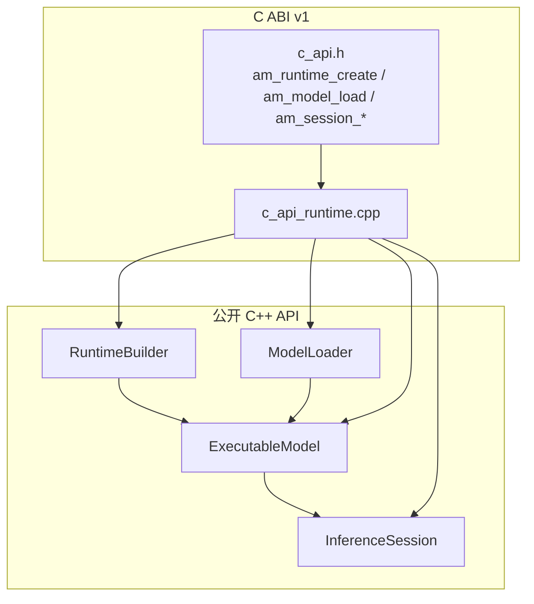
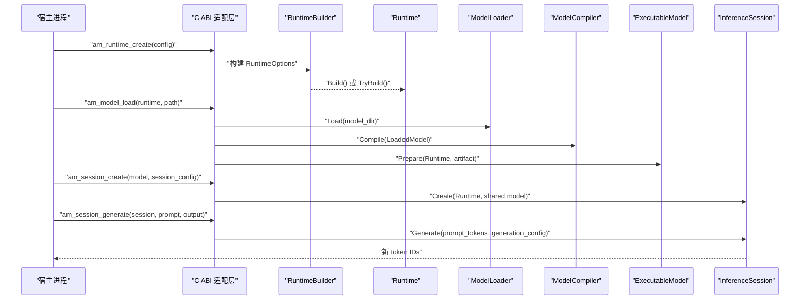
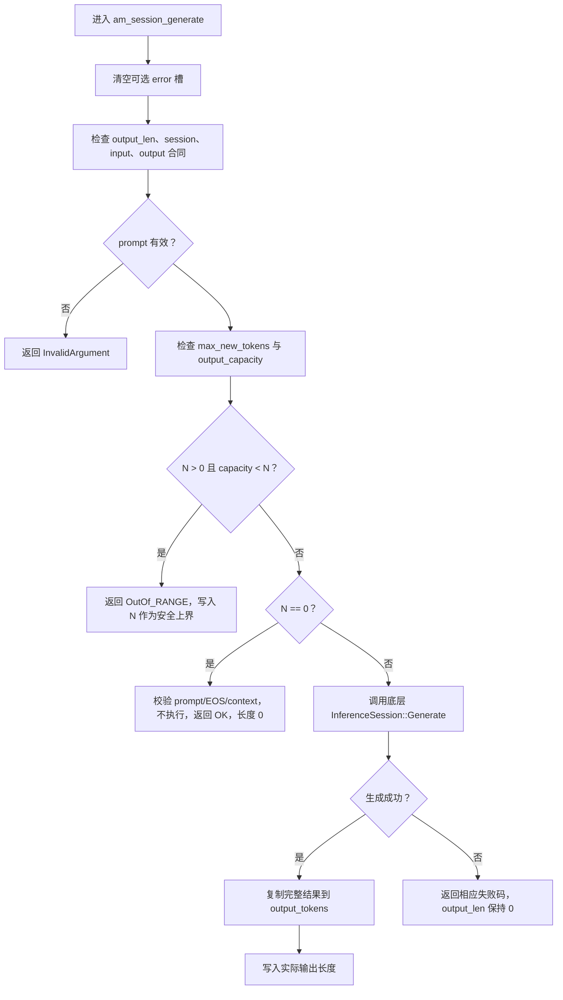
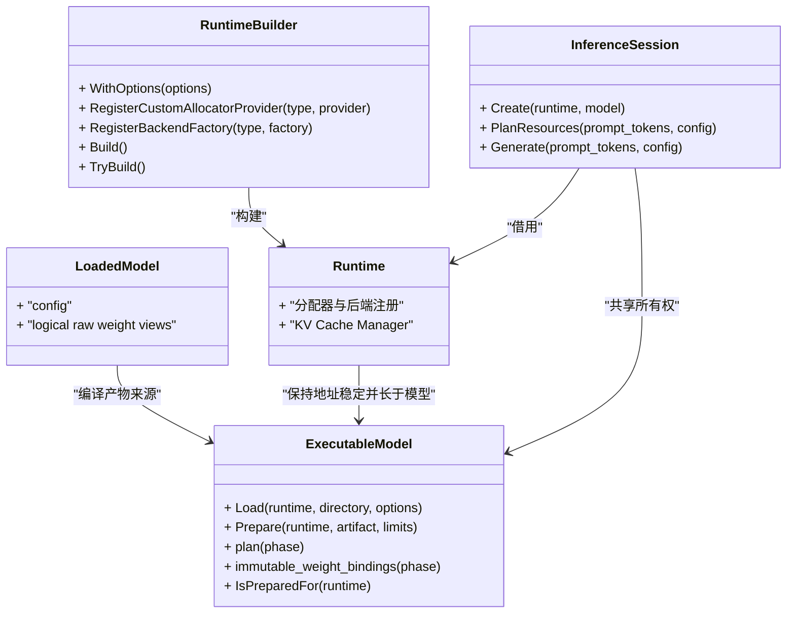
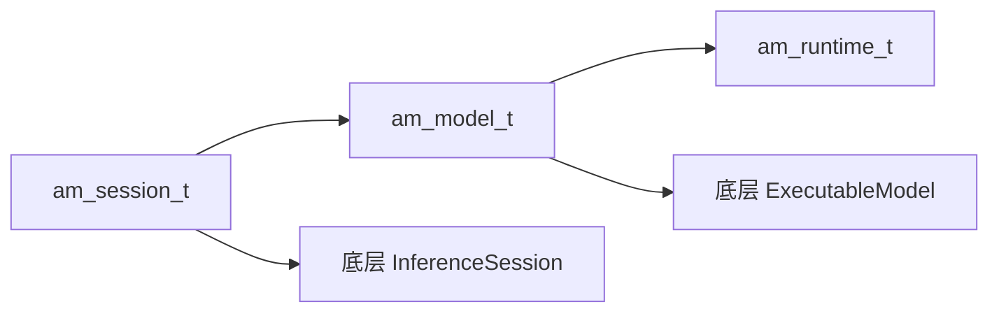
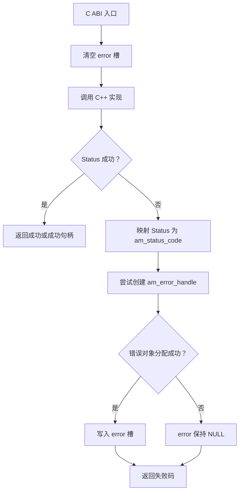

# API 参考文档

**本文引用的文件**
- [include/aethermind/runtime/runtime_builder.h](../../../include/aethermind/runtime/runtime_builder.h)
- [src/runtime/runtime_builder.cpp](../../../src/runtime/runtime_builder.cpp)
- [include/aethermind/model/model_loader.h](../../../include/aethermind/model/model_loader.h)
- [src/model/model_loader.cpp](../../../src/model/model_loader.cpp)
- [include/aethermind/inference/executable_model.h](../../../include/aethermind/inference/executable_model.h)
- [src/inference/executable_model.cpp](../../../src/inference/executable_model.cpp)
- [include/aethermind/inference/inference_session.h](../../../include/aethermind/inference/inference_session.h)
- [src/inference/inference_session.cpp](../../../src/inference/inference_session.cpp)
- [include/c_api.h](../../../include/c_api.h)
- [src/c_api_runtime.cpp](../../../src/c_api_runtime.cpp)
- [docs/api/public-api.md](../../api/public-api.md)
- [docs/api/runtime-c-abi.md](../../api/runtime-c-abi.md)

## 目录
1. [简介](#简介)
2. [项目结构与公开边界](#项目结构与公开边界)
3. [核心组件总览](#核心组件总览)
4. [架构与推理工作流](#架构与推理工作流)
5. [C++ 公开 API 参考](#c-公开-api-参考)
6. [C ABI v1 接口参考](#c-abi-v1-接口参考)
7. [生命周期与所有权管理](#生命周期与所有权管理)
8. [错误处理机制](#错误处理机制)
9. [线程安全与并发模型](#线程安全与并发模型)
10. [版本兼容性与迁移指南](#版本兼容性与迁移指南)
11. [典型代码示例路径](#典型代码示例路径)
12. [故障排查](#故障排查)
13. [结论](#结论)

## 简介
AetherMind 的公开 API 分为两个层次：
- C++ 高层 API：用于构建运行时、加载和准备可执行模型，以及发起同步推理请求。
- C ABI v1：面向 C/C++/跨语言宿主的可冻结调用契约，提供 Runtime、Model、Session 句柄及 `am_session_generate`。

本页串联从模型加载到会话生成的工作流，并汇集使用示例、生命周期和迁移说明。公开方法的签名与调用约束见 [C++ API](../../api/public-api.md#2-c-公开构建块includeaethermind)，C 句柄、结构体布局和输出缓冲区规则见 [Runtime C ABI](../../api/runtime-c-abi.md)。各入口的精度组合见 [产品能力矩阵](../../product.md#14-当前能力与验证状态)。

## 项目结构与公开边界
AetherMind 的公开头集中在 `include/aethermind/`，C ABI 入口在 `include/c_api.h`；实现位于 `src/` 下对应模块。文档中涉及的核心公开头包括：
- 运行时装配：`include/aethermind/runtime/runtime_builder.h`
- 模型加载：`include/aethermind/model/model_loader.h`
- 可执行模型：`include/aethermind/inference/executable_model.h`
- 推理会话：`include/aethermind/inference/inference_session.h`
- C ABI：`include/c_api.h`

**图表来源**
- [include/aethermind/runtime/runtime_builder.h:1-112](../../../include/aethermind/runtime/runtime_builder.h#L1-L112)
- [include/aethermind/model/model_loader.h:1-38](../../../include/aethermind/model/model_loader.h#L1-L38)
- [include/aethermind/inference/executable_model.h:1-183](../../../include/aethermind/inference/executable_model.h#L1-L183)
- [include/aethermind/inference/inference_session.h:1-114](../../../include/aethermind/inference/inference_session.h#L1-L114)
- [include/c_api.h:1-218](../../../include/c_api.h#L1-L218)
- [src/c_api_runtime.cpp:1-200](../../../src/c_api_runtime.cpp#L1-L200)

**章节来源**
- [include/aethermind/runtime/runtime_builder.h:1-112](../../../include/aethermind/runtime/runtime_builder.h#L1-L112)
- [include/aethermind/model/model_loader.h:1-38](../../../include/aethermind/model/model_loader.h#L1-L38)
- [include/aethermind/inference/executable_model.h:1-183](../../../include/aethermind/inference/executable_model.h#L1-L183)
- [include/aethermind/inference/inference_session.h:1-114](../../../include/aethermind/inference/inference_session.h#L1-L114)
- [include/c_api.h:1-218](../../../include/c_api.h#L1-L218)
- [docs/api/public-api.md](../../api/public-api.md)

## 核心组件总览
| 组件 | 职责 | 主要入口 | 关键语义 |
|---|---|---|---|
| `RuntimeBuilder` | 根据选项注册分配器、后端并装配 `Runtime` | `WithOptions`、`RegisterCustomAllocatorProvider`、`RegisterBackendFactory`、`Build`、`TryBuild` | 非线程安全；`Build` 失败中止，`TryBuild` 返回状态；成功消费 pending 注册项 |
| `ModelLoader` | 加载并校验 HuggingFace 模型目录 | `Load` | 无状态门面；仅做 I/O、配置解析、权重逻辑视图；不建图、不 resolve kernel、不预打包 |
| `ExecutableModel` | 将编译产物准备为执行就绪模型 | `Load`、`Prepare`、`plan`、`immutable_weight_bindings` | 可移动不可复制；需保持 Runtime 地址稳定；按 phase 查询 plan/binding |
| `InferenceSession` | 对已准备模型发起同步生成 | `Create`、`PlanResources`、`Generate` | 借用 Runtime，共享 ExecutableModel；所有共享 Runtime 的调用需外部串行化 |
| C ABI v1 | 暴露固定布局的 runtime/model/session 调用 | `am_runtime_create`、`am_model_load`、`am_session_create`、`am_session_generate` | 句柄所有权由宿主管理；错误通过 `am_error_handle` 或返回值报告 |

**章节来源**
- [include/aethermind/runtime/runtime_builder.h:1-112](../../../include/aethermind/runtime/runtime_builder.h#L1-L112)
- [include/aethermind/model/model_loader.h:1-38](../../../include/aethermind/model/model_loader.h#L1-L38)
- [include/aethermind/inference/executable_model.h:1-183](../../../include/aethermind/inference/executable_model.h#L1-L183)
- [include/aethermind/inference/inference_session.h:1-114](../../../include/aethermind/inference/inference_session.h#L1-L114)
- [include/c_api.h:1-218](../../../include/c_api.h#L1-L218)

## 架构与推理工作流
典型推理工作流如下：

**图表来源**
- [include/c_api.h:120-218](../../../include/c_api.h#L120-L218)
- [src/c_api_runtime.cpp:1-200](../../../src/c_api_runtime.cpp#L1-L200)
- [include/aethermind/runtime/runtime_builder.h:35-112](../../../include/aethermind/runtime/runtime_builder.h#L35-L112)
- [include/aethermind/model/model_loader.h:20-38](../../../include/aethermind/model/model_loader.h#L20-L38)
- [include/aethermind/inference/executable_model.h:75-183](../../../include/aethermind/inference/executable_model.h#L75-L183)
- [include/aethermind/inference/inference_session.h:44-114](../../../include/aethermind/inference/inference_session.h#L44-L114)

## C++ 公开 API 参考

### RuntimeBuilder
`RuntimeBuilder` 负责从 `RuntimeOptions` 和自定义提供者注册中装配 `Runtime`。它维护 pending 的自定义分配器和后端工厂，并在 `Build`/`TryBuild` 时消费这些注册。

#### 构造函数与基本规则
- 默认构造：创建空 builder，后续通过链式方法设置选项和注册。
- 拷贝构造/赋值：未声明为 public，应视为不可直接复制替换。
- 移动语义：内部 pending 列表随构建被转移，不应假设重复使用同一 builder 会保留之前注册的 provider/factory。

#### 公共方法

| 方法 | 参数 | 返回值 | 行为与异常 |
|---|---|---|---|
| `WithOptions(const RuntimeOptions& options)` | 要替换的运行时选项 | `RuntimeBuilder&` | 支持链式调用；不影响尚未消费但已存在的 pending 注册 |
| `RegisterCustomAllocatorProvider(DeviceType type, std::unique_ptr<AllocatorProvider> provider)` | 设备类型、分配器提供者（所有权转移） | `RuntimeBuilder&` | 前置条件检查失败时中止；provider 不得为空 |
| `RegisterBackendFactory(DeviceType type, std::unique_ptr<BackendFactory> factory)` | 设备类型、后端工厂（所有权转移） | `RuntimeBuilder&` | 前置条件检查失败时中止；factory 不得为空 |
| `Build()` | 无 | `Runtime` | 装配 AllocatorRegistry、BackendRegistry 和可选 KVCacheManager；初始化失败时中止 |
| `TryBuild()` | 无 | `StatusOr<Runtime>` | 将不支持选项、KV 初始化失败、注册阶段分配失败作为状态返回；诊断 OOM 返回空消息的 `ResourceExhausted` |

#### 生命周期与一致性
- Builder 本身不是线程安全的。
- `Build`/`TryBuild` 成功后会消费 pending 自定义注册；后续再次构建只复用当前选项和新添加的注册。
- `TryBuild` 在开始组装后若失败，pending 列表中只保留从未转移的项；已转移到被丢弃 registry 的注册不可恢复，重试时不会自动重新加入。

#### 复杂度与性能
- 装配是冷路径操作，通常发生在启动期或模型加载前。
- 注册表构建和 KV cache manager 初始化可能触发内存分配；`TryBuild` 能避免抛出异常，但仍可能消耗部分资源。

**章节来源**
- [include/aethermind/runtime/runtime_builder.h:15-112](../../../include/aethermind/runtime/runtime_builder.h#L15-L112)
- [docs/api/public-api.md](../../api/public-api.md)

### ModelLoader
`ModelLoader` 是 HuggingFace 模型目录的 I/O 门面。

#### 静态方法

| 方法 | 参数 | 返回值 | 行为与异常 |
|---|---|---|---|
| `Load(const std::filesystem::path& model_dir)` | HF 模型目录路径 | `StatusOr<std::unique_ptr<LoadedModel>>` | 读取 config、safetensors 元数据并解析逻辑权重视图；不构建图、不 resolve kernel、不预打包权重；所有失败通过 `StatusOr` 返回 |

#### 设计要点
- 无状态类，适合多次调用。
- 输出 `LoadedModel` 拥有配置和已解析权重逻辑视图，但不持有运行时后端状态。
- 适用场景：离线校验、独立加载流程、或先编译再准备模型的调用方。

**章节来源**
- [include/aethermind/model/model_loader.h:1-38](../../../include/aethermind/model/model_loader.h#L1-L38)
- [docs/api/public-api.md](../../api/public-api.md)

### ExecutableModel
`ExecutableModel` 是从编译器产物准备的不可变执行模型。它拥有 compiler artifact、packed weight collection、binding metadata、external tensor bindings 和 execution plan。

#### 构造与所有权
- 构造：私有构造，通过静态 `Load` 或 `Prepare` 创建。
- 移动构造：允许。
- 拷贝构造/赋值：删除。
- 析构：释放成员资源，遵循成员声明顺序反向销毁，确保 plan 和 binding table 在被其借用的 metadata/artifact backing 之前释放。

#### 静态工厂

| 方法 | 参数 | 返回值 | 行为与异常 |
|---|---|---|---|
| `Load(Runtime& runtime, const std::filesystem::path& directory, const ModelLoadOptions& options)` | 运行时、HF 目录、模型加载选项 | `StatusOr<ExecutableModel>` | 加载、按权重策略准入/转换、按 preset 和目标编译、调用 `Prepare`；Runtime 必须保持稳定且长于模型 |
| `Prepare(Runtime& runtime, LoweredModelArtifact artifact, const ModelLimits& limits = {})` | 运行时、已降低的模型产物、限额 | `StatusOr<ExecutableModel>` | 消费 artifact，完成 packed weights、bindings 和执行计划构建；失败不发布部分模型 |

#### 公共查询方法

| 方法 | 参数 | 返回值 | 语义 |
|---|---|---|---|
| `plan(ExecPhase phase)` | 执行阶段 | `StatusOr<const ExecutionPlan*>` | 返回模型拥有的 plan 借用指针；phase 不匹配报错 |
| `immutable_weight_bindings(ExecPhase phase)` | 执行阶段 | `StatusOr<const ExternalTensorBindings*>` | 返回不可变权重绑定；不含请求级 token/position 输入 |
| `artifact_id()` | 无 | `uint64_t` | 返回编译产物身份 |
| `phase()` | 无 | `ExecPhase` | 返回该模型编译的目标阶段 |
| `context_limit()` | 无 | `size_t` | 返回最大上下文长度 |
| `vocab_size()` | 无 | `size_t` | 返回词表大小 |
| `IsPreparedFor(const Runtime& runtime)` | 运行时引用 | `bool` | 判断模型中已解析的 kernel 是否属于该 Runtime |
| `resource_usage()` | 无 | `const ModelResourceUsage&` | 返回准备阶段的保守资源使用统计 |

#### 生命周期约束
- 传给 `Load`/`Prepare` 的 `Runtime` 必须保持地址稳定、不可移动，并且长于 `ExecutableModel`。
- `ExecutableModel` 必须长于从其 plan/bindings 派生的 prepared bindings。
- 底层权重 storage 由模型保活；resolved kernel 所借用的 backend 仍由 Runtime 保活。

#### 复杂度
- `plan` 和 `immutable_weight_bindings` 主要是 phase 校验和借用指针返回，开销低。
- `Load`/`Prepare` 是冷路径，可能触发权重转换、kernel 解析、执行计划构建和大量内存分配。

**章节来源**
- [include/aethermind/inference/executable_model.h:1-183](../../../include/aethermind/inference/executable_model.h#L1-L183)
- [docs/api/public-api.md](../../api/public-api.md)

### InferenceSession
`InferenceSession` 是基于已准备模型的一次同步推理会话。

#### 构造

| 方法 | 参数 | 返回值 | 行为 |
|---|---|---|---|
| `Create(Runtime& runtime, std::shared_ptr<const ExecutableModel> model)` | 运行时、共享模型 | `StatusOr<InferenceSession>` | 验证 plan contract 并创建会话 |
| `Create(Runtime& runtime, std::shared_ptr<const ExecutableModel> model, const InferenceSessionOptions& options)` | 同上，外加每请求负载上限 | `StatusOr<InferenceSession>` | 显式设置 `max_request_payload_bytes` |

#### 公共方法

| 方法 | 参数 | 返回值 | 行为 |
|---|---|---|---|
| `PlanResources(size_t prompt_tokens, const GenerationConfig& config)` | 提示 token 数、生成配置 | `StatusOr<RequestResourceUsage>` | 计算请求所需资源，不预约 KV、不分配 tensor buffer、不执行内核 |
| `Generate(std::span<const uint32_t> prompt_tokens, const GenerationConfig& config)` | 非空提示 token、生成配置 | `StatusOr<std::vector<uint32_t>>` | 返回包含首次 prefill 预测和 EOS 的新 token ID |

#### 生成行为细节
- 空提示无效。
- `max_new_tokens == 0` 返回空向量，不预约 KV 也不执行模型。
- 正数限制下，prefill 预测是第一个生成的 token，因此最多需要 `max_new_tokens - 1` 次 decode KV append。
- 分配失败会向上抛出 `std::bad_alloc`，但在 C ABI 适配层会被映射为 ResourceExhausted。

#### 生命周期
- 会话借用 `Runtime`，并与 `ExecutableModel` 共享所有权。
- 所有共享 `Runtime` 的请求必须外部串行化，即使它们来自不同会话。

**章节来源**
- [include/aethermind/inference/inference_session.h:1-114](../../../include/aethermind/inference/inference_session.h#L1-L114)
- [docs/api/public-api.md](../../api/public-api.md)

## C ABI v1 接口参考

### ABI 版本常量
| 符号 | 含义 | 值或语义 |
|---|---|---|
| `AM_ABI_VERSION_MAJOR` | 主版本 | `1u` |
| `AM_ABI_VERSION_MINOR` | 次版本 | `0u` |
| `AM_ABI_VERSION` | 打包版本 | `(major << 16) \| minor` |
| `AM_CPU_PRESET_O1_PLAIN` | CPU 预设 O1/plain | `0u` |
| `AM_CPU_PRESET_O2_PACKED` | CPU 预设 O2/packed | `1u` |
| `AM_KV_DTYPE_FLOAT32` | KV dtype Float32 | `0u` |

**章节来源**
- [include/c_api.h:70-115](../../../include/c_api.h#L70-L115)
- [docs/api/runtime-c-abi.md](../../api/runtime-c-abi.md)

### 基础对象与错误类型

| 类型/函数 | 用途 | 注意事项 |
|---|---|---|
| `ObjectHandle` | C 视角的对象句柄 | 不用于直接操作 c_api.h 中的 runtime/model/session 句柄 |
| `FObjectDeleter` | 引用计数归零时的删除器 | 由对象头持有 |
| `am_error_handle` | 诊断错误句柄 | 由 `am_error_create` 创建，`am_error_destroy` 释放 |
| `am_status_code` | C 状态码 | 包括 OK、InvalidArgument、ResourceExhausted、Unimplemented、Internal 等 |

**章节来源**
- [include/c_api.h:10-68](../../../include/c_api.h#L10-L68)
- [docs/api/public-api.md](../../api/public-api.md)

### Runtime 接口

| 函数 | 参数 | 返回值 | 行为 |
|---|---|---|---|
| `am_get_abi_version()` | 无 | `uint32_t` | 返回库实现的 ABI 版本，不分配、不抛异常 |
| `am_runtime_create(config, error)` | 配置指针、可选错误槽 | `am_runtime_t` 或 NULL | 创建 CPU Runtime，按固定策略分配静态 FP32 KV；NULL config 返回 InvalidArgument |
| `am_runtime_destroy(runtime)` | 运行时句柄 | 无 | 释放调用方持有的 handle；NULL 为 no-op |

`am_config_t` 固定大小为 48 字节，包含 `struct_size`、`abi_version`、`num_layers`、`num_kv_heads`、`head_dim`、`max_tokens`、`kv_dtype`、`cpu_preset`。首版要求 KV dtype 为 Float32，KV alignment 为 64 字节。

**章节来源**
- [include/c_api.h:115-165](../../../include/c_api.h#L115-L165)
- [docs/api/runtime-c-abi.md](../../api/runtime-c-abi.md)

### Model 接口

| 函数 | 参数 | 返回值 | 行为 |
|---|---|---|---|
| `am_model_load(runtime, path, error)` | 运行时句柄、HF 目录路径、可选错误槽 | `am_model_t` 或 NULL | Load→FP32 准入→Compile→KV 一致性校验→Prepare；失败不发布 partial model |
| `am_model_unload(model)` | 模型句柄 | 无 | 释放调用方持有的 model handle；session 仍可保活资源 |

路径是平台文件系统编码的 NUL 结尾字符串，仅在调用期间借用。

**章节来源**
- [include/c_api.h:165-190](../../../include/c_api.h#L165-L190)
- [docs/api/runtime-c-abi.md](../../api/runtime-c-abi.md)

### Session 接口

| 函数 | 参数 | 返回值 | 行为 |
|---|---|---|---|
| `am_session_create(model, config, error)` | 模型句柄、会话配置、可选错误槽 | `am_session_t` 或 NULL | 复制生成配置，保活 model 和 Runtime |
| `am_session_destroy(session)` | 会话句柄 | 无 | 释放 session 及其 retained owners；NULL 为 no-op |
| `am_session_generate(session, input_tokens, input_len, output_tokens, output_capacity, output_len, error)` | 会话、prompt、输出缓冲区、容量、输出长度槽、错误槽 | `am_status_code` | 返回新 token IDs；短 buffer 返回 OutOfRange 并写安全上界 |

`am_session_config_t` 固定大小为 24 字节，包含 `struct_size`、`abi_version`、`max_new_tokens`、`has_eos_token_id`、`eos_token_id`。`has_eos_token_id` 只能为 0 或 1。

**章节来源**
- [include/c_api.h:190-218](../../../include/c_api.h#L190-L218)
- [docs/api/runtime-c-abi.md](../../api/runtime-c-abi.md)

### Generate 的状态与缓冲区合同

**图表来源**
- [include/c_api.h:190-218](../../../include/c_api.h#L190-L218)
- [docs/api/runtime-c-abi.md](../../api/runtime-c-abi.md)

## 生命周期与所有权管理

### C++ 对象关系

**图表来源**
- [include/aethermind/runtime/runtime_builder.h:15-112](../../../include/aethermind/runtime/runtime_builder.h#L15-L112)
- [include/aethermind/inference/executable_model.h:75-183](../../../include/aethermind/inference/executable_model.h#L75-L183)
- [include/aethermind/inference/inference_session.h:44-114](../../../include/aethermind/inference/inference_session.h#L44-L114)

### C ABI 句柄所有权
- `am_runtime_create` 返回的 runtime 由调用方拥有。
- `am_model_load` 返回的 model 由调用方拥有。
- `am_session_create` 返回的 session 由调用方拥有。
- model 保活 Runtime owner；session 保活 model 及其 Runtime。
- 句柄销毁是单向释放：`am_runtime_destroy`、`am_model_unload`、`am_session_destroy` 各自释放一次调用方持有的 handle。
- 内部销毁顺序是 InferenceSession → ExecutableModel → Runtime，但 C ABI wrapper 的生命周期释放点与底层资源最后释放不一定完全同步。

**图表来源**
- [docs/api/runtime-c-abi.md](../../api/runtime-c-abi.md)
- [src/c_api_runtime.cpp:150-200](../../../src/c_api_runtime.cpp#L150-L200)

**章节来源**
- [docs/api/runtime-c-abi.md](../../api/runtime-c-abi.md)
- [include/c_api.h:115-218](../../../include/c_api.h#L115-L218)

## 错误处理机制

### C++ 错误传播
- `ModelLoader::Load`、`ExecutableModel::Load`、`ExecutableModel::Prepare`、`InferenceSession::Create`、`InferenceSession::Generate` 多使用 `StatusOr<T>`。
- 非法参数通常返回 `InvalidArgument`。
- 几何无法转换为 `size_t` 返回 `OutOfRange`。
- 分配失败通常表现为 `std::bad_alloc`；在 C ABI 适配层被捕获并映射为 `ResourceExhausted`。
- 其他未识别异常被映射为 `Internal`。

### C ABI 错误传播
- 接受 `am_error_handle* error` 的函数在进入后清空槽位，不读取旧值。
- 成功时保持 NULL；失败时尽量创建独立错误对象。
- 错误对象自身 OOM 时不再构造诊断，error 仍为 NULL；此时不能把 NULL 解释为成功。
- `am_error_code(NULL)` 返回 `AM_STATUS_UNKNOWN`。
- `am_error_message(NULL)` 返回非 NULL 空字符串。

**图表来源**
- [include/c_api.h:40-68](../../../include/c_api.h#L40-L68)
- [src/c_api_runtime.cpp:1-120](../../../src/c_api_runtime.cpp#L1-L120)
- [docs/api/runtime-c-abi.md](../../api/runtime-c-abi.md)

**章节来源**
- [include/c_api.h:40-68](../../../include/c_api.h#L40-L68)
- [src/c_api_runtime.cpp:1-120](../../../src/c_api_runtime.cpp#L1-L120)
- [docs/api/runtime-c-abi.md](../../api/runtime-c-abi.md)

## 线程安全与并发模型
- `RuntimeBuilder` 明确声明为非线程安全。
- `ExecutableModel` 明确声明为非线程安全；准备是冷路径，调用方必须串行化并发访问。
- `InferenceSession` 本身可以 move，但所有共享 `Runtime` 的 `Generate` 调用都必须由宿主串行化，包括不同会话之间的调用。
- C ABI 注释也强调：共享 Runtime 的 load/create/generate/destroy 必须由宿主串行化；shared ownership 只保证生命周期，不增加并发执行支持。

**章节来源**
- [include/aethermind/runtime/runtime_builder.h:15-35](../../../include/aethermind/runtime/runtime_builder.h#L15-L35)
- [include/aethermind/inference/executable_model.h:100-140](../../../include/aethermind/inference/executable_model.h#L100-L140)
- [include/aethermind/inference/inference_session.h:60-114](../../../include/aethermind/inference/inference_session.h#L60-L114)
- [docs/api/runtime-c-abi.md](../../api/runtime-c-abi.md)

## 版本兼容性与迁移指南

### C ABI 版本策略
- 当前 ABI 为 v1.0。
- `am_get_abi_version()` 返回 `(major << 16) \| minor`。
- `am_config_t` 和 `am_session_config_t` 都包含 `struct_size` 和 `abi_version`，适配器会校验结构体大小和 ABI major/minor。
- v1.x 保留原始类型、大小、offset、状态码和函数签名；新能力使用另命名的结构或函数，不破坏旧布局。
- major 破坏性变更采用显式 `_v2` 接口命名约定。

### 从直接 C++ 调用迁移到 C ABI
| 维度 | C++ 高层 API | C ABI v1 |
|---|---|---|
| 运行时创建 | `RuntimeBuilder` + `RuntimeOptions` | `am_runtime_create` + `am_config_t` |
| 模型加载 | `ModelLoader::Load` + `ModelCompiler` + `ExecutableModel::Prepare` | `am_model_load` |
| 会话创建 | `InferenceSession::Create` | `am_session_create` + `am_session_config_t` |
| 推理 | `InferenceSession::Generate` | `am_session_generate` |
| 错误 | `StatusOr`、异常 | `am_status_code`、`am_error_handle` |
| 并发 | 调用方串行化 | 调用方串行化 |

### 从 CLI 或高级封装迁移
- CLI 通常保留 CPU strict FP32 语义。
- C adapter 在 `am_model_load` 内执行 Load→FP32 准入→Compile→ValidateRuntimeModelKV→Prepare。
- 如果已有应用直接调用 `ModelLoader`、`ModelCompiler`、`ExecutableModel::Prepare`，迁移到 C ABI 时不需要自己实现 KV 一致性校验；但需要正确设置 `am_config_t` 和 `am_session_config_t`。

### 常见迁移问题
- 忘记设置 `struct_size` 或 `abi_version`：返回 InvalidArgument 或 Unimplemented。
- 传入未知 `cpu_preset` 或 `kv_dtype`：返回 InvalidArgument。
- 使用 GPU/CANN CUDA 配置值：可能生成并 lowering，但不代表具备对应设备推理支持。
- 期望 C ABI 自动 tokenizer/streaming/异步/并发：首版不支持。

**章节来源**
- [include/c_api.h:70-115](../../../include/c_api.h#L70-L115)
- [docs/api/runtime-c-abi.md](../../api/runtime-c-abi.md)
- [docs/api/public-api.md](../../api/public-api.md)

## 典型代码示例路径

由于本仓库没有单一“端到端示例”文件，推荐通过以下路径组合理解完整工作流：

| 步骤 | 推荐查看路径 | 说明 |
|---|---|---|
| 构建 Runtime | [include/aethermind/runtime/runtime_builder.h:15-112](../../../include/aethermind/runtime/runtime_builder.h#L15-L112) | 了解 `RuntimeBuilder` 的选项、注册、Build/TryBuild |
| 加载模型 | [include/aethermind/model/model_loader.h:20-38](../../../include/aethermind/model/model_loader.h#L20-L38) | 了解 HF 目录加载与逻辑权重视图 |
| 准备可执行模型 | [include/aethermind/inference/executable_model.h:75-183](../../../include/aethermind/inference/executable_model.h#L75-L183) | 了解 Load/Prepare、plan、bindings |
| 创建会话并推理 | [include/aethermind/inference/inference_session.h:44-114](../../../include/aethermind/inference/inference_session.h#L44-L114) | 了解 Create、PlanResources、Generate |
| C ABI 完整链路 | [include/c_api.h:115-218](../../../include/c_api.h#L115-L218) | 了解 am_runtime_create/am_model_load/am_session_generate |
| C ABI 实现细节 | [src/c_api_runtime.cpp:1-200](../../../src/c_api_runtime.cpp#L1-L200) | 了解配置复制、错误映射、句柄生命周期 |
| 官方 API 文档 | [docs/api/public-api.md](../../api/public-api.md) | 官方 C++ 与 C ABI 摘要 |
| C ABI 合同 | [docs/api/runtime-c-abi.md](../../api/runtime-c-abi.md) | 版本、布局、所有权、错误、Generate 合同 |

**章节来源**
- [include/aethermind/runtime/runtime_builder.h:15-112](../../../include/aethermind/runtime/runtime_builder.h#L15-L112)
- [include/aethermind/model/model_loader.h:20-38](../../../include/aethermind/model/model_loader.h#L20-L38)
- [include/aethermind/inference/executable_model.h:75-183](../../../include/aethermind/inference/executable_model.h#L75-L183)
- [include/aethermind/inference/inference_session.h:44-114](../../../include/aethermind/inference/inference_session.h#L44-L114)
- [include/c_api.h:115-218](../../../include/c_api.h#L115-L218)
- [src/c_api_runtime.cpp:1-200](../../../src/c_api_runtime.cpp#L1-L200)
- [docs/api/public-api.md](../../api/public-api.md)
- [docs/api/runtime-c-abi.md](../../api/runtime-c-abi.md)

## 故障排查

| 现象 | 可能原因 | 处理建议 |
|---|---|---|
| `am_runtime_create` 返回 NULL | 配置 size 不匹配、ABI version 不受支持、KV dtype 未知、几何无法转为 size_t | 检查 `struct_size`、`abi_version`、`kv_dtype`、`num_layers`、`num_kv_heads`、`head_dim`、`max_tokens` |
| `am_model_load` 返回 NULL | HF 目录无效、权重准入失败、Compile 失败、KV 不一致、Prepare 失败 | 确认模型目录结构；检查 Runtime KV 几何是否与模型一致 |
| `am_session_create` 返回 NULL | 会话配置 size/ABI 不合法、plan contract 失败 | 检查 `am_session_config_t` 字段 |
| `am_session_generate` 返回 OutOfRange | `output_capacity < max_new_tokens` | 为 N 个新 token 分配至少 N 容量的输出缓冲区 |
| `am_session_generate` 输出长度为 0 | 参数错误、执行失败、或 N=0 | 检查 prompt 非空、EOS 配置、context 上限；区分 N=0 合法情况 |
| C++ 侧频繁 ResourceExhausted | 分配失败在 C ABI 中被映射为 ResourceExhausted | 检查 KV capacity、workspace、activation payload 上限 |
| 多线程推理崩溃 | 多个线程同时访问同一个 Runtime | 在宿主层串行化所有共享 Runtime 的调用 |

**章节来源**
- [include/c_api.h:115-218](../../../include/c_api.h#L115-L218)
- [src/c_api_runtime.cpp:1-200](../../../src/c_api_runtime.cpp#L1-L200)
- [docs/api/runtime-c-abi.md](../../api/runtime-c-abi.md)

## 结论
AetherMind 的公开 API 将运行时装配、模型加载、模型准备和推理会话清晰分层：
- `RuntimeBuilder` 负责构建 Runtime。
- `ModelLoader` 负责 HF 模型目录的 I/O 与逻辑权重视图。
- `ExecutableModel` 将编译产物准备为执行就绪模型，并承担严格的 Runtime 生命周期约束。
- `InferenceSession` 提供同步推理接口。
- C ABI v1 提供固定布局、句柄所有权和错误传播的跨语言契约。

对于生产使用者，推荐优先使用 C++ 高层 API；当需要跨语言宿主或稳定 ABI 时，使用 C ABI v1，并严格遵循配置布局、句柄所有权、错误处理和串行化要求。
