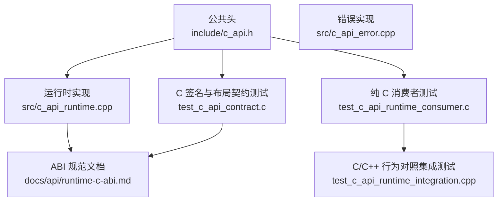
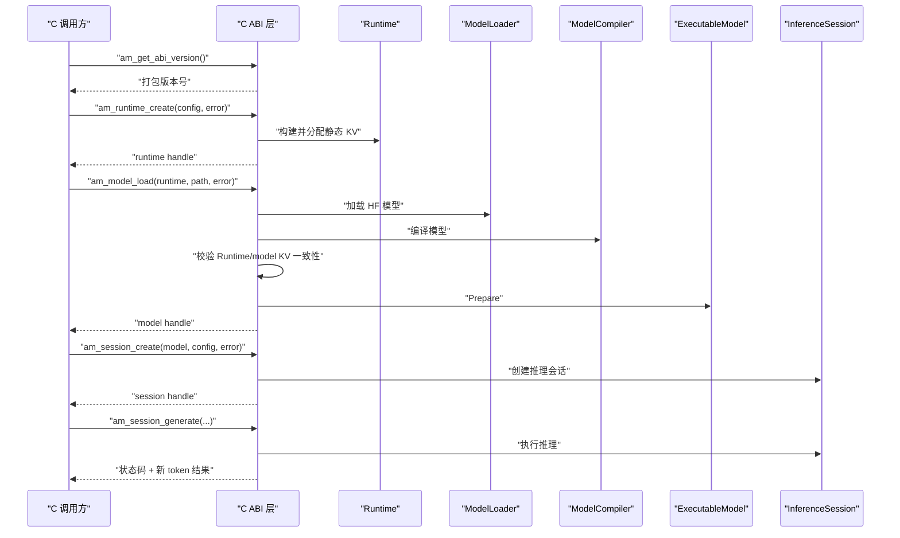
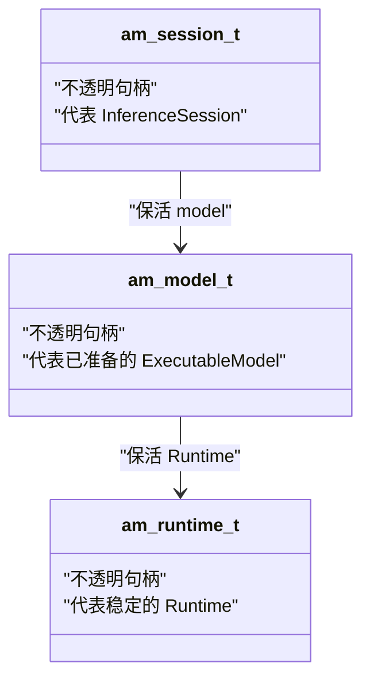
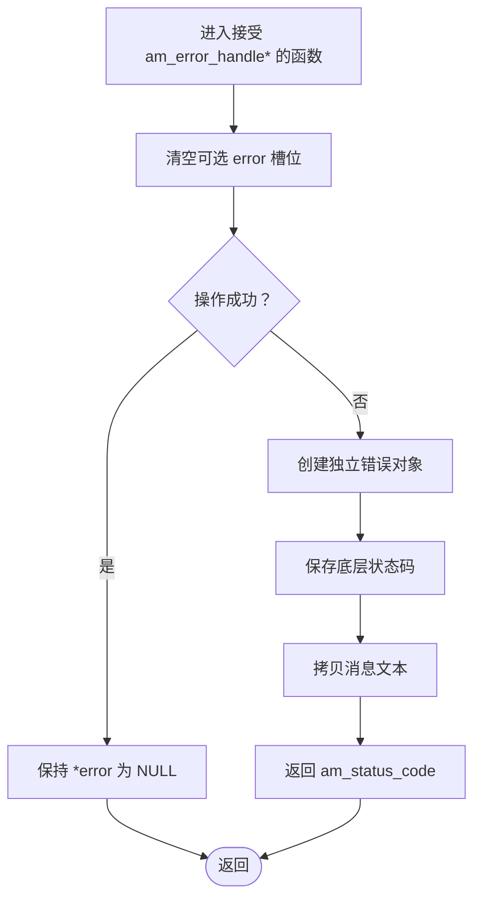
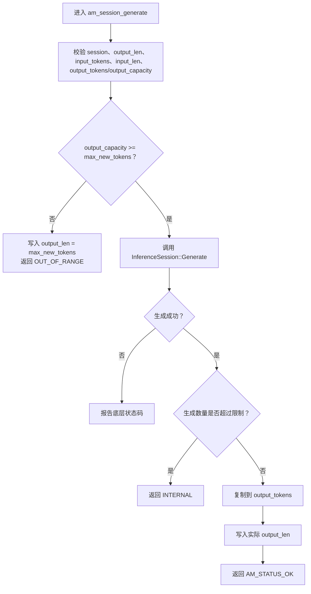
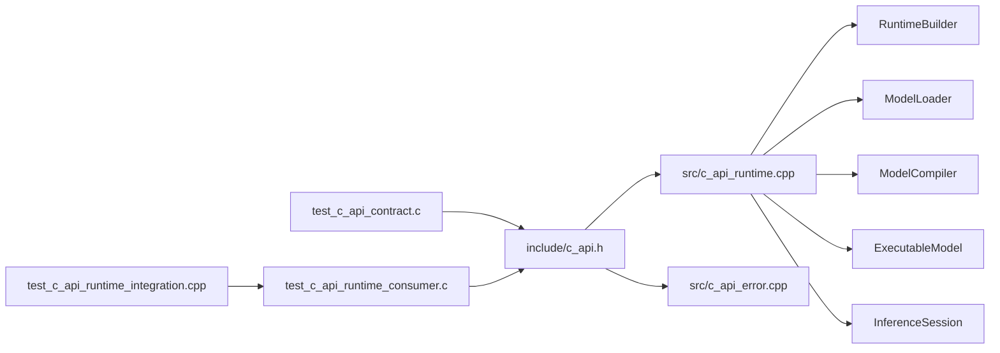

# C ABI 接口

**本文引用的文件**
- [include/c_api.h](../../../include/c_api.h)
- [src/c_api_runtime.cpp](../../../src/c_api_runtime.cpp)
- [src/c_api_error.cpp](../../../src/c_api_error.cpp)
- [docs/api/runtime-c-abi.md](../../api/runtime-c-abi.md)
- [tests/unit/c_api/test_c_api_contract.c](../../../tests/unit/c_api/test_c_api_contract.c)
- [tests/unit/c_api/test_c_api_runtime_consumer.c](../../../tests/unit/c_api/test_c_api_runtime_consumer.c)
- [tests/unit/c_api/test_c_api_runtime_consumer.h](../../../tests/unit/c_api/test_c_api_runtime_consumer.h)
- [tests/unit/c_api/test_c_api_runtime_integration.cpp](../../../tests/unit/c_api/test_c_api_runtime_integration.cpp)

## 目录
1. [引言](#引言)
2. [项目结构](#项目结构)
3. [核心组件](#核心组件)
4. [架构总览](#架构总览)
5. [详细组件分析](#详细组件分析)
6. [依赖关系分析](#依赖关系分析)
7. [性能注意事项](#性能注意事项)
8. [故障排查指南](#故障排查指南)
9. [结论](#结论)
10. [附录：C 语言使用示例与迁移指南](#附录c-语言使用示例与迁移指南)

## 引言
AetherMind C ABI v1 是面向纯 C 调用方的稳定运行时契约，暴露 CPU 推理所需的运行时、模型加载、会话创建和同步生成能力。它不暴露内部 C++ 布局、异常或容器类型，而是通过 opaque 句柄、固定大小配置结构、整型状态码和错误诊断对象进行跨语言交互。

首版交付范围限定为：
- CPU 后端；
- Llama Dense 架构；
- FP32 KV cache；
- 同步单请求；
- greedy 解码；
- 静态 KV 容量；
- Token ID 输入输出；
- O1/plain 与 O2/packed 两种编译预设。

该文档记录所有 C ABI 类型、函数、枚举、常量、句柄所有权、内存约定、缓冲区布局、错误语义、字符串编码、跨平台兼容性要求，以及从 C++ API 迁移时的映射关系和最佳实践。

## 项目结构
C ABI 由公共头、运行时实现、错误实现和测试契约共同构成：

**图表来源**
- [include/c_api.h:1-218](../../../include/c_api.h#L1-L218)
- [src/c_api_runtime.cpp:1-381](../../../src/c_api_runtime.cpp#L1-L381)
- [src/c_api_error.cpp:1-40](../../../src/c_api_error.cpp#L1-L40)
- [docs/api/runtime-c-abi.md](../../api/runtime-c-abi.md)
- [tests/unit/c_api/test_c_api_contract.c:1-78](../../../tests/unit/c_api/test_c_api_contract.c#L1-L78)
- [tests/unit/c_api/test_c_api_runtime_consumer.c:1-102](../../../tests/unit/c_api/test_c_api_runtime_consumer.c#L1-L102)
- [tests/unit/c_api/test_c_api_runtime_integration.cpp:1-200](../../../tests/unit/c_api/test_c_api_runtime_integration.cpp#L1-L200)

**章节来源**
- [include/c_api.h:1-218](../../../include/c_api.h#L1-L218)
- [docs/api/runtime-c-abi.md](../../api/runtime-c-abi.md)

## 核心组件
C ABI v1 的核心组件包括：
- 版本与宏：`AM_ABI_VERSION_MAJOR`、`AM_ABI_VERSION_MINOR`、`AM_ABI_VERSION`、`AM_CPU_PRESET_O1_PLAIN`、`AM_CPU_PRESET_O2_PACKED`、`AM_KV_DTYPE_FLOAT32`。
- 基础类型：`ObjectHandle`、`FObjectDeleter`、`am_status_code`、`am_error_handle`。
- 句柄类型：`am_runtime_t`、`am_model_t`、`am_session_t`。
- 配置结构：`am_config_t`、`am_session_config_t`。
- 生命周期函数：`am_get_abi_version`、`am_runtime_create/destroy`、`am_model_load/unload`、`am_session_create/destroy`、`am_session_generate`。
- 诊断工具：`am_error_create/destroy/code/message`。
- 可选回溯辅助：`AetherMindTraceback`。

其中，`am_runtime_t`、`am_model_t`、`am_session_t` 是不透明指针，不能互换，也不能直接访问内部字段。它们分别代表运行时代理、已准备模型和推理会话。

**章节来源**
- [include/c_api.h:1-218](../../../include/c_api.h#L1-L218)
- [docs/api/runtime-c-abi.md](../../api/runtime-c-abi.md)

## 架构总览
C ABI 的运行时生命周期如下：

**图表来源**
- [src/c_api_runtime.cpp:240-381](../../../src/c_api_runtime.cpp#L240-L381)
- [docs/api/runtime-c-abi.md](../../api/runtime-c-abi.md)

**章节来源**
- [src/c_api_runtime.cpp:240-381](../../../src/c_api_runtime.cpp#L240-L381)
- [docs/api/runtime-c-abi.md](../../api/runtime-c-abi.md)

## 详细组件分析

### 枚举与常量

| 名称 | 类型 | 值 | 含义 |
|---|---|---|---|
| `kBacktraceUpdateModeReplace` | `uint8_t` | `0` | 替换回溯信息 |
| `kBacktraceUpdateModeAppend` | `uint8_t` | `1` | 追加回溯信息 |
| `AM_STATUS_OK` | `am_status_code` | `0` | 成功 |
| `AM_STATUS_CANCELLED` | `am_status_code` | `1` | 取消 |
| `AM_STATUS_UNKNOWN` | `am_status_code` | `2` | 未知错误 |
| `AM_STATUS_INVALID_ARGUMENT` | `am_status_code` | `3` | 无效参数 |
| `AM_STATUS_DEADLINE_EXCEEDED` | `am_status_code` | `4` | 超时 |
| `AM_STATUS_NOT_FOUND` | `am_status_code` | `5` | 未找到 |
| `AM_STATUS_ALREADY_EXISTS` | `am_status_code` | `6` | 已存在 |
| `AM_STATUS_PERMISSION_DENIED` | `am_status_code` | `7` | 权限不足 |
| `AM_STATUS_RESOURCE_EXHAUSTED` | `am_status_code` | `8` | 资源耗尽 |
| `AM_STATUS_FAILED_PRECONDITION` | `am_status_code` | `9` | 前置条件失败 |
| `AM_STATUS_ABORTED` | `am_status_code` | `10` | 中止 |
| `AM_STATUS_OUT_OF_RANGE` | `am_status_code` | `11` | 越界 |
| `AM_STATUS_UNIMPLEMENTED` | `am_status_code` | `12` | 未实现 |
| `AM_STATUS_INTERNAL` | `am_status_code` | `13` | 内部错误 |
| `AM_STATUS_UNAVAILABLE` | `am_status_code` | `14` | 不可用 |
| `AM_STATUS_DATA_LOSS` | `am_status_code` | `15` | 数据丢失 |
| `AM_STATUS_OVERFLOW` | `am_status_code` | `16` | 溢出 |
| `AM_STATUS_UNAUTHENTICATED` | `am_status_code` | `17` | 未认证 |
| `AM_CPU_PRESET_O1_PLAIN` | `uint32_t` | `0` | O1 plain 编译预设 |
| `AM_CPU_PRESET_O2_PACKED` | `uint32_t` | `1` | O2 packed 编译预设 |
| `AM_KV_DTYPE_FLOAT32` | `uint32_t` | `0` | KV cache 数据类型为 FP32 |

这些状态码与宏在 C 和 C++ 中保持一致，并由契约测试验证其数值和结构布局。

**章节来源**
- [include/c_api.h:1-218](../../../include/c_api.h#L1-L218)
- [tests/unit/c_api/test_c_api_contract.c:20-78](../../../tests/unit/c_api/test_c_api_contract.c#L20-L78)

### 数据结构

#### `am_config_t`
用于创建 CPU Runtime。必须零初始化后设置 `struct_size`、`abi_version` 及几何字段。

| 字段 | 类型 | 偏移 | 约束 |
|---|---|---:|---|
| `struct_size` | `uint32_t` | `0` | 必须等于 `48` |
| `abi_version` | `uint32_t` | `4` | major=1，minor 不高于库实现 |
| `num_layers` | `uint64_t` | `8` | 正数，可安全转换为 `size_t` |
| `num_kv_heads` | `uint64_t` | `16` | 同上 |
| `head_dim` | `uint64_t` | `24` | 逻辑 head_dim，正数 |
| `max_tokens` | `uint64_t` | `32` | 静态 KV capacity，正数，可安全转换为 `size_t` |
| `kv_dtype` | `uint32_t` | `40` | 仅允许 `AM_KV_DTYPE_FLOAT32` |
| `cpu_preset` | `uint32_t` | `44` | 仅允许 O1/plain 或 O2/packed |

#### `am_session_config_t`
用于创建推理会话。创建时会按值复制，之后不可变。

| 字段 | 类型 | 偏移 | 约束 |
|---|---|---:|---|
| `struct_size` | `uint32_t` | `0` | 必须等于 `24` |
| `abi_version` | `uint32_t` | `4` | 同 runtime 配置 |
| `max_new_tokens` | `uint64_t` | `8` | 非负，可转换为 `size_t`，元素字节计算不溢出 |
| `has_eos_token_id` | `uint32_t` | `16` | 仅允许 `0` 或 `1` |
| `eos_token_id` | `uint32_t` | `20` | `has_eos_token_id=1` 时启用；值为 `0` 时忽略 |

这两个结构的布局由 C 契约测试中的 `_Static_assert` 强制验证，任何偏移变化都会破坏跨语言 ABI。

**章节来源**
- [include/c_api.h:1-218](../../../include/c_api.h#L1-L218)
- [docs/api/runtime-c-abi.md](../../api/runtime-c-abi.md)
- [tests/unit/c_api/test_c_api_contract.c:41-78](../../../tests/unit/c_api/test_c_api_contract.c#L41-L78)

### 句柄与生命周期

**图表来源**
- [src/c_api_runtime.cpp:140-198](../../../src/c_api_runtime.cpp#L140-L198)

句柄所有权规则如下：
- 每个成功 create/load 返回一个独立 caller-owned 句柄。
- `am_runtime_destroy`、`am_model_unload`、`am_session_destroy` 释放调用方持有的句柄。
- `NULL` 传入销毁函数为 no-op。
- 非空句柄只能释放一次；重复释放属于调用方违约。
- `am_model_t` 保活 `am_runtime_t`。
- `am_session_t` 保活 `am_model_t` 及其 Runtime。
- 外部 `am_runtime_t` 可在 session 使用前 destroy；已创建的 session 仍可完成请求。
- 内部销毁顺序为：`InferenceSession` → `ExecutableModel` → `Runtime`。

**章节来源**
- [src/c_api_runtime.cpp:140-198](../../../src/c_api_runtime.cpp#L140-L198)
- [docs/api/runtime-c-abi.md](../../api/runtime-c-abi.md)

### 错误处理与诊断

**图表来源**
- [src/c_api_runtime.cpp:28-66](../../../src/c_api_runtime.cpp#L28-L66)
- [src/c_api_error.cpp:1-40](../../../src/c_api_error.cpp#L1-L40)

关键规则：
- 所有接受 `am_error_handle* error` 的函数在进入时先将 `*error = NULL`，不读取旧值。
- 成功时保持 `NULL`；失败时尽力创建独立错误对象。
- 错误对象或消息分配失败时不再抛出异常，错误槽仍为 `NULL`。
- `am_error_code(NULL)` 返回 `AM_STATUS_UNKNOWN`。
- `am_error_message(NULL)` 返回非空空字符串。
- `std::bad_alloc` 映射为 `AM_STATUS_RESOURCE_EXHAUSTED`。
- 其他未识别 C++ 异常映射为 `AM_STATUS_INTERNAL`。

**章节来源**
- [src/c_api_runtime.cpp:28-66](../../../src/c_api_runtime.cpp#L28-L66)
- [src/c_api_error.cpp:1-40](../../../src/c_api_error.cpp#L1-L40)
- [docs/api/runtime-c-abi.md](../../api/runtime-c-abi.md)

### 缓冲区布局与 Generate 语义

`am_session_generate` 使用以下参数：
- `input_tokens`：借用输入 token 数组。
- `input_len`：输入长度，必须大于 `0`。
- `output_tokens`：调用方拥有的输出缓冲区。
- `output_capacity`：输出缓冲区容量，单位为 `uint32_t` 元素。
- `output_len`：输出长度，必须由调用方提供。
- `error`：可选错误诊断。

语义流程如下：

**图表来源**
- [src/c_api_runtime.cpp:334-381](../../../src/c_api_runtime.cpp#L334-L381)

重要约定：
- 输出缓冲区以 `uint32_t` 元素为单位。
- 若 `output_capacity < max_new_tokens`，则返回 `AM_STATUS_OUT_OF_RANGE`，并将 `output_len` 写为 `max_new_tokens`；这表示安全容量上界，不是已生成的实际长度。
- `output_tokens == NULL` 且 `output_capacity == 0` 可用于查询所需容量上界，不会执行推理。
- 全部成功后才复制结果；失败时 `output_len` 保持 `0`（如果槽位存在），token 缓冲区内容不变。
- `max_new_tokens == 0` 是合法配置，不执行推理，也不预约 KV，但仍会校验 prompt/EOS/模型上下文。

**章节来源**
- [src/c_api_runtime.cpp:334-381](../../../src/c_api_runtime.cpp#L334-L381)
- [docs/api/runtime-c-abi.md](../../api/runtime-c-abi.md)

### 字符串与路径编码
- `am_model_load` 的 `path` 是 NUL 结尾的平台文件系统路径编码。
- 路径仅在调用期间借用，不复制到内部 C++ 字符串作为持久所有权。
- 错误消息由 `am_error_message` 返回，借用到对应 `am_error_handle` 被销毁。
- 调用方不得假设消息使用 UTF-8 或其他特定编码；应将其视为平台相关文本。

**章节来源**
- [include/c_api.h:120-180](../../../include/c_api.h#L120-L180)
- [docs/api/runtime-c-abi.md](../../api/runtime-c-abi.md)

### 线程与并发
- 共享同一个 `am_runtime_t` 的 load、create、generate、destroy 调用必须由宿主串行化。
- shared ownership 只保证生命周期，不增加并发执行支持。
- 不同 `am_error_handle` 相互独立。

**章节来源**
- [docs/api/runtime-c-abi.md](../../api/runtime-c-abi.md)

## 依赖关系分析

**图表来源**
- [include/c_api.h:1-218](../../../include/c_api.h#L1-L218)
- [src/c_api_runtime.cpp:1-381](../../../src/c_api_runtime.cpp#L1-L381)
- [tests/unit/c_api/test_c_api_contract.c:1-78](../../../tests/unit/c_api/test_c_api_contract.c#L1-L78)
- [tests/unit/c_api/test_c_api_runtime_consumer.c:1-102](../../../tests/unit/c_api/test_c_api_runtime_consumer.c#L1-L102)
- [tests/unit/c_api/test_c_api_runtime_integration.cpp:1-200](../../../tests/unit/c_api/test_c_api_runtime_integration.cpp#L1-L200)

耦合特征：
- C ABI 层对外仅暴露稳定头文件；内部依赖 C++ 运行时、编译器、模型加载器、可执行模型和推理会话。
- 错误对象由独立的错误实现管理，避免将 C++ 异常传播到 C 边界。
- 测试契约保证函数签名、枚举值和结构布局不被意外修改。
- 集成测试将 C 调用链与独立配置的 C++ Session 逐 fixture 比较。

**章节来源**
- [src/c_api_runtime.cpp:1-381](../../../src/c_api_runtime.cpp#L1-L381)
- [tests/unit/c_api/test_c_api_contract.c:1-78](../../../tests/unit/c_api/test_c_api_contract.c#L1-L78)
- [tests/unit/c_api/test_c_api_runtime_integration.cpp:1-200](../../../tests/unit/c_api/test_c_api_runtime_integration.cpp#L1-L200)

## 性能注意事项
- KV cache 容量必须在 `am_config_t.max_tokens` 中显式指定，且首版固定使用 FP32 KV 数据类型。
- 每层 KV state 对齐到 64 字节；`head_dim` 应以逻辑维度填写，而不是 padded 维度。
- 输出缓冲区应至少分配 `max_new_tokens` 个 `uint32_t` 元素，以避免短缓冲查询带来的额外判断成本。
- 不建议采用“先生成再重试”的方式获取精确输出长度；EOS 使实际长度依赖执行过程，C ABI 明确选择基于 `max_new_tokens` 的安全容量上界。
- 复用同一 Runtime 加载多个模型时，`cpu_preset` 由 C adapter 保存并在后续编译中使用，因此应避免频繁重建 Runtime。
- 批量推理应通过调用方侧并发控制，而不是依赖 C ABI 内部并行；当前契约不提供异步或流式接口。

[本节为通用性能建议，不直接分析具体代码行]

## 故障排查指南

常见错误场景与处理建议：

| 现象 | 可能原因 | 推荐处理方式 |
|---|---|---|
| `am_runtime_create` 返回 `NULL` | 配置为空、KV dtype 非法、preset 非法、KV 几何无法转换为 `size_t`、资源不足 | 检查 `struct_size`、`abi_version`、`kv_dtype`、`cpu_preset` 及正数字段 |
| `am_model_load` 返回 `NULL` | 路径为空、权重不符合 FP32 准入策略、编译失败、KV 不一致、Prepare 失败 | 检查模型目录、HF 配置、KV 几何与 preset |
| `am_session_create` 返回 `NULL` | model 为空、session 配置非法 | 检查 model 句柄和 `am_session_config_t` |
| `am_session_generate` 返回 `OUT_OF_RANGE` | `output_capacity < max_new_tokens` | 分配足够大的输出缓冲区，或直接使用 `max_new_tokens` |
| `am_session_generate` 返回 `RESOURCE_EXHAUSTED` | 分配失败 | 减少并发、降低 batch、检查系统内存 |
| `am_session_generate` 返回 `INTERNAL` | 生成数量超出配置上限或未识别异常 | 检查 `max_new_tokens` 与实际生成数量 |
| 错误消息为空但状态码非 OK | 错误对象或消息分配失败 | 根据 `am_error_code` 降级处理，不要假定错误对象一定存在 |
| 多次销毁句柄导致崩溃 | 重复释放或误用伪造句柄 | 销毁后立即置 `NULL`，不信任第三方传递的句柄 |

**章节来源**
- [src/c_api_runtime.cpp:28-66](../../../src/c_api_runtime.cpp#L28-L66)
- [src/c_api_runtime.cpp:240-381](../../../src/c_api_runtime.cpp#L240-L381)
- [src/c_api_error.cpp:1-40](../../../src/c_api_error.cpp#L1-L40)
- [docs/api/runtime-c-abi.md](../../api/runtime-c-abi.md)

## 结论
AetherMind C ABI v1 提供了一个最小但完整的 CPU 推理入口：稳定的版本宏、固定布局的配置结构、不透明句柄、统一的错误契约和明确的缓冲区语义。它牺牲了高级特性以换取跨语言稳定性，适合需要纯 C 集成的进程、脚本绑定外层或嵌入式宿主。

使用时应遵循以下原则：
- 始终先设置正确的 `struct_size` 和 `abi_version`。
- 始终分配至少 `max_new_tokens` 个 `uint32_t` 的输出缓冲区。
- 始终串行化共享 Runtime 上的操作。
- 始终检查返回值和 `am_error_handle`。
- 始终在适当时机销毁句柄，并将销毁后的句柄置空。

[本节为总结性内容，不直接分析具体代码行]

## 附录：C 语言使用示例与迁移指南

### 完整 C 调用流程示例
以下是一个典型的 C 调用流程，展示如何初始化运行时、加载模型、创建会话、执行推理并清理资源：

1. 构造 `am_config_t`：
   - 零初始化。
   - 设置 `struct_size = sizeof(am_config_t)`。
   - 设置 `abi_version = AM_ABI_VERSION`。
   - 设置 `num_layers`、`num_kv_heads`、`head_dim`、`max_tokens`。
   - 设置 `kv_dtype = AM_KV_DTYPE_FLOAT32`。
   - 设置 `cpu_preset = AM_CPU_PRESET_O1_PLAIN` 或 `AM_CPU_PRESET_O2_PACKED`。

2. 构造 `am_session_config_t`：
   - 零初始化。
   - 设置 `struct_size = sizeof(am_session_config_t)`。
   - 设置 `abi_version = AM_ABI_VERSION`。
   - 设置 `max_new_tokens`。
   - 根据需要设置 `has_eos_token_id` 和 `eos_token_id`。

3. 调用 `am_runtime_create` 创建运行时。
4. 调用 `am_model_load` 加载本地 HF 模型目录。
5. 调用 `am_session_create` 创建推理会话。
6. 调用 `am_session_generate` 执行推理。
7. 按需重复调用 `am_session_generate`。
8. 调用 `am_session_destroy`、`am_model_unload`、`am_runtime_destroy` 清理资源。
9. 调用 `am_error_destroy` 清理错误对象。

参考测试中的纯 C 消费者实现，可以看到完整的错误处理、owner 释放标记和结果记录方式。

**章节来源**
- [tests/unit/c_api/test_c_api_runtime_consumer.c:1-102](../../../tests/unit/c_api/test_c_api_runtime_consumer.c#L1-L102)
- [tests/unit/c_api/test_c_api_runtime_smoke.c:1-42](../../../tests/unit/c_api/test_c_api_runtime_smoke.c#L1-L42)

### 与 C++ API 的映射关系

| C ABI 概念 | C++ 对应概念 | 说明 |
|---|---|---|
| `am_runtime_t` | `aethermind::Runtime` | C 句柄封装底层 Runtime；调用方不直接访问 C++ 对象 |
| `am_model_t` | `aethermind::ExecutableModel` | 已完成 Load、Compile、Validate、Prepare 的模型 |
| `am_session_t` | `aethermind::InferenceSession` | 推理会话，持有生成配置和模型引用 |
| `am_config_t` | `RuntimeOptions` + KV cache 配置 | C 端固定布局，内部映射到 C++ RuntimeOptions |
| `am_session_config_t` | `GenerationConfig` | C 端固定布局，内部映射到 C++ 生成配置 |
| `am_session_generate` | `InferenceSession::Generate` | C 包装层负责参数校验、错误转换和结果复制 |
| `am_error_handle` | `aethermind::Status` / C++ 异常 | C 层统一收敛为状态码和可选诊断对象 |

迁移建议：
- 如果已有 C++ 应用，优先使用 C++ API，因为 C ABI 是更保守的适配层。
- 如果需要与纯 C 宿主集成，优先使用 C ABI，避免暴露 STL、异常和 C++ ABI。
- 迁移过程中，应保留对 `struct_size`、`abi_version`、`output_capacity` 和错误对象的校验逻辑。
- 不应假设 C ABI 具备 C++ API 的全部高级功能，例如异步、streaming、多设备或复杂 tokenizer。

**章节来源**
- [src/c_api_runtime.cpp:140-381](../../../src/c_api_runtime.cpp#L140-L381)
- [docs/api/runtime-c-abi.md](../../api/runtime-c-abi.md)

### 内存管理与最佳实践

| 项目 | 规则 |
|---|---|
| 配置结构 | 零初始化后设置 `struct_size` 和 `abi_version`，再填几何字段 |
| 句柄 | 每个成功创建的对象只销毁一次；销毁后置 `NULL` |
| 所有权 | model 保活 runtime；session 保活 model 和 runtime |
| 输出缓冲区 | 调用方拥有并分配；容量至少为 `max_new_tokens` |
| 输入缓冲区 | 调用方拥有，仅被借用 |
| 错误对象 | 由 `am_error_create` 创建，由 `am_error_destroy` 销毁 |
| 路径 | 平台编码，仅借用，不要求 UTF-8 |
| 并发 | 共享 runtime 的操作由宿主串行化 |
| 失败恢复 | 不要假定错误对象一定存在；根据状态码降级处理 |

**章节来源**
- [include/c_api.h:1-218](../../../include/c_api.h#L1-L218)
- [docs/api/runtime-c-abi.md](../../api/runtime-c-abi.md)
