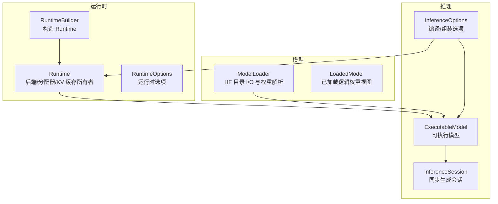
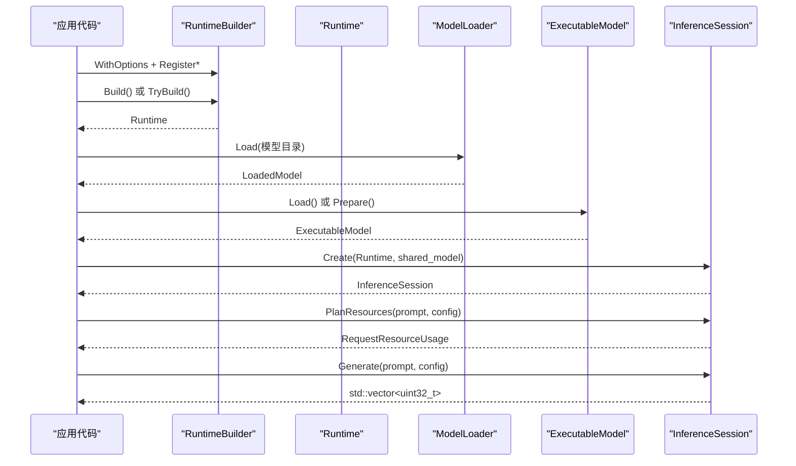
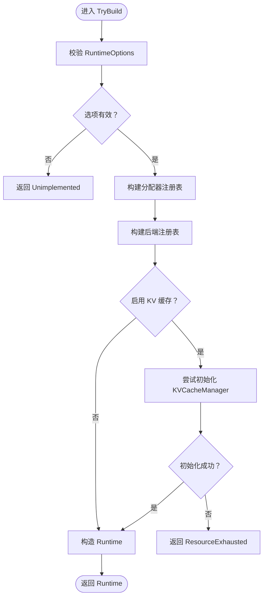
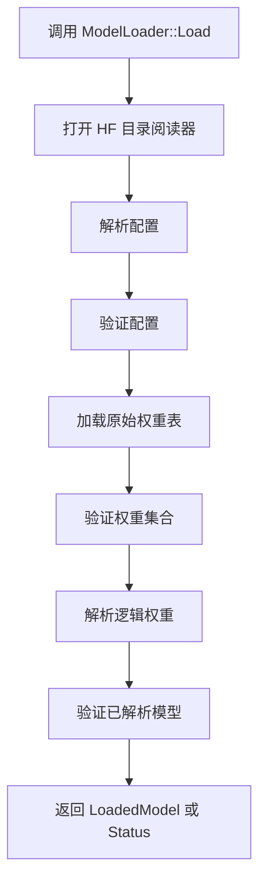
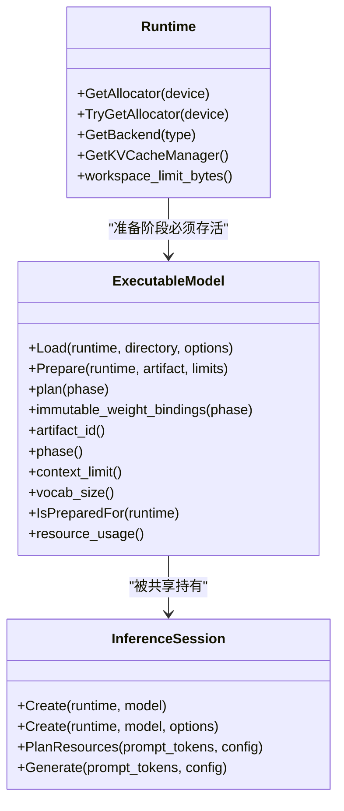
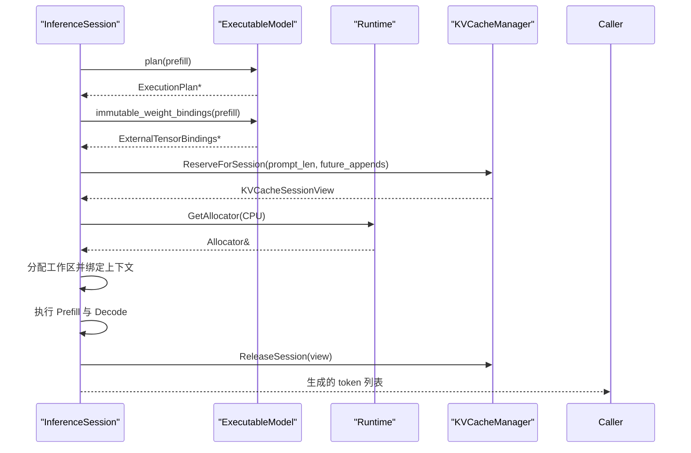
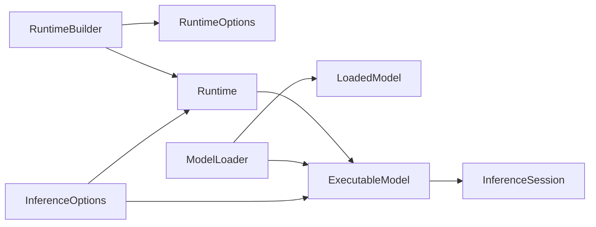

# C++ 公开 API

**本文引用的文件**
- [include/aethermind/runtime/runtime_builder.h](../../../../include/aethermind/runtime/runtime_builder.h)
- [include/aethermind/runtime/runtime.h](../../../../include/aethermind/runtime/runtime.h)
- [include/aethermind/runtime/runtime_options.h](../../../../include/aethermind/runtime/runtime_options.h)
- [src/runtime/runtime_builder.cpp](../../../../src/runtime/runtime_builder.cpp)
- [include/aethermind/model/model_loader.h](../../../../include/aethermind/model/model_loader.h)
- [src/model/model_loader.cpp](../../../../src/model/model_loader.cpp)
- [include/aethermind/inference/executable_model.h](../../../../include/aethermind/inference/executable_model.h)
- [src/inference/executable_model.cpp](../../../../src/inference/executable_model.cpp)
- [include/aethermind/inference/inference_session.h](../../../../include/aethermind/inference/inference_session.h)
- [src/inference/inference_session.cpp](../../../../src/inference/inference_session.cpp)
- [include/aethermind/inference/inference_options.h](../../../../include/aethermind/inference/inference_options.h)
- [apps/inference/inference_runner.h](../../../../apps/inference/inference_runner.h)

## 目录
1. [简介](#简介)
2. [项目结构](#项目结构)
3. [核心组件](#核心组件)
4. [架构总览](#架构总览)
5. [详细组件分析](#详细组件分析)
6. [依赖关系分析](#依赖关系分析)
7. [性能与资源特性](#性能与资源特性)
8. [故障排查指南](#故障排查指南)
9. [最佳实践与常见陷阱](#最佳实践与常见陷阱)
10. [结论](#结论)

## 简介
本文件面向使用 AetherMind C++ 公开 API 的开发者，系统性文档化推理工作流中的核心对象：`RuntimeBuilder`、`Runtime`、`ModelLoader`、`ExecutableModel` 与 `InferenceSession`。内容覆盖类职责、构造函数/工厂方法参数、返回值类型、异常行为、生命周期约束、线程安全约定、错误处理机制以及从构建运行时到执行推理的完整调用序列。同时给出典型使用模式、最佳实践与常见陷阱，帮助读者在正确理解底层契约的前提下稳定集成模型加载与推理流程。

## 项目结构
AetherMind 将运行时装配、模型加载、可执行模型准备与推理会话分别组织在不同命名空间与模块中。与本次文档直接相关的头文件和实现位于以下路径：

**图示来源**
- [include/aethermind/runtime/runtime_builder.h:1-112](../../../../include/aethermind/runtime/runtime_builder.h#L1-L112)
- [include/aethermind/runtime/runtime.h:1-127](../../../../include/aethermind/runtime/runtime.h#L1-L127)
- [include/aethermind/runtime/runtime_options.h:1-69](../../../../include/aethermind/runtime/runtime_options.h#L1-L69)
- [include/aethermind/model/model_loader.h:1-38](../../../../include/aethermind/model/model_loader.h#L1-L38)
- [include/aethermind/inference/executable_model.h:1-183](../../../../include/aethermind/inference/executable_model.h#L1-L183)
- [include/aethermind/inference/inference_session.h:1-114](../../../../include/aethermind/inference/inference_session.h#L1-L114)
- [include/aethermind/inference/inference_options.h:1-61](../../../../include/aethermind/inference/inference_options.h#L1-L61)

**章节来源**
- [include/aethermind/runtime/runtime_builder.h:1-112](../../../../include/aethermind/runtime/runtime_builder.h#L1-L112)
- [include/aethermind/runtime/runtime.h:1-127](../../../../include/aethermind/runtime/runtime.h#L1-L127)
- [include/aethermind/runtime/runtime_options.h:1-69](../../../../include/aethermind/runtime/runtime_options.h#L1-L69)
- [include/aethermind/model/model_loader.h:1-38](../../../../include/aethermind/model/model_loader.h#L1-L38)
- [include/aethermind/inference/executable_model.h:1-183](../../../../include/aethermind/inference/executable_model.h#L1-L183)
- [include/aethermind/inference/inference_session.h:1-114](../../../../include/aethermind/inference/inference_session.h#L1-L114)
- [include/aethermind/inference/inference_options.h:1-61](../../../../include/aethermind/inference/inference_options.h#L1-L61)

## 核心组件
本节按典型推理顺序说明核心类的职责与边界。

### RuntimeBuilder：运行时装配器
- 职责：根据 `RuntimeOptions` 和可选的自定义分配器提供者、后端工厂，装配出 `Runtime`。
- 线程安全：明确声明为非线程安全；并发访问应由调用方序列化。
- 关键方法：
  - `WithOptions(options)`：替换后续 `Build()` 使用的配置，返回引用以支持链式调用。
  - `RegisterCustomAllocatorProvider(type, provider)`：注册设备级分配器提供者，所有权转移给 builder。
  - `RegisterBackendFactory(type, factory)`：注册设备级后端工厂，所有权转移给 builder。
  - `Build()`：抛出或中止失败；成功返回拥有全部资源的 `Runtime`。
  - `TryBuild()`：不中止失败，返回 `StatusOr<Runtime>`；未支持选项返回 `Unimplemented`；分配失败返回空消息的 `ResourceExhausted`。
- 内部行为要点：
  - 校验选项是否启用未实现的执行/工作区/追踪能力。
  - 若启用 CUDA/CANN 后端但未注册对应自定义工厂，返回 `Unimplemented`。
  - KV 缓存管理器仅在启用时创建，并基于配置的分配器初始化平面内存。

**章节来源**
- [include/aethermind/runtime/runtime_builder.h:1-112](../../../../include/aethermind/runtime/runtime_builder.h#L1-L112)
- [src/runtime/runtime_builder.cpp:1-200](../../../../src/runtime/runtime_builder.cpp#L1-L200)

### Runtime：长期运行环境
- 职责：持有后端注册表、分配器注册表、KV 缓存管理器与工作区限制，是计划、会话与内核执行的长期宿主。
- 线程安全：非线程安全；并发访问需外部序列化。
- 关键方法：
  - `GetAllocator(device)` / `TryGetAllocator(device)`：获取设备分配器；前者缺失提供者时中止，后者返回状态。
  - `HasAllocatorProvider(type)`：检查是否存在分配器提供者。
  - `GetBackend(type)`：按需创建并缓存后端；无工厂或创建失败返回状态。
  - `workspace_limit_bytes()`：返回请求工作区负载上限，零表示无限制。
  - `GetKVCacheManager()`：返回 KV 缓存管理器指针或空指针；对管理器的所有读写和执行调用都必须外部序列化。
- 生命周期：必须由 `RuntimeBuilder` 创建；必须晚于所有通过其后端解析的执行计划及会话被销毁。

**章节来源**
- [include/aethermind/runtime/runtime.h:1-127](../../../../include/aethermind/runtime/runtime.h#L1-L127)
- [src/runtime/runtime_builder.cpp:1-200](../../../../src/runtime/runtime_builder.cpp#L1-L200)

### ModelLoader：HuggingFace 模型加载门面
- 职责：仅负责目录 I/O、配置解析、权重集合校验与逻辑权重解析；不负责图构建、内核解析或权重预打包。
- 接口：静态方法 `Load(model_dir)`，返回 `StatusOr<std::unique_ptr<LoadedModel>>`。
- 错误语义：所有失败通过 `StatusOr` 返回，包括目录读取、配置解析、权重验证与权重解析阶段。

**章节来源**
- [include/aethermind/model/model_loader.h:1-38](../../../../include/aethermind/model/model_loader.h#L1-L38)
- [src/model/model_loader.cpp:1-43](../../../../src/model/model_loader.cpp#L1-L43)

### ExecutableModel：可执行模型
- 职责：封装编译产物、原始权重支撑、打包权重、不可变绑定表、执行计划与元数据；供 `InferenceSession` 专用化并执行。
- 生命周期约束（最重要）：
  - 构造它的 `Runtime` 必须保持地址稳定且不被移动，且必须早于该模型销毁。
  - 模型必须早于由其 `ExecutionPlan` 构造出的任何 `PreparedExecutionBindings` 销毁。
  - 成员销毁顺序为逆序，确保先释放计划与绑定表，再释放它们借用的元数据和工件支撑。
- 构造方式：
  - `Load(runtime, directory, options)`：一次性加载并准备目标模型；会先转换源权重，再构建图。
  - `Prepare(runtime, artifact, limits)`：消费已编译工件并准备可执行模型；不会转换源权重。
- 查询接口：
  - `plan(phase)`：返回指定阶段的执行计划引用或阶段不匹配错误。
  - `immutable_weight_bindings(phase)`：返回不可变权重与常量绑定引用。
  - `artifact_id()` / `phase()` / `context_limit()` / `vocab_size()` / `IsPreparedFor(runtime)` / `resource_usage()`。
- 线程安全：准备阶段为冷路径操作；并发访问必须串行化。

**章节来源**
- [include/aethermind/inference/executable_model.h:1-183](../../../../include/aethermind/inference/executable_model.h#L1-L183)
- [src/inference/executable_model.cpp:1-200](../../../../src/inference/executable_model.cpp#L1-L200)

### InferenceSession：同步推理会话
- 职责：围绕一个已准备的 `ExecutableModel` 进行单请求同步推理，完成 Prefill 与 Decode 调度，管理 KV 预留与工作区。
- 构造方式：
  - `Create(runtime, model)`：使用默认每请求负载限制。
  - `Create(runtime, model, options)`：显式设置每请求最大负载字节数。
- 查询接口：
  - `PlanResources(prompt_tokens, config)`：在不预留 KV、不分配 Tensor Buffer 的情况下报告需求；仍可能分配控制向量。
- 执行接口：
  - `Generate(prompt_tokens, config)`：生成 token 列表，包含首次 Prefill 预测结果和 EOS（若产生）。
- 线程安全：共享同一 `Runtime` 的所有 `Generate` 调用必须外部序列化，即使它们属于不同会话。每次调用结束后都会释放 KV 预留。

**章节来源**
- [include/aethermind/inference/inference_session.h:1-114](../../../../include/aethermind/inference/inference_session.h#L1-L114)
- [src/inference/inference_session.cpp:1-200](../../../../src/inference/inference_session.cpp#L1-L200)

## 架构总览
下图展示从构建运行时、加载模型、准备可执行模型到执行推理的核心交互。

**图示来源**
- [include/aethermind/runtime/runtime_builder.h:1-112](../../../../include/aethermind/runtime/runtime_builder.h#L1-L112)
- [include/aethermind/model/model_loader.h:1-38](../../../../include/aethermind/model/model_loader.h#L1-L38)
- [include/aethermind/inference/executable_model.h:1-183](../../../../include/aethermind/inference/executable_model.h#L1-L183)
- [include/aethermind/inference/inference_session.h:1-114](../../../../include/aethermind/inference/inference_session.h#L1-L114)

## 详细组件分析

### RuntimeBuilder 接口与行为
- `WithOptions(const RuntimeOptions& options)`
  - 作用：替换 builder 当前配置。
  - 返回值：`RuntimeBuilder&`，用于链式调用。
- `RegisterCustomAllocatorProvider(DeviceType type, std::unique_ptr<AllocatorProvider> provider)`
  - 前置条件：`type` 不能为 `kUndefined`，`provider` 非空。
  - 行为：所有权转移；违反前置条件会中止。
- `RegisterBackendFactory(DeviceType type, std::unique_ptr<BackendFactory> factory)`
  - 前置条件：同上。
  - 行为：所有权转移；违反前置条件会中止。
- `Build()`
  - 行为：调用内部 `TryBuild()`；失败则中止。
  - 返回值：`Runtime`，拥有所有创建的资源。
- `TryBuild()`
  - 行为：校验选项、构建分配器注册表、后端注册表、KV 缓存管理器。
  - 返回值：
    - 成功：`Runtime`。
    - 不支持选项：`Unimplemented`。
    - 分配失败：`ResourceExhausted`，消息为空。
    - KV 初始化失败：`ResourceExhausted`。
  - 注意：部分构建失败时会丢弃中间注册的键值，已转移出去的登记项不可恢复。

**图示来源**
- [src/runtime/runtime_builder.cpp:1-200](../../../../src/runtime/runtime_builder.cpp#L1-L200)

**章节来源**
- [include/aethermind/runtime/runtime_builder.h:1-112](../../../../include/aethermind/runtime/runtime_builder.h#L1-L112)
- [src/runtime/runtime_builder.cpp:1-200](../../../../src/runtime/runtime_builder.cpp#L1-L200)

### Runtime 接口与资源边界
- `GetAllocator(Device device)`
  - 返回引用；若无提供者则中止。
- `TryGetAllocator(Device device)`
  - 返回指针或状态；适合需要传播错误的场景。
- `HasAllocatorProvider(DeviceType type)`
  - 布尔查询，无副作用。
- `GetBackend(DeviceType type)`
  - 懒创建并缓存后端；无工厂或创建失败返回状态。
- `workspace_limit_bytes()`
  - 只读查询；零表示无限制。
- `GetKVCacheManager()`
  - 返回可空指针；所有管理器写入、读取以及通过借用视图执行的 `Execute` 必须外部序列化。

**章节来源**
- [include/aethermind/runtime/runtime.h:1-127](../../../../include/aethermind/runtime/runtime.h#L1-L127)

### ModelLoader 接口与错误路径
- `static Load(std::filesystem::path model_dir)`
  - 步骤：打开目录阅读器 → 解析配置 → 验证配置 → 加载原始权重表 → 验证权重集 → 解析权重 → 构造 `LoadedModel`。
  - 任一阶段失败均返回相应 `Status`。

**图示来源**
- [src/model/model_loader.cpp:1-43](../../../../src/model/model_loader.cpp#L1-L43)

**章节来源**
- [include/aethermind/model/model_loader.h:1-38](../../../../include/aethermind/model/model_loader.h#L1-L38)
- [src/model/model_loader.cpp:1-43](../../../../src/model/model_loader.cpp#L1-L43)

### ExecutableModel 接口与生命周期契约
- `Load(Runtime&, std::filesystem::path, ModelLoadOptions)`
  - 用途：为目标平台加载模型，执行源权重转换与图构建。
  - 约束：`Runtime` 地址必须稳定且生命周期更长。
- `Prepare(Runtime&, LoweredModelArtifact, ModelLimits)`
  - 用途：消费已编译工件并准备可执行模型。
  - 约束：不会转换源权重；仍需稳定的 `Runtime`。
- `plan(ExecPhase)` / `immutable_weight_bindings(ExecPhase)`
  - 返回借用对象；阶段不匹配会返回错误。
- `artifact_id()` / `phase()` / `context_limit()` / `vocab_size()` / `IsPreparedFor(Runtime&)` / `resource_usage()`
  - 提供元数据与兼容性查询。
- 生命周期契约：
  - `Runtime` 必须保持地址稳定、不被移动，且早于模型销毁。
  - 模型必须早于所有由计划创建的 `PreparedExecutionBindings` 销毁。
  - 成员声明顺序即析构顺序：计划与绑定表先释放，再释放元数据与工件支撑。

**图示来源**
- [include/aethermind/runtime/runtime.h:1-127](../../../../include/aethermind/runtime/runtime.h#L1-L127)
- [include/aethermind/inference/executable_model.h:1-183](../../../../include/aethermind/inference/executable_model.h#L1-L183)
- [include/aethermind/inference/inference_session.h:1-114](../../../../include/aethermind/inference/inference_session.h#L1-L114)

**章节来源**
- [include/aethermind/inference/executable_model.h:1-183](../../../../include/aethermind/inference/executable_model.h#L1-L183)
- [src/inference/executable_model.cpp:1-200](../../../../src/inference/executable_model.cpp#L1-L200)

### InferenceSession 接口与推理流程
- `Create(Runtime&, std::shared_ptr<const ExecutableModel>)`
- `Create(Runtime&, std::shared_ptr<const ExecutableModel>, InferenceSessionOptions)`
- `PlanResources(size_t prompt_tokens, GenerationConfig)`
  - 不预留 KV、不分配 Tensor Buffer，但可能分配控制向量。
- `Generate(std::span<const uint32_t> prompt_tokens, GenerationConfig)`
  - 返回生成的 token ID 列表；空提示无效；零 token 限制返回空向量且不执行模型。
  - 异常传播：`std::bad_alloc` 会被转换为空消息的 `ResourceExhausted`，以避免进一步分配。

**图示来源**
- [src/inference/inference_session.cpp:1-200](../../../../src/inference/inference_session.cpp#L1-L200)
- [include/aethermind/inference/inference_session.h:1-114](../../../../include/aethermind/inference/inference_session.h#L1-L114)

**章节来源**
- [include/aethermind/inference/inference_session.h:1-114](../../../../include/aethermind/inference/inference_session.h#L1-L114)
- [src/inference/inference_session.cpp:1-200](../../../../src/inference/inference_session.cpp#L1-L200)

## 依赖关系分析
下图描述公开 API 之间的高层依赖方向。

**图示来源**
- [include/aethermind/runtime/runtime_builder.h:1-112](../../../../include/aethermind/runtime/runtime_builder.h#L1-L112)
- [include/aethermind/runtime/runtime_options.h:1-69](../../../../include/aethermind/runtime/runtime_options.h#L1-L69)
- [include/aethermind/model/model_loader.h:1-38](../../../../include/aethermind/model/model_loader.h#L1-L38)
- [include/aethermind/inference/executable_model.h:1-183](../../../../include/aethermind/inference/executable_model.h#L1-L183)
- [include/aethermind/inference/inference_session.h:1-114](../../../../include/aethermind/inference/inference_session.h#L1-L114)
- [include/aethermind/inference/inference_options.h:1-61](../../../../include/aethermind/inference/inference_options.h#L1-L61)

**章节来源**
- [include/aethermind/runtime/runtime_builder.h:1-112](../../../../include/aethermind/runtime/runtime_builder.h#L1-L112)
- [include/aethermind/runtime/runtime_options.h:1-69](../../../../include/aethermind/runtime/runtime_options.h#L1-L69)
- [include/aethermind/model/model_loader.h:1-38](../../../../include/aethermind/model/model_loader.h#L1-L38)
- [include/aethermind/inference/executable_model.h:1-183](../../../../include/aethermind/inference/executable_model.h#L1-L183)
- [include/aethermind/inference/inference_session.h:1-114](../../../../include/aethermind/inference/inference_session.h#L1-L114)
- [include/aethermind/inference/inference_options.h:1-61](../../../../include/aethermind/inference/inference_options.h#L1-L61)

## 性能与资源特性
- 运行时装配成本集中在 `RuntimeBuilder::Build/TryBuild`，包括注册表构建与 KV 缓存初始化。
- 模型准备成本集中在 `ExecutableModel::Load/Prepare`，涉及权重解析、布局规划、内核解析与绑定表构建。
- 推理会话成本分布在：
  - `PlanResources`：冷路径元数据与控制向量分配。
  - `Generate`：KV 预留、工作区分配、上下文绑定与执行。
- 资源上限：
  - `RuntimeOptions.workspace.default_workspace_limit_bytes`：请求工作区负载上限，零表示无限制。
  - `ModelLimits.max_model_payload_bytes` / `max_packed_weight_bytes`：模型载荷与打包权重上限。
  - `InferenceSessionOptions.max_request_payload_bytes`：单请求负载上限。
  - `KVCacheRuntimeOptions.max_bytes`：KV 平面载荷上限，含布局填充。
- 线程模型：
  - `RuntimeBuilder`、`Runtime`、`ExecutableModel` 准备过程均非线程安全。
  - 共享同一 `Runtime` 的多个 `InferenceSession::Generate` 调用必须外部序列化。
  - KV 管理器不允许内部锁保护，必须由调用方保证写入、读取与执行调用的串行性。

[本节为通用性能讨论，不直接分析具体文件]

## 故障排查指南
- 构建失败
  - 检查是否启用了尚未支持的执行、工作区或追踪选项；这些情况会返回 `Unimplemented`。
  - 启用 CUDA/CANN 后端时必须注册对应自定义后端工厂。
  - 分配失败会返回空消息的 `ResourceExhausted`，避免二次分配掩盖真实原因。
- KV 缓存失败
  - 检查层数、头数、最大 token、维度、dtype 与对齐是否合理。
  - 若 `max_bytes` 小于所需字节数，会返回 `ResourceExhausted`。
- 模型加载失败
  - 确认 HuggingFace 目录包含有效配置与 safetensors。
  - 关注配置验证、权重集合验证与权重解析阶段的状态。
- 可执行模型准备失败
  - 检查阶段一致性：编译产物不得混合执行阶段。
  - 检查常量内联数据大小是否与形状和数据类型一致。
  - 检查权重是否连续、角色是否可解析。
- 推理失败
  - 空提示或 token/position 输入长度不一致会返回 `InvalidArgument`。
  - 工作区对齐无效会返回 `InvalidArgument`。
  - 分配失败统一转换为空消息的 `ResourceExhausted`。

**章节来源**
- [src/runtime/runtime_builder.cpp:1-200](../../../../src/runtime/runtime_builder.cpp#L1-L200)
- [src/model/model_loader.cpp:1-43](../../../../src/model/model_loader.cpp#L1-L43)
- [src/inference/executable_model.cpp:1-200](../../../../src/inference/executable_model.cpp#L1-L200)
- [src/inference/inference_session.cpp:1-200](../../../../src/inference/inference_session.cpp#L1-L200)

## 最佳实践与常见陷阱
- 优先使用 `TryBuild()` 而非 `Build()`，以便区分未支持选项与分配失败。
- 始终将 `Runtime` 作为进程或长生命周期服务对象持有，并确保其地址在整个模型准备与会话期间稳定。
- 使用 `std::shared_ptr<const ExecutableModel>` 传递模型，避免复制；`ExecutableModel` 本身不可复制。
- 不要跨线程并发调用 `Runtime`、`ExecutableModel` 准备方法与 `InferenceSession::Generate`。
- 合理设置 KV 缓存大小与 dtype；FP32 KV 更保守，F16/BF16 可节省内存但需匹配策略。
- 使用 `PlanResources` 预先估算请求资源，避免在热路径上因预算不足而失败。
- 注意零限制的含义：大多数“零”表示无限制，而不是禁用功能。
- 当需要自定义 GPU/CANN 后端或分配器时，必须在构建前注册工厂与提供者。
- 不要在 `TryBuild` 开始组装后重试同一批 pending 注册；已转移的登记项不可恢复。

[本节为通用指导，不直接分析具体文件]

## 结论
AetherMind 的 C++ 公开 API 围绕五个核心对象组织推理生命周期：`RuntimeBuilder` 装配运行时，`Runtime` 托管后端与资源，`ModelLoader` 加载 HuggingFace 模型，`ExecutableModel` 准备可执行模型，`InferenceSession` 执行同步推理。正确使用这些对象的关键在于严格遵循生命周期约束、线程安全约定与资源上限语义。推荐实践是先通过 `RuntimeBuilder` 构建 `Runtime`，再用 `ModelLoader` 加载模型并通过 `ExecutableModel::Load` 或 `Prepare` 准备模型，最后用 `InferenceSession` 完成推理。对于生产系统，应优先采用 `TryBuild`、显式资源预算、外部序列化与清晰的错误分类策略。

[本节为总结性内容，不直接分析具体文件]
