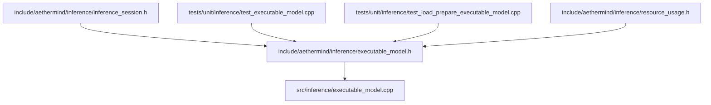
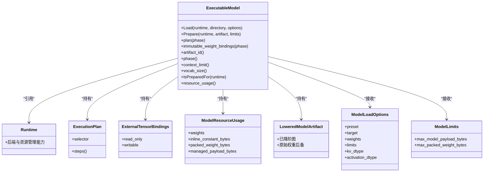
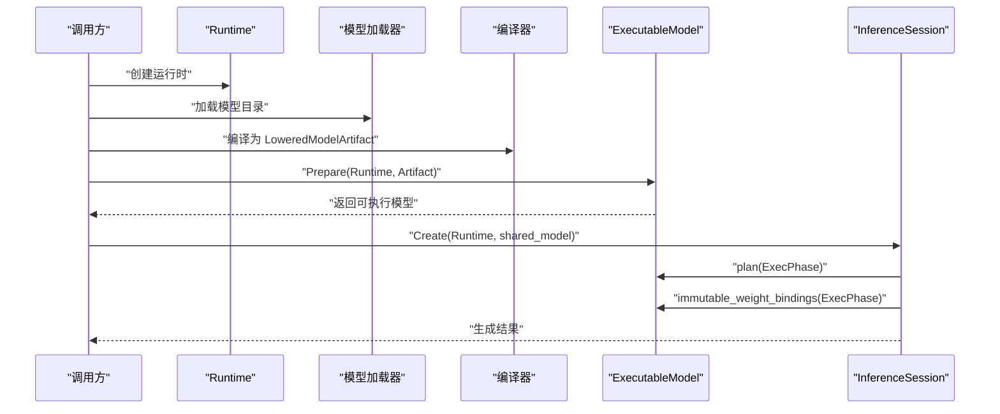
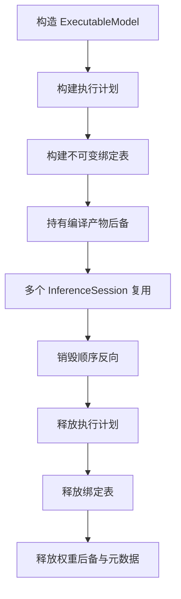
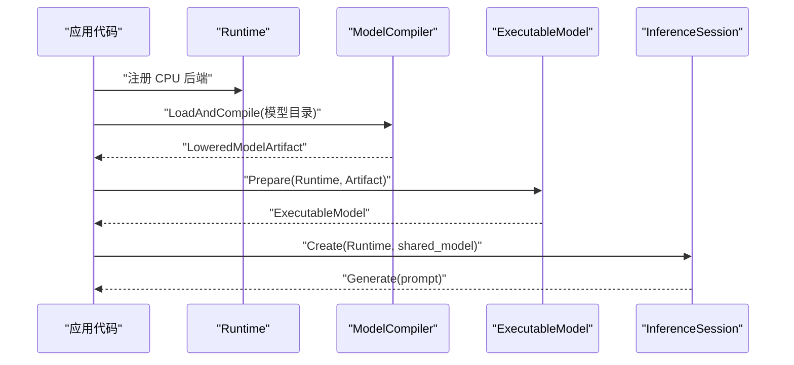
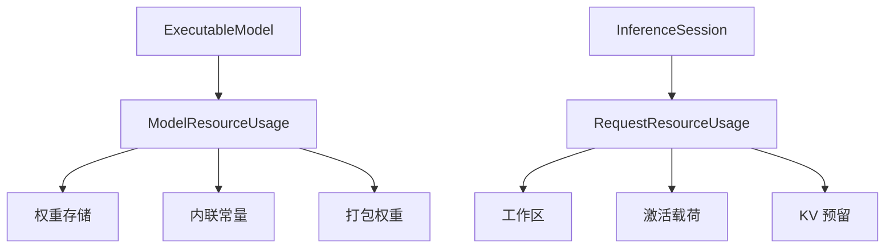
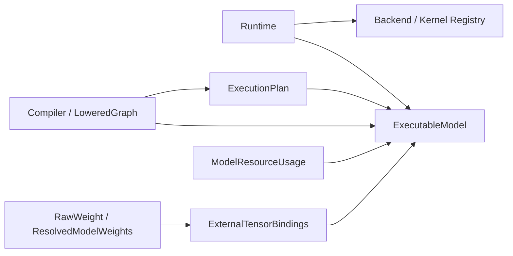

# ExecutableModel API

**本文引用的文件**
- [include/aethermind/inference/executable_model.h](../../../../include/aethermind/inference/executable_model.h)
- [src/inference/executable_model.cpp](../../../../src/inference/executable_model.cpp)
- [include/aethermind/inference/inference_session.h](../../../../include/aethermind/inference/inference_session.h)
- [include/aethermind/inference/resource_usage.h](../../../../include/aethermind/inference/resource_usage.h)
- [tests/unit/inference/test_executable_model.cpp](../../../../tests/unit/inference/test_executable_model.cpp)
- [tests/unit/inference/test_load_prepare_executable_model.cpp](../../../../tests/unit/inference/test_load_prepare_executable_model.cpp)

## 目录
1. [引言](#引言)
2. [项目结构定位](#项目结构定位)
3. [核心组件总览](#核心组件总览)
4. [架构总览](#架构总览)
5. [详细接口文档](#详细接口文档)
6. [对象生命周期与所有权模型](#对象生命周期与所有权模型)
7. [完整使用流程示例](#完整使用流程示例)
8. [依赖关系分析](#依赖关系分析)
9. [性能与资源特性](#性能与资源特性)
10. [故障排查指南](#故障排查指南)
11. [结论](#结论)

## 引言
ExecutableModel 是 AetherMind 推理管线中的“生产就绪模型”抽象。它位于编译产物与会话执行之间，承担三项核心职责：
- 将编译器生成的 LoweredModelArtifact 转换为可执行模型；
- 构建并持有不可变的执行计划；
- 管理不可变的权重绑定表，供 InferenceSession 复用。

该类不是普通值类型，而是具有严格生命周期、地址稳定性、阶段一致性和指针借用约束的资源型对象。调用方不应直接读取底层编译产物或重新解析权重角色——这些工作应在 Load() 或 Prepare() 阶段完成。

## 项目结构定位
ExecutableModel 的头文件位于推理公共接口层，实现位于推理源模块；其测试覆盖单元测试和加载准备集成路径。

图表来源
- [include/aethermind/inference/executable_model.h:1-183](../../../../include/aethermind/inference/executable_model.h#L1-L183)
- [src/inference/executable_model.cpp:1-200](../../../../src/inference/executable_model.cpp#L1-L200)
- [include/aethermind/inference/inference_session.h:1-114](../../../../include/aethermind/inference/inference_session.h#L1-L114)
- [include/aethermind/inference/resource_usage.h:1-43](../../../../include/aethermind/inference/resource_usage.h#L1-L43)
- [tests/unit/inference/test_executable_model.cpp:1-200](../../../../tests/unit/inference/test_executable_model.cpp#L1-L200)
- [tests/unit/inference/test_load_prepare_executable_model.cpp:1-168](../../../../tests/unit/inference/test_load_prepare_executable_model.cpp#L1-L168)

章节来源
- [include/aethermind/inference/executable_model.h:1-183](../../../../include/aethermind/inference/executable_model.h#L1-L183)

## 核心组件总览
ExecutableModel 的核心数据与行为围绕以下概念组织：

| 类别 | 名称 | 作用 |
|---|---|---|
| 配置 | ModelLoadOptions | 指定编译预设、目标设备、权重策略、每模型限制及 KV/激活数据类型 |
| 限制 | ModelLimits | 控制模型载荷和打包权重的最大字节数，零表示不限 |
| 输入 | LoweredModelArtifact | 由编译器产出的已降阶图与原始权重后备 |
| 输出 | ExecutableModel | 不可变、可移动、准备就绪的模型对象 |
| 查询 | ExecutionPlan* | 按执行阶段返回共享的执行计划指针 |
| 查询 | ExternalTensorBindings* | 按执行阶段返回不可变权重绑定表指针 |
| 资源 | ModelResourceUsage | 记录模型准备阶段的资源统计 |

类关系如下：

图表来源
- [include/aethermind/inference/executable_model.h:21-183](../../../../include/aethermind/inference/executable_model.h#L21-L183)
- [include/aethermind/inference/resource_usage.h:10-43](../../../../include/aethermind/inference/resource_usage.h#L10-L43)

章节来源
- [include/aethermind/inference/executable_model.h:21-183](../../../../include/aethermind/inference/executable_model.h#L21-L183)
- [include/aethermind/inference/resource_usage.h:10-43](../../../../include/aethermind/inference/resource_usage.h#L10-L43)

## 架构总览
ExecutableModel 处于编译、执行与会话之间的关键位置：

图表来源
- [include/aethermind/inference/executable_model.h:76-150](../../../../include/aethermind/inference/executable_model.h#L76-L150)
- [include/aethermind/inference/inference_session.h:28-74](../../../../include/aethermind/inference/inference_session.h#L28-L74)
- [tests/unit/inference/test_load_prepare_executable_model.cpp:28-86](../../../../tests/unit/inference/test_load_prepare_executable_model.cpp#L28-L86)

章节来源
- [include/aethermind/inference/executable_model.h:76-150](../../../../include/aethermind/inference/executable_model.h#L76-L150)
- [include/aethermind/inference/inference_session.h:28-74](../../../../include/aethermind/inference/inference_session.h#L28-L74)
- [tests/unit/inference/test_load_prepare_executable_model.cpp:28-86](../../../../tests/unit/inference/test_load_prepare_executable_model.cpp#L28-L86)

## 详细接口文档

### 静态工厂方法 Load

**声明语义**
- 通过模型目录、目标设备和权重策略加载并准备一个可执行模型；
- 内部会先加载模型，再根据 ModelLoadOptions 进行编译与准备；
- 失败时不返回部分模型，错误码会被保留并附加上下文信息；
- 要求 Runtime 地址稳定且生命周期长于返回的 ExecutableModel。

**参数说明**

| 参数 | 含义 |
|---|---|
| runtime | 提供后端、KV Cache 能力等运行环境引用；必须保持地址稳定且存活时间更长 |
| directory | 模型目录路径，用于加载权重和元数据 |
| options | ModelLoadOptions，包含编译预设、目标设备、权重策略、每模型限制、KV 数据类型、激活数据类型 |

**返回值**
- StatusOr<ExecutableModel>：成功时返回可执行模型，失败时返回状态码；常见失败包括模型加载失败、后端不可用、准备失败等。

**错误处理要点**
- 若底层 ModelLoader::Load 失败，Load 会保留原始错误码并添加“加载失败”上下文；
- 若后续 Prepare 失败，Load 会保留准备错误码并添加“准备失败”上下文；
- 若请求的设备后端不存在，应报告未找到错误；
- 如果 Runtime 没有注册对应后端，Prepare 阶段可能提前失败。

章节来源
- [include/aethermind/inference/executable_model.h:76-90](../../../../include/aethermind/inference/executable_model.h#L76-L90)
- [tests/unit/inference/test_load_prepare_executable_model.cpp:88-168](../../../../tests/unit/inference/test_load_prepare_executable_model.cpp#L88-L168)

### 静态工厂方法 Prepare

**声明语义**
- 接受已编译的 LoweredModelArtifact，将其转化为可执行模型；
- 在打包前检查 payload 限制；
- 解析内核并构建不可变绑定表；
- 失败时不会暴露部分准备好的模型；
- 不转换源权重，仅消费编译产物中的权重后备。

**参数说明**

| 参数 | 含义 |
|---|---|
| runtime | 提供后端与内核解析所需的运行时环境 |
| artifact | 已降低的模型编译产物，包含图和原始权重后备 |
| limits | ModelLimits，可选；控制模型载荷和打包权重大小上限 |

**返回值**
- StatusOr<ExecutableModel>：成功返回可执行模型；失败返回状态码。

**错误处理要点**
- 若编译产物混合了不同执行阶段，Prepare 会拒绝；
- 若常量内联数据缺失、形状非静态、尺寸溢出或与 dtype 不一致，会返回前置条件错误；
- 若权重无法解析、非连续或对齐不满足要求，会返回前置条件错误；
- 若内存不足，诊断性分配失败通常以资源耗尽状态返回空结果。

章节来源
- [include/aethermind/inference/executable_model.h:92-103](../../../../include/aethermind/inference/executable_model.h#L92-L103)
- [src/inference/executable_model.cpp:1-200](../../../../src/inference/executable_model.cpp#L1-L200)

### 查询方法 plan

**语义**
- 返回指定执行阶段的 ExecutionPlan 指针；
- 预填充和解码阶段当前共享同一个不可变计划；
- 虽然共享计划，但 Query 仍会检查该模型编译时的单一阶段；
- 阶段不匹配时返回错误；
- 诊断性分配失败返回空资源耗尽状态。

**参数**
- phase：调用方意图执行的阶段，例如预填充、解码或两者共用。

**返回值**
- StatusOr<const ExecutionPlan*>：成功返回指向内部计划的只读指针；失败返回状态码。

章节来源
- [include/aethermind/inference/executable_model.h:105-116](../../../../include/aethermind/inference/executable_model.h#L105-L116)
- [tests/unit/inference/test_executable_model.cpp:120-160](../../../../tests/unit/inference/test_executable_model.cpp#L120-L160)

### 查询方法 immutable_weight_bindings

**语义**
- 返回指定执行阶段的不可变外部张量绑定表；
- 模型输入被有意排除，因为会话会在调用 PrepareExecutionBindings 之前追加 token 和 position 绑定；
- 返回的是只读权重与常量的绑定；
- 阶段不匹配时返回错误；
- 诊断性分配失败返回空资源耗尽状态。

**参数**
- phase：调用方意图执行的阶段。

**返回值**
- StatusOr<const ExternalTensorBindings*>：成功返回内部绑定表指针；失败返回状态码。

章节来源
- [include/aethermind/inference/executable_model.h:118-131](../../../../include/aethermind/inference/executable_model.h#L118-L131)
- [tests/unit/inference/test_executable_model.cpp:150-170](../../../../tests/unit/inference/test_executable_model.cpp#L150-L170)

### 元数据查询方法

| 方法 | 用途 |
|---|---|
| artifact_id() | 返回编译产物的标识，与打包权重集合的源标识匹配 |
| phase() | 返回该编译产物所针对的单一执行阶段 |
| context_limit() | 返回经 HF max_position_embeddings 校验后的保守最大序列长度 |
| vocab_size() | 返回用于校验 token ID 的词表大小 |
| IsPreparedFor(const Runtime&) | 判断已解析内核是否属于给定 Runtime |
| resource_usage() | 返回模型准备阶段的资源统计 |

章节来源
- [include/aethermind/inference/executable_model.h:133-149](../../../../include/aethermind/inference/executable_model.h#L133-L149)
- [tests/unit/inference/test_load_prepare_executable_model.cpp:56-72](../../../../tests/unit/inference/test_load_prepare_executable_model.cpp#L56-L72)

## 对象生命周期与所有权模型

### 生命周期顺序
ExecutableModel 的销毁顺序与其成员声明顺序相反，这是其破坏契约的关键保障：
1. 释放执行计划；
2. 释放不可变绑定表；
3. 释放借用的权重绑定元数据和编译产物后备。

这意味着绑定表和计划必须先于它们所借用的后端、权重数据和编译产物销毁。

图表来源
- [include/aethermind/inference/executable_model.h:42-74](../../../../include/aethermind/inference/executable_model.h#L42-L74)
- [include/aethermind/inference/executable_model.h:151-183](../../../../include/aethermind/inference/executable_model.h#L151-L183)

### 地址稳定性
Runtime 必须保持地址稳定且生命周期长于 ExecutableModel。原因是执行计划中已解析的内核函数指针可能借用后端内部状态；如果 Runtime 被移动或销毁，这些指针可能失效。

### Move-only 语义
ExecutableModel 是可移动但不可赋值的类型。删除赋值操作的原因有两个：
- 替换已准备的模型会使已分发的计划和绑定指针失效；
- 成员逐字段赋值会先释放编译产物后备，而绑定表仍在借用这些数据。

因此，替换模型时应构造新对象，而不是原地赋值。

### 与 ExternalTensorBindings 的指针借用
ExecutableModel 持有的 ExternalTensorBindings 通过 PreparedExecutionBindings 向会话提供外部张量绑定。这些绑定的权重数据指针来自 ExecutableModel 内部的权重后备；因此 ExecutableModel 必须比任何 PreparedExecutionBindings 存活更久。

章节来源
- [include/aethermind/inference/executable_model.h:42-74](../../../../include/aethermind/inference/executable_model.h#L42-L74)
- [include/aethermind/inference/executable_model.h:151-183](../../../../include/aethermind/inference/executable_model.h#L151-L183)

## 完整使用流程示例

### 从编译产物准备可执行模型

推荐流程如下：

1. 创建 Runtime，并注册所需后端；
2. 从模型目录加载 LoadedModel；
3. 调用 ModelCompiler 得到 LoweredModelArtifact；
4. 调用 ExecutableModel::Prepare 得到可执行模型；
5. 将可执行模型放入 shared_ptr，交给 InferenceSession；
6. 通过 session.Generate 执行推理。

图表来源
- [tests/unit/inference/test_load_prepare_executable_model.cpp:28-86](../../../../tests/unit/inference/test_load_prepare_executable_model.cpp#L28-L86)
- [tests/unit/inference/test_executable_model.cpp:100-170](../../../../tests/unit/inference/test_executable_model.cpp#L100-L170)

### 资源使用统计获取方式

可从两个层面观察资源：

| 视角 | 接口 | 内容 |
|---|---|---|
| 模型准备级 | ExecutableModel::resource_usage() | 权重存储、内联常量、打包权重、托管载荷、FP32 转换观察 |
| 请求级 | InferenceSession::PlanResources() | 工作区、预填充激活、解码激活、峰值载荷、KV 预留、持久载荷 |

图表来源
- [include/aethermind/inference/executable_model.h:145-149](../../../../include/aethermind/inference/executable_model.h#L145-L149)
- [include/aethermind/inference/resource_usage.h:10-43](../../../../include/aethermind/inference/resource_usage.h#L10-L43)
- [include/aethermind/inference/inference_session.h:44-56](../../../../include/aethermind/inference/inference_session.h#L44-L56)

章节来源
- [include/aethermind/inference/executable_model.h:145-149](../../../../include/aethermind/inference/executable_model.h#L145-L149)
- [include/aethermind/inference/resource_usage.h:10-43](../../../../include/aethermind/inference/resource_usage.h#L10-L43)
- [include/aethermind/inference/inference_session.h:44-56](../../../../include/aethermind/inference/inference_session.h#L44-L56)

## 依赖关系分析

ExecutableModel 依赖的子系统如下：

图表来源
- [include/aethermind/inference/executable_model.h:21-183](../../../../include/aethermind/inference/executable_model.h#L21-L183)
- [src/inference/executable_model.cpp:1-200](../../../../src/inference/executable_model.cpp#L1-L200)

耦合特征：
- ExecutableModel 对 Runtime 是弱引用而非拥有者，避免循环所有权；
- 对 ExecutionPlan 和 ExternalTensorBindings 是强拥有者；
- 对 LoweredModelArtifact 是强拥有者，从而间接持有原始权重后备；
- 对 ModelResourceUsage 是强拥有者，用于观测资源使用情况。

章节来源
- [include/aethermind/inference/executable_model.h:151-183](../../../../include/aethermind/inference/executable_model.h#L151-L183)

## 性能与资源特性

### 冷路径准备
ExecutableModel 的准备过程是冷路径操作，不适合频繁重建。建议：
- 缓存 LoweredModelArtifact 或最终 ExecutableModel；
- 使用 shared_ptr 共享同一模型给多个 InferenceSession；
- 避免重复 Prepare，除非模型配置确实发生变化。

### 不可变绑定表
immutable_weight_bindings 返回不可变绑定表，允许多个会话安全地复用相同权重绑定，减少重复解析和绑定开销。

### 阶段共享计划
预填充和解码阶段共享同一个 ExecutionPlan，可减少计划构建成本，同时通过 phase() 和 CheckPhase 保证阶段一致性。

### 资源边界
- ModelLimits 控制模型载荷和打包权重大小；
- RequestResourceUsage 可用于预测单次请求的工作区和激活峰值；
- ModelResourceUsage 可用于观察模型级托管载荷。

章节来源
- [include/aethermind/inference/executable_model.h:21-103](../../../../include/aethermind/inference/executable_model.h#L21-L103)
- [include/aethermind/inference/resource_usage.h:10-43](../../../../include/aethermind/inference/resource_usage.h#L10-L43)
- [include/aethermind/inference/inference_session.h:44-56](../../../../include/aethermind/inference/inference_session.h#L44-L56)

## 故障排查指南

### 常见错误场景

| 现象 | 可能原因 | 处理建议 |
|---|---|---|
| Prepare 返回前置条件错误 | 常量内联数据缺失或形状不匹配 | 检查编译产物中的常量值和 TensorSpec |
| Prepare 返回权重无原始后备 | 权重绑定无法解析到 RawWeightView | 检查权重角色映射和 checkpoint 完整性 |
| Prepare 返回权重非连续 | 权重视图跨缓冲区或缺少连续后备 | 确保权重数据来源连续且对齐正确 |
| 后端不可用 | Runtime 未注册目标设备后端 | 注册对应 BackendFactory 或调整 target |
| IsPreparedFor 返回 false | 内核已解析到另一个 Runtime | 使用创建模型时的 Runtime 创建会话 |
| 阶段查询失败 | 调用方传入的 ExecPhase 与编译阶段不匹配 | 使用 phase() 确认模型阶段，再调用 plan() |
| 资源耗尽 | 工作区、激活或 KV 超出预算 | 使用 PlanResources 预估需求并调小 prompt 或限制 |

### 调试步骤
1. 先检查 Runtime 是否注册了对应后端；
2. 检查 LoweredModelArtifact 是否为空或包含混合阶段；
3. 使用 artifact_id() 和 phase() 确认模型身份；
4. 使用 IsPreparedFor(runtime) 确认 Runtime 匹配；
5. 使用 resource_usage() 检查托管载荷是否异常增长；
6. 使用 PlanResources 检查单次请求资源是否超限。

章节来源
- [src/inference/executable_model.cpp:1-200](../../../../src/inference/executable_model.cpp#L1-L200)
- [tests/unit/inference/test_executable_model.cpp:100-200](../../../../tests/unit/inference/test_executable_model.cpp#L100-L200)
- [tests/unit/inference/test_load_prepare_executable_model.cpp:88-168](../../../../tests/unit/inference/test_load_prepare_executable_model.cpp#L88-L168)

## 结论
ExecutableModel 是 AetherMind 推理栈中连接编译产物和执行会话的关键桥梁。它通过 Load() 和 Prepare() 完成从源码权重到可执行计划的转化，并通过不可变绑定表和共享执行计划提升多会话复用效率。正确使用该类需要特别注意 Runtime 地址稳定性、Move-only 语义、阶段一致性和指针借用关系。配合 ModelResourceUsage 与 RequestResourceUsage，调用方可以在模型级和请求级分别观察和控制资源消耗。
