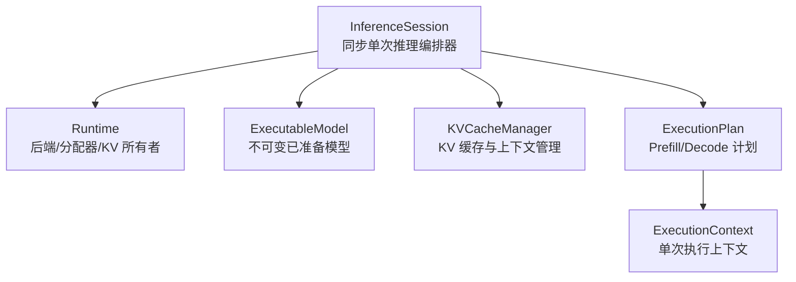
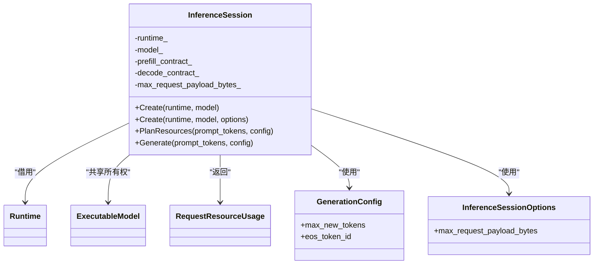
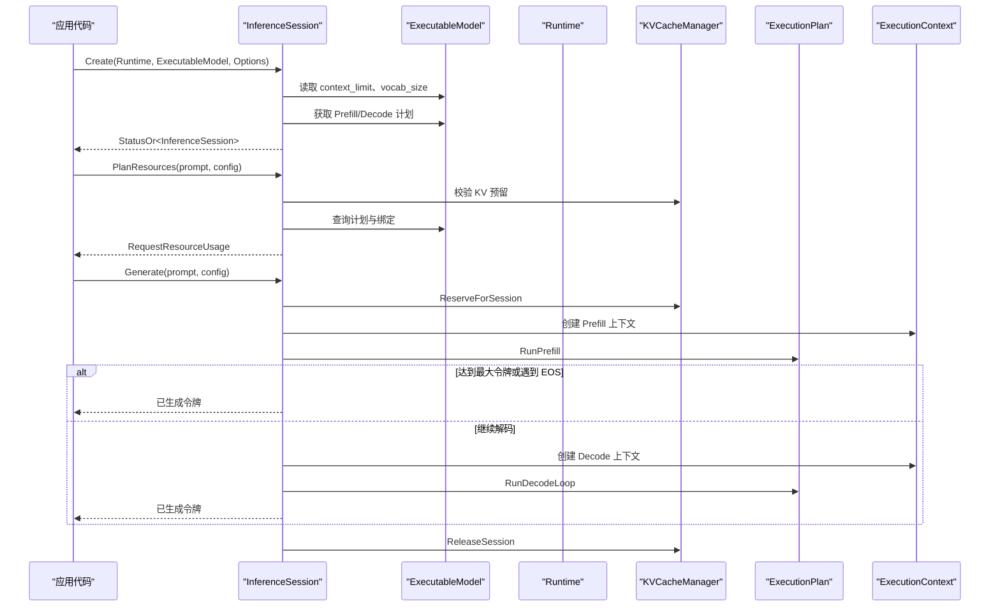
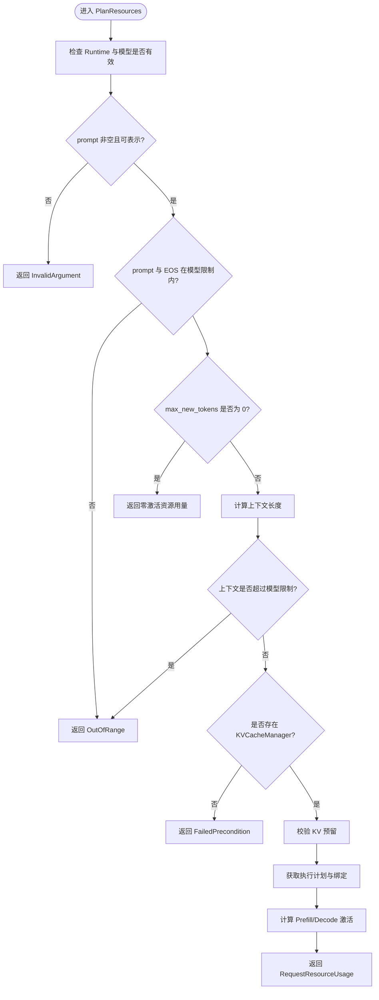
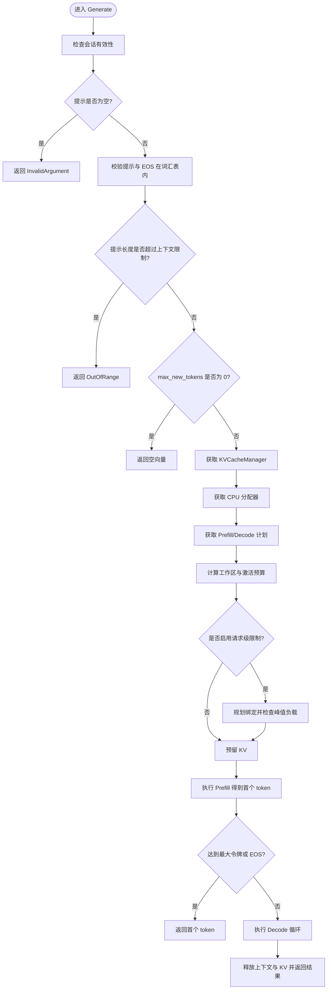
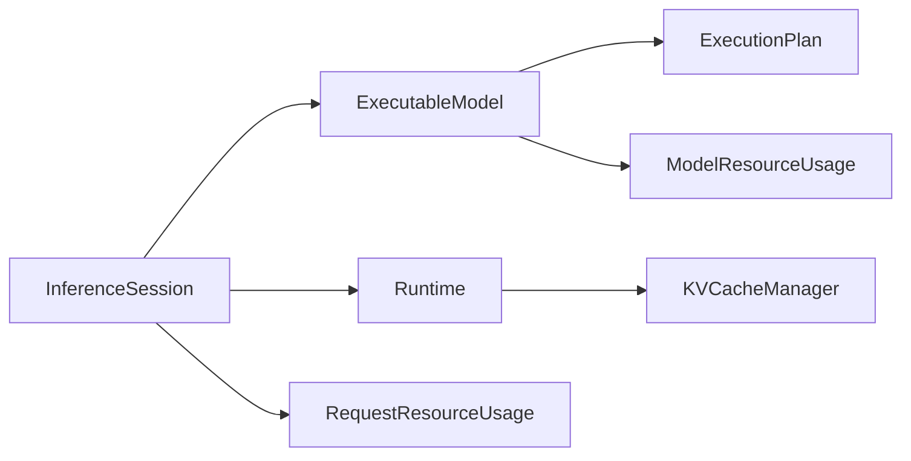

# InferenceSession API

**本文引用的文件**
- [inference_session.h](../../../../include/aethermind/inference/inference_session.h)
- [inference_session.cpp](../../../../src/inference/inference_session.cpp)
- [executable_model.h](../../../../include/aethermind/inference/executable_model.h)
- [runtime.h](../../../../include/aethermind/runtime/runtime.h)
- [resource_usage.h](../../../../include/aethermind/inference/resource_usage.h)
- [status.h](../../../../include/aethermind/base/status.h)

## 目录
1. [简介](#简介)
2. [项目结构与职责边界](#项目结构与职责边界)
3. [核心类型与构造方法](#核心类型与构造方法)
4. [架构总览](#架构总览)
5. [详细组件分析](#详细组件分析)
6. [依赖关系分析](#依赖关系分析)
7. [性能与资源特性](#性能与资源特性)
8. [故障排查指南](#故障排查指南)
9. [结论](#结论)
10. [附录：端到端使用流程](#附录端到端使用流程)

## 简介
InferenceSession 是 AetherMind 推理管线中的同步单次请求编排器。它不直接加载模型权重，也不负责编译图；它只在一个已经通过 ExecutableModel 准备完成的不可变执行模型上，完成一次从 Prompt 到令牌生成的完整推理流程。

其核心语义可以概括为：
- 持有 Runtime 引用和共享的 const ExecutableModel 指针。
- 在 Create() 阶段校验模型、Runtime、预填充/解码计划及输入输出契约。
- 提供 PlanResources() 作为冷路径元数据检查，用于预算评估而不真正分配激活或 KV。
- 提供 Generate() 完成 Prompt 预处理、Prefill 首次生成、Decode 循环、EOS 检测与 KV 释放。
- 将内存不足异常统一映射为 ResourceExhausted，保证错误报告本身不再额外分配。
- 要求调用方对同一 Runtime 上的所有 Generate 调用进行外部串行化。

## 项目结构与职责边界
InferenceSession 位于 `aethermind::inference` 命名空间，属于推理层 API。它与以下关键模块协作：
- Runtime：后端、分配器与 KVCacheManager 的所有者。
- ExecutableModel：不可变的已准备模型，持有执行计划、绑定表与权重元数据。
- KVCacheManager：按会话预留 KV 缓存并管理上下文长度。
- ExecutionContext / ExecutionPlan / Executor：执行底层算子。
- StatusOr 与 StatusCode：统一的返回值与错误码体系。



图表来源
- [inference_session.h:1-114](../../../../include/aethermind/inference/inference_session.h#L1-L114)
- [runtime.h:1-127](../../../../include/aethermind/runtime/runtime.h#L1-L127)
- [executable_model.h:1-183](../../../../include/aethermind/inference/executable_model.h#L1-L183)

章节来源
- [inference_session.h:1-114](../../../../include/aethermind/inference/inference_session.h#L1-L114)
- [runtime.h:1-127](../../../../include/aethermind/runtime/runtime.h#L1-L127)
- [executable_model.h:1-183](../../../../include/aethermind/inference/executable_model.h#L1-L183)

## 核心类型与构造方法

### InferenceSession 总体职责
InferenceSession 是一个移动构造可移动、拷贝删除的对象。它不拥有 Runtime，但借用其生命周期；它共享 std::shared_ptr<const ExecutableModel>，因此多个会话可以安全复用同一个已准备模型。

关键约束包括：
- 同一 Runtime 上的所有 Generate 调用必须外部序列化。
- 每次 Generate 开始时使用新的 Prefill 上下文，并在返回前释放 KV 预留。
- 空提示无效；零最大新令牌数返回空向量；超出词汇表或上下文限制返回 InvalidArgument 或 OutOfRange。



图表来源
- [inference_session.h:1-114](../../../../include/aethermind/inference/inference_session.h#L1-L114)

#### 构造方法一：无选项重载
```cpp
static StatusOr<InferenceSession> Create(
    Runtime& runtime,
    std::shared_ptr<const ExecutableModel> model);
```

行为说明：
- 委托给带选项的重载，并使用空的 InferenceSessionOptions。
- 内部会校验 model 非空、Runtime 匹配、context_limit 与 vocab_size 有效，并验证 Prefill 与 Decode 的执行计划契约。
- 如果 ExecutableModel 未针对当前 Runtime 准备，则返回 FailedPrecondition。

#### 构造方法二：带 InferenceSessionOptions 重载
```cpp
static StatusOr<InferenceSession> Create(
    Runtime& runtime,
    std::shared_ptr<const ExecutableModel> model,
    const InferenceSessionOptions& options);
```

行为说明：
- 若 model 为空，返回 InvalidArgument。
- 若模型不是由该 Runtime 准备，返回 FailedPrecondition。
- 若模型的上下文长度或词表大小为 0，返回 FailedPrecondition。
- 分别获取 ExecPhase::kPrefill 与 ExecPhase::kDecode 的执行计划。
- 调用 ValidatePlanContract 校验 token_input、position_input、token_output 等执行契约。
- 最终构造 InferenceSession，并保存 options.max_request_payload_bytes。

章节来源
- [inference_session.h:34-114](../../../../include/aethermind/inference/inference_session.h#L34-L114)
- [inference_session.cpp:260-340](../../../../src/inference/inference_session.cpp#L260-L340)

### GenerationConfig
GenerationConfig 控制单次推理的终止条件：
- max_new_tokens：最大新令牌数。值为 0 时，Generate 不申请 KV 也不执行模型，直接返回空向量。
- eos_token_id：可选的结束令牌 ID。若存在，则在生成结果包含 EOS 后停止。

注意：
- eos_token_id 必须在模型词汇表范围内。
- 当 max_new_tokens 为正数时，Prefill 产生的第一个令牌计入总数，因此最多只需要 max_new_tokens - 1 次 Decode KV 追加。

章节来源
- [inference_session.h:26-33](../../../../include/aethermind/inference/inference_session.h#L26-L33)
- [inference_session.cpp:380-450](../../../../src/inference/inference_session.cpp#L380-L450)
- [inference_session.cpp:500-620](../../../../src/inference/inference_session.cpp#L500-L620)

### InferenceSessionOptions
InferenceSessionOptions 提供请求级负载限制：
- max_request_payload_bytes：请求级工作区与激活峰值字节上限；0 表示不限。

该限制独立于 Runtime 的工作区限制。运行时可能同时检查：
- Runtime 全局 workspace_limit_bytes。
- InferenceSessionOptions 中 per-request 的 peak_payload_bytes。

章节来源
- [inference_session.h:35-39](../../../../include/aethermind/inference/inference_session.h#L35-L39)
- [inference_session.cpp:500-560](../../../../src/inference/inference_session.cpp#L500-L560)

## 架构总览
InferenceSession 的调用流可以分为三个阶段：
1. 构建阶段：Create() 校验 Runtime、模型与执行计划契约。
2. 预算阶段：PlanResources() 检查元数据与资源需求，但不执行模型。
3. 推理阶段：Generate() 完成 Prompt 预处理、Prefill、Decode 循环与资源回收。



图表来源
- [inference_session.cpp:260-340](../../../../src/inference/inference_session.cpp#L260-L340)
- [inference_session.cpp:340-450](../../../../src/inference/inference_session.cpp#L340-L450)
- [inference_session.cpp:450-620](../../../../src/inference/inference_session.cpp#L450-L620)

## 详细组件分析

### PlanResources：冷路径元数据检查
PlanResources 的职责是回答“给定 prompt 长度与生成配置，是否需要多少工作区、激活与 KV”，而不是真正执行模型。

主要流程如下：
1. 检查会话是否已被移动且仍持有有效的 Runtime 与模型。
2. 校验 prompt_tokens 非空且可表示为 int64_t。
3. 校验 prompt_tokens 不超过模型 context_limit，以及 eos_token_id 是否在词汇表内。
4. 若 max_new_tokens 为 0，直接返回仅包含模型持久负载的 RequestResourceUsage。
5. 计算 prompt_tokens + max_new_tokens - 1 的上下文长度，并再次校验不超过 context_limit。
6. 要求 KVCacheManager 存在，否则返回 FailedPrecondition。
7. 调用 KVCacheManager::ValidateReservation 做预留合法性检查。
8. 获取 Prefill 与 Decode 执行计划及不可变绑定。
9. 构造临时 token/position 视图，计算 Prefill 与 Decode 的激活大小。
10. 返回 peak_payload_bytes、kv_reserved_bytes 与模型托管负载信息。



图表来源
- [inference_session.cpp:340-450](../../../../src/inference/inference_session.cpp#L340-L450)

返回值语义：
- 成功时返回 RequestResourceUsage，其中包含：
  - workspace_bytes：Prefill 与 Decode 所需工作区的最大值。
  - prefill_activation_bytes：Prefill 激活峰值。
  - decode_activation_bytes：Decode 激活峰值。
  - peak_payload_bytes：工作区与激活峰值之和。
  - kv_reserved_bytes：KV 缓存管理器当前保留字节。
  - model_managed_payload_bytes：模型托管负载。
  - peak_with_persistent_payload_bytes：KV 与模型负载加上请求峰值的保守总和。
- 失败时返回各种 Status，例如 InvalidArgument、OutOfRange、FailedPrecondition、Overflow 或 ResourceExhausted。

章节来源
- [inference_session.h:44-53](../../../../include/aethermind/inference/inference_session.h#L44-L53)
- [resource_usage.h:1-43](../../../../include/aethermind/inference/resource_usage.h#L1-L43)
- [inference_session.cpp:340-450](../../../../src/inference/inference_session.cpp#L340-L450)

### Generate：完整推理流程
Generate 是同步单次请求的主入口。它接收 uint32_t 提示令牌与 GenerationConfig，返回 StatusOr<std::vector<uint32_t>>。

#### 参数与前置校验
- 检查会话未被移动且仍持有 Runtime 与模型。
- 提示不能为空。
- 提示中每个 token 必须小于 vocab_size。
- eos_token_id 若在配置中给出，也必须小于 vocab_size。
- 提示长度不能超过 context_limit。
- 若 max_new_tokens 为 0，直接返回空向量。

#### KV 与分配器
- 需要 KVCacheManager；若不存在则返回 FailedPrecondition。
- 通过 Runtime::TryGetAllocator(Device::CPU()) 获取 CPU 分配器。
- 根据 Runtime 的 workspace_limit_bytes 与 InferenceSessionOptions 的 max_request_payload_bytes 决定是否做更严格的预算检查。

#### 资源规划与 KV 预留
- 当存在请求级负载限制或 Runtime 工作区限制时，先调用 KVCacheManager::ValidateReservation。
- 若启用请求级负载限制，则先构建 Prefill 与可能的 Decode 绑定布局，再计算 RequestUsage。
- 如果 peak_payload_bytes 超过 max_request_payload_bytes，返回 ResourceExhausted。
- 之后才真正调用 ReserveForSession 预留 KV。

#### Prefill 阶段
- 创建工作区并初始化 WorkspaceArena。
- 将 prompt 转换为 int64_t 的 token 与 position 序列。
- 构建或复用 ExecutionBindingPlan，并 MaterializeContext。
- 调用 RunPrefill 得到第一个预测 token。
- 将该 token 加入 generated_tokens。

#### 早期终止判断
- 如果已生成令牌数量等于 max_new_tokens，或者最后一个 token 等于 eos_token_id，则提前返回。

#### Decode 循环
- 设置 decode token 为上一个生成 token，position 为 prompt 长度。
- 如果是预算阶段已计算出的 Decode 布局，则复用；否则重新 PrepareContext。
- 调用 RunDecodeLoop，在达到最大令牌数或遇到 EOS 时停止。
- 最终调用 Finish 释放上下文与 KV 预留，并返回已生成令牌。



图表来源
- [inference_session.cpp:450-620](../../../../src/inference/inference_session.cpp#L450-L620)

#### 返回值语义
- 成功时返回 std::vector<uint32_t>，包含从 Prefill 的第一个 token 开始的所有生成 token，包括 EOS（如果产生）。
- 空提示返回 InvalidArgument。
- 零最大新令牌数返回空向量，且不申请 KV。
- 超出词汇表或上下文限制返回 OutOfRange。
- 缺少 KVCacheManager 返回 FailedPrecondition。
- 工作区或请求负载超限返回 ResourceExhausted。
- 若底层分配抛出 std::bad_alloc，整个函数捕获并返回 ResourceExhausted，消息体为空，以避免在错误处理中再次分配内存。

章节来源
- [inference_session.h:55-70](../../../../include/aethermind/inference/inference_session.h#L55-L70)
- [inference_session.cpp:450-620](../../../../src/inference/inference_session.cpp#L450-L620)
- [status.h:1-200](../../../../include/aethermind/base/status.h#L1-L200)

### 执行契约与内部辅助
InferenceSession 依赖 ValidatePlanContract 确保执行计划符合其假设：
- 每个 phase 必须有恰好一个 token 输出。
- 模型输入必须是两个独立的 rank-one Int64 张量。
- 输出必须是 Activation 类型的 Int64 张量。
- 当前只支持 CPU 执行计划。
- 计划中只能有一个 Argmax 算子，并且该算子的唯一输出就是模型输出。

这些约束使得 InferenceSession 不需要解释通用执行图，而是以固定契约运行 Llama 类模型的 Prefill 与 Decode 路径。

章节来源
- [inference_session.cpp:620-803](../../../../src/inference/inference_session.cpp#L620-L803)

## 依赖关系分析
InferenceSession 的依赖关系呈现清晰的层次结构：
- 顶层 API：InferenceSession。
- 模型层：ExecutableModel 提供 plan、immutable_weight_bindings、context_limit、vocab_size。
- 运行时层：Runtime 提供 allocator、workspace_limit_bytes、KVCacheManager。
- 执行层：ExecutionPlan、ExecutionContext、Executor。
- 资源层：RequestResourceUsage、ModelResourceUsage。



图表来源
- [inference_session.h:1-114](../../../../include/aethermind/inference/inference_session.h#L1-L114)
- [executable_model.h:1-183](../../../../include/aethermind/inference/executable_model.h#L1-L183)
- [runtime.h:1-127](../../../../include/aethermind/runtime/runtime.h#L1-L127)
- [resource_usage.h:1-43](../../../../include/aethermind/inference/resource_usage.h#L1-L43)

章节来源
- [inference_session.h:1-114](../../../../include/aethermind/inference/inference_session.h#L1-L114)
- [executable_model.h:1-183](../../../../include/aethermind/inference/executable_model.h#L1-L183)
- [runtime.h:1-127](../../../../include/aethermind/runtime/runtime.h#L1-L127)
- [resource_usage.h:1-43](../../../../include/aethermind/inference/resource_usage.h#L1-L43)

## 性能与资源特性
- 冷路径优先：PlanResources 只做元数据与几何检查，避免执行模型和分配激活缓冲区。
- 预算分层：
  - Runtime 提供全局 workspace_limit_bytes。
  - InferenceSessionOptions 提供 per-request 的 max_request_payload_bytes。
  - KVCacheManager 提供上下文长度与 KV 预留约束。
- 资源复用：
  - ExecutableModel 被多个 InferenceSession 共享。
  - 请求级工作区由 RequestResources 内部管理，并在 Finish 或 Close 时释放。
- 异常安全：
  - std::bad_alloc 被捕获并转换为 ResourceExhausted。
  - 请求级资源在异常路径中通过 RAII 清理，确保 KV 预留最终释放。

章节来源
- [inference_session.cpp:200-340](../../../../src/inference/inference_session.cpp#L200-L340)
- [inference_session.cpp:450-620](../../../../src/inference/inference_session.cpp#L450-L620)
- [runtime.h:1-127](../../../../include/aethermind/runtime/runtime.h#L1-L127)

## 故障排查指南

### 常见错误与含义
- InvalidArgument：
  - 传入 null ExecutableModel。
  - 提示为空。
  - token 或 position 输入长度不一致或不可表示。
  - token 与 position 输入引用相同执行值。
- OutOfRange：
  - 提示 token 或 eos_token_id 超出词汇表。
  - 提示长度或上下文长度超过模型限制。
- FailedPrecondition：
  - ExecutableModel 不是由当前 Runtime 准备。
  - 模型缺少 validated token 限制。
  - 缺少 KVCacheManager。
  - 会话被移动后仍被使用。
- ResourceExhausted：
  - 工作区或请求负载超过限制。
  - 底层内存分配失败，std::bad_alloc 被转换为 ResourceExhausted。
- Overflow：
  - 计算 prompt_tokens + max_new_tokens - 1 或其他尺寸时溢出 size_t。

### 调试建议
1. 先调用 PlanResources，确认请求预算是否符合预期。
2. 检查 Runtime 是否启用了 KVCacheManager。
3. 检查 ExecutableModel 是否由同一 Runtime 准备。
4. 检查提示 token 是否全部小于 vocab_size。
5. 若出现 ResourceExhausted，比较 RequestResourceUsage.peak_payload_bytes 与 max_request_payload_bytes。
6. 若出现 Internal 状态，检查执行计划是否满足单输出、单 Argmax、CPU 执行等契约。

章节来源
- [inference_session.cpp:260-340](../../../../src/inference/inference_session.cpp#L260-L340)
- [inference_session.cpp:340-450](../../../../src/inference/inference_session.cpp#L340-L450)
- [inference_session.cpp:450-620](../../../../src/inference/inference_session.cpp#L450-L620)
- [inference_session.cpp:620-803](../../../../src/inference/inference_session.cpp#L620-L803)

## 结论
InferenceSession 将“已准备模型”和“单次推理”解耦：模型准备由 ExecutableModel 负责，推理编排由 InferenceSession 负责。它通过 Create 建立安全的执行前提，通过 PlanResources 暴露冷路径预算能力，通过 Generate 封装完整的 Prompt、Prefill、Decode 与资源回收流程。

对于使用者而言，最重要的约定有三条：
1. 使用已准备的 ExecutableModel。
2. 在同一 Runtime 上串行化所有 Generate 调用。
3. 通过 PlanResources 与 RequestResourceUsage 做显式预算决策，再决定何时拒绝或降级请求。

## 附录：端到端使用流程

### 典型步骤
1. 构建 Runtime。
2. 加载或准备 ExecutableModel。
3. 调用 InferenceSession::Create 创建会话。
4. 可选：调用 PlanResources 检查预算。
5. 调用 Generate 传入提示与 GenerationConfig。
6. 处理返回的令牌向量或错误状态。
7. 销毁会话；KV 预留会在对象析构前释放。

### 代码示例路径
由于本仓库 API 头文件中未提供完整可编译示例，建议参考以下实现位置理解端到端流程：
- 会话创建与选项传递：[inference_session.cpp:260-340](../../../../src/inference/inference_session.cpp#L260-L340)
- 资源规划与预算：[inference_session.cpp:340-450](../../../../src/inference/inference_session.cpp#L340-L450)
- 完整推理流程：[inference_session.cpp:450-620](../../../../src/inference/inference_session.cpp#L450-L620)
- 执行契约校验：[inference_session.cpp:620-803](../../../../src/inference/inference_session.cpp#L620-L803)

### 资源规划使用场景
- 服务网关在调度前调用 PlanResources，估算峰值负载。
- 如果 peak_payload_bytes 超过业务阈值，直接拒绝请求。
- 如果 KV 预留失败，回退到较小批量或排队策略。
- 如果预算通过，再调用 Generate 执行真实推理。

章节来源
- [inference_session.h:1-114](../../../../include/aethermind/inference/inference_session.h#L1-L114)
- [inference_session.cpp:260-803](../../../../src/inference/inference_session.cpp#L260-L803)
- [resource_usage.h:1-43](../../../../include/aethermind/inference/resource_usage.h#L1-L43)
