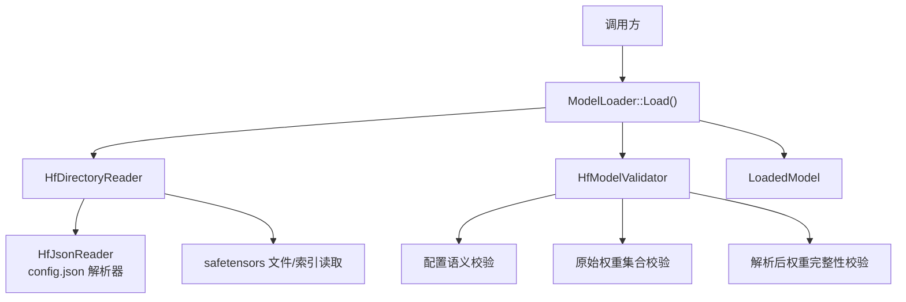
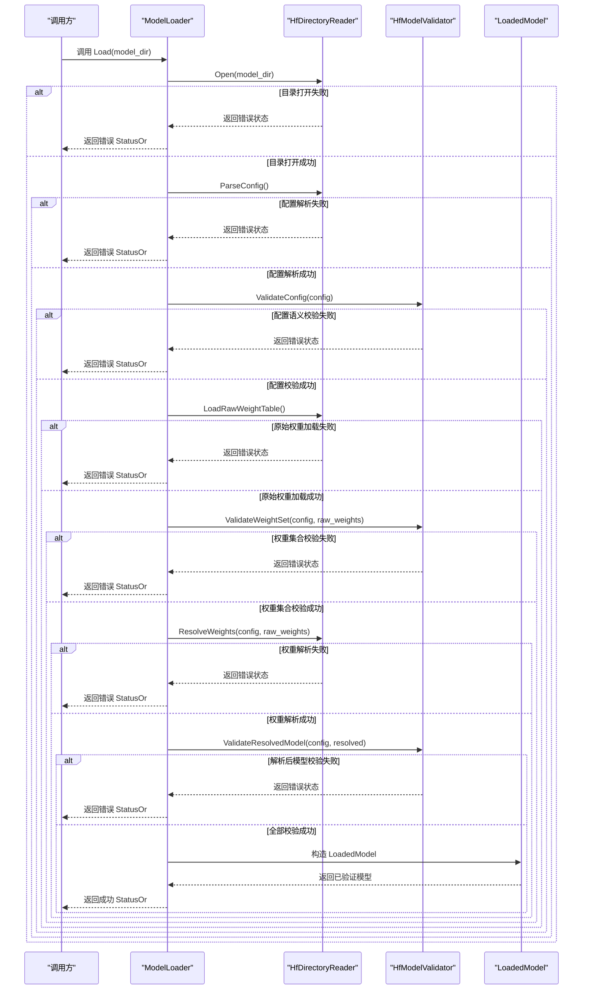
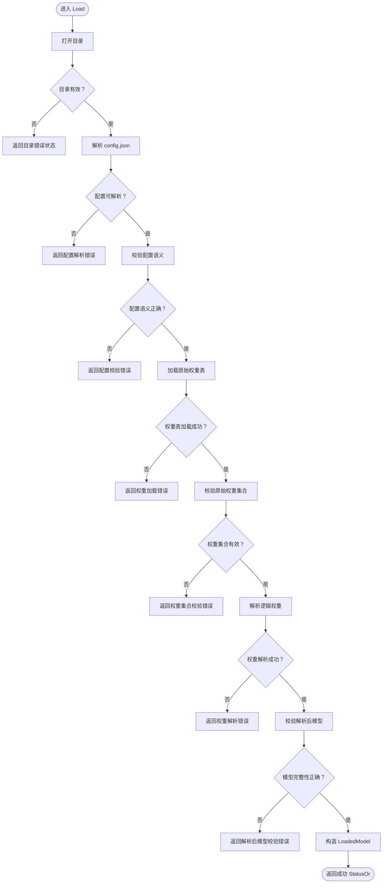
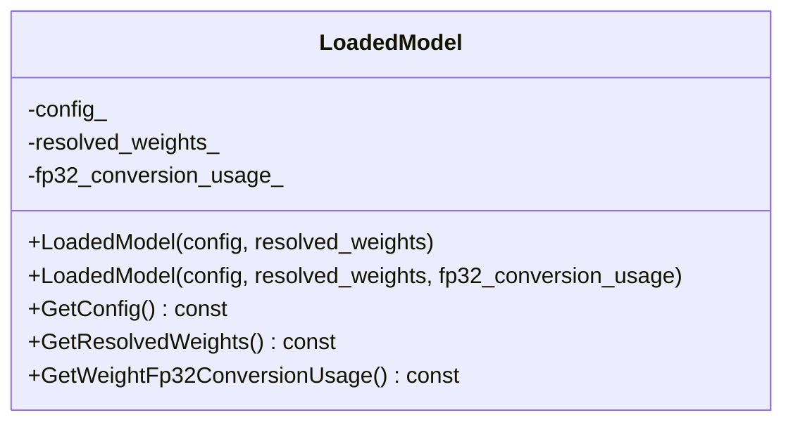
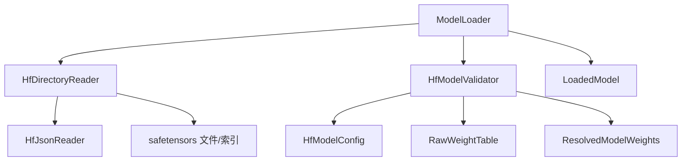
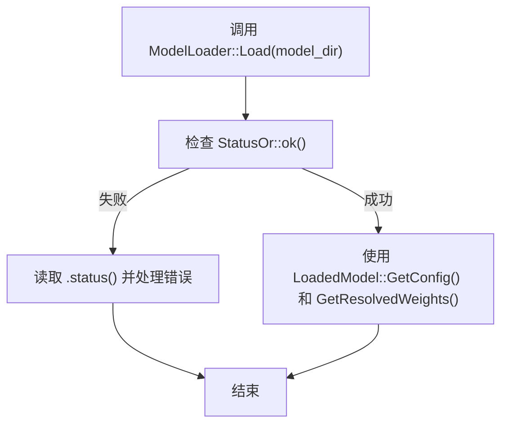

# ModelLoader API

**本文引用的文件**
- [model_loader.h](../../../../include/aethermind/model/model_loader.h)
- [model_loader.cpp](../../../../src/model/model_loader.cpp)
- [loaded_model.h](../../../../include/aethermind/model/loaded_model.h)
- [loaded_model.cpp](../../../../src/model/loaded_model.cpp)
- [status.h](../../../../include/aethermind/base/status.h)
- [status.cpp](../../../../src/base/status.cpp)
- [hf_directory_reader.h](../../../../include/aethermind/model/formats/hf/hf_directory_reader.h)
- [hf_directory_reader.cpp](../../../../src/model/formats/hf/hf_directory_reader.cpp)
- [hf_json_reader.h](../../../../include/aethermind/model/formats/hf/hf_json_reader.h)
- [hf_json_reader.cpp](../../../../src/model/formats/hf/hf_json_reader.cpp)
- [hf_model_validator.h](../../../../include/aethermind/model/formats/hf/hf_model_validator.h)
- [test_model_loader.cpp](../../../../tests/unit/model/test_model_loader.cpp)

## 目录
1. [简介](#简介)
2. [项目结构定位](#项目结构定位)
3. [核心组件](#核心组件)
4. [架构总览](#架构总览)
5. [详细组件分析](#详细组件分析)
6. [依赖关系分析](#依赖关系分析)
7. [性能与资源特性](#性能与资源特性)
8. [使用示例与错误处理](#使用示例与错误处理)
9. [常见问题排查](#常见问题排查)
10. [结论](#结论)

## 简介
ModelLoader 是 HuggingFace 模型目录加载入口，职责边界非常明确：它负责模型目录 I/O、config.json 解析、结构化验证和逻辑权重解析，最终返回一个已验证的 LoadedModel。它不构建计算图、不解析具体后端内核、也不执行权重预打包。所有失败都通过 `StatusOr<std::unique_ptr<LoadedModel>>` 返回，而不是抛出异常；调用方需要显式检查返回值是否成功。

该设计使 ModelLoader 成为编译管线之前的“所有权边界”：LoadedModel 持有后端无关的模型配置和逻辑权重视图，后续编译器或推理层再基于它构建图、选择内核并完成内存分配。

## 项目结构定位
ModelLoader 位于模型模块的前端入口位置，围绕 HF 格式组织成一条短而清晰的流水线：



**图表来源**
- [model_loader.cpp:12-42](../../../../src/model/model_loader.cpp#L12-L42)
- [hf_directory_reader.h:26-106](../../../../include/aethermind/model/formats/hf/hf_directory_reader.h#L26-L106)
- [hf_json_reader.h:20-73](../../../../include/aethermind/model/formats/hf/hf_json_reader.h#L20-L73)
- [hf_model_validator.h:18-55](../../../../include/aethermind/model/formats/hf/hf_model_validator.h#L18-L55)

**章节来源**
- [model_loader.h:1-38](../../../../include/aethermind/model/model_loader.h#L1-L38)
- [model_loader.cpp:1-43](../../../../src/model/model_loader.cpp#L1-L43)

## 核心组件
- **ModelLoader**：静态入口类，封装 HF 目录加载完整流程。
- **LoadedModel**：已验证模型的所有权对象，持有 HfModelConfig 与 ResolvedModelWeights。
- **HfDirectoryReader**：HF 目录 I/O 抽象，支持单文件和分片 safetensors 布局。
- **HfJsonReader**：顺序 JSON 解析基类，为 config.json 提供轻量、无拷贝的解析能力。
- **HfModelValidator**：三阶段验证器，分别校验配置、原始权重集合和解析后的逻辑权重。
- **Status / StatusOr**：项目统一的状态与结果类型，用于非异常错误传播。

**章节来源**
- [model_loader.h:13-36](../../../../include/aethermind/model/model_loader.h#L13-L36)
- [loaded_model.h:19-43](../../../../include/aethermind/model/loaded_model.h#L19-L43)
- [hf_directory_reader.h:26-106](../../../../include/aethermind/model/formats/hf/hf_directory_reader.h#L26-L106)
- [hf_json_reader.h:20-73](../../../../include/aethermind/model/formats/hf/hf_json_reader.h#L20-L73)
- [hf_model_validator.h:18-55](../../../../include/aethermind/model/formats/hf/hf_model_validator.h#L18-L55)

## 架构总览
ModelLoader::Load() 的调用序列如下：



**图表来源**
- [model_loader.cpp:12-42](../../../../src/model/model_loader.cpp#L12-L42)
- [hf_directory_reader.h:60-106](../../../../include/aethermind/model/formats/hf/hf_directory_reader.h#L60-L106)
- [hf_model_validator.h:24-55](../../../../include/aethermind/model/formats/hf/hf_model_validator.h#L24-L55)

## 详细组件分析

### ModelLoader 接口定义
ModelLoader 是一个极简的静态门面类，只暴露一个静态方法：

| 项目 | 说明 |
|---|---|
| 类名 | `aethermind::ModelLoader` |
| 公开方法 | `static StatusOr<std::unique_ptr<LoadedModel>> Load(const std::filesystem::path& model_dir)` |
| 参数 | `model_dir`：包含 `config.json` 和 safetensors 文件的 HuggingFace 模型目录路径 |
| 返回值 | 成功时返回包含 `LoadedModel` 指针的 `StatusOr`；失败时返回携带错误码和消息的 `Status` |
| 职责范围 | 目录 I/O、config 解析、结构化验证、逻辑权重解析 |
| 明确排除 | 不负责图构建、内核解析、权重预打包 |

**章节来源**
- [model_loader.h:13-36](../../../../include/aethermind/model/model_loader.h#L13-L36)

### 静态 Load() 方法与实现流程
Load() 的实现是一条顺序流水线，任何一步失败都会立即返回对应的错误状态，不会继续执行后续步骤。

| 步骤 | 操作 | 可能失败原因 | 返回语义 |
|---|---|---|---|
| 1 | 打开并检查 HF 目录 | 目录不存在、无法访问、布局不明确 | 返回底层 `Open()` 的错误状态 |
| 2 | 解析 config.json | JSON 语法错误、字段类型错误、多余内容 | 返回解析错误状态 |
| 3 | 校验配置语义 | 不支持的架构、缺失必填字段、字段不一致 | 返回 `InvalidArgument` 等语义错误 |
| 4 | 加载原始权重表 | safetensors 文件缺失、索引不一致、数据损坏 | 返回 I/O 或格式错误状态 |
| 5 | 校验原始权重集合 | 缺少必要张量、名称不符合预期、策略冲突 | 返回权重集合校验错误 |
| 6 | 解析逻辑权重 | 权重映射失败、dtype 不一致、张量绑定歧义 | 返回权重解析错误 |
| 7 | 校验解析后模型 | tied embeddings、dtype 一致性、完整性问题 | 返回解析后模型校验错误 |
| 8 | 构造 LoadedModel | 无 | 返回成功状态和唯一指针 |



**图表来源**
- [model_loader.cpp:12-42](../../../../src/model/model_loader.cpp#L12-L42)

**章节来源**
- [model_loader.cpp:12-42](../../../../src/model/model_loader.cpp#L12-L42)

### LoadedModel 生命周期与所有权
LoadedModel 是模型加载完成后的所有权边界对象。它保存：

| 成员 | 含义 |
|---|---|
| `HfModelConfig` | 从 config.json 解析出的后端无关模型配置 |
| `ResolvedModelWeights` | 逻辑权重视图，保留共享后备存储 |
| `RawWeightFp32ConversionUsage` | 可选的 FP32 转换使用统计信息 |

关键点：
- LoadedModel 不包含后端相关工件。
- 它的 `ResolvedModelWeights` 会保留对原始张量数据的共享后备存储，直到后续编译阶段消费这些数据。
- 构造函数接受移动语义，避免不必要的复制。
- 公共接口提供只读访问：获取配置、获取解析权重、观察 FP32 转换使用情况。



**图表来源**
- [loaded_model.h:19-43](../../../../include/aethermind/model/loaded_model.h#L19-L43)
- [loaded_model.cpp:5-32](../../../../src/model/loaded_model.cpp#L5-L32)

**章节来源**
- [loaded_model.h:1-45](../../../../include/aethermind/model/loaded_model.h#L1-L45)
- [loaded_model.cpp:1-33](../../../../src/model/loaded_model.cpp#L1-L33)

### 目录 I/O 与 HF 布局识别
HfDirectoryReader 负责 HF 模型目录的检查和读取：

- 支持两种布局：
  - 单文件 safetensors
  - 分片 safetensors，由 `model.safetensors.index.json` 描述
- 混合布局会被拒绝，确保后续加载代码始终面对单一权重源。
- `InspectDirectory()` 只做目录形状检查，不加载配置或权重。
- `Open()` 返回一个不可变 reader，之后通过 `ParseConfig()` 和 `LoadRawWeightTable()` 触发实际 I/O。

| 方法 | 输入 | 输出 | 失败场景 |
|---|---|---|---|
| `Open(model_dir)` | 模型目录路径 | `StatusOr<HfDirectoryReader>` | 目录无效、布局不明确、文件缺失 |
| `InspectDirectory(model_dir)` | 模型目录路径 | `StatusOr<HfDirectoryDescriptor>` | 目录形状非法 |
| `ParseConfig()` | 无（内部持有目录） | `StatusOr<HfModelConfig>` | JSON 语法错误、字段类型错误 |
| `LoadRawWeightTable()` | 无（内部持有目录） | `StatusOr<RawWeightTable>` | safetensors 文件缺失、索引不一致 |

**章节来源**
- [hf_directory_reader.h:26-106](../../../../include/aethermind/model/formats/hf/hf_directory_reader.h#L26-L106)
- [hf_directory_reader.cpp:1-743](../../../../src/model/formats/hf/hf_directory_reader.cpp#L1-L743)

### config.json 解析
config.json 由 `HfJsonReader` 提供的基础解析能力驱动，并由 `ConfigJsonParser` 解析出 Phase 1 所需的字段。其特点包括：

- 顺序扫描，不复制原始文本。
- 未知字段被跳过，保持与上游 HuggingFace 配置的向前兼容。
- JSON 字符串支持转义和 UTF-16 代理对解码。
- 数字解析区分整型、无符号整型和浮点型，并拒绝越界或不合法值。
- 解析失败会附带字节偏移信息，便于定位错误位置。

**章节来源**
- [hf_json_reader.h:20-73](../../../../include/aethermind/model/formats/hf/hf_json_reader.h#L20-L73)
- [hf_json_reader.cpp:1-488](../../../../src/model/formats/hf/hf_json_reader.cpp#L1-L488)
- [hf_directory_reader.cpp:1-743](../../../../src/model/formats/hf/hf_directory_reader.cpp#L1-L743)

### 三阶段验证
HfModelValidator 将验证分为三个阶段：

| 阶段 | 输入 | 目的 | 典型失败原因 |
|---|---|---|---|
| `ValidateConfig` | 已解析配置 | 检查 Phase 1 支持的配置语义 | 不支持的架构、必填字段缺失、字段不一致 |
| `ValidateWeightSet` | 配置 + 原始权重表 | 检查 schema 张量是否齐全、意外张量是否符合严格策略 | 缺少张量、名称不匹配 |
| `ValidateResolvedModel` | 配置 + 解析后逻辑权重 | 检查 tied embeddings、dtype 一致性、完整性 | dtype 不一致、绑定不完整 |

在 ModelLoader::Load() 中，三个验证分别在配置解析后、原始权重加载后、权重解析后执行。

**章节来源**
- [hf_model_validator.h:18-55](../../../../include/aethermind/model/formats/hf/hf_model_validator.h#L18-L55)
- [model_loader.cpp:22-41](../../../../src/model/model_loader.cpp#L22-L41)

### 状态与错误语义
`StatusOr<std::unique_ptr<LoadedModel>>` 是该 API 的核心错误契约：

- 成功路径：`StatusOr::ok()` 为真，且解引用后得到有效的 `LoadedModel` 指针。
- 失败路径：`StatusOr::ok()` 为假，可通过 `.status()` 获取 `Status`，进一步查看错误码和消息。
- 错误码来自 `StatusCode` 枚举，常见包括：
  - `kNotFound`：目录或文件不存在
  - `kInvalidArgument`：JSON 格式错误、字段类型错误、权重 schema 不匹配
  - `kResourceExhausted`：资源不足
  - `kInternal`：内部错误
  - `kUnknown`：未分类错误

**章节来源**
- [status.h:23-689](../../../../include/aethermind/base/status.h#L23-L689)
- [status.cpp:1-101](../../../../src/base/status.cpp#L1-L101)

## 依赖关系分析
ModelLoader 的直接依赖如下：



**图表来源**
- [model_loader.cpp:1-43](../../../../src/model/model_loader.cpp#L1-L43)
- [hf_directory_reader.h:26-106](../../../../include/aethermind/model/formats/hf/hf_directory_reader.h#L26-L106)
- [hf_model_validator.h:18-55](../../../../include/aethermind/model/formats/hf/hf_model_validator.h#L18-L55)
- [loaded_model.h:19-43](../../../../include/aethermind/model/loaded_model.h#L19-L43)

耦合特征：
- ModelLoader 与 HfDirectoryReader 紧密耦合，因为加载流程高度依赖目录结构和 safetensors 布局。
- HfModelValidator 与模型数据结构耦合，但通过明确的三阶段接口隔离了不同阶段的验证责任。
- ModelLoader 与 LoadedModel 是“生产者-消费者”关系：前者负责生产，后者作为所有权边界向后传递。

**章节来源**
- [model_loader.cpp:1-43](../../../../src/model/model_loader.cpp#L1-L43)
- [hf_directory_reader.h:26-106](../../../../include/aethermind/model/formats/hf/hf_directory_reader.h#L26-L106)
- [hf_model_validator.h:18-55](../../../../include/aethermind/model/formats/hf/hf_model_validator.h#L18-L55)

## 性能与资源特性
- **I/O 成本集中在加载阶段**：目录检查、JSON 解析、safetensors 文件读取均发生在 ModelLoader::Load() 内。
- **零拷贝倾向**：HfJsonReader 使用 borrowed string view，避免复制 config.json 文本。
- **共享后备存储**：LoadedModel 中的 ResolvedModelWeights 保留 RawWeightView 的共享后备存储，减少重复加载。
- **无后端工件**：LoadedModel 不持有后端特定内存或内核对象，降低加载阶段的内存压力。
- **线程安全保证**：
  - Status 的常量方法是线程安全的。
  - StatusOr 不是并发可变安全的。
  - ModelLoader 本身是无状态静态类，不维护全局可变状态。
  - HfDirectoryReader 实例构造后不可变，适合在只读上下文中复用。

**章节来源**
- [status.h:23-689](../../../../include/aethermind/base/status.h#L23-L689)
- [hf_json_reader.h:20-73](../../../../include/aethermind/model/formats/hf/hf_json_reader.h#L20-L73)
- [loaded_model.h:19-43](../../../../include/aethermind/model/loaded_model.h#L19-L43)

## 使用示例与错误处理

### 成功加载 HuggingFace 模型目录
以下示例展示如何调用 ModelLoader 并处理成功路径。注意：这里不直接粘贴源代码，而是给出调用流程和源码参考路径。

```cpp
#include <filesystem>
#include "aethermind/model/model_loader.h"
#include "aethermind/base/status.h"

int main() {
    std::filesystem::path model_dir = "./my_llama_model";

    auto loaded = aethermind::ModelLoader::Load(model_dir);

    if (!loaded.ok()) {
        // 处理错误
        return 1;
    }

    auto* model = loaded->get();
    // 此时可以使用 GetConfig() 和 GetResolvedWeights()
    return 0;
}
```

参考测试用例中的成功路径：
- 单文件 safetensors 模型加载到 LoadedModel 边界。
- 分片 safetensors 模型加载到 LoadedModel 边界。

**章节来源**
- [test_model_loader.cpp:1-200](../../../../tests/unit/model/test_model_loader.cpp#L1-L200)

### 处理文件不存在
当 `model_dir` 指向的目录不存在、`config.json` 缺失或 safetensors 文件缺失时，Load() 会返回错误状态。

推荐处理方式：

```cpp
auto loaded = aethermind::ModelLoader::Load(model_dir);

if (!loaded.ok()) {
    auto status = loaded.status();
    // 可以打印状态字符串或检查 StatusCode
    return 1;
}
```

可能的错误码：
- `kNotFound`：目录或文件缺失。
- `kInvalidArgument`：目录存在但布局不符合 HF safetensors 规范。
- `kInternal`：内部实现错误。

**章节来源**
- [status.h:23-689](../../../../include/aethermind/base/status.h#L23-L689)
- [status.cpp:1-101](../../../../src/base/status.cpp#L1-L101)
- [hf_directory_reader.h:60-106](../../../../include/aethermind/model/formats/hf/hf_directory_reader.h#L60-L106)

### 处理 JSON 格式错误
如果 `config.json` 语法不正确、字段类型错误或包含不支持的内容，JSON 解析会失败。

推荐处理方式：

```cpp
auto loaded = aethermind::ModelLoader::Load(model_dir);

if (!loaded.ok()) {
    auto status = loaded.status();
    // 对于 JSON 错误，通常对应 InvalidArgument
    // 可使用 status.ToString() 获取人类可读信息
    return 1;
}
```

JSON 解析错误细节：
- 基础解析器会在非法字符、截断 escape、非法 Unicode 代理对时报错。
- config.json 解析器会把低层错误包装为带字段的诊断信息。

**章节来源**
- [hf_json_reader.cpp:1-488](../../../../src/model/formats/hf/hf_json_reader.cpp#L1-L488)
- [hf_directory_reader.cpp:1-743](../../../../src/model/formats/hf/hf_directory_reader.cpp#L1-L743)

### 处理权重格式或完整性错误
当 safetensors 文件缺失、索引不一致、dtype 不匹配或逻辑权重解析失败时，Load() 会在权重加载或验证阶段返回错误。

推荐处理方式：

```cpp
auto loaded = aethermind::ModelLoader::Load(model_dir);

if (!loaded.ok()) {
    auto status = loaded.status();
    // 权重相关错误可能表现为 InvalidArgument、DataLoss 或 Internal
    return 1;
}
```

**章节来源**
- [model_loader.cpp:22-41](../../../../src/model/model_loader.cpp#L22-L41)
- [hf_model_validator.h:24-55](../../../../include/aethermind/model/formats/hf/hf_model_validator.h#L24-L55)

### 完整调用流程图


**图表来源**
- [model_loader.cpp:12-42](../../../../src/model/model_loader.cpp#L12-L42)
- [loaded_model.h:29-43](../../../../include/aethermind/model/loaded_model.h#L29-L43)

## 常见问题排查

| 现象 | 可能原因 | 建议排查方式 |
|---|---|---|
| 加载立即失败 | 目录不存在或没有权限 | 检查 `model_dir` 是否存在、是否为目录 |
| 提示找不到文件 | 缺少 `config.json` 或 safetensors 文件 | 确认 HF 目录包含必需文件 |
| JSON 解析失败 | `config.json` 语法错误、字段类型错误 | 检查 JSON 格式、字段值和注释 |
| 权重集合校验失败 | 缺少必要张量、名称不符合预期 | 检查 safetensors 文件内容是否与模型架构一致 |
| 解析后模型校验失败 | dtype 不一致、tied embeddings 不完整 | 检查权重 dtype 和权重映射 |
| 分片模型加载失败 | index 文件与实际 shard 不一致 | 检查 `model.safetensors.index.json` 和分片文件名 |

**章节来源**
- [model_loader.cpp:12-42](../../../../src/model/model_loader.cpp#L12-L42)
- [hf_directory_reader.h:26-106](../../../../include/aethermind/model/formats/hf/hf_directory_reader.h#L26-L106)
- [hf_model_validator.h:18-55](../../../../include/aethermind/model/formats/hf/hf_model_validator.h#L18-L55)

## 结论
ModelLoader 是一个职责清晰、错误语义明确的 HF 模型目录加载入口。它将目录 I/O、config 解析、结构化验证和逻辑权重解析收敛到一个静态方法中，并通过 `StatusOr<std::unique_ptr<LoadedModel>>` 向调用方暴露完整的成功与失败路径。LoadedModel 作为所有权边界，承载后端无关的配置和逻辑权重，为后续的图构建、内核选择和推理执行提供稳定基础。

对于使用者而言，最重要的实践是：
1. 始终检查 `StatusOr::ok()`。
2. 在失败路径中使用 `.status()` 获取错误码和消息。
3. 只在成功路径中访问 `LoadedModel`。
4. 确保模型目录包含正确的 `config.json` 和 safetensors 文件。
5. 理解 ModelLoader 不负责图构建、内核解析和权重预打包。
