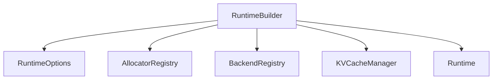
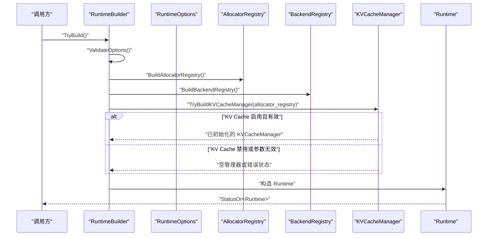
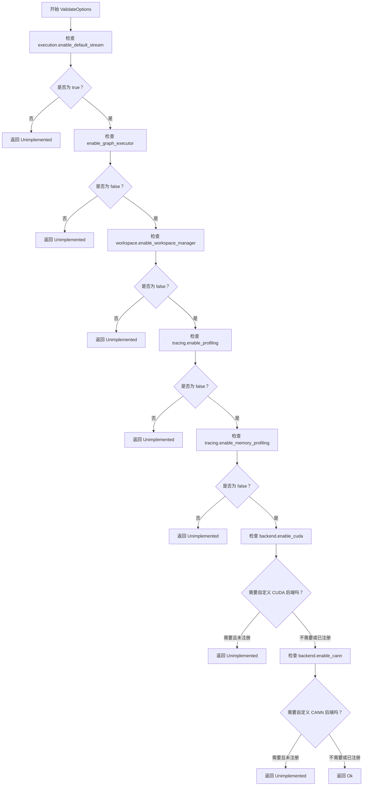
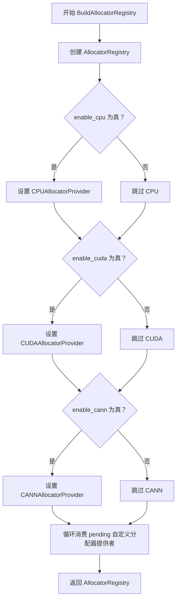
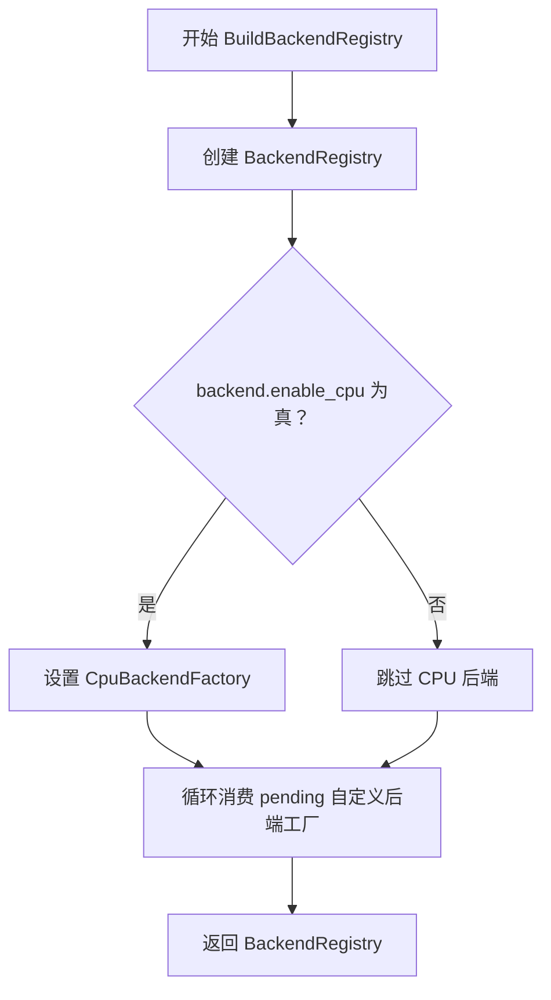
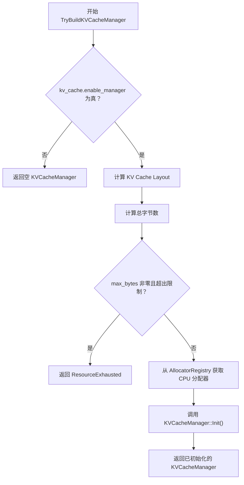
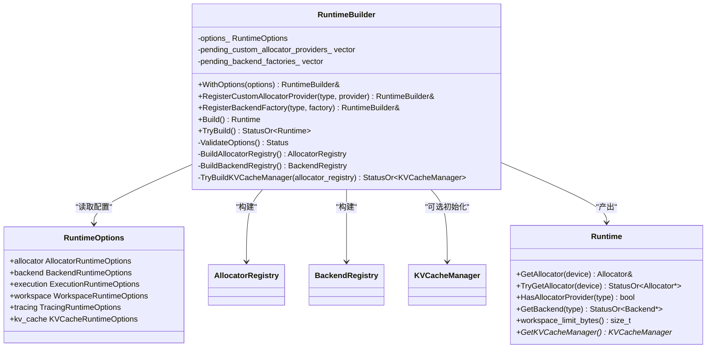

# RuntimeBuilder API

**本文引用的文件**
- [include/aethermind/runtime/runtime_builder.h](../../../../include/aethermind/runtime/runtime_builder.h)
- [src/runtime/runtime_builder.cpp](../../../../src/runtime/runtime_builder.cpp)
- [include/aethermind/runtime/runtime_options.h](../../../../include/aethermind/runtime/runtime_options.h)
- [include/aethermind/runtime/runtime.h](../../../../include/aethermind/runtime/runtime.h)
- [tests/unit/runtime/test_runtime_builder.cpp](../../../../tests/unit/runtime/test_runtime_builder.cpp)

## 目录
1. [简介](#简介)
2. [项目结构中的位置](#项目结构中的位置)
3. [核心职责与概念](#核心职责与概念)
4. [完整方法文档](#完整方法文档)
5. [构建流程与错误处理](#构建流程与错误处理)
6. [对象生命周期与待注册项消费语义](#对象生命周期与待注册项消费语义)
7. [线程安全与并发模型](#线程安全与并发模型)
8. [典型配置示例说明](#典型配置示例说明)
9. [依赖关系分析](#依赖关系分析)
10. [性能与资源特性](#性能与资源特性)
11. [故障排查指南](#故障排查指南)
12. [最佳实践建议](#最佳实践建议)
13. [总结](#总结)

## 简介
`RuntimeBuilder` 是 AetherMind 运行时系统的装配器类。它负责根据 `RuntimeOptions` 组装 `Runtime`，并允许在构建前注册自定义分配器提供者 `AllocatorProvider` 和后端工厂 `BackendFactory`。其设计采用 Builder 模式：通过链式调用逐步配置选项、注册扩展点，最后通过 `Build()` 或 `TryBuild()` 完成最终装配。

该类的关键特征是：
- 默认分配器和后端由 `RuntimeOptions` 推导；自定义注册项优先于默认值。
- 构建过程中可能初始化 KV Cache Manager。
- `Build()` 在失败时中止程序；`TryBuild()` 返回 `StatusOr<Runtime>`，适合可恢复的错误处理。
- 构建完成后会消费“待注册项”，避免重复注入。
- 该类本身不是线程安全的。

## 项目结构中的位置
`RuntimeBuilder` 属于运行时模块，位于头文件 `include/aethermind/runtime/runtime_builder.h`，实现位于 `src/runtime/runtime_builder.cpp`。它与以下组件紧密相关：
- `RuntimeOptions`：定义运行时配置。
- `Runtime`：被装配出的长生命周期运行时对象。
- `AllocatorRegistry`、`BackendRegistry`：分别管理分配器和后端。
- `KVCacheManager`：可选的 KV Cache 管理器。

**图示来源**
- [include/aethermind/runtime/runtime_builder.h:14-111](../../../../include/aethermind/runtime/runtime_builder.h#L14-L111)
- [include/aethermind/runtime/runtime_options.h:10-68](../../../../include/aethermind/runtime/runtime_options.h#L10-L68)
- [include/aethermind/runtime/runtime.h:14-127](../../../../include/aethermind/runtime/runtime.h#L14-L127)

**章节来源**
- [include/aethermind/runtime/runtime_builder.h:1-111](../../../../include/aethermind/runtime/runtime_builder.h#L1-L111)
- [include/aethermind/runtime/runtime_options.h:1-69](../../../../include/aethermind/runtime/runtime_options.h#L1-L69)
- [include/aethermind/runtime/runtime.h:1-127](../../../../include/aethermind/runtime/runtime.h#L1-L127)

## 核心职责与概念
`RuntimeBuilder` 的职责可以概括为：

| 维度 | 说明 |
|---|---|
| 装配入口 | 提供 `WithOptions()`、`RegisterCustomAllocatorProvider()`、`RegisterBackendFactory()`、`Build()`、`TryBuild()` 等公共接口。 |
| 配置来源 | 从 `RuntimeOptions` 中读取是否启用 CPU/CUDA/CANN 分配器、CPU/GPU/CANN 后端、KV Cache、工作区限制、执行策略和跟踪策略。 |
| 自定义扩展 | 允许用户覆盖默认分配器提供者和后端工厂。 |
| 构建产物 | 产出 `Runtime`，由 `Runtime` 拥有分配器、后端和 KV Cache 等资源。 |
| 错误策略 | `Build()` 抛出异常式中止；`TryBuild()` 返回状态码，支持资源耗尽、未实现、参数无效等错误路径。 |
| 生命周期 | 一次构建消费 pending registrations；后续构建只使用当前已保存的配置和新增注册。 |

**章节来源**
- [include/aethermind/runtime/runtime_builder.h:14-111](../../../../include/aethermind/runtime/runtime_builder.h#L14-L111)
- [src/runtime/runtime_builder.cpp:11-200](../../../../src/runtime/runtime_builder.cpp#L11-L200)

## 完整方法文档

### WithOptions()

| 项目 | 内容 |
|---|---|
| 方法签名 | `RuntimeBuilder& WithOptions(const RuntimeOptions& options)` |
| 作用 | 替换 builder 内部保存的 `RuntimeOptions`，供后续 `Build()` 或 `TryBuild()` 使用。 |
| 参数 | `options`：新的运行时配置，包含分配器、后端、执行、工作区、跟踪、KV Cache 等子选项。 |
| 返回值 | `*this`，用于链式调用。 |
| 异常行为 | 该方法不直接触发构建错误；但新 `RuntimeOptions` 会在构建阶段被校验。 |
| 常见用途 | 先构造一个空的 `RuntimeBuilder`，再调用 `WithOptions(options)` 设置设备、KV Cache、工作区等。 |

参考实现位置：[src/runtime/runtime_builder.cpp:11-14](../../../../src/runtime/runtime_builder.cpp#L11-L14)

**章节来源**
- [include/aethermind/runtime/runtime_builder.h:23-28](../../../../include/aethermind/runtime/runtime_builder.h#L23-L28)
- [src/runtime/runtime_builder.cpp:11-14](../../../../src/runtime/runtime_builder.cpp#L11-L14)

### RegisterCustomAllocatorProvider()

| 项目 | 内容 |
|---|---|
| 方法签名 | `RuntimeBuilder& RegisterCustomAllocatorProvider(DeviceType type, std::unique_ptr<AllocatorProvider> provider)` |
| 作用 | 注册一个自定义分配器提供者，覆盖指定 `DeviceType` 的默认分配器提供者。 |
| 参数 | `type`：要覆盖的设备类型，不能是 `kUndefined`。 `provider`：分配器提供者所有权转移给 builder。 |
| 返回值 | `*this`，用于链式调用。 |
| 前置条件 | `provider` 不能为空；`type` 不能是 `kUndefined`。违反时调用 abort。 |
| 存储语义 | 注册项保存在 `pending_custom_allocator_providers_` 列表中，直到构建时被消费。 |
| 构建影响 | 在 `BuildAllocatorRegistry()` 中，builder 将 pending 注册转移到 `AllocatorRegistry`。 |

参考实现位置：[src/runtime/runtime_builder.cpp:63-78](../../../../src/runtime/runtime_builder.cpp#L63-L78)

**章节来源**
- [include/aethermind/runtime/runtime_builder.h:30-43](../../../../include/aethermind/runtime/runtime_builder.h#L30-L43)
- [src/runtime/runtime_builder.cpp:63-78](../../../../src/runtime/runtime_builder.cpp#L63-L78)

### RegisterBackendFactory()

| 项目 | 内容 |
|---|---|
| 方法签名 | `RuntimeBuilder& RegisterBackendFactory(DeviceType type, std::unique_ptr<BackendFactory> factory)` |
| 作用 | 注册一个自定义后端工厂，覆盖指定 `DeviceType` 的默认后端工厂。 |
| 参数 | `type`：要覆盖的设备类型，不能是 `kUndefined`。 `factory`：后端工厂所有权转移给 builder。 |
| 返回值 | `*this`，用于链式调用。 |
| 前置条件 | `factory` 不能为空；`type` 不能是 `kUndefined`。违反时调用 abort。 |
| 存储语义 | 注册项保存在 `pending_backend_factories_` 列表中，直到构建时被消费。 |
| 构建影响 | 在 `BuildBackendRegistry()` 中，builder 将 pending 注册转移到 `BackendRegistry`。 |

参考实现位置：[src/runtime/runtime_builder.cpp:80-92](../../../../src/runtime/runtime_builder.cpp#L80-L92)

**章节来源**
- [include/aethermind/runtime/runtime_builder.h:45-58](../../../../include/aethermind/runtime/runtime_builder.h#L45-L58)
- [src/runtime/runtime_builder.cpp:80-L92](../../../../src/runtime/runtime_builder.cpp#L80-L92)

### Build()

| 项目 | 内容 |
|---|---|
| 方法签名 | `Runtime Build()` |
| 作用 | 使用当前 `RuntimeOptions` 和 pending 注册构建 `Runtime`。 |
| 返回值 | 成功时返回一个已构建完成的 `Runtime`。 |
| 异常行为 | 如果内部 `TryBuild()` 返回错误状态，则调用 `AM_CHECK` 中止程序。 |
| 资源所有权 | 返回的 `Runtime` 拥有所有已创建的分配器、后端和 KV Cache 资源。 |
| 构建副作用 | 消费 pending custom allocator providers 和 backend factories。 |

参考实现位置：[src/runtime/runtime_builder.cpp:16-20](../../../../src/runtime/runtime_builder.cpp#L16-L20)

**章节来源**
- [include/aethermind/runtime/runtime_builder.h:60-72](../../../../include/aethermind/runtime/runtime_builder.h#L60-L72)
- [src/runtime/runtime_builder.cpp:16-20](../../../../src/runtime/runtime_builder.cpp#L16-L20)

### TryBuild()

| 项目 | 内容 |
|---|---|
| 方法签名 | `StatusOr<Runtime> TryBuild()` |
| 作用 | 构建 `Runtime`，并将初始化失败以 `Status` 返回，而不是中止程序。 |
| 返回值 | 成功时返回 `Runtime`；否则返回错误状态。 |
| 错误类型 | 可能返回 `Unimplemented`、`InvalidArgument`、`ResourceExhausted` 等。 |
| 构建步骤 | 1. 校验 `RuntimeOptions`。 2. 构建 `AllocatorRegistry`。 3. 构建 `BackendRegistry`。 4. 尝试构建 `KVCacheManager`。 5. 构造 `Runtime`。 |
| 内存异常处理 | 捕获 `std::bad_alloc`，转换为空消息的 `ResourceExhausted`。 |
| 消费语义 | 成功构建会消费 pending 注册；即使构建中途失败，pending 列表也不会保留已转移的条目。 |

参考实现位置：[src/runtime/runtime_builder.cpp:22-35](../../../../src/runtime/runtime_builder.cpp#L22-L35)

**章节来源**
- [include/aethermind/runtime/runtime_builder.h:74-95](../../../../include/aethermind/runtime/runtime_builder.h#L74-L95)
- [src/runtime/runtime_builder.cpp:22-35](../../../../src/runtime/runtime_builder.cpp#L22-L35)

## 构建流程与错误处理

### 总体构建序列

**图示来源**
- [src/runtime/runtime_builder.cpp:22-35](../../../../src/runtime/runtime_builder.cpp#L22-L35)
- [src/runtime/runtime_builder.cpp:94-122](../../../../src/runtime/runtime_builder.cpp#L94-L122)
- [src/runtime/runtime_builder.cpp:124-198](../../../../src/runtime/runtime_builder.cpp#L124-L198)

### 选项校验流程

`ValidateOptions()` 对 `RuntimeOptions` 进行白名单检查，当前拒绝的行为包括：

| 选项 | 当前行为 |
|---|---|
| `execution.enable_default_stream=false` | 返回 `Unimplemented`。 |
| `execution.enable_graph_executor=true` | 返回 `Unimplemented`。 |
| `workspace.enable_workspace_manager=true` | 返回 `Unimplemented`。 |
| `tracing.enable_profiling=true` | 返回 `Unimplemented`。 |
| `tracing.enable_memory_profiling=true` | 返回 `Unimplemented`。 |
| `backend.enable_cuda=true` 且未注册 CUDA 自定义后端工厂 | 返回 `Unimplemented`。 |
| `backend.enable_cann=true` 且未注册 CANN 自定义后端工厂 | 返回 `Unimplemented`。 |

**图示来源**
- [src/runtime/runtime_builder.cpp:37-61](../../../../src/runtime/runtime_builder.cpp#L37-L61)

**章节来源**
- [src/runtime/runtime_builder.cpp:37-61](../../../../src/runtime/runtime_builder.cpp#L37-L61)

### 分配器注册表构建

`BuildAllocatorRegistry()` 按 `RuntimeOptions::allocator` 启用内置分配器提供者，然后依次消费 pending 自定义分配器提供者。

| 设备 | 默认提供者 |
|---|---|
| CPU | `CPUAllocatorProvider` |
| CUDA | `CUDAAllocatorProvider` |
| CANN | `CANNAllocatorProvider` |

注意：
- 默认提供者由 `enable_cpu`、`enable_cuda`、`enable_cann` 控制。
- 自定义提供者通过 `RegisterCustomAllocatorProvider()` 注册，并在构建时被转移到 `AllocatorRegistry`。
- 一旦某条 pending 注册被移入 registry，即使后续步骤失败，也不能回到 pending 列表。

**图示来源**
- [src/runtime/runtime_builder.cpp:94-122](../../../../src/runtime/runtime_builder.cpp#L94-L122)

**章节来源**
- [src/runtime/runtime_builder.cpp:94-122](../../../../src/runtime/runtime_builder.cpp#L94-L122)

### 后端注册表构建

`BuildBackendRegistry()` 首先根据 `RuntimeOptions::backend.enable_cpu` 注册 CPU 后端工厂，然后消费 pending 自定义后端工厂。

关键点：
- 当前没有内置 GPU/CANN 后端工厂，因此启用 `backend.enable_cuda` 或 `backend.enable_cann` 必须配合自定义后端工厂。
- pending 后端工厂在构建时按顺序消费。

**图示来源**
- [src/runtime/runtime_builder.cpp:124-143](../../../../src/runtime/runtime_builder.cpp#L124-L143)

**章节来源**
- [src/runtime/runtime_builder.cpp:124-L143](../../../../src/runtime/runtime_builder.cpp#L124-L143)

### KV Cache 管理器构建

`TryBuildKVCacheManager()` 负责：
1. 判断是否启用 KV Cache manager。
2. 计算 KV Cache layout。
3. 校验最大字节限制。
4. 从 `AllocatorRegistry` 获取 CPU 分配器。
5. 调用 `KVCacheManager::Init()` 初始化。

**图示来源**
- [src/runtime/runtime_builder.cpp:145-L198](../../../../src/runtime/runtime_builder.cpp#L145-L198)

**章节来源**
- [src/runtime/runtime_builder.cpp:145-L198](../../../../src/runtime/runtime_builder.cpp#L145-L198)

## 对象生命周期与待注册项消费语义

### 待注册项数据结构

`RuntimeBuilder` 内部维护两类待注册项：

| 类型 | 字段 | 含义 |
|---|---|---|
| `PendingCustomAllocatorProvider` | `type`、`provider` | 待注册的自定义分配器提供者。 |
| `PendingBackendFactory` | `type`、`factory` | 待注册的自定义后端工厂。 |

这两个结构体都是私有成员，仅在构建时消费。

**章节来源**
- [include/aethermind/runtime/runtime_builder.h:97-L109](../../../../include/aethermind/runtime/runtime_builder.h#L97-L109)

### 消费时机

1. `RegisterCustomAllocatorProvider()` 将条目追加到 `pending_custom_allocator_providers_`。
2. `RegisterBackendFactory()` 将条目追加到 `pending_backend_factories_`。
3. `BuildAllocatorRegistry()` 消费分配器 pending 列表。
4. `BuildBackendRegistry()` 消费后端 pending 列表。
5. 一旦条目被移动到 registry，就不再存在于 pending 列表中。

这意味着：
- 多次调用 `RegisterCustomAllocatorProvider()` 会累积多个条目。
- 一次 `Build()` 或 `TryBuild()` 会消费这些条目。
- 失败后重试时，之前已转移的自定义注册不会再次出现。

**章节来源**
- [src/runtime/runtime_builder.cpp:63-L92](../../../../src/runtime/runtime_builder.cpp#L63-L92)
- [src/runtime/runtime_builder.cpp:94-L143](../../../../src/runtime/runtime_builder.cpp#L94-L143)

### Build() 与 TryBuild() 的错误处理差异

| 对比项 | `Build()` | `TryBuild()` |
|---|---|---|
| 错误传播方式 | 调用内部 `TryBuild()`，若失败则通过 `AM_CHECK` 中止。 | 返回 `StatusOr<Runtime>`，由调用方判断。 |
| 适用场景 | 应用启动期、不允许恢复的错误。 | 测试、插件加载、可恢复装配场景。 |
| OOM 行为 | 通过 `TryBuild()` 转为 `ResourceExhausted`，再由 `AM_CHECK` 中止。 | 直接返回 `ResourceExhausted`。 |
| 未实现选项 | 间接中止。 | 返回 `Unimplemented`。 |
| 参数无效 | 间接中止。 | 返回 `InvalidArgument` 或其他合适状态。 |
| KV Cache 初始化失败 | 间接中止。 | 返回具体错误状态。 |

**章节来源**
- [src/runtime/runtime_builder.cpp:16-L35](../../../../src/runtime/runtime_builder.cpp#L16-L35)

## 线程安全与并发模型

`RuntimeBuilder` 明确声明为非线程安全。原因包括：
- 内部保存 mutable 的 `options_`。
- 内部维护两个可变 vector：pending allocator providers 和 pending backend factories。
- 链式方法直接修改这些状态。
- 构建过程会消费 pending 列表。

因此，不应在多线程中对同一个 `RuntimeBuilder` 实例并发调用 `WithOptions()`、`RegisterCustomAllocatorProvider()`、`RegisterBackendFactory()` 或 `Build()`/`TryBuild()`。

如果需要多实例并行装配，应为每个线程使用独立的 `RuntimeBuilder` 对象。

**章节来源**
- [include/aethermind/runtime/runtime_builder.h:14-L21](../../../../include/aethermind/runtime/runtime_builder.h#L14-L21)

## 典型配置示例说明

以下示例描述如何配置 CPU 后端、注册自定义 `AllocatorProvider`，并构建 `Runtime`。由于本 API 文档不直接粘贴代码，请使用对应源码路径理解调用顺序。

### 示例一：仅启用默认 CPU 后端

目标：
- 使用默认 `RuntimeOptions`。
- 不注册自定义分配器提供者。
- 构建 `Runtime`。

推荐调用链：
1. 构造 `RuntimeBuilder`。
2. 可选：调用 `WithOptions(options)`。
3. 调用 `Build()` 或 `TryBuild()`。

参考路径：
- [include/aethermind/runtime/runtime_builder.h:23-L72](../../../../include/aethermind/runtime/runtime_builder.h#L23-L72)
- [tests/unit/runtime/test_runtime_builder.cpp:135-L152](../../../../tests/unit/runtime/test_runtime_builder.cpp#L135-L152)

### 示例二：启用 KV Cache 并构建 Runtime

目标：
- 启用 `kv_cache.enable_manager`。
- 设置层数、KV head 数、最大 token、head_dim、数据类型和对齐。
- 验证 `Runtime` 的 KV Cache manager 存在并已初始化。

推荐调用链：
1. 构造 `RuntimeOptions`。
2. 填充 `kv_cache` 子选项。
3. 调用 `RuntimeBuilder::WithOptions(options)`。
4. 调用 `TryBuild()` 或 `Build()`。
5. 通过 `Runtime::GetKVCacheManager()` 检查 KV Cache。

参考路径：
- [tests/unit/runtime/test_runtime_builder.cpp:19-L38](../../../../tests/unit/runtime/test_runtime_builder.cpp#L19-L38)
- [tests/unit/runtime/test_runtime_builder.cpp:61-L88](../../../../tests/unit/runtime/test_runtime_builder.cpp#L61-L88)
- [tests/unit/runtime/test_runtime_builder.cpp:154-L167](../../../../tests/unit/runtime/test_runtime_builder.cpp#L154-L167)

### 示例三：注册自定义 AllocatorProvider

目标：
- 注册自定义 `AllocatorProvider`。
- 覆盖指定 `DeviceType` 的默认分配器提供者。
- 验证 pending 注册在构建后被消费。

推荐调用链：
1. 构造 `RuntimeBuilder`。
2. 调用 `RegisterCustomAllocatorProvider(device_type, provider)`。
3. 调用 `TryBuild()` 或 `Build()`。
4. 确认后续重试不再包含该自定义注册。

参考路径：
- [tests/unit/runtime/test_runtime_builder.cpp:40-L59](../../../../tests/unit/runtime/test_runtime_builder.cpp#L40-L59)
- [tests/unit/runtime/test_runtime_builder.cpp:105-L133](../../../../tests/unit/runtime/test_runtime_builder.cpp#L105-L133)
- [src/runtime/runtime_builder.cpp:63-L78](../../../../src/runtime/runtime_builder.cpp#L63-L78)

### 示例四：注册自定义 BackendFactory

目标：
- 注册自定义 `BackendFactory`。
- 覆盖指定 `DeviceType` 的后端工厂。
- 配合 `backend.enable_cuda` 或 `backend.enable_cann` 使用。

推荐调用链：
1. 构造自定义 `BackendFactory`。
2. 调用 `RegisterBackendFactory(device_type, factory)`。
3. 设置 `RuntimeOptions::backend.enable_cuda` 或 `backend.enable_cann`。
4. 调用 `TryBuild()` 或 `Build()`。

参考路径：
- [tests/unit/runtime/test_runtime_builder.cpp:40-L59](../../../../tests/unit/runtime/test_runtime_builder.cpp#L40-L59)
- [src/runtime/runtime_builder.cpp:80-L92](../../../../src/runtime/runtime_builder.cpp#L80-L92)
- [src/runtime/runtime_builder.cpp:37-L61](../../../../src/runtime/runtime_builder.cpp#L37-L61)

## 依赖关系分析

### 主要依赖

**图示来源**
- [include/aethermind/runtime/runtime_builder.h:14-L111](../../../../include/aethermind/runtime/runtime_builder.h#L14-L111)
- [include/aethermind/runtime/runtime_options.h:10-L68](../../../../include/aethermind/runtime/runtime_options.h#L10-L68)
- [include/aethermind/runtime/runtime.h:14-L127](../../../../include/aethermind/runtime/runtime.h#L14-L127)

### 构建阶段依赖

| 阶段 | 输入 | 输出 | 失败路径 |
|---|---|---|---|
| 选项校验 | `RuntimeOptions` | `Status` | `Unimplemented`、`InvalidArgument` |
| 分配器注册表构建 | `RuntimeOptions::allocator`、pending allocator providers | `AllocatorRegistry` | 分配失败 → `ResourceExhausted` |
| 后端注册表构建 | `RuntimeOptions::backend`、pending backend factories | `BackendRegistry` | 分配失败 → `ResourceExhausted` |
| KV Cache 构建 | `RuntimeOptions::kv_cache`、`AllocatorRegistry` | `KVCacheManager` | 参数无效、超限、分配失败 |
| Runtime 构造 | registries、manager、workspace limit | `Runtime` | 一般无额外失败 |

**章节来源**
- [src/runtime/runtime_builder.cpp:22-L143](../../../../src/runtime/runtime_builder.cpp#L22-L143)
- [src/runtime/runtime_builder.cpp:145-L198](../../../../src/runtime/runtime_builder.cpp#L145-L198)

## 性能与资源特性

- **资源所有者**：`Runtime` 拥有 `AllocatorRegistry`、`BackendRegistry` 和 `KVCacheManager`。`RuntimeBuilder` 只是临时装配器。
- **延迟创建**：`Runtime` 的后端是按需创建并缓存的；分配器也通过 registry 管理。
- **KV Cache 开销**：当启用 KV Cache 时，布局计算和实际内存分配发生在构建阶段。
- **工作区限制**：`workspace.default_workspace_limit_bytes` 在构建时传入 `Runtime`，但不一定启用独立 workspace manager。
- **内存异常优化**：`TryBuild()` 捕获 `std::bad_alloc`，并使用空消息构造 `ResourceExhausted`，避免在 OOM 报告路径上继续分配。

**章节来源**
- [include/aethermind/runtime/runtime.h:14-L127](../../../../include/aethermind/runtime/runtime.h#L14-L127)
- [src/runtime/runtime_builder.cpp:22-L35](../../../../src/runtime/runtime_builder.cpp#L22-L35)
- [src/runtime/runtime_builder.cpp:145-L198](../../../../src/runtime/runtime_builder.cpp#L145-L198)

## 故障排查指南

| 现象 | 可能原因 | 诊断建议 |
|---|---|---|
| 构建返回 `Unimplemented` | 启用了尚未支持的执行、工作区或跟踪选项。 | 检查 `execution`、`workspace`、`tracing` 子选项。 |
| 构建返回 `Unimplemented` | 启用了 CUDA 或 CANN 后端但未注册对应自定义工厂。 | 调用 `RegisterBackendFactory()` 注册对应设备类型的工厂。 |
| 构建返回 `InvalidArgument` | KV Cache 参数无效，例如 `head_dim=0` 或 `alignment=0`。 | 检查 `kv_cache` 子选项。 |
| 构建返回 `ResourceExhausted` | KV Cache 所需内存超过 `max_bytes`，或底层分配失败。 | 检查 `kv_cache.max_bytes`、系统内存和分配器可用性。 |
| 自定义分配器未生效 | 未正确注册，或已在失败构建中被消费。 | 检查 `RegisterCustomAllocatorProvider()` 调用顺序和重试语义。 |
| 自定义后端未生效 | 未正确注册，或 pending 注册已被消费。 | 检查 `RegisterBackendFactory()` 调用顺序和重试语义。 |
| 程序崩溃 | 使用了 `Build()` 而内部错误触发了 `AM_CHECK`。 | 改用 `TryBuild()` 检查 `Status`。 |

参考测试用例：
- KV Cache 无效参数：[tests/unit/runtime/test_runtime_builder.cpp:90-L103](../../../../tests/unit/runtime/test_runtime_builder.cpp#L90-L103)
- pending 注册在失败后仍被消费：[tests/unit/runtime/test_runtime_builder.cpp:105-L133](../../../../tests/unit/runtime/test_runtime_builder.cpp#L105-L133)
- OOM 下 pending 列表可复用但已转移注册不可恢复：[tests/unit/runtime/test_runtime_builder.cpp:169-L200](../../../../tests/unit/runtime/test_runtime_builder.cpp#L169-L200)

**章节来源**
- [tests/unit/runtime/test_runtime_builder.cpp:61-L200](../../../../tests/unit/runtime/test_runtime_builder.cpp#L61-L200)
- [src/runtime/runtime_builder.cpp:37-L198](../../../../src/runtime/runtime_builder.cpp#L37-L198)

## 最佳实践建议

1. **优先使用 `TryBuild()`**
   除非你确定构建失败应终止进程，否则优先使用 `TryBuild()` 以便恢复。

2. **不要在多线程共享同一个 `RuntimeBuilder`**
   因为它是非线程安全的。如需并行装配，请为每个线程创建独立实例。

3. **一次性完成所有注册后再构建**
   虽然 builder 允许链式调用，但建议在 `Build()` 或 `TryBuild()` 之前完成所有 `WithOptions()` 和注册调用。

4. **理解 pending 注册的一次性语义**
   已转移到 registry 的自定义分配器或后端工厂不会回到 pending 列表；失败重试时应重新注册需要的条目。

5. **显式配置 CUDA/CANN 后端工厂**
   当前没有内置 GPU/CANN 后端工厂，启用相应后端时必须注册自定义 `BackendFactory`。

6. **谨慎启用 KV Cache**
   KV Cache 会增加构建阶段的内存分配；务必检查 `num_layers`、`num_kv_heads`、`max_tokens`、`head_dim`、`kv_dtype`、`alignment` 和 `max_bytes`。

7. **保持 `Runtime` 生命周期稳定**
   `Runtime` 必须比通过其后端解析的 `ExecutionPlan` 以及借用其 KV Cache 的管理器或 session view 更长。

**章节来源**
- [include/aethermind/runtime/runtime.h:14-L23](../../../../include/aethermind/runtime/runtime.h#L14-L23)
- [include/aethermind/runtime/runtime_builder.h:14-L21](../../../../include/aethermind/runtime/runtime_builder.h#L14-L21)
- [src/runtime/runtime_builder.cpp:22-L35](../../../../src/runtime/runtime_builder.cpp#L22-L35)
- [src/runtime/runtime_builder.cpp:145-L198](../../../../src/runtime/runtime_builder.cpp#L145-L198)

## 总结

`RuntimeBuilder` 是 AetherMind 运行时装配的核心入口。它通过 `RuntimeOptions` 决定默认行为，并通过 `RegisterCustomAllocatorProvider()` 和 `RegisterBackendFactory()` 暴露扩展点。`Build()` 适用于简单场景，而 `TryBuild()` 提供更精细的错误控制和可恢复构建语义。

在实际工程中，推荐：
- 使用 `TryBuild()` 作为主构建路径。
- 显式注册自定义分配器和后端。
- 正确处理 pending 注册的消费语义。
- 在应用启动阶段完成 `Runtime` 装配，并将其作为长生命周期资源管理。
- 对外部并发访问进行序列化，因为 `RuntimeBuilder` 和 `Runtime` 都不是线程安全的。
