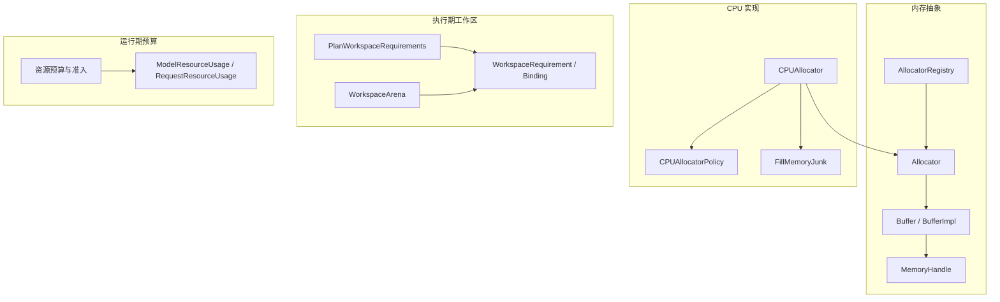
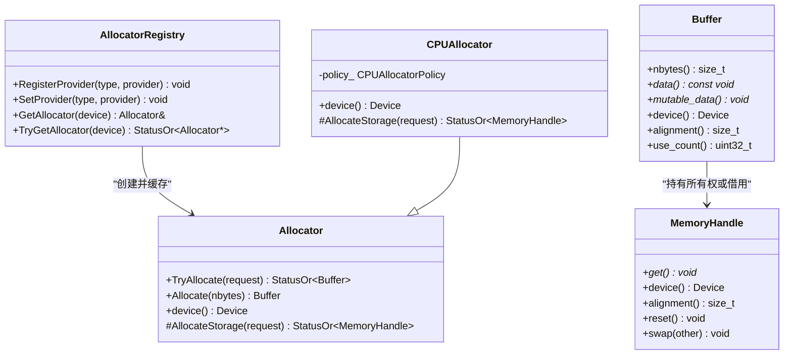
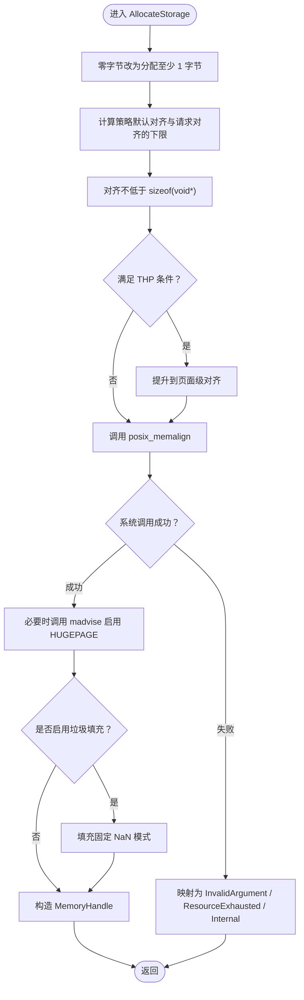
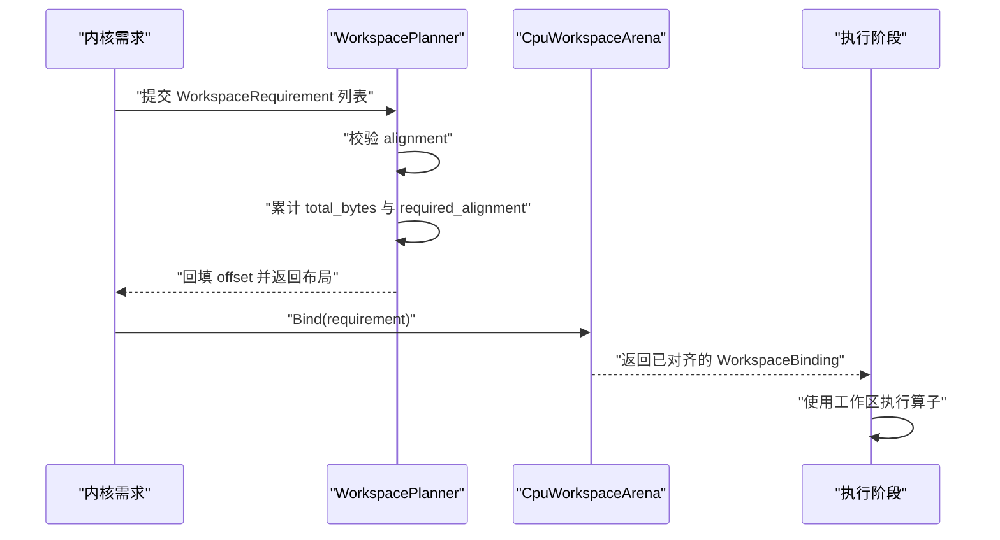
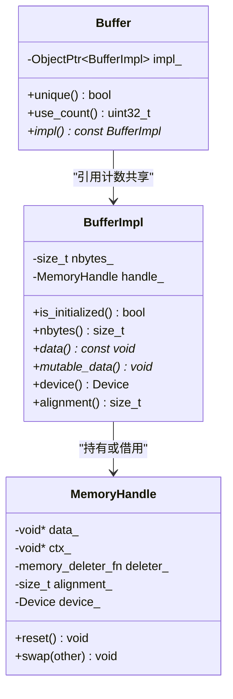
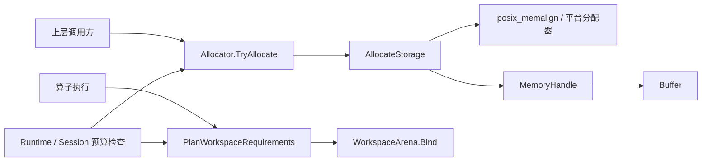
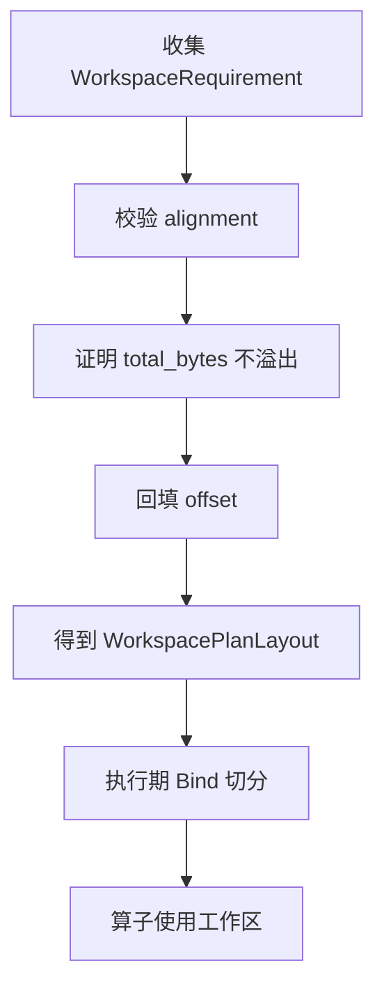
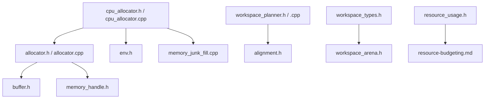

# 内存分配策略与优化

**本文引用的文件**
- [allocator.h](../../../include/aethermind/memory/allocator.h)
- [allocator.cpp](../../../src/memory/allocator.cpp)
- [cpu_allocator.h](../../../include/aethermind/memory/cpu_allocator.h)
- [cpu_allocator.cpp](../../../src/memory/cpu_allocator.cpp)
- [buffer.h](../../../include/aethermind/memory/buffer.h)
- [memory_handle.h](../../../include/aethermind/memory/memory_handle.h)
- [workspace_arena.h](../../../include/aethermind/base/workspace_arena.h)
- [workspace_types.h](../../../include/aethermind/base/workspace_types.h)
- [workspace_planner.h](../../../include/aethermind/runtime/workspace_planner.h)
- [workspace_planner.cpp](../../../src/runtime/workspace_planner.cpp)
- [object_allocator.h](../../../include/aethermind/base/object_allocator.h)
- [memory_junk_fill.cpp](../../../src/memory/memory_junk_fill.cpp)
- [cann_allocator.cpp](../../../src/memory/cann_allocator.cpp)
- [cuda_allocator.cpp](../../../src/memory/cuda_allocator.cpp)
- [resource_usage.h](../../../include/aethermind/inference/resource_usage.h)
- [resource-budgeting.md](../../guides/resource-budgeting.md)
- [runtime-configuration.md](../../guides/runtime-configuration.md)
- [env.h](../../../include/aethermind/base/env.h)
- [test_cpu_allocator.cpp](../../../tests/unit/memory/test_cpu_allocator.cpp)
- [test_runtime_resource_limits.cpp](../../../tests/unit/runtime/test_runtime_resource_limits.cpp)
- [test_inference_resource_limits.cpp](../../../tests/unit/inference/test_inference_resource_limits.cpp)

## 目录
1. [引言](#引言)
2. [项目结构](#项目结构)
3. [核心组件](#核心组件)
4. [架构总览](#架构总览)
5. [详细组件分析](#详细组件分析)
6. [依赖关系分析](#依赖关系分析)
7. [性能考量](#性能考量)
8. [故障排查指南](#故障排查指南)
9. [结论](#结论)
10. [附录](#附录)

## 引言
本文围绕 AetherMind 的内存分配策略与优化展开，覆盖以下目标：
- 小对象快速分配、大对象连续分配、临时工作区复用、长期缓冲区持久化的策略选择。
- 内存对齐对 SIMD 指令性能的影响、缓存行优化和 NUMA 感知建议。
- 内存碎片化问题及当前实现中的缓解方案。
- 资源预算控制、内存上限监控与 OOM 处理机制。
- 性能分析方法：分配热点识别、内存带宽利用分析和延迟分布统计。
- 生产环境部署最佳实践：内存配置调优、垃圾回收相关参数设置、故障恢复策略。

AetherMind 当前 CPU 路径的核心设计是：通过 `Allocator` 抽象统一设备分配入口，由 `CPUAllocator` 基于 `posix_memalign` 提供对齐存储；执行期使用 `WorkspaceArena` 和 `WorkspacePlanner` 做一次性规划、按偏移切分的临时工作区；`Buffer` 以引用计数共享底层 `MemoryHandle` 的生命周期；推理层提供 KV Cache、Workspace 和激活值的阶段式资源预算检查，避免实际分配前才失败。

## 项目结构
与内存分配相关的代码分布在四个主要区域：
- 通用内存接口：`include/aethermind/memory/*` 与 `src/memory/*`。
- 执行期工作区：`include/aethermind/base/workspace_*.h`、`src/backend/cpu/cpu_workspace_arena.cpp`、`include/aethermind/runtime/workspace_planner.*`、`src/runtime/workspace_planner.cpp`。
- 运行时与推理资源预算：`include/aethermind/inference/resource_usage.h`、`docs/guides/resource-budgeting.md`、`docs/guides/runtime-configuration.md`。
- 单元测试：验证对齐、OOM、预算校验、零字节语义、THP 行为等。

**图表来源**
- [allocator.h:1-114](../../../include/aethermind/memory/allocator.h#L1-L114)
- [cpu_allocator.h:1-70](../../../include/aethermind/memory/cpu_allocator.h#L1-L70)
- [workspace_types.h:1-84](../../../include/aethermind/base/workspace_types.h#L1-L84)
- [workspace_planner.h:1-77](../../../include/aethermind/runtime/workspace_planner.h#L1-L77)
- [buffer.h:1-185](../../../include/aethermind/memory/buffer.h#L1-L185)
- [memory_handle.h:1-170](../../../include/aethermind/memory/memory_handle.h#L1-L170)
- [memory_junk_fill.cpp:1-30](../../../src/memory/memory_junk_fill.cpp#L1-L30)
- [resource_usage.h:1-43](../../../include/aethermind/inference/resource_usage.h#L1-L43)
- [resource-budgeting.md](../../guides/resource-budgeting.md)

**章节来源**
- [allocator.h:1-114](../../../include/aethermind/memory/allocator.h#L1-L114)
- [cpu_allocator.h:1-70](../../../include/aethermind/memory/cpu_allocator.h#L1-L70)
- [workspace_types.h:1-84](../../../include/aethermind/base/workspace_types.h#L1-L84)
- [workspace_planner.h:1-77](../../../include/aethermind/runtime/workspace_planner.h#L1-L77)
- [buffer.h:1-185](../../../include/aethermind/memory/buffer.h#L1-L185)
- [memory_handle.h:1-170](../../../include/aethermind/memory/memory_handle.h#L1-L170)
- [memory_junk_fill.cpp:1-30](../../../src/memory/memory_junk_fill.cpp#L1-L30)
- [resource_usage.h:1-43](../../../include/aethermind/inference/resource_usage.h#L1-L43)
- [resource-budgeting.md](../../guides/resource-budgeting.md)

## 核心组件
### 统一分配接口与注册表
- `AllocationRequest` 描述可见大小和对齐下限；非零对齐必须是 2 的幂。
- `Allocator` 暴露 `TryAllocate` 与 `Allocate`，内部先校验请求，再调用 `AllocateStorage`，最后把 `MemoryHandle` 移入 `Buffer`。
- `AllocatorRegistry` 按 `DeviceType` 管理 `AllocatorProvider`，并按 `Device` 缓存实例。
- 所有诊断性 OOM 返回空消息的 `ResourceExhausted`，避免在错误报告中再次分配。

**图表来源**
- [allocator.h:1-114](../../../include/aethermind/memory/allocator.h#L1-L114)
- [cpu_allocator.h:1-70](../../../include/aethermind/memory/cpu_allocator.h#L1-L70)
- [memory_handle.h:1-170](../../../include/aethermind/memory/memory_handle.h#L1-L170)
- [buffer.h:1-185](../../../include/aethermind/memory/buffer.h#L1-L185)

**章节来源**
- [allocator.h:1-114](../../../include/aethermind/memory/allocator.h#L1-L114)
- [allocator.cpp:1-140](../../../src/memory/allocator.cpp#L1-L140)

### CPU 分配器与大页优化
`CPUAllocator` 将设备无关的分配策略落到 CPU 平台：
- 默认对齐来自构建宏 `KALLOC_ALIGNMENT`，未定义时为 64 字节。
- 小于指针大小的非零对齐会被提升，因为 `posix_memalign` 无法表达更弱对齐。
- 当 `allow_thp` 为真且环境变量 `THP_MEM_ALLOC_ENABLE` 非零时，超过 2 MiB 的分配会尝试 THP 对齐和大页建议。
- 可选的 junk fill 用固定 64 位模式写入新分配内存，帮助发现未初始化读取。
- `posix_memalign` 的 `ENOMEM` 被映射为 `ResourceExhausted`；其他错误为 `Internal`。

**图表来源**
- [cpu_allocator.cpp:1-127](../../../src/memory/cpu_allocator.cpp#L1-L127)
- [env.h:1-39](../../../include/aethermind/base/env.h#L1-L39)
- [memory_junk_fill.cpp:1-30](../../../src/memory/memory_junk_fill.cpp#L1-L30)

**章节来源**
- [cpu_allocator.h:1-70](../../../include/aethermind/memory/cpu_allocator.h#L1-L70)
- [cpu_allocator.cpp:1-127](../../../src/memory/cpu_allocator.cpp#L1-L127)
- [memory_junk_fill.cpp:1-30](../../../src/memory/memory_junk_fill.cpp#L1-L30)
- [env.h:1-39](../../../include/aethermind/base/env.h#L1-L39)

### 工作区规划与绑定
工作区是为算子执行准备的临时缓冲，不等同于模型权重或请求级激活值：
- `WorkspaceRequirement` 描述字节数、对齐、生命周期、可复用性和最终偏移。
- `PlanWorkspaceRequirements` 先统一校验所有对齐，再证明布局不会溢出，最后回填 `offset`。
- `WorkspaceArena::Bind` 根据已规划的偏移切出执行期切片，要求基指针本身已经满足所需对齐。
- 生命周期从 `kPerOperator` 到 `kPersistent`，支持跨算子、跨 token、跨序列甚至持久化。

**图表来源**
- [workspace_types.h:1-84](../../../include/aethermind/base/workspace_types.h#L1-L84)
- [workspace_planner.h:1-77](../../../include/aethermind/runtime/workspace_planner.h#L1-L77)
- [workspace_planner.cpp:1-71](../../../src/runtime/workspace_planner.cpp#L1-L71)
- [workspace_arena.h:1-29](../../../include/aethermind/base/workspace_arena.h#L1-L29)
- [cpu_workspace_arena.cpp:1-43](../../../src/backend/cpu/cpu_workspace_arena.cpp#L1-L43)

**章节来源**
- [workspace_types.h:1-84](../../../include/aethermind/base/workspace_types.h#L1-L84)
- [workspace_planner.h:1-77](../../../include/aethermind/runtime/workspace_planner.h#L1-L77)
- [workspace_planner.cpp:1-71](../../../src/runtime/workspace_planner.cpp#L1-L71)
- [workspace_arena.h:1-29](../../../include/aethermind/base/workspace_arena.h#L1-L29)
- [cpu_workspace_arena.cpp:1-43](../../../src/backend/cpu/cpu_workspace_arena.cpp#L1-L43)

### 缓冲区与内存句柄
- `MemoryHandle` 是移动独占的原始指针包装，携带设备类型、对齐信息和可选释放回调。
- `BufferImpl` 在构造时严格校验可见大小、设备类型、对齐合法性以及 CPU 指针对齐。
- `Buffer` 通过 `ObjectRef` 共享 `BufferImpl`，拷贝不会复制底层内存，但允许并发观察访问。
- 空 `Buffer`、零大小但非空指针、已初始化但未拥有外部内存等边界情况都有明确语义。

**图表来源**
- [memory_handle.h:1-170](../../../include/aethermind/memory/memory_handle.h#L1-L170)
- [buffer.h:1-185](../../../include/aethermind/memory/buffer.h#L1-L185)

**章节来源**
- [memory_handle.h:1-170](../../../include/aethermind/memory/memory_handle.h#L1-L170)
- [buffer.h:1-185](../../../include/aethermind/memory/buffer.h#L1-L185)

## 架构总览
AetherMind 的内存子系统可以理解为三层：
1. **底层设备分配层**：`Allocator` 抽象 + `CPUAllocator` + `CUDAAllocator` / `CANNAllocator`（当前构建中占位）。
2. **对象与缓冲层**：`MemoryHandle` 表示原始存储契约，`Buffer` 表示共享、可观测的缓冲视图。
3. **执行期与工作区层**：`WorkspaceRequirement`、`WorkspacePlanning`、`WorkspaceArena` 共同实现“一次规划、多次复用”的临时内存。
4. **资源预算层**：KV Cache、Workspace、激活值和模型 packed weight 在分配前进行 payload 级别的上限检查。

**图表来源**
- [allocator.cpp:1-140](../../../src/memory/allocator.cpp#L1-L140)
- [cpu_allocator.cpp:1-127](../../../src/memory/cpu_allocator.cpp#L1-L127)
- [workspace_planner.cpp:1-71](../../../src/runtime/workspace_planner.cpp#L1-L71)
- [resource-budgeting.md](../../guides/resource-budgeting.md)

## 详细组件分析

### 小对象快速分配
当前仓库没有独立的 small-object arena；小对象主要通过：
- `ObjectAllocator` 提供的 `make_object`，对小类型使用 `std::malloc` 或带对齐的 `posix_memalign`。
- `BufferImpl` 等元数据对象由对象分配器创建，而不是走 `CPUAllocator` 的通用大缓冲路径。
- 如果对象对齐不超过 `std::max_align_t`，则走 `std::malloc`；否则走 `posix_memalign`。

适用场景：
- 图节点、算子参数、编译中间对象等小尺寸、短生命周期对象。
- 不需要自定义对齐或大页优化的轻量数据结构。

限制与建议：
- 当前 `ObjectAllocator` 不是分代分配器，也没有对象池；频繁创建销毁可能产生元数据碎片。
- 若需进一步优化，可在热点路径上引入固定大小块池，但仍应保证对齐和析构语义。

**章节来源**
- [object_allocator.h:1-200](../../../include/aethermind/base/object_allocator.h#L1-L200)

### 大对象连续分配
大对象主要由 `CPUAllocator` 负责：
- 使用 `posix_memalign` 获取连续内存。
- 对于 ≥2 MiB 且开启 THP 的分配，尝试页面级对齐和 `madvise(MADV_HUGEPAGE)`。
- 分配失败时返回 `ResourceExhausted`，上层可以重试。

适用场景：
- 模型权重、KV Cache 平面、packed weight artifact、大型 activation buffer。
- 需要高内存带宽、低缺页率的连续数据集。

优化要点：
- 合理设置 `context_tokens` 和 KV geometry，避免过度预留。
- 结合 `kv_max_bytes`、`max_request_payload_bytes` 等预算接口，在分配前拒绝超限请求。

**章节来源**
- [cpu_allocator.cpp:1-127](../../../src/memory/cpu_allocator.cpp#L1-L127)
- [resource-budgeting.md](../../guides/resource-budgeting.md)

### 临时工作区复用
工作区的设计目标是减少重复分配，提高局部性：
- 规划阶段计算每个 requirement 的 `offset` 和全局 `total_bytes`。
- 零字节 requirement 仍获得一个位置标记，便于追踪生命周期而不占用空间。
- 执行阶段通过 `WorkspaceArena::Bind` 直接切出已对齐的切片。

适用场景：
- GEMM、attention、RMSNorm、RoPE 等算子的临时矩阵、索引表、归一化中间结果。
- Prefill 和 Decode 阶段的临时激活值可通过不同 arena 或不同生命周期区分。

**图表来源**
- [workspace_planner.cpp:1-71](../../../src/runtime/workspace_planner.cpp#L1-L71)
- [workspace_types.h:1-84](../../../include/aethermind/base/workspace_types.h#L1-L84)

**章节来源**
- [workspace_planner.h:1-77](../../../include/aethermind/runtime/workspace_planner.h#L1-L77)
- [workspace_planner.cpp:1-71](../../../src/runtime/workspace_planner.cpp#L1-L71)
- [workspace_types.h:1-84](../../../include/aethermind/base/workspace_types.h#L1-L84)
- [workspace_arena.h:1-29](../../../include/aethermind/base/workspace_arena.h#L1-L29)

### 长期缓冲区持久化
长期缓冲区包括：
- 模型权重及其 packed weight。
- KV Cache 物理平面。
- 生命周期为 `kPersistent` 的工作区。
- 由 `MemoryHandle` 借用的外部存储。

这些对象通常不应在每轮请求中反复分配：
- KV Cache 由 Runtime 在构建阶段根据几何参数规划并分配。
- Model weights 由 `ExecutableModel::Prepare` 阶段准备，受 `ModelLimits` 控制。
- Persistent workspace 应在 Runtime 或 Session 生命周期内保持有效。

**章节来源**
- [workspace_types.h:1-84](../../../include/aethermind/base/workspace_types.h#L1-L84)
- [resource-budgeting.md](../../guides/resource-budgeting.md)
- [runtime-configuration.md](../../guides/runtime-configuration.md)

## 依赖关系分析

**图表来源**
- [allocator.cpp:1-140](../../../src/memory/allocator.cpp#L1-L140)
- [cpu_allocator.cpp:1-127](../../../src/memory/cpu_allocator.cpp#L1-L127)
- [workspace_planner.cpp:1-71](../../../src/runtime/workspace_planner.cpp#L1-L71)
- [resource-budgeting.md](../../guides/resource-budgeting.md)

耦合关系总结：
- 内存分配层对平台 API 的依赖集中在 `CPUAllocator`。
- 工作区规划只依赖对齐工具和溢出检查，不分配内存。
- 资源预算文档与测试覆盖了 KV Cache、Workspace、activation 和 model payload 的分配前检查。
- CUDA/CANN 分配器在当前构建中尚未实现，仅作为注册点存在。

**章节来源**
- [allocator.cpp:1-140](../../../src/memory/allocator.cpp#L1-L140)
- [cpu_allocator.cpp:1-127](../../../src/memory/cpu_allocator.cpp#L1-L127)
- [workspace_planner.cpp:1-71](../../../src/runtime/workspace_planner.cpp#L1-L71)
- [cann_allocator.cpp:1-14](../../../src/memory/cann_allocator.cpp#L1-L14)
- [cuda_allocator.cpp:1-14](../../../src/memory/cuda_allocator.cpp#L1-L14)

## 性能考量

### 内存对齐与 SIMD 指令
- 默认对齐为 64 字节，适合大多数现代 CPU 缓存行。
- `WorkspaceRequirement.alignment` 默认也是 64 字节，有助于 SIMD 向量加载和向量化循环。
- `WorkspacePlanLayout.required_alignment` 用于确保统一工作区基地址满足最大对齐需求。
- 测试覆盖了指针对齐、缓存行对齐和页面级对齐场景。

建议：
- 对 SIMD 密集型算子，显式声明 64 字节或更高对齐。
- 对宽度为 8 个 float32 或 16 个 float16 的数据，尽量让 stride 和 base 都满足 64 字节对齐。

**章节来源**
- [cpu_allocator.cpp:1-127](../../../src/memory/cpu_allocator.cpp#L1-L127)
- [workspace_types.h:1-84](../../../include/aethermind/base/workspace_types.h#L1-L84)
- [workspace_planner.h:1-77](../../../include/aethermind/runtime/workspace_planner.h#L1-L77)
- [test_cpu_allocator.cpp:1-200](../../../tests/unit/memory/test_cpu_allocator.cpp#L1-L200)

### 缓存行优化
- 64 字节对齐可降低 false sharing 的概率。
- 工作区规划把多个 requirement 打包进单一布局，有利于顺序访问。
- junk fill 会在调试或安全模式下增加一次写带宽，但能更早暴露未初始化读取。

建议：
- 在生产环境评估是否关闭 junk fill，前提是已有足够的单元测试和静态分析。
- 避免让不同线程同时写入相邻 cache line 的工作区。

**章节来源**
- [memory_junk_fill.cpp:1-30](../../../src/memory/memory_junk_fill.cpp#L1-L30)
- [workspace_planner.cpp:1-71](../../../src/runtime/workspace_planner.cpp#L1-L71)

### NUMA 感知分配
当前 CPU 分配器没有显式 NUMA node 选择逻辑，也没有 `numactl` 或进程亲和 API 的直接封装。
- 如需 NUMA 优化，建议在调用方保证进程或线程与期望 NUMA 节点亲和。
- 大对象分配可结合操作系统级 huge page 和透明大页策略。
- 多模型或多会话场景应避免跨 NUMA 节点频繁分配和迁移。

[本节为概念性指导，不直接分析具体源文件]

### 内存带宽利用分析
- 大对象连续分配更适合顺序读写和 SIMD 向量化。
- 工作区复用减少分配开销，提升算子间数据复用。
- 模型 packed weight 和 KV Cache 是典型的高带宽、长寿命数据。

分析方法：
- 使用 perf、VTune、Linux `perf stat` 观察 L1/L2/L3 cache miss、LLC miss 和内存带宽。
- 对比启用/禁用 THP、启用/禁用 junk fill 的带宽差异。
- 比较不同 alignment 下的 GEMM、attention、linear 算子吞吐。

[本节为通用性能分析方法，不直接分析具体源文件]

### 延迟分布统计
- OOM 路径应尽快返回，避免在错误报告路径中再次分配。
- `TryAllocate` 捕获 `std::bad_alloc` 并返回空消息的 `ResourceExhausted`。
- 预算检查发生在真正分配之前，可减少无效延迟。

分析方法：
- 记录 `PlanResources` 到 `Generate` 之间的延迟。
- 分别统计预算拒绝、KV 容量拒绝、workspace 拒绝和实际 kernel 执行的延迟分布。
- 对重试路径单独建模，避免混淆首次失败与重试成功。

**章节来源**
- [allocator.cpp:1-140](../../../src/memory/allocator.cpp#L1-L140)
- [test_inference_resource_limits.cpp:1-200](../../../tests/unit/inference/test_inference_resource_limits.cpp#L1-L200)

## 故障排查指南

### 对齐非法或对不齐
现象：
- 分配返回 `InvalidArgument`。
- 某些 SIMD 内核出现段错误或数值异常。

排查步骤：
1. 确认 `AlignmentRequest.alignment` 是否为 2 的幂。
2. 检查 `WorkspaceRequirement.alignment` 是否非零且为 2 的幂。
3. 对 CPU buffer 验证 `(uintptr_t)data % alignment == 0`。
4. 查看 `CPUAllocator` 的对齐提升行为，特别是小于 `sizeof(void*)` 的对齐。

**章节来源**
- [allocator.cpp:1-140](../../../src/memory/allocator.cpp#L1-L140)
- [cpu_allocator.cpp:1-127](../../../src/memory/cpu_allocator.cpp#L1-L127)
- [workspace_planner.cpp:1-71](../../../src/runtime/workspace_planner.cpp#L1-L71)

### 内存不足与 OOM
现象：
- `TryAllocate` 返回 `ResourceExhausted`。
- `RuntimeBuilder::TryBuild()` 或 `InferenceSession::Generate` 返回资源耗尽状态。

排查步骤：
1. 检查 `kv_max_bytes` 是否小于 KV geometry 计算出的所需字节。
2. 检查 `workspace_limit_bytes` 是否小于规划出的 workspace 峰值。
3. 检查 `max_request_payload_bytes` 是否小于 workspace 与激活峰值之和。
4. 检查系统层面是否有足够虚拟内存和 huge page。
5. 确认 `THP_MEM_ALLOC_ENABLE` 是否正确设置。

**章节来源**
- [test_runtime_resource_limits.cpp:1-200](../../../tests/unit/runtime/test_runtime_resource_limits.cpp#L1-L200)
- [test_inference_resource_limits.cpp:1-200](../../../tests/unit/inference/test_inference_resource_limits.cpp#L1-L200)
- [resource-budgeting.md](../../guides/resource-budgeting.md)

### 透明大页告警或失败
现象：
- 日志中出现 THP advice 失败的警告。
- 大对象分配仍然成功，但没有获得 huge page。

原因：
- THP 仅在大于等于 2 MiB 且环境变量开启时生效。
- `madvise(MADV_HUGEPAGE)` 只是建议，失败不影响底层分配成功。

建议：
- 在生产环境确认内核透明大页策略。
- 不要因 THP 警告误判分配失败；关注 `ResourceExhausted` 而非日志警告。

**章节来源**
- [cpu_allocator.cpp:1-127](../../../src/memory/cpu_allocator.cpp#L1-L127)
- [test_cpu_allocator.cpp:1-200](../../../tests/unit/memory/test_cpu_allocator.cpp#L1-L200)

### 工作区越界或未对齐
现象：
- 工作区绑定为空或算子访问越界。
- 某些内核报对齐错误。

排查步骤：
1. 检查 `WorkspaceRequirement.bytes` 和 `alignment`。
2. 检查 `PlanWorkspaceRequirements` 是否成功。
3. 检查 `CpuWorkspaceArena::Bind` 的基指针和 offset 是否在 arena 范围内。
4. 确认 `required_alignment` 已传递给底层缓冲区分配。

**章节来源**
- [workspace_planner.cpp:1-71](../../../src/runtime/workspace_planner.cpp#L1-L71)
- [cpu_workspace_arena.cpp:1-43](../../../src/backend/cpu/cpu_workspace_arena.cpp#L1-L43)

## 结论
AetherMind 当前内存分配体系以清晰的职责分层为核心：
- `Allocator` 提供统一、可验证的设备分配入口。
- `CPUAllocator` 承担 CPU 侧对齐、THP 和调试填充策略。
- `Buffer` 与 `MemoryHandle` 分离了数据视图和所有权契约。
- `WorkspacePlanner` 与 `WorkspaceArena` 提供一次规划、按偏移复用的临时内存。
- 资源预算系统在 KV Cache、workspace 和 activation 分配前做 payload 级别准入。

针对未来优化，可优先考虑：
- 引入小型对象池以减少元数据分配热点。
- 扩展 NUMA 感知分配和多节点内存拓扑探测。
- 在工作区规划中加入更好的复用策略，例如按生命周期合并窗口。
- 完善 GPU 后端分配器，使 CUDA/CANN 路径具备与 CPU 相近的安全语义和性能特征。

## 附录

### 分配策略对照表
| 场景 | 推荐策略 | 关键接口 | 注意事项 |
|---|---|---|---|
| 小对象快速分配 | 使用对象分配器或固定大小池 | `make_object`、`ObjectAllocator` | 注意对齐和析构语义 |
| 大对象连续分配 | `CPUAllocator` 配合 THP | `TryAllocate`、`CPUAllocatorPolicy` | 关注 huge page 可用性 |
| 临时工作区复用 | 工作区规划 + arena 绑定 | `PlanWorkspaceRequirements`、`WorkspaceArena::Bind` | 生命周期要正确 |
| 长期缓冲区持久化 | KV Cache、model weights、persistent workspace | Runtime、ExecutableModel、Session | 在分配前检查预算 |

**章节来源**
- [object_allocator.h:1-200](../../../include/aethermind/base/object_allocator.h#L1-L200)
- [cpu_allocator.h:1-70](../../../include/aethermind/memory/cpu_allocator.h#L1-L70)
- [workspace_planner.h:1-77](../../../include/aethermind/runtime/workspace_planner.h#L1-L77)
- [resource-budgeting.md](../../guides/resource-budgeting.md)

### 生产环境部署最佳实践
- 设置合理的 `context_tokens` 和 `kv_max_bytes`，避免 KV 过度预留。
- 设置 `workspace_limit_bytes` 以保护突发请求不被 workspace 击穿。
- 设置 `max_request_payload_bytes` 防止 activation 峰值导致 OOM。
- 在模型准备阶段设置 `max_model_payload_bytes` 和 `max_packed_weight_bytes`。
- 谨慎调整 `THP_MEM_ALLOC_ENABLE`，并结合操作系统 huge page 策略验证。
- 对高频路径关闭 junk fill，但保留单元测试和安全测试覆盖。
- 对 OOM 路径实现重试、降级或优雅拒绝，避免泄露 KV reservation。

**章节来源**
- [runtime-configuration.md](../../guides/runtime-configuration.md)
- [resource-budgeting.md](../../guides/resource-budgeting.md)
- [test_runtime_resource_limits.cpp:1-200](../../../tests/unit/runtime/test_runtime_resource_limits.cpp#L1-L200)
- [test_inference_resource_limits.cpp:1-200](../../../tests/unit/inference/test_inference_resource_limits.cpp#L1-L200)
