# 内存管理系统

**本文引用的文件**
- [allocator.h](../../../include/aethermind/memory/allocator.h)
- [allocator.cpp](../../../src/memory/allocator.cpp)
- [cpu_allocator.h](../../../include/aethermind/memory/cpu_allocator.h)
- [cpu_allocator.cpp](../../../src/memory/cpu_allocator.cpp)
- [cuda_allocator.h](../../../include/aethermind/memory/cuda_allocator.h)
- [cuda_allocator.cpp](../../../src/memory/cuda_allocator.cpp)
- [cann_allocator.h](../../../include/aethermind/memory/cann_allocator.h)
- [cann_allocator.cpp](../../../src/memory/cann_allocator.cpp)
- [buffer.h](../../../include/aethermind/memory/buffer.h)
- [memory_handle.h](../../../include/aethermind/memory/memory_handle.h)
- [workspace_arena.h](../../../include/aethermind/base/workspace_arena.h)
- [workspace_types.h](../../../include/aethermind/base/workspace_types.h)
- [cpu_workspace_arena.cpp](../../../src/backend/cpu/cpu_workspace_arena.cpp)
- [memory_junk_fill.h](../../../src/memory/memory_junk_fill.h)
- [memory_junk_fill.cpp](../../../src/memory/memory_junk_fill.cpp)
- [object.h](../../../include/aethermind/base/object.h)
- [object_allocator.h](../../../include/aethermind/base/object_allocator.h)
- [unified_allocator_design.md](../../archive/designs/unified_allocator_design.md)
- [test_cpu_allocator.cpp](../../../tests/unit/memory/test_cpu_allocator.cpp)
- [test_buffer.cpp](../../../tests/unit/memory/test_buffer.cpp)

## 目录
1. [引言](#引言)
2. [项目结构](#项目结构)
3. [核心组件](#核心组件)
4. [架构总览](#架构总览)
5. [详细组件分析](#详细组件分析)
6. [依赖关系分析](#依赖关系分析)
7. [性能与对齐特性](#性能与对齐特性)
8. [工作区分配策略与垃圾回收](#工作区分配策略与垃圾回收)
9. [内存泄漏检测与诊断](#内存泄漏检测与诊断)
10. [性能分析与优化实践](#性能分析与优化实践)
11. [自定义分配器实现指南](#自定义分配器实现指南)
12. [故障排查](#故障排查)
13. [结论](#结论)

## 引言
AetherMind 的内存管理系统围绕“统一分配器抽象 + 设备特定实现 + 引用计数缓冲区 + 执行期工作区”分层构建。它屏蔽 CPU、CUDA、CANN 等后端差异，对外暴露 `Allocator`、`Buffer`、`MemoryHandle` 和 `WorkspaceArena` 等稳定接口；内部通过 `AllocatorRegistry` 按设备类型注册 Provider，并按具体设备缓存分配器实例。缓冲区使用引用计数共享底层存储，释放逻辑被封装在 `MemoryHandle` 的析构回调中，从而避免 Buffer 持有分配器对象，降低生命周期耦合。

## 项目结构
内存管理相关文件主要分布在以下位置：
- 公共抽象与接口：`include/aethermind/memory/*`、`include/aethermind/base/workspace_arena.h`、`include/aethermind/base/workspace_types.h`
- 分配器实现：`src/memory/{cpu,cuda,cann}_allocator.cpp`
- 缓冲区与句柄：`include/aethermind/memory/buffer.h`、`include/aethermind/memory/memory_handle.h`
- 调试填充工具：`src/memory/memory_junk_fill.{h,cpp}`
- 工作区后端实现：`src/backend/cpu/cpu_workspace_arena.cpp`
- 设计与测试：`docs/archive/designs/unified_allocator_design.md`、`tests/unit/memory/*`

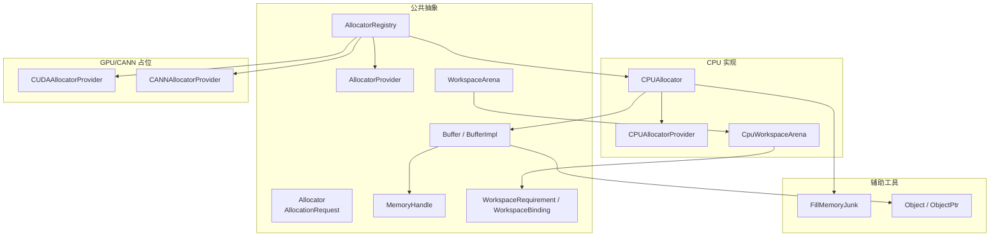

**图示来源**
- [allocator.h:1-114](../../../include/aethermind/memory/allocator.h#L1-L114)
- [allocator.cpp:1-140](../../../src/memory/allocator.cpp#L1-L140)
- [cpu_allocator.h:1-70](../../../include/aethermind/memory/cpu_allocator.h#L1-L70)
- [cpu_allocator.cpp:1-127](../../../src/memory/cpu_allocator.cpp#L1-L127)
- [cuda_allocator.h:1-17](../../../include/aethermind/memory/cuda_allocator.h#L1-L17)
- [cuda_allocator.cpp:1-14](../../../src/memory/cuda_allocator.cpp#L1-L14)
- [cann_allocator.h:1-17](../../../include/aethermind/memory/cann_allocator.h#L1-L17)
- [cann_allocator.cpp:1-14](../../../src/memory/cann_allocator.cpp#L1-L14)
- [buffer.h:1-185](../../../include/aethermind/memory/buffer.h#L1-L185)
- [memory_handle.h:1-170](../../../include/aethermind/memory/memory_handle.h#L1-L170)
- [workspace_arena.h:1-29](../../../include/aethermind/base/workspace_arena.h#L1-L29)
- [workspace_types.h:1-84](../../../include/aethermind/base/workspace_types.h#L1-L84)
- [cpu_workspace_arena.cpp:1-43](../../../src/backend/cpu/cpu_workspace_arena.cpp#L1-L43)
- [memory_junk_fill.h:1-17](../../../src/memory/memory_junk_fill.h#L1-L17)

**章节来源**
- [allocator.h:1-114](../../../include/aethermind/memory/allocator.h#L1-L114)
- [buffer.h:1-185](../../../include/aethermind/memory/buffer.h#L1-L185)
- [workspace_arena.h:1-29](../../../include/aethermind/base/workspace_arena.h#L1-L29)

## 核心组件
- `AllocationRequest`：描述可见字节数与最小对齐要求。零对齐表示使用分配器的默认策略；非零对齐必须是 2 的幂。
- `Allocator`：统一分配入口。`TryAllocate` 先校验请求，再调用派生类的 `AllocateStorage`，最后将 `MemoryHandle` 移入 `Buffer`。`Allocate` 是面向强语义的非异常安全版本包装。
- `AllocatorProvider`：按 `DeviceType` 创建分配器实例。
- `AllocatorRegistry`：按设备类型注册 Provider，并按 `Device` 缓存分配器实例。当前实现不是线程安全的。
- `Buffer`：可复制的引用计数缓冲区，所有拷贝共享同一个 `BufferImpl`。构造时校验可见大小、设备类型、对齐以及 CPU 指针实际对齐。
- `MemoryHandle`：移动独占的原始指针句柄，携带设备、对齐、可选析构上下文。空析构函数或 `NoOpMemoryDeleter` 表示借用内存。
- `WorkspaceArena`：执行期工作区抽象，提供绑定与重置。
- `WorkspaceRequirement` / `WorkspaceBinding`：描述一次算子或步骤的工作区需求与最终绑定的内存切片。
- `FillMemoryJunk`：用固定模式填充新分配内存，便于发现未初始化读。

**章节来源**
- [allocator.h:1-114](../../../include/aethermind/memory/allocator.h#L1-L114)
- [buffer.h:1-185](../../../include/aethermind/memory/buffer.h#L1-L185)
- [memory_handle.h:1-170](../../../include/aethermind/memory/memory_handle.h#L1-L170)
- [workspace_types.h:1-84](../../../include/aethermind/base/workspace_types.h#L1-L84)
- [memory_junk_fill.h:1-17](../../../src/memory/memory_junk_fill.h#L1-L17)

## 架构总览
统一分配器设计采用 Provider-Instance 分层模型：
- Provider 按 `DeviceType`（CPU、CUDA、CANN）注册。
- Registry 按 `Device`（类型 + 索引）解析并缓存分配器实例。
- `Buffer` 与 `MemoryHandle` 是唯一持有的内存抽象；释放逻辑由 `MemoryHandle.deleter` 自包含，不反向依赖分配器。

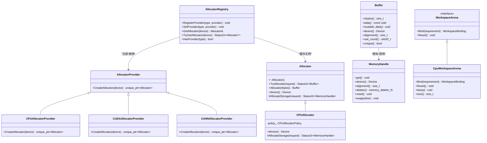

**图示来源**
- [allocator.h:1-114](../../../include/aethermind/memory/allocator.h#L1-L114)
- [cpu_allocator.h:1-70](../../../include/aethermind/memory/cpu_allocator.h#L1-L70)
- [cuda_allocator.h:1-17](../../../include/aethermind/memory/cuda_allocator.h#L1-L17)
- [cann_allocator.h:1-17](../../../include/aethermind/memory/cann_allocator.h#L1-L17)
- [buffer.h:1-185](../../../include/aethermind/memory/buffer.h#L1-L185)
- [memory_handle.h:1-170](../../../include/aethermind/memory/memory_handle.h#L1-L170)
- [workspace_arena.h:1-29](../../../include/aethermind/base/workspace_arena.h#L1-L29)
- [cpu_workspace_arena.cpp:1-43](../../../src/backend/cpu/cpu_workspace_arena.cpp#L1-L43)

## 详细组件分析

### 分配器抽象与注册中心
`Allocator::TryAllocate` 的职责非常明确：
1. 校验对齐是否为零或 2 的幂。
2. 调用 `AllocateStorage` 获取底层存储。
3. 校验返回的 `MemoryHandle` 非空、有所有权、设备合法且匹配、对齐有效且不低于请求值。
4. 对 CPU 设备额外验证指针实际地址满足声明的对齐。
5. 将 handle 移入 `Buffer`；若抛出 `std::bad_alloc`，则转为资源耗尽状态。

`AllocatorRegistry` 维护两类映射：
- `DeviceType → AllocatorProvider`
- `Device → Allocator`

当 Provider 被替换时，会丢弃该设备类型下已缓存的分配器实例，但已有 `Buffer` 仍由其自身的 `MemoryHandle` 持有存储所有权。

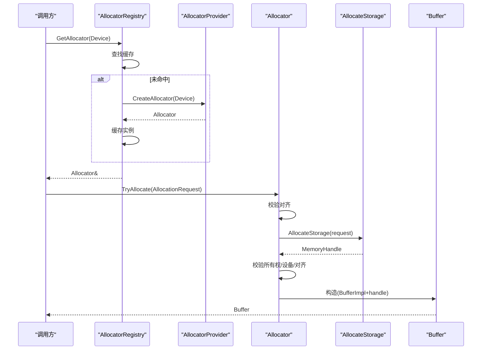

**图示来源**
- [allocator.cpp:1-140](../../../src/memory/allocator.cpp#L1-L140)
- [allocator.h:1-114](../../../include/aethermind/memory/allocator.h#L1-L114)

**章节来源**
- [allocator.cpp:1-140](../../../src/memory/allocator.cpp#L1-L140)
- [allocator.h:1-114](../../../include/aethermind/memory/allocator.h#L1-L114)

### CPU 分配器
`CPUAllocator` 基于 `posix_memalign` 分配内存：
- 零长度分配仍返回一个可 free 的非空指针。
- 默认对齐来自策略或编译常量，至少为指针宽度。
- 大于阈值且开启透明大页的环境变量开关后，会提升对齐到页面大小，并在 Linux 上尝试 `madvise(MADV_HUGEPAGE)`。
- 支持“垃圾填充”，写入固定模式以暴露未初始化读取。
- 错误路径区分无效参数、内存不足和其他系统错误。

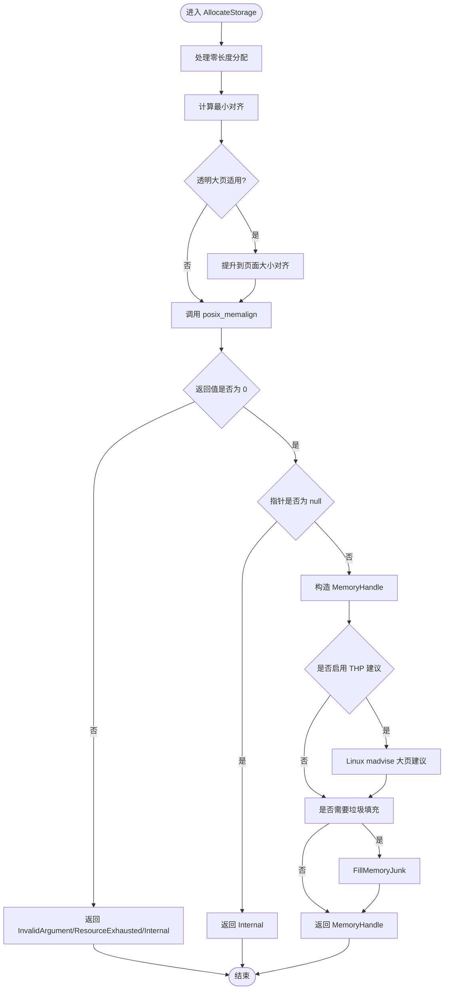

**图示来源**
- [cpu_allocator.cpp:1-127](../../../src/memory/cpu_allocator.cpp#L1-L127)
- [memory_junk_fill.cpp:1-30](../../../src/memory/memory_junk_fill.cpp#L1-L30)

**章节来源**
- [cpu_allocator.h:1-70](../../../include/aethermind/memory/cpu_allocator.h#L1-L70)
- [cpu_allocator.cpp:1-127](../../../src/memory/cpu_allocator.cpp#L1-L127)
- [memory_junk_fill.cpp:1-30](../../../src/memory/memory_junk_fill.cpp#L1-L30)

### CUDA 与 CANN 分配器现状
当前构建中的 CUDA 和 CANN Provider 仅做参数检查并返回失败，提示对应设备分配器尚未在当前配置中实现。因此，运行时若请求这些设备，会在 Provider 阶段失败。

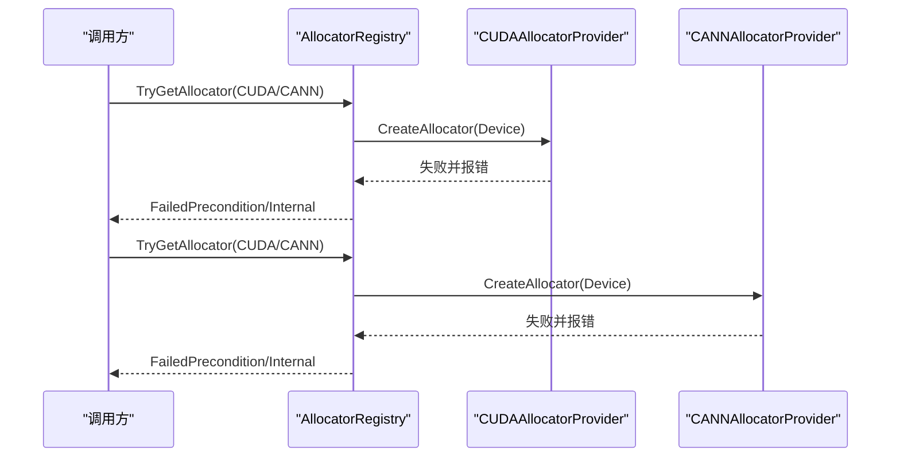

**图示来源**
- [cuda_allocator.cpp:1-14](../../../src/memory/cuda_allocator.cpp#L1-L14)
- [cann_allocator.cpp:1-14](../../../src/memory/cann_allocator.cpp#L1-L14)
- [allocator.cpp:1-140](../../../src/memory/allocator.cpp#L1-L140)

**章节来源**
- [cuda_allocator.h:1-17](../../../include/aethermind/memory/cuda_allocator.h#L1-L17)
- [cuda_allocator.cpp:1-14](../../../src/memory/cuda_allocator.cpp#L1-L14)
- [cann_allocator.h:1-17](../../../include/aethermind/memory/cann_allocator.h#L1-L17)
- [cann_allocator.cpp:1-14](../../../src/memory/cann_allocator.cpp#L1-L14)

### 缓冲区与内存句柄
`Buffer` 是基于 `ObjectRef` 的引用计数对象。其实现体 `BufferImpl` 保存可见字节数与 `MemoryHandle`，并在构造时进行多重前置条件检查：
- 非零可见大小必须对应非空指针。
- 设备类型必须为 CPU、CUDA 或 CANN。
- 对齐必须为零或 2 的幂。
- CPU 指针的实际地址必须满足声明对齐。

`MemoryHandle` 是一个移动独占句柄，支持：
- 拥有型释放：非空析构函数。
- 借用型内存：空析构函数或 `NoOpMemoryDeleter`。
- 重置时先清空自身字段，再调用旧析构函数，避免悬垂访问。

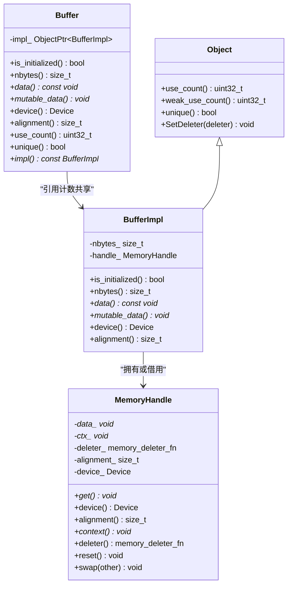

**图示来源**
- [buffer.h:1-185](../../../include/aethermind/memory/buffer.h#L1-L185)
- [memory_handle.h:1-170](../../../include/aethermind/memory/memory_handle.h#L1-L170)
- [object.h:1-200](../../../include/aethermind/base/object.h#L1-L200)

**章节来源**
- [buffer.h:1-185](../../../include/aethermind/memory/buffer.h#L1-L185)
- [memory_handle.h:1-170](../../../include/aethermind/memory/memory_handle.h#L1-L170)
- [object.h:1-200](../../../include/aethermind/base/object.h#L1-L200)

## 依赖关系分析
- `Allocator` 依赖 `Device`、`Status`、`Buffer`、`MemoryHandle`。
- `CPUAllocator` 依赖 `CPUAllocatorPolicy`、`env`、`memory_junk_fill`。
- `Buffer` 依赖 `Object`、`ObjectPtr`、`MemoryHandle`。
- `WorkspaceArena` 依赖 `WorkspaceRequirement`。
- `CpuWorkspaceArena` 直接消费 `WorkspaceRequirement.offset`，不做重新分配。

潜在循环依赖不存在：工作区类型位于 `base`，分配器位于 `memory`，二者通过简单数据结构交互。

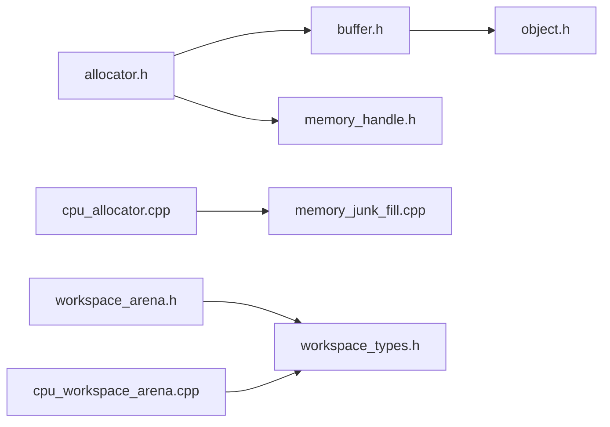

**图示来源**
- [allocator.h:1-114](../../../include/aethermind/memory/allocator.h#L1-L114)
- [buffer.h:1-185](../../../include/aethermind/memory/buffer.h#L1-L185)
- [memory_handle.h:1-170](../../../include/aethermind/memory/memory_handle.h#L1-L170)
- [cpu_allocator.cpp:1-127](../../../src/memory/cpu_allocator.cpp#L1-L127)
- [memory_junk_fill.cpp:1-30](../../../src/memory/memory_junk_fill.cpp#L1-L30)
- [workspace_arena.h:1-29](../../../include/aethermind/base/workspace_arena.h#L1-L29)
- [workspace_types.h:1-84](../../../include/aethermind/base/workspace_types.h#L1-L84)
- [cpu_workspace_arena.cpp:1-43](../../../src/backend/cpu/cpu_workspace_arena.cpp#L1-L43)

**章节来源**
- [allocator.h:1-114](../../../include/aethermind/memory/allocator.h#L1-L114)
- [buffer.h:1-185](../../../include/aethermind/memory/buffer.h#L1-L185)
- [workspace_types.h:1-84](../../../include/aethermind/base/workspace_types.h#L1-L84)

## 性能与对齐特性
- CPU 默认对齐通常为缓存行粒度，可通过 `CPUAllocatorPolicy.default_alignment` 覆盖。
- 小于指针宽度的对齐会被提升，因为底层 `posix_memalign` 无法表达更弱对齐。
- 大于阈值的分配在环境变量允许时可申请透明大页，并对内核发出大页建议。
- 垃圾填充会引入额外写入开销，适合调试阶段；生产路径可根据性能需要关闭。
- 分配失败时，`TryAllocate` 返回明确的 `Status`，`Allocate` 则将资源耗尽转换为 `std::bad_alloc`，其他错误转换为运行时异常。

**章节来源**
- [cpu_allocator.cpp:1-127](../../../src/memory/cpu_allocator.cpp#L1-L127)
- [cpu_allocator.h:1-70](../../../include/aethermind/memory/cpu_allocator.h#L1-L70)
- [allocator.cpp:1-140](../../../src/memory/allocator.cpp#L1-L140)

## 工作区分配策略与垃圾回收

### 工作区抽象
`WorkspaceArena` 定义执行期工作区的两个操作：
- `Bind`：根据 `WorkspaceRequirement` 返回一个借用的 `WorkspaceBinding`。
- `Reset`：释放全部绑定并使现有绑定失效。

`WorkspaceRequirement` 包含：
- `bytes`：所需字节数。
- `alignment`：对齐要求，默认 64 字节缓存行对齐。
- `lifetime`：生命周期范围，如每算子、每层、每 token、每序列或持久。
- `reusable`：是否允许后续兼容需求复用。
- `offset`：规划阶段填写的统一工作区偏移。

`WorkspaceBinding` 是执行时的真实切片视图，生命周期仅限于单次 kernel 调用。

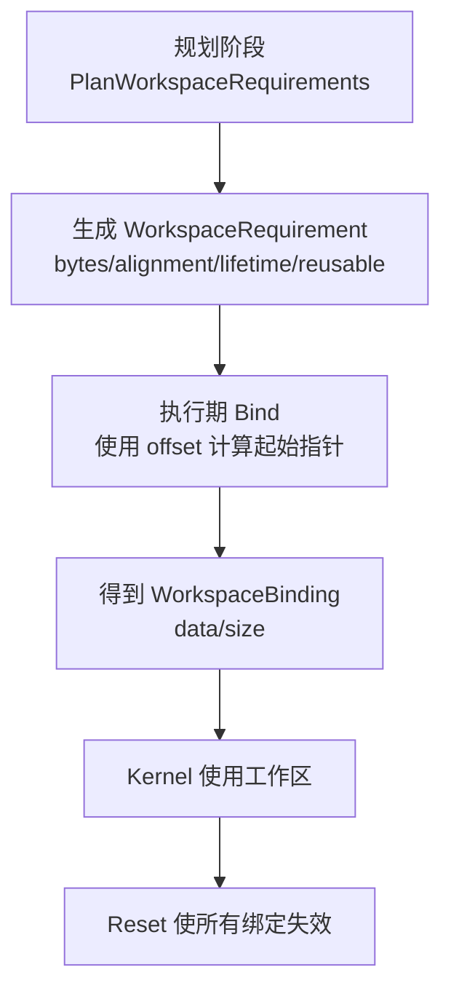

**图示来源**
- [workspace_types.h:1-84](../../../include/aethermind/base/workspace_types.h#L1-L84)
- [workspace_arena.h:1-29](../../../include/aethermind/base/workspace_arena.h#L1-L29)

**章节来源**
- [workspace_types.h:1-84](../../../include/aethermind/base/workspace_types.h#L1-L84)
- [workspace_arena.h:1-29](../../../include/aethermind/base/workspace_arena.h#L1-L29)

### CPU 工作区实现
`CpuWorkspaceArena` 并不分配新内存，而是基于传入的基址和大小进行边界检查与对齐校验：
- 基址为空、长度为 0、对齐为 0、偏移越界都会返回空绑定。
- 剩余空间不足返回空绑定。
- 起始指针未按要求的对齐对齐返回空绑定。
- `Reset` 当前为空操作，因为绑定只是视图，没有独立资源。

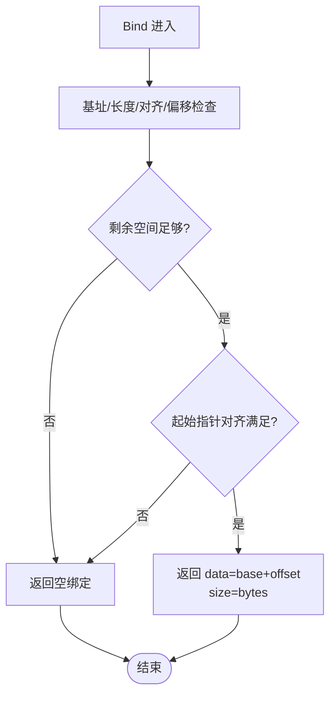

**图示来源**
- [cpu_workspace_arena.cpp:1-43](../../../src/backend/cpu/cpu_workspace_arena.cpp#L1-L43)
- [workspace_types.h:1-84](../../../include/aethermind/base/workspace_types.h#L1-L84)

**章节来源**
- [cpu_workspace_arena.cpp:1-43](../../../src/backend/cpu/cpu_workspace_arena.cpp#L1-L43)

### 垃圾回收机制
AetherMind 的内存回收不是传统意义上的“标记-清除”垃圾回收，而是 RAII + 引用计数：
- `MemoryHandle` 在 reset 或析构时调用其析构函数，完成底层释放。
- `Buffer` 通过 `ObjectPtr<BufferImpl>` 共享实现体，最后一个强所有者销毁时触发清理。
- `Object` 与 `ObjectAllocator` 提供侵入式引用计数与对象分配基础设施，用于 `BufferImpl` 等元数据对象。

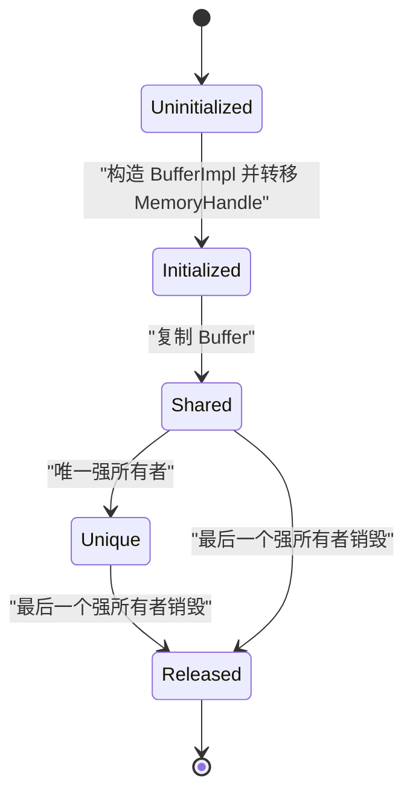

**图示来源**
- [buffer.h:1-185](../../../include/aethermind/memory/buffer.h#L1-L185)
- [memory_handle.h:1-170](../../../include/aethermind/memory/memory_handle.h#L1-L170)
- [object.h:1-200](../../../include/aethermind/base/object.h#L1-L200)
- [object_allocator.h:1-200](../../../include/aethermind/base/object_allocator.h#L1-L200)

**章节来源**
- [buffer.h:1-185](../../../include/aethermind/memory/buffer.h#L1-L185)
- [memory_handle.h:1-170](../../../include/aethermind/memory/memory_handle.h#L1-L170)
- [object.h:1-200](../../../include/aethermind/base/object.h#L1-L200)
- [object_allocator.h:1-200](../../../include/aethermind/base/object_allocator.h#L1-L200)

## 内存泄漏检测与诊断
- **未初始化内存检测**：CPU 分配器默认写入固定调试模式，便于发现未初始化读取。
- **分配失败模拟**：单元测试通过 malloc interposer 注入失败，验证资源耗尽、重试、以及已分配存储是否正确释放。
- **引用计数观察**：`Buffer::use_count` 和 `unique` 可用于判断共享所有权情况，配合测试用例确认析构函数只调用一次。
- **设备与对齐契约检查**：`Allocator::TryAllocate` 与 `BufferImpl` 构造函数均强制校验设备类型、对齐有效性及 CPU 指针实际对齐。

推荐诊断路径：
1. 使用 `TryAllocate` 检查 `Status`，避免静默失败。
2. 在调试构建中保留垃圾填充，或在关键路径打印 `Buffer::use_count`。
3. 通过单元测试中的失败注入模式复现 OOM 和资源释放路径。
4. 检查工作区绑定前确保 `WorkspaceRequirement.alignment` 非零且为 2 的幂。

**章节来源**
- [memory_junk_fill.cpp:1-30](../../../src/memory/memory_junk_fill.cpp#L1-L30)
- [test_cpu_allocator.cpp:1-200](../../../tests/unit/memory/test_cpu_allocator.cpp#L1-L200)
- [test_buffer.cpp:1-200](../../../tests/unit/memory/test_buffer.cpp#L1-L200)
- [allocator.cpp:1-140](../../../src/memory/allocator.cpp#L1-L140)
- [buffer.h:1-185](../../../include/aethermind/memory/buffer.h#L1-L185)

## 性能分析与优化实践
- **对齐优化**：尽量让 `AlignmentRequest` 与算子或硬件要求一致，减少二次对齐与 padding。
- **透明大页**：对于大块连续分配，可在环境变量允许的情况下开启 THP，降低 TLB 压力。
- **垃圾填充开关**：调试阶段开启，生产环境根据性能需求关闭。
- **重用工作区**：优先使用 `WorkspaceArena` 复用已规划的工作区，而不是每次算子都分配。
- **避免重复分配**：利用 `AllocatorRegistry` 缓存分配器实例，避免重复创建。
- **批量分配**：将多个小缓冲区合并为更大的工作区切片，减少系统调用次数。
- **观察引用计数**：在复杂对象图中，通过 `Buffer::use_count` 定位意外共享导致的延迟释放。

[本节为通用指导，不直接分析具体代码文件]

## 自定义分配器实现指南

### 实现步骤
1. 实现 `Allocator` 派生类，重写 `AllocateStorage`。
   - 处理零长度分配：返回一个可释放的非空指针。
   - 将请求对齐与分配器默认对齐合并，确保对齐为 2 的幂且不小于指针宽度。
   - 根据设备选择底层分配 API，例如 CPU 使用 `posix_memalign`，GPU/CANN 使用各自驱动 API。
   - 设置 `MemoryHandle` 的设备与对齐；如果是借用内存，使用空析构函数或 `NoOpMemoryDeleter`。
2. 实现 `AllocatorProvider` 派生类，重写 `CreateAllocator`。
   - 校验传入 `Device` 类型是否属于该 Provider。
   - 返回指向新分配的 `Allocator` 实例。
3. 向 `AllocatorRegistry` 注册 Provider。
   - 使用 `RegisterProvider` 添加首次 Provider。
   - 使用 `SetProvider` 替换 Provider，注意这会清空对应设备类型的缓存实例。
4. 通过 `GetAllocator` 或 `TryGetAllocator` 获取分配器并进行 `TryAllocate`。

### 关键约束
- `AllocateStorage` 返回的 `MemoryHandle` 必须：
  - 非空。
  - 拥有所有权或明确表示借用。
  - 设备类型合法且与 `Allocator::device()` 一致。
  - 对齐有效且不低于请求对齐。
  - CPU 指针实际地址满足声明对齐。
- `AllocatorRegistry` 当前不是线程安全的，多线程场景需外部序列化。
- `Buffer` 不持有分配器指针，因此分配器实例销毁不会影响已存在的 `Buffer`。

### 示例流程
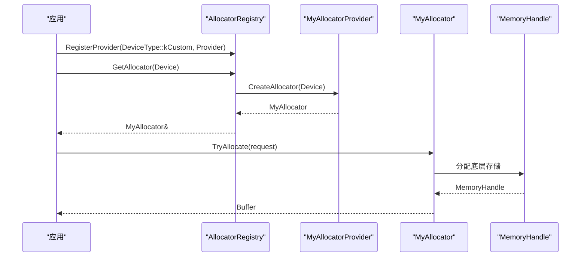

**图示来源**
- [allocator.h:1-114](../../../include/aethermind/memory/allocator.h#L1-L114)
- [allocator.cpp:1-140](../../../src/memory/allocator.cpp#L1-L140)
- [cpu_allocator.h:1-70](../../../include/aethermind/memory/cpu_allocator.h#L1-L70)
- [memory_handle.h:1-170](../../../include/aethermind/memory/memory_handle.h#L1-L170)

**章节来源**
- [allocator.h:1-114](../../../include/aethermind/memory/allocator.h#L1-L114)
- [allocator.cpp:1-140](../../../src/memory/allocator.cpp#L1-L140)
- [memory_handle.h:1-170](../../../include/aethermind/memory/memory_handle.h#L1-L170)

## 故障排查
- **对齐无效**：检查 `AllocationRequest.alignment` 是否为零或 2 的幂。
- **设备不匹配**：确认 `Allocator::device()` 与 `MemoryHandle.device()` 一致。
- **CPU 指针未对齐**：检查底层分配 API 是否真正返回了对齐地址，并确认 `MemoryHandle.alignment` 与实际地址一致。
- **CUDA/CANN 不可用**：当前 Provider 返回失败，需要在支持的设备构建中包含相应实现。
- **内存未释放**：确认 `MemoryHandle` 安装了正确的析构函数，且 `Buffer` 的所有者生命周期正确。
- **工作区绑定为空**：检查 `WorkspaceRequirement.bytes`、`alignment`、`offset` 与 `CpuWorkspaceArena` 的基址和大小。
- **资源耗尽**：优先检查 `TryAllocate` 的 `Status`，不要直接调用可能抛异常的 `Allocate`。

**章节来源**
- [allocator.cpp:1-140](../../../src/memory/allocator.cpp#L1-L140)
- [cpu_allocator.cpp:1-127](../../../src/memory/cpu_allocator.cpp#L1-L127)
- [cuda_allocator.cpp:1-14](../../../src/memory/cuda_allocator.cpp#L1-L14)
- [cann_allocator.cpp:1-14](../../../src/memory/cann_allocator.cpp#L1-L14)
- [cpu_workspace_arena.cpp:1-43](../../../src/backend/cpu/cpu_workspace_arena.cpp#L1-L43)
- [buffer.h:1-185](../../../include/aethermind/memory/buffer.h#L1-L185)

## 结论
AetherMind 的内存管理系统通过清晰的抽象层把设备差异隐藏起来：`Allocator` 负责分配与校验，`Buffer` 负责共享所有权，`MemoryHandle` 负责释放契约，`WorkspaceArena` 负责执行期临时内存。CPU 路径已经具备完整的对齐、透明大页、垃圾填充与错误处理；CUDA 与 CANN 目前仅提供 Provider 占位。工作区采用“规划 + 绑定”的两阶段模型，便于统一调度算子临时内存。对于扩展而言，新增分配器只需实现 `Allocator` 与 `AllocatorProvider`，并通过 `AllocatorRegistry` 注册即可融入现有生态。

[本节为总结性内容，不直接分析具体代码文件]
