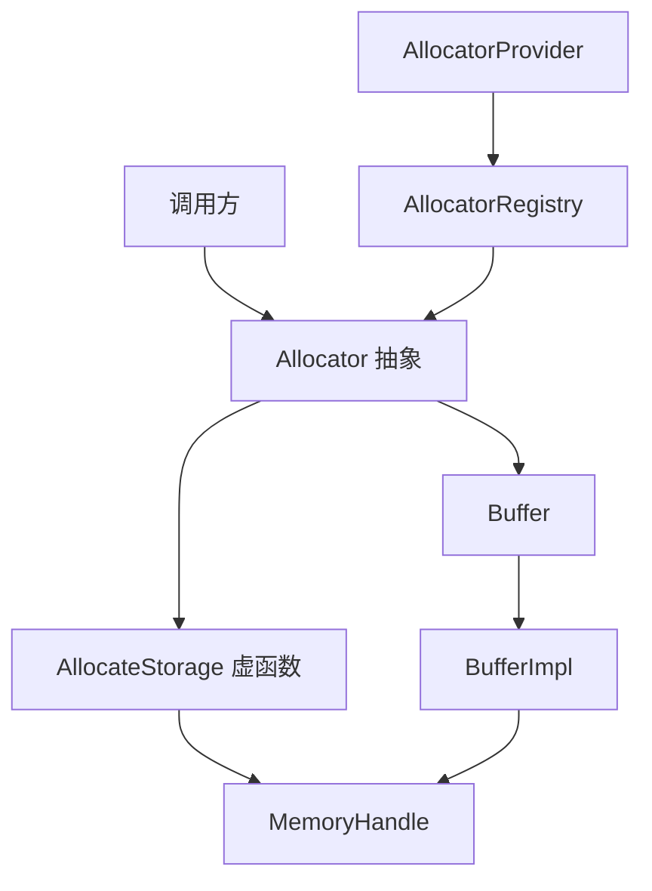
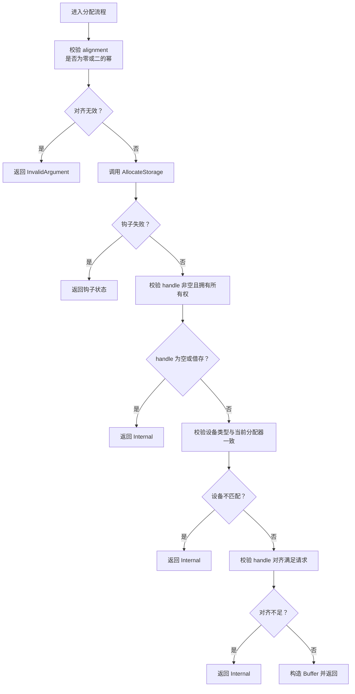
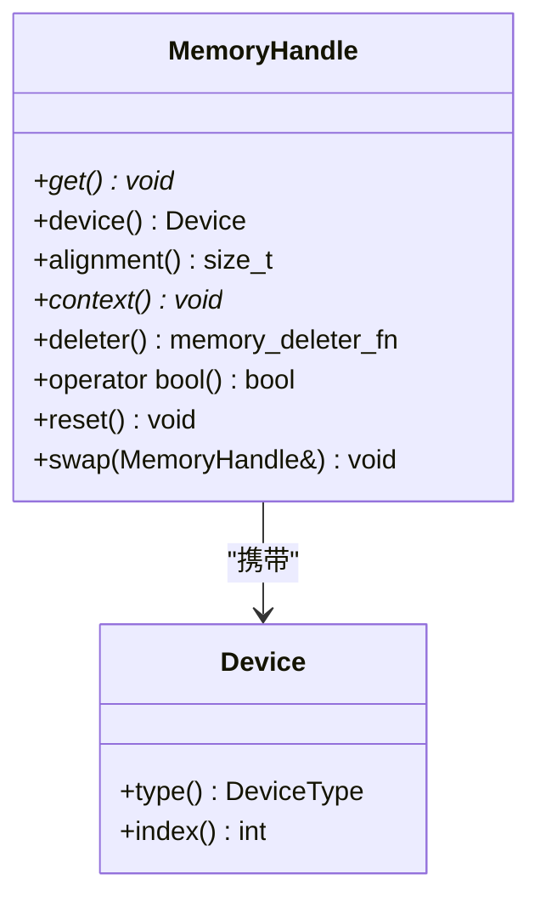
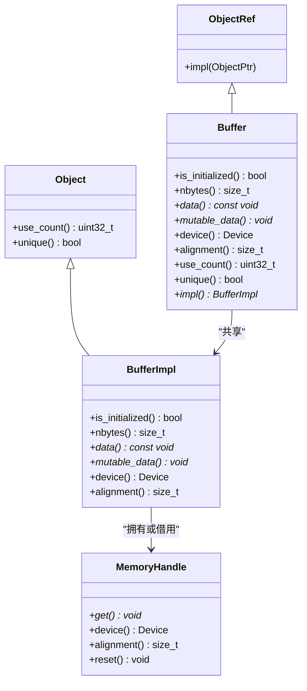
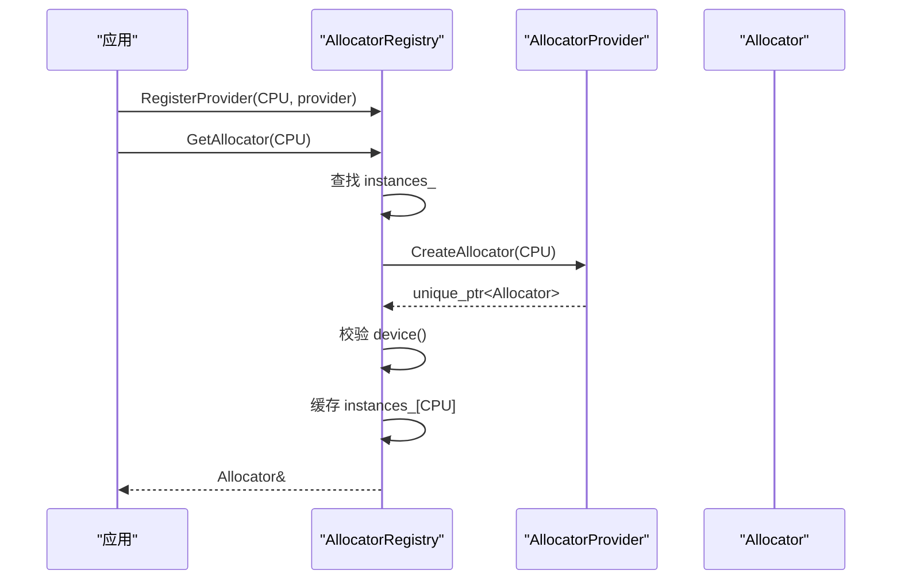
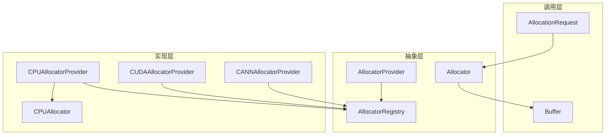
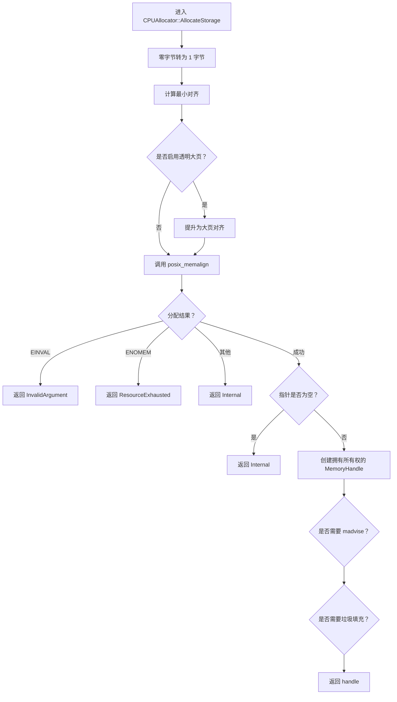
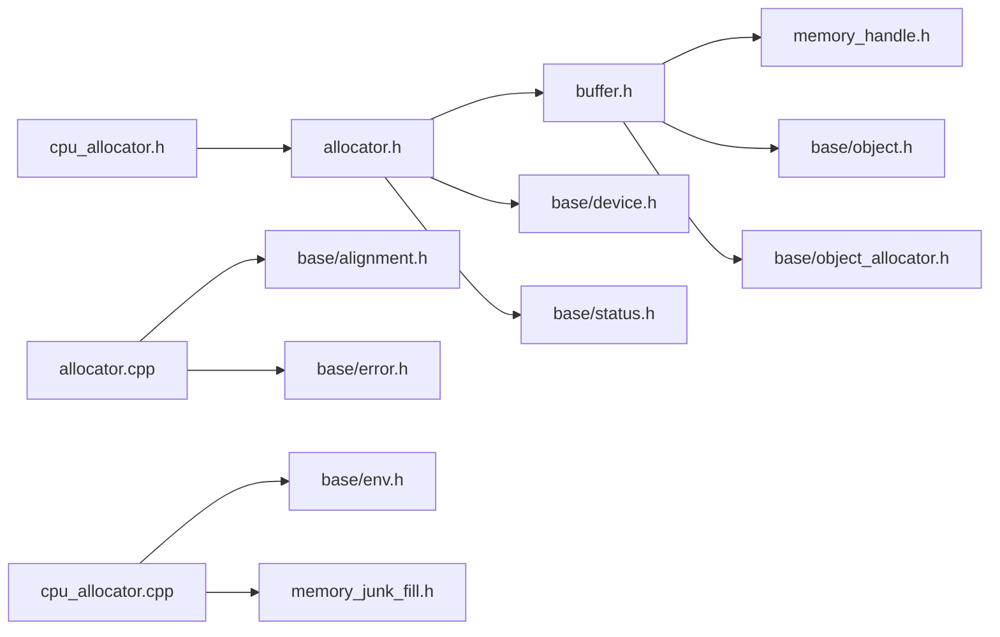

# 分配器抽象接口

**本文引用的文件**
- [allocator.h](../../../include/aethermind/memory/allocator.h)
- [allocator.cpp](../../../src/memory/allocator.cpp)
- [memory_handle.h](../../../include/aethermind/memory/memory_handle.h)
- [buffer.h](../../../include/aethermind/memory/buffer.h)
- [cpu_allocator.h](../../../include/aethermind/memory/cpu_allocator.h)
- [cpu_allocator.cpp](../../../src/memory/cpu_allocator.cpp)
- [cuda_allocator.h](../../../include/aethermind/memory/cuda_allocator.h)
- [cann_allocator.h](../../../include/aethermind/memory/cann_allocator.h)
- [alignment.h](../../../include/aethermind/base/alignment.h)
- [test_memory_handle.cpp](../../../tests/unit/memory/test_memory_handle.cpp)
- [test_buffer.cpp](../../../tests/unit/memory/test_buffer.cpp)

## 目录

1. [引言](#引言)
2. [项目结构](#项目结构)
3. [核心组件](#核心组件)
4. [架构总览](#架构总览)
5. [详细组件分析](#详细组件分析)
6. [依赖关系分析](#依赖关系分析)
7. [性能与对齐特性](#性能与对齐特性)
8. [自定义分配器实现指南](#自定义分配器实现指南)
9. [故障排查](#故障排查)
10. [结论](#结论)

## 引言

AetherMind 的内存子系统通过统一的分配器抽象，屏蔽 CPU、CUDA、CANN 等后端的具体存储获取方式。调用方不直接操作底层指针，而是通过 `AllocationRequest` 描述需求，由 `Allocator` 验证并返回拥有所有权的 `Buffer`；`Buffer` 内部再共享不可变的 `BufferImpl` 元数据，并由 `MemoryHandle` 表达“借存”或“拥有”的释放语义。

本文件聚焦以下目标：

- 解释 `Allocator` 基类的设计哲学与职责边界。
- 说明 `AllocationRequest` 字段的约束条件。
- 对比 `TryAllocate` 与 `Allocate` 的行为差异和错误传播策略。
- 阐述 `MemoryHandle` 的所有权语义、deleter 回调机制、借存与拥有的区别。
- 解释 `Buffer` 与 `BufferImpl` 的引用计数共享模型、生命周期、线程安全约定。
- 说明 `AllocatorProvider` 工厂模式与 `AllocatorRegistry` 注册表的使用方式。
- 提供实现自定义分配器的步骤、错误处理策略和内存对齐验证要点。

## 项目结构

与分配器抽象相关的代码主要分布在 `include/aethermind/memory` 和 `src/memory` 两个位置：

| 文件 | 职责 |
|---|---|
| `allocator.h` | 定义 `AllocationRequest`、`Allocator`、`AllocatorProvider`、`AllocatorRegistry` |
| `allocator.cpp` | 实现通用校验流程、`TryAllocate`、`Allocate`、注册表缓存逻辑 |
| `memory_handle.h` | 定义可移动、非拷贝的 `MemoryHandle` 及其 deleter 回调语义 |
| `buffer.h` | 定义共享实现的 `BufferImpl` 和公共句柄 `Buffer` |
| `cpu_allocator.h` / `cpu_allocator.cpp` | CPU 分配策略、THP 支持、对齐选择、Junk Fill |
| `cuda_allocator.h` | CUDA 后端 Provider 声明 |
| `cann_allocator.h` | CANN 后端 Provider 声明 |
| `alignment.h` | 对齐有效性检查与偏移对齐工具 |
| `test_memory_handle.cpp` | MemoryHandle 所有权、重置、reentrant reset 行为测试 |
| `test_buffer.cpp` | Buffer 引用计数、共享写入、借用内存、对齐边界测试 |

**图示来源**
- [allocator.h:22-114](../../../include/aethermind/memory/allocator.h#L22-L114)
- [memory_handle.h:30-168](../../../include/aethermind/memory/memory_handle.h#L30-L168)
- [buffer.h:24-185](../../../include/aethermind/memory/buffer.h#L24-L185)

**章节来源**
- [allocator.h:1-114](../../../include/aethermind/memory/allocator.h#L1-L114)
- [memory_handle.h:1-170](../../../include/aethermind/memory/memory_handle.h#L1-L170)
- [buffer.h:1-185](../../../include/aethermind/memory/buffer.h#L1-L185)

## 核心组件

### AllocationRequest：请求契约

`AllocationRequest` 是调用方对分配器的最小输入契约，包含两个字段：

| 字段 | 含义 | 约束 |
|---|---|---|
| `nbytes` | 可见字节数 | 布局填充必须已包含在内；零字节仍可能产生可释放的非空指针 |
| `alignment` | 最小对齐要求 | 零表示使用分配器默认策略；非零必须是 2 的幂；子视图需自行处理字节偏移 |

设计要点：

- `alignment = 0` 不是“未知对齐”，而是“让分配器决定默认策略”。
- 分配器可以返回比请求更强的对齐，但不能弱于请求。
- 调用方负责把内部 padding 计入 `nbytes`，而不是交给分配器去猜测布局。

**章节来源**
- [allocator.h:22-35](../../../include/aethermind/memory/allocator.h#L22-L35)
- [alignment.h:19-24](../../../include/aethermind/base/alignment.h#L19-L24)

### Allocator：设备无关的分配入口

`Allocator` 是一个抽象基类，核心职责包括：

1. 暴露 `device()`，声明该分配器属于哪个设备。
2. 实现 `TryAllocate`，统一完成参数校验、存储钩子调用、所有权与对齐验证。
3. 实现 `Allocate`，将异常风格错误转换为 C++ 标准异常或运行时异常。
4. 通过受保护的 `AllocateStorage` 虚函数，把具体设备的存储获取细节下沉到子类。

设计哲学：

- 调用方只提交 `AllocationRequest`，不直接操作底层分配函数。
- 所有设备相关实现集中在 `AllocateStorage`。
- 所有跨后端的校验集中在 `TryAllocate`。
- 失败路径尽量返回 `Status`，避免在诊断日志中再次分配内存。

**章节来源**
- [allocator.h:37-68](../../../include/aethermind/memory/allocator.h#L37-L68)
- [allocator.cpp:13-57](../../../src/memory/allocator.cpp#L13-L57)

### TryAllocate 与 Allocate 的行为差异

| 方法 | 返回值 | 成功时行为 | 失败时行为 |
|---|---|---|---|
| `TryAllocate` | `StatusOr<Buffer>` | 返回已验证的拥有 `Buffer` | 返回 `Status`；资源耗尽返回 `ResourceExhausted` |
| `Allocate` | `Buffer` | 等价于传入默认 `AllocationRequest` 的 `TryAllocate` | 资源耗尽抛出 `std::bad_alloc`；其他错误抛出运行时异常 |

关键差异：

- `TryAllocate` 适合需要显式错误处理的场景。
- `Allocate` 适合传统 C++ 异常语义，但不适合在诊断路径中重复调用。
- 两者都会先校验 `alignment`，再调用 `AllocateStorage`。
- `Allocate` 会把 `ResourceExhausted` 映射为 `std::bad_alloc`，其他错误映射为运行时异常。

**图示来源**
- [allocator.cpp:13-57](../../../src/memory/allocator.cpp#L13-L57)
- [allocator.h:45-68](../../../include/aethermind/memory/allocator.h#L45-L68)

**章节来源**
- [allocator.cpp:13-85](../../../src/memory/allocator.cpp#L13-L85)
- [allocator.h:45-68](../../../include/aethermind/memory/allocator.h#L45-L68)

### MemoryHandle：所有权、deleter 与借存

`MemoryHandle` 是一个可移动、不可拷贝的原始内存指针包装体，携带以下信息：

| 字段 | 含义 |
|---|---|
| `data_` | 指向存储的指针 |
| `ctx_` | deleter 上下文指针 |
| `deleter_` | 最多调用一次的释放回调 |
| `device_` | 存储所属设备 |
| `alignment_` | 指针实际保证的对齐 |

所有权语义：

- **拥有内存**：`deleter` 为非空且不是 `NoOpMemoryDeleter`。销毁时会调用 deleter。
- **借用内存**：`deleter` 为空或使用 `NoOpMemoryDeleter`。调用方必须确保存储生命周期长于所有 handle 和 view。
- **空 handle**：默认构造、移动后或 `reset()` 后，context、deleter 均为空，设备为未定义，对齐为零。

deleter 约束：

- 接收 `(deleter_ctx, ptr)`，最多调用一次。
- 不得抛出异常。
- 不得借用在 handle 之前析构的资源，例如不能持有会早于 handle 销毁的分配器实例。
- `reset()` 会先将 handle 清空，再调用 deleter，因此 deleter 中可以安全地观察空 handle。

**图示来源**
- [memory_handle.h:30-168](../../../include/aethermind/memory/memory_handle.h#L30-L168)

**章节来源**
- [memory_handle.h:1-170](../../../include/aethermind/memory/memory_handle.h#L1-L170)
- [test_memory_handle.cpp:1-125](../../../tests/unit/memory/test_memory_handle.cpp#L1-L125)

### Buffer 与 BufferImpl：引用计数共享模型

`BufferImpl` 是不可变实现对象，保存：

- `nbytes_`：可见字节数。
- `handle_`：定义释放语义的 `MemoryHandle`。

`Buffer` 是公共句柄，继承自 `ObjectRef`，共享一个 `ObjectPtr<BufferImpl>`。其核心性质如下：

| 概念 | 说明 |
|---|---|
| 共享元数据 | 所有 `Buffer` 副本共享同一个 `BufferImpl` |
| 引用计数 | 最后一个强所有者析构时触发释放 |
| 借存场景 | 即使没有真实所有权，只要有一个强所有者，`unique()` 仍可返回 true |
| 写可见性 | 通过 `mutable_data()` 的写对所有副本可见 |
| 空 Buffer | 默认构造和移动后的 Buffer 未初始化，但观察者访问仍安全 |

线程安全约定：

- 不同 `Buffer` 副本可以同时拷贝、赋值、销毁。
- 对同一 `Buffer` 对象的读写，以及对共享内存的并发写，需要外部同步。
- 读取 `use_count()` 仅用于调试和断言，不应作为同步原语。

**图示来源**
- [buffer.h:24-185](../../../include/aethermind/memory/buffer.h#L24-L185)
- [memory_handle.h:30-168](../../../include/aethermind/memory/memory_handle.h#L30-L168)

**章节来源**
- [buffer.h:1-185](../../../include/aethermind/memory/buffer.h#L1-L185)
- [test_buffer.cpp:1-200](../../../tests/unit/memory/test_buffer.cpp#L1-L200)

### AllocatorProvider：工厂模式

`AllocatorProvider` 是分配器工厂接口，只暴露一个方法：

| 方法 | 行为 |
|---|---|
| `CreateAllocator(Device device)` | 创建并返回某个设备的 `Allocator` 实例 |

已有 Provider：

- `CPUAllocatorProvider`：只接受 CPU 设备。
- `CUDAAllocatorProvider`：面向 CUDA 后端。
- `CANNAllocatorProvider`：面向 CANN 后端。

Provider 的职责是“根据设备类型创建分配器”，而不是“管理分配器生命周期”；后者由 `AllocatorRegistry` 负责。

**章节来源**
- [allocator.h:70-79](../../../include/aethermind/memory/allocator.h#L70-L79)
- [cpu_allocator.h:52-69](../../../include/aethermind/memory/cpu_allocator.h#L52-L69)
- [cuda_allocator.h:1-17](../../../include/aethermind/memory/cuda_allocator.h#L1-L17)
- [cann_allocator.h:1-17](../../../include/aethermind/memory/cann_allocator.h#L1-L17)

### AllocatorRegistry：注册表与缓存

`AllocatorRegistry` 维护两层映射：

| 映射 | 键 | 值 | 作用 |
|---|---|---|---|
| `providers_` | `DeviceType` | `AllocatorProvider` | 按设备类型查找工厂 |
| `instances_` | `Device` | `Allocator` | 缓存具体分配器实例 |

关键行为：

- `RegisterProvider`：注册 Provider，不允许空 Provider、不允许 `kUndefined`、不允许重复注册。
- `SetProvider`：替换 Provider，并丢弃对应设备类型的已缓存分配器实例；已有 `Buffer` 不受影响。
- `GetAllocator`：查找或创建分配器，失败时中止。
- `TryGetAllocator`：返回 `StatusOr<Allocator*>`，缺失 Provider 返回 `FailedPrecondition`，Provider 返回空或设备不匹配返回 `Internal`。
- 注册表本身**不是线程安全的**；文档明确建议调用方串行化并发访问。

**图示来源**
- [allocator.cpp:87-140](../../../src/memory/allocator.cpp#L87-L140)
- [allocator.h:81-114](../../../include/aethermind/memory/allocator.h#L81-L114)
- [cpu_allocator.cpp:119-127](../../../src/memory/cpu_allocator.cpp#L119-L127)

**章节来源**
- [allocator.h:81-114](../../../include/aethermind/memory/allocator.h#L81-L114)
- [allocator.cpp:87-140](../../../src/memory/allocator.cpp#L87-L140)

## 架构总览

从高层看，AetherMind 的分配体系分为三层：

1. **调用层**：使用 `AllocationRequest` 或 `Buffer` API。
2. **抽象层**：`Allocator` 提供统一入口，`Buffer` 提供统一内存视图。
3. **实现层**：`CPUAllocator`、`CUDAAllocator`、`CANNAllocator` 通过各自的 Provider 注册到 `AllocatorRegistry`。

**图示来源**
- [allocator.h:22-114](../../../include/aethermind/memory/allocator.h#L22-L114)
- [cpu_allocator.h:14-69](../../../include/aethermind/memory/cpu_allocator.h#L14-L69)

## 详细组件分析

### CPUAllocator：对齐、大页与垃圾填充

`CPUAllocatorPolicy` 控制 CPU 分配策略：

| 字段 | 默认行为 | 说明 |
|---|---|---|
| `default_alignment` | 构建期宏或 64 字节 | 请求未指定对齐时的下限 |
| `junk_fill` | true | 用垃圾模式填充新内存，降低未初始化读取风险 |
| `allow_thp` | true | 允许透明大页，受环境变量 `THP_MEM_ALLOC_ENABLE` 控制 |

`AllocateStorage` 的主要逻辑：

1. 零字节请求也分配至少 1 字节，以便获得可释放指针。
2. 计算最小对齐：取请求对齐、策略默认对齐、`sizeof(void*)` 三者最大值。
3. 若满足 THP 条件，则提升到页面级对齐。
4. 调用 `posix_memalign` 分配内存。
5. 根据 `errno` 返回 `InvalidArgument`、`ResourceExhausted` 或 `Internal`。
6. 构造拥有所有权的 `MemoryHandle`。
7. 可选地调用 `madvise` 启用大页。
8. 可选地执行 junk fill。

**图示来源**
- [cpu_allocator.cpp:36-118](../../../src/memory/cpu_allocator.cpp#L36-L118)

**章节来源**
- [cpu_allocator.h:14-50](../../../include/aethermind/memory/cpu_allocator.h#L14-L50)
- [cpu_allocator.cpp:1-127](../../../src/memory/cpu_allocator.cpp#L1-L127)

### 对齐校验与错误传播

对齐校验贯穿三个层次：

1. `AllocationRequest.alignment` 在进入 `TryAllocate` 时校验。
2. `MemoryHandle.alignment` 在 `TryAllocate` 中校验，必须满足请求的最小对齐。
3. `BufferImpl` 构造时对 CPU 指针做额外校验，确保 CPU 指针确实满足声明的对齐。

对齐规则：

- 零对齐表示未知或未强制。
- 非零对齐必须是 2 的幂。
- `IsValidAlignment` 使用单比特检测。
- CPU 分配器会将低于 `sizeof(void*)` 的对齐提升，而不是拒绝。

**章节来源**
- [allocator.cpp:17-23](../../../src/memory/allocator.cpp#L17-L23)
- [allocator.cpp:43-52](../../../src/memory/allocator.cpp#L43-L52)
- [buffer.h:43-56](../../../include/aethermind/memory/buffer.h#L43-L56)
- [cpu_allocator.cpp:61-66](../../../src/memory/cpu_allocator.cpp#L61-L66)
- [alignment.h:19-24](../../../include/aethermind/base/alignment.h#L19-L24)

### 所有权与借存的完整流程

#### 拥有内存的 Buffer

典型流程：

1. `Allocator::TryAllocate` 调用 `AllocateStorage`。
2. 子类返回拥有所有权的 `MemoryHandle`。
3. `TryAllocate` 校验 handle 非空、deleter 存在且不为 `NoOpMemoryDeleter`。
4. 校验设备类型和设备实例匹配。
5. 校验对齐满足请求。
6. 构造 `Buffer`，最终由最后一个强所有者释放存储。

#### 借用内存的 Buffer

典型流程：

1. 调用方直接构造 `MemoryHandle`，使用 `nullptr` 或 `NoOpMemoryDeleter`。
2. `Buffer` 接受该 handle。
3. 当最后一个 `Buffer` 被销毁时，不会调用 deleter。
4. 调用方仍需保证底层存储未被释放。

测试覆盖的关键行为：

- `MemoryHandle` 在 `reset()` 前清空自身状态。
- deleter 中重新设置 handle 不会导致重复释放。
- `Buffer` 拷贝共享同一底层指针。
- `Buffer` 最后一次强所有者析构时才触发 deleter。
- 借用内存的 `unique()` 可以为 true，因为唯一性衡量的是 `BufferImpl` 强引用数，而非所有权。

**章节来源**
- [allocator.cpp:25-57](../../../src/memory/allocator.cpp#L25-L57)
- [memory_handle.h:63-132](../../../include/aethermind/memory/memory_handle.h#L63-L132)
- [buffer.h:84-185](../../../include/aethermind/memory/buffer.h#L84-L185)
- [test_memory_handle.cpp:1-125](../../../tests/unit/memory/test_memory_handle.cpp#L1-L125)
- [test_buffer.cpp:1-200](../../../tests/unit/memory/test_buffer.cpp#L1-L200)

## 依赖关系分析

**图示来源**
- [allocator.h:1-20](../../../include/aethermind/memory/allocator.h#L1-L20)
- [allocator.cpp:1-12](../../../src/memory/allocator.cpp#L1-L12)
- [buffer.h:12-22](../../../include/aethermind/memory/buffer.h#L12-L22)
- [cpu_allocator.h:1-13](../../../include/aethermind/memory/cpu_allocator.h#L1-L13)
- [cpu_allocator.cpp:1-20](../../../src/memory/cpu_allocator.cpp#L1-L20)

**章节来源**
- [allocator.h:1-20](../../../include/aethermind/memory/allocator.h#L1-L20)
- [allocator.cpp:1-12](../../../src/memory/allocator.cpp#L1-L12)
- [buffer.h:12-22](../../../include/aethermind/memory/buffer.h#L12-L22)
- [cpu_allocator.h:1-13](../../../include/aethermind/memory/cpu_allocator.h#L1-L13)
- [cpu_allocator.cpp:1-20](../../../src/memory/cpu_allocator.cpp#L1-L20)

## 性能与对齐特性

### CPU 分配性能特征

- 使用 `posix_memalign` 保证对齐，避免后续算子因对齐不足产生分支或回退。
- 透明大页（THP）可通过环境变量关闭；开启后优先使用页面级对齐。
- 垃圾填充可在调试阶段帮助发现未初始化内存访问，但在高性能路径上会增加开销。
- 大页配置失败只会记录警告，不会使分配失败。

### 对齐复杂度

对齐检查基本是常数时间：

- `IsValidAlignment` 使用位运算判断单比特。
- `TryAllocate` 中的对齐比较是简单数值比较。
- CPU 指针对齐检查是地址模运算。

### 引用计数开销

- `Buffer` 通过 `ObjectRef` 共享 `BufferImpl`。
- 引用计数操作应视为轻量级，但不应用于同步控制。
- 频繁拷贝 `Buffer` 可降低指针传递成本，但不会减少底层内存分配次数。

[本节为通用性能讨论，不直接分析特定代码片段]

## 自定义分配器实现指南

### 实现目标

实现一个自定义分配器时，通常只需要做三件事：

1. 定义一个继承 `Allocator` 的子类。
2. 实现 `device()`。
3. 实现 `AllocateStorage`。

如果需要动态创建该分配器，还需提供一个继承 `AllocatorProvider` 的 Provider。

### AllocateStorage 正确实现步骤

| 步骤 | 要求 |
|---|---|
| 1 | 接受 `AllocationRequest`，不要忽略 `nbytes` 和 `alignment` |
| 2 | 分配底层存储 |
| 3 | 计算实际能提供的对齐，并如实写入 `MemoryHandle.alignment` |
| 4 | 如果拥有存储，设置有效的 noexcept deleter |
| 5 | 如果借用存储，使用 `nullptr` 或 `NoOpMemoryDeleter` |
| 6 | 设置正确的 `Device` |
| 7 | 失败时使用 `Status` 返回，不要用异常中断正常校验链 |
| 8 | 零字节分配也要返回可释放指针 |

推荐错误分类：

| 情况 | 推荐 Status |
|---|---|
| 请求对齐非法 | `InvalidArgument` |
| 底层分配内存不足 | `ResourceExhausted` |
| 返回的 handle 为空 | `Internal` |
| 返回的 handle 是借存 | `Internal` |
| 设备类型不在支持列表 | `Internal` |
| 设备与分配器不一致 | `Internal` |
| 对齐不满足最小要求 | `Internal` |
| CPU 指针未对齐 | `Internal` |

### 内存对齐验证清单

实现 `AllocateStorage` 时，应验证：

1. 分配的指针是否非空。
2. 对齐是否为 0 或 2 的幂。
3. 对齐是否大于等于 `request.alignment`。
4. 如果是 CPU 设备，指针地址模对齐应为 0。
5. 如果使用平台分配函数，要正确处理返回码和 errno。
6. 如果返回借存指针，要明确告知上层无法释放该内存。

### 错误处理策略

- 不要在 `TryAllocate` 或 `AllocateStorage` 中抛出普通异常；只有 `std::bad_alloc` 会被上层特殊处理。
- 诊断消息应避免二次分配，尤其是在 OOM 路径中。
- 对于临时字符串、格式化输出，应放在外层或已确认不会再次失败的调用点。
- 不要把业务错误和底层资源错误混为一谈：资源耗尽用 `ResourceExhausted`，参数问题用 `InvalidArgument`，实现一致性错误用 `Internal`。

### 自定义 Provider 示例思路

Provider 的实现应：

1. 校验传入的 `Device` 是否符合自身后端。
2. 返回非空的 `Allocator`。
3. 保证返回分配器的 `device()` 与传入设备一致。
4. 不在 Provider 中缓存分配器实例；缓存由 `AllocatorRegistry` 负责。

**章节来源**
- [allocator.h:45-114](../../../include/aethermind/memory/allocator.h#L45-L114)
- [allocator.cpp:13-140](../../../src/memory/allocator.cpp#L13-L140)
- [cpu_allocator.cpp:61-118](../../../src/memory/cpu_allocator.cpp#L61-L118)
- [cpu_allocator.h:30-69](../../../include/aethermind/memory/cpu_allocator.h#L30-L69)

## 故障排查

### 常见错误与定位方向

| 现象 | 可能原因 | 排查建议 |
|---|---|---|
| `TryAllocate` 返回 `InvalidArgument` | `allocation_request.alignment` 不是 2 的幂 | 检查调用方传入的对齐值 |
| `TryAllocate` 返回 `Internal`，提示 handle 为空 | `AllocateStorage` 返回空 handle | 检查底层分配是否失败或提前返回 |
| `TryAllocate` 返回 `Internal`，提示借存 | `AllocateStorage` 使用了空 deleter 或 `NoOpMemoryDeleter` | 确认是否误把借用内存当作拥有内存 |
| `TryAllocate` 返回 `Internal`，提示设备不匹配 | `MemoryHandle.device()` 与 `Allocator::device()` 不一致 | 检查后端分配函数绑定的设备索引 |
| `TryAllocate` 返回 `Internal`，提示对齐不足 | `handle.alignment` 小于请求对齐 | 检查底层分配函数的对齐参数 |
| `BufferImpl` 构造 abort | CPU 指针未满足声明对齐 | 检查 `reinterpret_cast<uintptr_t>(ptr) % alignment` |
| 注册分配器时报错 | Provider 为空、设备类型未定义或重复注册 | 检查 `RegisterProvider` 参数 |
| 获取分配器失败 | 未注册 Provider 或 Provider 返回空 | 检查 `HasProvider` 和 `CreateAllocator` |

### 所有权泄漏与重复释放

- 如果 deleter 被调用多次，可能是多个 `Buffer` 副本误认为各自拥有内存，而底层只有一份。
- 如果底层内存未被释放，可能是 `MemoryHandle` 被构造为借用模式，但上层期望自动释放。
- 如果 deleter 中修改了 handle，应遵循测试中的 reentrant reset 语义：首次 reset 后 handle 变为空，replacement handle 由下一次 reset 释放。

### 线程安全注意事项

- `MemoryHandle` 的不同实例互不影响，但对同一实例的并发 move/reset/swap 需要同步。
- `Buffer` 的拷贝和析构可并发，但对同一 `Buffer` 对象或其共享内存的并发写需要同步。
- `AllocatorRegistry` 不是线程安全的，多线程环境下应由上层串行化注册和查询。

**章节来源**
- [allocator.cpp:13-140](../../../src/memory/allocator.cpp#L13-L140)
- [buffer.h:43-56](../../../include/aethermind/memory/buffer.h#L43-L56)
- [memory_handle.h:63-132](../../../include/aethermind/memory/memory_handle.h#L63-L132)
- [test_memory_handle.cpp:1-125](../../../tests/unit/memory/test_memory_handle.cpp#L1-L125)
- [test_buffer.cpp:1-200](../../../tests/unit/memory/test_buffer.cpp#L1-L200)

## 结论

AetherMind 的分配器抽象通过清晰的职责分层实现了可扩展的内存管理：

- `AllocationRequest` 限定调用方可表达的语义。
- `Allocator` 统一校验所有权、设备和对齐，并把具体实现下沉到 `AllocateStorage`。
- `MemoryHandle` 以最小代价表达拥有与借用两种所有权语义。
- `Buffer` 通过引用计数共享实现对象，既方便复制又保证最后一个所有者释放存储。
- `AllocatorProvider` 和 `AllocatorRegistry` 提供工厂与缓存能力，同时保持 Provider 与实例生命周期的解耦。
- `CPUAllocator` 展示了如何在 CPU 后端处理对齐、透明大页、垃圾填充和错误分类。

实现自定义分配器时，最关键的约束是：**返回的 `MemoryHandle` 必须准确表达所有权、设备和对齐，并且不得泄露或重复释放底层存储**。只要满足这一契约，上层 `Buffer` 和 `Allocator` 就能可靠地复用现有逻辑。
