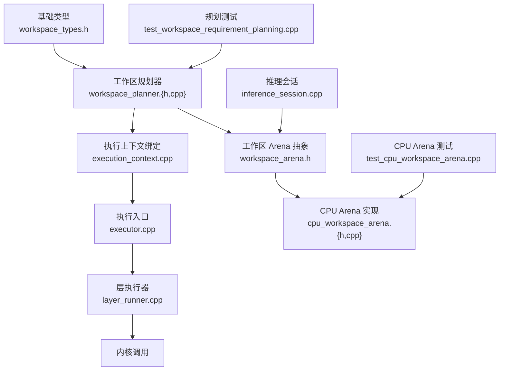
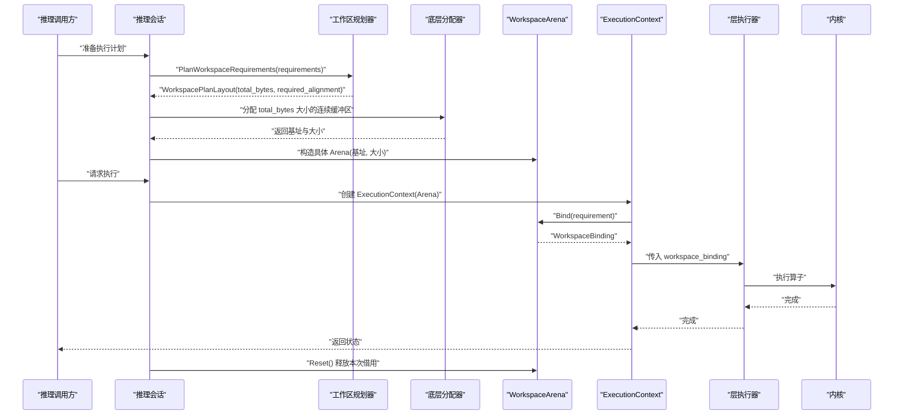
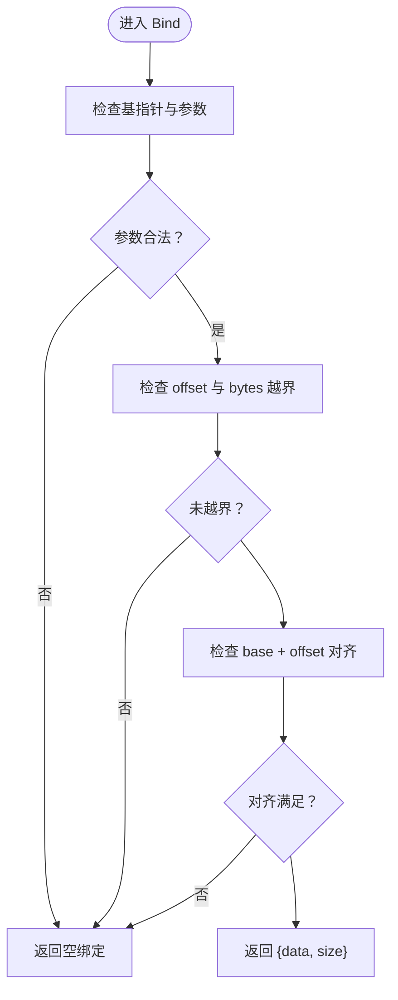
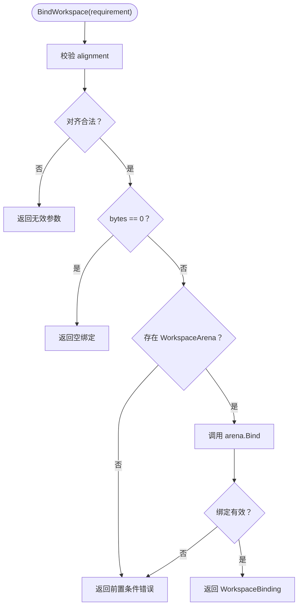
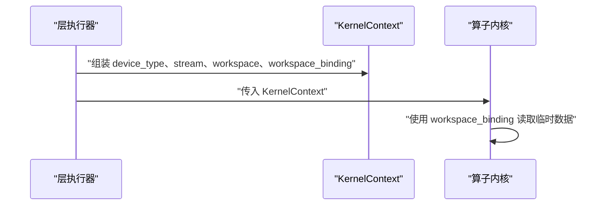
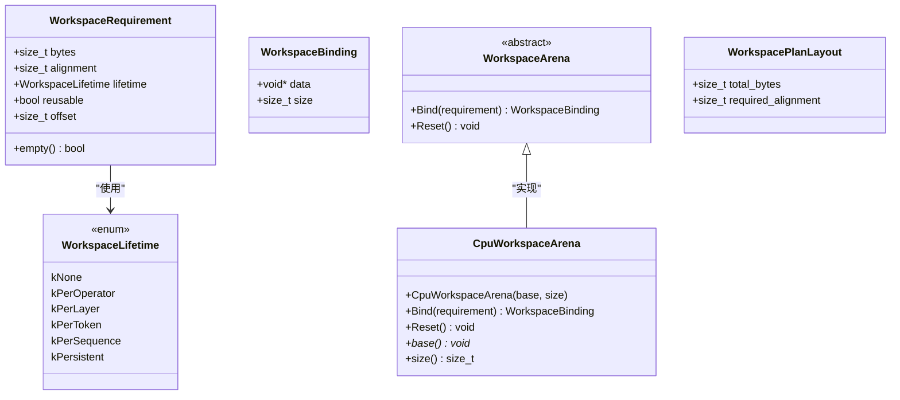
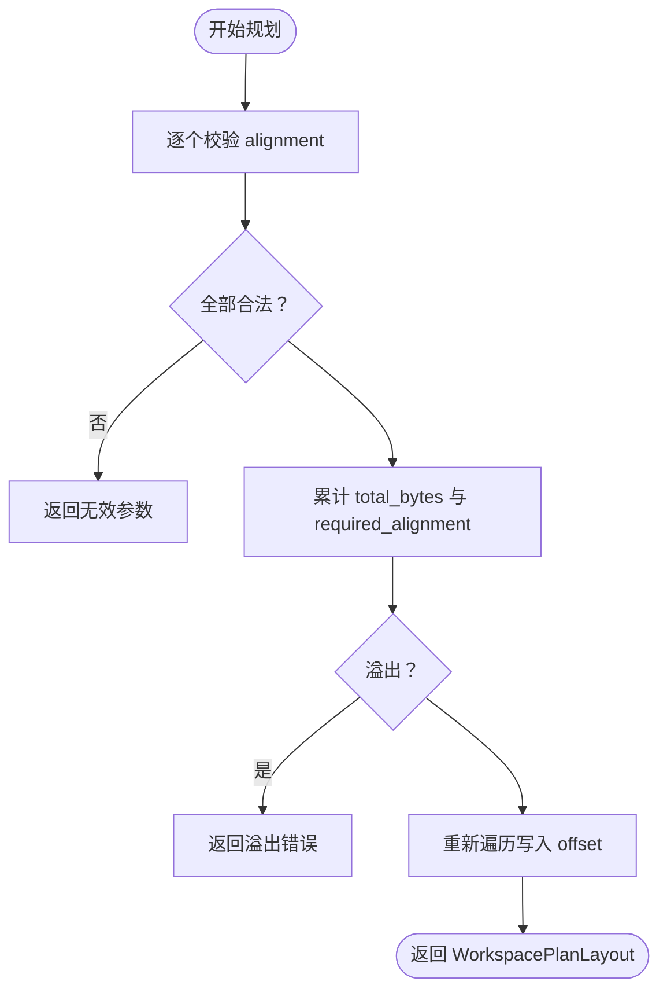
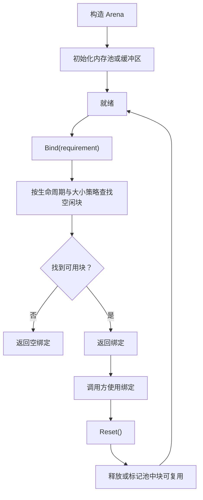

# 工作区 Arena 系统

**本文引用的文件**
- [workspace_types.h](../../../include/aethermind/base/workspace_types.h)
- [workspace_arena.h](../../../include/aethermind/base/workspace_arena.h)
- [workspace_planner.h](../../../include/aethermind/runtime/workspace_planner.h)
- [workspace_planner.cpp](../../../src/runtime/workspace_planner.cpp)
- [cpu_workspace_arena.h](../../../include/aethermind/backend/cpu/cpu_workspace_arena.h)
- [cpu_workspace_arena.cpp](../../../src/backend/cpu/cpu_workspace_arena.cpp)
- [execution_context.cpp](../../../src/execution/execution_context.cpp)
- [executor.cpp](../../../src/execution/executor.cpp)
- [layer_runner.cpp](../../../src/execution/layer_runner.cpp)
- [inference_session.cpp](../../../src/inference/inference_session.cpp)
- [test_workspace_requirement_planning.cpp](../../../tests/unit/execution/test_workspace_requirement_planning.cpp)
- [test_cpu_workspace_arena.cpp](../../../tests/unit/backend/cpu/test_cpu_workspace_arena.cpp)

## 目录
1. [引言](#引言)
2. [项目结构](#项目结构)
3. [核心组件](#核心组件)
4. [架构总览](#架构总览)
5. [详细组件分析](#详细组件分析)
6. [依赖关系分析](#依赖关系分析)
7. [性能与内存布局优化](#性能与内存布局优化)
8. [故障排查指南](#故障排查指南)
9. [结论](#结论)
10. [附录：自定义 WorkspaceArena 实现指南](#附录自定义-workspacearena-实现指南)

## 引言
AetherMind 的工作区 Arena 系统负责为推理过程中的临时中间缓冲提供统一规划与绑定能力。它把“算子需要的临时空间”从运行时动态分配中解耦出来，通过编译期或运行前的工作区规划算法生成偏移，再由执行期的 Arena 按偏移切分出视图。这样既避免重复分配，也便于在 CPU、后端和推理会话中复用同一块连续缓冲区。

本文聚焦以下主题：
- `WorkspaceRequirement` 的生命周期语义（`kPerOperator`、`kPerLayer`、`kPerToken`、`kPerSequence`、`kPersistent`）及其在推理流程中的应用场景。
- `WorkspaceBinding` 的绑定机制、偏移计算与重用策略。
- `WorkspaceArena` 抽象接口的设计理念、`Bind` 方法实现模式与 `Reset` 清理语义。
- CPU `CpuWorkspaceArena` 的具体实现行为与边界检查。
- 工作区规划算法、内存布局、零字节语义与溢出保护。
- 如何扩展自定义 `WorkspaceArena`，包括内存池设计、并发安全与性能监控集成。

## 项目结构
工作区相关代码横跨 base 类型定义、runtime 规划层、backend CPU 实现以及 execution/inference 使用侧：

**图表来源**
- [workspace_types.h:1-84](../../../include/aethermind/base/workspace_types.h#L1-L84)
- [workspace_planner.h:1-77](../../../include/aethermind/runtime/workspace_planner.h#L1-L77)
- [workspace_planner.cpp:1-71](../../../src/runtime/workspace_planner.cpp#L1-L71)
- [workspace_arena.h:1-29](../../../include/aethermind/base/workspace_arena.h#L1-L29)
- [cpu_workspace_arena.h:1-25](../../../include/aethermind/backend/cpu/cpu_workspace_arena.h#L1-L25)
- [cpu_workspace_arena.cpp:1-43](../../../src/backend/cpu/cpu_workspace_arena.cpp#L1-L43)
- [execution_context.cpp:1-96](../../../src/execution/execution_context.cpp#L1-L96)
- [executor.cpp:1-12](../../../src/execution/executor.cpp#L1-L12)
- [layer_runner.cpp:1-200](../../../src/execution/layer_runner.cpp#L1-L200)
- [inference_session.cpp:1-120](../../../src/inference/inference_session.cpp#L1-L120)
- [test_workspace_requirement_planning.cpp:1-200](../../../tests/unit/execution/test_workspace_requirement_planning.cpp#L1-L200)
- [test_cpu_workspace_arena.cpp:1-102](../../../tests/unit/backend/cpu/test_cpu_workspace_arena.cpp#L1-L102)

**章节来源**
- [workspace_types.h:1-84](../../../include/aethermind/base/workspace_types.h#L1-L84)
- [workspace_planner.h:1-77](../../../include/aethermind/runtime/workspace_planner.h#L1-L77)
- [workspace_arena.h:1-29](../../../include/aethermind/base/workspace_arena.h#L1-L29)

## 核心组件
本节梳理四类核心构件：生命周期枚举、需求描述、绑定视图与 Arena 抽象。

| 构件 | 职责 | 关键属性或方法 | 说明 |
|---|---|---|---|
| `WorkspaceLifetime` | 描述工作区生命周期的作用域 | `kNone`、`kPerOperator`、`kPerLayer`、`kPerToken`、`kPerSequence`、`kPersistent` | 由后端算子在准备阶段填写；规划器不修改它，但它可以指导上层调度与重用策略。 |
| `WorkspaceRequirement` | 描述一次算子或步骤的临时空间需求 | `bytes`、`alignment`、`lifetime`、`reusable`、`offset` | `offset` 是规划结果；`empty()` 以 `bytes == 0` 判断。 |
| `WorkspaceBinding` | 执行时借用的工作区切片 | `data`、`size` | 仅在一次内核调用期间有效；不得跨调用保存。 |
| `WorkspaceArena` | 提供执行时的绑定与重置 | `Bind(requirement)`、`Reset()` | 具体实现决定底层策略；`Reset` 使之前绑定失效。 |

**章节来源**
- [workspace_types.h:1-84](../../../include/aethermind/base/workspace_types.h#L1-L84)
- [workspace_arena.h:1-29](../../../include/aethermind/base/workspace_arena.h#L1-L29)

## 架构总览
工作区系统在 AetherMind 中的典型调用链如下：

**图表来源**
- [workspace_planner.cpp:1-71](../../../src/runtime/workspace_planner.cpp#L1-L71)
- [execution_context.cpp:1-96](../../../src/execution/execution_context.cpp#L1-L96)
- [executor.cpp:1-12](../../../src/execution/executor.cpp#L1-L12)
- [layer_runner.cpp:1-200](../../../src/execution/layer_runner.cpp#L1-L200)
- [inference_session.cpp:1-120](../../../src/inference/inference_session.cpp#L1-L120)

## 详细组件分析

### `WorkspaceRequirement` 生命周期语义与应用场景
`WorkspaceLifetime` 将临时缓冲的作用域从单个算子逐步扩展到更高层级：

- `kNone`：不需要工作区。
- `kPerOperator`：只在单个算子调用期间有效。适合中等规模、每次调用都产生且立即销毁的中间张量。
- `kPerLayer`：可在一个模型层内复用。适合层内部多个算子共享的临时矩阵、归约缓冲等。
- `kPerToken`：在一个 token 步长内复用。解码阶段的逐 token 中间缓存很适合该级别。
- `kPerSequence`：在一个请求序列内复用。预填充与解码可能共享的批处理缓冲。
- `kPersistent`：随拥有对象存活。适合需要长期驻留的持久化临时缓冲。

这些语义本身并不改变规划器的偏移计算；它们主要影响上层调度器对重用窗口、并发访问与回收策略的判断。例如，`kPerLayer` 可让同层多个算子共享一段已对齐的缓冲，而 `kPerToken` 可让解码路径在不同 token 间复用固定大小的临时区。

**章节来源**
- [workspace_types.h:1-84](../../../include/aethermind/base/workspace_types.h#L1-L84)

### `WorkspaceBinding` 绑定机制与偏移计算
`WorkspaceBinding` 是对已规划 `WorkspaceRequirement.offset` 的执行期解释：

1. 规划阶段：`PlanWorkspaceRequirements` 计算每个非空需求的对齐后起始偏移，并写入 `requirement.offset`。
2. 执行阶段：`ExecutionContext::BindWorkspace` 再次校验对齐与非空条件，然后委托 `WorkspaceArena::Bind`。
3. 绑定阶段：具体 Arena 根据 `base + offset` 生成 `WorkspaceBinding`，并保证 `size >= bytes`。

这种“规划偏移 + 执行期切片”的设计，使得一次连续内存可以服务多次不同算子的临时空间，避免运行时反复分配。

**章节来源**
- [workspace_planner.cpp:1-71](../../../src/runtime/workspace_planner.cpp#L1-L71)
- [execution_context.cpp:1-96](../../../src/execution/execution_context.cpp#L1-L96)

### `WorkspaceArena` 抽象接口设计理念
`WorkspaceArena` 是一个极简抽象：

- `Bind`：接受带 `offset` 的需求，返回借用的切片。
- `Reset`：使所有先前绑定失效，表示当前步骤结束。

接口刻意不暴露分配细节，允许不同后端采用不同策略：
- CPU 端可采用静态预分配、环形缓冲区、分块分配等。
- 推理会话可实现轻量 Arena，直接基于已分配的字节数组进行偏移切分。
- 未来 GPU 后端也可按需实现自己的 Arena，只要满足绑定契约即可。

**章节来源**
- [workspace_arena.h:1-29](../../../include/aethermind/base/workspace_arena.h#L1-L29)

### CPU `CpuWorkspaceArena` 实现分析
`CpuWorkspaceArena` 是仓库中显式提供的 CPU Arena 实现。其核心行为如下：

- 构造函数接收外部传入的基指针与大小，不做分配。
- `Bind` 会检查：
  - 基指针是否为空。
  - `bytes` 是否为零。
  - `alignment` 是否为零。
  - `offset` 是否在 `[0, size_)` 范围内。
  - `offset + bytes` 是否越界。
  - `base + offset` 是否满足要求的对齐。
- 任何失败都会返回空的 `WorkspaceBinding`，而不是抛异常。
- `Reset` 当前为空操作，因为 Arena 本身不持有额外状态。

**图表来源**
- [cpu_workspace_arena.cpp:1-43](../../../src/backend/cpu/cpu_workspace_arena.cpp#L1-L43)

需要注意的是，虽然 `CpuWorkspaceArena` 被用于 CPU 后端，但它并不是一个复杂的“静态预分配 + 环形缓冲区 + 分块分配”管理器；它更像是一个**受约束的偏移查看器**。真正的“静态预分配”发生在上层：规划器计算出总大小后，由调用方分配一块连续内存，再交给 Arena 使用。

**章节来源**
- [cpu_workspace_arena.h:1-25](../../../include/aethermind/backend/cpu/cpu_workspace_arena.h#L1-L25)
- [cpu_workspace_arena.cpp:1-43](../../../src/backend/cpu/cpu_workspace_arena.cpp#L1-L43)
- [test_cpu_workspace_arena.cpp:1-102](../../../tests/unit/backend/cpu/test_cpu_workspace_arena.cpp#L1-L102)

### 推理会话中的轻量 Arena
推理会话中还包含一个内部 `SessionWorkspaceArena`，其行为与 `CpuWorkspaceArena` 类似，但面向推理资源管理：

- 由 `RequestResources::InitializeWorkspace` 调用底层 `Allocator` 分配缓冲区。
- `Bind` 同样基于 `base_ + requirement.offset` 做偏移与对齐检查。
- `Reset` 为空操作，因为推理会话在适当位置调用 Arena 的 `Reset` 作为步骤边界语义。

这说明 AetherMind 支持多种 Arena 实现：CPU 后端可使用 `CpuWorkspaceArena`，推理会话也可用自实现的轻量 Arena。

**章节来源**
- [inference_session.cpp:1-120](../../../src/inference/inference_session.cpp#L1-L120)

### 执行上下文中的绑定封装
`ExecutionContext::BindWorkspace` 提供了统一的绑定入口：

1. 校验 alignment 必须是非零 2 的幂。
2. 如果 `bytes == 0`，直接返回空绑定。
3. 如果存在工作区需求但没有 Arena，返回前置条件错误。
4. 调用 `arena_->Bind(requirement)`。
5. 如果返回绑定为空或 size 不足，返回前置条件错误。

这使得上层代码不必直接关心 Arena 的失败细节，而是通过统一的状态码表达绑定失败。

**图表来源**
- [execution_context.cpp:1-96](../../../src/execution/execution_context.cpp#L1-L96)

**章节来源**
- [execution_context.cpp:1-96](../../../src/execution/execution_context.cpp#L1-L96)

### 层执行器与工作区传递
层执行器负责构建 `KernelContext`，并将 `WorkspaceArena` 与 `WorkspaceBinding` 一起传给内核调用链路。这意味着算子可以通过 `KernelContext.workspace` 访问 Arena，并通过 `KernelContext.workspace_binding` 访问当前步骤的临时缓冲。

**图表来源**
- [layer_runner.cpp:1-200](../../../src/execution/layer_runner.cpp#L1-L200)

**章节来源**
- [layer_runner.cpp:1-200](../../../src/execution/layer_runner.cpp#L1-L200)
- [executor.cpp:1-12](../../../src/execution/executor.cpp#L1-L12)

## 依赖关系分析

**图表来源**
- [workspace_types.h:1-84](../../../include/aethermind/base/workspace_types.h#L1-L84)
- [workspace_arena.h:1-29](../../../include/aethermind/base/workspace_arena.h#L1-L29)
- [cpu_workspace_arena.h:1-25](../../../include/aethermind/backend/cpu/cpu_workspace_arena.h#L1-L25)
- [workspace_planner.h:1-77](../../../include/aethermind/runtime/workspace_planner.h#L1-L77)

**章节来源**
- [workspace_types.h:1-84](../../../include/aethermind/base/workspace_types.h#L1-L84)
- [workspace_arena.h:1-29](../../../include/aethermind/base/workspace_arena.h#L1-L29)
- [cpu_workspace_arena.h:1-25](../../../include/aethermind/backend/cpu/cpu_workspace_arena.h#L1-L25)
- [workspace_planner.h:1-77](../../../include/aethermind/runtime/workspace_planner.h#L1-L77)

## 性能与内存布局优化

### 工作区规划算法
`PlanWorkspaceRequirements` 的核心流程：

1. **第一阶段：全部验证。** 检查每个需求的 alignment 是否为非零 2 的幂。
2. **第二阶段：证明布局。** 统计 `required_alignment` 并按顺序累加对齐后的偏移与字节数，同时检测溢出。
3. **第三阶段：提交偏移。** 在同一遍历中再次计算对齐偏移，并写入 `requirement.offset`。

关键点：
- 先验证再修改，保证失败时不会留下部分规划的偏移。
- 使用溢出检查函数避免 `size_t` 加法溢出。
- 捕获 `std::bad_alloc` 并转换为 `ResourceExhausted`，但规划成功时不分配内存。

**图表来源**
- [workspace_planner.cpp:1-71](../../../src/runtime/workspace_planner.cpp#L1-L71)

**章节来源**
- [workspace_planner.cpp:1-71](../../../src/runtime/workspace_planner.cpp#L1-L71)
- [test_workspace_requirement_planning.cpp:1-200](../../../tests/unit/execution/test_workspace_requirement_planning.cpp#L1-L200)

### 内存布局优化要点
- **对齐优先：** 每个需求按其 alignment 对齐，因此较大的 alignment 可能引入 padding。
- **零字节需求：** `bytes == 0` 不消耗空间，但仍记录一个“位置标记”，并且参与 `required_alignment` 的最大值统计。
- **总对齐要求：** `WorkspacePlanLayout.required_alignment` 是所有需求中的最大 alignment，用于选择底层分配器的对齐方式。
- **无分配规划：** 规划阶段只计算偏移和总大小，不申请堆内存，降低运行时开销。

### 垃圾回收与重用策略
Arena 层的“垃圾回收”体现为 `Reset`：

- `CpuWorkspaceArena::Reset` 当前为空操作，因为它是纯偏移视图。
- `ExecutionContext::Clear` 会清空上下文中的 Arena 引用，防止后续误用。
- 推理会话在使用完工作区后会调用 `workspace->Reset()`，标志一次推理步骤的结束。
- `WorkspaceRequirement.reusable` 字段可用于上层调度器决定是否重用同一片工作区；当前规划器并不据此合并区间，但 API 保留该语义以便未来扩展。

**章节来源**
- [cpu_workspace_arena.cpp:1-43](../../../src/backend/cpu/cpu_workspace_arena.cpp#L1-L43)
- [execution_context.cpp:1-96](../../../src/execution/execution_context.cpp#L1-L96)
- [inference_session.cpp:1-120](../../../src/inference/inference_session.cpp#L1-L120)

## 故障排查指南

| 现象 | 可能原因 | 定位建议 |
|---|---|---|
| 绑定返回空或 size 为 0 | `bytes == 0`、`alignment == 0`、`offset` 越界、`base + offset` 不对齐 | 检查 `WorkspaceRequirement` 的四个关键字段与 Arena 的 `base`、`size`。 |
| 执行上下文报告“需要 WorkspaceArena” | 工作区总大小大于 0，但创建上下文时未传入 Arena | 确认 `ExecutionPlan.total_workspace_bytes()` 与 `ExecutionContext::Create` 的参数。 |
| 绑定失败提示“无法提供工作区” | Arena 的 `Bind` 返回空或 size 小于需求 | 检查 Arena 实现是否正确处理 offset、alignment 与边界。 |
| 规划返回溢出错误 | 对齐后的总大小超过 `size_t` 容量 | 检查是否存在超大需求或大量高对齐 padding。 |
| 规划返回无效参数 | alignment 不是非零 2 的幂 | 检查算子准备的 `WorkspaceRequirement.alignment`。 |
| 推理过程中工作区越界 | 上层分配的缓冲区小于 `total_bytes` 或对不齐 | 核对 `WorkspacePlanLayout.total_bytes` 与 `required_alignment`。 |

**章节来源**
- [execution_context.cpp:1-96](../../../src/execution/execution_context.cpp#L1-L96)
- [workspace_planner.cpp:1-71](../../../src/runtime/workspace_planner.cpp#L1-L71)
- [test_cpu_workspace_arena.cpp:1-102](../../../tests/unit/backend/cpu/test_cpu_workspace_arena.cpp#L1-L102)

## 结论
AetherMind 的工作区 Arena 系统通过四层协作完成临时缓冲管理：

1. **类型层**：用 `WorkspaceLifetime`、`WorkspaceRequirement`、`WorkspaceBinding` 明确描述生命周期、需求与执行视图。
2. **规划层**：`PlanWorkspaceRequirements` 提供无分配、对齐感知、溢出保护的布局计算。
3. **抽象层**：`WorkspaceArena` 隔离分配策略，使 CPU、推理会话与未来后端可替换实现。
4. **执行层**：`ExecutionContext` 与层执行器将工作区绑定注入内核调用链，并在步骤结束时触发 Reset。

这套设计将“算子临时空间”与“权重、激活、KV Cache”区分开来，使推理路径更容易做内存复用与资源预算控制。

## 附录：自定义 WorkspaceArena 实现指南

### 实现契约
自定义 Arena 必须满足：

- `Bind(requirement)`：
  - 若需求无效或无法提供足够空间，返回空 `WorkspaceBinding`。
  - 若返回绑定，则 `data` 必须非空，`size >= requirement.bytes`。
  - `data` 指向的地址应满足 `requirement.alignment`。
- `Reset()`：
  - 使之前返回的所有绑定失效。
  - 不强制清空底层缓冲区内容，但不应泄露上一轮状态给下一轮。

### 内存池设计建议
如果需要比简单偏移查看更复杂的复用逻辑，可考虑：

- **固定尺寸池：** 为常见 `bytes` 范围维护多个大小类链表，减少碎片。
- **滑动窗口池：** 结合 `WorkspaceLifetime`，按 `kPerOperator`、`kPerLayer`、`kPerToken` 维护多个窗口。
- **环形缓冲区：** 适用于解码阶段 token-by-token 的固定大小临时缓冲。
- **分块分配：** 将大需求拆分为对齐块，小块需求走快速路径。

### 并发安全考虑
- 如果 Arena 可能被多线程共享，需要在 `Bind` 和 `Reset` 中加入锁或线程本地存储。
- 推荐为每个线程维护独立的 Arena 实例，避免竞争。
- 如果使用线程池，可将 Arena 放入线程局部变量，并在任务开始时初始化、结束时 Reset。

### 性能监控集成
建议在自定义 Arena 中统计：

- 总分配大小。
- 绑定次数。
- 绑定失败次数。
- 平均/最大/分位数占用。
- 热点需求的大小分布。
- `Reset` 调用频率。

这些指标可上报到 profiling 系统，帮助发现过度分配、对齐浪费或生命周期设置不当的问题。

### 最小参考实现思路
虽然不建议直接复制源码，但可以遵循以下思路：

**图表来源**
- [workspace_arena.h:1-29](../../../include/aethermind/base/workspace_arena.h#L1-L29)
- [cpu_workspace_arena.cpp:1-43](../../../src/backend/cpu/cpu_workspace_arena.cpp#L1-L43)
- [inference_session.cpp:1-120](../../../src/inference/inference_session.cpp#L1-L120)

**章节来源**
- [workspace_arena.h:1-29](../../../include/aethermind/base/workspace_arena.h#L1-L29)
- [cpu_workspace_arena.cpp:1-43](../../../src/backend/cpu/cpu_workspace_arena.cpp#L1-L43)
- [inference_session.cpp:1-120](../../../src/inference/inference_session.cpp#L1-L120)
