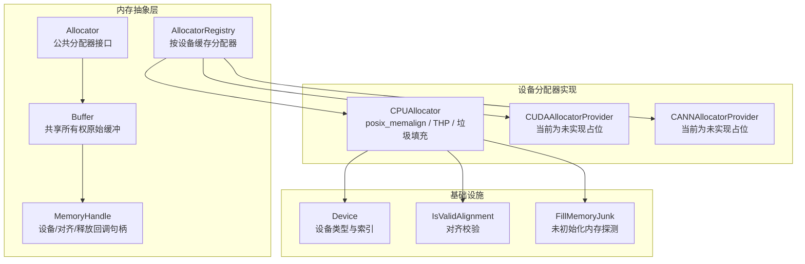
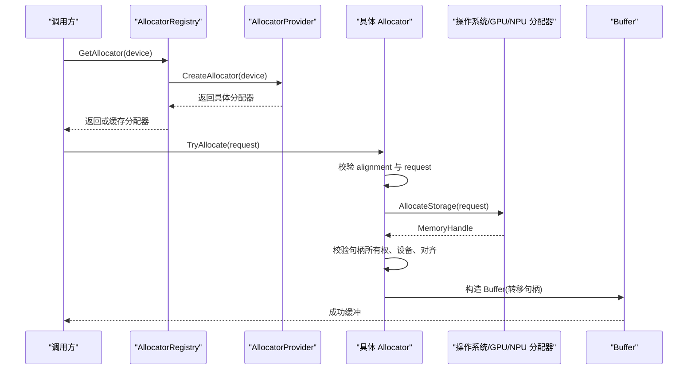
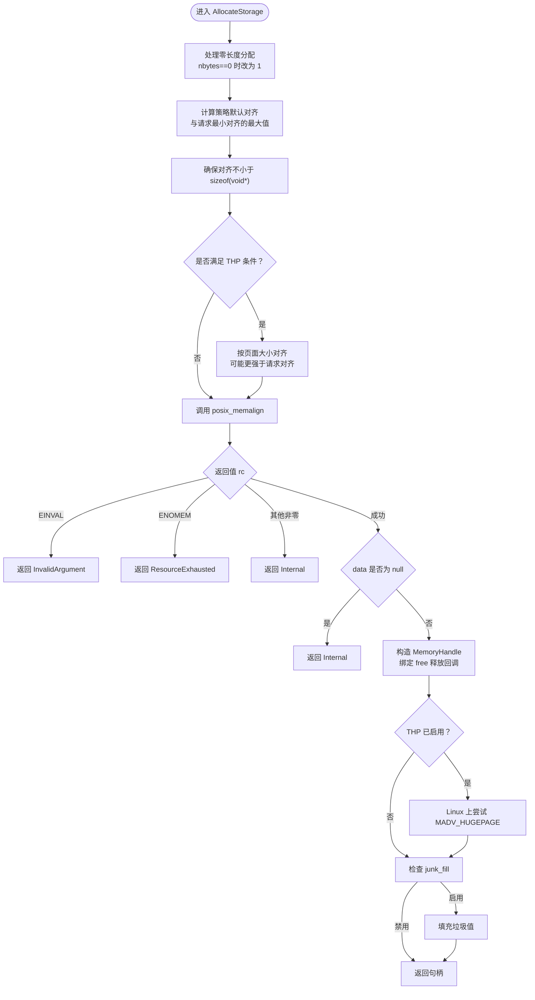
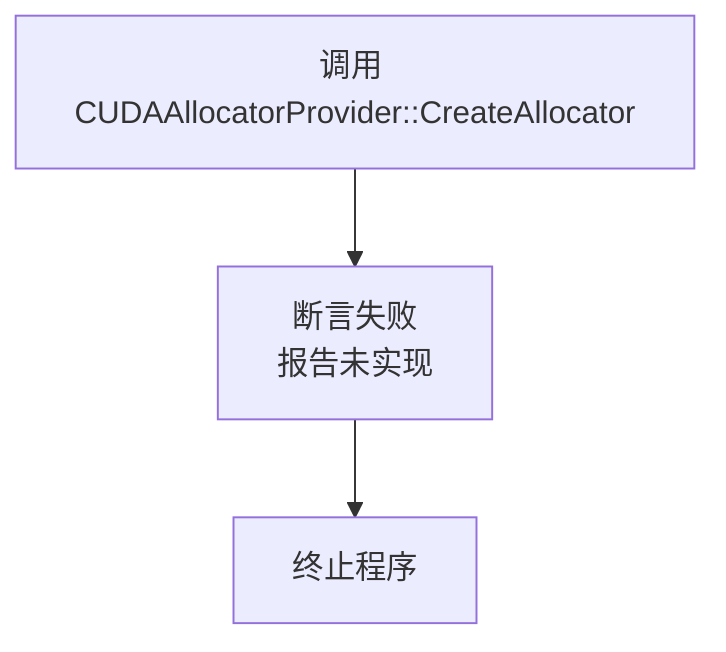
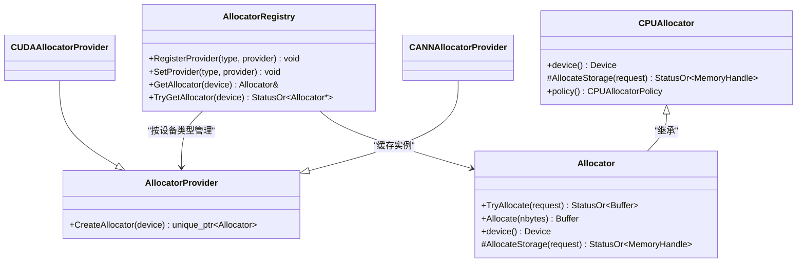
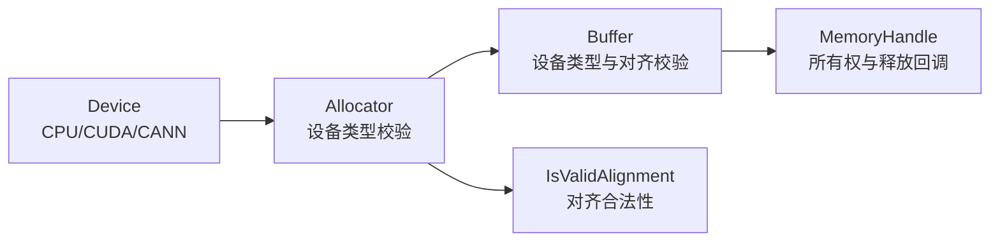

# 设备特定分配器实现

**本文引用的文件**
- [allocator.h](../../../include/aethermind/memory/allocator.h)
- [allocator.cpp](../../../src/memory/allocator.cpp)
- [cpu_allocator.h](../../../include/aethermind/memory/cpu_allocator.h)
- [cpu_allocator.cpp](../../../src/memory/cpu_allocator.cpp)
- [cuda_allocator.h](../../../include/aethermind/memory/cuda_allocator.h)
- [cuda_allocator.cpp](../../../src/memory/cuda_allocator.cpp)
- [cann_allocator.h](../../../include/aethermind/memory/cann_allocator.h)
- [cann_allocator.cpp](../../../src/memory/cann_allocator.cpp)
- [buffer.h](../../../include/aethermind/memory/buffer.h)
- [memory_handle.h](../../../include/aethermind/memory/memory_handle.h)
- [alignment.h](../../../include/aethermind/base/alignment.h)
- [device.h](../../../include/aethermind/base/device.h)
- [memory_junk_fill.cpp](../../../src/memory/memory_junk_fill.cpp)
- [test_cpu_allocator.cpp](../../../tests/unit/memory/test_cpu_allocator.cpp)

## 目录
1. [引言](#引言)
2. [项目结构](#项目结构)
3. [核心组件](#核心组件)
4. [架构总览](#架构总览)
5. [详细组件分析](#详细组件分析)
6. [依赖关系分析](#依赖关系分析)
7. [性能与内存策略](#性能与内存策略)
8. [故障排查指南](#故障排查指南)
9. [结论](#结论)
10. [附录：跨设备数据迁移建议](#附录跨设备数据迁移建议)

## 引言
本文件面向 AetherMind 运行时中的设备特定内存分配器，系统性地说明 CPU、CUDA、CANN 三类分配器的接口契约、当前实现状态、错误恢复机制、对齐与容量约束，以及可扩展的零拷贝、内存池与传输优化方向。需要特别注意：在当前仓库中，只有 CPU 分配器具备完整实现；CUDA 与 CANN 分配器以“未实现”占位形式存在，用于暴露统一的 AllocatorProvider 扩展点。

## 项目结构
AetherMind 的内存子系统围绕一个抽象分配器接口展开，由设备类型驱动提供具体实现，并通过注册表统一获取和缓存实例。相关头文件和源文件位于 include/aethermind/memory 与 src/memory 下，并与基础设备、对齐、缓冲区等模块协同工作。

**图表来源**
- [allocator.h:14-113](../../../include/aethermind/memory/allocator.h#L14-L113)
- [cpu_allocator.h:17-69](../../../include/aethermind/memory/cpu_allocator.h#L17-L69)
- [cuda_allocator.h:11-16](../../../include/aethermind/memory/cuda_allocator.h#L11-L16)
- [cann_allocator.h:11-16](../../../include/aethermind/memory/cann_allocator.h#L11-L16)
- [buffer.h:19-184](../../../include/aethermind/memory/buffer.h#L19-L184)
- [memory_handle.h:15-169](../../../include/aethermind/memory/memory_handle.h#L15-L169)
- [alignment.h:12-34](../../../include/aethermind/base/alignment.h#L12-L34)
- [device.h:24-187](../../../include/aethermind/base/device.h#L24-L187)

**章节来源**
- [allocator.h:14-113](../../../include/aethermind/memory/allocator.h#L14-L113)
- [cpu_allocator.h:17-69](../../../include/aethermind/memory/cpu_allocator.h#L17-L69)
- [cuda_allocator.h:11-16](../../../include/aethermind/memory/cuda_allocator.h#L11-L16)
- [cann_allocator.h:11-16](../../../include/aethermind/memory/cann_allocator.h#L11-L16)

## 核心组件
- 分配器接口与验证入口：
  - AllocationRequest 描述可见字节数与最小对齐要求。
  - Allocator::TryAllocate 负责参数校验、调用设备专用 AllocateStorage、验证返回句柄的所有权、设备类型和对齐一致性，并最终构造 Buffer。
  - Allocator::Allocate 是异常风格封装，将 ResourceExhausted 转换为 std::bad_alloc。
- 分配器提供者与注册表：
  - AllocatorProvider 为每个 DeviceType 创建 Allocator。
  - AllocatorRegistry 维护 DeviceType→Provider 映射，并缓存 Device→Allocator 实例；设置 Provider 时会清除同类型已缓存分配器，但已有 Buffer 仍通过自身 MemoryHandle 持有存储。
- 缓冲区与句柄：
  - MemoryHandle 是移动独占的原始指针包装，携带设备、对齐和可选释放回调；空回调或 NoOpMemoryDeleter 表示借用内存。
  - Buffer 通过 BufferImpl 共享底层存储元数据，并在构造时再次校验设备类型、对齐和 CPU 指针实际对齐。

**章节来源**
- [allocator.h:14-113](../../../include/aethermind/memory/allocator.h#L14-L113)
- [allocator.cpp:12-139](../../../src/memory/allocator.cpp#L12-L139)
- [buffer.h:19-184](../../../include/aethermind/memory/buffer.h#L19-L184)
- [memory_handle.h:15-169](../../../include/aethermind/memory/memory_handle.h#L15-L169)

## 架构总览
AetherMind 在分配层面采用“抽象接口 + 设备提供者 + 注册表缓存”的模式：

**图表来源**
- [allocator.cpp:20-139](../../../src/memory/allocator.cpp#L20-L139)
- [allocator.h:47-113](../../../include/aethermind/memory/allocator.h#L47-L113)

## 详细组件分析

### CPU 分配器
CPUAllocator 使用 posix_memalign 获取对齐内存，支持以下特性：
- 默认对齐：优先使用构建期 KALLOC_ALIGNMENT，否则回退到 64 字节缓存行对齐；当请求对齐小于 sizeof(void*) 时进行提升而非拒绝。
- 巨页优化：当 policy.allow_thp 为真且环境变量 THP_MEM_ALLOC_ENABLE 非零时，对大于等于 2 MiB 的请求启用透明巨页（THP），并按页面大小对齐；Linux 上尝试 madvise(MADV_HUGEPAGE)。
- 未初始化探测：可通过 policy.junk_fill 启用垃圾值填充，帮助发现未初始化读取。
- 错误语义：EINVAL 转为 InvalidArgument；ENOMEM 转为 ResourceExhausted；其他失败为 Internal；null 返回也被视为内部错误。
- 零长度分配：会分配至少 1 字节，保证返回可 free 的非空指针，同时对外显示 nbytes 为 0。

**图表来源**
- [cpu_allocator.cpp:28-126](../../../src/memory/cpu_allocator.cpp#L28-L126)

**章节来源**
- [cpu_allocator.h:17-69](../../../include/aethermind/memory/cpu_allocator.h#L17-L69)
- [cpu_allocator.cpp:28-126](../../../src/memory/cpu_allocator.cpp#L28-L126)
- [memory_junk_fill.cpp:10-29](../../../src/memory/memory_junk_fill.cpp#L10-L29)

#### CPU 分配器关键行为与测试覆盖
- 保留用户写入的数据：测试先写入再断言首尾字节，说明垃圾填充发生在分配阶段，后续写操作正常生效。
- 零长度分配仍拥有有效可释放指针，并对齐满足请求。
- 非 2 的幂对齐在分配前被拒绝，且不触发底层分配。
- 小对齐会被提升到至少指针大小。
- 系统分配失败返回 ResourceExhausted，并可重试；若元数据分配失败，已分配的底层存储会被释放。
- THP 警告路径下的 OOM 也能正确释放底层存储。

**章节来源**
- [test_cpu_allocator.cpp:1-200](../../../tests/unit/memory/test_cpu_allocator.cpp#L1-L200)

### CUDA 分配器
当前仓库中的 CUDAAllocatorProvider::CreateAllocator 直接断言失败，提示该构建配置下未实现 CUDA 分配器。因此：
- 无法通过 CUDA 设备类型获取分配器。
- 任何试图使用该 Provider 的路径都会中止。
- 这为后续接入 cudaMalloc/cudaFree 或 CUDA 内存池预留了明确的扩展点。

**图表来源**
- [cuda_allocator.cpp:5-13](../../../src/memory/cuda_allocator.cpp#L5-L13)

**章节来源**
- [cuda_allocator.h:11-16](../../../include/aethermind/memory/cuda_allocator.h#L11-L16)
- [cuda_allocator.cpp:5-13](../../../src/memory/cuda_allocator.cpp#L5-L13)

### CANN 分配器
CANNAllocatorProvider 与 CUDA 分配器类似，也处于“未实现”状态：
- 当前不可用。
- 未来适配华为昇腾 NPU 时，应遵循现有 Allocator 接口，并提供正确的设备、对齐、释放回调和错误码。

**章节来源**
- [cann_allocator.h:11-16](../../../include/aethermind/memory/cann_allocator.h#L11-L16)
- [cann_allocator.cpp:5-13](../../../src/memory/cann_allocator.cpp#L5-L13)

### 公共分配器接口与注册表
Allocator::TryAllocate 是所有设备分配的统一验证入口，主要职责包括：
- 校验 alignment 必须为零或 2 的幂。
- 调用具体分配器的 AllocateStorage。
- 校验返回句柄非空、拥有所有权、设备类型为 CPU/CUDA/CANN，且与分配器声明设备一致。
- 校验返回的对齐合法且不低于请求对齐；对于 CPU 指针还额外检查实际地址对齐。
- 捕获底层 bad_alloc，将其转换为 ResourceExhausted，避免诊断信息分配引发二次 OOM。

AllocatorRegistry 的职责包括：
- 注册或替换设备类型对应的 Provider。
- 首次访问时为 Device 创建并缓存 Allocator。
- 替换 Provider 时清理对应类型的缓存实例，但不影响已有 Buffer 的生命周期。

**图表来源**
- [allocator.h:14-113](../../../include/aethermind/memory/allocator.h#L14-L113)
- [allocator.cpp:20-139](../../../src/memory/allocator.cpp#L20-L139)
- [cpu_allocator.h:17-69](../../../include/aethermind/memory/cpu_allocator.h#L17-L69)

**章节来源**
- [allocator.h:14-113](../../../include/aethermind/memory/allocator.h#L14-L113)
- [allocator.cpp:20-139](../../../src/memory/allocator.cpp#L20-L139)

## 依赖关系分析
- 设备类型约束：
  - DeviceType 包含 kCPU、kCUDA、kCANN 和 kUndefined。
  - Buffer 和 Allocator 均只接受 CPU/CUDA/CANN 三种有效设备类型。
- 对齐约束：
  - IsValidAlignment 要求对齐为非零且为 2 的幂。
  - CPU 分配器在底层限制下提升过小对齐。
- 所有权模型：
  - 分配器返回的 MemoryHandle 必须有非空且非 NoOp 的释放回调；否则被判定为借用内存而被拒绝。
  - Buffer 通过 ObjectRef 实现引用计数，多个 Buffer 可共享同一底层存储。

**图表来源**
- [device.h:24-187](../../../include/aethermind/base/device.h#L24-L187)
- [allocator.cpp:20-84](../../../src/memory/allocator.cpp#L20-L84)
- [buffer.h:43-77](../../../include/aethermind/memory/buffer.h#L43-L77)
- [alignment.h:12-34](../../../include/aethermind/base/alignment.h#L12-L34)

**章节来源**
- [device.h:24-187](../../../include/aethermind/base/device.h#L24-L187)
- [allocator.cpp:20-84](../../../src/memory/allocator.cpp#L20-L84)
- [buffer.h:43-77](../../../include/aethermind/memory/buffer.h#L43-L77)
- [alignment.h:12-34](../../../include/aethermind/base/alignment.h#L12-L34)

## 性能与内存策略

### CPU 分配器性能特征
- 对齐与缓存友好性：默认 64 字节对齐有助于 SIMD 向量化；KALLOC_ALIGNMENT 允许构建期定制。
- 透明巨页：对 ≥2 MiB 分配可在 Linux 上尝试 MADV_HUGEPAGE，降低 TLB 压力；需显式开启环境变量。
- 未初始化检测：垃圾填充会引入额外写入成本，适合调试；生产环境可根据策略关闭。
- 系统分配失败：返回 ResourceExhausted，调用方可重试；测试覆盖了 malloc interposer 下的可恢复场景。

### CUDA 与 CANN 分配器现状
- 当前均为未实现占位，任何创建行为都会直接断言失败。
- 这意味着 GPU/NPU 路径在当前构建中不可用，上层调度应避免选择这些设备，除非提供自定义 Provider 并替换默认注册。

### 可扩展优化方向
- 内存池：
  - CPU：可按 size class 建立线程本地或进程级池，减少 posix_memalign/free 开销。
  - CUDA：可基于 cudaMallocAsync、cudaMemPool 或自定义块池，减少设备端分配碎片与同步开销。
  - CANN：参考昇腾提供的内存池 API，实现块分配、复用与边界保护。
- 零拷贝优化：
  - 利用 MemoryHandle 的借用语义，让 Buffer 仅持有视图而不转移所有权，前提是生命周期由外部对象保证。
  - 对主机与设备内存，结合运行时同步原语实现异步流水线，避免不必要的 host-device 拷贝。
- 对齐与布局：
  - 保持 Buffer 与算子内核约定的对齐；对大块权重和 KV Cache 优先使用页面对齐或大页。
- 最大分配大小：
  - 当前代码没有全局上限；CPU 侧受限于系统可用内存和 posix_memalign 能力，GPU/NPU 侧应由各自后端定义上限并进行预检。

[本节为通用性能指导，不直接分析具体代码文件]

## 故障排查指南

### 常见错误与定位
- 对齐非法：
  - 现象：TryAllocate 返回 InvalidArgument。
  - 原因：alignment 不是 2 的幂。
  - 处理：修正请求对齐，或使用 0 选择默认策略。
- 句柄为空或借用内存：
  - 现象：Internal 错误，提示句柄为空或借用内存。
  - 原因：AllocateStorage 返回空句柄，或释放回调为空或 NoOpMemoryDeleter。
  - 处理：确保分配器返回拥有所有权的句柄。
- 设备类型不匹配：
  - 现象：Internal 错误，提示无效或不匹配的设备。
  - 原因：句柄设备类型不在 CPU/CUDA/CANN 范围内，或与分配器 device() 不一致。
  - 处理：检查 Allocator 与 MemoryHandle 的设备构造。
- 实际对齐不足：
  - 现象：Internal 错误，提示返回对齐不足或 CPU 指针不对齐。
  - 原因：分配器声明的对齐小于请求对齐，或 CPU 指针未按声明对齐。
  - 处理：调整分配策略，确保实际地址满足对齐。
- CUDA/CANN 分配器未实现：
  - 现象：创建分配器时断言失败。
  - 原因：当前构建未实现 GPU/NPU 分配器。
  - 处理：避免选择对应设备，或提供自定义 AllocatorProvider 实现。

**章节来源**
- [allocator.cpp:20-84](../../../src/memory/allocator.cpp#L20-L84)
- [cuda_allocator.cpp:5-13](../../../src/memory/cuda_allocator.cpp#L5-L13)
- [cann_allocator.cpp:5-13](../../../src/memory/cann_allocator.cpp#L5-L13)

### 内存泄漏检测技巧
- 使用垃圾填充：开启 CPUAllocatorPolicy.junk_fill，可快速发现未初始化读导致的异常模式。
- 观察 Buffer 引用计数：通过 use_count 判断是否存在意外共享；unique 可用于单所有者假设检查。
- 借助测试工具：测试中通过 MallocInterposer 注入分配失败，验证资源释放路径；生产环境中可结合 ASan/LSan 或平台工具定位泄漏。
- 句柄释放回调：确保释放回调不为空且不会抛出；若回调中重新分配内存，应谨慎避免递归 OOM。

**章节来源**
- [memory_junk_fill.cpp:10-29](../../../src/memory/memory_junk_fill.cpp#L10-L29)
- [buffer.h:122-170](../../../include/aethermind/memory/buffer.h#L122-L170)
- [memory_handle.h:55-143](../../../include/aethermind/memory/memory_handle.h#L55-L143)

## 结论
AetherMind 的分配器设计以统一的 Allocator 接口为核心，通过 AllocatorProvider 与 AllocatorRegistry 解耦设备差异。当前仓库中，CPU 分配器已经成熟，支持灵活对齐、透明巨页与未初始化探测；CUDA 与 CANN 分配器则提供了清晰的扩展点，便于后续接入 GPU 与昇腾 NPU。对于生产部署，建议在 CPU 侧根据负载特征权衡垃圾填充与 THP，在 GPU/NPU 侧引入设备内存池与异步流水，以减少分配开销并提高吞吐。

[本节为总结性内容，不直接分析具体代码文件]

## 附录：跨设备数据迁移建议
虽然本仓库未提供统一的设备间传输 API，但从内存模型角度可以给出以下实践建议：
- 明确所有权：
  - 如果数据需要在主机与设备之间共享，应使用可借用的 MemoryHandle 视图，并确保源对象生命周期覆盖使用范围。
  - 如果需要移动所有权，应通过新的分配器在目标设备上分配，并复制数据。
- 同步语义：
  - 在访问跨设备数据前，使用运行时的流或事件完成同步，避免竞态。
- 零拷贝路径：
  - 对于支持统一虚拟地址的平台，可优先采用零拷贝；否则应批量合并传输以降低延迟。
- 对齐与格式：
  - 传输前确保数据对齐符合目标设备内核要求；必要时做 padding 或重排。
- 错误恢复：
  - 传输失败时应回滚已提交的工作或释放临时资源，保持状态机可重试。

[本节为概念性建议，不直接分析具体代码文件]
