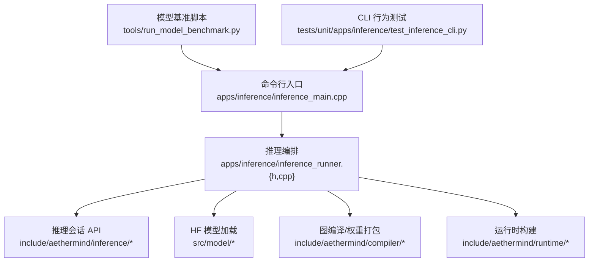
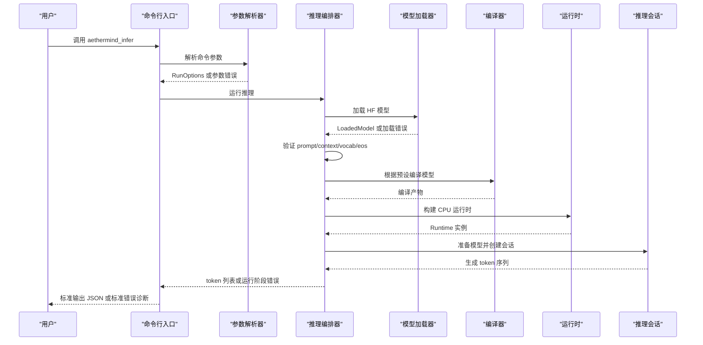
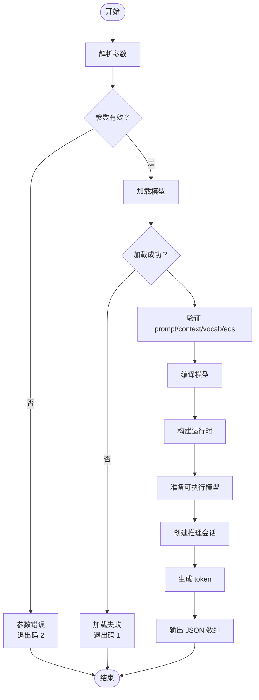
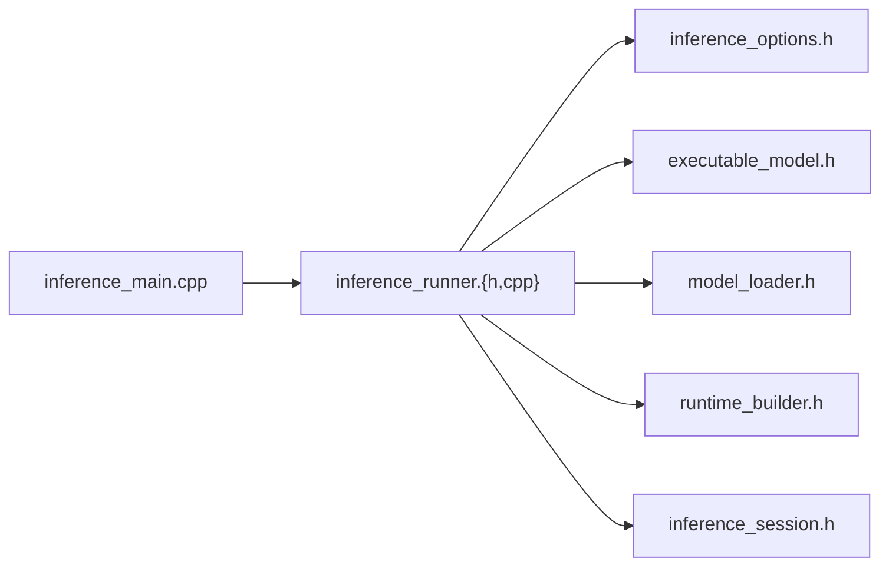

# 命令行工具

**本文引用的文件**
- [inference_main.cpp](../../apps/inference/inference_main.cpp)
- [inference_runner.h](../../apps/inference/inference_runner.h)
- [inference_runner.cpp](../../apps/inference/inference_runner.cpp)
- [test_inference_cli.py](../../tests/unit/apps/inference/test_inference_cli.py)
- [run_model_benchmark.py](../../tools/run_model_benchmark.py)
- [test_model_benchmark_cli.py](../../tests/unit/inference/test_model_benchmark_cli.py)
- [inference_options.h](../../include/aethermind/inference/inference_options.h)
- [hf_json_reader.h](../../include/aethermind/model/formats/hf/hf_json_reader.h)

## 目录
1. [简介](#简介)
2. [项目结构](#项目结构)
3. [核心组件](#核心组件)
4. [架构总览](#架构总览)
5. [详细组件分析](#详细组件分析)
6. [依赖关系分析](#依赖关系分析)
7. [性能与基准测试](#性能与基准测试)
8. [输出与日志规范](#输出与日志规范)
9. [故障排除指南](#故障排除指南)
10. [结论](#结论)

## 简介
`aethermind_infer` 是 AetherMind 推理系统的命令行入口，用于在 CPU 上加载 Hugging Face Llama Dense 模型、执行预填充与解码，并输出新产生的 token 序列。它面向以下使用场景：
- 单次 HF 模型推理
- 基于固定 prompt 的批量重复推理（通过外部脚本或循环调用）
- 性能基准测试（由 `run_model_benchmark.py` 驱动引擎二进制）

该工具不直接暴露通用 JSON/YAML 配置文件；其“配置”主要通过命令行参数和 Hugging Face 模型的 `config.json` 表达。日志级别由内部 spdlog 默认 stderr 日志器承担，但当前实现未提供显式日志级别参数。

## 项目结构
推理相关代码集中在 `apps/inference`，Python 基准脚本位于 `tools`，CLI 行为通过单元测试严格约束。



**图表来源**
- [inference_main.cpp:1-299](../../apps/inference/inference_main.cpp#L1-L299)
- [inference_runner.h:1-72](../../apps/inference/inference_runner.h#L1-L72)
- [inference_runner.cpp:1-253](../../apps/inference/inference_runner.cpp#L1-L253)
- [run_model_benchmark.py:1-370](../../tools/run_model_benchmark.py#L1-L370)
- [test_inference_cli.py:1-381](../../tests/unit/apps/inference/test_inference_cli.py#L1-L381)

**章节来源**
- [inference_main.cpp:1-299](../../apps/inference/inference_main.cpp#L1-L299)
- [inference_runner.h:1-72](../../apps/inference/inference_runner.h#L1-L72)
- [inference_runner.cpp:1-253](../../apps/inference/inference_runner.cpp#L1-L253)
- [run_model_benchmark.py:1-370](../../tools/run_model_benchmark.py#L1-L370)

## 核心组件
| 组件 | 职责 | 关键行为 |
|---|---|---|
| 命令行解析器 | 解析 `--model`、`--tokens`、`--context-tokens`、`--max-new-tokens`、`--eos-token-id`、`--preset` | 拒绝重复选项、未知选项、缺少值、非十进制整数 |
| 推理编排器 | 加载模型、验证参数、选择编译预设、构建运行时、准备可执行模型、创建会话并生成 | 将内存不足统一映射为资源耗尽状态，并记录失败阶段 |
| 推理选项接口 | 定义编译预设、CPU 运行时装配选项、KV dtype | 零 context capacity 无效；KV dtype 默认 FP32 |
| HF 模型读取器 | 顺序解析 `config.json`，校验字段、类型、边界 | 解析失败返回带偏移的错误信息 |
| 基准驱动脚本 | 封装引擎调用、收集机器/源码/库身份、写入可复现报告 | 校验 workload、模式、模型文件和二进制一致性 |

**章节来源**
- [inference_main.cpp:1-299](../../apps/inference/inference_main.cpp#L1-L299)
- [inference_runner.h:1-72](../../apps/inference/inference_runner.h#L1-L72)
- [inference_runner.cpp:1-253](../../apps/inference/inference_runner.cpp#L1-L253)
- [inference_options.h:1-61](../../include/aethermind/inference/inference_options.h#L1-L61)
- [hf_json_reader.h:1-76](../../include/aethermind/model/formats/hf/hf_json_reader.h#L1-L76)

## 架构总览
下图展示从命令行到生成 token 的控制流，以及错误如何被定位到具体阶段。



**图表来源**
- [inference_main.cpp:1-299](../../apps/inference/inference_main.cpp#L1-L299)
- [inference_runner.cpp:1-253](../../apps/inference/inference_runner.cpp#L1-L253)

## 详细组件分析

### 命令行参数规范
`aethermind_infer` 采用分离的 `--flag value` 形式，不支持 `--flag=value`，也不支持位置参数。

| 参数 | 是否必需 | 类型 | 说明 |
|---|---:|---|---|
| `--model` | 是 | 路径 | Hugging Face 模型目录，必须包含 `config.json` 与 safetensors 权重 |
| `--tokens` | 是 | 逗号分隔的无符号十进制整数 | 输入 prompt token 序列；至少一个 token |
| `--context-tokens` | 是 | 正整数 | KV cache 物理容量上限；必须为正且不超过模型上下文 |
| `--max-new-tokens` | 是 | 非负整数 | 最多生成的新 token 数量；为零时仅做参数校验 |
| `--eos-token-id` | 否 | 无符号 32 位整数 | 停止生成使用的结束 token；必须在词表范围内 |
| `--preset` | 否 | `o1-plain` 或 `o2-packed` | 编译与执行预设；默认 `o1-plain` |
| `--help` | 特殊 | 无值 | 打印帮助后成功退出，不能与其他参数混用 |

**参数约束要点**
- 所有整数字段均按无符号十进制解析，不接受前导空格、尾随空格、符号、小数点、十六进制格式或溢出值。
- `--tokens` 每个元素必须是 `[0, vocab_size)`。
- `--context-tokens` 必须为正且不能超过 `max_position_embeddings`。
- `prompt_tokens` 长度不能超过模型上下文；若生成次数不为零，则 `prompt + (new - 1)` 也不能超过模型上下文。
- 重复选项、未知选项、缺失值均会报错。

**章节来源**
- [inference_main.cpp:1-200](../../apps/inference/inference_main.cpp#L1-L200)
- [test_inference_cli.py:1-381](../../tests/unit/apps/inference/test_inference_cli.py#L1-L381)

### 推理流程与阶段诊断
推理过程被划分为多个明确阶段，失败时可指出发生在哪一步。



**图表来源**
- [inference_runner.cpp:1-253](../../apps/inference/inference_runner.cpp#L1-L253)
- [inference_main.cpp:201-299](../../apps/inference/inference_main.cpp#L201-L299)

**阶段语义**
- `parameters`：参数解析、prompt/vocab/eos/context 范围检查。
- `load`：模型目录读取、`config.json` 解析、权重格式校验。
- `model admission`：权重精度策略检查，要求 FP32 输入。
- `compile`：模型架构、RoPE、激活函数等编译期校验。
- `runtime build`：CPU 运行时配置与资源规划。
- `prepare`：可执行模型准备。
- `session`：推理会话创建。
- `generate`：实际预填充与解码。

**章节来源**
- [inference_runner.h:1-72](../../apps/inference/inference_runner.h#L1-L72)
- [inference_runner.cpp:1-253](../../apps/inference/inference_runner.cpp#L1-L253)

### Hugging Face 模型输入规范
模型目录需满足：
- 包含 `config.json`。
- 包含一个或多个 safetensors 权重文件；若使用分片索引，则需提供 `*.safetensors.index.json`。
- 当前 CLI 主要支持 Llama Dense 架构；其他架构会在编译阶段报“不支持的模型类型”。
- 激活函数需受支持；例如某些激活函数会被加载阶段拒绝。
- `config.json` 中的 `vocab_size`、`max_position_embeddings`、`rope_parameters`、`hidden_act` 等字段会影响参数校验与编译路径。

HF JSON 读取器对 `config.json` 的顺序解析具有深度限制，并对字符串转义、UTF-8、数值边界进行校验。

**章节来源**
- [hf_json_reader.h:1-76](../../include/aethermind/model/formats/hf/hf_json_reader.h#L1-L76)
- [test_inference_cli.py:1-200](../../tests/unit/apps/inference/test_inference_cli.py#L1-L200)

### 推理选项与运行时配置
推理选项通过命令行参数映射到内部结构：
- `RunOptions.model_dir`：模型目录。
- `RunOptions.prompt_tokens`：输入 token。
- `RunOptions.context_tokens`：KV cache 容量。
- `RunOptions.generation.max_new_tokens`、`RunOptions.generation.eos_token_id`：生成控制。
- `RunOptions.preset`：`CompilePreset::kO1Plain` 或 `CompilePreset::kO2Packed`。

运行时侧还涉及：
- `CpuRuntimeAssemblyOptions.context_tokens`：上下文容量。
- `CpuRuntimeAssemblyOptions.kv_dtype`：KV dtype，默认 FP32。
- `MakeCompileOptions` 根据预设和设备类型生成编译选项。

**章节来源**
- [inference_runner.h:1-72](../../apps/inference/inference_runner.h#L1-L72)
- [inference_options.h:1-61](../../include/aethermind/inference/inference_options.h#L1-L61)

## 依赖关系分析
CLI 层依赖推理编排层，编排层再组合模型加载、编译、运行时与会话。



**图表来源**
- [inference_main.cpp:1-299](../../apps/inference/inference_main.cpp#L1-L299)
- [inference_runner.cpp:1-253](../../apps/inference/inference_runner.cpp#L1-L253)
- [inference_options.h:1-61](../../include/aethermind/inference/inference_options.h#L1-L61)

**耦合特征**
- CLI 只负责参数解析、状态报告与序列化输出。
- 推理编排器集中处理生命周期、错误阶段标记和异常保护。
- 底层模型、编译、运行时接口以独立头文件暴露，便于测试替换。

**章节来源**
- [inference_main.cpp:1-299](../../apps/inference/inference_main.cpp#L1-L299)
- [inference_runner.cpp:1-253](../../apps/inference/inference_runner.cpp#L1-L253)

## 性能与基准测试

### 单次推理
典型用法：指定模型目录、prompt token、上下文容量和新 token 上限。默认 preset 为 `o1-plain`，也可切换为 `o2-packed`。两次相同调用应具有确定性结果。

示例命令结构（以占位符代替真实路径与 token）：
```text
aethermind_infer \
  --model /path/to/hf_model \
  --tokens 1,7,3 \
  --context-tokens 8 \
  --max-new-tokens 3
```

若希望提前停止生成，可传入 `--eos-token-id`。

**章节来源**
- [inference_main.cpp:1-200](../../apps/inference/inference_main.cpp#L1-L200)
- [test_inference_cli.py:1-200](../../tests/unit/apps/inference/test_inference_cli.py#L1-L200)

### 批量推理
CLI 本身不内置“批量任务队列”，但可通过外部方式实现：
- Shell 循环或 Python 脚本多次调用 `aethermind_infer`。
- 对同一 prompt 多次重复，可使用 `run_model_benchmark.py` 的 `--repetitions`。
- 对于不同 prompt，可将 prompt 列表写入文本文件，逐行调用 CLI。

需要注意：
- 每次调用都会重新加载模型、编译并构建运行时。
- 若需要共享运行时或复用会话，应通过上层 API 而非重复启动进程。
- 批量输出需要调用方自行合并多个 JSON 行。

**章节来源**
- [test_model_benchmark_cli.py:1-236](../../tests/unit/inference/test_model_benchmark_cli.py#L1-L236)
- [run_model_benchmark.py:201-370](../../tools/run_model_benchmark.py#L201-L370)

### 性能基准测试
`run_model_benchmark.py` 是独立的基准驱动脚本，它会调用引擎二进制并收集完整可复现实验环境信息。

常用参数：
| 参数 | 说明 |
|---|---|
| `--binary` | 要调用的引擎二进制路径 |
| `--model` | HF 模型目录 |
| `--prompt` | 逗号分隔的 uint32 prompt token |
| `--max-new-tokens` | 最大生成 token |
| `--preset` | `o1-plain` 或 `o2-packed` |
| `--warmup` | 预热次数 |
| `--repetitions` | 重复执行次数 |
| `--mode` | `timing`、`profile` 或 `allocations` |
| `--weights` | 权重策略：`require-fp32`、`convert-fp32`、`keep-fp16`、`keep-bf16` |
| `--kv-dtype` | KV dtype：`f32`、`f16`、`bf16` |
| `--activation-dtype` | 激活 dtype：`f32`、`f16`、`bf16` |
| `--output-root` | 报告输出根目录 |
| `--variant` | 实验变体标识 |
| `--timeout-seconds` | 超时秒数 |

关键行为：
- `timing` 模式要求不受 `LD_PRELOAD`、`LD_AUDIT` 干扰的动态加载环境。
- `profile` 模式不采集 timing 或分配指标。
- `allocations` 模式关注分配请求计数。
- KV dtype 为非 FP32 时必须启用保留 FP16/BF16 的权重策略。
- 如果 activation dtype 为非 FP32，则要求 weights 策略与 kv dtype 一致。
- 输出报告包含 machine、commit、source patch、library identity、engine stdout/stderr 等可追溯信息。

**章节来源**
- [run_model_benchmark.py:1-370](../../tools/run_model_benchmark.py#L1-L370)
- [test_model_benchmark_cli.py:1-236](../../tests/unit/inference/test_model_benchmark_cli.py#L1-L236)

## 输出与日志规范

### 标准输出
成功时，CLI 向标准输出写入一行 JSON 整数数组，表示生成的新 token。

约束：
- 输出是一行 JSON。
- 数组元素为整数。
- 每个 token 都在 `[0, vocab_size)` 范围内。
- 即使生成数量为 0，也输出空数组 `[]`。

**章节来源**
- [inference_main.cpp:201-299](../../apps/inference/inference_main.cpp#L201-L299)
- [test_inference_cli.py:1-200](../../tests/unit/apps/inference/test_inference_cli.py#L1-L200)

### 标准错误
错误信息写入标准错误，格式为：
```
aethermind_infer: <阶段>: <状态名>: <消息>
```
其中 `<阶段>` 可以是 `none`、`parameters`、`load`、`model admission`、`compile`、`runtime build`、`prepare`、`session`、`generate` 或 `unknown`。

内存不足的特殊情况：
- 如果状态是资源耗尽且消息为空，stderr 会附加“内存分配失败”提示。
- 捕获到的 `std::bad_alloc` 会被转换为资源耗尽状态。

**章节来源**
- [inference_main.cpp:201-299](../../apps/inference/inference_main.cpp#L201-L299)
- [inference_runner.cpp:1-253](../../apps/inference/inference_runner.cpp#L1-L253)

### 退出码
| 条件 | 退出码 |
|---|---:|
| 成功 | `0` |
| 参数错误或 help 以外的正常辅助输出失败 | `2` |
| 加载、编译、运行时、会话、生成等运行阶段失败 | `1` |
| 文件系统异常、内部异常、日志初始化失败 | `1` |

**章节来源**
- [inference_main.cpp:201-299](../../apps/inference/inference_main.cpp#L201-L299)

### 日志级别配置
当前实现初始化 spdlog 的 stderr 多线程日志器，但没有公开日志级别参数。日志主要用于内部诊断，而面向用户的错误信息通过 `ReportStatus` 和 `ReportException` 输出。

因此，在当前版本中：
- 无法通过 CLI 参数设置日志级别。
- 不应依赖内部 spdlog 输出作为稳定契约；应以标准错误中的 `aethermind_infer:` 诊断为主。
- 外部系统可以通过环境变量拦截日志，但官方文档不承诺稳定格式。

**章节来源**
- [inference_main.cpp:201-299](../../apps/inference/inference_main.cpp#L201-L299)

## 故障排除指南

| 现象 | 可能原因 | 处理方式 |
|---|---|---|
| 报错“缺少必需选项” | 未传 `--model`、`--tokens`、`--context-tokens` 或 `--max-new-tokens` | 补全四个必需参数 |
| 报错“重复选项” | 同一 flag 出现多次 | 删除重复项 |
| 报错“未知选项” | 传入不支持的 flag 或把值拼成 `--flag=value` | 改为 `--flag value` |
| 报错“缺少选项值” | flag 后没有值或下一个参数以 `--` 开头 | 为 flag 提供合法值 |
| `--tokens` 解析失败 | 包含负号、空格、小数、十六进制、空项或越界整数 | 使用纯十进制无符号整数，并用逗号分隔 |
| `--context-tokens` 为零或非正 | KV 容量必须为正 | 设置为大于 0 的值 |
| `context-tokens` 超过模型上下文 | 超过 `max_position_embeddings` | 降低容量或更换更大上下文模型 |
| prompt 或 eos 超出词表 | token 不在 `[0, vocab_size)` | 检查 tokenizer 与模型词表 |
| prompt 长度超过上下文 | 输入太长 | 截断 prompt 或增加上下文容量 |
| 生成次数导致总量溢出 | `prompt + new - 1` 超出 size_t 或模型上下文 | 减少 prompt 或生成次数 |
| 模型加载失败 | 目录不存在、缺少 `config.json` 或 safetensors | 检查模型目录完整性 |
| 编译失败 | 模型类型、RoPE、激活函数不受支持 | 使用 Llama Dense 模型，并使用受支持的激活与 RoPE |
| 模型准入失败 | 权重精度不是 FP32 | 使用 FP32 权重或调整权重策略 |
| 标准输出为空但 stderr 有内容 | 发生运行错误 | 查看 stderr 中的阶段与状态名称 |
| 管道关闭后返回 1 | 标准输出被管道关闭 | 检查下游消费者是否正确消费输出 |
| 基准测试报告不一致 | 模型、二进制、库、机器或源码在运行期间变化 | 保持运行环境稳定，不要动态替换文件 |

### 常见调试步骤
1. 先使用 `--help` 确认参数语法。
2. 用最小 prompt 和较小 `--max-new-tokens` 验证基础路径。
3. 逐步增大 `--context-tokens` 和 `--max-new-tokens`，观察是否在容量边界失败。
4. 检查 `config.json` 中的 `vocab_size`、`max_position_embeddings`、`rope_parameters`、`hidden_act`。
5. 如遇到内存不足，降低 batch、prompt 长度或 KV capacity。
6. 使用 `run_model_benchmark.py` 获取完整机器、源码与二进制指纹，便于复现问题。

**章节来源**
- [inference_main.cpp:1-299](../../apps/inference/inference_main.cpp#L1-L299)
- [inference_runner.cpp:1-253](../../apps/inference/inference_runner.cpp#L1-L253)
- [test_inference_cli.py:1-381](../../tests/unit/apps/inference/test_inference_cli.py#L1-L381)
- [run_model_benchmark.py:201-370](../../tools/run_model_benchmark.py#L201-L370)

## 结论
`aethermind_infer` 是一个面向 CPU FP32 Llama Dense 推理的简洁 CLI。它以严格的命令行参数契约、明确的阶段化错误诊断和稳定的单行 JSON token 输出，适合嵌入自动化流水线。对于批量推理与性能评估，推荐结合外部脚本与 `run_model_benchmark.py`，以获得可复现、可追溯的实验报告。当前版本不提供通用配置文件和可调日志级别，配置主要通过命令行参数与 HF 模型元数据表达。
