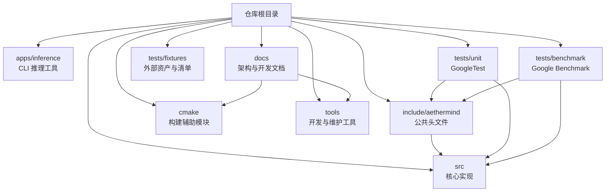
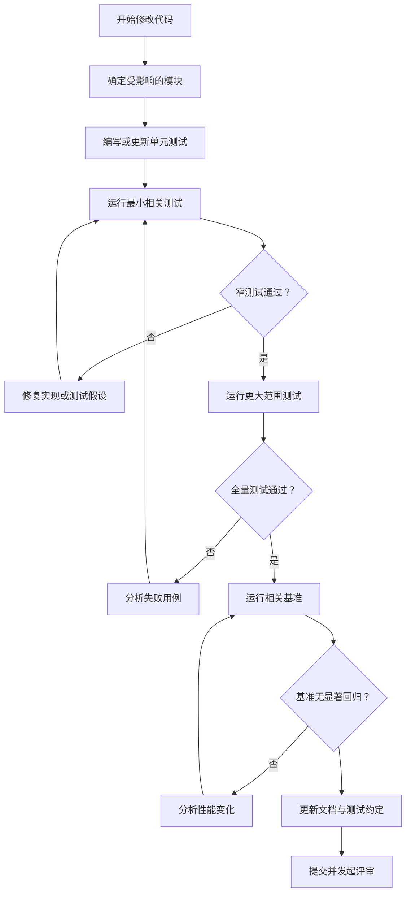
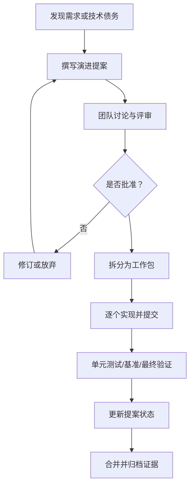
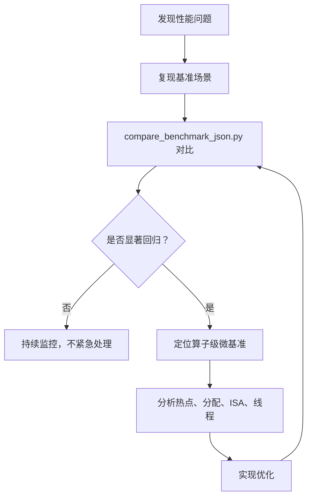
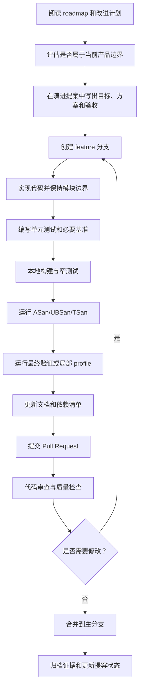

# 开发工作流

**本文引用的文件**
- [README.md](../../../README.md)
- [CMakeLists.txt](../../../CMakeLists.txt)
- [CMakePresets.json](../../../CMakePresets.json)
- [AGENTS.md](../../../AGENTS.md)
- [docs/README.md](../../README.md)
- [docs/guides/test_writing_guidelines.md](../../guides/test_writing_guidelines.md)
- [docs/guides/final-validation.md](../../guides/final-validation.md)
- [docs/improvement-plan/README.md](../../improvement-plan/README.md)
- [tools/build_project.sh](../../../tools/build_project.sh)
- [tools/run_final_validation.py](../../../tools/run_final_validation.py)
- [tools/prepare_validation_assets.py](../../../tools/prepare_validation_assets.py)
- [tools/verify_llama_numerical_reference.py](../../../tools/verify_llama_numerical_reference.py)
- [tools/compare_benchmark_json.py](../../../tools/compare_benchmark_json.py)
- [tools/verify_ctest_report.py](../../../tools/verify_ctest_report.py)
- [tools/check_docs_links.py](../../../tools/check_docs_links.py)

## 目录

1. [简介](#简介)
2. [项目结构总览](#项目结构总览)
3. [开发环境搭建](#开发环境搭建)
4. [构建与运行](#构建与运行)
5. [分支管理策略](#分支管理策略)
6. [代码提交规范](#代码提交规范)
7. [代码审查流程](#代码审查流程)
8. [测试驱动开发](#测试驱动开发)
9. [数值参考生成与基准验证](#数值参考生成与基准验证)
10. [CI 辅助工具使用指南](#ci-辅助工具使用指南)
11. [改进计划参与方式](#改进计划参与方式)
12. [调试技巧与性能分析](#调试技巧与性能分析)
13. [常见问题排查](#常见问题排查)
14. [从功能开发到合并的完整生命周期](#从功能开发到合并的完整生命周期)
15. [结论](#结论)

## 简介

AetherMind 是一个面向 Llama 密集模型的桌面和服务器 CPU 本地推理引擎，提供独立的命令行接口、稳定的 C ABI 以及一组以 C++20 编写的核心公共接口。当前交付范围明确限定在 CPU 单进程、同步、单请求、静态 KV Cache 的 FP32 推理路径；GPU、服务化、分布式等能力属于产品附录中的演进方向，不构成当前承诺。

本仓库的开发工作流围绕以下目标组织：

- 可复现的构建与依赖获取。
- 清晰的模块边界和跨层依赖规则。
- 以 GoogleTest 为核心的单元测试。
- 以 Google Benchmark 为核心的性能基准。
- 以 CMake Preset 和 Python 驱动器为核心的最终验收矩阵。
- 以演进提案索引为中心的改进计划阅读与贡献入口。

对于新成员，建议按如下顺序理解仓库：先阅读根目录说明和文档地图，再进入构建命令、测试约定、演进提案索引，最后结合具体功能定位 `include/aethermind` 与 `src/` 下的对应模块。

**章节来源**
- [README.md](../../../README.md)
- [docs/README.md](../../README.md)

## 项目结构总览

仓库采用“头文件定义 + 实现镜像 + 应用与测试分离”的组织方式：

| 目录 | 主要职责 |
|---|---|
| `include/aethermind/` | 公共 API 头文件，按 base、dtypes、model、graph、compiler、operators、execution、kv_cache、runtime、memory、inference 等模块划分 |
| `src/` | 核心实现，通常与 `include/aethermind/` 保持镜像关系 |
| `apps/inference/` | 可选的独立 CLI 推理工具及其私有 runner 逻辑 |
| `tests/unit/` | GoogleTest 单元测试，按源码模块镜像组织 |
| `tests/benchmark/` | Google Benchmark 基准测试 |
| `tests/fixtures/` | 外部模型资产、配方和校验清单 |
| `cmake/` | CMake 辅助模块、依赖声明、测试配置、Sanitizer 支持 |
| `docs/` | 架构、模块设计、过程规范、算子契约、演进提案 |
| `tools/` | 构建脚本、数值参考生成、基准比较、CI 辅助校验 |



**图表来源**
- [README.md](../../../README.md)
- [AGENTS.md](../../../AGENTS.md)

**章节来源**
- [README.md](../../../README.md)
- [AGENTS.md](../../../AGENTS.md)

## 开发环境搭建

### 必要环境

项目要求：

- C++20 工具链，且标准库需提供 `<format>` 和 `std::format_string`。例如 GCC 搭配 libstdc++ ≥ 13.1、Clang ≥ 14 或 MSVC ≥ 19.30。
- CMake ≥ 3.28。
- pthreads 运行时。
- Python 3（用于 tools 下的生成和校验脚本）。
- Git（用于自动拉取共享第三方依赖源码）。

CMake 会在配置阶段检测 `std::format` 支持；若不支持会直接终止配置并提示选择具备 C++20 `<format>` 支持的编译环境。

### 依赖获取机制

默认情况下，AetherMind 通过 CMake FetchContent 自动获取 spdlog、GoogleTest、Google Benchmark。首次 configure 时会将已启用依赖的源码克隆到 `.deps/` 目录下：

```text
.deps/
├── googletest/
├── benchmark/
├── spdlog/
```

关键行为包括：

- 每个依赖有进程锁、staging 目录和发布后复用机制。
- 已有 checkout 不会自动更新。
- 版本 tag 不匹配或工作区存在修改时会拒绝覆盖。
- 每次 build 保留自己的 `_deps/` 二进制和生成产物。
- 显式 `FETCHCONTENT_SOURCE_DIR_*` 可绕过自动获取，指向离线源码。
- `FETCHCONTENT_UPDATES_DISCONNECTED=ON` 允许拉取缺失源码；`FETCHCONTENT_FULLY_DISCONNECTED=ON` 要求已有匹配的源码且不再下载。

### 离线构建准备

如果需要离线构建，应先准备好 GoogleTest 源码 checkout，并在 configure 时指定源目录：

```bash
cmake -S . -B build \
  -DFETCHCONTENT_SOURCE_DIR_GOOGLETEST=/absolute/path/to/googletest
```

其他依赖也需要提前准备对应的 offline source directory。清除显式 override 可使用空值重新交给 AetherMind 的共享依赖管理机制。

**章节来源**
- [README.md](../../../README.md)
- [CMakeLists.txt:1-40](../../../CMakeLists.txt#L1-L40)

## 构建与运行

### 基础构建

推荐先配置并导出 compile_commands.json，再按需构建目标：

```bash
cmake -S . -B build -DCMAKE_EXPORT_COMPILE_COMMANDS=ON
cmake --build build -j
cmake --build build --target AetherMind -j
cmake --build build --target aethermind_unit_tests -j
cmake --build build --target aethermind_benchmark -j
```

核心库目标是 `AetherMind`，单元测试目标是 `aethermind_unit_tests`，基准测试目标是 `aethermind_benchmark`。如果只需要 CLI 推理工具，应开启 `BUILD_INFERENCE_TOOL=ON`。

### 便捷构建脚本

`tools/build_project.sh` 封装了常用构建选项，适合快速迭代：

| 参数 | 作用 |
|---|---|
| `--build-dir` | 指定构建目录，默认 `build` |
| `--debug` / `--release` / `--relwithdebinfo` / `--minsizerel` | 设置 CMake 构建类型 |
| `--target` | 指定构建目标，如 `all`、`AetherMind`、`aethermind_unit_tests`、`aethermind_benchmark` |
| `--skip-tests` | 关闭 BUILD_TESTS |
| `--skip-benchmarks` | 关闭 BUILD_BENCHMARKS |
| `--disable-libbacktrace` | 关闭 USE_LIBBACKTRACE |
| `--disable-segfault-hook` | 关闭 BACKTRACE_ON_SEGFAULT |
| `--tsan` | 设置 AETHERMIND_SANITIZER=tsan |
| `--configure-only` | 只执行 cmake configure |

示例：

```bash
./tools/build_project.sh --release --target aethermind_unit_tests
./tools/build_project.sh --tsan --build-dir build-tsan --target aethermind_unit_tests
```

### 预置构建矩阵

仓库定义了多组 CMake Preset，用于统一验证场景：

| Preset | 用途 |
|---|---|
| `validation-common` | 基础验证配置，启用测试、CLI、AVX2/F16C、必需资产 |
| `validation-release` | Release 构建，禁用 Sanitizer |
| `validation-baseline` | 不带可选 x86 ISA 实现的基线验证 |
| `validation-avx2` | AVX2/FMA 内核验证 |
| `validation-asan-ubsan` | 地址错误、未定义行为和泄漏检查 |
| `validation-tsan` | 线程安全扫描 |
| `benchmark-model` | 模型测量基准，不含测试依赖 |
| `benchmark-model-baseline` | 排除可选 x86 ISA 的模型基准 |
| `validation-cli-only` | 仅构建独立 CLI |

推荐用法：

```bash
cmake --preset validation-release
cmake --build --preset validation-release

cmake --preset benchmark-model
cmake --build --preset benchmark-model
```

**章节来源**
- [README.md](../../../README.md)
- [AGENTS.md](../../../AGENTS.md)
- [tools/build_project.sh:1-161](../../../tools/build_project.sh#L1-L161)
- [CMakePresets.json:1-217](../../../CMakePresets.json#L1-L217)

## 分支管理策略

仓库未包含强制性的分支命名规则或 Merge Request 模板，因此实际分支策略应由团队在当前协作流程中约定。结合项目现状，建议采用以下轻量策略：

| 分支类型 | 命名建议 | 适用场景 |
|---|---|---|
| 主分支 | `main` | 稳定可构建、可通过基础测试的代码 |
| 功能分支 | `feature/<短描述>` | 新增功能、算子、模块扩展 |
| 修复分支 | `fix/<问题编号或短描述>` | 缺陷修复、回归修复 |
| 验证分支 | `validation/<preset或场景>` | 特定 Sanitizer、ISA、模型或基准验证 |
| 临时实验分支 | `tmp/<作者>/<实验名>` | 短期实验，不应长期留在仓库 |

建议规则：

- 每次 PR 聚焦单一变更主题，避免把多个无关功能塞进一个分支。
- 分支尽量小、可独立验证。
- 大型重构或跨模块改动优先在演进提案中记录，再拆分为可审查的子任务。
- 分支内暂存大量模型权重、二进制产物或 large files 时使用 `.gitignore`，不要直接提交。
- 如果团队引入 GitHub/GitLab，应在仓库根补充分支保护规则、PR 模板和标签约定。

**章节来源**
- [docs/README.md](../../README.md)
- [AGENTS.md](../../../AGENTS.md)

## 代码提交规范

### 提交粒度

- 每个提交应表达一个清晰、可理解的变更意图。
- 不要把构建系统调整、格式化、逻辑修复和文档补全混在一个提交里。
- 若需要恢复历史状态，优先用独立 revert 提交，而不是伪造提交信息。

### 提交消息格式

建议使用结构化消息：

```
<类型>: <简短摘要>

详细说明：
- 变更动机
- 对接口、所有权、并发或性能的影响
- 相关测试或基准
- 已知限制
```

类型建议：

| 类型 | 含义 |
|---|---|
| `feat` | 新功能 |
| `fix` | 缺陷修复 |
| `perf` | 性能优化 |
| `refactor` | 不影响行为的代码重构 |
| `test` | 新增或修改测试 |
| `docs` | 文档更新 |
| `build` | 构建系统或依赖调整 |
| `chore` | 工具、脚本、清理 |
| `revert` | 回滚提交 |

### 代码风格

- C++ 使用 C++20。
- 代码风格由 `.clang-format` 控制，IDE 和 CI 应保持一致。
- 注释遵循 `docs/guides/cpp_comment_guidelines.md`。
- 头文件应保证自包含，测试文件应优先让编译器验证被测单元头的独立性。

### 文档一致性

- 代码变更应与文档变更放在同一个 PR。
- 文档不超过 600 行，按模块拆分。
- 决策写入对应模块文档或架构附录，不在活跃目录堆叠日期型报告。
- 相对链接失效由 `tools/check_docs_links.py` 检查。

**章节来源**
- [docs/README.md](../../README.md)
- [AGENTS.md](../../../AGENTS.md)

## 代码审查流程

虽然仓库没有内置强制评审模板，但结合现有文档和工程实践，建议将以下环节纳入 PR 检查：

1. **正确性检查**
   - 单元测试是否覆盖新增行为。
   - 是否有死亡测试验证失败路径。
   - 是否避免无意义的 `DISABLED_` 或静默 `GTEST_SKIP()`。

2. **模块边界检查**
   - 是否违反 AGENTS.md 中定义的模块依赖方向。
   - 是否把执行细节污染进 operators 语义层。
   - 是否把图 IR 依赖下沉进 backend/kernels。

3. **构建与平台检查**
   - Debug、Release、ASan、UBSan、TSan、baseline、AVX2 是否可构建或通过预期过滤。
   - 是否影响 CMakePresets 中的 preset 名称或标签。

4. **性能与基准检查**
   - 是否引入明显回归。
   - 是否使用 `tools/compare_benchmark_json.py` 对比新旧 JSON。
   - 是否误把基准波动当作功能通过依据。

5. **文档检查**
   - 是否更新相关模块文档。
   - 是否新增演进提案或更新现有提案状态。
   - 相对链接是否有效。

6. **资产与安全性检查**
   - 是否提交大模型权重、二进制文件或敏感数据。
   - 数值参考资产是否通过 `prepare_validation_assets.py` 和 `verify_llama_numerical_reference.py`。

**章节来源**
- [docs/guides/test_writing_guidelines.md](../../guides/test_writing_guidelines.md)
- [AGENTS.md](../../../AGENTS.md)

## 测试驱动开发

### 测试目标与框架

AetherMind 使用 GoogleTest 作为单元测试框架，测试目标为 `aethermind_unit_tests`。基准测试目标为 `aethermind_benchmark`，基于 Google Benchmark。

测试文件应放在 `tests/unit/` 下，并与源码结构镜像：

| 源码位置 | 测试位置 |
|---|---|
| `include/aethermind/graph/` | `tests/unit/graph/` |
| `include/aethermind/model/` | `tests/unit/model/` |
| `src/operators/` | `tests/unit/operators/` |
| `include/aethermind/kv_cache/` | `tests/unit/kv_cache/` |
| `include/aethermind/execution/` | `tests/unit/execution/` |
| `src/backend/cpu/kernels/` | `tests/unit/backend/cpu/kernels/` |

### 测试编写原则

- 优先验证契约，而非实现细节。
- 单个测试应聚焦一个行为。
- 单元测试必须快；慢场景放入基准或集成测试。
- 测试文件名建议 `test_<unit>.cpp`。
- 套件名和用例名使用 PascalCase。
- 避免无意义数字后缀，如 `test1`。
- 文件大小超过约 800 行时应按职责拆分。

### 命名与分类

| 类别 | 规则 |
|---|---|
| 普通测试 | `TEST(SuiteName, BehaviorDescription)` |
| 共享夹具 | `TEST_F(FixtureClass, BehaviorDescription)` |
| 死亡测试 | 用例名以 `Death` 结尾，匹配 `Check failed` |
| 跳过测试 | 仅在环境不可达时使用，并提供原因字符串 |
| 禁用测试 | 不允许长期保留 `DISABLED_` |

### 运行测试

基本命令：

```bash
./build/tests/unit/aethermind_unit_tests
./build/tests/unit/aethermind_unit_tests --gtest_filter=TensorRandomNew.*
./build/tests/unit/aethermind_unit_tests --gtest_filter=Device.* --gtest_break_on_failure
./build/tests/unit/aethermind_unit_tests --gtest_repeat=10
```

如果某些测试依赖独立 CLI 或外部资产，需先构建 CLI 并按 README 准备 fixtures。

### 测试优先级

- 先运行最窄的相关目标。
- 只在必要时运行全量测试集。
- 如果存在 `compile_commands.json`，优先使用能利用它的工具。



**图表来源**
- [docs/guides/test_writing_guidelines.md](../../guides/test_writing_guidelines.md)
- [AGENTS.md](../../../AGENTS.md)

**章节来源**
- [docs/guides/test_writing_guidelines.md](../../guides/test_writing_guidelines.md)
- [AGENTS.md](../../../AGENTS.md)

## 数值参考生成与基准验证

### 外部资产准备

数值参考、admission 变体和模型权重不随 Git 交付。`tools/prepare_validation_assets.py` 负责准备或验证这些资产：

- 默认不下载任何模型。
- 如果源 checkpoint 缺失，需显式传递 `--download-source`。
- 下载内容来自 recipe 固定 revision 的 HuggingFace 资源。
- 下载后会校验字节数和 SHA256。
- admission 变体会生成到 staging，检查后再原子发布。
- numerical reference 可由已审阅 bundle 提供，也可在冻结 Python 环境中重新生成。

```bash
python3 tools/prepare_validation_assets.py
python3 tools/prepare_validation_assets.py --download-source --numerical-bundle "$VALIDATED_NUMERICAL_BUNDLE"
```

### 数值参考验证

`tools/verify_llama_numerical_reference.py` 验证 reviewed 的 Llama 数值资产。它：

- 只使用 Python 标准库。
- 不再生成资产。
- 不修改容忍度。
- 不更新 reviewed manifest。
- 校验 safetensors 头部、张量 dtype、shape、偏移、元素数量、非有限值和 payload 连续性。
- 校验 manifest 的 schema、generator、reference 和 cases。
- 对 logits 和 kv 使用不同容忍度区间。

```bash
python3 tools/verify_llama_numerical_reference.py --root "$PWD/tests/fixtures/inference_numerical" --expected "$PWD/tests/fixtures/inference_numerical/checksums.json"
```

### 基准结果比较

`tools/compare_benchmark_json.py` 用于比较两个 Google Benchmark JSON 输出：

- 支持 mean 聚合行或 iteration 行。
- 自动处理 s/ms/us/ns 时间单位。
- 支持按名称子串过滤。
- 单线程和多线程基准使用不同阈值。
- 可选择在超过阈值时返回退出码 2。

```bash
python3 tools/compare_benchmark_json.py \
  --baseline baseline.json \
  --candidate candidate.json \
  --single-thread-threshold 5.0 \
  --multi-thread-threshold 8.0 \
  --fail-on-regression
```

### 基准测试运行

模型基准通过 `aethermind_model_benchmark` 目标和相关 Python 驱动器运行。CMakePresets 提供 `benchmark-model` 和 `benchmark-model-baseline`，分别对应带 AVX2/FMA 和不带可选 x86 ISA 的 Release 模型测量。

注意：final validation 中的 benchmark profile 只验证行为合同，不采集新的性能基线，也不按耗时决定通过；实际性能采集仍应显式运行模型基准指南。

**章节来源**
- [tools/prepare_validation_assets.py:1-200](../../../tools/prepare_validation_assets.py#L1-L200)
- [tools/verify_llama_numerical_reference.py:1-200](../../../tools/verify_llama_numerical_reference.py#L1-L200)
- [tools/compare_benchmark_json.py:1-161](../../../tools/compare_benchmark_json.py#L1-L161)
- [CMakePresets.json:1-217](../../../CMakePresets.json#L1-L217)

## CI 辅助工具使用指南

### 统一最终验证

`tools/run_final_validation.py` 是五批验证的统一编排器，不是第二个测试框架。它调用既有 fixture checker、CMake presets、CTest 和黑盒探针，然后验证清单和报告是否证明一次完整运行。

支持的 profile：

| Profile | 构建 preset | 执行集合 |
|---|---|---|
| `baseline` | `validation-baseline` | production/lifecycle + numerical-model |
| `avx2` | `validation-avx2` | production/lifecycle + isa-avx2 + numerical-model |
| `asan` | `validation-asan-ubsan` | 适用的 production/lifecycle + numerical-model + isa-avx2 |
| `tsan` | `validation-tsan` | 适用的 validation/thread-smoke，排除 interposer/ISA/preload/CLI |
| `cli` | `validation-cli-only` | 独立 CLI 黑盒方法 |
| `benchmark` | `benchmark-model` | 模型基准行为合同 |
| `benchmark-baseline` | `benchmark-model-baseline` | 相同合同，排除可选 AVX2/FMA |

```bash
python3 tools/prepare_validation_assets.py
python3 tools/run_final_validation.py --jobs 4 --build-concurrency 2
```

局部运行：

```bash
python3 tools/run_final_validation.py --profiles baseline
python3 tools/run_final_validation.py --profiles asan tsan
python3 tools/run_final_validation.py --fresh-build
```

该工具会记录：

- `status.json` / `summary.json`
- 源码前后 patch 和摘要
- 各 profile 的日志、CTest inventory、JUnit 报告
- policy 与实际 binary/library/cache 的摘要

**章节来源**
- [tools/run_final_validation.py:1-200](../../../tools/run_final_validation.py#L1-L200)
- [docs/guides/final-validation.md](../../guides/final-validation.md)

### CTest 报告校验

`tools/verify_ctest_report.py` 对 CTest inventory 和 JUnit 结果做“失败即关闭”的校验：

- 校验 test 名称唯一且非 disabled。
- 校验实际数量与冻结数量一致。
- 校验 JUnit 中所有用例状态为 run/passed/completed。
- 校验 failures/errors/skipped/disabled 计数一致。
- 校验 JUnit testcase 名称集合与 inventory 完全一致。

```bash
python3 tools/verify_ctest_report.py --inventory <slice>.inventory.json
```

当新增或删除合法测试时，应先检查实际清单差异，再人工修改冻结策略。

**章节来源**
- [tools/verify_ctest_report.py:1-200](../../../tools/verify_ctest_report.py#L1-L200)
- [docs/guides/final-validation.md](../../guides/final-validation.md)

### 文档链接检查

`tools/check_docs_links.py` 检查 `docs/` 下的相对 Markdown 链接：

- 默认跳过 `archive/`。
- 忽略 HTTP、锚点、mailto、file 前缀。
- 忽略代码块和反引号内的链接。
- 返回非零表示存在断裂链接。

```bash
python3 tools/check_docs_links.py --root docs
python3 tools/check_docs_links.py --root docs --include-archive
```

**章节来源**
- [tools/check_docs_links.py:1-72](../../../tools/check_docs_links.py#L1-L72)
- [docs/README.md](../../README.md)

## 改进计划参与方式

改进计划位于 `docs/improvement-plan/`，用于记录“将来要做什么”。当前优先级入口见 `docs/roadmap.md`，通用写作规则见 `docs/README.md`。

### 提案状态流转

| 状态 | 含义 |
|---|---|
| `Draft` | 草稿，尚未进入实施 |
| `In Progress` | 正在实施 |
| `Implemented` | 已完成 |
| `Superseded` | 被后续方案取代 |

### 专题文档章节规范

一个完整的演进提案应包含：

1. 现状分析
2. 目标架构
3. 方案与备选
4. 实施步骤
5. 风险与依赖
6. 验收标准

### 如何阅读

推荐阅读路径：

- 先从 `docs/improvement-plan/README.md` 了解当前专题和状态。
- 关注当前处于 `In Progress` 或 `Draft` 的高优先级条目，例如系统能力路线图、FP16/BF16 执行支持、CUDA 后端支持、DeepInfer 质量与验证。
- 已实现条目用于理解当前公共 API 和上层组装契约的来源。
- 已被取代的条目主要用于历史追溯，不应作为当前事实来源。

### 如何贡献

1. 先在演进提案中说明问题、目标和约束。
2. 将大范围改动拆成可审查的工作包。
3. 每个工作包对应可运行的测试、基准或验证入口。
4. 通过 PR 逐步推进状态，从 Draft → In Progress → Implemented。
5. 被替代的方案移入 archive 或标记 Superseded，不破坏活跃索引。



**图表来源**
- [docs/improvement-plan/README.md](../../improvement-plan/README.md)
- [docs/README.md](../../README.md)

**章节来源**
- [docs/improvement-plan/README.md](../../improvement-plan/README.md)
- [docs/README.md](../../README.md)

## 调试技巧与性能分析

### 构建类型选择

| 构建类型 | 适用场景 |
|---|---|
| Debug | 日常调试、断点、详细日志 |
| RelWithDebInfo | 带调试信息的优化构建 |
| Release | 生产验证、基准测量 |
| MinSizeRel | 体积优先场景 |

### Sanitizer 调试

仓库支持多种 Sanitizer 预设：

| 预设 | 用途 |
|---|---|
| `validation-asan-ubsan` | 地址错误、未定义行为、内存泄漏 |
| `validation-tsan` | 多线程竞争检测 |
| `none` | 常规构建，适合性能和 Release 验证 |

ASan/UBSan 通常配合 `halt_on_error=1`，TSan 也启用严格错误处理。TSAN 在某些原生 main 前内存映射异常下可能有已知回退路径，但不能把回退失败视为通过。

### 常见调试命令

```bash
# TSan 构建
cmake -S . -B build-tsan -DAETHERMIND_SANITIZER=tsan -DBUILD_TESTS=ON -DBUILD_BENCHMARKS=OFF
cmake --build build-tsan --target aethermind_unit_tests -j

# 只运行某个测试
./build/tests/unit/aethermind_unit_tests --gtest_filter="KernelSelector.*"

# 失败时中断
./build/tests/unit/aethermind_unit_tests --gtest_filter="Device.*" --gtest_break_on_failure
```

### 性能分析方法

1. 先用 `aethermind_model_benchmark` 跑 Release 基准。
2. 使用 `tools/compare_benchmark_json.py` 对比 baseline 和 candidate。
3. 对可疑算子或路径缩小到 `tests/benchmark/cpu_kernels/` 下的微基准。
4. 确认是否因多线程、ISA、缓存或输入规模导致波动。
5. 不要仅凭单次运行判定性能回归；结合多次运行、基线阈值和科学解释。



**图表来源**
- [tools/compare_benchmark_json.py:1-161](../../../tools/compare_benchmark_json.py#L1-L161)
- [CMakePresets.json:1-217](../../../CMakePresets.json#L1-L217)

**章节来源**
- [CMakePresets.json:1-217](../../../CMakePresets.json#L1-L217)
- [tools/build_project.sh:1-161](../../../tools/build_project.sh#L1-L161)
- [tools/compare_benchmark_json.py:1-161](../../../tools/compare_benchmark_json.py#L1-L161)

## 常见问题排查

### 无法找到 std::format

**现象**：CMake 配置时报错，提示需要 C++20 `<format>`。

**原因**：编译器或标准库版本过旧。

**解决**：升级到 GCC ≥ 13.1、Clang ≥ 14 或 MSVC ≥ 19.30，并确保标准库支持 C++20 `<format>`。

### 依赖获取失败

**现象**：FetchContent 拉取 googletest、benchmark 或 spdlog 失败。

**可能原因**：

- 网络不可用。
- Git 不可用。
- 已有 `.deps/` 目录状态不一致。
- 显式 `FETCHCONTENT_SOURCE_DIR_*` 指向非 Git 或非预期版本。

**解决**：

- 在线环境下删除损坏的 `.deps/<dependency>` 目录后重试。
- 离线环境显式传入正确的源码目录。
- 升级依赖前先停止所有使用该源码的构建，修改版本 tag 并清理旧目录。
- 不要共享 `FETCHCONTENT_BASE_DIR`，因为它还包含配置相关的二进制和状态。

### 测试发现数量与预期不符

**现象**：最终验证或 CTest 校验失败，提示 count mismatch 或 names_sha256 mismatch。

**原因**：新增了或删除了测试，但没有更新冻结策略。

**解决**：

```bash
python3 tools/verify_ctest_report.py \
  --inventory <slice>.inventory.json --inventory-only
```

先查看 candidate 清单，再人工修改 `policy.json`，不要自动化覆盖冻结值。

### 数值参考资产校验失败

**现象**：`prepare_validation_assets.py` 或 `verify_llama_numerical_reference.py` 报 checksum 不匹配。

**原因**：

- 使用了未审阅的新 asset。
- Python 环境或参考库版本变化。
- 浮点结果变化。
- 下载的 HuggingFace 资源与 recipe 固定 revision 不一致。

**解决**：

- 使用已审阅的 bundle。
- 在冻结 Python 环境中重新生成。
- 不要为了通过而直接修改 checksum。
- 只有经过评审的新 candidate 才能晋升为期望。

### 基准比较无重叠项

**现象**：`compare_benchmark_json.py` 输出 “No overlapping benchmark names found.”

**原因**：两个 JSON 的基准名称不完全一致，或过滤条件太严格。

**解决**：

- 检查 baseline 和 candidate 是否来自同一基准目标。
- 调整 `--name-filter`。
- 确认时间单位和聚合行是否一致。

### 文档链接断裂

**现象**：`check_docs_links.py` 报告 broken link。

**原因**：移动了文档、重命名了文件，或写错了相对路径。

**解决**：

- 修正相对路径。
- 如果是外部链接，确保不以相对形式出现。
- 如果是 archive 下的链接，考虑是否需要迁移或移除。

**章节来源**
- [CMakeLists.txt:1-40](../../../CMakeLists.txt#L1-L40)
- [README.md](../../../README.md)
- [tools/verify_ctest_report.py:1-200](../../../tools/verify_ctest_report.py#L1-L200)
- [tools/prepare_validation_assets.py:1-200](../../../tools/prepare_validation_assets.py#L1-L200)
- [tools/compare_benchmark_json.py:1-161](../../../tools/compare_benchmark_json.py#L1-L161)
- [tools/check_docs_links.py:1-72](../../../tools/check_docs_links.py#L1-L72)

## 从功能开发到合并的完整生命周期

下图展示一个新功能从构思到合并的典型路径：



**图表来源**
- [docs/improvement-plan/README.md](../../improvement-plan/README.md)
- [docs/guides/test_writing_guidelines.md](../../guides/test_writing_guidelines.md)
- [tools/run_final_validation.py:1-200](../../../tools/run_final_validation.py#L1-L200)

### 每个阶段的检查清单

| 阶段 | 必须完成 |
|---|---|
| 规划 | 明确问题、目标、风险和验收标准 |
| 设计 | 判断是否影响公共 API、模块边界或执行契约 |
| 编码 | 遵守 C++20、clang-format、注释规范和模块依赖规则 |
| 测试 | 新增单元测试；必要时增加基准 |
| 验证 | 至少运行 narrow target，必要时运行 final validation profile |
| 文档 | 更新相关模块文档或演进提案 |
| 评审 | 接受 reviewer 反馈，修复遗漏 |
| 合并 | 确保 CI 通过、资产有效、历史可追踪 |

**章节来源**
- [AGENTS.md](../../../AGENTS.md)
- [docs/guides/test_writing_guidelines.md](../../guides/test_writing_guidelines.md)
- [docs/guides/final-validation.md](../../guides/final-validation.md)

## 结论

AetherMind 的开发工作流强调“边界清晰、验证先行、证据可归档”。对新人而言，最重要的三条原则是：

1. 先理解模块边界和公共 API，再动手改代码。
2. 先写最小可失败的测试，再实现功能。
3. 用 CMake Preset、Sanitizer、数值参考工具和最终验证矩阵证明变更，而不只是口头说明。

当你不确定某个改动是否应该进入某个模块时，优先查阅 `AGENTS.md` 的模块所有权表；当你不确定某个未来方向是否属于当前交付范围时，优先查阅 `docs/improvement-plan/README.md` 和 `docs/roadmap.md`；当你不确定测试怎么写时，优先遵循 `docs/guides/test_writing_guidelines.md`。
