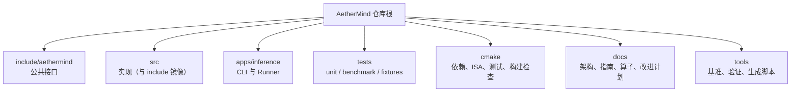
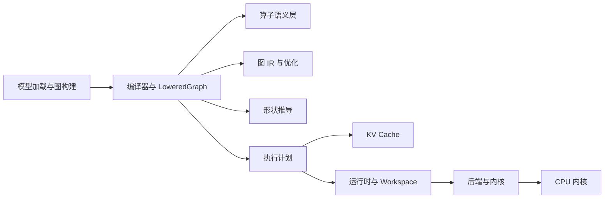
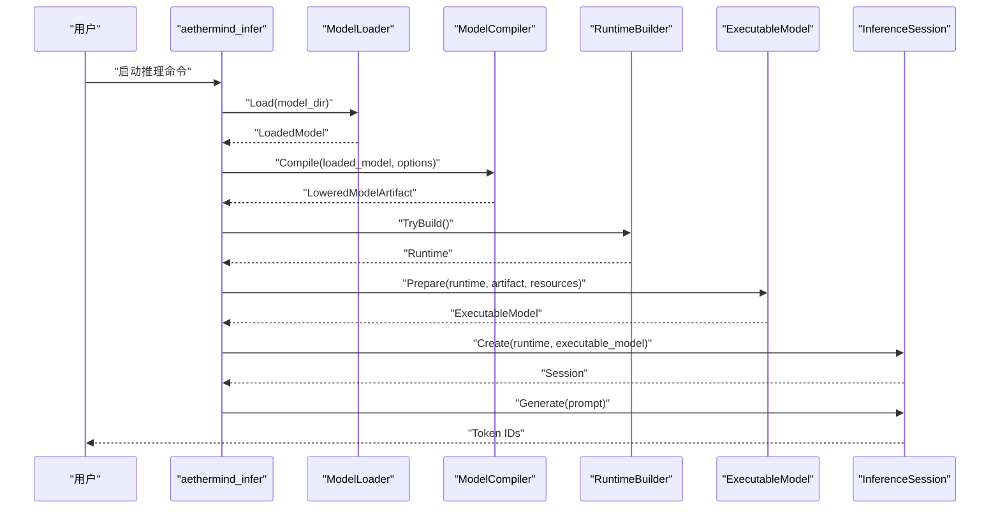
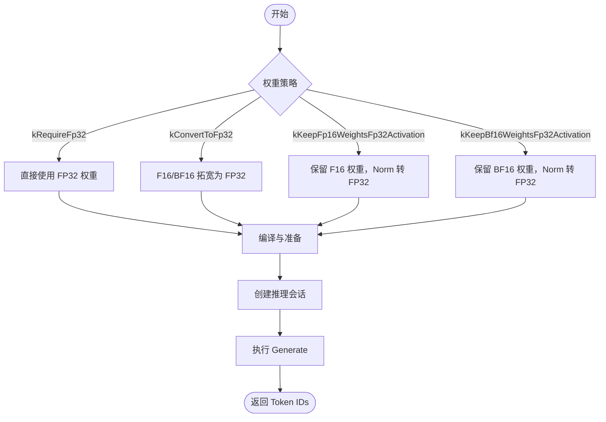
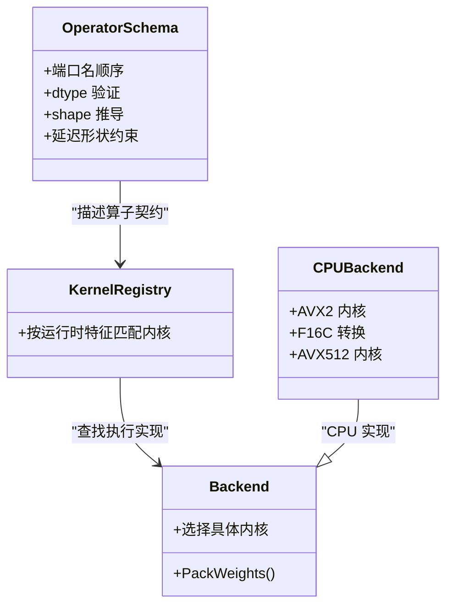
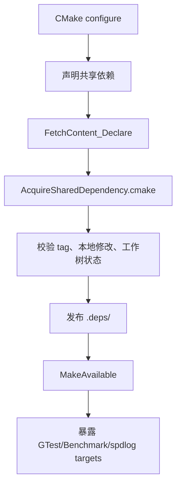
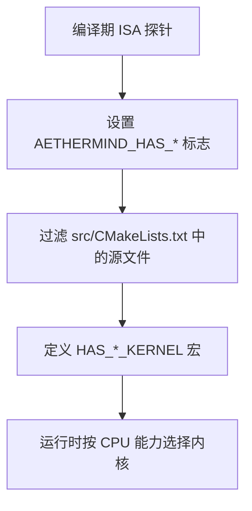

# 开发指南

**本文引用的文件**
- [README.md](../../../README.md)
- [CMakeLists.txt](../../../CMakeLists.txt)
- [CMakePresets.json](../../../CMakePresets.json)
- [AGENTS.md](../../../AGENTS.md)
- [.clang-format](../../../.clang-format)
- [cmake/AetherMindDependencySources.cmake](../../../cmake/AetherMindDependencySources.cmake)
- [cmake/AetherMindBuildChecks.cmake](../../../cmake/AetherMindBuildChecks.cmake)
- [cmake/AetherMindSanitizers.cmake](../../../cmake/AetherMindSanitizers.cmake)
- [cmake/AetherMindCpuIsa.cmake](../../../cmake/AetherMindCpuIsa.cmake)
- [src/CMakeLists.txt](../../../src/CMakeLists.txt)
- [tests/unit/CMakeLists.txt](../../../tests/unit/CMakeLists.txt)
- [docs/guides/cpp_coding_style_guidelines.md](../../guides/cpp_coding_style_guidelines.md)
- [docs/guides/cpp_comment_guidelines.md](../../guides/cpp_comment_guidelines.md)
- [docs/guides/test_writing_guidelines.md](../../guides/test_writing_guidelines.md)
- [docs/roadmap.md](../../roadmap.md)
- [docs/guides/fp32-compatible-inference.md](../../guides/fp32-compatible-inference.md)

## 目录
1. [引言](#引言)
2. [项目结构](#项目结构)
3. [核心组件](#核心组件)
4. [架构总览](#架构总览)
5. [详细组件分析](#详细组件分析)
6. [依赖与构建系统](#依赖与构建系统)
7. [性能与交叉编译](#性能与交叉编译)
8. [代码质量与审查流程](#代码质量与审查流程)
9. [调试、测试与性能分析](#调试测试与性能分析)
10. [改进计划与贡献流程](#改进计划与贡献流程)
11. [故障排查](#故障排查)
12. [结论](#结论)

## 引言
AetherMind 是一个面向桌面和服务器的 C++20 CPU 推理引擎，当前产品边界聚焦 Llama Dense 模型的同步单请求推理：静态 KV 缓存、Token IDs I/O、FP32 激活与 logits，以及显式 W16/A32 权重策略。仓库同时提供独立 CLI、C ABI、C++ API、图 IR、算子层、执行器、KV Cache 管理器和运行时资源规划。

本指南从开发视角覆盖：
- C++ 编码规范、注释标准与命名约定
- CMake 构建组织、依赖管理与可选特性开关
- 改进计划、路线图与贡献工作流
- 开发环境搭建、调试技巧与性能分析方法
- 代码质量工具配置与使用建议

## 项目结构
仓库采用“公共头 + 实现镜像 + 应用 + 测试 + CMake 辅助模块”的结构：

**图表来源**
- [README.md](../../../README.md)
- [AGENTS.md](../../../AGENTS.md)

### 顶层目录职责
| 目录 | 职责 |
|---|---|
| `include/aethermind` | 公共 C++ 接口，按 base、model、graph、compiler、execution、backend、kv_cache、runtime、memory、operators、inference 等模块划分 |
| `src` | 对应实现的 `.cpp`，并包含 C ABI 适配层 |
| `apps/inference` | 可选的 `aethermind_infer` 独立推理工具 |
| `tests/unit` | GoogleTest 单元测试，按模块镜像源码布局 |
| `tests/benchmark` | Google Benchmark 性能目标 |
| `cmake` | 依赖获取、Sanitizer、CPU ISA 探测、测试注册、构建校验 |
| `docs` | 架构、模块设计、开发指南、算子契约与改进计划 |
| `tools` | 基准运行、参考数据生成、CI 辅助脚本 |

**章节来源**
- [README.md](../../../README.md)
- [AGENTS.md](../../../AGENTS.md)

## 核心组件
AetherMind 的核心由以下协作域组成：

| 组件 | 主要职责 | 关键约束 |
|---|---|---|
| **模型加载与图构建** | HuggingFace config/safetensors 读取、权重解析、家族识别、语义图构建 | Loader 不依赖 graph/backend/prepack；家族识别和图构建入口是权威 |
| **图与优化** | Graph IR、GraphRewriteSession、PassManager、常量折叠、死代码消除、SiLU-Mul 融合 | 不得依赖 execution/backend/model 执行细节 |
| **编译器** | ModelCompiler、LoweredGraph、权重打包请求构建 | 可携带 KernelSelector，但不查询 kernel registry |
| **执行计划** | ExecutionPlan、ExecutionContext、LayerRunner、StateAliasPlan | Public 头仅前向声明 LoweredGraph |
| **KV Cache** | KVCacheLayout、KVCacheManager、KVCacheSessionView | View 只借用 storage/session state，不暴露 Buffer |
| **运行时** | Runtime/RuntimeBuilder、Workspace 规划 | 聚合 backend、allocator、KV Cache，不反向依赖 execution/compiler/graph/model |
| **后端与内核** | Backend 抽象、KernelRegistry、CPU 内核、权重打包 | 不得依赖 Graph IR 或 OperatorSchema 语义细节 |
| **推理编排** | ExecutableModel、InferenceSession、Generate、WeightPolicy | 只做编排、准入与所有权聚合 |

**图表来源**
- [AGENTS.md](../../../AGENTS.md)

**章节来源**
- [AGENTS.md](../../../AGENTS.md)

## 架构总览
CLI 的典型调用链是：

**图表来源**
- [README.md](../../../README.md)
- [AGENTS.md](../../../AGENTS.md)

## 详细组件分析

### 模型准备与推理会话
`ExecutableModel::Load` 根据 `ModelLoadOptions::weights` 选择源权重处理策略，包括 FP32 直读、F16/BF16 拓宽为 FP32、保留 F16/BF16 权重但使用 FP32 激活等路径。`InferenceSession::Create` 与 `Generate` 负责同步生成 Token IDs。

**图表来源**
- [README.md](../../../README.md)
- [docs/guides/fp32-compatible-inference.md](../../guides/fp32-compatible-inference.md)

**章节来源**
- [README.md](../../../README.md)
- [docs/guides/fp32-compatible-inference.md](../../guides/fp32-compatible-inference.md)

### 算子与后端内核
算子层定义 OpType、OperatorSchema、OpParams 及推断函数，后端通过 KernelRegistry 和 Backend 抽象将算子映射到具体内核。CPU 后端提供 RMSNorm、Embedding、Dot Product、GEMM、Attention、RMSNorm+Add 等内核，并按 AVX2/F16C/AVX512-BF16/AVX512-FP16 能力启用相应实现。

**图表来源**
- [AGENTS.md](../../../AGENTS.md)
- [cmake/AetherMindCpuIsa.cmake:1-156](../../../cmake/AetherMindCpuIsa.cmake#L1-L156)
- [src/CMakeLists.txt:1-193](../../../src/CMakeLists.txt#L1-L193)

**章节来源**
- [AGENTS.md](../../../AGENTS.md)
- [cmake/AetherMindCpuIsa.cmake:1-156](../../../cmake/AetherMindCpuIsa.cmake#L1-L156)
- [src/CMakeLists.txt:1-193](../../../src/CMakeLists.txt#L1-L193)

## 依赖与构建系统

### 构建入口与选项
根 `CMakeLists.txt` 定义：
- 最低 CMake 版本 3.28
- C++20
- `USE_LIBBACKTRACE`、`BACKTRACE_ON_SEGFAULT`
- `BUILD_TESTS`、`BUILD_BENCHMARKS`、`BUILD_INFERENCE_TOOL`
- `USE_ALLOC_ALIGNMENT`、`BUILD_DOCS`、`AETHERMIND_VALIDATION_REQUIRED_ASSETS`

核心库目标为 `AetherMind`，测试目标为 `aethermind_unit_tests`，基准目标为 `aethermind_benchmark`，可选 CLI 目标为 `aethermind_infer`。

**章节来源**
- [CMakeLists.txt:1-171](../../../CMakeLists.txt#L1-L171)
- [AGENTS.md](../../../AGENTS.md)

### 共享依赖管理
依赖通过自定义 `aethermind_declare_shared_dependency` 与 `aethermind_make_shared_dependency_available` 管理：
- 首次 configure 自动克隆 spdlog、GoogleTest、Google Benchmark 到 `.deps/`
- 进程锁、staging 目录、tag 校验、clean worktree 检查
- 父工程已提供的 target 优先；显式 `FETCHCONTENT_SOURCE_DIR_*` 可绕过自动获取
- `FETCHCONTENT_FULLY_DISCONNECTED=ON` 要求已有匹配 checkout，不再下载
- 超时可通过 `AETHERMIND_DEPENDENCY_LOCK_TIMEOUT` 与 `AETHERMIND_DEPENDENCY_DOWNLOAD_TIMEOUT` 调整

**图表来源**
- [cmake/AetherMindDependencySources.cmake:1-129](../../../cmake/AetherMindDependencySources.cmake#L1-L129)
- [README.md](../../../README.md)

**章节来源**
- [cmake/AetherMindDependencySources.cmake:1-129](../../../cmake/AetherMindDependencySources.cmake#L1-L129)
- [README.md](../../../README.md)

### 测试与基准目标
`tests/unit/CMakeLists.txt` 自动收集 `tests/unit/**/*.cpp`，链接 `GTest::gtest_main` 和 `AetherMind` 共享库；必要时复用应用 runner 私有 helper，并为 Linux 导出 malloc wrapper 用于分配拦截测试。基准在 `tests/benchmark/`，通过 `BUILD_BENCHMARKS=ON` 引入。

**章节来源**
- [tests/unit/CMakeLists.txt:1-99](../../../tests/unit/CMakeLists.txt#L1-L99)
- [docs/guides/test_writing_guidelines.md](../../guides/test_writing_guidelines.md)

## 性能与交叉编译

### CPU ISA 探测与内核选择
`cmake/AetherMindCpuIsa.cmake` 在 x86/x86_64 上对 GCC/Clang/AppleClang 进行编译期探针：
- AVX2、F16C、AVX2+FMA
- AVX512-BF16、AVX512-FP16
- 设置 `AETHERMIND_HAS_AVX2_FMA`、`AETHERMIND_HAS_F16C`、`AETHERMIND_HAS_AVX512BF16`、`AETHERMIND_HAS_AVX512FP16`
- 提供 `aethermind_configure_avx2_sources`、`aethermind_configure_f16c_sources`、`aethermind_configure_avx512bf16_sources`、`aethermind_configure_avx512fp16_sources` 等宏

`src/CMakeLists.txt` 根据这些标志移除或添加对应源文件，并定义 `ATTENTION_HAS_AVX2_KERNEL`、`GEMM_HAS_AVX2_FMA_KERNEL`、`A16_HAS_AVX2_FMA_KERNEL` 等编译宏。

**图表来源**
- [cmake/AetherMindCpuIsa.cmake:1-156](../../../cmake/AetherMindCpuIsa.cmake#L1-L156)
- [src/CMakeLists.txt:1-193](../../../src/CMakeLists.txt#L1-L193)

**章节来源**
- [cmake/AetherMindCpuIsa.cmake:1-156](../../../cmake/AetherMindCpuIsa.cmake#L1-L156)
- [src/CMakeLists.txt:1-193](../../../src/CMakeLists.txt#L1-L193)

### 内存对齐与 Sanitizer
- `KALLOC_ALIGNMENT` 必须为正整数且为 2 的幂，并通过 `try_compile` 在目标 size_t 范围内验证
- Sanitizer 支持 `none`、`asan-ubsan`、`tsan`，仅在 GNU/Clang/AppleClang Unix 工具链下可用
- Sanitizer 会同时检查编译和链接，并为项目目标注入 `-fno-omit-frame-pointer -g`

**章节来源**
- [cmake/AetherMindBuildChecks.cmake:1-44](../../../cmake/AetherMindBuildChecks.cmake#L1-L44)
- [cmake/AetherMindSanitizers.cmake:1-59](../../../cmake/AetherMindSanitizers.cmake#L1-L59)

### 预置构建配置
`CMakePresets.json` 提供：
- `validation-release`：Release、关闭 optional ISA、启用 tests 与 CLI
- `validation-baseline`：baseline ISA 验证
- `validation-avx2`：AVX2/FMA 内核验证
- `validation-asan-ubsan`：地址与未定义行为检测
- `validation-tsan`：线程安全检测
- `benchmark-model`：Release 模型测量，关闭 tests
- `validation-cli-only`：仅构建 CLI

**章节来源**
- [CMakePresets.json:1-200](../../../CMakePresets.json#L1-L200)

## 代码质量与审查流程

### C++ 编码规范
- 语言标准：C++20，现代特性应服务于清晰性、安全性与正确性
- 命名：变量与函数用 `snake_case`，类型用 `PascalCase`，枚举成员用 `kPascalCase`，宏用 `AM_UPPER_SNAKE_CASE`
- 文件组织：头文件声明接口，源文件实现细节；避免重型实现放入头文件
- 包含顺序：对应头 → 项目头 → 第三方头 → 标准库头
- 函数：短函数、明确参数传递方式、返回值优先于输出参数
- 类型：合理用 `auto`，避免隐藏重要类型信息
- 常量正确性：合理使用 `const`、不可变局部变量
- 所有权：强调所有权与生命周期，避免隐式魔法

**章节来源**
- [docs/guides/cpp_coding_style_guidelines.md](../../guides/cpp_coding_style_guidelines.md)

### 注释标准
- 公共 API 使用 Doxygen `///` 注释，包含 `@brief`、`@param`、`@return`、`@throws`、`@tparam` 等标签
- 内部实现使用 `//`；块注释仅用于版权、API 文档或少量复杂解释
- TODO/FIXME/HACK/NOTE 应结构化、谨慎使用
- 文件级注释放在 include guard 之后、第一个 `#include` 之前

**章节来源**
- [docs/guides/cpp_comment_guidelines.md](../../guides/cpp_comment_guidelines.md)

### 格式化配置
`.clang-format` 基于 LLVM 风格，主要规则：
- IndentWidth: 4，UseTab: false
- AllowShortFunctionsOnASingleLine: All
- AllowShortIfStatementsOnASingleLine: Always
- BreakBeforeBraces: Custom，AfterControlStatement: Never
- ColumnLimit: 0（允许较长行）
- PointerAlignment: Left
- ReflowComments: true

建议在 IDE 中启用 clang-format 保存时格式化，并在提交前统一格式。

**章节来源**
- [.clang-format:1-66](../../../.clang-format#L1-L66)

### 代码审查要点
结合仓库约束，代码审查应关注：
- 是否遵守 AGENTS.md 的模块所有权与跨模块依赖规则
- 是否破坏 operator、graph、compiler、execution、runtime、model、backend 的职责边界
- 是否引入不必要的后端/执行细节进入上游模块
- 是否正确使用 WeightPolicy、CompilePreset、MakeCpuRuntimeOptions
- 是否保持 FP32 兼容性与 KV geometry 一致
- 是否新增未经过验证的 GPU、服务化或分布式能力
- 是否更新测试、基准、文档与改进计划

**章节来源**
- [AGENTS.md](../../../AGENTS.md)
- [docs/guides/cpp_coding_style_guidelines.md](../../guides/cpp_coding_style_guidelines.md)

## 调试、测试与性能分析

### 单元测试
- 框架：GoogleTest，目标 `aethermind_unit_tests`
- 文件放置：`tests/unit/` 镜像源码布局
- 命名：suite 与 test 名称使用 PascalCase
- 死亡测试：以 `Death` 结尾，匹配 `Check failed`
- 禁用测试：不应长期保留 `DISABLED_` 或空 `GTEST_SKIP()`
- 参数化测试：使用 `TEST_P` 覆盖多组输入

**章节来源**
- [docs/guides/test_writing_guidelines.md](../../guides/test_writing_guidelines.md)

### 基准测试
- 目标：`aethermind_benchmark`
- 模型测量目标：`aethermind_model_benchmark`，区分准备阶段、内部 Prefill/Decode 与公开 `Generate`
- 使用 `CMakePresets.json` 中的 `benchmark-model` 预置构建 Release 基准

**章节来源**
- [CMakePresets.json:1-200](../../../CMakePresets.json#L1-L200)
- [README.md](../../../README.md)

### Sanitizer 与调试
- ASAN+UBSAN：`validation-asan-ubsan`
- TSAN：`validation-tsan`
- 断点与重复：可使用 gtest 的 `--gtest_break_on_failure`、`--gtest_repeat`
- 推荐先构建最小相关目标，再逐步扩大范围

**章节来源**
- [AGENTS.md](../../../AGENTS.md)
- [cmake/AetherMindSanitizers.cmake:1-59](../../../cmake/AetherMindSanitizers.cmake#L1-L59)

## 改进计划与贡献流程

### 当前在研方向
`docs/roadmap.md` 维护活跃方向表，包括：
- CPU 算子覆盖与性能
- 工程质量体系
- 系统能力路线图
- KV / Attention 演进
- Qwen 与 MoE
- FP16 / BF16 执行
- CUDA 后端
- 生产验证与质量

已完成或被取代的方案保留在 `improvement-plan/` 供追溯。

**章节来源**
- [docs/roadmap.md](../../roadmap.md)

### 贡献流程建议
1. 明确需求属于现有模块还是新模块，遵循 AGENTS.md 的模块所有权。
2. 阅读相关模块文档、算子契约与改进计划。
3. 编写或更新单元测试、基准、文档。
4. 使用 clang-format 格式化代码。
5. 使用预置配置验证 baseline、AVX2、ASAN/UBSAN、TSAN。
6. 提交前确认未引入超出产品边界的 GPU、服务化或分布式能力。
7. 若涉及权重策略或数值合同，补充 FP32 兼容性说明与验证结果。

**章节来源**
- [AGENTS.md](../../../AGENTS.md)
- [docs/roadmap.md](../../roadmap.md)

## 故障排查

| 问题 | 可能原因 | 处理建议 |
|---|---|---|
| 缺少 `std::format` 支持 | 工具链不支持 C++20 `<format>` | 升级 GCC ≥ 13.1、Clang ≥ 14 或 MSVC ≥ 19.30 |
| Sanitizer 配置失败 | 非 GNU/Clang/AppleClang 或 Unix 平台 | 改用受支持的工具链或设置 `AETHERMIND_SANITIZER=none` |
| 依赖获取失败 | Git 不可用、网络受限、tag 不匹配、工作区有修改 | 使用离线 `FETCHCONTENT_SOURCE_DIR_*` 或清理 `.deps/<dependency>` 后重新 configure |
| AVX2/F16C 内核未编译 | 编译器未启用对应指令集或探针失败 | 检查 `AETHERMIND_ENABLE_AVX2`、`AETHERMIND_ENABLE_F16C` 与编译器支持 |
| 测试找不到模型或 CLI | 未准备 fixtures 或未构建 `aethermind_infer` | 按 README 准备 HF fixtures 并构建独立 CLI |
| 内存对齐错误 | `KALLOC_ALIGNMENT` 不是 2 的幂或超出 `size_t` | 改为合法值，如 64 |

**章节来源**
- [CMakeLists.txt:1-40](../../../CMakeLists.txt#L1-L40)
- [cmake/AetherMindSanitizers.cmake:1-59](../../../cmake/AetherMindSanitizers.cmake#L1-L59)
- [cmake/AetherMindDependencySources.cmake:1-129](../../../cmake/AetherMindDependencySources.cmake#L1-L129)
- [cmake/AetherMindBuildChecks.cmake:1-44](../../../cmake/AetherMindBuildChecks.cmake#L1-L44)
- [README.md](../../../README.md)

## 结论
AetherMind 当前聚焦 CPU Llama Dense 推理的质量与可维护性：清晰的模块边界、严格的权重策略、可验证的 FP32 兼容路径、完善的 CMake 依赖与构建预置、以及针对单元测试、基准与 Sanitizer 的工程实践。开发者应在 AGENTS.md 与 docs 约束下扩展算子、后端、编译器与运行时能力，并通过改进计划与路线图推进 FP16/BF16、KV/Attention 演进、CUDA 后端与生产验证。
