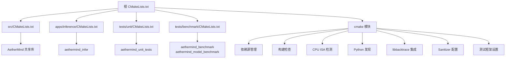
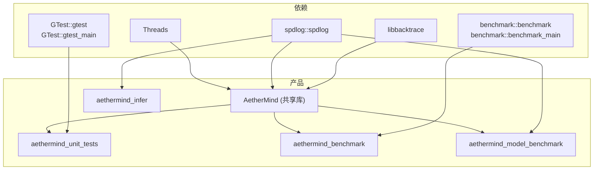
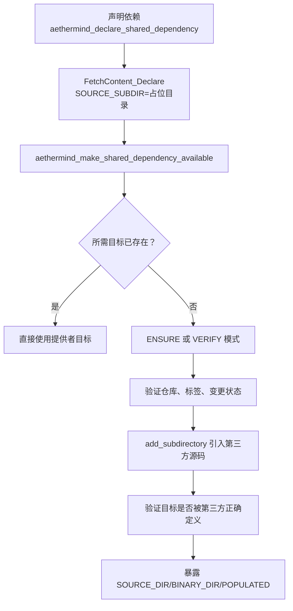
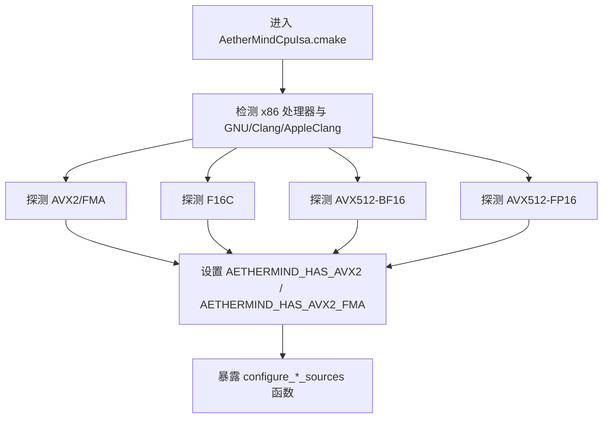
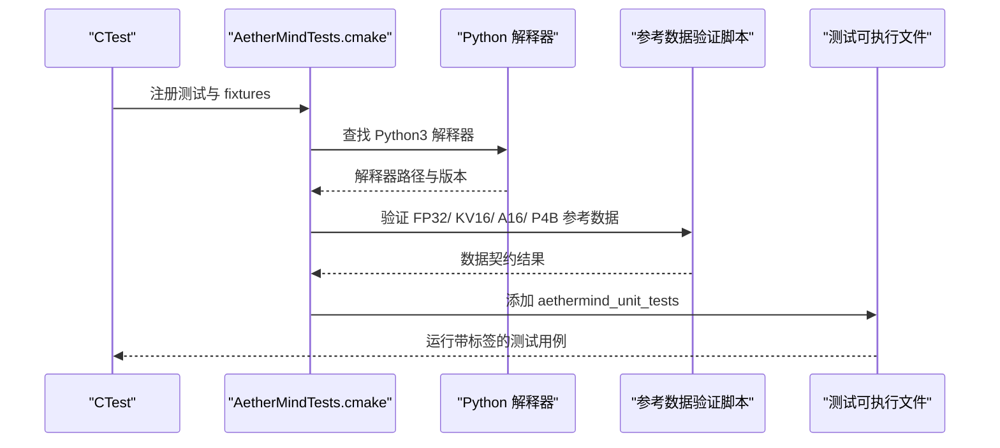
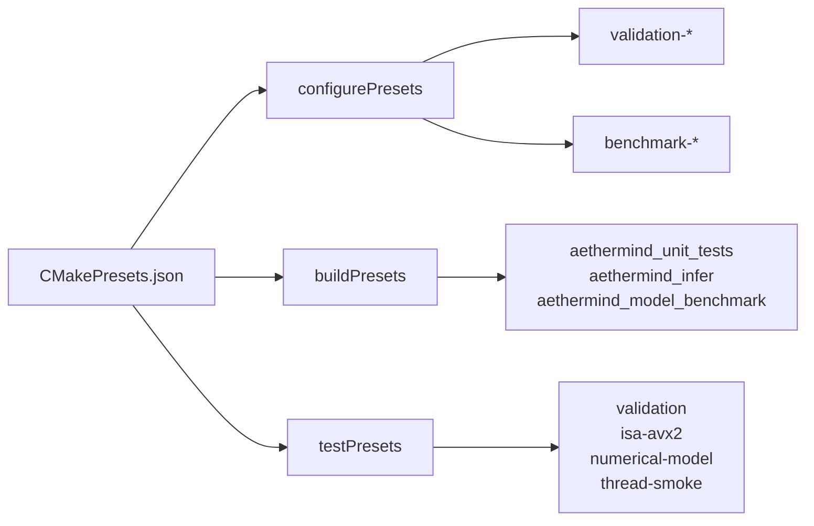

# 构建系统

**本文引用的文件**
- [CMakeLists.txt](../../../CMakeLists.txt)
- [CMakePresets.json](../../../CMakePresets.json)
- [cmake/AcquireSharedDependency.cmake](../../../cmake/AcquireSharedDependency.cmake)
- [cmake/AetherMindBuildChecks.cmake](../../../cmake/AetherMindBuildChecks.cmake)
- [cmake/AetherMindCpuIsa.cmake](../../../cmake/AetherMindCpuIsa.cmake)
- [cmake/AetherMindDependencySources.cmake](../../../cmake/AetherMindDependencySources.cmake)
- [cmake/AetherMindFindPython.cmake](../../../cmake/AetherMindFindPython.cmake)
- [cmake/AetherMindLibbacktrace.cmake](../../../cmake/AetherMindLibbacktrace.cmake)
- [cmake/AetherMindSanitizers.cmake](../../../cmake/AetherMindSanitizers.cmake)
- [cmake/AetherMindTests.cmake](../../../cmake/AetherMindTests.cmake)
- [src/CMakeLists.txt](../../../src/CMakeLists.txt)
- [apps/inference/CMakeLists.txt](../../../apps/inference/CMakeLists.txt)
- [tests/unit/CMakeLists.txt](../../../tests/unit/CMakeLists.txt)
- [tests/benchmark/CMakeLists.txt](../../../tests/benchmark/CMakeLists.txt)
- [.gitmodules](../../../.gitmodules)

## 目录
1. [简介](#简介)
2. [项目结构](#项目结构)
3. [核心构建组件](#核心构建组件)
4. [架构总览](#架构总览)
5. [详细组件分析](#详细组件分析)
6. [依赖管理策略](#依赖管理策略)
7. [交叉编译与平台支持](#交叉编译与平台支持)
8. [构建选项与模式](#构建选项与模式)
9. [性能分析与调试工具集成](#性能分析与调试工具集成)
10. [常见构建问题排查](#常见构建问题排查)
11. [结论](#结论)

## 简介
AetherMind 是一个 C++20 推理引擎，其构建系统以根 `CMakeLists.txt` 为入口，通过 `cmake/` 下的多个独立模块完成环境检查、CPU 指令集检测、Python 发现、第三方依赖获取、测试框架配置以及可选的崩溃回溯库集成。构建产物包括共享库 `AetherMind`、可选 CLI 程序 `aethermind_infer`、单元测试目标 `aethermind_unit_tests` 和基准测试目标 `aethermind_benchmark`、`aethermind_model_benchmark`。

本项目要求：
- CMake ≥ 3.28。
- 支持 C++20 `std::format` 的标准库实现。
- 在 Unix-like 平台上优先使用 GNU 或 Clang 工具链；MSVC 下禁用部分特性（如 libbacktrace）。

## 项目结构
构建体系采用“顶层聚合 + 模块化 CMake”组织方式：

| 路径 | 职责 |
|---|---|
| `CMakeLists.txt` | 定义项目元信息、全局 C++ 标准、启用测试、加载 CMake 模块、声明并拉取 spdlog / GoogleTest / Google Benchmark、添加子目录 |
| `CMakePresets.json` | 提供验证、基准、ASan/UBSan、TSan、CLI-only 等预设 |
| `cmake/*.cmake` | 依赖源获取、构建检查、CPU ISA 检测、Python 发现、libbacktrace 集成、sanitizer 配置、测试标签与注册 |
| `src/CMakeLists.txt` | 收集源码、按 CPU ISA 能力裁剪源文件、生成共享库、链接 spdlog 与 libbacktrace |
| `apps/inference/CMakeLists.txt` | 构建 CLI 可执行文件 |
| `tests/unit/CMakeLists.txt` | 构建单元测试可执行文件，注册 GTest 测试 |
| `tests/benchmark/CMakeLists.txt` | 构建通用基准与模型基准可执行文件 |
| `.gitmodules` | 声明 libbacktrace、cpufp、STREAM 三个 Git 子模块 |

**图示来源**
- [CMakeLists.txt:1-171](../../../CMakeLists.txt#L1-L171)
- [src/CMakeLists.txt:1-193](../../../src/CMakeLists.txt#L1-L193)
- [apps/inference/CMakeLists.txt:1-10](../../../apps/inference/CMakeLists.txt#L1-L10)
- [tests/unit/CMakeLists.txt:1-99](../../../tests/unit/CMakeLists.txt#L1-L99)
- [tests/benchmark/CMakeLists.txt:1-79](../../../tests/benchmark/CMakeLists.txt#L1-L79)

**章节来源**
- [CMakeLists.txt:1-171](../../../CMakeLists.txt#L1-L171)
- [src/CMakeLists.txt:1-193](../../../src/CMakeLists.txt#L1-L193)
- [apps/inference/CMakeLists.txt:1-10](../../../apps/inference/CMakeLists.txt#L1-L10)
- [tests/unit/CMakeLists.txt:1-99](../../../tests/unit/CMakeLists.txt#L1-L99)
- [tests/benchmark/CMakeLists.txt:1-79](../../../tests/benchmark/CMakeLists.txt#L1-L79)

## 核心构建组件
根构建脚本负责整体编排：
- 设置 C++20 标准与位置无关代码。
- 检查 C++20 `std::format` 支持，否则直接终止配置。
- 定义构建选项，例如是否启用 libbacktrace、测试、基准、文档、内存分配对齐、推理工具等。
- 加载 sanitizer、CPU ISA、依赖源等模块。
- 按需引入 spdlog、GoogleTest、Google Benchmark。
- 添加 `src` 主库；可选添加 `apps/inference`。
- 若启用测试，则启用 CTest 并添加 `tests/unit`。
- 若启用基准，则添加 `tests/benchmark`。
- 若启用文档，则查找 Doxygen 并创建 `aethermind_docs` 目标。

**章节来源**
- [CMakeLists.txt:1-171](../../../CMakeLists.txt#L1-L171)

## 架构总览
从构建视角看，AetherMind 的依赖与目标关系如下：

**图示来源**
- [CMakeLists.txt:44-171](../../../CMakeLists.txt#L44-L171)
- [src/CMakeLists.txt:108-193](../../../src/CMakeLists.txt#L108-L193)
- [apps/inference/CMakeLists.txt:1-10](../../../apps/inference/CMakeLists.txt#L1-L10)
- [tests/unit/CMakeLists.txt:1-99](../../../tests/unit/CMakeLists.txt#L1-L99)
- [tests/benchmark/CMakeLists.txt:1-79](../../../tests/benchmark/CMakeLists.txt#L1-L79)

## 详细组件分析

### 根 CMakeLists.txt 组织逻辑
根脚本是构建系统的协调器，而不是具体实现者。它主要做以下工作：
1. **基础约束**：强制 CMake 版本、C++20 标准、位置无关代码。
2. **运行时特性检查**：用编译探测确认编译器/标准库支持 `<format>`。
3. **全局选项**：
   - `USE_LIBBACKTRACE`：非 MSVC 默认开启。
   - `BACKTRACE_ON_SEGFAULT`：默认开启，用于在段错误时打印回溯。
   - `BUILD_TESTS`：默认开启单元测试。
   - `BUILD_BENCHMARKS`：默认开启基准测试。
   - `BUILD_INFERENCE_TOOL`：默认关闭，需显式启用。
   - `USE_ALLOC_ALIGNMENT`：默认开启，启用内存分配对齐校验。
   - `BUILD_DOCS`：默认关闭，需要 Doxygen。
   - `AETHERMIND_VALIDATION_REQUIRED_ASSETS`：默认关闭，用于严格验证场景。
4. **依赖发现与声明**：
   - 如果外部已提供 `spdlog::spdlog`，则复用。
   - 否则通过 `aethermind_declare_shared_dependency` 声明 spdlog 源码。
   - 通过 `aethermind_make_shared_dependency_available` 暴露目标。
   - 对 spdlog 的 `SPDLOG_USE_STD_FORMAT` 行为进行条件调整。
5. **测试与基准依赖**：
   - GoogleTest 需要同时提供 `GTest::gtest` 与 `GTest::gtest_main`。
   - Google Benchmark 需要同时提供 `benchmark::benchmark` 与 `benchmark::benchmark_main`。
   - 未提供时使用 FetchContent 拉取固定版本。
6. **子项目添加**：
   - 始终添加 `src`。
   - 可选添加 `apps/inference`。
   - 可选添加 `tests/unit` 与 `tests/benchmark`。
7. **文档目标**：
   - 查找 Doxygen 与 dot。
   - 创建 `aethermind_docs` 自定义目标。

**章节来源**
- [CMakeLists.txt:1-171](../../../CMakeLists.txt#L1-L171)

### cmake/AetherMindDependencySources.cmake：依赖源管理
该模块封装了 AetherMind 的第三方依赖获取策略，核心函数为：
- `aethermind_declare_shared_dependency(name, source_dir, repository, tag)`
- `aethermind_make_shared_dependency_available(name, TARGETS ...)`

关键行为：
- 每个依赖必须提供绝对路径和固定标签。
- 使用 FetchContent 的 `SOURCE_SUBDIR __aethermind_population_only__` 防止在未就绪时自动配置第三方 CMakeLists。
- 实际下载由独立的 `AcquireSharedDependency.cmake` 脚本控制，避免直接运行不可信子项目代码。
- 支持覆盖、提供者提前声明目标、完全离线模式、锁超时、下载超时。
- 最终通过 `add_subdirectory` 引入第三方源码，并验证所需目标存在。

**图示来源**
- [cmake/AetherMindDependencySources.cmake:1-129](../../../cmake/AetherMindDependencySources.cmake#L1-L129)
- [cmake/AcquireSharedDependency.cmake:1-175](../../../cmake/AcquireSharedDependency.cmake#L1-L175)

**章节来源**
- [cmake/AetherMindDependencySources.cmake:1-129](../../../cmake/AetherMindDependencySources.cmake#L1-L129)
- [cmake/AcquireSharedDependency.cmake:1-175](../../../cmake/AcquireSharedDependency.cmake#L1-L175)

### cmake/AetherMindBuildChecks.cmake：构建检查
该模块专门校验内存分配对齐参数 `KALLOC_ALIGNMENT`：
- 首先校验其为正十进制整数。
- 将值注入一段静态断言源码，并在目标编译器中尝试编译。
- 要求值是 `size_t` 可表示且为 2 的幂。
- 失败时输出完整编译输出并终止配置。

这保证了运行时分配器的对齐常量在编译期就是合法的，而不是等到链接或运行阶段才发现问题。

**章节来源**
- [cmake/AetherMindBuildChecks.cmake:1-44](../../../cmake/AetherMindBuildChecks.cmake#L1-L44)

### cmake/AetherMindCpuIsa.cmake：CPU ISA 检测与源码开关
该模块处理 x86/x86_64 上 GNU/Clang/AppleClang 的工具级指令集能力检测：
- 定义可选开关：AVX2、F16C、AVX512-BF16、AVX512-FP16。
- 使用 `CheckCXXSourceCompiles` 探测编译器能否编译对应 intrinsics。
- 区分两类能力：
  - 编译期能力：决定是否编译特定翻译单元。
  - 运行期能力：由运行时 CPU 特征决定内核选择。
- 暴露布尔变量：`AETHERMIND_HAS_AVX2`、`AETHERMIND_HAS_F16C`、`AETHERMIND_HAS_AVX2_FMA`、`AETHERMIND_HAS_AVX512BF16`、`AETHERMIND_HAS_AVX512FP16`。
- 提供辅助函数，向指定源文件追加 `-mavx2`、`-mfma`、`-mf16c`、`-mavx512bf16`、`-mavx512fp16` 等编译选项，并禁用统一编译包含。

**图示来源**
- [cmake/AetherMindCpuIsa.cmake:1-156](../../../cmake/AetherMindCpuIsa.cmake#L1-L156)

**章节来源**
- [cmake/AetherMindCpuIsa.cmake:1-156](../../../cmake/AetherMindCpuIsa.cmake#L1-L156)

### cmake/AetherMindFindPython.cmake：Python 发现
该模块为构建期和 CTest 提供统一的 Python 解释器发现逻辑，优先级如下：
1. `AETHERMIND_PYTHON_EXECUTABLE`（模块内缓存选项，绝对路径）。
2. 用户显式设置的 `Python3_EXECUTABLE` 缓存项。
3. `$ENV{VIRTUAL_ENV}`。
4. `$ENV{UV_PROJECT_ENVIRONMENT}`。
5. 项目根 `.venv`。
6. CMake 内置 `find_package(Python3)` 系统搜索。

关键特性：
- 支持 `REQUIRED` 和 `MIN_VERSION`。
- 所有候选解释器都会运行最小探针，确认可执行且能报告 Python 版本。
- 隐藏父作用域中可能残留的普通变量 `Python3_EXECUTABLE`，避免上游项目污染。
- 输出 `Python3_EXECUTABLE`、`Python3_Interpreter_FOUND`、`Python3_VERSION*`、`AETHERMIND_PYTHON_FOUND`、`AETHERMIND_PYTHON_SOURCE`。
- 使用内部 pair-cache 记录上次解析结果，提升重复配置的稳定性。

**章节来源**
- [cmake/AetherMindFindPython.cmake:1-309](../../../cmake/AetherMindFindPython.cmake#L1-L309)

### cmake/AetherMindLibbacktrace.cmake：libbacktrace 集成
该模块使用 ExternalProject 构建 `3rdparty/libbacktrace`：
- 构建产物位于二进制目录下的 `3rdparty/libbacktrace`。
- 在 macOS 上使用 `/usr/bin/cc` 调用系统编译器，避免 Xcode 命令行工具路径差异。
- 将生成的静态库 `libbacktrace.a` 与头文件作为导入目标 `libbacktrace` 暴露。
- 仅在非 MSVC 平台启用。
- 主库通过 `USE_LIBBACKTRACE` 宏决定是否链接该库并启用相关功能。

注意：libbacktrace 本身由 Git 子模块提供，而非 FetchContent。

**章节来源**
- [cmake/AetherMindLibbacktrace.cmake:1-72](../../../cmake/AetherMindLibbacktrace.cmake#L1-L72)
- [.gitmodules:1-9](../../../.gitmodules#L1-L9)

### cmake/AetherMindSanitizers.cmake：Sanitizer 配置
该模块统一管理项目级 sanitizer：
- 缓存选项 `AETHERMIND_SANITIZER` 支持 `none`、`asan-ubsan`、`tsan`。
- 在非 none 模式下，先探测 C/C++ 是否能同时编译和链接对应 sanitizer。
- 仅对项目自有目标应用 sanitizer，不修改第三方依赖的编译选项。
- ASan+UBSan：添加 `-fsanitize=address,undefined`。
- TSan：添加 `-fsanitize=thread`，并将优化级别调整为 `-O1`。
- 统一添加 `-fno-omit-frame-pointer -g`，便于调试与回溯。

**章节来源**
- [cmake/AetherMindSanitizers.cmake:1-59](../../../cmake/AetherMindSanitizers.cmake#L1-L59)

### cmake/AetherMindTests.cmake：测试框架设置
该模块负责测试配置、标签分类、资源准备与 CTest 注册：
- 配置测试模型目录、数值参考目录、外部推理可执行文件路径。
- 根据测试名称匹配规则，给测试打上多种标签：
  - `unit`、`smoke`、`model`、`cli`、`numerical`、`numerical-model`、`kv16-model`、`a16-model`、`long-context`、`validation`、`isa-avx2`、`lifecycle`、`context_boundary`、`interposer`、`thread-smoke`、`build`、`fixture` 等。
- 根据构建能力与环境判断是否禁用某些测试：
  - 缺少数值参考数据。
  - 未编译 AVX2 内核。
  - Interposer 相关测试在 sanitizer 或非 Linux 环境下不可用。
  - 缺少 CLI 或模型资源。
- 使用 CTest FIXTURES 管理数值参考数据、KV16 参考、A16 参考、P4B 参考等。
- 使用 Python 脚本验证参考数据契约。
- 通过 `aethermind_register_tests` 把 GTest 发现的测试加入 CTest，并设置标签、超时、工作目录和环境变量。

**图示来源**
- [cmake/AetherMindTests.cmake:1-450](../../../cmake/AetherMindTests.cmake#L1-L450)
- [tests/unit/CMakeLists.txt:1-99](../../../tests/unit/CMakeLists.txt#L1-L99)

**章节来源**
- [cmake/AetherMindTests.cmake:1-450](../../../cmake/AetherMindTests.cmake#L1-L450)
- [tests/unit/CMakeLists.txt:1-99](../../../tests/unit/CMakeLists.txt#L1-L99)

### src/CMakeLists.txt：主库构建与 ISA 源码裁剪
主库构建逻辑围绕 AetherMind 共享库展开：
- 收集 `src` 下所有 C++ 源文件。
- 根据 CPU ISA 检测结果移除不支持的内核源码：
  - 无 AVX2/FMA：移除注意力、add-rmsnorm、silu-mul、dot-product、rmsnorm、gemm 等 AVX2 内核。
  - 无 F16C：移除 F16C 转换源及 KV16 attention 相关源。
  - 无 AVX2：移除 AVX2 BF16/FP16 转换源。
  - 无 AVX512-BF16：移除 A16 AVX512-BF16 内核。
  - 无 AVX512-FP16：移除 A16 AVX512-FP16 内核。
- 使用 `aethermind_apply_sanitizer` 为目标启用 sanitizer。
- 对参考内核添加严格的浮点收缩关闭选项，保证数值契约。
- 根据 ISA 能力定义宏，例如 `ATTENTION_HAS_AVX2_KERNEL`、`RMSNORM_HAS_AVX2_FMA_KERNEL`、`GEMM_HAS_A32_F16_AVX2_FMA_KERNEL` 等。
- 链接 spdlog，并根据 `USE_LIBBACKTRACE` 链接 libbacktrace。
- 根据 `USE_ALLOC_ALIGNMENT` 和 `BACKTRACE_ON_SEGFAULT` 定义编译宏。

**章节来源**
- [src/CMakeLists.txt:1-193](../../../src/CMakeLists.txt#L1-L193)

### apps/inference/CMakeLists.txt：推理工具
该文件非常简单：
- 创建 `aethermind_infer` 可执行文件。
- 应用项目 sanitizer。
- 链接 `AetherMind` 和 `spdlog::spdlog`。

**章节来源**
- [apps/inference/CMakeLists.txt:1-10](../../../apps/inference/CMakeLists.txt#L1-L10)

### tests/unit/CMakeLists.txt：单元测试
单元测试构建包含：
- 定义测试目标 `aethermind_unit_tests`。
- 加载 `AetherMindTests.cmake` 并调用 `aethermind_configure_test_options`。
- 收集单元测试源文件，并按是否需要 AVX2 能力移除特定测试源。
- 将 C API 合约测试作为 C11 源编译。
- 复用 `apps/inference/inference_runner.cpp` 中的实现，以便测试推理 runner。
- 链接 `AetherMind` 与 `GTest::gtest_main`。
- 设置测试模型目录、数值参考目录、Torch 可选编译宏。
- 调用 `aethermind_register_tests` 注册 CTest。

**章节来源**
- [tests/unit/CMakeLists.txt:1-99](../../../tests/unit/CMakeLists.txt#L1-L99)

### tests/benchmark/CMakeLists.txt：基准测试
基准测试构建包含：
- 构建 `aethermind_benchmark`，排除 `models/model_benchmark.cpp`。
- 单独构建 `aethermind_model_benchmark`。
- 应用 sanitizer。
- 链接 `AetherMind` 与 `benchmark::benchmark_main`。
- 在非 Linux 平台给出提示，因为模型基准目前要求 Linux。
- 生成私有头文件 `aethermind_model_benchmark_build_info.h`，写入构建类型、sanitizer、编译器、编译器版本和 C++ 标志等信息。

**章节来源**
- [tests/benchmark/CMakeLists.txt:1-79](../../../tests/benchmark/CMakeLists.txt#L1-L79)

## 依赖管理策略
AetherMind 的依赖分为三类：

| 类别 | 依赖 | 获取方式 | 说明 |
|---|---|---|---|
| 构建期第三方源码 | spdlog | FetchContent + 自定义获取脚本 | 固定版本 v1.17.0，可通过外部 target 提供 |
| 测试框架 | GoogleTest | FetchContent + 自定义获取脚本 | 固定版本 v1.18.0，需提供两个目标 |
| 基准框架 | Google Benchmark | FetchContent + 自定义获取脚本 | 固定版本 v1.9.5，需提供两个目标 |
| 系统依赖 | Threads | `find_package(Threads REQUIRED)` | 必需 |
| 可选回溯库 | libbacktrace | Git 子模块 + ExternalProject | 非 MSVC 默认启用 |
| 可选 Python | Python3 | 自定义 Python 发现模块 | 测试与数值参考数据校验使用 |

依赖管理的核心原则：
- 第三方源码不会立即执行任意 CMakeLists，而是先通过 `SOURCE_SUBDIR __aethermind_population_only__` 阻止自动配置。
- 所有共享依赖通过 `aethermind_declare_shared_dependency` 声明，再通过 `aethermind_make_shared_dependency_available` 安全暴露目标。
- 如果上层工程已经提供相同依赖的 target，AetherMind 会复用而不是重新构建。
- 依赖源码位于 `.deps/<name>` 目录下，并通过 Git 标签锁定版本。
- 支持完全离线构建，但缺失内容时会报错，而不是静默跳过。

**章节来源**
- [CMakeLists.txt:44-171](../../../CMakeLists.txt#L44-L171)
- [cmake/AetherMindDependencySources.cmake:1-129](../../../cmake/AetherMindDependencySources.cmake#L1-L129)
- [cmake/AcquireSharedDependency.cmake:1-175](../../../cmake/AcquireSharedDependency.cmake#L1-L175)

## 交叉编译与平台支持
当前构建系统对交叉编译的支持具有以下特点：

- CPU ISA 检测仅针对 x86/x86_64 上的 GNU、Clang、AppleClang。
- 其他处理器或未支持的编译器不会启用 AVX2、F16C、AVX512 相关能力。
- sanitizer 仅在 GNU/Clang AppleClang 的 Unix 平台启用，Windows 明确拒绝。
- libbacktrace 在 MSVC 下不启用。
- Python 发现走 CMake FindPython3 机制，适合多数常规交叉环境，但不会主动探测 torch/transformers 风格第三方环境。
- 基准测试中的模型测量目前明确要求 Linux。

建议的交叉编译注意事项：
- 若目标不是 x86/x86_64，应显式关闭 `AETHERMIND_ENABLE_AVX2`、`AETHERMIND_ENABLE_F16C`、`AETHERMIND_ENABLE_AVX512BF16`、`AETHERMIND_ENABLE_AVX512FP16`。
- 若目标平台不支持所选 sanitizer，应将 `AETHERMIND_SANITIZER=none`。
- 若目标平台无法安装 libbacktrace，应关闭 `USE_LIBBACKTRACE`。
- 若目标平台没有 Python，应确保测试不需要 Python 驱动的数值参考数据，或使用 `AETHERMIND_VALIDATION_REQUIRED_ASSETS=OFF`。

**章节来源**
- [cmake/AetherMindCpuIsa.cmake:1-156](../../../cmake/AetherMindCpuIsa.cmake#L1-L156)
- [cmake/AetherMindSanitizers.cmake:1-59](../../../cmake/AetherMindSanitizers.cmake#L1-L59)
- [cmake/AetherMindLibbacktrace.cmake:1-72](../../../cmake/AetherMindLibbacktrace.cmake#L1-L72)
- [tests/benchmark/CMakeLists.txt:29-35](../../../tests/benchmark/CMakeLists.txt#L29-L35)

## 构建选项与模式

### 重要构建选项
| 选项 | 默认值 | 含义 |
|---|---:|---|
| `USE_LIBBACKTRACE` | ON | 非 MSVC 下启用 libbacktrace |
| `BACKTRACE_ON_SEGFAULT` | ON | 启用段错误时的回溯信号处理 |
| `BUILD_TESTS` | ON | 启用单元测试 |
| `BUILD_BENCHMARKS` | ON | 启用基准测试 |
| `BUILD_INFERENCE_TOOL` | OFF | 构建推理 CLI |
| `USE_ALLOC_ALIGNMENT` | ON | 启用内存分配对齐校验 |
| `BUILD_DOCS` | OFF | 启用 Doxygen 文档 |
| `AETHERMIND_VALIDATION_REQUIRED_ASSETS` | OFF | 要求模型夹具与 CLI 用于 CTest 验证 |
| `AETHERMIND_ENABLE_AVX2` | ON | 构建可选 x86 AVX2 实现 |
| `AETHERMIND_ENABLE_F16C` | ON | 构建可选 x86 F16C 转换 |
| `AETHERMIND_ENABLE_AVX512BF16` | ON | 构建可选 x86 AVX512-BF16 实现 |
| `AETHERMIND_ENABLE_AVX512FP16` | ON | 构建可选 x86 AVX512-FP16 实现 |
| `AETHERMIND_SANITIZER` | none | 项目级 sanitizer：none、asan-ubsan、tsan |
| `KALLOC_ALIGNMENT` | 64 | 内存分配对齐字节数，必须是 2 的幂 |
| `AETHERMIND_PYTHON_EXECUTABLE` | 空 | 显式指定 Python 解释器路径 |

**章节来源**
- [CMakeLists.txt:19-43](../../../CMakeLists.txt#L19-L43)
- [cmake/AetherMindCpuIsa.cmake:1-12](../../../cmake/AetherMindCpuIsa.cmake#L1-L12)
- [cmake/AetherMindSanitizers.cmake:1-12](../../../cmake/AetherMindSanitizers.cmake#L1-L12)
- [cmake/AetherMindFindPython.cmake:60-100](../../../cmake/AetherMindFindPython.cmake#L60-L100)

### CMakePresets.json 预设
预设分为三类：

#### 配置预设
- `validation-common`：基础验证环境，启用测试、推理工具，关闭基准，启用 AVX2/F16C，导出 compile_commands，要求验证资产。
- `validation-release`：发布验证。
- `validation-baseline`：关闭可选 x86 ISA 实现的发布验证。
- `validation-avx2`：启用 AVX2/FMA 内核验证。
- `validation-asan-ubsan`：Debug + AddressSanitizer + UndefinedBehaviorSanitizer。
- `validation-tsan`：Debug + ThreadSanitizer。
- `benchmark-model`：仅构建模型基准。
- `benchmark-model-baseline`：关闭可选 x86 ISA 的模型基准。
- `validation-cli-only`：仅构建 CLI，不依赖测试和基准。

#### 构建预设
- `validation-release`
- `validation-baseline`
- `validation-avx2`
- `validation-asan-ubsan`
- `validation-tsan`
- `benchmark-model`
- `benchmark-model-baseline`
- `validation-cli-only`

#### 测试预设
- `validation-baseline`：仅运行 `validation` 标签，排除 `isa-avx2`。
- `validation-avx2`：仅运行 `isa-avx2` 标签。
- `validation-numerical`：仅运行 `numerical-model` 标签。
- `validation-release`：发布验证测试。
- `validation-asan-ubsan`：ASan/UBSan 测试，配置 `ASAN_OPTIONS` 与 `UBSAN_OPTIONS`。
- `validation-tsan`：TSan 测试，配置 `TSAN_OPTIONS`。

**图示来源**
- [CMakePresets.json:1-217](../../../CMakePresets.json#L1-L217)

**章节来源**
- [CMakePresets.json:1-217](../../../CMakePresets.json#L1-L217)

## 性能分析与调试工具集成

### Sanitizer 集成
- 通过 `AETHERMIND_SANITIZER` 控制。
- `asan-ubsan` 适合内存与未定义行为调试。
- `tsan` 适合线程竞争检测。
- 项目层只对自己定义的目标启用 sanitizer，第三方依赖保持原样。
- 测试与 CLI 均通过 `aethermind_apply_sanitizer` 应用。

**章节来源**
- [cmake/AetherMindSanitizers.cmake:1-59](../../../cmake/AetherMindSanitizers.cmake#L1-L59)
- [src/CMakeLists.txt:108-116](../../../src/CMakeLists.txt#L108-L116)
- [apps/inference/CMakeLists.txt:1-10](../../../apps/inference/CMakeLists.txt#L1-L10)
- [tests/unit/CMakeLists.txt:12-22](../../../tests/unit/CMakeLists.txt#L12-L22)

### 崩溃回溯集成
- 非 MSVC 下默认启用 libbacktrace。
- 通过 `USE_LIBBACKTRACE` 控制是否构建并链接 libbacktrace。
- 通过 `BACKTRACE_ON_SEGFAULT` 控制是否在段错误时启用回溯信号处理。
- 主库会定义 `USE_LIBBACKTRACE` 与 `BACKTRACE_ON_SEGFAULT` 宏，供运行时行为选择。

**章节来源**
- [cmake/AetherMindLibbacktrace.cmake:1-72](../../../cmake/AetherMindLibbacktrace.cmake#L1-L72)
- [src/CMakeLists.txt:128-170](../../../src/CMakeLists.txt#L128-L170)

### 基准与性能分析
- Google Benchmark 用于通用算子基准。
- `aethermind_model_benchmark` 用于模型级测量，并生成构建信息头，记录编译器、优化等级、AVX2/FMA 能力与 sanitizer 模式。
- CMakePresets 提供了 `benchmark-model` 与 `benchmark-model-baseline` 两种模型基准预设。
- 基准测试在非 Linux 平台会给出提示，表明当前模型测量要求 Linux。

**章节来源**
- [tests/benchmark/CMakeLists.txt:1-79](../../../tests/benchmark/CMakeLists.txt#L1-L79)
- [CMakePresets.json:70-115](../../../CMakePresets.json#L70-L115)

## 常见构建问题排查

### 无法找到 C++20 std::format
**现象**：配置阶段直接报错，提示需要 C++20 `std::format` 与 `std::format_string`。
**原因**：编译器或标准库版本过旧。
**解决**：
- 升级 libstdc++ 到 13.1 或更新版本。
- 使用支持 C++20 `<format>` 的 GCC、Clang 或 libc++ 版本。

**章节来源**
- [CMakeLists.txt:1-18](../../../CMakeLists.txt#L1-L18)

### 内存分配对齐无效或配置失败
**现象**：设置 `KALLOC_ALIGNMENT` 后配置失败。
**原因**：值不是 2 的幂，或超出目标 `size_t` 范围。
**解决**：
- 设置为 2 的幂，例如 64、128、256。
- 不要传入字符串或非数字值。

**章节来源**
- [cmake/AetherMindBuildChecks.cmake:1-44](../../../cmake/AetherMindBuildChecks.cmake#L1-L44)

### 第三方依赖无法获取或目标缺失
**现象**：spdlog、GoogleTest、Google Benchmark 报出依赖未提供目标或缺少 CMakeLists。
**原因**：
- 网络不可用且启用了在线模式。
- 本地 `.deps` 目录内容不完整或被污染。
- 外部提供的 target 名称不正确。
- 依赖源码不是 Git 仓库或标签不一致。

**解决**：
- 确保有 Git 可用。
- 清理对应 `.deps/<name>` 目录后重新配置。
- 使用 `AETHERMIND_DEPENDENCY_LOCK_TIMEOUT` 与 `AETHERMIND_DEPENDENCY_DOWNLOAD_TIMEOUT` 调整超时。
- 如果使用外部依赖 provider，确保提供所需 target。

**章节来源**
- [cmake/AetherMindDependencySources.cmake:1-129](../../../cmake/AetherMindDependencySources.cmake#L1-L129)
- [cmake/AcquireSharedDependency.cmake:1-175](../../../cmake/AcquireSharedDependency.cmake#L1-L175)

### Python 解释器无法发现
**现象**：测试注册阶段找不到 Python，或 Python 版本低于要求。
**原因**：
- 未安装 Python。
- 虚拟环境未激活。
- 显式设置的 `Python3_EXECUTABLE` 指向无效路径。
- 项目要求 `MIN_VERSION` 但未满足。

**解决**：
- 设置 `AETHERMIND_PYTHON_EXECUTABLE=/absolute/path/to/python`。
- 激活虚拟环境或设置 `VIRTUAL_ENV`、`UV_PROJECT_ENVIRONMENT`。
- 确保 Python ≥ 3.12。
- 如果不需要 Python 驱动的数据验证，关闭严格验证模式。

**章节来源**
- [cmake/AetherMindFindPython.cmake:1-309](../../../cmake/AetherMindFindPython.cmake#L1-L309)
- [cmake/AetherMindTests.cmake:340-420](../../../cmake/AetherMindTests.cmake#L340-L420)

### Sanitizer 无法编译或链接
**现象**：设置 `AETHERMIND_SANITIZER=asan-ubsan` 或 `tsan` 后配置失败。
**原因**：
- 工具链不支持所选 sanitizer。
- Windows 平台。
- 编译器/链接器未安装 sanitizer runtime。

**解决**：
- 改用 `AETHERMIND_SANITIZER=none`。
- 切换到 GNU/Clang 的 Unix 环境。
- 安装对应 sanitizer 运行时。

**章节来源**
- [cmake/AetherMindSanitizers.cmake:1-59](../../../cmake/AetherMindSanitizers.cmake#L1-L59)

### AVX2 相关测试被禁用
**现象**：运行测试时发现 AVX2 相关用例被标记为不适用或禁用。
**原因**：
- 构建未启用 AVX2/FMA。
- 主机不具备 AVX2 能力。
- 测试标签过滤排除了这些用例。

**解决**：
- 使用 `validation-avx2` 预设。
- 在 x86/x86_64 上启用 `AETHERMIND_ENABLE_AVX2=ON`。
- 使用支持 AVX2/FMA 的机器运行相关测试。

**章节来源**
- [cmake/AetherMindCpuIsa.cmake:1-156](../../../cmake/AetherMindCpuIsa.cmake#L1-L156)
- [cmake/AetherMindTests.cmake:201-450](../../../cmake/AetherMindTests.cmake#L201-L450)

### libbacktrace 构建失败
**现象**：非 MSVC 下构建失败，或找不到 libbacktrace。
**原因**：
- Git 子模块未初始化。
- 目标平台无法构建 libbacktrace。
- 编译器路径异常。

**解决**：
- 执行 Git 子模块初始化。
- 确认 `3rdparty/libbacktrace` 存在。
- 若非必要，关闭 `USE_LIBBACKTRACE`。

**章节来源**
- [.gitmodules:1-9](../../../.gitmodules#L1-L9)
- [cmake/AetherMindLibbacktrace.cmake:1-72](../../../cmake/AetherMindLibbacktrace.cmake#L1-L72)

## 结论
AetherMind 的 CMake 构建系统以清晰的层次划分职责：根脚本负责编排，`cmake/` 模块负责能力检测与依赖治理，`src/` 负责主库构建，`apps/` 与 `tests/` 分别负责 CLI、单元测试与基准。其设计重点包括：
- 固定版本的第三方依赖，配合 FetchContent 与独立获取脚本，提高可重现性。
- 编译期 CPU ISA 探测与运行期 CPU 能力选择的分离。
- 强约束的测试标签体系，使 CTest 可以按验证、基准、数值、ISA、线程等不同维度筛选用例。
- 可插拔的 sanitizer、Python、libbacktrace 与依赖 provider。
- 面向 CI 的 CMakePresets，覆盖发布验证、基线验证、AVX2 验证、ASan/UBSan、TSan、CLI-only 与模型基准。

对于开发者而言，最自然的入口是 `CMakePresets.json` 中的预设；对于需要扩展的项目，推荐通过 `aethermind_declare_shared_dependency` 管理新依赖，通过 `aethermind_apply_sanitizer` 应用 sanitizer，并通过 `aethermind_configure_avx2_sources` 等函数注册新的 CPU ISA 源文件。
