# 编码规范

**本文引用的文件**
- [README.md](../../../README.md)
- [AGENTS.md](../../../AGENTS.md)
- [docs/guides/cpp_coding_style_guidelines.md](../../guides/cpp_coding_style_guidelines.md)
- [docs/guides/cpp_comment_guidelines.md](../../guides/cpp_comment_guidelines.md)
- [.clang-format](../../../.clang-format)
- [include/aethermind/base/macros.h](../../../include/aethermind/base/macros.h)
- [include/aethermind/base/object.h](../../../include/aethermind/base/object.h)
- [include/aethermind/base/status.h](../../../include/aethermind/base/status.h)
- [include/aethermind/base/tensor_view.h](../../../include/aethermind/base/tensor_view.h)
- [include/aethermind/inference/model_execution_policy.h](../../../include/aethermind/inference/model_execution_policy.h)
- [src/c_api_runtime.cpp](../../../src/c_api_runtime.cpp)

## 目录
1. [引言](#引言)
2. [适用范围与优先级](#适用范围与优先级)
3. [语言标准](#语言标准)
4. [命名约定](#命名约定)
5. [文件组织与头文件包含顺序](#文件组织与头文件包含顺序)
6. [函数设计、参数传递与返回值](#函数设计参数传递与返回值)
7. [类型选择指南](#类型选择指南)
8. [const 正确性、所有权与生命周期](#const-正确性所有权与生命周期)
9. [引用、指针与智能指针使用规范](#引用指针与智能指针使用规范)
10. [错误处理](#错误处理)
11. [注释与文档标准](#注释与文档标准)
12. [代码格式与 .clang-format 规则](#代码格式与-clang-format-规则)
13. [性能、并发与构建集成](#性能并发与构建集成)
14. [良好写法与糟糕写法对照](#良好写法与糟糕写法对照)
15. [审查清单](#审查清单)
16. [结论](#结论)

## 引言
AetherMind 是一个面向桌面和服务器 CPU 的 C++20 Llama Dense 推理引擎。该编码规范把仓库中现有的风格指导、注释规范、架构约束、CMake 标准、`.clang-format` 配置以及公共 API 契约汇总为一份统一的 C++ 开发参考，帮助开发者编写正确、可读、可维护且所有权清晰的代码。

本规范强调：
- 正确性优先于“聪明”的代码。
- 明确的所有权、生命周期和线程安全假设。
- 稳定的公共 ABI 与模块边界。
- 可验证的性能优化，而不是无依据的微优化。

**章节来源**
- [README.md](../../../README.md)
- [AGENTS.md](../../../AGENTS.md)

## 适用范围与优先级
编码规范的优先级如下：
1. 已验证的仓库事实（例如 CMake、构建目标、模块依赖、ABI 契约）。
2. `AGENTS.md` 中的架构约束与项目级指令。
3. 本编码规范。
4. 子系统的专用约束（例如后端、算子、内存分配器等特定区域的更严格规则）。
5. 通用编程原则。

如果某个子系统有明确的专用约束，应优先遵循子系统约束；若子系统约束与本规范冲突，应以仓库事实和 `AGENTS.md` 为准。

**章节来源**
- [docs/guides/cpp_coding_style_guidelines.md](../../guides/cpp_coding_style_guidelines.md)
- [AGENTS.md](../../../AGENTS.md)

## 语言标准
- 本项目使用 **C++20**。
- 只在现代特性能提升清晰度、安全性或正确性时使用新特性。
- 不要为了“看起来很现代”而引入新语法。
- `std::expected` 是可选的，取决于工具链支持；当不可用时可使用项目自定义的 `Expected<T, E>`。
- 构建要求编译器提供 `std::format` 与 `std::format_string`，典型环境包括 GCC ≥ 13.1、Clang ≥ 14 或 MSVC ≥ 19.30。

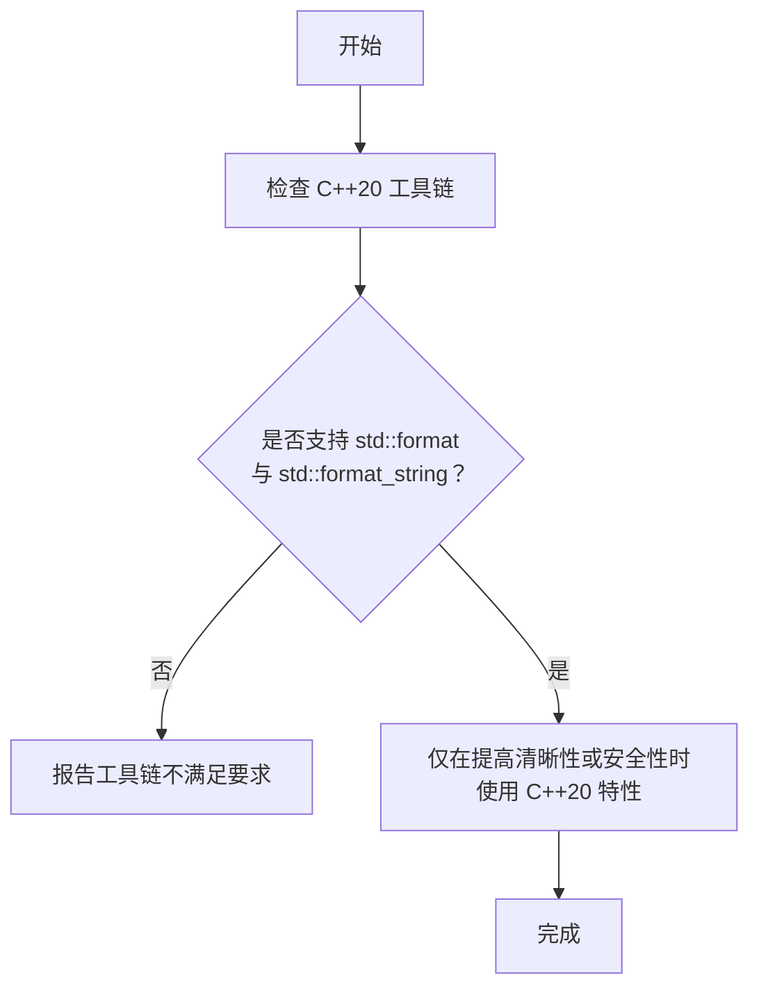

**图表来源**
- [README.md](../../../README.md)
- [docs/guides/cpp_coding_style_guidelines.md](../../guides/cpp_coding_style_guidelines.md)

**章节来源**
- [README.md](../../../README.md)
- [docs/guides/cpp_coding_style_guidelines.md](../../guides/cpp_coding_style_guidelines.md)
- [AGENTS.md](../../../AGENTS.md)

## 命名约定
### 总体原则
- 名称应表达意图，而不是实现细节。
- 避免非必要的缩写。
- 单字母变量只用于简单循环索引、极短作用域内的临时局部变量，或符合数学惯例的符号。
- 保持一致性优先于追求简洁。

### 命名风格
| 实体 | 推荐风格 | 说明 |
|---|---|---|
| 变量、函数、成员函数 | `snake_case` | 例如 `parse_request`、`next_offset_` |
| 类、结构体、接口类型 | `PascalCase` | 例如 `RequestParser`、`TensorView` |
| 枚举成员 | `kPascalCase` | 例如 `ErrorKind` 的成员 |
| 项目宏和常量 | `AM_UPPER_SNAKE_CASE` | 例如 `AM_CHECK`、`AM_THROW` |
| 私有数据成员 | 可选尾部下划线 | 例如 `buffer_`、`capacity_`，前提是项目已有此约定 |

### 项目中的实际用法
- 错误宏采用 `AM_THROW`、`AM_CHECK`、`AM_DCHECK`、`AM_UNREACHABLE`。
- 项目对象模型使用 `ObjectPtr<T>` 表示侵入式引用计数所有权。
- 类型名普遍使用 `PascalCase`，例如 `TensorView`、`Status`。
- 状态和错误相关类型使用 `PascalCase`，例如 `Status`、`ErrorKind`。

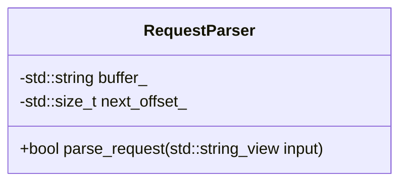

**图表来源**
- [docs/guides/cpp_coding_style_guidelines.md](../../guides/cpp_coding_style_guidelines.md)

**章节来源**
- [docs/guides/cpp_coding_style_guidelines.md](../../guides/cpp_coding_style_guidelines.md)
- [include/aethermind/base/status.h:1-200](../../../include/aethermind/base/status.h#L1-L200)
- [include/aethermind/base/object.h:1-200](../../../include/aethermind/base/object.h#L1-L200)

## 文件组织与头文件包含顺序
### 文件职责
- 头文件声明接口。
- 源文件实现细节。
- 不要在头文件中放置重型实现，除非出于模板、`inline` 或性能敏感原因。
- 头文件应尽量自包含。
- 最小化传递包含，必要时使用前向声明降低耦合。

### 包含顺序
在 `.cpp` 文件中，建议按以下顺序包含头文件：
1. 对应项目的头文件。
2. 其他项目头文件。
3. 第三方库头文件。
4. 标准库头文件。

每次只包含真正需要的头文件，并删除未使用的包含。不要依赖间接包含。

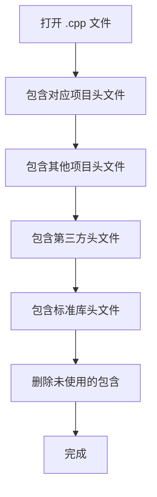

**图表来源**
- [docs/guides/cpp_coding_style_guidelines.md](../../guides/cpp_coding_style_guidelines.md)

**章节来源**
- [docs/guides/cpp_coding_style_guidelines.md](../../guides/cpp_coding_style_guidelines.md)

## 函数设计、参数传递与返回值
### 函数设计
- 函数应保持短小、职责单一。
- 大函数应按可读性和可测试性拆分，但不要拆成掩盖逻辑的小包装。
- 控制流应直接、易读；能用提前返回时避免深层嵌套。
- 复杂布尔表达式应拆成具名中间变量。

### 参数传递策略
| 情况 | 推荐方式 | 理由 |
|---|---|---|
| 廉价标量类型 | 按值传递 | 开销低且语义清晰 |
| 大型只读对象 | `const T&` | 避免拷贝，同时表达只读语义 |
| 确实要移动的对象 | `T&&` | 明确表达移动语义意图 |
| 只读字符串输入 | `std::string_view` | 避免不必要的字符串构造 |
| 多个相关参数 | 显式参数对象 | 减少重载爆炸，提高扩展性 |

### 返回值设计
- 优先返回值，而不是输出参数。
- 只有在确有强理由时才使用输出参数。
- 返回值类型应强类型化且语义清晰。
- 对于可能失败的操作，使用项目既有的错误模型；不要静默吞掉错误。

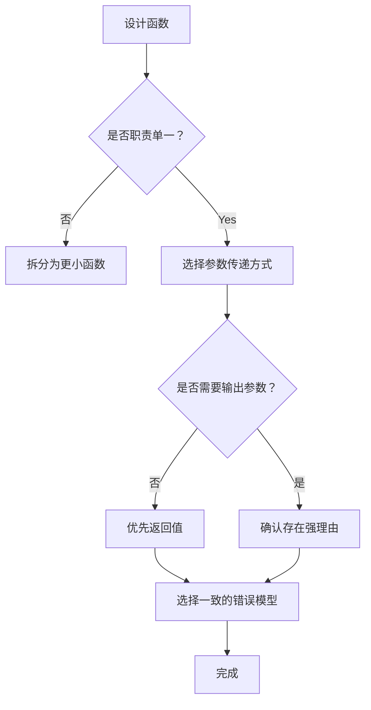

**图表来源**
- [docs/guides/cpp_coding_style_guidelines.md](../../guides/cpp_coding_style_guidelines.md)

**章节来源**
- [docs/guides/cpp_coding_style_guidelines.md](../../guides/cpp_coding_style_guidelines.md)

## 类型选择指南
- 优先使用具体、简单的类型。
- `auto` 适用于初始化器已经清楚显示类型、重复完整类型会损害可读性，或需要防止意外窄化的场景。
- 不要在隐藏重要类型信息的场景中使用 `auto`。
- 容器选择应根据访问模式和所有权需求，而不是凭习惯。
- 默认序列容器通常使用 `std::vector`；固定大小数据用 `std::array`；借用字符串用 `std::string_view`；可选值用 `std::optional`；封闭备选用 `std::variant`；连续借用的范围可用 `std::span`（项目标准允许时）。

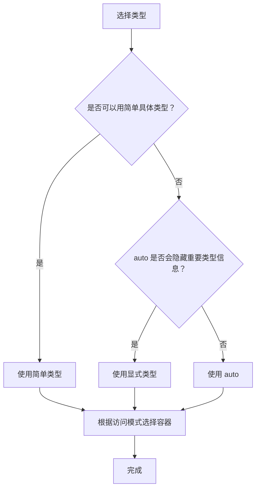

**图表来源**
- [docs/guides/cpp_coding_style_guidelines.md](../../guides/cpp_coding_style_guidelines.md)

**章节来源**
- [docs/guides/cpp_coding_style_guidelines.md](../../guides/cpp_coding_style_guidelines.md)

## const 正确性、所有权与生命周期
### const 正确性
- 对不应改变的值使用 `const`。
- 不修改可观察状态的成员函数应标记为 `const`。
- 局部变量在不影响清晰度的前提下倾向于不可变。
- 示例中的 `end` 迭代器应被标记为 `const auto`，以避免误改终止条件。

### 所有权管理
- 优先 RAII。
- 优先明确所有权，避免隐式生命周期假设。
- 禁止隐藏的别名关系和不必要的堆分配。
- 首选所有权类型：
  - `ObjectPtr<T>`：项目对象模型中的侵入式引用计数所有权。
  - `std::unique_ptr<T>`：独占所有权。
  - `std::shared_ptr<T>`：仅在确实需要共享生命周期时使用。
  - 裸指针仅用于空的可借用访问。
  - 引用仅用于非空的借用访问。

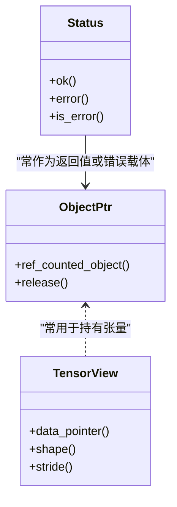

**图表来源**
- [include/aethermind/base/object.h:1-200](../../../include/aethermind/base/object.h#L1-L200)
- [include/aethermind/base/tensor_view.h:1-200](../../../include/aethermind/base/tensor_view.h#L1-L200)
- [include/aethermind/base/status.h:1-200](../../../include/aethermind/base/status.h#L1-L200)

**章节来源**
- [docs/guides/cpp_coding_style_guidelines.md](../../guides/cpp_coding_style_guidelines.md)
- [include/aethermind/base/object.h:1-200](../../../include/aethermind/base/object.h#L1-L200)

## 引用、指针与智能指针使用规范
### 基本原则
- 裸指针和引用仅用于非拥有访问。
- 裸指针表示可为空的借用。
- 引用表示非空的借用。
- 所有权转移必须通过明确的所有权类型表达。
- 禁止让调用方猜测谁负责释放内存。

### 项目内常见模式
- `ObjectPtr<T>`：用于项目对象模型的引用计数所有权。
- `std::unique_ptr<T>`：适合大多数独占所有权的资源。
- `std::shared_ptr<T>`：仅限真实共享生命周期的场景。
- 在 C ABI 层，外部句柄通常以 opaque handle 形式暴露，内部由 Runtime 或会话对象拥有并管理生命周期。

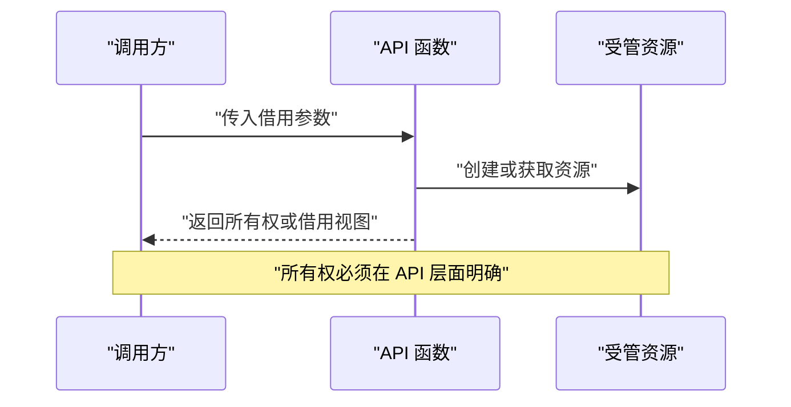

**图表来源**
- [docs/guides/cpp_coding_style_guidelines.md](../../guides/cpp_coding_style_guidelines.md)
- [src/c_api_runtime.cpp:1-200](../../../src/c_api_runtime.cpp#L1-L200)

**章节来源**
- [docs/guides/cpp_coding_style_guidelines.md](../../guides/cpp_coding_style_guidelines.md)
- [src/c_api_runtime.cpp:1-200](../../../src/c_api_runtime.cpp#L1-L200)

## 错误处理
### 统一原则
- 遵循项目既有的错误模型。
- 优先使用 `AM_CHECK`、`AM_THROW`、`AM_DCHECK`、`AM_UNREACHABLE`。
- 只在子系统 API 已采用状态/结果风格时使用返回值错误模型。
- 错误路径必须可读、明确，不得静默吞错。

### 典型用法
- 前置条件检查：`AM_CHECK(idx < size(), "index {} out of range {}")`。
- 运行时错误：`AM_THROW(ErrorKind::InvalidArgument) << "invalid runtime state"`。
- 状态对象：检查 `config.ok()`，失败时返回 `config.error()`。

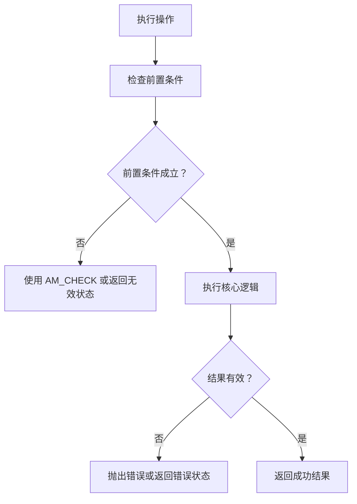

**图表来源**
- [docs/guides/cpp_coding_style_guidelines.md](../../guides/cpp_coding_style_guidelines.md)
- [include/aethermind/base/macros.h](../../../include/aethermind/base/macros.h)
- [include/aethermind/base/status.h:1-200](../../../include/aethermind/base/status.h#L1-L200)

**章节来源**
- [docs/guides/cpp_coding_style_guidelines.md](../../guides/cpp_coding_style_guidelines.md)
- [include/aethermind/base/macros.h](../../../include/aethermind/base/macros.h)
- [include/aethermind/base/status.h:1-200](../../../include/aethermind/base/status.h#L1-L200)

## 注释与文档标准
### 注释总则
- 注释应解释意图、不变式、所有权、生命周期、线程安全假设和非平凡权衡。
- 不要机械翻译明显代码。
- 使用英文；公开 API 和重要设计注释使用完整句子。
- 注释不准确时应修复或删除，不要留下过期的解释。
- 不要在仓库中保留注释掉的代码。

### Doxygen 公共 API 文档
- 对非平凡的公共 API 使用 `///` 开头的 Doxygen 注释。
- 强制标签：
  - `@brief`：始终需要。
  - `@param`：有参数时需要。
  - `@return`：返回非 void 时需要。
  - `@throws`：可能抛出异常时需要。
  - `@tparam`：模板参数含义非平凡时需要。
- 可选标签：`@pre`、`@post`、`@note`、`@warning`、`@see`、`@deprecated`。
- 公共 API 注释还应覆盖：前置条件、后置条件、所有权、线程安全性、阻塞行为、异常行为和复杂度保证。

### 文件级、类级和函数级注释
- 非平凡公共头文件和源码文件可添加文件级注释。
- 类或结构体应在职责、生命周期、不变式或同步模型非平凡时进行文档化。
- 数据成员仅在含义不明确或涉及不变式、锁规则时需要注释。
- 函数体内只注释困难部分，不要逐行叙述。

### TODO / FIXME / HACK / NOTE
- TODO：计划中的未来工作，格式如 `// TODO(username): ...`。
- FIXME：已知不正确但需修复的行为。
- HACK：故意使用的丑陋变通方案，必须说明原因、风险和移除条件。
- NOTE：重要的非行动性上下文。

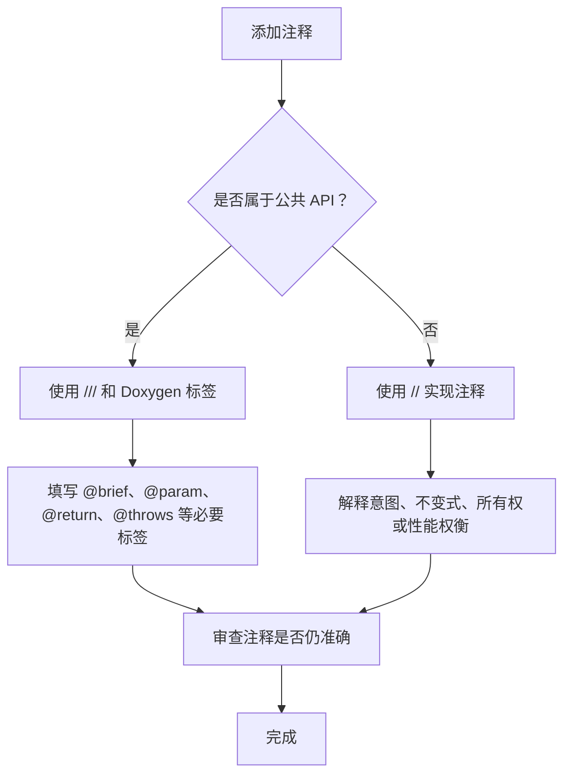

**图表来源**
- [docs/guides/cpp_comment_guidelines.md](../../guides/cpp_comment_guidelines.md)
- [docs/guides/cpp_comment_guidelines.md](../../guides/cpp_comment_guidelines.md)

**章节来源**
- [docs/guides/cpp_comment_guidelines.md](../../guides/cpp_comment_guidelines.md)
- [docs/guides/cpp_comment_guidelines.md](../../guides/cpp_comment_guidelines.md)

## 代码格式与 .clang-format 规则
### 基本格式化要求
- 使用 `.clang-format`，不要手工对抗格式化器排版。
- 缩进宽度为 4。
- 不使用 Tab，使用空格。
- 指针和引用对齐到类型一侧，即 `Type* ptr`。
- 列宽限制为 0，优先换行而非写出难以阅读的超长行。
- 短块、短 if、短 lambda、短循环和短函数允许放在单行。
- 构造函数初始化列表冒号前换行。
- 继承列表冒号前换行。
- 模板声明总是换行。
- 括号、尖括号、方括号内一般不加多余空格。
- 赋值运算符两侧加空格。
- 控制语句后括号前加空格。

### 关键配置摘要
| 配置项 | 含义 |
|---|---|
| `BasedOnStyle: LLVM` | 基于 LLVM 风格 |
| `IndentWidth: 4` | 缩进 4 空格 |
| `UseTab: false` | 不使用 Tab |
| `ColumnLimit: 0` | 不强制列宽 |
| `BreakConstructorInitializers: BeforeColon` | 构造函数初始化列表冒号前换行 |
| `BreakInheritanceList: BeforeColon` | 继承列表冒号前换行 |
| `AlwaysBreakTemplateDeclarations: Yes` | 模板声明强制换行 |
| `PointerAlignment: Left` | 指针靠近类型 |
| `SpaceBeforeAssignmentOperators: true` | 赋值运算符两侧空格 |
| `SpaceBeforeParens: ControlStatements` | 控制语句括号前空格 |
| `AllowShortFunctionsOnASingleLine: All` | 允许短函数单行 |
| `ReflowComments: true` | 自动重排注释 |

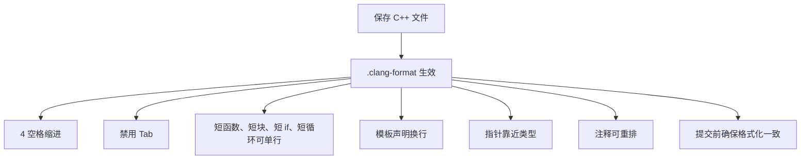

**图表来源**
- [.clang-format:1-66](../../../.clang-format#L1-L66)
- [docs/guides/cpp_coding_style_guidelines.md](../../guides/cpp_coding_style_guidelines.md)

**章节来源**
- [.clang-format:1-66](../../../.clang-format#L1-L66)
- [docs/guides/cpp_coding_style_guidelines.md](../../guides/cpp_coding_style_guidelines.md)

## 性能、并发与构建集成
### 性能原则
- 先保证清晰性，再优化热点路径。
- 避免不必要的分配和拷贝。
- 热点路径注意：隐藏临时对象、重复字符串构造、重复查找、不必要的虚函数调用。
- 性能相关决策应记录注释，并提供证据，不能仅凭直觉声称性能提升。

### 并发原则
- 并发设计必须明确。
- 明确哪个互斥量保护哪些状态。
- 临界区应小而可理解。
- 谨慎混用原子和互斥量。
- 线程亲和性假设应在名称、注释或 API 设计中显式表达。

### 构建与项目集成
- 尊重现有 CMake 结构和目标命名。
- 避免随意重命名目标或移动文件。
- 广泛包含的头文件变更应考虑编译时间影响。
- 优先使用目标级验证，而不是重建整个树。

**章节来源**
- [docs/guides/cpp_coding_style_guidelines.md](../../guides/cpp_coding_style_guidelines.md)
- [README.md](../../../README.md)

## 良好写法与糟糕写法对照
### 命名
- 良好：使用 `snake_case` 表示变量和函数，`PascalCase` 表示类型，`AM_UPPER_SNAKE_CASE` 表示宏。
- 糟糕：使用模糊缩写、混合命名风格、在宏名中使用普通标识符风格。

**章节来源**
- [docs/guides/cpp_coding_style_guidelines.md](../../guides/cpp_coding_style_guidelines.md)

### 参数与返回值
- 良好：`ParseResult parse_config(std::string_view text);`
- 糟糕：`bool parse_config(const std::string& text, Config* out_config, Error* out_error);`，除非该模式已是项目约定。

**章节来源**
- [docs/guides/cpp_coding_style_guidelines.md](../../guides/cpp_coding_style_guidelines.md)

### 所有权
- 良好：`std::unique_ptr<Node> make_node();`
- 糟糕：返回裸指针却未说明谁负责释放。

**章节来源**
- [docs/guides/cpp_coding_style_guidelines.md](../../guides/cpp_coding_style_guidelines.md)

### 错误处理
- 良好：检查 `config.ok()` 后返回 `config.error()`。
- 糟糕：静默忽略错误，或不区分调试断言与运行期错误。

**章节来源**
- [docs/guides/cpp_coding_style_guidelines.md](../../guides/cpp_coding_style_guidelines.md)

### 注释
- 良好：Doxygen 公共 API 使用 `///` 和结构化标签；实现注释解释为什么这样做。
- 糟糕：纯描述性注释、过时注释、注释掉的代码、缺少必要 Doxygen 标签。

**章节来源**
- [docs/guides/cpp_comment_guidelines.md](../../guides/cpp_comment_guidelines.md)
- [docs/guides/cpp_comment_guidelines.md](../../guides/cpp_comment_guidelines.md)

## 审查清单
编写或审查代码时，至少确认以下内容：
- 代码是否正确。
- 所有权是否清晰。
- 生命周期假设是否安全。
- API 是否易于理解。
- 控制流是否直接。
- 边界情况和失败模式是否处理。
- 并发假设是否明确。
- 性能是否满足预期规模。
- 改动范围是否足够小。
- 未来维护者能否快速理解。

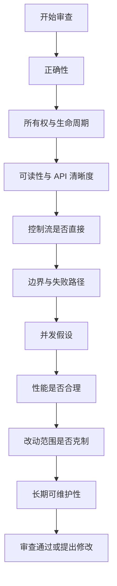

**图表来源**
- [docs/guides/cpp_coding_style_guidelines.md](../../guides/cpp_coding_style_guidelines.md)

**章节来源**
- [docs/guides/cpp_coding_style_guidelines.md](../../guides/cpp_coding_style_guidelines.md)

## 结论
AetherMind 的 C++ 编码规范以正确性、可读性和明确的所有权为中心。开发者应：
- 使用 C++20，但只在改进清晰性或安全性时使用新特性。
- 遵循 `snake_case`、`PascalCase`、`kPascalCase`、`AM_UPPER_SNAKE_CASE` 命名约定。
- 将接口与实现分离，并按项目、第三方、标准库的顺序组织头文件包含。
- 优先返回值、`const` 引用、`std::string_view` 和智能指针。
- 使用 Doxygen 文档化公共 API，并用实现注释解释意图和约束。
- 使用 `.clang-format` 统一格式，避免手工排版。
- 在性能、并发和错误处理上保持显式、保守和可验证。
