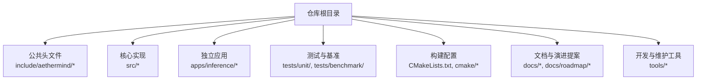
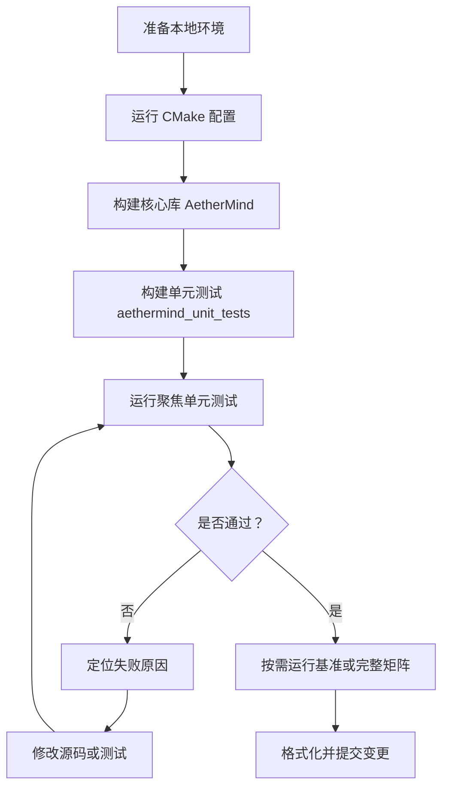
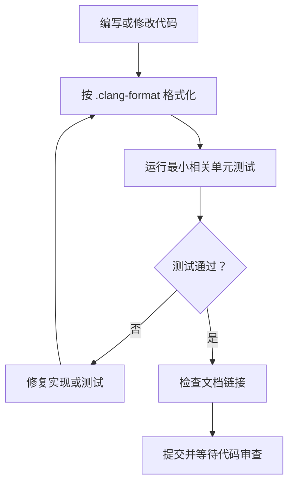
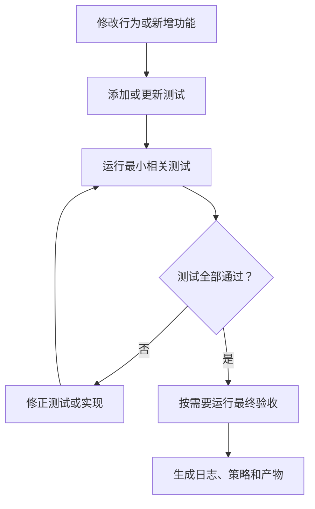
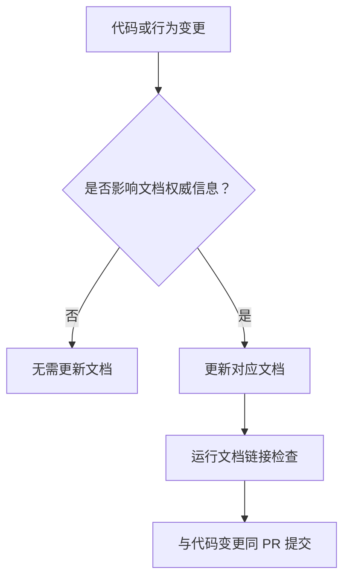
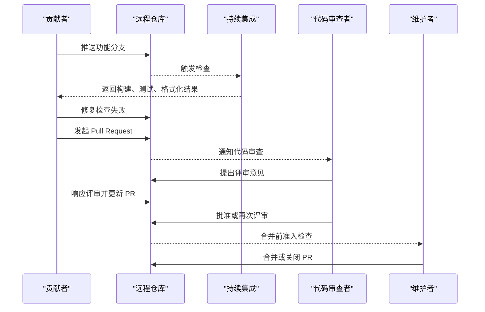
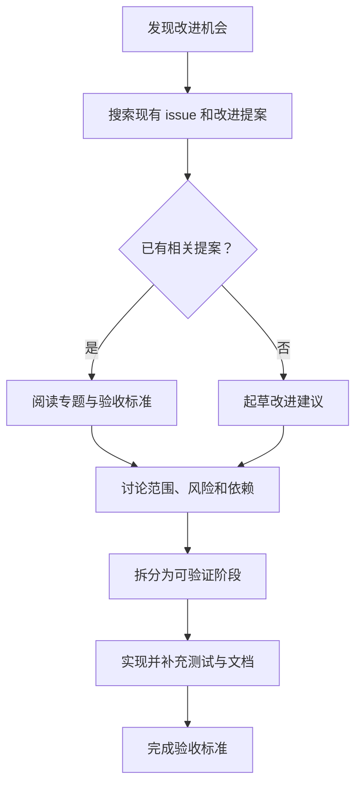
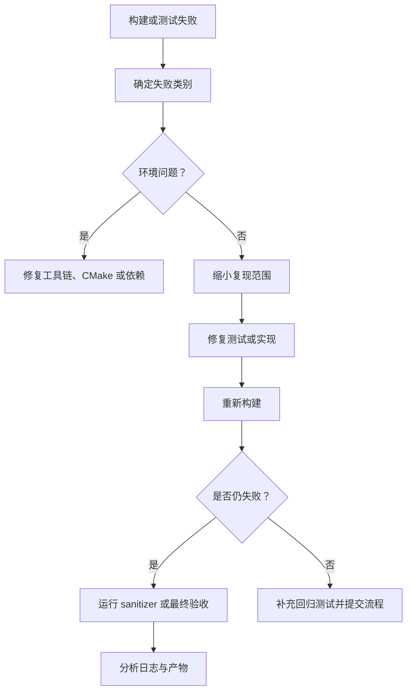

# 贡献指南

**本文引用的文件**
- [README.md](../../../README.md)
- [AGENTS.md](../../../AGENTS.md)
- [CMakeLists.txt](../../../CMakeLists.txt)
- [.clang-format](../../../.clang-format)
- [LICENSE](../../../LICENSE)
- [docs/README.md](../../README.md)
- [docs/issues.md](../../issues.md)
- [docs/guides/cpp_coding_style_guidelines.md](../../guides/cpp_coding_style_guidelines.md)
- [docs/guides/test_writing_guidelines.md](../../guides/test_writing_guidelines.md)
- [docs/guides/final-validation.md](../../guides/final-validation.md)
- [docs/roadmap/README.md](../../roadmap/README.md)
- [tools/check_docs_links.py](../../../tools/check_docs_links.py)

## 目录
1. [引言](#引言)
2. [项目结构与入口](#项目结构与入口)
3. [如何开始贡献](#如何开始贡献)
4. [开发环境与构建测试](#开发环境与构建测试)
5. [代码风格与质量检查](#代码风格与质量检查)
6. [测试编写要求](#测试编写要求)
7. [文档更新规范](#文档更新规范)
8. [提交与拉取请求流程](#提交与拉取请求流程)
9. [代码审查标准](#代码审查标准)
10. [改进计划参与方式](#改进计划参与方式)
11. [问题报告与功能请求](#问题报告与功能请求)
12. [许可证、版权声明与行为准则](#许可证版权声明与行为准则)
13. [故障排查](#故障排查)
14. [结语](#结语)

## 引言
AetherMind 是一个面向桌面与服务器的 C++20 CPU 推理引擎，当前聚焦 Llama 家族密集模型的本地推理。仓库同时提供独立 CLI、C ABI 和一组公共 C++ API，并配套较完整的架构文档、模块设计、算子契约、演进提案和质量验证说明。

本贡献指南面向希望参与 AetherMind 的开发者，涵盖从 Fork、分支、编码、测试、文档到 Pull Request 评审的全流程；也说明如何阅读和改进演进提案、如何报告问题、如何遵循许可证和社区约定。

## 项目结构与入口
仓库采用“头文件在 `include/`，实现镜像在 `src/`”的分层结构，核心库目标为 `AetherMind`，可选 CLI 工具位于 `apps/inference/`，单元测试位于 `tests/unit/`，基准位于 `tests/benchmark/`，构建辅助位于 `cmake/`，文档位于 `docs/`，开发与维护脚本位于 `tools/`。

**图表来源**
- [README.md](../../../README.md)
- [AGENTS.md](../../../AGENTS.md)

仓库中关于文档权威顺序、写作规则、已知问题和路线图的位置也在 `docs/README.md` 中明确，新贡献者应优先阅读该文档以理解文档体系。

**章节来源**
- [README.md](../../../README.md)
- [docs/README.md](../../README.md)
- [AGENTS.md](../../../AGENTS.md)

## 如何开始贡献
推荐的新贡献者路径如下：

| 步骤 | 说明 |
|---|---|
| 1. 获取仓库 | Fork 本仓库到自己的账号，然后克隆自己的远程仓库到本地。 |
| 2. 创建功能分支 | 使用语义化分支名，例如 `feature/kv-cache-improvement`、`fix/operator-shape-mismatch`、`docs/add-contributing-guide`。不要直接在主分支上工作。 |
| 3. 同步上游 | 在开始新功能前，先同步 Fork 的上游默认分支，避免历史冲突。 |
| 4. 搭建环境 | 安装满足要求的 C++20 工具链、CMake ≥ 3.28，并确认系统支持 pthreads。 |
| 5. 构建基础目标 | 按 README 或 AGENTS.md 中的命令构建核心库、单元测试和可选 CLI。 |
| 6. 复现问题或实现需求 | 先在现有测试或最小可复现示例中定位问题，再决定修改范围。 |
| 7. 编写或更新测试 | 任何行为变更都应附带测试；修复缺陷时优先补充回归测试。 |
| 8. 运行质量检查 | 执行 clang-format 检查、相关单元测试，必要时运行最终验收矩阵。 |
| 9. 更新文档 | 若接口、架构、行为或操作流程发生变化，同步更新对应文档。 |
| 10. 提交与发起 PR | 提交清晰 commit，描述动机、变更范围和验证结果；随后发起 Pull Request。 |
| 11. 响应评审 | 根据 reviewer 意见修改，保持改动范围可控，避免无关重构。 |
| 12. 合并前检查 | 确保所有 CI 检查通过、文档链接有效、变更符合产品边界。 |

如果贡献涉及算子、内核、量化、后端或模型架构等复杂领域，应先阅读 [项目手册](../README.md) 与 `docs/roadmap/` 中对应专题，再动手实现。

**章节来源**
- [README.md](../../../README.md)
- [AGENTS.md](../../../AGENTS.md)
- [docs/README.md](../../README.md)

## 开发环境与构建测试
### 基本要求
- C++20 工具链，需提供 `<format>` 支持。
- CMake ≥ 3.28。
- 运行时依赖 pthreads。
- 可选 libbacktrace（默认启用）。

### 关键构建目标
- `AetherMind`：核心共享库。
- `aethermind_unit_tests`：GoogleTest 单元测试。
- `aethermind_benchmark`：Google Benchmark 性能基准。
- `aethermind_infer`：可选的独立推理 CLI。

### 常用命令
根目录 README 和 AGENTS.md 都给出了默认配置、全量构建、按目标构建以及 TSAN 变体命令。建议先构建最小受影响目标，再逐步扩大验证范围。

**图表来源**
- [README.md](../../../README.md)
- [AGENTS.md](../../../AGENTS.md)

**章节来源**
- [README.md](../../../README.md)
- [README.md](../../../README.md)
- [CMakeLists.txt:1-20](../../../CMakeLists.txt#L1-L20)
- [AGENTS.md](../../../AGENTS.md)

## 代码风格与质量检查
### 语言与标准
仓库统一使用 C++20，鼓励现代特性只在提升清晰度、安全性或正确性时使用，不应为了“看起来现代”而引入语言特性。

### 命名与组织
- 变量和函数使用 `snake_case`。
- 类型使用 `PascalCase`。
- 枚举成员使用 `kPascalCase`。
- 宏和常量使用 `AM_UPPER_SNAKE_CASE`。
- 私有数据成员可使用尾下划线，但需与现有代码一致。
- 头文件声明接口，源文件实现细节；减少不必要的跨头包含。

### 所有权与生命周期
- 明确所有权和生命周期。
- 优先 RAII。
- 避免裸拥有指针。
- 非拥有访问使用原始指针或引用。
- 智能指针选择遵循：独占用 `std::unique_ptr`，共享用 `std::shared_ptr`，项目内对象模型使用 `ObjectPtr<T>`。

### 错误处理
- 遵循项目既有错误模型。
- 使用 `AM_CHECK`、`AM_THROW`、`AM_DCHECK`、`AM_UNREACHABLE` 等宏保持一致性。
- 错误路径必须可读且显式，不得静默吞掉错误。

### 性能与并发
- 热路径避免隐藏临时对象、重复字符串构造、重复查找和无必要虚调用。
- 并发设计必须显式记录锁保护状态、临界区大小和线程亲和假设。
- 不轻易混用原子和互斥；简单同步方案优于“聪明”无锁逻辑。

### 格式化与静态检查
- 代码格式以 `.clang-format` 为准。
- AGENTS.md 提供了基于工作树差异文件的 clang-format 检查和自动格式化命令。
- 若有本地 `build/compile_commands.json`，可进一步运行 `clang-tidy`。

**图表来源**
- [docs/guides/cpp_coding_style_guidelines.md](../../guides/cpp_coding_style_guidelines.md)
- [docs/guides/cpp_coding_style_guidelines.md](../../guides/cpp_coding_style_guidelines.md)
- [AGENTS.md](../../../AGENTS.md)

**章节来源**
- [docs/guides/cpp_coding_style_guidelines.md](../../guides/cpp_coding_style_guidelines.md)
- [docs/guides/cpp_coding_style_guidelines.md](../../guides/cpp_coding_style_guidelines.md)
- [AGENTS.md](../../../AGENTS.md)

## 测试编写要求
### 框架与目标
- 使用 GoogleTest。
- 测试目标为 `aethermind_unit_tests`。
- 测试文件放在 `tests/unit/`，并按源码目录镜像组织。

### 文件放置与命名
- 测试文件通常命名为 `test_<单元>.cpp`。
- 新增测试无需手动编辑收集列表；CMake 会递归收集 `tests/unit/**/*.cpp`。
- 单个测试文件建议控制在合理规模，超过约 800 行或混合多个职责时应拆分。

### 测试风格
- 套件名和用例名使用 PascalCase。
- 每个测试只验证一个行为。
- 优先 `EXPECT_*`，仅在继续执行会导致崩溃时使用 `ASSERT_*`。
- 死亡测试匹配 `AM_CHECK` 输出的 `Check failed`，调试专用断言需用 `#ifndef NDEBUG` 保护。
- 全局状态需在 `SetUp`/`TearDown` 中重置；随机数必须显式设置种子。

### 浮点比较与平台特性
- 浮点比较使用容差比较，对归约类计算建议使用相对误差辅助函数。
- 需要 ISA 或编译器特性的代码应使用编译期守卫。
- 无法运行的平台条件应使用 `GTEST_SKIP()` 并给出原因。

### 测试覆盖率与验收
仓库未规定统一的百分比覆盖率阈值。更关键的验收方式是：
- 行为契约被覆盖。
- 边界条件、无效输入和错误路径被覆盖。
- 测试稳定、可复现、可隔离。
- 最终验收矩阵能通过相应 profile。

最终验收由 `tools/run_final_validation.py` 编排，覆盖 baseline、AVX2、ASAN、TSAN、CLI、Benchmark 等多个 profile，并冻结测试清单和资产身份。

**图表来源**
- [docs/guides/test_writing_guidelines.md](../../guides/test_writing_guidelines.md)
- [docs/guides/test_writing_guidelines.md](../../guides/test_writing_guidelines.md)
- [docs/guides/final-validation.md](../../guides/final-validation.md)

**章节来源**
- [docs/guides/test_writing_guidelines.md](../../guides/test_writing_guidelines.md)
- [docs/guides/test_writing_guidelines.md](../../guides/test_writing_guidelines.md)
- [docs/guides/final-validation.md](../../guides/final-validation.md)

## 文档更新规范
### 文档分类
仓库文档分为四类：系统现状、模块设计、过程规范、已知问题。构建、测试与运行命令以根 README 为准，不在 `docs/README.md` 重复。

### 权威顺序
1. 用户当前明确指令。
2. 已验证的代码、CMake 与测试事实。
3. `architecture.md`、[项目手册](../README.md)、`product.md`、`roadmap/README.md`。
4. `guides/`、`api/`、`operators/`。
5. `issues.md`。
6. `archive/`：仅冷存储，不作为事实来源。

### 写作规则
- 新建文档前先判断能否并入现有入口。
- 现状写架构或模块文档；在研方向写路线图；缺陷写 `issues.md`。
- 单篇文档不超过 600 行；按模块拆分，不按日期或版本拆分。
- 不使用状态头、日期头、版本号头和模板目录。
- 文档应与代码同一 PR 修改；过时文档移入 `archive/`。
- 自动化只保留一种文档相对链接检查：`python3 tools/check_docs_links.py`。

### 贡献者文档更新要求
当你的变更影响以下内容时，应同步更新文档：
- 公开 API 或 ABI。
- 模块职责、边界或所有权。
- 构建、测试、验证命令。
- 产品范围、验收标准或演进方向。
- 算子契约、参考实现或优化证据位置。

**图表来源**
- [docs/README.md](../../README.md)
- [tools/check_docs_links.py](../../../tools/check_docs_links.py)

**章节来源**
- [docs/README.md](../../README.md)

## 提交与拉取请求流程
### 分支策略
- 主分支用于发布基线。
- 功能分支用于实现具体任务。
- 修复分支用于缺陷修复。
- 文档分支用于纯文档改进。

### Commit 建议
- 一条 commit 只做一件事。
- commit message 说明动机、变更范围和验证方式。
- 不要把机械清理与业务逻辑混在同一 diff 中。
- 避免 drive-by 重构，除非它属于正确性或评审要求的一部分。

### Pull Request 建议
- 标题应准确描述变更。
- 描述应包括：背景、变更内容、风险、测试方式、文档更新情况。
- 如果是缺陷修复，说明复现方式和回归测试。
- 如果是性能变更，提供证据，不空口宣称性能提升。
- 如涉及多模块，列出受影响模块和依赖方向变化。

[此图为概念流程，不对应特定源码文件]

**章节来源**
- [AGENTS.md](../../../AGENTS.md)
- [docs/guides/cpp_coding_style_guidelines.md](../../guides/cpp_coding_style_guidelines.md)

## 代码审查标准
### 正确性与契约
- 行为是否符合公开接口和模块契约。
- 是否破坏现有测试或预期行为。
- 错误路径是否明确，异常、Status、死亡测试是否合理。

### 所有权与生命周期
- 是否清晰表达谁拥有资源。
- 是否存在隐式拷贝、悬垂指针、双重释放或内存泄漏风险。
- 是否遵循 RAII。

### 可读性与可维护性
- 函数是否小而专注。
- 控制流是否直白，嵌套是否过深。
- 命名是否表达意图而非实现细节。
- 是否留下无意义的注释或注释掉的代码。

### 性能与稳定性
- 热路径是否避免不必要分配、复制和重复查找。
- 并发假设是否显式记录。
- 是否在没有证据的情况下声称性能提升。

### 构建与测试
- 是否能构建最小受影响目标。
- 是否运行了足够聚焦的测试。
- 是否覆盖边界条件和错误路径。
- 是否需要 TSAN、ASAN 或其他 sanitizer 验证。

### 文档一致性
- 是否更新了受影响的文档。
- 是否保持与 `docs/README.md` 的权威顺序一致。
- 是否保留了稳定的术语定义。

**章节来源**
- [docs/guides/cpp_coding_style_guidelines.md](../../guides/cpp_coding_style_guidelines.md)
- [docs/README.md](../../README.md)

## 改进计划参与方式
`docs/roadmap/` 汇集当前优先事项、候选提案和历史提案。提案状态包括 Draft、In Progress、Implemented 和 Superseded。通用写作规则见 [文档导航](../../README.md#写作规则)。

### 阅读改进提案的顺序
1. 从 [项目路线图](../../roadmap/README.md) 找到专题，确认其优先级与状态。
2. 阅读专题文档的现状分析、目标架构、方案与备选、实施步骤、风险与依赖、验收标准。
3. 对照 [项目手册](../README.md) 中对应模块的设计文档，确认是否与现有边界冲突。
4. 对照 `docs/issues.md`，确认是否有尚未解决的已知缺口。

### 提出新的改进建议
1. 先在 `docs/issues.md` 或已有改进提案中确认该问题是否已被记录。
2. 若属于长期架构演进，可在讨论后新增改进提案，或使用现有编号体系扩展。
3. 提案应明确：目标、范围、非目标、风险、依赖、分阶段实施和验收标准。
4. 不要将短期 bug 直接写成大型架构提案；短期缺陷应优先走 issue 和修复 PR。
5. 文档应遵守 `docs/README.md` 的写作规则，不滥用编号、模板和带日期的目录。

**图表来源**
- [docs/roadmap/README.md](../../roadmap/README.md)
- [docs/README.md](../../README.md)
- [docs/issues.md](../../issues.md)

**章节来源**
- [docs/roadmap/README.md](../../roadmap/README.md)
- [docs/README.md](../../README.md)
- [docs/issues.md](../../issues.md)

## 问题报告与功能请求
### 问题报告
仓库的已知缺陷和优化待办集中在 `docs/issues.md`。报告问题时请尽量包含：
- 复现步骤。
- 期望行为与实际行为。
- 相关模块、API 或构建选项。
- 是否可被现有测试复现。
- 是否涉及并发、内存、性能或平台特性。

### 功能请求
- 小范围增强可直接在 PR 中讨论。
- 影响产品范围、公开 API、架构或验收标准的变更，应先讨论改进提案。
- 功能请求应避免把短期 bug 包装成大规模架构变更。
- 应明确功能的目标、非目标、风险、依赖和验收方式。

### 已知问题示例
仓库当前记录了若干未解决条目，例如图构建与算子语义不一致、workspace 规划尚未完全生效、activation arena 峰值接近全部 activation 字节之和、PRD 部分表述需要重新裁决、GEMM 缺少部分生产门禁证据等。这些条目可作为新贡献者的学习入口，但实现前应核对最新路线图和模块文档。

**章节来源**
- [docs/issues.md](../../issues.md)

## 许可证、版权声明与行为准则
### 许可证
AetherMind 使用 Apache License 2.0。该许可证允许复制、分发、修改和再分发作品，但要求保留许可证、版权声明和归属信息，并对商标、免责声明、责任限制等作出约束。

### 贡献者义务
- 贡献视为在 Apache License 2.0 下授权给许可方。
- 修改文件应保留原有版权和许可证信息。
- 如需添加自身版权声明，应遵循许可证附录的方式，且不改变许可证本身。
- 不要在贡献中引入未授权的第三方代码。

### 社区沟通与行为
仓库中没有独立的单独行为准则文件，但可从现有规范和工具推断基本协作原则：
- 尊重代码、测试和文档的权威顺序。
- 保持变更范围可控。
- 使用清晰的 commit 和 PR 描述。
- 在评审中关注正确性、所有权、生命周期、并发、性能和可维护性。
- 不制造噪音日志、不隐藏错误、不保留无意义注释。
- 使用工具检查格式和文档链接，减少低级错误。

如果你代表公司或组织贡献，请确保你有权提交该代码，并遵守组织的知识产权政策。

**章节来源**
- [LICENSE:1-200](../../../LICENSE#L1-L200)
- [AGENTS.md](../../../AGENTS.md)
- [docs/README.md](../../README.md)

## 故障排查
### 构建失败
- 确认 C++ 工具链支持 C++20 和 `<format>`。
- 确认 CMake ≥ 3.28。
- 检查是否启用了正确的构建选项，例如 `BUILD_TESTS`、`BUILD_BENCHMARKS`、`BUILD_INFERENCE_TOOL`。
- 如依赖下载失败，检查网络、代理和离线源码目录。

### 测试失败
- 先运行最小相关测试：`--gtest_filter=Suite.Case`。
- 检查测试是否依赖缺失的 fixture 或外部模型路径。
- 对于并发问题，尝试 TSAN 变体。
- 对于内存问题，考虑 ASAN/UBSAN 最终验收 profile。

### 文档链接失效
- 运行 `python3 tools/check_docs_links.py`。
- 检查相对路径是否指向真实存在的文档。
- 避免在活跃文档中引用 `docs/archive/` 作为事实来源。

### 最终验收失败
- 使用 `tools/run_final_validation.py` 指定局部 profile 运行。
- 检查 policy 是否与实际测试清单一致。
- 检查模型资产是否准备好且校验通过。
- 注意不同 profile 的交集不能简单相加为独立测试数量。

**图表来源**
- [README.md](../../../README.md)
- [AGENTS.md](../../../AGENTS.md)
- [docs/guides/final-validation.md](../../guides/final-validation.md)

**章节来源**
- [README.md](../../../README.md)
- [AGENTS.md](../../../AGENTS.md)
- [docs/guides/final-validation.md](../../guides/final-validation.md)

## 结语
AetherMind 的贡献流程强调最小正确变更、清晰所有权、严格测试、稳定文档和渐进式演进。新贡献者可以从阅读 `docs/README.md`、[项目手册](../README.md) 和相关改进提案开始，先从小型修复和文档改进入手，逐步参与更复杂的架构和功能变更。

最重要的三条原则是：
1. 让代码更容易被理解和维护。
2. 用测试证明行为，而不是只凭直觉。
3. 用文档解释为什么这样做，而不是只记录做了什么。
