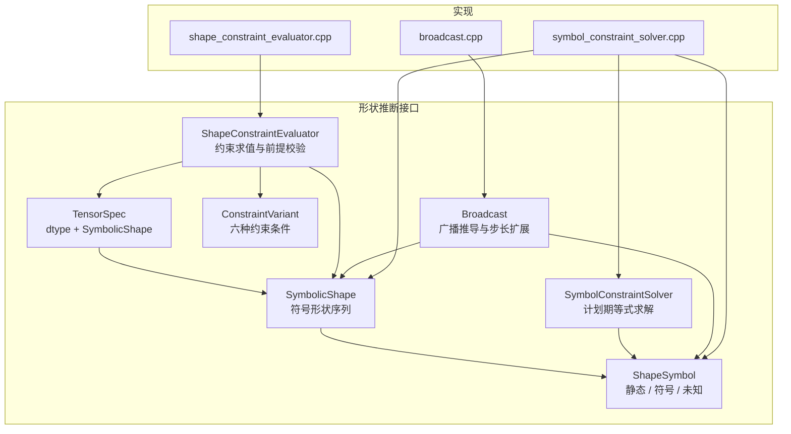
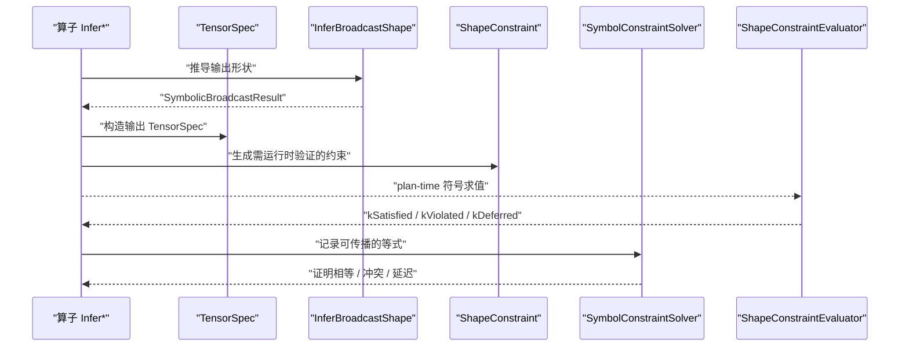
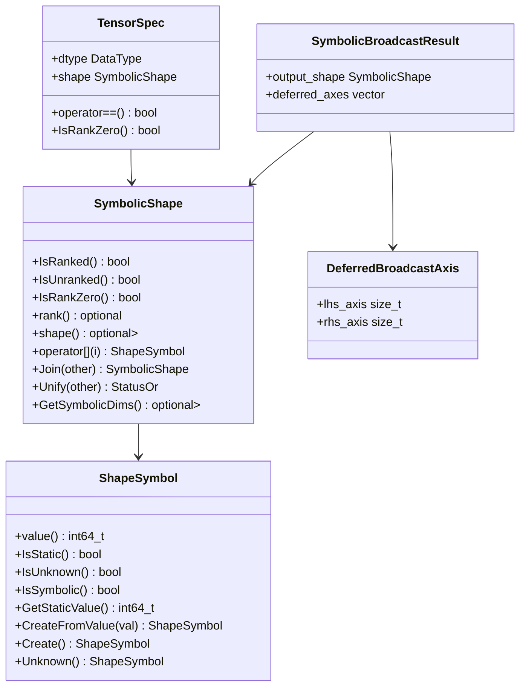
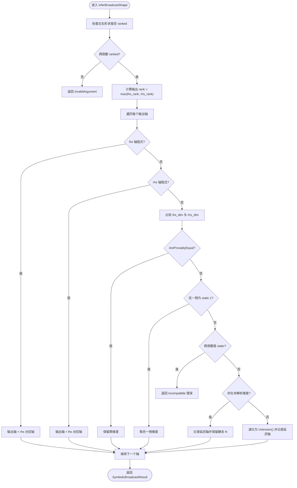
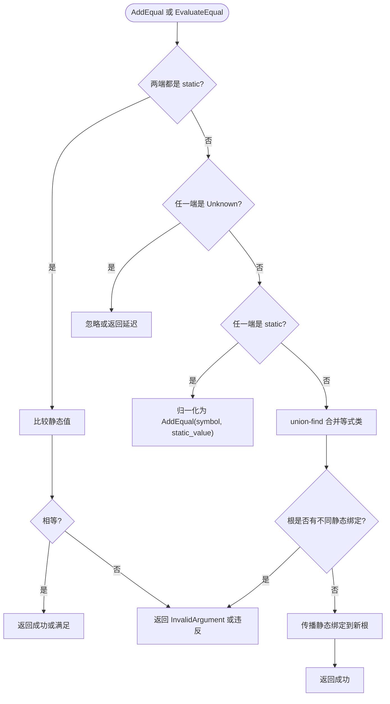
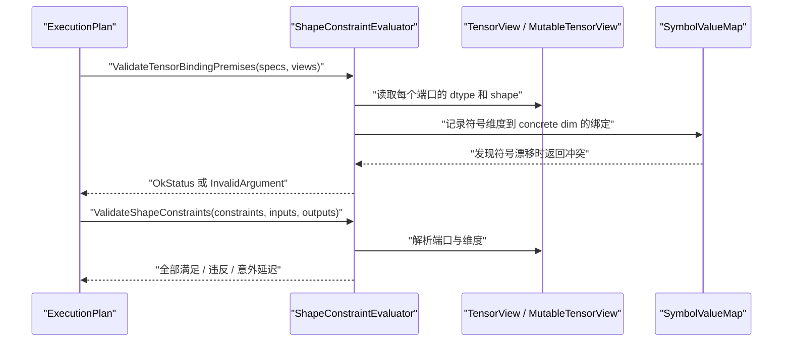
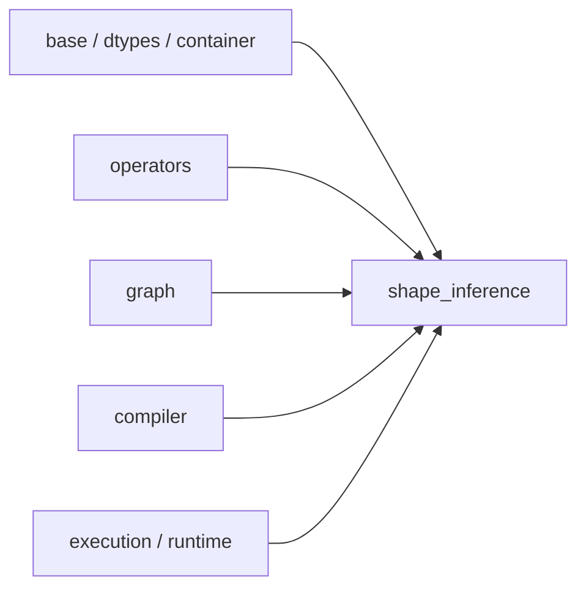

# 形状推断系统

**本文引用的文件**
- [tensor_spec.h](../../include/aethermind/shape_inference/tensor_spec.h)
- [shape_symbol.h](../../include/aethermind/shape_inference/shape_symbol.h)
- [shape_constraint.h](../../include/aethermind/shape_inference/shape_constraint.h)
- [symbol_constraint_solver.h](../../include/aethermind/shape_inference/symbol_constraint_solver.h)
- [broadcast.h](../../include/aethermind/shape_inference/broadcast.h)
- [shape_constraint_evaluator.h](../../include/aethermind/shape_inference/shape_constraint_evaluator.h)
- [broadcast.cpp](../../src/shape_inference/broadcast.cpp)
- [shape_symbol.cpp](../../src/shape_inference/shape_symbol.cpp)
- [symbol_constraint_solver.cpp](../../src/shape_inference/symbol_constraint_solver.cpp)
- [shape_constraint_evaluator.cpp](../../src/shape_inference/shape_constraint_evaluator.cpp)
- [include/aethermind/shape_inference/](../../include/aethermind/shape_inference)
- [test_broadcast.cpp](../../tests/unit/shape_inference/test_broadcast.cpp)
- [test_symbol_constraint_solver.cpp](../../tests/unit/shape_inference/test_symbol_constraint_solver.cpp)
- [test_shape_constraint.cpp](../../tests/unit/shape_inference/test_shape_constraint.cpp)

## 目录
1. [引言](#引言)
2. [项目结构](#项目结构)
3. [核心组件](#核心组件)
4. [架构总览](#架构总览)
5. [详细组件分析](#详细组件分析)
6. [依赖关系分析](#依赖关系分析)
7. [性能与复杂度](#性能与复杂度)
8. [编译期与运行期应用](#编译期与运行期应用)
9. [错误处理机制](#错误处理机制)
10. [使用示例与调试技巧](#使用示例与调试技巧)
11. [结论](#结论)

## 引言
AetherMind 的形状推断系统围绕“符号维度”“张量规格”“形状约束”和“约束求值”四个层次组织。它把静态已知维度、可传播的符号维度、未知维度和运行时 concrete 形状统一建模，使算子可以在图构建阶段生成输出形状与延迟约束，在计划构建阶段利用等式求解器证明部分约束，在运行期通过 TensorView 校验最终合法性。广播规则分为两层：面向完全静态形状的广播计算层，以及面向可能包含符号或未知维度的符号广播推导层；后者会返回“延迟轴”，供后续运行时解析。

该系统的职责边界很清晰：`shape_inference` 模块不实现算子语义、不持有执行状态，也不维护跨 step 的全局形状环境；它提供类型、数据结构、广播算法、约束语言和求值工具，由 `operators`、`graph`、`compiler`、`execution` 消费。

## 项目结构
形状推断相关代码主要分布在以下位置：
- 公共接口头文件位于 `include/aethermind/shape_inference`。
- 核心实现位于 `src/shape_inference`。
- 设计说明位于 本文。
- 单元测试位于 `tests/unit/shape_inference`。

**图表来源**
- [tensor_spec.h:1-25](../../include/aethermind/shape_inference/tensor_spec.h#L1-L25)
- [shape_symbol.h:1-203](../../include/aethermind/shape_inference/shape_symbol.h#L1-L203)
- [shape_constraint.h:1-132](../../include/aethermind/shape_inference/shape_constraint.h#L1-L132)
- [symbol_constraint_solver.h:1-112](../../include/aethermind/shape_inference/symbol_constraint_solver.h#L1-L112)
- [broadcast.h:1-97](../../include/aethermind/shape_inference/broadcast.h#L1-L97)
- [shape_constraint_evaluator.h:1-115](../../include/aethermind/shape_inference/shape_constraint_evaluator.h#L1-L115)
- [broadcast.cpp:1-173](../../src/shape_inference/broadcast.cpp#L1-L173)
- [shape_symbol.cpp:1-204](../../src/shape_inference/shape_symbol.cpp#L1-L204)
- [symbol_constraint_solver.cpp:1-222](../../src/shape_inference/symbol_constraint_solver.cpp#L1-L222)
- [shape_constraint_evaluator.cpp:1-579](../../src/shape_inference/shape_constraint_evaluator.cpp#L1-L579)

**章节来源**
- [include/aethermind/shape_inference/](../../include/aethermind/shape_inference)

## 核心组件
### TensorSpec：数据类型与符号形状的组合
`TensorSpec` 是一个轻量描述符，将 `DataType` 与 `SymbolicShape` 绑定在一起。它表示图值、算子输出 spec、降低后步骤 spec 中的唯一形状与类型契约，不包含 stride、内存地址或物理布局信息。其相等性同时要求 dtype 与 shape 相等，并提供判断 rank-zero 标量的便捷方法。

关键特性：
- 用于跨模块传递形状信息，避免重复定义。
- 支持 rank-zero 标量检测，便于算子在符号阶段提前识别标量分支。
- 与 `InferenceResult`、`LoweredStepSpec`、`ExecutionPlan::values()` 配合，形成统一的 plan-time 形状视图。

**章节来源**
- [tensor_spec.h:1-25](../../include/aethermind/shape_inference/tensor_spec.h#L1-L25)
- [include/aethermind/shape_inference/](../../include/aethermind/shape_inference)

### ShapeSymbol：一维符号表示
`ShapeSymbol` 是线程安全的值类型，内部用一个 `int64_t` 表达三种状态：
- 非负值：已知的静态维度。
- `-1`：无 identity 的未知维度，常用于无法参与等式传播的场景。
- 小于等于 `-2`：由 `Create()` 生成的符号维度，每个值唯一，可用于身份相等与等式传播。

核心行为：
- `IsStatic()`、`IsUnknown()`、`IsSymbolic()` 提供互斥的状态判断。
- `GetStaticValue()` 在非静态时触发检查，防止误用。
- `Create()` 通过进程级原子计数器递减分配唯一符号值。
- `JoinShapeSymbol` 用于控制流分支合并：相同则保留，不同则创建新符号以放宽约束。
- `UnifyShapeSymbol` 用于严格合一：优先选择知识更多的一方；static/static 冲突报错；两个不同 symbolic 退化为 `Unknown()`，因为当前层不耦合求解器。

辅助谓词：
- `AreProvablyEqual`：两侧都不是 `Unknown()` 且值相等。
- `HasRank`、`IsPositiveIfStatic`：用于快速判断 rank 和正维度。

**章节来源**
- [shape_symbol.h:1-203](../../include/aethermind/shape_inference/shape_symbol.h#L1-L203)
- [shape_symbol.cpp:1-204](../../src/shape_inference/shape_symbol.cpp#L1-L204)
- [include/aethermind/shape_inference/](../../include/aethermind/shape_inference)

### SymbolicShape：符号化多维形状
`SymbolicShape` 内部是可选的 `ShapeSymbol` 向量：
- `nullopt`：unranked 形状。
- 空向量：rank-zero 标量。
- 非空向量：ranked 形状，每个维度一个 `ShapeSymbol`。

重要操作：
- `Join`：宽松合并，用于 If/Else、循环等分支汇聚；任一 unranked 或 rank 不同则结果为 unranked。
- `Unify`：严格合一，用于 Add、MatMul 等算子输入；rank 不同时报错，逐维调用 `UnifyShapeSymbol`。
- `GetSymbolicDims`：返回每维是否为非静态，便于优化路径跳过静态维度。
- `Dump` 与流输出：便于调试打印形状。

**章节来源**
- [shape_symbol.h:70-190](../../include/aethermind/shape_inference/shape_symbol.h#L70-L190)
- [shape_symbol.cpp:1-204](../../src/shape_inference/shape_symbol.cpp#L1-L204)

### ShapeConstraint：纯数据约束语言
`ShapeConstraint` 由两部分组成：
- `condition`：`ConstraintVariant`，表达六种约束之一。
- `error_context`：借用 static-duration 字符串，用于诊断违反约束时的错误上下文。

约束类型：
| 约束 | 语义 |
|---|---|
| `DimEqualConstraint` | 两个端口维度必须相等 |
| `DimBroadcastableConstraint` | 两个维度满足广播兼容：相等、左侧为 1、或右侧为 1 |
| `VolumeEqualConstraint` | 两组维度乘积相等；空列表表示标量体积 1 |
| `RankEqualConstraint` | 指定端口的 rank 等于目标值 |
| `RankAtLeastConstraint` | 指定端口的 rank 不小于最小值 |
| `DimPositiveConstraint` | 指定维度严格大于 0 |

定位方式：
- `TensorPort`：方向（输入/输出）+ 张量索引。
- `DimLocator`：端口 + 维度下标。

三态求值结果：
- `kSatisfied`：可证明满足。
- `kViolated`：可证明违反。
- `kDeferred`：当前事实不足以判断，需要更多运行时信息。

**章节来源**
- [shape_constraint.h:1-132](../../include/aethermind/shape_inference/shape_constraint.h#L1-L132)
- [include/aethermind/shape_inference/](../../include/aethermind/shape_inference)
- [test_shape_constraint.cpp:1-442](../../tests/unit/shape_inference/test_shape_constraint.cpp#L1-L442)

### SymbolConstraintSolver：计划期等式求解器
`SymbolConstraintSolver` 基于 union-find 维护 ShapeSymbol 之间的等式类，并在根节点上存储静态维度绑定。它专为图编译阶段设计，不是线程安全对象。

核心能力：
- `AddEqual(lhs, rhs)`：记录两个符号相等；若两端都是 static 且不等，立即返回 `InvalidArgument`；`Unknown` 被静默忽略；symbolic 走 union-by-rank 合并。
- `AddEqual(symbol, static_value)`：将符号绑定到静态值；若已有不同静态绑定，返回冲突。
- `EvaluateEqual(lhs, rhs)`：返回三态结果；仅当可证明相等时返回 `kSatisfied`。
- `GetStaticBinding(symbol)`：沿 root 查找静态绑定；static 直接返回自身值；unknown 或未绑定返回 `nullopt`。

内部结构要点：
- 符号值映射：`-2 → 0`、`-3 → 1`……因此 dense vector 适合全局符号空间。
- parent/rank/static_bindings 三个数组分别维护并查集拓扑、近似深度和根上的静态绑定。
- 路径压缩提升查询效率。

注意：当前生产代码中没有直接调用点，主要存在于单元测试中；它不参与 `Infer*`、图校验或 execution plan 构建，而是作为独立的 plan-time 等式事实库。

**章节来源**
- [symbol_constraint_solver.h:1-112](../../include/aethermind/shape_inference/symbol_constraint_solver.h#L1-L112)
- [symbol_constraint_solver.cpp:1-222](../../src/shape_inference/symbol_constraint_solver.cpp#L1-L222)
- [test_symbol_constraint_solver.cpp:1-83](../../tests/unit/shape_inference/test_symbol_constraint_solver.cpp#L1-L83)
- [include/aethermind/shape_inference/](../../include/aethermind/shape_inference)

### Broadcast：广播规则与延迟轴
广播推导分为两个层级：

1. 完全静态广播层：
   - `BroadcastShapes`：按 NumPy 右对齐规则计算输出形状。
   - `BroadcastInputStrides`：为 broadcast 输入扩展 stride，leading 广播轴 stride 设为 0。

2. 符号广播层：
   - `InferBroadcastShape`：对可能含符号或未知维度的形状进行广播推导；不创建新符号，歧义维度退化为 `Unknown()`。
   - 返回 `SymbolicBroadcastResult`，包含输出形状和 `deferred_axes`。
   - `DeferredBroadcastAxis` 记录原始 lhs/rhs 轴索引，供后续运行时确认实际广播来源。

广播决策逻辑：
- 两个维度相同：保留原维度。
- 任一侧为静态 1：取另一侧维度。
- 两个不同 static 维度：报错。
- 一侧 static N≠1，另一侧未解析：输出 N，并记录延迟轴。
- 两侧都未解析：输出 `Unknown()`，并记录延迟轴。
- leading 缺失轴视为隐式 1，不产生延迟记录。

**章节来源**
- [broadcast.h:1-97](../../include/aethermind/shape_inference/broadcast.h#L1-L97)
- [broadcast.cpp:1-173](../../src/shape_inference/broadcast.cpp#L1-L173)
- [test_broadcast.cpp:1-481](../../tests/unit/shape_inference/test_broadcast.cpp#L1-L481)

### ShapeConstraintEvaluator：约束求值与运行时前提校验
该模块提供两类求值入口：
- 符号态求值：输入是 `SymbolicShape`，返回三态结果。
- 运行期求值：输入是 `TensorView` / `MutableTensorView`，返回 `StatusOr<ShapeConstraintEvaluationResult>`，不会返回 `kDeferred`。

关键函数：
- `ValidateConcreteShapeAgainstSpec`：校验 concrete shape 是否符合 plan-time `TensorSpec`；对共享同一 `ShapeSymbol` 的维度建立符号值绑定表，发现漂移时报错。
- `EvaluateShapeConstraint`（符号态 / 运行期）：按约束类型解析端口和维度，然后判定满足、违反或延迟。
- `ValidateShapeConstraints`：批量校验运行时约束；违反转为 `InvalidArgument`，意外出现 `kDeferred` 转为 `Internal`。
- `ValidateTensorBindingPremises`：校验 step 绑定的 concrete 张量是否仍满足 plan-time spec 的前提；例如 dtype、rank、静态维度、符号一致性。

符号态求值的关键规则：
- `DimEqual`：两侧值相等即满足；两侧都是 static 且不等即违反；否则延迟。
- `DimBroadcastable`：相等或任一侧为 static 1 即满足；两侧 static 且都不为 1 即违反；否则延迟。
- `DimPositive`：static 且 >0 满足，≤0 违反；非 static 延迟。
- `VolumeEqual`：两侧维度列表同值或可静态计算且乘积相等；若不可静态计算或溢出则延迟。
- `RankEqual` / `RankAtLeast`：rank 已知且满足则满足；已知且不满足则违反；unranked 或 rank 不可得则延迟。

**章节来源**
- [shape_constraint_evaluator.h:1-115](../../include/aethermind/shape_inference/shape_constraint_evaluator.h#L1-L115)
- [shape_constraint_evaluator.cpp:1-579](../../src/shape_inference/shape_constraint_evaluator.cpp#L1-L579)
- [test_shape_constraint.cpp:1-442](../../tests/unit/shape_inference/test_shape_constraint.cpp#L1-L442)
- [include/aethermind/shape_inference/](../../include/aethermind/shape_inference)

## 架构总览
形状推断系统采用“数据描述 + 求值分离”的架构：
- `TensorSpec` 和 `SymbolicShape` 描述计划期的形状信息。
- `ShapeConstraint` 描述算子语义产生的形状规则。
- `SymbolConstraintSolver` 在计划期维护等式事实。
- `Broadcast` 提供广播推导与延迟轴。
- `ShapeConstraintEvaluator` 在符号态和运行期分别求值。

**图表来源**
- [broadcast.cpp:80-173](../../src/shape_inference/broadcast.cpp#L80-L173)
- [symbol_constraint_solver.cpp:1-222](../../src/shape_inference/symbol_constraint_solver.cpp#L1-L222)
- [shape_constraint_evaluator.cpp:1-579](../../src/shape_inference/shape_constraint_evaluator.cpp#L1-L579)

## 详细组件分析

### TensorSpec 与 SymbolicShape 的数据模型

**图表来源**
- [tensor_spec.h:1-25](../../include/aethermind/shape_inference/tensor_spec.h#L1-L25)
- [shape_symbol.h:1-203](../../include/aethermind/shape_inference/shape_symbol.h#L1-L203)
- [broadcast.h:40-97](../../include/aethermind/shape_inference/broadcast.h#L40-L97)

**章节来源**
- [tensor_spec.h:1-25](../../include/aethermind/shape_inference/tensor_spec.h#L1-L25)
- [shape_symbol.h:1-203](../../include/aethermind/shape_inference/shape_symbol.h#L1-L203)

### 广播推导流程

**图表来源**
- [broadcast.cpp:80-173](../../src/shape_inference/broadcast.cpp#L80-L173)
- [shape_symbol.cpp:150-204](../../src/shape_inference/shape_symbol.cpp#L150-L204)

**章节来源**
- [broadcast.cpp:1-173](../../src/shape_inference/broadcast.cpp#L1-L173)
- [test_broadcast.cpp:1-481](../../tests/unit/shape_inference/test_broadcast.cpp#L1-L481)

### 符号约束求解流程

**图表来源**
- [symbol_constraint_solver.cpp:1-222](../../src/shape_inference/symbol_constraint_solver.cpp#L1-L222)

**章节来源**
- [symbol_constraint_solver.cpp:1-222](../../src/shape_inference/symbol_constraint_solver.cpp#L1-L222)
- [test_symbol_constraint_solver.cpp:1-83](../../tests/unit/shape_inference/test_symbol_constraint_solver.cpp#L1-L83)

### 约束求值与运行时前提校验

**图表来源**
- [shape_constraint_evaluator.cpp:1-579](../../src/shape_inference/shape_constraint_evaluator.cpp#L1-L579)

**章节来源**
- [shape_constraint_evaluator.h:1-115](../../include/aethermind/shape_inference/shape_constraint_evaluator.h#L1-L115)
- [shape_constraint_evaluator.cpp:1-579](../../src/shape_inference/shape_constraint_evaluator.cpp#L1-L579)
- [test_shape_constraint.cpp:1-442](../../tests/unit/shape_inference/test_shape_constraint.cpp#L1-L442)

## 依赖关系分析
`shape_inference` 模块遵循单向依赖原则：
- 它只依赖 `base`、`dtypes` 和基础容器。
- 它不依赖 `operators`、`graph`、`compiler`、`execution`、`backend`。
- 反向依赖由上层模块承担：`operators` 产出 `InferenceResult`，`graph` 和 `compiler` 消费 spec 与约束，`execution` 和 `runtime` 校验 binding 前提。

**图表来源**
- [include/aethermind/shape_inference/](../../include/aethermind/shape_inference)

**章节来源**
- [include/aethermind/shape_inference/](../../include/aethermind/shape_inference)

## 性能与复杂度
### 时间复杂度
- `BroadcastShapes`：O(output_rank)，线性扫描右对齐后的维度。
- `BroadcastInputStrides`：O(output_rank)，线性扩展 stride。
- `InferBroadcastShape`：O(output_rank)，每次输出轴做常数次符号判断与可能的延迟轴记录。
- `SymbolicShape::Join`：O(rank)。
- `SymbolicShape::Unify`：O(rank)，逐维合一。
- `SymbolConstraintSolver::AddEqual`：均摊接近 O(α(n))，其中 α 是反阿克曼函数，得益于路径压缩与按秩合并。
- `SymbolConstraintSolver::EvaluateEqual`：接近 O(α(n)) 查询根与静态绑定。
- `ValidateConcreteShapeAgainstSpec`：O(rank)，逐维检查并维护符号绑定表。
- `EvaluateShapeConstraint`：取决于约束类型；大多数为 O(1) 或 O(k) 维度列表比较。

### 空间复杂度
- `SymbolicShape`：O(rank) 存储 ShapeSymbol 向量。
- `SymbolConstraintSolver`：dense vector 大小与最大符号值相关，最坏情况随全局符号数量增长；不适合频繁创建局部实例。
- `DeferredBroadcastAxis`：最多 O(output_rank) 条延迟轴记录。
- `SymbolValueMap`：O(unique_symbols_per_step) 的哈希表。

### 优化建议
- 避免在热路径重复创建 `SymbolConstraintSolver`，应复用单例或 per-plan 实例。
- 对于大量静态维度，优先使用 `IsStatic()` 和 `AreProvablyEqual` 短路求值。
- 广播推导中优先匹配“相同维度”和“静态 1”的快速分支。
- 约束求值尽量在 plan-time 证明掉简单约束，减少运行期开销。

[本节为通用性能讨论，不直接分析具体代码片段]

## 编译期与运行期应用
### 编译期应用
- 算子 `Infer*` 使用 `SymbolicShape` 和 `Broadcast` 推导输出形状。
- 输出 spec 放入 `InferenceResult.outputs`。
- 无法在 plan-time 证明的约束放入 `runtime_checks`。
- `SymbolConstraintSolver` 可用于计划期等式传播，消除冗余运行时检查。
- 常量折叠和优化 pass 可使用 `BroadcastShapes` 等 concrete 广播工具。

### 运行期应用
- `ValidateTensorBindingPremises` 确保 concrete 张量仍满足 plan-time spec 的前提。
- `ValidateShapeConstraints` 对剩余约束执行运行时校验。
- `EvaluateShapeConstraint` 在 hot path 不应 abort，越界端口或维度由 plan-build 阶段预先保证。
- 符号漂移通过 `SymbolValueMap` 捕获：同一 `ShapeSymbol` 在不同端口必须绑定到相同 concrete 维度。

**章节来源**
- [include/aethermind/shape_inference/](../../include/aethermind/shape_inference)
- [shape_constraint_evaluator.h:40-115](../../include/aethermind/shape_inference/shape_constraint_evaluator.h#L40-L115)
- [shape_constraint_evaluator.cpp:1-579](../../src/shape_inference/shape_constraint_evaluator.cpp#L1-L579)

## 错误处理机制
系统在不同阶段采用不同的错误策略：

| 阶段 | 错误来源 | 处理方式 |
|---|---|---|
| 符号构造 | `CreateFromValue` 传入负数 | `AM_CHECK` 终止 |
| 符号访问 | 对 unranked 或越界维度访问 | `AM_CHECK` 终止 |
| 符号合一 | static/static 冲突 | 返回 `InvalidArgument` |
| 广播计算 | 负维度或不兼容维度 | 返回 `InvalidArgument` |
| 符号广播 | 输入 unranked | 返回 `InvalidArgument` |
| 约束解析 | 端口或维度越界 | 运行期返回 `InvalidArgument`，hot path 不 abort |
| 约束求值 | 违反约束 | 返回 `kViolated` 或 `InvalidArgument(error_context)` |
| 约束求值 | 运行期意外出现 `kDeferred` | 转为 `Internal` |
| 符号求解 | static 冲突 | 返回 `InvalidArgument` |
| 符号求解 | 绑定负静态值 | 返回 `InvalidArgument` |

`ShapeConstraint::error_context` 借用的字符串必须是 static-duration，否则复制后可能悬垂。测试中使用字面量或静态字符串，确保生命周期足够长。

**章节来源**
- [shape_symbol.cpp:1-204](../../src/shape_inference/shape_symbol.cpp#L1-L204)
- [broadcast.cpp:1-173](../../src/shape_inference/broadcast.cpp#L1-L173)
- [symbol_constraint_solver.cpp:1-222](../../src/shape_inference/symbol_constraint_solver.cpp#L1-L222)
- [shape_constraint_evaluator.cpp:1-579](../../src/shape_inference/shape_constraint_evaluator.cpp#L1-L579)
- [include/aethermind/shape_inference/](../../include/aethermind/shape_inference)

## 使用示例与调试技巧

### 使用示例
#### 广播形状推导
- 完全静态广播：使用 `BroadcastShapes` 计算两个 concrete shape 的输出形状。
- 广播 stride 扩展：使用 `BroadcastInputStrides` 将低 rank 输入的 stride 扩展到输出 rank，广播轴 stride 设为 0。
- 符号广播：使用 `InferBroadcastShape` 推导可能含符号维度的输出形状，并从 `deferred_axes` 中提取需要运行时确认的轴。

参考测试：
- [test_broadcast.cpp:1-481](../../tests/unit/shape_inference/test_broadcast.cpp#L1-L481)

#### 符号约束求解
- 创建多个 `ShapeSymbol::Create()` 符号。
- 使用 `AddEqual` 建立等式链。
- 使用 `AddEqual(symbol, static_value)` 绑定静态值。
- 使用 `EvaluateEqual` 或 `AreEqual` 判断是否可证明相等。
- 使用 `GetStaticBinding` 获取符号的静态绑定。

参考测试：
- [test_symbol_constraint_solver.cpp:1-83](../../tests/unit/shape_inference/test_symbol_constraint_solver.cpp#L1-L83)

#### 约束求值
- 符号态求值：构造 `ShapeConstraint`，传入 `SymbolicShape` 输入输出，观察 `kSatisfied` / `kViolated` / `kDeferred`。
- 运行期求值：构造 `TensorView` / `MutableTensorView`，调用 `EvaluateShapeConstraint`，验证约束是否满足。
- 批量校验：调用 `ValidateShapeConstraints`，将所有违反转换为 `Status`。
- 绑定前提校验：调用 `ValidateTensorBindingPremises`，确保 concrete 张量没有偏离 plan-time spec。

参考测试：
- [test_shape_constraint.cpp:1-442](../../tests/unit/shape_inference/test_shape_constraint.cpp#L1-L442)

### 调试技巧
- 使用 `SymbolicShape::Dump()` 或流输出打印形状，观察静态维度、符号和未知维度。
- 在 `InferBroadcastShape` 中检查 `deferred_axes`，确认哪些轴依赖运行时信息。
- 在 `SymbolConstraintSolver` 中先添加等式再查询，避免在未绑定状态下误判。
- 使用 `ValidateTensorBindingPremises` 快速定位 dtype、rank、静态维度或符号漂移问题。
- 对于 `VolumeEqualConstraint`，注意空维度列表表示标量体积 1，避免误判 volume 不匹配。
- 如果约束总是 `kDeferred`，检查是否缺少必要的静态维度或等式绑定。

**章节来源**
- [shape_symbol.cpp:170-204](../../src/shape_inference/shape_symbol.cpp#L170-L204)
- [broadcast.cpp:80-173](../../src/shape_inference/broadcast.cpp#L80-L173)
- [symbol_constraint_solver.cpp:1-222](../../src/shape_inference/symbol_constraint_solver.cpp#L1-L222)
- [shape_constraint_evaluator.cpp:1-579](../../src/shape_inference/shape_constraint_evaluator.cpp#L1-L579)
- [test_broadcast.cpp:1-481](../../tests/unit/shape_inference/test_broadcast.cpp#L1-L481)
- [test_symbol_constraint_solver.cpp:1-83](../../tests/unit/shape_inference/test_symbol_constraint_solver.cpp#L1-L83)
- [test_shape_constraint.cpp:1-442](../../tests/unit/shape_inference/test_shape_constraint.cpp#L1-L442)

## 结论
AetherMind 的形状推断系统通过 `ShapeSymbol`、`SymbolicShape`、`TensorSpec`、`ShapeConstraint`、`SymbolConstraintSolver` 和 `ShapeConstraintEvaluator` 构建了一个清晰的形状推理栈。它在编译期尽可能推导输出形状并证明简单约束，在运行期用 concrete TensorView 校验剩余约束和 spec 前提。广播规则既支持完全静态的高效计算，也支持符号推导和延迟轴机制。求解器采用 union-find 实现高效的等式传播，但当前生产调用集中在测试中，尚未成为算子 infer 的主路径。

未来改进方向包括：
- 将 `SymbolConstraintSolver` 更紧密集成到算子 infer 和 graph 构建流程中。
- 扩展约束类型以覆盖更多算子语义。
- 增加跨 step 的符号等式传播。
- 提供更丰富的调试输出，帮助定位广播延迟轴和符号漂移问题。

[本节为总结性内容，不直接分析具体文件]
