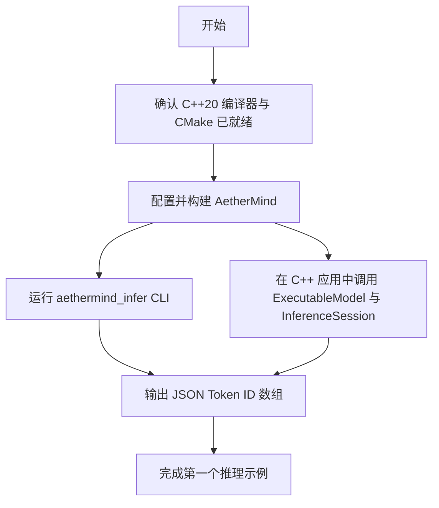
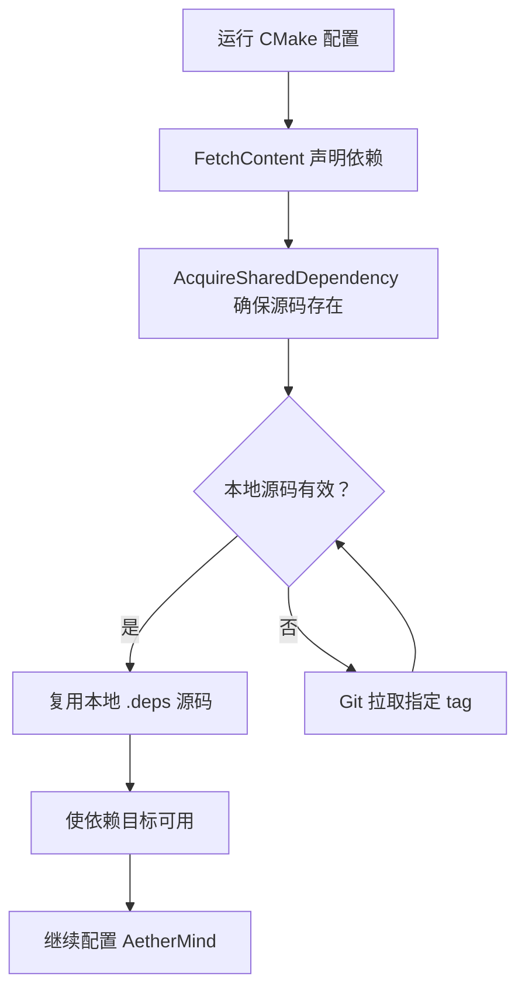
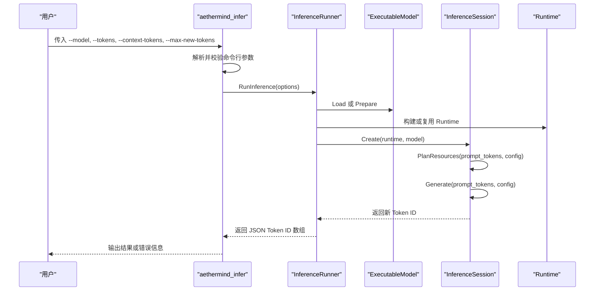

# 快速开始

**本文引用的文件**
- [README.md](../../README.md)
- [CMakeLists.txt](../../CMakeLists.txt)
- [CMakePresets.json](../../CMakePresets.json)
- [AetherMindDependencySources.cmake](../../cmake/AetherMindDependencySources.cmake)
- [build_project.sh](../../tools/build_project.sh)
- [inference_main.cpp](../../apps/inference/inference_main.cpp)
- [inference_runner.h](../../apps/inference/inference_runner.h)
- [executable_model.h](../../include/aethermind/inference/executable_model.h)
- [inference_session.h](../../include/aethermind/inference/inference_session.h)
- [public-api.md](../api/public-api.md)
- [fp32-compatible-inference.md](../guides/fp32-compatible-inference.md)

## 目录
1. [简介](#简介)
2. [环境要求](#环境要求)
3. [安装与依赖准备](#安装与依赖准备)
4. [首次构建配置](#首次构建配置)
5. [构建产物与验证](#构建产物与验证)
6. [CLI 推理快速示例](#cli-推理快速示例)
7. [从模型下载到推理输出的完整流程](#从模型下载到推理输出的完整流程)
8. [基本 C++ API 集成方法](#基本-c-api-集成方法)
9. [常见构建问题与解决方案](#常见构建问题与解决方案)
10. [性能与资源注意事项](#性能与资源注意事项)
11. [故障排查](#故障排查)
12. [结论](#结论)

## 简介
AetherMind 是一个面向桌面与服务器的 CPU 推理引擎，当前主要支持 Llama Dense 模型的同步、单次请求推理。它提供：
- 独立的 CLI 工具 `aethermind_infer`
- 稳定的 C ABI
- 可直接集成的 C++ API，用于加载 HuggingFace 模型、编译图、准备可执行模型并生成 Token ID

对于新手而言，最快路径是：安装 C++20 编译器与 CMake → 构建项目 → 准备一个小型 HuggingFace Llama 检查点 → 通过 CLI 或 C++ API 运行一次贪婪生成。



## 环境要求
- **C++ 标准与编译器**
  - 必须满足 C++20，并提供 `<format>` 和 `std::format_string`。
  - README 明确推荐 GCC（配合 libstdc++ ≥ 13.1）、Clang ≥ 14、或 MSVC ≥ 19.30。
  - CMake 会主动检测 `std::format` 能力；不满足时会直接报错。
- **CMake**
  - 最低版本为 3.28。
- **运行时系统库**
  - 需要 pthreads。
- **可选组件**
  - `libbacktrace`：默认启用，可通过选项关闭。
- **第三方依赖**
  - spdlog：日志。
  - Google Benchmark：仅在开启基准测试时获取。
  - GoogleTest：仅在开启单元测试时获取。
- **网络与 Git**
  - 默认使用 CMake `FetchContent` 自动下载依赖源码到 `.deps/`。
  - 首次构建可能需要网络访问和 Git。

**章节来源**
- [README.md](../../README.md)
- [CMakeLists.txt:1-30](../../CMakeLists.txt#L1-L30)

## 安装与依赖准备
### 1. 安装基础工具
你需要安装：
- C++20 兼容的编译器
- CMake ≥ 3.28
- Git（用于自动拉取依赖）
- Python（部分工具脚本使用，但核心构建不一定强制）

### 2. 依赖获取机制
AetherMind 不会把第三方依赖作为固定子模块锁定在仓库中，而是：
- 在首次配置阶段根据 CMake 列表声明依赖
- 将源码下载到共享目录 `.deps/`
- 校验 tag、工作区状态和锁
- 复用已存在的正确 checkout

这意味着你不需要手动克隆 spdlog、GoogleBenchmark 或 GoogleTest；只要允许 CMake 访问网络并使用 Git，它们会在第一次 configure 时自动准备。



**图示来源**
- [CMakeLists.txt:45-171](../../CMakeLists.txt#L45-L171)
- [AetherMindDependencySources.cmake:1-129](../../cmake/AetherMindDependencySources.cmake#L1-L129)

**章节来源**
- [README.md](../../README.md)
- [AetherMindDependencySources.cmake:1-129](../../cmake/AetherMindDependencySources.cmake#L1-L129)

## 首次构建配置
### 推荐方式一：根级 CMake
适合大多数开发者。

```bash
# 配置
cmake -S . -B build -DCMAKE_EXPORT_COMPILE_COMMANDS=ON

# 全量构建
cmake --build build -j

# 只构建核心库
cmake --build build --target AetherMind -j

# 只构建 CLI
cmake --build build --target aethermind_infer -j
```

注意：CLI 默认未启用。需要在配置阶段打开 `BUILD_INFERENCE_TOOL`，或者使用预设。

### 推荐方式二：CMake Preset
仓库提供了多个 preset，其中 `validation-cli-only` 专门针对 CLI：

```bash
# 配置 CLI 专用构建
cmake --preset validation-cli-only

# 构建
cmake --build --preset validation-cli-only
```

其他常用 preset：
- `validation-release`：Release + 单元测试 + CLI
- `benchmark-model`：模型基准测试
- `validation-asan-ubsan`：地址与未定义行为检测
- `validation-tsan`：线程安全检测

### 推荐方式三：辅助脚本
仓库提供 `tools/build_project.sh`，封装了常用参数。

```bash
./tools/build_project.sh --release --target all
./tools/build_project.sh --debug --skip-benchmarks --target AetherMind
./tools/build_project.sh --configure-only
```

**章节来源**
- [README.md](../../README.md)
- [CMakePresets.json:1-217](../../CMakePresets.json#L1-L217)
- [build_project.sh:1-161](../../tools/build_project.sh#L1-L161)

## 构建产物与验证
### 构建产物
- `AetherMind`：核心共享库
- `aethermind_infer`：独立 CLI 工具
- `aethermind_unit_tests`：单元测试
- `aethermind_benchmark`：基准测试目标
- `aethermind_model_benchmark`：模型测量目标（Linux 开发目标）

### 验证步骤
1. 确认 CLI 可执行文件存在：
   ```bash
   ls build/aethermind_infer
   ```
2. 查看帮助信息：
   ```bash
   ./build/aethermind_infer --help
   ```
3. 如果启用了单元测试：
   ```bash
   ctest --test-dir build -V
   ```
4. 如果使用预设中的 CTest：
   ```bash
   cmake --build --preset validation-release
   ctest --preset validation-release
   ```

**章节来源**
- [README.md](../../README.md)
- [CMakePresets.json:1-217](../../CMakePresets.json#L1-L217)

## CLI 推理快速示例
CLI 程序名为 `aethermind_infer`，它通过 CPU FP32 Llama Dense 推理生成新的 Token ID，并以 JSON 整数数组输出结果。

### 必需参数
- `--model <hf-directory>`：HuggingFace 模型目录，包含 `config.json` 与 safetensors 权重
- `--tokens <逗号分隔的 uint32>`：提示词 Token ID 列表
- `--context-tokens <正整数>`：KV cache 上下文容量
- `--max-new-tokens <非负整数>`：最大新 Token 数量

### 可选参数
- `--eos-token-id <uint32>`：停止 Token ID
- `--preset o1-plain|o2-packed`：编译预设，默认 `o1-plain`

### 最小命令示例
假设你已经准备好一个极小的 Llama 检查点，并且已经知道输入 Token ID，例如 `[1, 2, 3]`：

```bash
./build/aethermind_infer \
  --model /path/to/tiny-llama-checkpoint \
  --tokens "1,2,3" \
  --context-tokens 64 \
  --max-new-tokens 10
```

成功时，命令行会向标准输出写入一个 JSON 整数数组；失败时，错误信息会输出到标准错误流。

### 参数说明
- `--model` 指向一个有效的 HuggingFace 目录，而不是单个 safetensors 文件。
- `--tokens` 是逗号分隔的无符号十进制整数，不能为空，也不能包含非数字字符。
- `--context-tokens` 必须为正整数。
- `--max-new-tokens` 可以为零；为零时不分配 KV，也不执行推理。
- `--preset` 目前支持 `o1-plain` 和 `o2-packed`。

**章节来源**
- [inference_main.cpp:1-200](../../apps/inference/inference_main.cpp#L1-L200)

## 从模型下载到推理输出的完整流程
下图展示 CLI 从模型目录到 Token ID 输出的端到端逻辑。



**图示来源**
- [inference_main.cpp:1-200](../../apps/inference/inference_main.cpp#L1-L200)
- [inference_runner.h:1-72](../../apps/inference/inference_runner.h#L1-L72)
- [executable_model.h:1-183](../../include/aethermind/inference/executable_model.h#L1-L183)
- [inference_session.h:1-114](../../include/aethermind/inference/inference_session.h#L1-L114)

### 关键语义
- CLI 负责参数解析、日志输出和错误诊断。
- `RunInference` 拥有 Runtime、模型和会话，直到生成结束。
- `ExecutableModel::Load` 会完成加载、权重准入、编译和准备。
- `InferenceSession::Generate` 执行 Prefill 和 Decode，并返回拥有所有权的新 Token ID。

**章节来源**
- [inference_main.cpp:1-200](../../apps/inference/inference_main.cpp#L1-L200)
- [inference_runner.h:1-72](../../apps/inference/inference_runner.h#L1-L72)
- [executable_model.h:1-183](../../include/aethermind/inference/executable_model.h#L1-L183)
- [inference_session.h:1-114](../../include/aethermind/inference/inference_session.h#L1-L114)

## 基本 C++ API 集成方法
如果你要在自己的 C++ 应用中集成 AetherMind，核心对象如下：

| 对象 | 职责 | 生命周期要点 |
|---|---|---|
| `Runtime` | 管理后端、分配器、KV Cache Manager | 必须长于模型和会话 |
| `LoadedModel` | 加载后的 HuggingFace 配置与原始权重视图 | 由 Loader 创建，供 Compiler 消费 |
| `LoweredModelArtifact` | 降低后的模型中间表示 | 被 `ExecutableModel::Prepare` 消费 |
| `ExecutableModel` | 已准备的可执行模型 | 不可复制，只能移动；长于所有 Session |
| `InferenceSession` | 单次同步推理会话 | 每次 `Generate` 前预填充，结束后释放 KV 预留 |

### 最简集成步骤
1. 创建 `Runtime`
2. 加载模型：`ModelLoader::Load` 或 `ExecutableModel::Load`
3. 编译模型：`ModelCompiler::Compile`
4. 准备模型：`ExecutableModel::Prepare`
5. 创建会话：`InferenceSession::Create`
6. 执行推理：`InferenceSession::Generate`

### 官方公开 API 参考位置
公共 API 语义与头文件注释保持同步，重点包括：
- `ModelLoader::Load`
- `ModelCompiler::Compile`
- `RuntimeBuilder`
- `ExecutableModel::Load` / `Prepare`
- `InferenceSession::Create` / `Generate`

**章节来源**
- [public-api.md](../api/public-api.md)
- [executable_model.h:1-183](../../include/aethermind/inference/executable_model.h#L1-L183)
- [inference_session.h:1-114](../../include/aethermind/inference/inference_session.h#L1-L114)

### F16/BF16 权重的 FP32 兼容推理
如果你想加载由 Loader 接受的 F16 或 BF16 checkpoint，可以使用 FP32 兼容策略：
- 使用 `WeightPolicy::kConvertToFp32`
- 权重在准备前转换为 FP32
- 激活值、KV、累积过程和 logits 仍为 FP32

该路径要求 `Runtime` 在转换前创建并保持地址稳定，因为转换可能使用其 CPU 分配器。

**章节来源**
- [fp32-compatible-inference.md](../guides/fp32-compatible-inference.md)

## 常见构建问题与解决方案
### 1. 缺少 C++20 `<format>` 支持
**现象**
配置时报错，提示需要 C++20 `std::format` 和 `std::format_string`。

**原因**
编译器或标准库不支持 C++20 `<format>`。

**解决**
- GCC：升级到 libstdc++ ≥ 13.1
- Clang：升级到 ≥ 14，并确保链接较新的 libc++ 或 libstdc++
- MSVC：升级到 ≥ 19.30

**章节来源**
- [README.md](../../README.md)
- [CMakeLists.txt:1-30](../../CMakeLists.txt#L1-L30)

### 2. CMake 版本过低
**现象**
CMake 报告版本不满足要求。

**原因**
项目要求 CMake ≥ 3.28。

**解决**
升级 CMake，或使用 IDE、包管理器提供的较新版本。

**章节来源**
- [CMakePresets.json:1-10](../../CMakePresets.json#L1-L10)
- [CMakeLists.txt:1-5](../../CMakeLists.txt#L1-L5)

### 3. 无法找到 Threads/pthreads
**现象**
CMake 找不到 Threads 包。

**原因**
系统未安装 pthreads 开发库。

**解决**
- Linux：安装 `pthread` 相关开发包
- macOS：通常由 Xcode Command Line Tools 提供
- Windows：MSVC 自带 pthreads 支持

**章节来源**
- [README.md](../../README.md)
- [CMakeLists.txt:31-35](../../CMakeLists.txt#L31-L35)

### 4. 依赖下载失败或卡住
**现象**
首次构建时 spdlog、GoogleTest 或 GoogleBenchmark 无法拉取。

**原因**
网络不可用、Git 不可用、代理限制或 `.deps/` 状态损坏。

**解决**
- 检查网络连接和 Git 是否可用
- 删除对应依赖目录后重新配置：
  ```bash
  rm -rf .deps/spdlog
  rm -rf .deps/googletest
  rm -rf .deps/benchmark
  cmake -S . -B build
  ```
- 离线构建时预先准备源码，并通过 `FETCHCONTENT_SOURCE_DIR_*` 覆盖

**章节来源**
- [README.md](../../README.md)
- [AetherMindDependencySources.cmake:1-129](../../cmake/AetherMindDependencySources.cmake#L1-L129)

### 5. 没有生成 `aethermind_infer`
**现象**
构建完成后找不到 CLI 可执行文件。

**原因**
默认 `BUILD_INFERENCE_TOOL=OFF`。

**解决**
显式启用：
```bash
cmake -S . -B build -DBUILD_INFERENCE_TOOL=ON
cmake --build build --target aethermind_infer -j
```
或使用预设：
```bash
cmake --preset validation-cli-only
cmake --build --preset validation-cli-only
```

**章节来源**
- [CMakeLists.txt:36-44](../../CMakeLists.txt#L36-L44)
- [CMakePresets.json:1-217](../../CMakePresets.json#L1-L217)
- [apps/inference/CMakeLists.txt:1-10](../../apps/inference/CMakeLists.txt#L1-L10)

### 6. 内存不足或资源耗尽
**现象**
推理时报资源耗尽，或出现内存分配失败。

**原因**
- `--context-tokens` 太小
- 模型太大，超出 KV 或 workspace 预算
- 进程可用内存不足

**解决**
- 增大 `--context-tokens`
- 使用更小的模型检查点验证流程
- 调整 Runtime 和工作区预算
- 关闭不必要的依赖和测试以减小构建体积

**章节来源**
- [inference_main.cpp:150-200](../../apps/inference/inference_main.cpp#L150-L200)
- [inference_session.h:1-114](../../include/aethermind/inference/inference_session.h#L1-L114)

## 性能与资源注意事项
- 当前 CLI 和 C ABI 严格保留 FP32 源权重准入契约。
- 单请求生成是同步的，不包含 temperature、top-k、top-p 等采样策略。
- KV Cache 是静态预分配的，不是 PagedAttention。
- 支持的 CPU 优化包括 AVX2、F16C 等 ISA 特性，具体取决于构建选项和目标硬件。
- `aethermind_model_benchmark` 可用于区分模型准备、内部 Prefill/Decode 和公开 `Generate` 的性能测量。

**章节来源**
- [README.md](../../README.md)
- [README.md](../../README.md)

## 故障排查
### CLI 参数错误
CLI 会拒绝：
- 未知选项
- 重复选项
- 缺失值
- 非无符号整数
- 非正数的 `--context-tokens`
- 不受支持的 `--preset`

遇到这些情况，请对照帮助信息重新构造命令。

### 模型目录无效
CLI 和底层 Loader 期望 HuggingFace 格式的目录结构，至少包含：
- `config.json`
- safetensors 权重文件

请先确认模型目录能通过 AetherMind 的模型校验。

### 构建类型与调试
- Debug 模式便于定位问题
- Release 模式更接近生产行为
- AddressSanitizer 和 UndefinedBehaviorSanitizer 有助于发现内存和未定义行为问题
- ThreadSanitizer 可用于线程安全问题

**章节来源**
- [inference_main.cpp:1-200](../../apps/inference/inference_main.cpp#L1-L200)
- [CMakePresets.json:1-217](../../CMakePresets.json#L1-L217)

## 结论
要在 15 分钟内运行第一个 AetherMind 推理示例，建议按以下顺序操作：
1. 确认 C++20 编译器、CMake ≥ 3.28、Git 可用
2. 使用 `cmake --preset validation-cli-only` 配置 CLI 构建
3. 使用 `cmake --build --preset validation-cli-only` 构建
4. 准备一个极小的 HuggingFace Llama 检查点
5. 使用 `aethermind_infer --model ... --tokens ... --context-tokens ... --max-new-tokens ...` 运行推理
6. 如需集成到自己的应用，则从 `ExecutableModel::Load` 和 `InferenceSession::Generate` 入手

如果遇到构建问题，优先检查编译器版本、CMake 版本、pthreads 和依赖下载状态；如果遇到推理问题，优先检查模型目录格式、Token ID、上下文容量和资源预算。
