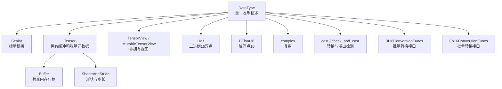
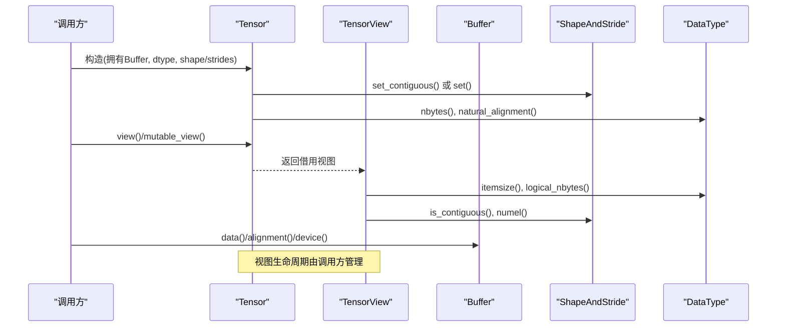
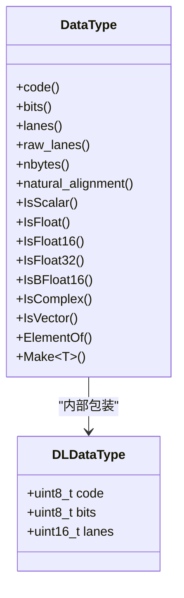
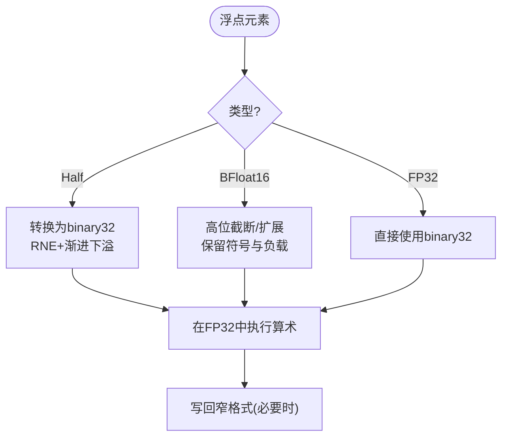
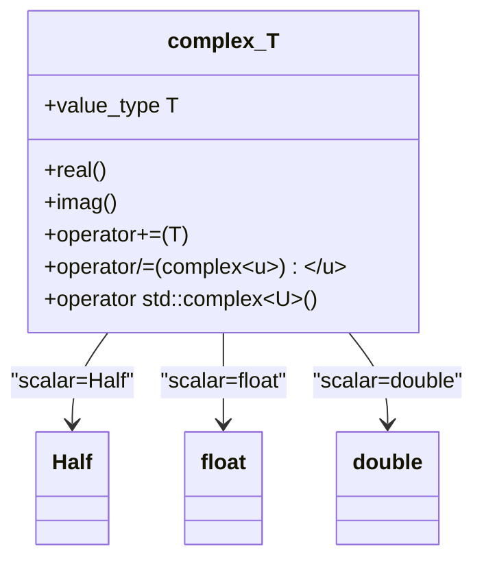
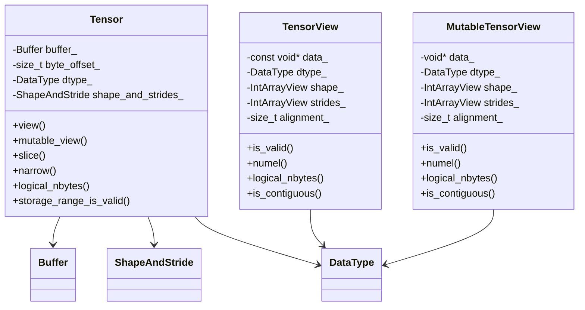
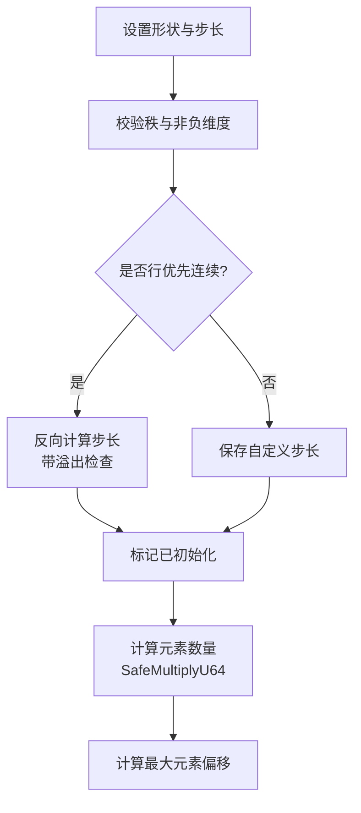
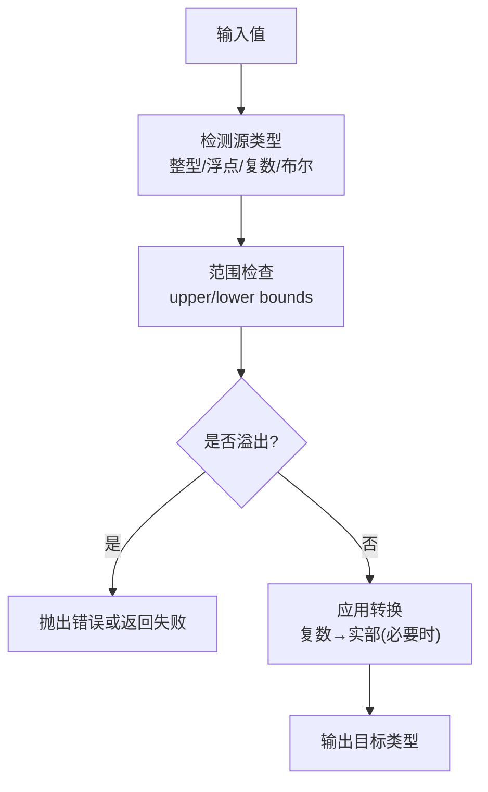
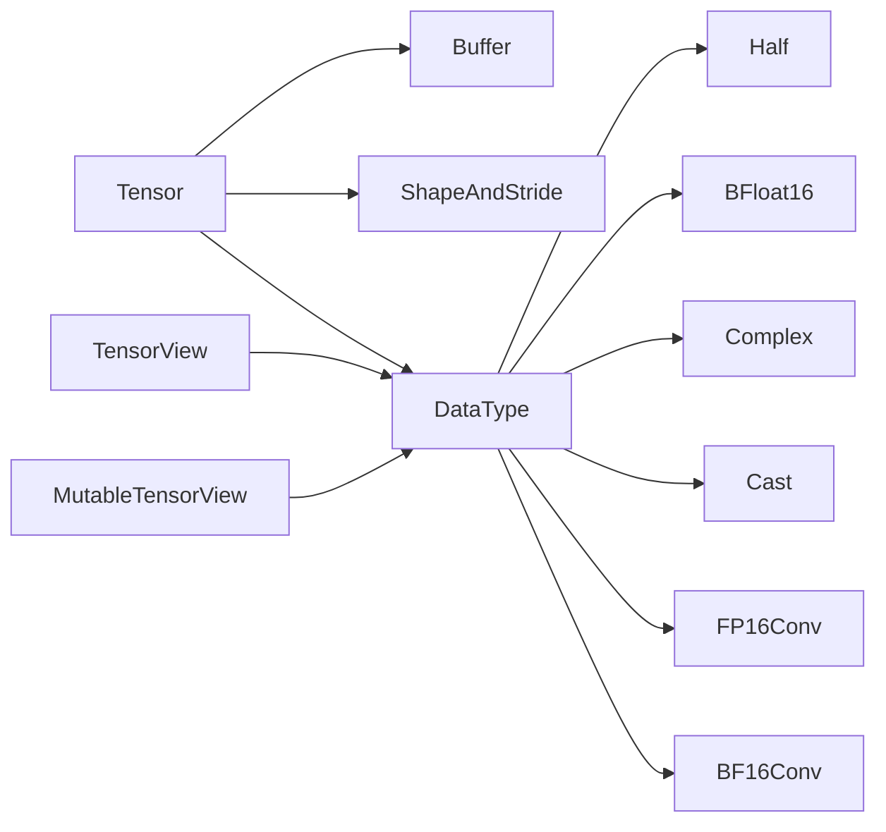

# 数据类型系统

**本文引用的文件**
- [include/aethermind/dtypes/data_type.h](../../include/aethermind/dtypes/data_type.h)
- [src/dtypes/data_type.cpp](../../src/dtypes/data_type.cpp)
- [include/aethermind/dtypes/bfloat16.h](../../include/aethermind/dtypes/bfloat16.h)
- [src/dtypes/bfloat16.cpp](../../src/dtypes/bfloat16.cpp)
- [include/aethermind/dtypes/half.h](../../include/aethermind/dtypes/half.h)
- [src/dtypes/half.cpp](../../src/dtypes/half.cpp)
- [include/aethermind/dtypes/complex.h](../../include/aethermind/dtypes/complex.h)
- [include/aethermind/dtypes/cast.h](../../include/aethermind/dtypes/cast.h)
- [include/aethermind/dtypes/bf16_conversion.h](../../include/aethermind/dtypes/bf16_conversion.h)
- [include/aethermind/dtypes/fp16_conversion.h](../../include/aethermind/dtypes/fp16_conversion.h)
- [include/aethermind/base/tensor.h](../../include/aethermind/base/tensor.h)
- [src/base/tensor.cpp](../../src/base/tensor.cpp)
- [include/aethermind/base/tensor_view.h](../../include/aethermind/base/tensor_view.h)
- [src/base/tensor_view.cpp](../../src/base/tensor_view.cpp)
- [include/aethermind/base/shape_and_stride.h](../../include/aethermind/base/shape_and_stride.h)
- [src/base/shape_and_stride.cpp](../../src/base/shape_and_stride.cpp)
- [include/aethermind/memory/buffer.h](../../include/aethermind/memory/buffer.h)
- [include/aethermind/base/scalar.h](../../include/aethermind/base/scalar.h)

## 目录
1. [引言](#引言)
2. [项目结构](#项目结构)
3. [核心组件](#核心组件)
4. [架构总览](#架构总览)
5. [详细组件分析](#详细组件分析)
6. [依赖关系分析](#依赖关系分析)
7. [性能考虑](#性能考虑)
8. [故障排查指南](#故障排查指南)
9. [结论](#结论)
10. [附录：数据类型选择指南](#附录数据类型选择指南)

## 引言
AetherMind 的数据类型系统围绕一个统一、可验证的 `DataType` 抽象展开，向上支撑张量元数据与视图操作，向下承载 FP16/BF16/FP32、复数、整型、布尔、Float8/Float6/Float4 等元素类型。其设计目标包括：
- 统一的 DLPack 风格类型编码，同时提供 C++ 侧强类型校验与字节语义。
- 浮点类型采用“存储为窄格式、算术提升为 FP32”的策略，保证数值行为一致且易于推理。
- 复数类型通过自定义 `complex<T>` 支持常量求值与跨精度转换。
- 张量与视图分离：`Tensor` 拥有缓冲区和形状元数据，`TensorView`/`MutableTensorView` 仅借用数据指针和元信息。
- 形状与步长使用固定最大秩的内联容器，避免堆分配，并严格检查溢出。
- dtype 转换通过集中式的溢出检测与符号处理实现，便于在算子、模型加载和执行路径中复用。

## 项目结构
与数据类型系统直接相关的代码主要分布在以下模块：
- `aethermind/dtypes`：数据类型定义、转换与批量转换接口。
- `aethermind/base`：张量、视图、形状与步长、标量桥接。
- `aethermind/memory`：共享内存缓冲区及对齐约束。
- `src/*`：上述头文件的实现细节。

**图表来源**
- [include/aethermind/dtypes/data_type.h:1-200](../../include/aethermind/dtypes/data_type.h#L1-L200)
- [include/aethermind/base/tensor.h:1-120](../../include/aethermind/base/tensor.h#L1-L120)
- [include/aethermind/base/tensor_view.h:1-120](../../include/aethermind/base/tensor_view.h#L1-L120)
- [include/aethermind/base/shape_and_stride.h:1-80](../../include/aethermind/base/shape_and_stride.h#L1-L80)
- [include/aethermind/memory/buffer.h:1-80](../../include/aethermind/memory/buffer.h#L1-L80)
- [include/aethermind/dtypes/bfloat16.h:1-80](../../include/aethermind/dtypes/bfloat16.h#L1-L80)
- [include/aethermind/dtypes/half.h:1-80](../../include/aethermind/dtypes/half.h#L1-L80)
- [include/aethermind/dtypes/complex.h:1-80](../../include/aethermind/dtypes/complex.h#L1-L80)
- [include/aethermind/dtypes/cast.h:1-80](../../include/aethermind/dtypes/cast.h#L1-L80)
- [include/aethermind/dtypes/bf16_conversion.h:1-40](../../include/aethermind/dtypes/bf16_conversion.h#L1-L40)
- [include/aethermind/dtypes/fp16_conversion.h:1-40](../../include/aethermind/dtypes/fp16_conversion.h#L1-L40)

**章节来源**
- [include/aethermind/dtypes/data_type.h:1-200](../../include/aethermind/dtypes/data_type.h#L1-L200)
- [include/aethermind/base/tensor.h:1-120](../../include/aethermind/base/tensor.h#L1-L120)
- [include/aethermind/base/tensor_view.h:1-120](../../include/aethermind/base/tensor_view.h#L1-L120)
- [include/aethermind/base/shape_and_stride.h:1-80](../../include/aethermind/base/shape_and_stride.h#L1-L80)
- [include/aethermind/memory/buffer.h:1-80](../../include/aethermind/memory/buffer.h#L1-L80)

## 核心组件
- `DLDataType` 与 `DataType`：前者是 DLPack 风格的原始类型描述符；后者封装校验、字节大小、自然对齐、向量长度与可扩展向量因子。
- `Half` 与 `BFloat16`：分别表示 IEEE 754 binary16 与 bfloat16，运算提升为 FP32，转换函数提供位精确或舍入控制。
- `complex<T>`：常量友好的复数模板，布局与 `std::complex<T>` 兼容，支持跨精度转换与 Smith 算法除法。
- `Tensor`：拥有 `Buffer` + `ShapeAndStride` + `DataType`，支持切片、窄化、逻辑字节大小、最大访问跨度等。
- `TensorView` / `MutableTensorView`：非拥有视图，借用数据指针、dtype、形状与步长，以及可选的对齐信息。
- `ShapeAndStride`：固定最大秩（8）的内联形状与步长容器，负责行优先连续布局计算与溢出保护。
- `cast` 工具族：提供符号判断、范围检查、溢出检测与复杂到非复杂的实部提取。
- 批量转换接口：`Fp16ConversionFuncs` 与 `Bf16ConversionFuncs` 提供主机端批量转换契约。

**章节来源**
- [include/aethermind/dtypes/data_type.h:1-200](../../include/aethermind/dtypes/data_type.h#L1-L200)
- [include/aethermind/dtypes/bfloat16.h:1-120](../../include/aethermind/dtypes/bfloat16.h#L1-L120)
- [include/aethermind/dtypes/half.h:1-120](../../include/aethermind/dtypes/half.h#L1-L120)
- [include/aethermind/dtypes/complex.h:1-120](../../include/aethermind/dtypes/complex.h#L1-L120)
- [include/aethermind/base/tensor.h:1-120](../../include/aethermind/base/tensor.h#L1-L120)
- [include/aethermind/base/tensor_view.h:1-120](../../include/aethermind/base/tensor_view.h#L1-L120)
- [include/aethermind/base/shape_and_stride.h:1-80](../../include/aethermind/base/shape_and_stride.h#L1-L80)
- [include/aethermind/dtypes/cast.h:1-120](../../include/aethermind/dtypes/cast.h#L1-L120)
- [include/aethermind/dtypes/bf16_conversion.h:1-75](../../include/aethermind/dtypes/bf16_conversion.h#L1-L75)
- [include/aethermind/dtypes/fp16_conversion.h:1-72](../../include/aethermind/dtypes/fp16_conversion.h#L1-L72)

## 架构总览
数据类型系统的核心交互如下：
- `DataType` 是所有张量和视图的类型锚点，提供 `nbytes()`、`natural_alignment()`、工厂方法和类型查询。
- `Tensor` 持有 `Buffer`，并通过 `ShapeAndStride` 描述多维索引空间。
- `TensorView`/`MutableTensorView` 不拥有内存，只借用来进行高性能读写与形状查询。
- 浮点类型通过转换为 FP32 参与算术，并提供批量转换接口供后端优化。
- `cast` 工具在标量与张量元素转换中提供统一的溢出与符号语义。

**图表来源**
- [include/aethermind/base/tensor.h:1-120](../../include/aethermind/base/tensor.h#L1-L120)
- [include/aethermind/base/tensor_view.h:1-120](../../include/aethermind/base/tensor_view.h#L1-L120)
- [include/aethermind/base/shape_and_stride.h:1-80](../../include/aethermind/base/shape_and_stride.h#L1-L80)
- [include/aethermind/dtypes/data_type.h:1-200](../../include/aethermind/dtypes/data_type.h#L1-L200)
- [include/aethermind/memory/buffer.h:1-80](../../include/aethermind/memory/buffer.h#L1-L80)

**章节来源**
- [src/base/tensor.cpp:1-120](../../src/base/tensor.cpp#L1-L120)
- [src/base/tensor_view.cpp:1-120](../../src/base/tensor_view.cpp#L1-L120)
- [src/base/shape_and_stride.cpp:1-80](../../src/base/shape_and_stride.cpp#L1-L80)

## 详细组件分析

### 基础数据类型抽象：DLDataType 与 DataType
- `DLDataType` 包含 `code`、`bits`、`lanes`，用于与外部生态互操作。
- `DataType` 对 code/bits/lanes 组合进行严格校验：
  - 支持整数、无符号整数、布尔、句柄、void、FP16、BF16、FP32、FP64、Float8/Float6/Float4、复数、向量和可扩展向量。
  - `nbytes()` 按 lane 计算元素字节数；对可扩展向量拒绝编译期 size 查询。
  - `natural_alignment()` 映射到 C++ 标量类型的自然对齐，句柄类型为指针对齐，其他未映射类型返回 1。
  - 提供 `Make<T>()` 将 C++ 标量类型映射到 `DataType`，并在 `ToString()` 中生成可读字符串。

**图表来源**
- [include/aethermind/dtypes/data_type.h:1-200](../../include/aethermind/dtypes/data_type.h#L1-L200)
- [src/dtypes/data_type.cpp:1-80](../../src/dtypes/data_type.cpp#L1-L80)

**章节来源**
- [include/aethermind/dtypes/data_type.h:1-200](../../include/aethermind/dtypes/data_type.h#L1-L200)
- [src/dtypes/data_type.cpp:1-133](../../src/dtypes/data_type.cpp#L1-L133)

### 浮点数类型：FP16、BF16、FP32
- `Half`：
  - 存储 16-bit binary16 位模式，算术与比较隐式转换为 FP32，遵循 IEEE 754 binary32 舍入与 NaN 语义。
  - 提供 `from_bits()` 以绕过转换直接构造；转换函数实现定点位操作，支持渐进下溢与 RNE。
- `BFloat16`：
  - 存储 16-bit bfloat16 位模式，指数范围与 binary32 相同但尾数更少；转换时保留符号与有效负载位，NaN 静默化。
  - 算术同样提升为 FP32，并提供与 float/double/int 的运算符重载。
- FP32：作为算术中间精度，也是大多数宽化转换的目标类型。

**图表来源**
- [include/aethermind/dtypes/half.h:1-120](../../include/aethermind/dtypes/half.h#L1-L120)
- [src/dtypes/half.cpp:1-120](../../src/dtypes/half.cpp#L1-L120)
- [include/aethermind/dtypes/bfloat16.h:1-120](../../include/aethermind/dtypes/bfloat16.h#L1-L120)
- [src/dtypes/bfloat16.cpp:1-120](../../src/dtypes/bfloat16.cpp#L1-L120)

**章节来源**
- [include/aethermind/dtypes/half.h:1-120](../../include/aethermind/dtypes/half.h#L1-L120)
- [src/dtypes/half.cpp:1-200](../../src/dtypes/half.cpp#L1-L200)
- [include/aethermind/dtypes/bfloat16.h:1-120](../../include/aethermind/dtypes/bfloat16.h#L1-L120)
- [src/dtypes/bfloat16.cpp:1-200](../../src/dtypes/bfloat16.cpp#L1-L200)

### 复数类型支持
- `complex<T>` 提供常量友好的实部/虚部访问、跨精度转换、与 `std::complex<T>` 的显式转换。
- 内存布局为 `{real, imag}`，对齐为 `2 * sizeof(T)`，以便与配对浮点 SIMD 对齐兼容。
- 除法采用 Smith 算法，避免中间溢出，保持 IEEE 复数无穷/NaN 语义。

**图表来源**
- [include/aethermind/dtypes/complex.h:1-120](../../include/aethermind/dtypes/complex.h#L1-L120)

**章节来源**
- [include/aethermind/dtypes/complex.h:1-200](../../include/aethermind/dtypes/complex.h#L1-L200)

### 张量与视图：Tensor、TensorView、MutableTensorView
- `Tensor`：
  - 拥有 `Buffer`、`byte_offset_`、`dtype_`、`ShapeAndStride`。
  - 提供 `view()`/`mutable_view()` 返回借用视图；支持 `slice()`/`narrow()` 调整维度与步长。
  - 计算 `logical_nbytes()`、`max_touched_span_bytes()`、`storage_range_is_valid()` 确保存储范围合法。
- `TensorView`/`MutableTensorView`：
  - 非拥有视图，借用数据指针、dtype、形状与步长，以及可选的对齐信息。
  - 提供 `is_valid()`、`numel()`、`logical_nbytes()`、`is_contiguous()`、`is_rank_zero()` 等查询。
  - 严格的生命周期约定：引用对象必须比视图存活更久。

**图表来源**
- [include/aethermind/base/tensor.h:1-120](../../include/aethermind/base/tensor.h#L1-L120)
- [include/aethermind/base/tensor_view.h:1-120](../../include/aethermind/base/tensor_view.h#L1-L120)
- [include/aethermind/base/shape_and_stride.h:1-80](../../include/aethermind/base/shape_and_stride.h#L1-L80)
- [include/aethermind/dtypes/data_type.h:1-200](../../include/aethermind/dtypes/data_type.h#L1-L200)
- [include/aethermind/memory/buffer.h:1-80](../../include/aethermind/memory/buffer.h#L1-L80)

**章节来源**
- [include/aethermind/base/tensor.h:1-256](../../include/aethermind/base/tensor.h#L1-L256)
- [src/base/tensor.cpp:1-200](../../src/base/tensor.cpp#L1-L200)
- [include/aethermind/base/tensor_view.h:1-262](../../include/aethermind/base/tensor_view.h#L1-L262)
- [src/base/tensor_view.cpp:1-200](../../src/base/tensor_view.cpp#L1-L200)

### 形状与内存布局
- `ShapeAndStride`：
  - 固定最大秩 `kMaxRank = 8`，内联存储，零堆分配。
  - `set()` 同步更新形状与步长；`set_contiguous()` 计算行优先连续步长，并对乘法溢出进行检查。
  - `numel()`、`is_contiguous()`、`max_element_offset()` 均带有溢出保护与边界检查。
- `Buffer`：
  - 引用计数共享内存，保存可见字节数、设备、对齐与内存句柄。
  - 构造时校验对齐为 0 或 2 的幂，CPU 指针必须满足声明对齐；线程安全方面要求调用方同步写入。

**图表来源**
- [include/aethermind/base/shape_and_stride.h:1-167](../../include/aethermind/base/shape_and_stride.h#L1-L167)
- [src/base/shape_and_stride.cpp:1-168](../../src/base/shape_and_stride.cpp#L1-L168)
- [include/aethermind/memory/buffer.h:1-185](../../include/aethermind/memory/buffer.h#L1-L185)

**章节来源**
- [include/aethermind/base/shape_and_stride.h:1-167](../../include/aethermind/base/shape_and_stride.h#L1-L167)
- [src/base/shape_and_stride.cpp:1-168](../../src/base/shape_and_stride.cpp#L1-L168)
- [include/aethermind/memory/buffer.h:1-185](../../include/aethermind/memory/buffer.h#L1-L185)

### dtype 转换机制与精度控制
- `cast` 工具族提供：
  - 符号判断 `is_negative()`、符号差异 `signs_differ()`、符号函数 `signum()`。
  - 上界/下界检查 `greater_than_max()`、`less_than_lowest()`。
  - 溢出检测 `is_cast_overflow()`，覆盖整型、浮点、复数与布尔源类型。
  - 复数到非复数的实部提取 `maybe_real`。
- 批量转换：
  - `Fp16ConversionFuncs`：FP16 ↔ FP32 批量转换，默认便携实现，支持任意字节对齐，空范围允许。
  - `Bf16ConversionFuncs`：BF16 ↔ FP32 批量转换，NaN 静默化，保留符号与可表示负载位，RNE 舍入与渐进下溢。
- 标量桥接：
  - `Scalar` 聚合多种标量类型与对应 `DataType`，提供 `to<type>()` 转换，并使用 `check_and_cast` 进行溢出检测。

**图表来源**
- [include/aethermind/dtypes/cast.h:1-200](../../include/aethermind/dtypes/cast.h#L1-L200)
- [include/aethermind/dtypes/fp16_conversion.h:1-72](../../include/aethermind/dtypes/fp16_conversion.h#L1-L72)
- [include/aethermind/dtypes/bf16_conversion.h:1-75](../../include/aethermind/dtypes/bf16_conversion.h#L1-L75)
- [include/aethermind/base/scalar.h:1-120](../../include/aethermind/base/scalar.h#L1-L120)

**章节来源**
- [include/aethermind/dtypes/cast.h:1-200](../../include/aethermind/dtypes/cast.h#L1-L200)
- [include/aethermind/dtypes/fp16_conversion.h:1-72](../../include/aethermind/dtypes/fp16_conversion.h#L1-L72)
- [include/aethermind/dtypes/bf16_conversion.h:1-75](../../include/aethermind/dtypes/bf16_conversion.h#L1-L75)
- [include/aethermind/base/scalar.h:1-120](../../include/aethermind/base/scalar.h#L1-L120)

## 依赖关系分析
- `Tensor` 依赖 `Buffer`、`ShapeAndStride`、`DataType`。
- `TensorView`/`MutableTensorView` 依赖 `DataType`、`IntArrayView`。
- `DataType` 依赖各具体标量类型（`Half`、`BFloat16`、`complex<T>`、整型/浮点/布尔）。
- 批量转换接口独立于后端生命周期，但由后端选择最优实现。

**图表来源**
- [include/aethermind/base/tensor.h:1-120](../../include/aethermind/base/tensor.h#L1-L120)
- [include/aethermind/base/tensor_view.h:1-120](../../include/aethermind/base/tensor_view.h#L1-L120)
- [include/aethermind/dtypes/data_type.h:1-200](../../include/aethermind/dtypes/data_type.h#L1-L200)
- [include/aethermind/dtypes/cast.h:1-120](../../include/aethermind/dtypes/cast.h#L1-L120)
- [include/aethermind/dtypes/fp16_conversion.h:1-72](../../include/aethermind/dtypes/fp16_conversion.h#L1-L72)
- [include/aethermind/dtypes/bf16_conversion.h:1-75](../../include/aethermind/dtypes/bf16_conversion.h#L1-L75)

**章节来源**
- [include/aethermind/base/tensor.h:1-120](../../include/aethermind/base/tensor.h#L1-L120)
- [include/aethermind/base/tensor_view.h:1-120](../../include/aethermind/base/tensor_view.h#L1-L120)
- [include/aethermind/dtypes/data_type.h:1-200](../../include/aethermind/dtypes/data_type.h#L1-L200)

## 性能考虑
- 浮点算术提升到 FP32：
  - 减少硬件分支与异常路径，提高数值一致性；适合 CPU/GPU 通用路径。
  - 注意频繁转换的成本，可在批量化转换中使用 `Fp16ConversionFuncs`/`Bf16ConversionFuncs`。
- 连续布局优先：
  - `ShapeAndStride::set_contiguous()` 与 `TensorView::is_contiguous()` 有助于向量化与缓存局部性。
- 固定秩与内联存储：
  - `ShapeAndStride` 最大秩 8 且内联数组，避免小张量的堆分配开销。
- 对齐与内存访问：
  - `Buffer` 要求对齐为 0 或 2 的幂，CPU 指针需满足对齐；`Tensor::alignment()` 结合 `byte_offset_` 计算实际对齐。
- 溢出防护：
  - 所有尺寸与步长计算都使用 `SafeMultiplyU64`/`CheckOverflowMul`/`CheckOverflowAdd`，防止极端形状导致未定义行为。

[本节为通用性能建议，不直接分析具体文件]

## 故障排查指南
- 张量未初始化或元数据不一致：
  - 检查 `Tensor::validate()` 与 `ShapeAndStride::is_initialized()`，确认 buffer 已初始化、dtype 非可扩展向量、itemsize 为正、形状与步长非负。
- 视图无效：
  - 检查 `TensorView::is_valid()`，确认 dtype 不是可扩展向量、dtype 字节数为正、shape/stride 秩匹配、无负维度、numel 与 logical_nbytes 无溢出。
- 对齐错误：
  - 检查 `Buffer` 构造时的对齐约束，CPU 指针必须满足对齐；视图的 `alignment()` 若不为 0，则必须是 2 的幂。
- dtype 转换溢出：
  - 使用 `is_cast_overflow()` 与 `check_and_cast()`，特别关注复数到非复数时虚部非零的情况。
- 形状溢出：
  - 检查 `ShapeAndStride::numel()` 与 `max_element_offset()`，确认没有维度乘积或步长累加溢出。

**章节来源**
- [src/base/tensor.cpp:120-255](../../src/base/tensor.cpp#L120-L255)
- [src/base/tensor_view.cpp:1-200](../../src/base/tensor_view.cpp#L1-L200)
- [src/base/shape_and_stride.cpp:80-168](../../src/base/shape_and_stride.cpp#L80-L168)
- [include/aethermind/dtypes/cast.h:120-294](../../include/aethermind/dtypes/cast.h#L120-L294)
- [include/aethermind/memory/buffer.h:1-185](../../include/aethermind/memory/buffer.h#L1-L185)

## 结论
AetherMind 的数据类型系统以 `DataType` 为中心，统一了 DLPack 互操作与 C++ 类型语义，并通过 `Half`、`BFloat16`、`complex<T>` 等具体类型实现数值一致性与常量友好性。`Tensor` 与 `TensorView` 的职责分离使得所有权与借用语义清晰，配合 `ShapeAndStride` 的内联存储与溢出保护，形成高效且安全的张量表达层。dtype 转换通过集中式的溢出检测与批量转换接口，为算子与后端优化提供了稳定基础。

[本节为总结性内容，不直接分析具体文件]

## 附录：数据类型选择指南
- 数值精度与带宽权衡：
  - FP32：高精度中间计算、参考基准、兼容性最好。
  - FP16：较高精度与较小带宽占用，广泛适用于训练与推理中间态。
  - BF16：与 FP32 相同的指数范围，更适合大动态范围场景。
  - Float8/Float6/Float4：极低带宽，通常用于权重压缩或特定算子路径。
- 复数场景：
  - 使用 `complex<Half>`、`complex<float>`、`complex<double>`，注意除法稳定性与跨精度转换。
- 内存布局与对齐：
  - 优先使用行优先连续布局；若必须使用 strided 视图，确保步长计算无溢出且对齐满足需求。
- 转换策略：
  - 标量转换使用 `check_and_cast()`；批量数据使用 `ConvertFp16ToFp32`/`ConvertFp32ToFp16` 或 BF16 对应接口。
- 生命周期：
  - `Tensor` 拥有内存，`TensorView` 仅借用；不要长期持有视图，除非能保证被引用对象存活。

[本节为通用指导，不直接分析具体文件]
