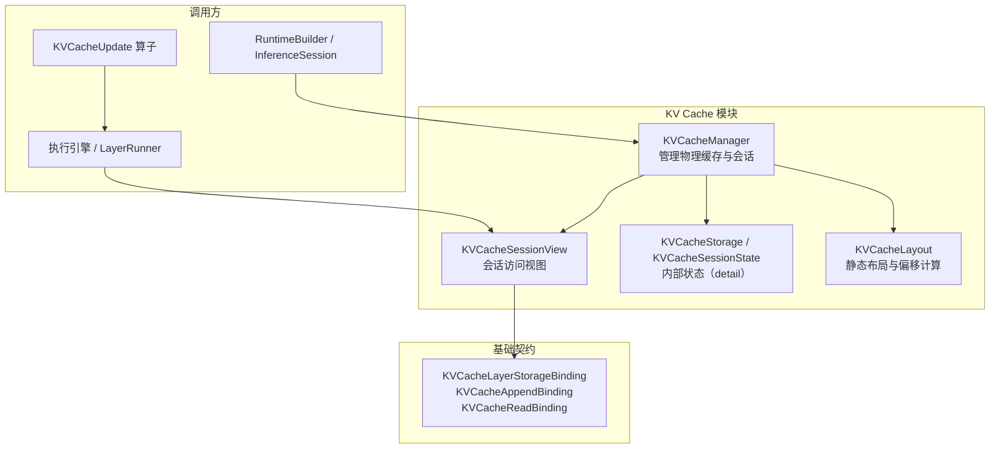
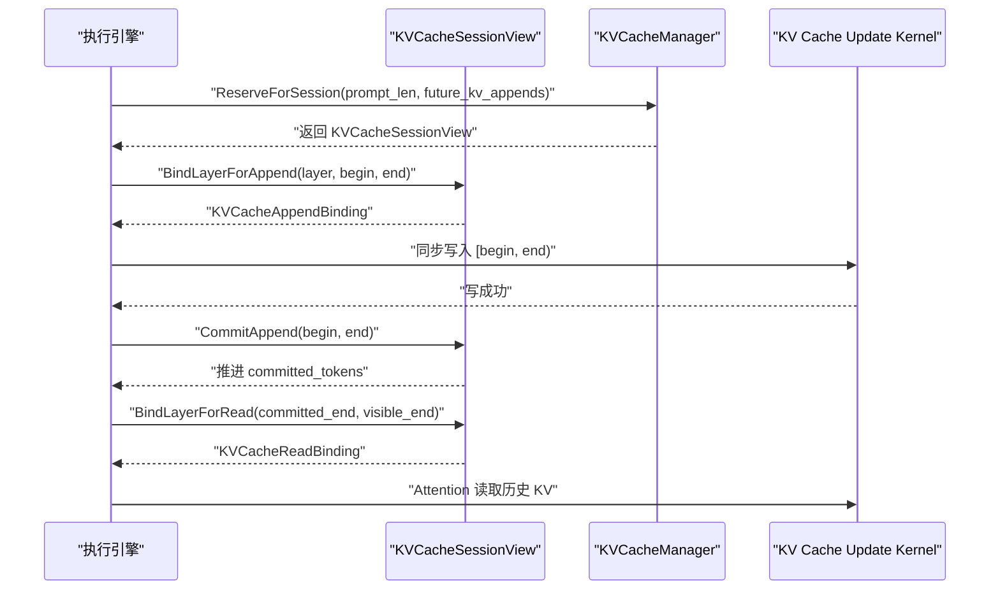
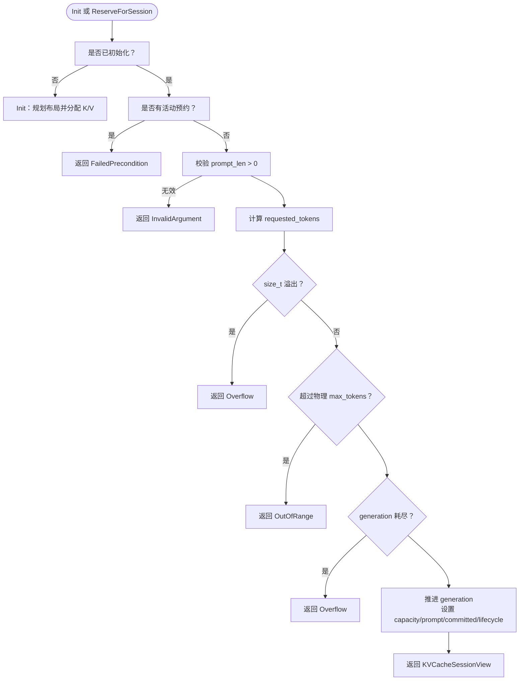
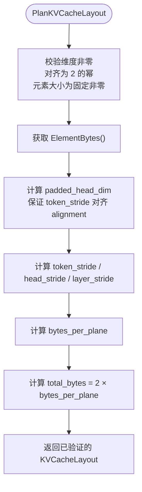
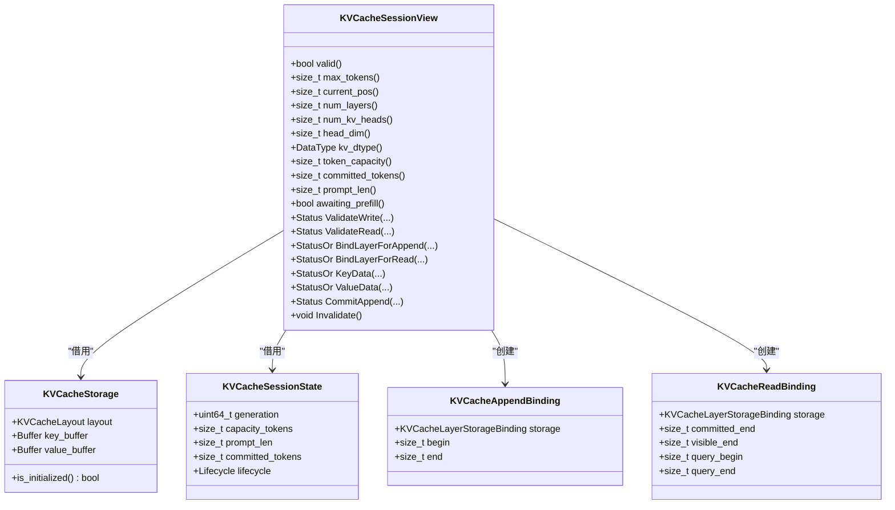
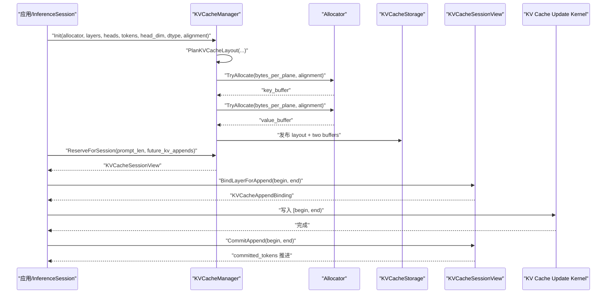
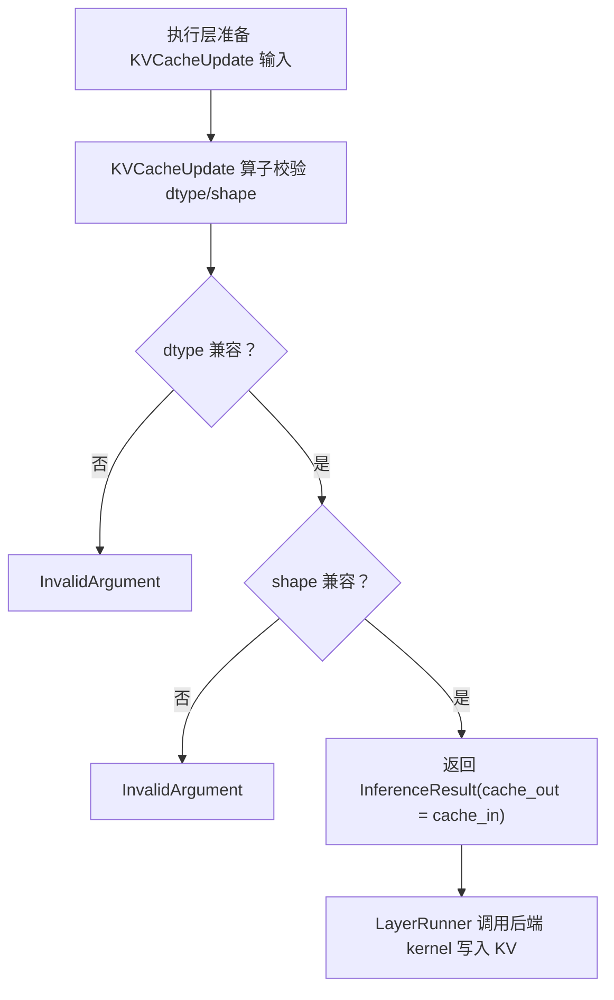
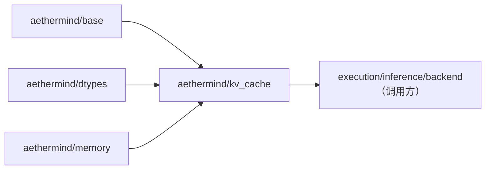

# KV Cache 系统

**本文引用的文件**
- [kv_cache_manager.h](../../../include/aethermind/kv_cache/kv_cache_manager.h)
- [kv_cache_layout.h](../../../include/aethermind/kv_cache/kv_cache_layout.h)
- [kv_cache_session_view.h](../../../include/aethermind/kv_cache/kv_cache_session_view.h)
- [kv_cache_state.h](../../../include/aethermind/kv_cache/detail/kv_cache_state.h)
- [kv_cache_binding.h](../../../include/aethermind/base/kv_cache_binding.h)
- [kv_cache_manager.cpp](../../../src/kv_cache/kv_cache_manager.cpp)
- [kv_cache_layout.cpp](../../../src/kv_cache/kv_cache_layout.cpp)
- [kv_cache_session_view.cpp](../../../src/kv_cache/kv_cache_session_view.cpp)
- [src/kv_cache/](../../../src/kv_cache)
- [kv_cache_design.md](../../archive/designs/kv_cache_design.md)
- [kvcache_update_op.cpp](../../../src/operators/ops/kvcache_update_op.cpp)
- [test_kv_cache_layout_planning.cpp](../../../tests/unit/kv_cache/test_kv_cache_layout_planning.cpp)

## 目录
1. [引言](#引言)
2. [项目结构](#项目结构)
3. [核心组件](#核心组件)
4. [架构总览](#架构总览)
5. [详细组件分析](#详细组件分析)
6. [依赖关系分析](#依赖关系分析)
7. [性能与内存特征](#性能与内存特征)
8. [配置示例与最佳实践](#配置示例与最佳实践)
9. [故障排查指南](#故障排查指南)
10. [结论](#结论)

## 引言
AetherMind 的 KV Cache 系统为 decoder-only Transformer 推理路径提供静态 Key/Value 缓存。其设计目标是：在预分配、连续地址空间、单会话独占的前提下，让执行引擎通过稳定的逻辑视图写入 Prefill/Decode 阶段的 KV，并以可验证的只读窗口供 Attention 访问历史状态。

当前实现不引入分页式 KV、块回收、多请求共享、prefix cache、动态扩容或运行时调度；这些职责由 Runtime、Inference、Execution、Operator 和 Backend 子系统承担。KV Cache 模块本身仅负责物理布局规划、K/V 存储所有权、单会话预约、提交水位和窄读写绑定。

## 项目结构
KV Cache 相关代码集中在 `include/aethermind/kv_cache` 与 `src/kv_cache`，并通过 `base/kv_cache_binding.h` 向执行层暴露窄绑定契约；算子侧的 `KVCacheUpdate` 完成 activation 与 KV 缓存之间的类型与形状契约校验。

**图示来源**
- [kv_cache_manager.h:15-113](../../../include/aethermind/kv_cache/kv_cache_manager.h#L15-L113)
- [kv_cache_layout.h:14-103](../../../include/aethermind/kv_cache/kv_cache_layout.h#L14-L103)
- [kv_cache_session_view.h:18-199](../../../include/aethermind/kv_cache/kv_cache_session_view.h#L18-L199)
- [kv_cache_state.h:16-60](../../../include/aethermind/kv_cache/detail/kv_cache_state.h#L16-L60)
- [kv_cache_binding.h:11-59](../../../include/aethermind/base/kv_cache_binding.h#L11-L59)

**章节来源**
- [src/kv_cache/](../../../src/kv_cache)
- [kv_cache_design.md](../../archive/designs/kv_cache_design.md)

## 核心组件
- **KVCacheManager**：物理 KV 缓存的所有者，负责初始化、单会话预约、重置、释放，以及构造不可复制但可移动的会话视图。
- **KVCacheLayout**：独立值类型，描述 K/V plane 的几何、对齐、stride 与字节偏移；提供零分配的布局规划入口。
- **KVCacheSessionView**：借用的会话视图，封装生命周期、提交水位、范围校验、append/read binding 和只读元素指针。
- **KVCacheStorage / KVCacheSessionState**：manager-owned 的内部状态，分别持有 layout 与 K/V Buffer，以及 generation、capacity、prompt_len、committed_tokens 和 lifecycle。
- **KVCache 窄绑定**：面向 kernel 的一次性 storage 描述，包含 append 写窗口与 read 可见前沿。

**章节来源**
- [kv_cache_manager.h:15-113](../../../include/aethermind/kv_cache/kv_cache_manager.h#L15-L113)
- [kv_cache_layout.h:14-103](../../../include/aethermind/kv_cache/kv_cache_layout.h#L14-L103)
- [kv_cache_session_view.h:18-199](../../../include/aethermind/kv_cache/kv_cache_session_view.h#L18-L199)
- [kv_cache_state.h:16-60](../../../include/aethermind/kv_cache/detail/kv_cache_state.h#L16-L60)
- [kv_cache_binding.h:11-59](../../../include/aethermind/base/kv_cache_binding.h#L11-L59)

## 架构总览
KV Cache 处于 Execution Layer 与 Operator Layer 之间：上层通过 `KVCacheSessionView` 建立 append 与 read 绑定，内核直接按 stride 访问 K/V plane；算子侧则负责 activation 与缓存 dtype/shape 契约。

**图示来源**
- [kv_cache_manager.cpp:68-104](../../../src/kv_cache/kv_cache_manager.cpp#L68-L104)
- [kv_cache_session_view.cpp:109-175](../../../src/kv_cache/kv_cache_session_view.cpp#L109-L175)
- [kv_cache_session_view.cpp:176-200](../../../src/kv_cache/kv_cache_session_view.cpp#L176-L200)

## 详细组件分析

### KVCacheManager：容量控制与生命周期
KVCacheManager 维护一份物理缓存和一个活动会话预约。它禁止复制，允许移动；所有公开操作必须由调用方串行化，不能在 `Execute()` 期间重入。

关键职责：
- `Init`：规划布局、分配 key/value 两个 plane，两者都成功后整体发布。
- `ReserveForSession`：校验未初始化、已有预约、prompt 非空、预约总量不超过物理容量、generation 未耗尽，然后推进 generation 并返回视图。
- `ValidateReservation`：复用 reservation 检查但不修改状态、不分配 KV。
- `ResetSession`：保留预约与 generation，清零提交水位，回到等待 Prefill。
- `ReleaseSession`：清空预约字段、回到空闲、推进 generation（饱和时不递增），并使传入 view 失效。

容量控制策略：
- 物理容量上限来自 `layout.max_tokens`。
- 会话容量 = `prompt_len + future_kv_appends`。
- `future_kv_appends` 是 prompt 之后最多还能追加的 KV 位置数；例如 Generate 上限 N 时传入 N - 1，因为首 token 尚未进入 KV。
- generation 用于防止旧视图复活；达到 `uint64_t` 最大值后仍允许 release，但后续 reservation 以溢出错误拒绝。

**图示来源**
- [kv_cache_manager.cpp:18-66](../../../src/kv_cache/kv_cache_manager.cpp#L18-L66)
- [kv_cache_manager.cpp:68-104](../../../src/kv_cache/kv_cache_manager.cpp#L68-L104)

**章节来源**
- [kv_cache_manager.h:15-113](../../../include/aethermind/kv_cache/kv_cache_manager.h#L15-L113)
- [kv_cache_manager.cpp:18-176](../../../src/kv_cache/kv_cache_manager.cpp#L18-L176)
- [src/kv_cache/](../../../src/kv_cache)

### KVCacheLayout：静态内存布局规划算法
KVCacheLayout 定义每个 K/V plane 中 `num_layers × num_kv_heads × max_tokens × head_dim` 元素的几何。`padded_head_dim` 可大于 `head_dim`，用于保证每行相对平面对齐。

布局规划要点：
- `PlanKVCacheLayout` 是纯规划入口，成功路径不分配内存。
- 行 padding 以完整元素为单位，使 `token_stride` 同时是元素大小和 `alignment` 的倍数。
- `head_stride` 覆盖全部 token，`layer_stride` 覆盖全部 head。
- `BytesPerPlane()` 按 `num_layers × layer_stride` 计算；`TotalBytes()` 返回两 plane 总和。
- `Offset` 先做几何校验，再逐层累加 offset，并对所有乘加做溢出检查。

**图示来源**
- [kv_cache_layout.h:14-103](../../../include/aethermind/kv_cache/kv_cache_layout.h#L14-L103)
- [kv_cache_layout.cpp:1-200](../../../src/kv_cache/kv_cache_layout.cpp#L1-L200)
- [test_kv_cache_layout_planning.cpp:1-200](../../../tests/unit/kv_cache/test_kv_cache_layout_planning.cpp#L1-L200)

**章节来源**
- [kv_cache_layout.h:14-103](../../../include/aethermind/kv_cache/kv_cache_layout.h#L14-L103)
- [kv_cache_layout.cpp:1-200](../../../src/kv_cache/kv_cache_layout.cpp#L1-L200)
- [src/kv_cache/](../../../src/kv_cache)
- [test_kv_cache_layout_planning.cpp:1-200](../../../tests/unit/kv_cache/test_kv_cache_layout_planning.cpp#L1-L200)

### KVCacheSessionView：会话视图抽象与访问接口
KVCacheSessionView 借用 manager-owned 的 `KVCacheStorage` 和 `KVCacheSessionState`，并在绑定时捕获 `generation`。若 session 被释放或重新预约，该视图自动变为 stale。

主要接口语义：
- 查询接口：`valid()`、`max_tokens()`、`current_pos()`、`num_layers()`、`num_kv_heads()`、`head_dim()`、`kv_dtype()`、`token_capacity()`、`committed_tokens()`、`prompt_len()`、`awaiting_prefill()`。
- 范围校验：`ValidateWrite` 校验可写区间；`ValidateRead` 校验已提交区间。
- 绑定接口：`BindLayerForAppend` 生成 append binding；`BindLayerForRead` 生成 read binding。
- 只读数据：`KeyData` / `ValueData` 返回单个元素指针。
- 提交接口：`CommitAppend` 推进全局提交水位。
- 失效接口：`Invalidate` 解除本视图绑定。

对于 CPU plane，视图还会检查平面基址满足布局 alignment，从而确保内核看到绝对对齐的 token 行。

**图示来源**
- [kv_cache_session_view.h:18-199](../../../include/aethermind/kv_cache/kv_cache_session_view.h#L18-L199)
- [kv_cache_state.h:16-60](../../../include/aethermind/kv_cache/detail/kv_cache_state.h#L16-L60)
- [kv_cache_binding.h:11-59](../../../include/aethermind/base/kv_cache_binding.h#L11-L59)

**章节来源**
- [kv_cache_session_view.h:18-199](../../../include/aethermind/kv_cache/kv_cache_session_view.h#L18-L199)
- [kv_cache_session_view.cpp:1-200](../../../src/kv_cache/kv_cache_session_view.cpp#L1-L200)
- [src/kv_cache/](../../../src/kv_cache)

### KV 缓存分配、回收与更新流程
- **分配**：`KVCacheManager::Init` 调用 `PlanKVCacheLayout`，得到 layout 后按 `bytes_per_plane` 和 `alignment` 申请 key/value buffer；只有两个 buffer 都成功后才发布 storage。
- **回收**：Manager 不直接暴露“释放某个 session 的物理内存”的接口；物理内存随 manager 生命周期存在。`ReleaseSession` 释放的是逻辑预约，而不是底层 buffer。
- **更新**：调用方通过 `BindLayerForAppend` 获得 `[begin, end)` 写窗口，内核写入后由 `CommitAppend` 推进 `committed_tokens`。

**图示来源**
- [kv_cache_manager.cpp:18-66](../../../src/kv_cache/kv_cache_manager.cpp#L18-L66)
- [kv_cache_manager.cpp:68-104](../../../src/kv_cache/kv_cache_manager.cpp#L68-L104)
- [kv_cache_session_view.cpp:109-200](../../../src/kv_cache/kv_cache_session_view.cpp#L109-L200)

**章节来源**
- [kv_cache_manager.cpp:18-176](../../../src/kv_cache/kv_cache_manager.cpp#L18-L176)
- [src/kv_cache/](../../../src/kv_cache)

### 与执行引擎和算子的集成方式
- **执行引擎集成**：执行层通过 `KVCacheSessionView` 构造 append 与 read binding。append 的 `end` 是 plan-local 可见前沿，只有在整个 plan 成功时才通过 `CommitAppend` 成为跨 plan 可见的 `committed_end`。read 的 `committed_end` 必须等于当前全局提交水位，而 `visible_end` 可以更大，前提是同 plan 内已证明对应层的 append 已完成。
- **算子集成**：`KVCacheUpdate` 算子负责校验 activation 与缓存输入的类型和形状。支持相同 dtype 或 F32 activation 搭配 F16/BF16 KV 缓存的混合模式；输出 shape/dtype 遵循 cache-in。

**图示来源**
- [kvcache_update_op.cpp:1-191](../../../src/operators/ops/kvcache_update_op.cpp#L1-L191)
- [kv_cache_binding.h:11-59](../../../include/aethermind/base/kv_cache_binding.h#L11-L59)

**章节来源**
- [kvcache_update_op.cpp:1-191](../../../src/operators/ops/kvcache_update_op.cpp#L1-L191)
- [src/kv_cache/](../../../src/kv_cache)

## 依赖关系分析
KV Cache 模块遵循单向依赖：
- `kv_cache` 依赖 `base`、`dtypes`、`memory`。
- 不依赖 `runtime`、`execution`、`inference`、`model`、`backend`。
- `KVCacheManager` 按值拥有 `KVCacheStorage` 与 `KVCacheSessionState`。
- `KVCacheSessionView` 只借用 manager-owned 指针，不保存独立 layout 或 buffer 引用。
- 窄绑定位于 `base/kv_cache_binding.h`，是 kernel invocation-only 的轻量契约。

**图示来源**
- [src/kv_cache/](../../../src/kv_cache)
- [kv_cache_manager.h:1-113](../../../include/aethermind/kv_cache/kv_cache_manager.h#L1-L113)
- [kv_cache_binding.h:1-59](../../../include/aethermind/base/kv_cache_binding.h#L1-L59)

**章节来源**
- [src/kv_cache/](../../../src/kv_cache)

## 性能与内存特征
- **静态预分配**：KV Cache 在初始化阶段一次性分配两个连续 plane，Decode 稳态无分配。
- **零分配规划**：`PlanKVCacheLayout`、`BytesPerPlane()`、`TotalBytes()` 在成功路径不分配内存，适合在资源预算阶段使用。
- **对齐优化**：`token_stride` 必须是 `alignment` 的倍数，CPU plane 基址也需满足该对齐，便于内核高效访问。
- **布局测试覆盖**：单元测试覆盖多种 dtype、head_dim、alignment 组合，包括三字节元素、十二字节元素、对齐小于元素等情况。
- **内存统计**：`total_bytes()` 返回 key 与 value buffer 的字节数之和，可用于诊断实际占用。
- **避免热路径开销**：View 提供大量只读查询接口，减少每次访问时的昂贵校验；复杂校验集中在 `ValidateBaseState`、`ValidateWrite`、`ValidateRead` 等边界入口。

[本节为通用性能讨论，不直接分析具体代码片段]

## 配置示例与最佳实践

### KV Cache 配置步骤
1. 根据模型配置确定 `num_layers`、`num_kv_heads`、`head_dim`。
2. 根据推理策略确定物理 `max_tokens`。
3. 选择 `kv_dtype`；注意物理 dtype 合法不等于对应 CPU kernel 可执行。
4. 选择 `alignment`，默认 64 字节；CPU plane 基址必须满足该对齐。
5. 调用 `PlanKVCacheLayout` 检查 `TotalBytes()` 是否满足资源上限。
6. 使用合适的 `Allocator` 调用 `KVCacheManager::Init`。
7. 在执行前用 `ValidateReservation(prompt_len, future_kv_appends)` 做准入，再调用 `ReserveForSession`。

**章节来源**
- [kv_cache_layout.h:60-103](../../../include/aethermind/kv_cache/kv_cache_layout.h#L60-L103)
- [kv_cache_manager.h:27-66](../../../include/aethermind/kv_cache/kv_cache_manager.h#L27-L66)
- [src/kv_cache/](../../../src/kv_cache)

### 容量规划最佳实践
- `prompt_len` 必须大于 0。
- `future_kv_appends` 应等于期望生成 token 数减 1，因为首 token 尚未进入 KV。
- 预留 `capacity_tokens` 时应考虑最大对话长度、安全余量和可能的重试。
- 如果多个阶段需要不同容量，应优先使用更大的 `max_tokens`，因为 KV Cache 不支持运行时扩容。
- 使用 `ValidateReservation` 提前拒绝超出物理容量的请求，避免在 reserve 失败时产生复杂回滚。

**章节来源**
- [kv_cache_manager.cpp:68-104](../../../src/kv_cache/kv_cache_manager.cpp#L68-L104)
- [src/kv_cache/](../../../src/kv_cache)

### 视图与事务最佳实践
- 始终通过 `KVCacheSessionView` 访问 KV，不要直接操作底层 buffer。
- 在计划所有层写成功之前，不要调用 `CommitAppend`。
- append 起点必须等于当前 `committed_tokens`。
- read 的 `committed_end` 必须等于当前提交水位；`visible_end` 只能用于同一同步 plan 内已证明完成的局部可见范围。
- 调用 `ReleaseSession` 后，旧视图副本仍可能存活，但应视为 stale；继续访问会触发 precondition 错误。

**章节来源**
- [kv_cache_session_view.h:60-199](../../../include/aethermind/kv_cache/kv_cache_session_view.h#L60-L199)
- [kv_cache_session_view.cpp:109-200](../../../src/kv_cache/kv_cache_session_view.cpp#L109-L200)

## 故障排查指南

| 现象 | 常见原因 | 建议处理 |
|---|---|---|
| 初始化失败 | 布局规划溢出、dtype 非法、allocator 分配失败 | 检查 `num_layers`、`num_kv_heads`、`max_tokens`、`head_dim`、`kv_dtype`、`alignment`；确认 allocator 可用 |
| 预约失败且提示未初始化 | 未调用 `Init` 或 `Init` 失败 | 先成功调用 `Init`，再检查 `is_initialized()` |
| 预约失败且提示已有活动会话 | 上一个 session 未 `ReleaseSession` | 确保每个 session 都有匹配的 release |
| 预约失败且提示 prompt 为空 | `prompt_len == 0` | 确保 prompt 至少包含一个 token |
| 预约失败且提示超出物理容量 | `prompt_len + future_kv_appends > max_tokens` | 增大 `max_tokens` 或减小生成上限 |
| 写入失败且提示越界 | layer、head、seq_pos 或 token_count 不合法 | 检查索引范围、`seq_pos + token_count` 不超过 reservation |
| 读取失败且提示超出已提交范围 | 读取范围超过 `committed_tokens` | 确保 Attention 只读取已 commit 的历史 |
| 提交失败 | append 起点不等于当前提交水位，或范围为空 | 检查 `begin == committed_tokens` 且 `end > begin` |
| CPU 内核行为异常 | plane 基址未按 `alignment` 对齐 | 确认 CPU plane base 满足 layout alignment |
| 视图访问报 stale | session 已 release 或重新 reserve | 使用新视图，不重用旧副本 |

**章节来源**
- [kv_cache_manager.cpp:18-176](../../../src/kv_cache/kv_cache_manager.cpp#L18-L176)
- [kv_cache_session_view.cpp:1-200](../../../src/kv_cache/kv_cache_session_view.cpp#L1-L200)
- [src/kv_cache/](../../../src/kv_cache)

## 结论
AetherMind 的 KV Cache 系统以静态连续内存为基础，通过 `KVCacheLayout` 冻结布局规则，通过 `KVCacheManager` 管理物理缓存与单会话预约，通过 `KVCacheSessionView` 提供稳定、可验证的访问边界。其设计强调零分配规划、严格的状态机、明确的 append/read 事务语义，以及与执行引擎和算子之间的窄绑定契约。

在实际工程中，应优先在资源预算阶段使用布局规划接口评估内存，使用 `ValidateReservation` 做准入检查，并在执行期严格按 `CommitAppend` 的语义推进提交水位。对于长期演进，Paged KV、block 回收、多请求共享和 prefix cache 属于产品边界之外的目标，应在后续版本中另行定义。

[本节为总结性内容，不直接分析具体文件]
