# CPU 后端实现 (CPU Backend Implementation)

**本文引用的文件**
- [cpu_backend.h](../../../../include/aethermind/backend/cpu/cpu_backend.h)
- [cpu_backend.cpp](../../../../src/backend/cpu/cpu_backend.cpp)
- [cpu_capabilities.h](../../../../include/aethermind/backend/cpu/cpu_capabilities.h)
- [cpu_capabilities.cpp](../../../../src/backend/cpu/cpu_capabilities.cpp)
- [cpu_info.h](../../../../include/aethermind/backend/cpu/cpu_info.h)
- [cpu_info.cpp](../../../../src/backend/cpu/cpu_info.cpp)
- [cpu_packed_weight_layout.h](../../../../include/aethermind/backend/cpu/cpu_packed_weight_layout.h)
- [cpu_packed_weight_layout.cpp](../../../../src/backend/cpu/cpu_packed_weight_layout.cpp)
- [cpu_workspace_arena.h](../../../../include/aethermind/backend/cpu/cpu_workspace_arena.h)
- [cpu_workspace_arena.cpp](../../../../src/backend/cpu/cpu_workspace_arena.cpp)
- [fp16_conversion.h](../../../../include/aethermind/dtypes/fp16_conversion.h)
- [fp16_conversion.cpp](../../../../src/backend/cpu/fp16_conversion.cpp)
- [fp16_conversion_f16c.cpp](../../../../src/backend/cpu/fp16_conversion_f16c.cpp)
- [fp16_conversion_avx2.cpp](../../../../src/backend/cpu/fp16_conversion_avx2.cpp)
- [bf16_conversion.h](../../../../include/aethermind/dtypes/bf16_conversion.h)
- [bf16_conversion.cpp](../../../../src/backend/cpu/bf16_conversion.cpp)
- [bf16_conversion_avx2.cpp](../../../../src/backend/cpu/bf16_conversion_avx2.cpp)

## 目录
1. [引言](#引言)
2. [项目结构](#项目结构)
3. [核心组件](#核心组件)
4. [架构总览](#架构总览)
5. [详细组件分析](#详细组件分析)
6. [依赖关系分析](#依赖关系分析)
7. [性能与内存特性](#性能与内存特性)
8. [故障诊断指南](#故障诊断指南)
9. [结论](#结论)

## 引言
本文面向 AetherMind 的 CPU 后端，系统性梳理其运行时内核选择、CPU 能力探测、SIMD 指令集分支、权重打包布局、工作区绑定以及 Fp16/Bf16 转换路径。文档兼顾高层设计与源码级细节，帮助读者理解：
- CpuBackend 如何通过 `CpuCapabilities` 的 `effective_features` 选择最优内核；
- `DetectCpuCapabilities` 在 x86-64 与 AArch64 上如何探测 AVX2、F16C、NEON、SVE/SVE2、AMX 等特性；
- BPanel FP32 权重布局为何采用 `[K-panel][N-block][K-row][N-lane]` 物理排列；
- WorkspaceArena 如何以零拷贝方式校验对齐并返回工作区绑定；
- Fp16/Bf16 转换函数如何在 F16C、AVX2 与标量路径之间切换。

## 项目结构
CPU 后端代码主要分布在 `include/aethermind/backend/cpu` 与 `src/backend/cpu` 两个目录中，按职责划分为：
- 后端接口与工厂：`CpuBackend`、`CpuBackendFactory`
- 能力模型与探测：`CpuCapabilities`、`CpuFeatureSet`、`DetectCpuCapabilities`
- 权重打包布局：`CpuIdentityPackingRecipe`、`CpuBPanelF32Kc512Nr16Recipe`
- 工作区绑定：`CpuWorkspaceArena`
- 数据类型转换：Fp16/Bf16 的通用选择器与 SIMD 实现

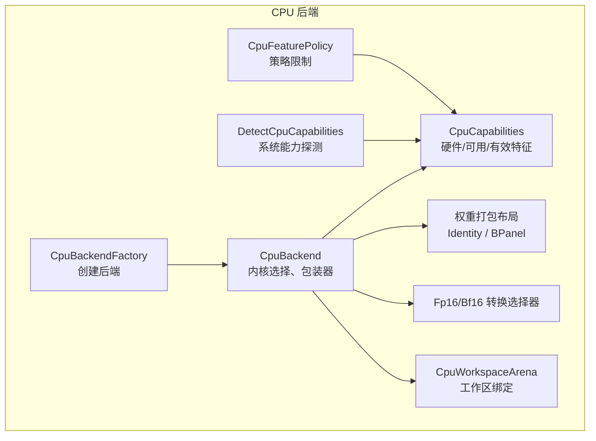

**图示来源**
- [cpu_backend.h:1-157](../../../../include/aethermind/backend/cpu/cpu_backend.h#L1-L157)
- [cpu_backend.cpp:1-551](../../../../src/backend/cpu/cpu_backend.cpp#L1-L551)
- [cpu_capabilities.h:1-219](../../../../include/aethermind/backend/cpu/cpu_capabilities.h#L1-L219)
- [cpu_info.h:1-55](../../../../include/aethermind/backend/cpu/cpu_info.h#L1-L55)
- [cpu_packed_weight_layout.h:1-55](../../../../include/aethermind/backend/cpu/cpu_packed_weight_layout.h#L1-L55)
- [cpu_workspace_arena.h:1-25](../../../../include/aethermind/backend/cpu/cpu_workspace_arena.h#L1-L25)

**章节来源**
- [cpu_backend.h:1-157](../../../../include/aethermind/backend/cpu/cpu_backend.h#L1-L157)
- [cpu_backend.cpp:1-551](../../../../src/backend/cpu/cpu_backend.cpp#L1-L551)
- [cpu_capabilities.h:1-219](../../../../include/aethermind/backend/cpu/cpu_capabilities.h#L1-L219)
- [cpu_info.h:1-55](../../../../include/aethermind/backend/cpu/cpu_info.h#L1-L55)

## 核心组件
本节从调用方视角总结 CPU 后端的对外能力：
- `CpuBackend`：持有不可变的 `CpuCapabilities` 快照，根据 `effective_features` 过滤候选内核、构建 `ResolvedKernel`，并提供 Fp16/Bf16 转换函数和权重打包 API。
- `CpuBackendFactory`：通过状态通道返回检测错误，避免构造阶段直接中止进程。
- `CpuCapabilities`：保存三类特征集合——硬件能力、OS 允许能力、应用策略后的有效能力，并提供 SVE 向量长度。
- `CpuFeaturePolicy`：仅能禁用或要求现有可用特性，不能“创造”新指令。
- `CpuWorkspaceArena`：基于固定基地址和大小做偏移对齐校验，不分配额外内存。
- 权重打包布局：Identity 直传、BPanel FP32 KC=512 NR=16 分块重排。
- Fp16/Bf16 转换：按 `effective_features` 选择 F16C、AVX2 或标量回退路径。

**章节来源**
- [cpu_backend.h:1-157](../../../../include/aethermind/backend/cpu/cpu_backend.h#L1-L157)
- [cpu_capabilities.h:1-219](../../../../include/aethermind/backend/cpu/cpu_capabilities.h#L1-L219)
- [cpu_packed_weight_layout.h:1-55](../../../../include/aethermind/backend/cpu/cpu_packed_weight_layout.h#L1-L55)
- [cpu_workspace_arena.h:1-25](../../../../include/aethermind/backend/cpu/cpu_workspace_arena.h#L1-L25)

## 架构总览
CPU 后端的核心流程分为三层：
1. 能力层：`DetectCpuCapabilities` 探测硬件和 OS 上下文，得到 `hardware_features`、`usable_features`，再经 `ApplyCpuFeaturePolicy` 得到 `effective_features`。
2. 后端层：`CpuBackend` 使用 `effective_features` 筛选注册表中的 `KernelDef`，并冻结参数构建器、元数据构建器。
3. 执行层：算子内核、权重打包、类型转换均依赖该有效特征集，保证运行期不会调用未授权指令。

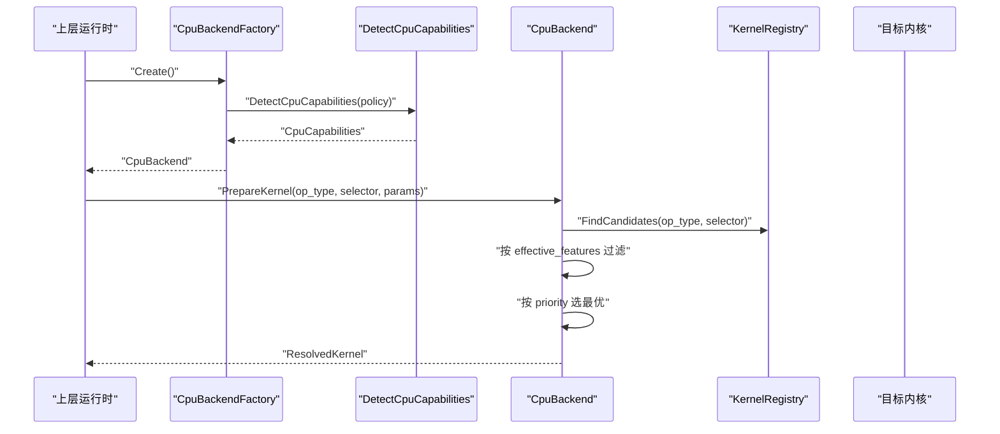

**图示来源**
- [cpu_backend.cpp:400-551](../../../../src/backend/cpu/cpu_backend.cpp#L400-L551)
- [cpu_info.cpp:201-356](../../../../src/backend/cpu/cpu_info.cpp#L201-L356)

**章节来源**
- [cpu_backend.cpp:350-551](../../../../src/backend/cpu/cpu_backend.cpp#L350-L551)
- [cpu_info.cpp:201-356](../../../../src/backend/cpu/cpu_info.cpp#L201-L356)

## 详细组件分析

### CpuBackend：内核解析与资源入口
`CpuBackend` 是 CPU 设备的统一入口，承担以下职责：
- 记录构造时的 `CpuCapabilities`，并在构造时冻结全局内核注册表。
- `GetHostFp16Conversions`、`GetHostBf16Conversions` 返回由 `SelectFp16Conversions`、`SelectBf16Conversions` 选择的转换函数指针。
- `PrepareKernel` 先校验 `selector.device_type == kCPU`，再从全局注册表中查找候选，用 `effective_features` 过滤并按优先级取最高者。
- 当 `weight_format == kPacked` 时，会携带期望的 `packing_recipe`；若描述符缺少布局或对齐字段，则返回内部错误。
- `PackWeights` 与 `GetWeightPackingRequirements` 会先解析出选中 recipe，再交给内部计划函数处理 Identity 或 BPanel 布局。

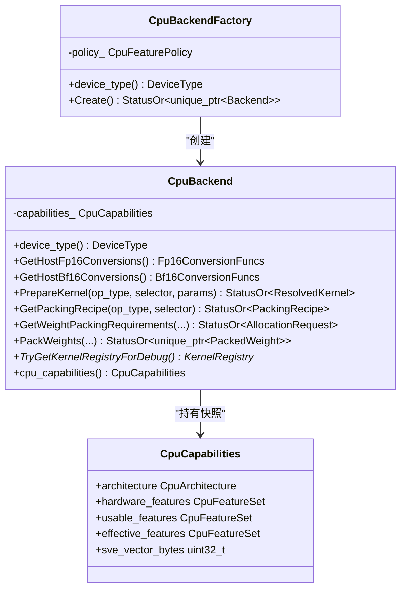

**图示来源**
- [cpu_backend.h:1-157](../../../../include/aethermind/backend/cpu/cpu_backend.h#L1-L157)
- [cpu_backend.cpp:400-551](../../../../src/backend/cpu/cpu_backend.cpp#L400-L551)
- [cpu_capabilities.h:201-219](../../../../include/aethermind/backend/cpu/cpu_capabilities.h#L201-L219)

**章节来源**
- [cpu_backend.h:1-157](../../../../include/aethermind/backend/cpu/cpu_backend.h#L1-L157)
- [cpu_backend.cpp:400-551](../../../../src/backend/cpu/cpu_backend.cpp#L400-L551)

### CpuCapabilities 与动态能力检测
`CpuCapabilities` 将能力分为三层：
- `hardware_features`：CPU 静态支持的特性，用于诊断。
- `usable_features`：硬件和当前 OS/进程上下文共同允许的特性。例如 x86-64 上需要检查 `osxsave`、`XCR0` 位，Linux AMX 还需请求 `XTILEDATA` 权限。
- `effective_features`：应用 `CpuFeaturePolicy` 之后的最终决策集合，内核选择必须只使用它。

能力探测在 `DetectCpuCapabilities` 中完成：
1. 根据编译目标选择 x86-64 或 AArch64 探测逻辑。
2. 填充 `hardware_features` 与 `usable_features`。
3. `ApplyCpuFeaturePolicy` 校验策略不变量：
   - `usable_features` 必须是 `hardware_features` 的子集；
   - `disabled_features` 只能减少可用特性；
   - `required_features` 必须仍存在于结果 `effective_features` 中。

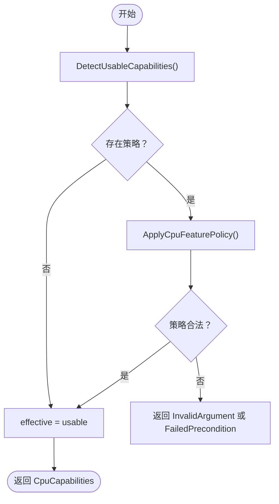

**图示来源**
- [cpu_info.cpp:201-356](../../../../src/backend/cpu/cpu_info.cpp#L201-L356)

**章节来源**
- [cpu_capabilities.h:1-219](../../../../include/aethermind/backend/cpu/cpu_capabilities.h#L1-L219)
- [cpu_capabilities.cpp:1-75](../../../../src/backend/cpu/cpu_capabilities.cpp#L1-L75)
- [cpu_info.h:1-55](../../../../include/aethermind/backend/cpu/cpu_info.h#L1-L55)
- [cpu_info.cpp:1-356](../../../../src/backend/cpu/cpu_info.cpp#L1-L356)

### 跨平台 CPU 特性探测：AVX2、F16C、NEON、SVE/SVE2、AMX
#### x86-64 路径
- 使用 `cpuid` 读取叶 1、叶 7 及子叶，检测 SSE4.1、AVX、FMA、F16C、AVX2、AVX512F/BW/VNNI、AVXVNNI、AVX512BF16、AVX512FP16、AMX_TILE/INT8/BF16。
- AVX/FMA/F16C 需同时满足 `osxsave` 且 `XCR0` 相应位启用，才进入 `usable_features`。
- AVX-512 需要更严格的 XSAVE 组合位，AMX 还需要 Linux `arch_prctl(ARCH_REQ_XCOMP_PERM)` 授予 `XTILEDATA` 权限。

#### AArch64 路径
- Linux 下通过 `getauxval(AT_HWCAP)`、`AT_HWCAP2` 检测 NEON、FP16、DotProd、I8MM、BF16、SVE、SVE2。
- Apple 下通过 `sysctlbyname` 查询 `hw.optional.arm.FEAT_*`。
- SVE 还尝试读取线程局部向量长度 `PR_SVE_GET_VL`，并保存到 `sve_vector_bytes`。

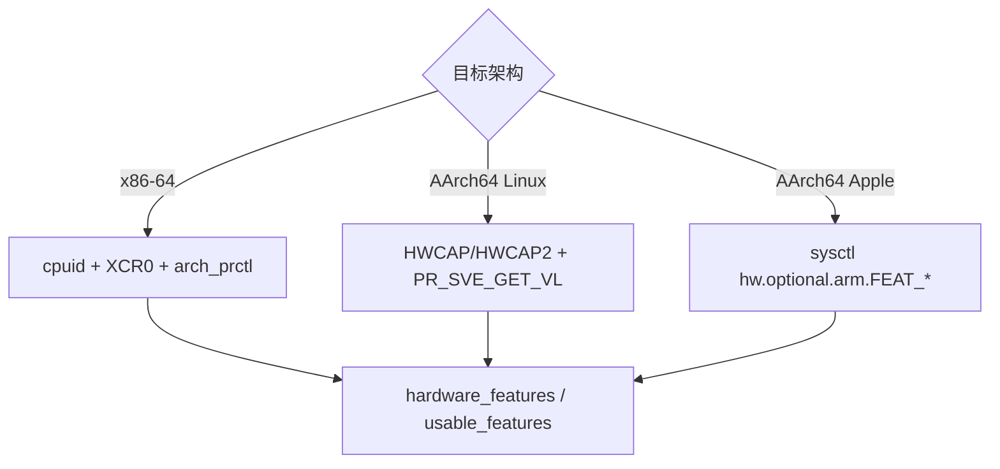

**图示来源**
- [cpu_info.cpp:1-200](../../../../src/backend/cpu/cpu_info.cpp#L1-L200)
- [cpu_info.cpp:201-356](../../../../src/backend/cpu/cpu_info.cpp#L201-L356)

**章节来源**
- [cpu_info.cpp:1-356](../../../../src/backend/cpu/cpu_info.cpp#L1-L356)

### 内核选择优先级策略
内核选择流程如下：
1. `KernelRegistry::FindCandidates(op_type, selector)` 获取候选描述符。
2. 过滤掉 `cpu_requirements` 不在 `effective_features` 中的描述符。
3. 在剩余候选中选择 `priority` 最大者。
4. 若无候选，返回 `NotFound`，包含 op_type、selector 与 effective_features 的诊断信息。
5. 若描述符为 packed 权重但缺少布局或对齐，返回内部错误。
6. 可选的 `metadata_builder` 会在准备阶段生成 `resolved.attrs`。

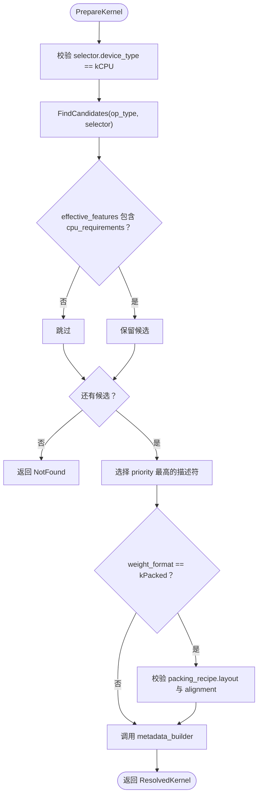

**图示来源**
- [cpu_backend.cpp:400-551](../../../../src/backend/cpu/cpu_backend.cpp#L400-L551)

**章节来源**
- [cpu_backend.cpp:400-551](../../../../src/backend/cpu/cpu_backend.cpp#L400-L551)

### Fp16/Bf16 转换函数的硬件加速路径
转换函数选择同样基于 `effective_features`，并且要求至少具备 AVX：
- Fp16：
  - 若存在 F16C，则 `to_fp32` 使用 F16C 的 `_mm256_cvtph_ps` 路径。
  - 若存在 AVX2，则 `from_fp32` 使用 AVX2 位操作路径，处理正常数、次正规数、无穷大、NaN 及舍入规则，最后回退到标量尾部。
- Bf16：
  - 若存在 AVX2，则双向转换都走 AVX2 路径：宽化只需左移高位，压缩时使用 RNE 舍入并强制 quiet NaN。

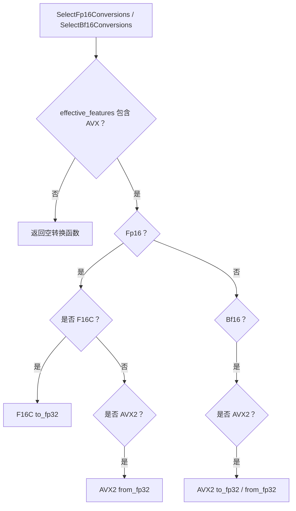

**图示来源**
- [fp16_conversion.cpp:1-26](../../../../src/backend/cpu/fp16_conversion.cpp#L1-L26)
- [bf16_conversion.cpp:1-21](../../../../src/backend/cpu/bf16_conversion.cpp#L1-L21)
- [fp16_conversion_f16c.cpp:1-37](../../../../src/backend/cpu/fp16_conversion_f16c.cpp#L1-L37)
- [fp16_conversion_avx2.cpp:1-76](../../../../src/backend/cpu/fp16_conversion_avx2.cpp#L1-L76)
- [bf16_conversion_avx2.cpp:1-81](../../../../src/backend/cpu/bf16_conversion_avx2.cpp#L1-L81)

**章节来源**
- [fp16_conversion.cpp:1-26](../../../../src/backend/cpu/fp16_conversion.cpp#L1-L26)
- [fp16_conversion_f16c.cpp:1-37](../../../../src/backend/cpu/fp16_conversion_f16c.cpp#L1-L37)
- [fp16_conversion_avx2.cpp:1-76](../../../../src/backend/cpu/fp16_conversion_avx2.cpp#L1-L76)
- [bf16_conversion.cpp:1-21](../../../../src/backend/cpu/bf16_conversion.cpp#L1-L21)
- [bf16_conversion_avx2.cpp:1-81](../../../../src/backend/cpu/bf16_conversion_avx2.cpp#L1-L81)

### CpuPackedWeightLayout：内存布局优化
CPU 后端目前支持两类打包布局：
- Identity 布局：逻辑权重直接作为物理存储，无重排，仅要求对齐。
- BPanel FP32 KC=512 NR=16 布局：逻辑 `[N,K]` 被重排为物理轴序 `[K-panel][N-block][K-row][N-lane]`，其中：
  - `KC = 512`，`NR = 16`；
  - N lane 连续存放，便于向量化；
  - 超出逻辑范围的 padding 填充正零；
  - 每个 panel block 要求 64 字节对齐。

布局尺寸计算会逐步乘以 `n_blocks`、`KC`、`NR`、`k_panels`、`sizeof(float)`，并使用溢出检查，避免整数溢出导致错误分配。

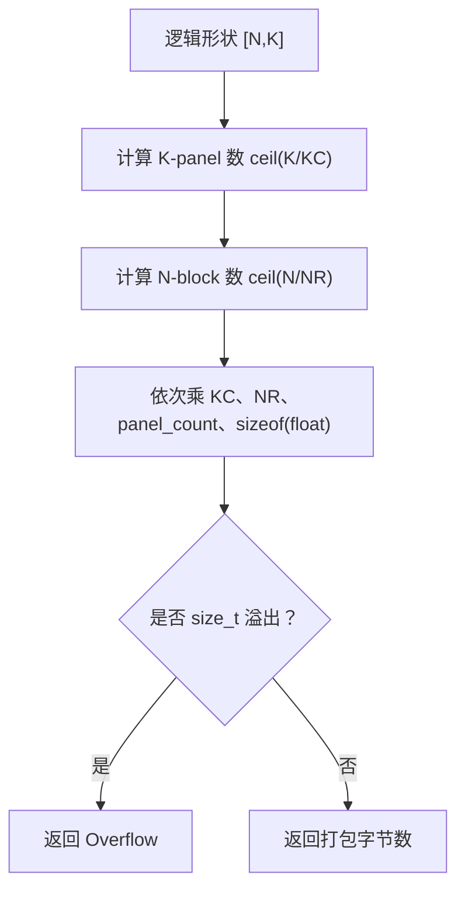

**图示来源**
- [cpu_packed_weight_layout.cpp:1-33](../../../../src/backend/cpu/cpu_packed_weight_layout.cpp#L1-L33)
- [cpu_packed_weight_layout.h:1-55](../../../../include/aethermind/backend/cpu/cpu_packed_weight_layout.h#L1-L55)

**章节来源**
- [cpu_packed_weight_layout.h:1-55](../../../../include/aethermind/backend/cpu/cpu_packed_weight_layout.h#L1-L55)
- [cpu_packed_weight_layout.cpp:1-33](../../../../src/backend/cpu/cpu_packed_weight_layout.cpp#L1-L33)

### 权重打包流程与预算控制
权重打包由 `CpuBackend::PackWeights` 驱动：
1. 先从注册表解析出期望的 `PackingRecipe`。
2. 校验传入 recipe 与后端选择的 recipe 一致。
3. 根据 recipe 调用 `PlanWeightsWithRecipe`：
   - Identity：验证输入视图合法性、行主连续、dtype 与 rank。
   - BPanel FP32：要求输入为 Float32、二维、K 维度一致，累加行数并计算打包字节数。
4. 通过 `Allocator::TryAllocate` 申请物理存储。
5. Identity 直接复制；BPanel 按 `[K-panel][N-block][K-row][N-lane]` 重排写入。
6. 异常路径中 `std::bad_alloc` 会被转换为 `ResourceExhausted`。

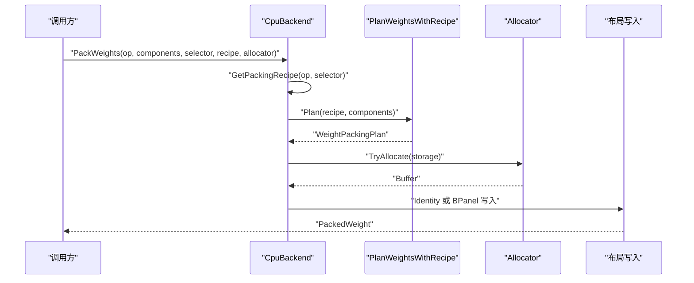

**图示来源**
- [cpu_backend.cpp:201-400](../../../../src/backend/cpu/cpu_backend.cpp#L201-L400)

**章节来源**
- [cpu_backend.cpp:201-400](../../../../src/backend/cpu/cpu_backend.cpp#L201-L400)

### WorkspaceArena 的工作区管理
`CpuWorkspaceArena` 是一个极简的只读工作区绑定器：
- 构造函数接收固定基地址和大小。
- `Bind(requirement)` 检查：
  - 基指针非空；
  - 所需字节数大于 0；
  - 对齐值非空；
  - 偏移不超过 arena 大小；
  - 剩余空间足够；
  - 目标地址按对齐值对齐。
- 不维护活跃区间，也不自动推进偏移；`Reset()` 为空操作。
- 适合由上层规划器一次性划分多个固定大小的工作区片段。

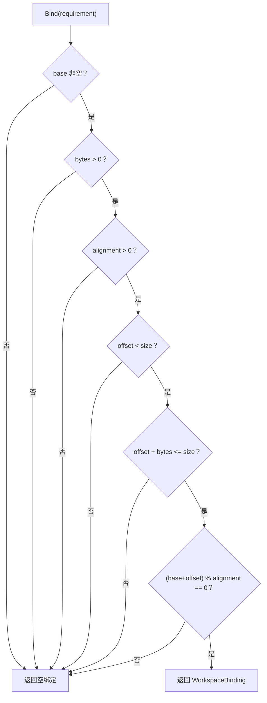

**图示来源**
- [cpu_workspace_arena.cpp:1-43](../../../../src/backend/cpu/cpu_workspace_arena.cpp#L1-L43)

**章节来源**
- [cpu_workspace_arena.h:1-25](../../../../include/aethermind/backend/cpu/cpu_workspace_arena.h#L1-L25)
- [cpu_workspace_arena.cpp:1-43](../../../../src/backend/cpu/cpu_workspace_arena.cpp#L1-L43)

## 依赖关系分析
CPU 后端对关键外部依赖的耦合如下：
- 内核注册表：通过 `KernelRegistry::Global()` 访问，后端构造时会冻结注册表，避免运行时新增描述符影响已解析内核。
- 能力探测：依赖 `aethermind::cpu::DetectCpuCapabilities`，并将结果存入不可变快照。
- 布局常量：依赖 `CpuIdentityPackingRecipe` 与 `CpuBPanelF32Kc512Nr16Recipe` 的 layout identity 与 alignment。
- 类型转换：依赖 Fp16/Bf16 的 SIMD 头文件和编译期宏，如 F16C 与 AVX2 转换可用性。
- 内存分配：通过 `Allocator::TryAllocate` 和 `Buffer` 管理打包权重存储。

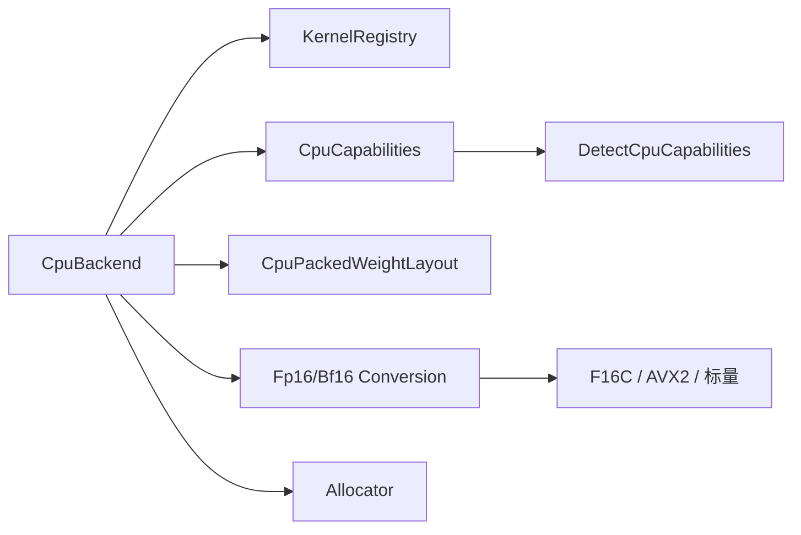

**图示来源**
- [cpu_backend.cpp:1-551](../../../../src/backend/cpu/cpu_backend.cpp#L1-L551)
- [cpu_info.cpp:201-356](../../../../src/backend/cpu/cpu_info.cpp#L201-L356)
- [fp16_conversion.cpp:1-26](../../../../src/backend/cpu/fp16_conversion.cpp#L1-L26)
- [bf16_conversion.cpp:1-21](../../../../src/backend/cpu/bf16_conversion.cpp#L1-L21)

**章节来源**
- [cpu_backend.cpp:1-551](../../../../src/backend/cpu/cpu_backend.cpp#L1-L551)
- [cpu_info.cpp:201-356](../../../../src/backend/cpu/cpu_info.cpp#L201-L356)

## 性能与内存特性

### 能力检测与内核选择开销
- 能力探测仅在创建后端或工厂时执行一次，后续 `CpuBackend` 复用不可变快照，内核选择仅做位集合包含判断与优先级比较。
- `CpuFeatureSet` 是无堆分配的位集合，交集、差集、哈希等操作均为常数级字操作。

### 权重打包内存行为
- Identity 布局可能只是视图复制，适合轻量融合场景。
- BPanel FP32 布局会产生新的物理存储，并引入 padding；优点是将 K 维切分为 512 列面板、N 维切分为 16 行块，有利于 GEMM 微内核缓存命中和向量化。
- 所有尺寸计算都进行溢出检查，避免巨大矩阵触发 `size_t` 溢出。

### Fp16/Bf16 转换性能
- F16C 路径适合快速半精度到单精度的宽化，利用专用指令减少逐元素开销。
- AVX2 路径适合单精度到半精度、单精度到 BF16 的压缩过程，处理边界情况（次正规、无穷、NaN）并保持与标量语义一致的舍入。
- 两种路径均以 8 或 16 个元素为循环步长，剩余部分回退标量。

### 工作区内存特性
- `CpuWorkspaceArena` 不做分配，只做偏移和对齐校验，因此不会增加额外内存占用。
- 如果调用方传递的对齐或偏移不符合约束，`Bind` 返回空绑定，由上层决定是否降级或报错。

[本节为通用性能讨论，不直接分析具体源码片段]

## 故障诊断指南

### 常见错误分类
| 错误类别 | 典型原因 | 定位建议 |
|---|---|---|
| `InvalidArgument` | selector 不是 CPU、weight 视图无效、rank 不为 2、dtype 不一致、K 维度不一致、recipe 不匹配 | 检查 `KernelSelector`、`TensorView` 的 dtype/rank/stride、传入 recipe |
| `Overflow` | 形状或字节数乘法加法溢出 | 检查超大矩阵维度、`itemsize`、打包布局尺寸计算 |
| `NotFound` | 没有满足 `effective_features` 的内核 | 检查 CPU 能力、策略、内核注册表描述符的 `cpu_requirements` |
| `FailedPrecondition` | 策略要求了不支持的有效特性 | 检查 `required_features` 是否超出 `effective_features` |
| `ResourceExhausted` | 分配失败 | 检查可用内存、arena 大小、工作区需求 |
| 内部错误 | packed 描述符缺少 layout 或 alignment | 检查内核注册表描述符完整性 |

### 能力相关诊断
- 若 AVX、AVX2、F16C、AMX、SVE 未被纳入 `effective_features`，优先检查：
  - 是否在受支持的架构上编译；
  - x86-64 上 `osxsave` 与 `XCR0` 位；
  - Linux AMX 是否需要 `XTILEDATA` 权限；
  - AArch64 上 HWCAP/HWCAP2 或 Apple `sysctl` 特性；
  - 是否通过 `CpuFeaturePolicy` 禁用了必要特性。

### 权重打包诊断
- 若 Identity 打包失败，确认输入视图是否行主连续、dtype 合法、shape 可表示。
- 若 BPanel 打包失败，确认输入为 Float32、二维、K 相同，并检查 `ceil(N/NR)`、`ceil(K/KC)` 导致的 padding 与对齐。
- 若 `GetWeightPackingRequirements` 与 `PackWeights` 返回不同结果，确认两者使用的 recipe 一致。

### 转换函数诊断
- 若 Fp16/Bf16 转换函数为空，检查 `effective_features` 是否包含 AVX；进一步检查 F16C 或 AVX2 是否启用。
- 若数值异常，检查 NaN、无穷、次正规数的处理分支是否与标量语义一致。

**章节来源**
- [cpu_backend.cpp:201-551](../../../../src/backend/cpu/cpu_backend.cpp#L201-L551)
- [cpu_info.cpp:201-356](../../../../src/backend/cpu/cpu_info.cpp#L201-L356)
- [cpu_packed_weight_layout.cpp:1-33](../../../../src/backend/cpu/cpu_packed_weight_layout.cpp#L1-L33)
- [fp16_conversion.cpp:1-26](../../../../src/backend/cpu/fp16_conversion.cpp#L1-L26)
- [bf16_conversion.cpp:1-21](../../../../src/backend/cpu/bf16_conversion.cpp#L1-L21)

## 结论
AetherMind 的 CPU 后端通过清晰的三层能力模型、严格的策略校验、稳定的内核选择流程和明确的权重布局契约，实现了可扩展且可诊断的 CPU 执行路径。其设计重点包括：
- 将能力探测与应用策略解耦，使内核选择始终基于不可变且可测试的 `effective_features`；
- 用 Identity 与 BPanel 两种布局覆盖轻量直通和高性能 GEMM 两类典型场景；
- 用无堆 `CpuFeatureSet` 和零拷贝 `CpuWorkspaceArena` 降低运行时开销；
- 用 F16C 与 AVX2 分支提供 Fp16/Bf16 的高效转换路径，同时保持标量回退与数值语义一致性。

在实际调优中，应优先确认能力探测是否正确、策略是否过严、权重布局是否与内核预期一致，再考虑调整并行度、块大小、调度策略等更高阶参数。

[本节为总结性内容，不直接分析具体源码片段]
