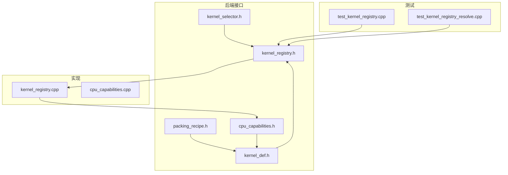
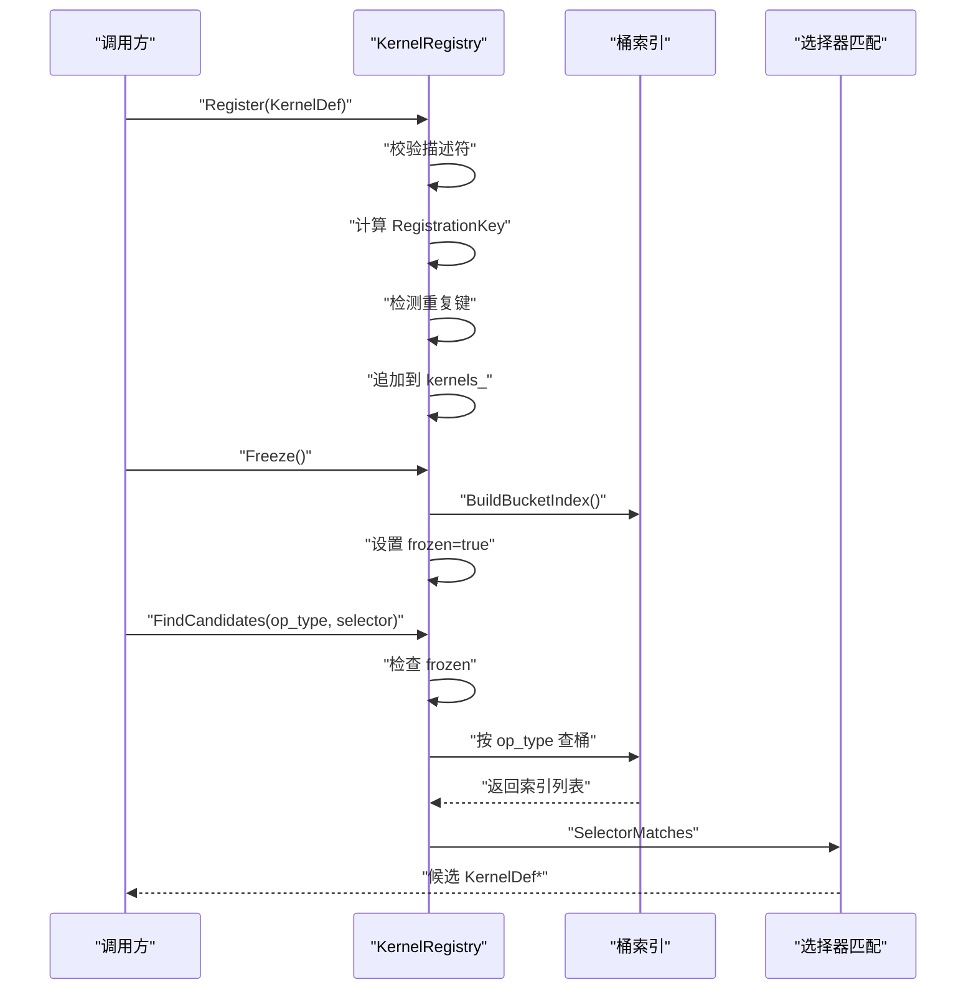
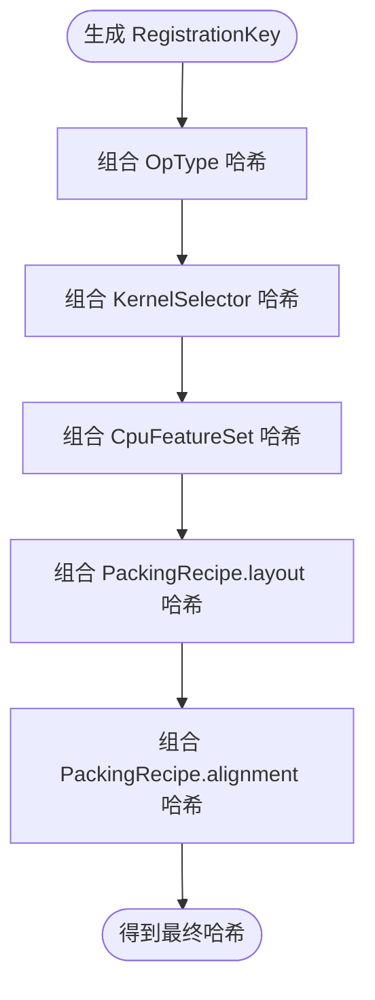
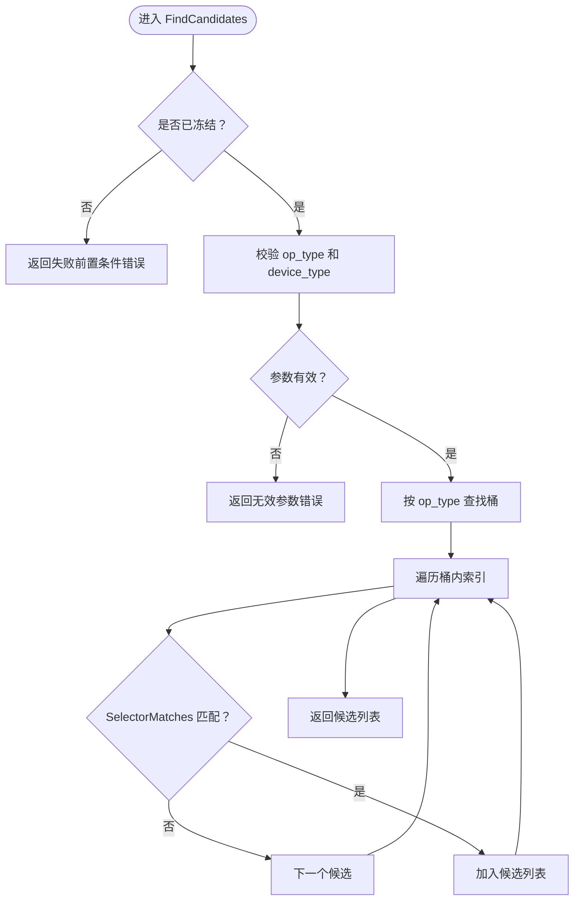
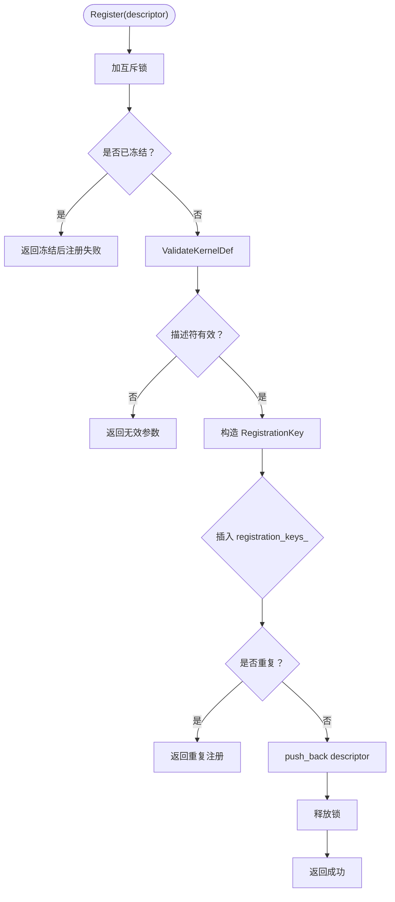
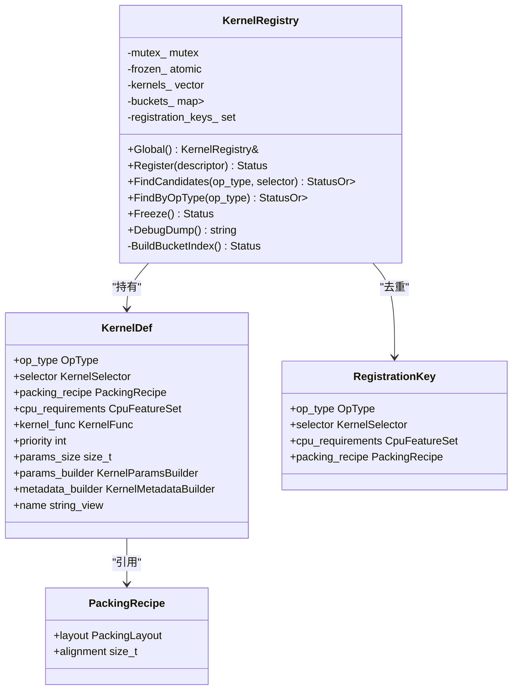
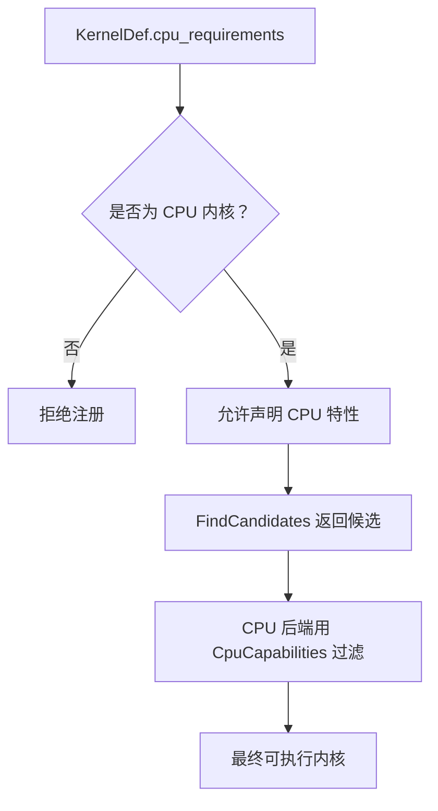

# 内核注册与发现（Kernel Registry）

**本文引用的文件**
- [kernel_registry.h](../../../../include/aethermind/backend/kernel_registry.h)
- [kernel_registry.cpp](../../../../src/backend/kernel_registry.cpp)
- [kernel_def.h](../../../../include/aethermind/backend/kernel_def.h)
- [packing_recipe.h](../../../../include/aethermind/backend/packing_recipe.h)
- [kernel_selector.h](../../../../include/aethermind/base/kernel_selector.h)
- [cpu_capabilities.h](../../../../include/aethermind/backend/cpu/cpu_capabilities.h)
- [cpu_capabilities.cpp](../../../../src/backend/cpu/cpu_capabilities.cpp)
- [test_kernel_registry.cpp](../../../../tests/unit/backend/test_kernel_registry.cpp)
- [test_kernel_registry_resolve.cpp](../../../../tests/unit/backend/test_kernel_registry_resolve.cpp)

## 目录
1. [引言](#引言)
2. [项目结构定位](#项目结构定位)
3. [核心组件总览](#核心组件总览)
4. [架构总览](#架构总览)
5. [关键数据结构与算法详解](#关键数据结构与算法详解)
6. [注册流程与并发安全](#注册流程与并发安全)
7. [候选选择算法与桶索引](#候选选择算法与桶索引)
8. [CPU 特性集匹配策略](#cpu-特性集匹配策略)
9. [PackingRecipe 兼容性检查](#packingrecipe-兼容性检查)
10. [调试信息输出格式](#调试信息输出格式)
11. [性能特征与优化点](#性能特征与优化点)
12. [添加新内核描述的完整步骤](#添加新内核描述的完整步骤)
13. [常见陷阱与避免指南](#常见陷阱与避免指南)
14. [故障排查建议](#故障排查建议)
15. [结论](#结论)

## 引言
AetherMind 的内核注册与发现系统负责在进程启动阶段收集所有后端内核描述，并在运行时根据算子类型、设备、数据类型、权重布局和执行阶段筛选出可执行的内核候选集合。其设计目标是：
- 提供全局单例式注册中心，保证内核定义唯一且生命周期可控。
- 将“结构性选择”和“运行期能力过滤”解耦：注册表只做结构化匹配，CPU 指令集等硬件能力由 CPU 后端进一步判断。
- 通过冻结机制构建一次性的桶索引，使热路径查找避免锁竞争。
- 用结构化哈希和精确的 PackingRecipe 区分不同物理权重布局的内核变体。

## 项目结构定位
该子系统位于 AetherMind 后端基础设施层，主要源码分布在以下位置：
- 接口与公共数据结构：`include/aethermind/backend/kernel_registry.h`、`kernel_def.h`、`packing_recipe.h`、`base/kernel_selector.h`、`backend/cpu/cpu_capabilities.h`。
- 实现：`src/backend/kernel_registry.cpp`、`src/backend/cpu/cpu_capabilities.cpp`。
- 单元测试：`tests/unit/backend/test_kernel_registry.cpp`、`test_kernel_registry_resolve.cpp`。



**图表来源**
- [kernel_registry.h:1-90](../../../../include/aethermind/backend/kernel_registry.h#L1-L90)
- [kernel_registry.cpp:1-138](../../../../src/backend/kernel_registry.cpp#L1-L138)
- [kernel_def.h:1-133](../../../../include/aethermind/backend/kernel_def.h#L1-L133)
- [packing_recipe.h:1-65](../../../../include/aethermind/backend/packing_recipe.h#L1-L65)
- [kernel_selector.h:1-107](../../../../include/aethermind/base/kernel_selector.h#L1-L107)
- [cpu_capabilities.h:1-219](../../../../include/aethermind/backend/cpu/cpu_capabilities.h#L1-L219)
- [cpu_capabilities.cpp:1-75](../../../../src/backend/cpu/cpu_capabilities.cpp#L1-L75)
- [test_kernel_registry.cpp:1-305](../../../../tests/unit/backend/test_kernel_registry.cpp#L1-L305)
- [test_kernel_registry_resolve.cpp:1-104](../../../../tests/unit/backend/test_kernel_registry_resolve.cpp#L1-L104)

**章节来源**
- [kernel_registry.h:1-90](../../../../include/aethermind/backend/kernel_registry.h#L1-L90)
- [kernel_registry.cpp:1-138](../../../../src/backend/kernel_registry.cpp#L1-L138)

## 核心组件总览
| 组件 | 职责 | 关键行为 |
|---|---|---|
| `KernelRegistry` | 全局内核注册与发现入口 | 提供全局单例、注册、冻结、按算子类型查找、调试转储 |
| `RegistrationKey` | 去重键 | 组合算子类型、选择器、CPU 特性集、打包配方 |
| `RegistrationKeyHash` | 去重键哈希 | 基于字段顺序组合哈希，保证相等键相同哈希 |
| `KernelDef` | 内核描述符 | 绑定算子、选择器、CPU 需求、函数指针、优先级、参数构造器等 |
| `ValidateKernelDef` | 描述符校验 | 检查空值、设备类型、打包配方、参数大小等不变量 |
| `PackingRecipe` | 物理权重布局身份 | 包含布局标识和对齐要求 |
| `CpuFeatureSet` | CPU 特性集 | 无堆分配的位图，支持包含、交集、差集、哈希 |
| `SelectorMatches` | 结构化匹配 | 比较设备、数据类型、权重格式、执行阶段 |

**章节来源**
- [kernel_registry.h:1-90](../../../../include/aethermind/backend/kernel_registry.h#L1-L90)
- [kernel_def.h:1-133](../../../../include/aethermind/backend/kernel_def.h#L1-L133)
- [packing_recipe.h:1-65](../../../../include/aethermind/backend/packing_recipe.h#L1-L65)
- [kernel_selector.h:1-107](../../../../include/aethermind/base/kernel_selector.h#L1-L107)
- [cpu_capabilities.h:1-219](../../../../include/aethermind/backend/cpu/cpu_capabilities.h#L1-L219)

## 架构总览
内核注册与发现的整体流程可以分为三个阶段：
1. **注册阶段**：调用方构造 `KernelDef`，通过 `KernelRegistry::Register` 插入全局注册表；注册表做结构校验和重复检测。
2. **冻结阶段**：调用 `Freeze`，一次性构建 `buckets_` 桶索引并设置原子冻结标志。
3. **发现阶段**：调用 `FindCandidates` 或 `FindByOpType`，先检查冻结状态，再按算子类型快速定位候选，最后进行结构化选择匹配。



**图表来源**
- [kernel_registry.cpp:23-138](../../../../src/backend/kernel_registry.cpp#L23-L138)
- [kernel_registry.h:18-90](../../../../include/aethermind/backend/kernel_registry.h#L18-L90)
- [kernel_selector.h:63-107](../../../../include/aethermind/base/kernel_selector.h#L63-L107)

**章节来源**
- [kernel_registry.cpp:23-138](../../../../src/backend/kernel_registry.cpp#L23-L138)
- [kernel_registry.h:18-90](../../../../include/aethermind/backend/kernel_registry.h#L18-L90)

## 关键数据结构与算法详解

### KernelRegistry 全局单例
`KernelRegistry::Global()` 使用局部静态变量实现线程安全的延迟初始化全局单例。该模式避免显式锁管理初始化过程，并由 C++ 标准保证多线程首次访问时的同步语义。

- 单例生命周期与进程生命周期一致。
- 所有公开方法通过内部互斥量和原子冻结标志控制并发访问。
- `size()`、`empty()`、`DebugDump()` 等方法在需要时加锁，确保对内部容器的安全访问。

**章节来源**
- [kernel_registry.cpp:23-31](../../../../src/backend/kernel_registry.cpp#L23-L31)
- [kernel_registry.h:36-89](../../../../include/aethermind/backend/kernel_registry.h#L36-L89)

### RegistrationKey 与结构化哈希
`RegistrationKey` 是注册去重的核心键，包含：
- `op_type`
- `selector`
- `cpu_requirements`
- `packing_recipe`

其哈希由四部分依次组合而成：
1. 算子类型哈希
2. 选择器哈希
3. CPU 特性集哈希
4. PackingRecipe 的 layout 枚举值和对齐值

这意味着即使两个 `KernelDef` 的优先级、名称、函数指针不同，只要这四项完全相同，就会被判定为重复注册。



**图表来源**
- [kernel_registry.h:18-35](../../../../include/aethermind/backend/kernel_registry.h#L18-L35)
- [kernel_selector.h:83-107](../../../../include/aethermind/base/kernel_selector.h#L83-L107)
- [cpu_capabilities.h:112-157](../../../../include/aethermind/backend/cpu/cpu_capabilities.h#L112-L157)

**章节来源**
- [kernel_registry.h:18-35](../../../../include/aethermind/backend/kernel_registry.h#L18-L35)

### FindCandidates 的后端选择算法
`FindCandidates` 不直接返回具体实现内核，而是返回所有“结构上可服务请求”的 `KernelDef*`。它遵循以下规则：
- 必须先冻结。
- 校验 `op_type` 不能是未知类型。
- 校验 `selector.device_type` 不能是未定义。
- 按 `op_type` 从 `buckets_` 中取索引。
- 对每个候选调用 `SelectorMatches`，仅保留结构性匹配项。
- CPU 指令集要求不参与本阶段的匹配；它属于后端选择逻辑的职责。



**图表来源**
- [kernel_registry.cpp:66-100](../../../../src/backend/kernel_registry.cpp#L66-L100)
- [kernel_selector.h:63-81](../../../../include/aethermind/base/kernel_selector.h#L63-L81)

**章节来源**
- [kernel_registry.cpp:66-100](../../../../src/backend/kernel_registry.cpp#L66-L100)
- [kernel_selector.h:63-107](../../../../include/aethermind/base/kernel_selector.h#L63-L107)

## 注册流程与并发安全
注册流程的核心保证如下：
1. **互斥保护**：所有写操作通过 `std::mutex` 保护。
2. **冻结不可逆**：一旦冻结，再次注册返回失败前置条件错误。
3. **描述符校验**：通过 `ValidateKernelDef` 检查函数指针、名称、设备类型、打包配方、参数大小等。
4. **重复检测**：使用 `registration_keys_` 集合检测完全相同的 `RegistrationKey`。
5. **原子冻结标志**：冻结完成后以释放语义写入 `frozen_`，读取时使用获取语义，保证发现路径能看到完整的桶索引。



**图表来源**
- [kernel_registry.cpp:33-64](../../../../src/backend/kernel_registry.cpp#L33-L64)
- [kernel_def.h:68-133](../../../../include/aethermind/backend/kernel_def.h#L68-L133)

**章节来源**
- [kernel_registry.cpp:33-64](../../../../src/backend/kernel_registry.cpp#L33-L64)
- [kernel_def.h:68-133](../../../../include/aethermind/backend/kernel_def.h#L68-L133)

## 候选选择算法与桶索引
### 桶索引构建过程
`BuildBucketIndex` 会在冻结阶段一次性构建：
- 输入：`kernels_` 向量。
- 处理：遍历每个 `KernelDef.op_type`，将其索引追加到对应算子的桶中。
- 异常处理：如果分配失败，返回资源耗尽错误。
- 交换：用临时 `buckets` 与成员 `buckets_` 交换，减少拷贝成本。

桶索引的时间复杂度为 O(n)，空间复杂度为 O(n) 个索引存储；后续查找只扫描目标算子的桶，而不是全量内核。

### 候选选择流程
1. 检查 `frozen_`。
2. 校验参数。
3. 查找 `buckets_[op_type]`。
4. 预分配候选结果容量。
5. 遍历桶内索引，应用 `SelectorMatches`。
6. 返回 `KernelDef*` 数组。



**图表来源**
- [kernel_registry.h:36-89](../../../../include/aethermind/backend/kernel_registry.h#L36-L89)
- [kernel_def.h:24-133](../../../../include/aethermind/backend/kernel_def.h#L24-L133)
- [packing_recipe.h:45-65](../../../../include/aethermind/backend/packing_recipe.h#L45-L65)

**章节来源**
- [kernel_registry.cpp:66-138](../../../../src/backend/kernel_registry.cpp#L66-L138)
- [kernel_registry.h:36-89](../../../../include/aethermind/backend/kernel_registry.h#L36-L89)

## CPU 特性集匹配策略
`CpuFeatureSet` 是一个固定大小、无堆分配的位图，用于表示 CPU 指令集特性。它支持：
- 从初始值列表创建。
- 查询单个特性是否存在。
- 检查是否完全包含另一个集合。
- 计算交集和差集。
- 生成哈希。

注册时，只有 `DeviceType::kCPU` 的内核可以声明 `cpu_requirements`；非 CPU 内核若声明 CPU 特性会被拒绝。

需要特别注意：**`FindCandidates` 不比较 CPU 特性**。它的职责是返回所有结构上可能可用的内核，包括 AVX2、FMA、AVX512 等不同实现变体。CPU 后端在拿到候选列表后，再用当前进程的 `CpuCapabilities` 进一步筛选。



**图表来源**
- [kernel_def.h:97-115](../../../../include/aethermind/backend/kernel_def.h#L97-L115)
- [kernel_registry.cpp:66-100](../../../../src/backend/kernel_registry.cpp#L66-L100)
- [cpu_capabilities.h:63-157](../../../../include/aethermind/backend/cpu/cpu_capabilities.h#L63-L157)

**章节来源**
- [kernel_def.h:97-115](../../../../include/aethermind/backend/kernel_def.h#L97-L115)
- [kernel_selector.h:63-81](../../../../include/aethermind/base/kernel_selector.h#L63-L81)
- [cpu_capabilities.h:63-157](../../../../include/aethermind/backend/cpu/cpu_capabilities.h#L63-L157)
- [cpu_capabilities.cpp:1-75](../../../../src/backend/cpu/cpu_capabilities.cpp#L1-L75)

## PackingRecipe 兼容性检查
`PackingRecipe` 用于表达后端拥有的精确物理权重布局身份，包含：
- `layout`：布局标识，如 `kNone`、`kCpuIdentity`、`kCpuBPanelF32Kc512Nr16`。
- `alignment`：布局块起始对齐要求。

校验规则如下：
- 如果 `weight_format == kPacked`：
  - `layout` 必须是已知布局。
  - `alignment` 必须至少为 `alignof(void*)`。
  - `alignment` 必须是 2 的幂。
- 如果 `weight_format != kPacked`：
  - `layout` 必须是 `kNone`。
  - `alignment` 必须是 0。

此外，`RegistrationKey` 的哈希会同时考虑 `layout` 和 `alignment`，因此同一选择器和 CPU 特性下，不同打包布局被视为不同的注册键。

**章节来源**
- [packing_recipe.h:1-65](../../../../include/aethermind/backend/packing_recipe.h#L1-L65)
- [kernel_def.h:88-115](../../../../include/aethermind/backend/kernel_def.h#L88-L115)
- [kernel_registry.h:18-35](../../../../include/aethermind/backend/kernel_registry.h#L18-L35)

## 调试信息输出格式
`DebugDump()` 输出所有已注册内核的一行一条记录，字段顺序为：
1. 算子类型字符串
2. 内核名称
3. 选择器字符串
4. CPU 特性集字符串
5. 优先级数值

示例格式（用自然语言描述）：
```
算子类型 | 内核名称 | 选择器 | cpu_features=特性集合 | 优先级
```

该输出会锁定互斥量，因此在生产环境中应谨慎使用，通常用于诊断和测试验证。

**章节来源**
- [kernel_registry.cpp:118-138](../../../../src/backend/kernel_registry.cpp#L118-L138)
- [cpu_capabilities.cpp:43-75](../../../../src/backend/cpu/cpu_capabilities.cpp#L43-L75)

## 性能特征与优化点
| 场景 | 行为 | 性能影响 |
|---|---|---|
| 注册 | 加锁、校验、哈希去重、追加向量 | O(1) 平均插入，受哈希表和向量扩容影响 |
| 冻结 | 构建桶索引、原子写冻结标志 | O(n) 构建一次，之后零锁热路径 |
| 查找候选 | 原子读冻结标志、哈希表查找、线性扫描桶 | 接近 O(k)，k 为同算子类型的候选数量 |
| 调试转储 | 加锁遍历所有内核 | 不适合高频调用 |
| CPU 特性匹配 | 不在注册表中进行 | 减少注册表热路径开销，交由后端决策 |

优化要点：
- 冻结后查找路径不加锁。
- 桶索引提前分配候选结果容量。
- `CpuFeatureSet` 避免堆分配。
- `PackingRecipe` 使用轻量枚举和对齐值参与哈希。
- `DebugDump` 仅在诊断路径使用。

**章节来源**
- [kernel_registry.cpp:33-138](../../../../src/backend/kernel_registry.cpp#L33-L138)
- [cpu_capabilities.h:63-157](../../../../include/aethermind/backend/cpu/cpu_capabilities.h#L63-L157)

## 添加新内核描述的完整步骤
以下是向 AetherMind 内核注册系统添加一个新内核的推荐流程：

1. **确定算子类型**
   确认该内核处理的 `OpType`，并确保它不是 `kUnknown`。

2. **构造 KernelSelector**
   指定设备类型、激活数据类型、权重数据类型、状态数据类型、输出数据类型、权重格式和执行阶段。

3. **决定是否使用打包权重**
   - 如果是普通权重，保持 `weight_format == kPlain`，`packing_recipe` 为空。
   - 如果是打包权重，设置 `weight_format == kPacked`，并选择有效的 `PackingLayout` 和满足要求的 `alignment`。

4. **声明 CPU 特性需求（仅限 CPU 内核）**
   使用 `CpuFeatureSet::From` 列出所需指令集特性；非 CPU 内核不得声明 CPU 特性。

5. **编写内核函数**
   提供一个符合 `KernelFunc` 签名的函数，不能为空指针。

6. **填写 KernelDef**
   设置 `op_type`、`selector`、可选 `cpu_requirements`、可选 `packing_recipe`、`kernel_func`、`priority`、`params_size`、`params_builder`、`metadata_builder`、`name`。

7. **确保 name 是静态生命周期字符串**
   `name` 是 `string_view`，注册表不会复制它，因此必须指向静态常量或长期存活对象。

8. **注册内核**
   调用 `KernelRegistry::Global().Register(descriptor)`。

9. **在合适时机冻结注册表**
   在所有内核注册完成后调用 `Freeze()`。

10. **验证候选结果**
    使用 `FindCandidates` 或 `FindByOpType` 验证是否能找到预期内核。

11. **补充单元测试**
    覆盖正常注册、重复注册、冻结后注册、候选匹配、CPU 特性差异、打包布局差异等场景。

**章节来源**
- [kernel_def.h:24-133](../../../../include/aethermind/backend/kernel_def.h#L24-L133)
- [kernel_registry.cpp:33-138](../../../../src/backend/kernel_registry.cpp#L33-L138)
- [test_kernel_registry.cpp:1-305](../../../../tests/unit/backend/test_kernel_registry.cpp#L1-L305)
- [test_kernel_registry_resolve.cpp:1-104](../../../../tests/unit/backend/test_kernel_registry_resolve.cpp#L1-L104)

## 常见陷阱与避免指南
| 陷阱 | 现象 | 避免方式 |
|---|---|---|
| 使用动态字符串作为 `KernelDef.name` | 内核被选中后悬垂指针 | 使用静态字符串或全局常量 |
| 忘记冻结注册表 | 查找返回失败前置条件错误 | 在所有注册完成后调用 `Freeze()` |
| 在冻结后注册 | 返回失败前置条件错误 | 只在启动早期注册 |
| 重复注册相同 `RegistrationKey` | 返回重复注册错误 | 避免相同算子类型、选择器、CPU 特性、打包配方的重复定义 |
| 打包权重未满足对齐要求 | 校验失败 | 对齐值至少为 `alignof(void*)` 且为 2 的幂 |
| 非 CPU 内核声明 CPU 特性 | 校验失败 | 非 CPU 内核不要设置 `cpu_requirements` |
| 把 CPU 特性当作结构化选择的一部分 | 误以为 `FindCandidates` 会过滤掉不支持的指令集 | 理解 CPU 特性由后端进一步过滤 |
| 执行阶段不匹配 | 找不到候选 | 正确设置 `ExecPhase`，例如 `kBoth` 能匹配预填充和解码 |
| 忽略 PackingRecipe 差异 | 期望一个布局匹配多个物理布局 | 不同 `layout` 或 `alignment` 是不同的注册键 |

**章节来源**
- [kernel_def.h:88-133](../../../../include/aethermind/backend/kernel_def.h#L88-L133)
- [kernel_registry.cpp:33-100](../../../../src/backend/kernel_registry.cpp#L33-L100)
- [test_kernel_registry.cpp:1-305](../../../../tests/unit/backend/test_kernel_registry.cpp#L1-L305)
- [test_kernel_registry_resolve.cpp:1-104](../../../../tests/unit/backend/test_kernel_registry_resolve.cpp#L1-L104)

## 故障排查建议
当内核注册或发现出现问题时，可按以下顺序排查：

1. **检查返回值状态**
   `Register`、`Freeze`、`FindCandidates`、`FindByOpType` 均返回 `Status` 或 `StatusOr`，优先打印状态码和诊断消息。

2. **确认是否已冻结**
   查找前必须冻结；冻结前调用查找会返回失败前置条件错误。

3. **确认是否重复注册**
   重复的 `RegistrationKey` 会触发重复注册错误。

4. **检查描述符不变量**
   使用 `ValidateKernelDef` 的规则核对：函数指针非空、名称非空、设备类型有效、打包配方合法、参数大小合理。

5. **检查执行阶段**
   如果候选为空，确认请求的 `ExecPhase` 是否与内核声明的 `phase` 兼容。

6. **检查 CPU 特性**
   如果后端没有返回期望的高性能内核，确认 CPU 是否支持相应指令集，以及后端是否正确过滤候选。

7. **使用调试转储**
   调用 `DebugDump()` 查看已注册内核的名称、选择器、CPU 特性和优先级。

8. **使用测试辅助**
   参考 `test_kernel_registry.cpp` 和 `test_kernel_registry_resolve.cpp` 中的构造方式和断言模式。

**章节来源**
- [kernel_registry.cpp:23-138](../../../../src/backend/kernel_registry.cpp#L23-L138)
- [kernel_def.h:68-133](../../../../include/aethermind/backend/kernel_def.h#L68-L133)
- [test_kernel_registry.cpp:1-305](../../../../tests/unit/backend/test_kernel_registry.cpp#L1-L305)
- [test_kernel_registry_resolve.cpp:1-104](../../../../tests/unit/backend/test_kernel_registry_resolve.cpp#L1-L104)

## 结论
AetherMind 的内核注册与发现系统通过清晰的职责划分实现了高性能、可扩展的内核选择基础设施：
- `KernelRegistry` 提供全局单例、原子冻结和桶索引优化。
- `RegistrationKey` 将算子类型、选择器、CPU 特性集和打包配方统一为去重键。
- `FindCandidates` 专注结构化匹配，把 CPU 指令集过滤交给后端。
- `PackingRecipe` 精确区分物理权重布局，避免隐式假设。
- `ValidateKernelDef` 在注册阶段捕获大量配置错误。
- 测试覆盖了并发冻结、重复注册、阶段匹配、打包布局区分等关键行为。

对于内核开发者而言，最关键的实践是：准确描述 `KernelSelector`，仅在 CPU 内核中声明必要的 `CpuFeatureSet`，为打包权重提供合法的 `PackingRecipe`，并使用静态生命周期字符串作为内核名称。这样既能保证注册阶段的安全性，又能让运行时候选选择保持简洁高效。
