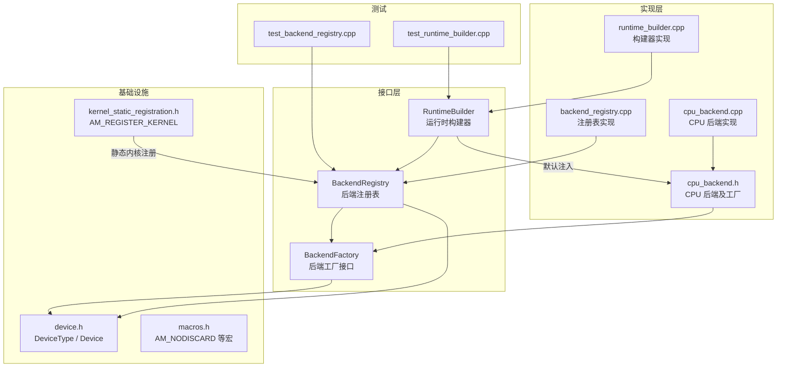
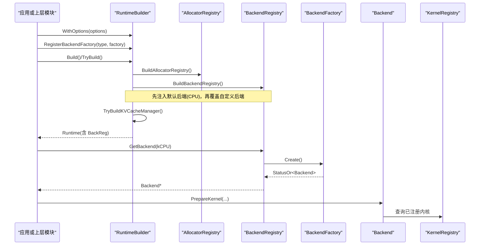
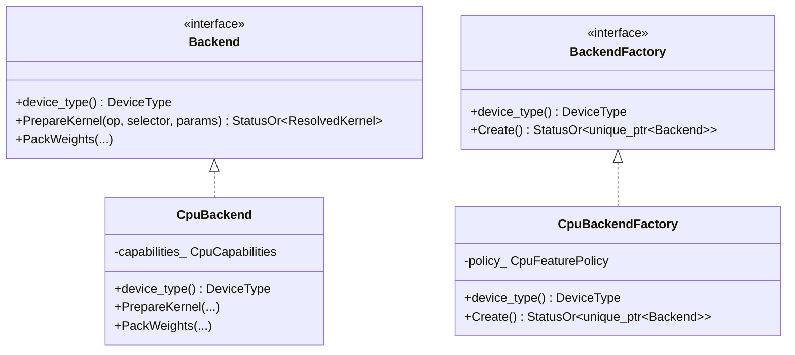
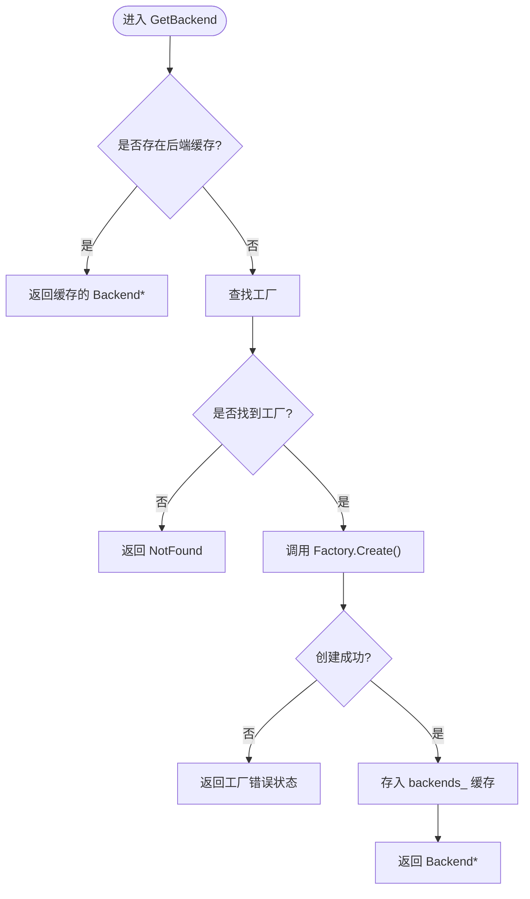
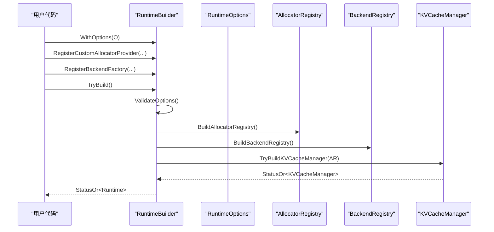
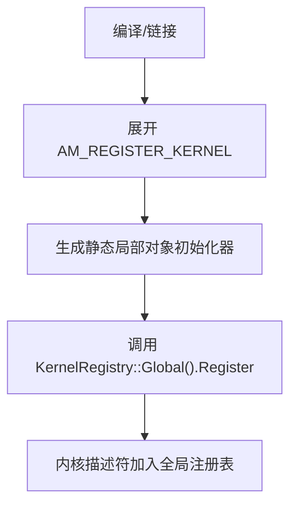
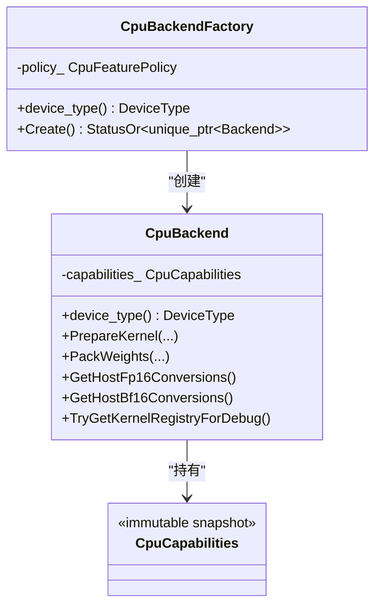
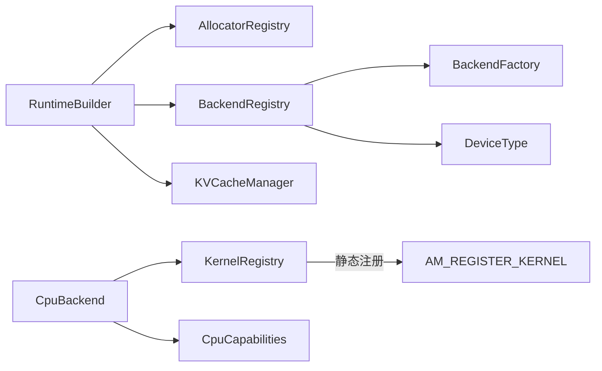

# 后端工厂与注册 (Backend Factory & Registration)

**本文引用的文件**
- [backend_factory.h](../../../../include/aethermind/backend/backend_factory.h)
- [backend_registry.h](../../../../include/aethermind/backend/backend_registry.h)
- [backend_registry.cpp](../../../../src/backend/backend_registry.cpp)
- [runtime_builder.h](../../../../include/aethermind/runtime/runtime_builder.h)
- [runtime_builder.cpp](../../../../src/runtime/runtime_builder.cpp)
- [kernel_static_registration.h](../../../../include/aethermind/backend/kernel_static_registration.h)
- [macros.h](../../../../include/aethermind/base/macros.h)
- [cpu_backend.h](../../../../include/aethermind/backend/cpu/cpu_backend.h)
- [cpu_backend.cpp](../../../../src/backend/cpu/cpu_backend.cpp)
- [device.h](../../../../include/aethermind/base/device.h)
- [test_backend_registry.cpp](../../../../tests/unit/backend/test_backend_registry.cpp)
- [test_runtime_builder.cpp](../../../../tests/unit/runtime/test_runtime_builder.cpp)

## 目录
1. [引言](#引言)
2. [项目结构](#项目结构)
3. [核心组件](#核心组件)
4. [架构总览](#架构总览)
5. [详细组件分析](#详细组件分析)
6. [依赖关系分析](#依赖关系分析)
7. [性能考量](#性能考量)
8. [故障排查指南](#故障排查指南)
9. [结论](#结论)
10. [附录：最佳实践清单](#附录最佳实践清单)

## 引言
本文面向 AetherMind 后端的工厂与注册机制，系统性解释以下主题：
- BackendFactory 的工厂模式设计与错误传播契约。
- BackendRegistry 的全局（进程级）注册表、懒加载缓存与生命周期管理。
- RuntimeBuilder 的后端配置流程、默认后端注入顺序与自定义覆盖策略。
- 静态注册宏 AM_REGISTER_KERNEL 的工作方式及其与 KernelRegistry 的关系。
- 多后端共存、设备类型路由、默认后端选择算法。
- 初始化顺序、依赖注入路径与错误传播链。
- 自定义后端注册的最佳实践、热插拔方案与多进程注意事项。

本说明尽量以代码仓库中的实际实现为依据，同时为不熟悉底层实现的读者提供渐进式理解。

## 项目结构
后端工厂与注册机制涉及头文件、运行时装配器、CPU 后端示例、基础设备抽象以及单元测试。关键位置如下：
- 接口层：backend_factory.h、backend_registry.h、runtime_builder.h。
- 实现层：backend_registry.cpp、runtime_builder.cpp、cpu_backend.h/.cpp。
- 基础设施：device.h、macros.h、kernel_static_registration.h。
- 测试：test_backend_registry.cpp、test_runtime_builder.cpp。

图表来源
- [backend_factory.h:1-45](../../../../include/aethermind/backend/backend_factory.h#L1-L45)
- [backend_registry.h:1-64](../../../../include/aethermind/backend/backend_registry.h#L1-L64)
- [backend_registry.cpp:1-48](../../../../src/backend/backend_registry.cpp#L1-L48)
- [runtime_builder.h:1-112](../../../../include/aethermind/runtime/runtime_builder.h#L1-L112)
- [runtime_builder.cpp:1-204](../../../../src/runtime/runtime_builder.cpp#L1-L204)
- [cpu_backend.h:1-157](../../../../include/aethermind/backend/cpu/cpu_backend.h#L1-L157)
- [device.h:1-188](../../../../include/aethermind/base/device.h#L1-L188)
- [kernel_static_registration.h:1-24](../../../../include/aethermind/backend/kernel_static_registration.h#L1-L24)

章节来源
- [backend_factory.h:1-45](../../../../include/aethermind/backend/backend_factory.h#L1-L45)
- [backend_registry.h:1-64](../../../../include/aethermind/backend/backend_registry.h#L1-L64)
- [runtime_builder.h:1-112](../../../../include/aethermind/runtime/runtime_builder.h#L1-L112)

## 核心组件
- BackendFactory：定义“按设备类型创建 Backend”的工厂接口。Create() 返回 StatusOr，使能力检测失败可被向上层报告而非中断程序。
- BackendRegistry：持有每个 DeviceType 对应的工厂和已创建的 Backend 实例；GetBackend 懒创建并缓存；SetFactory 会替换工厂并驱逐旧缓存。
- RuntimeBuilder：根据 RuntimeOptions 构建 AllocatorRegistry、BackendRegistry，并可选初始化 KVCacheManager；支持用户自定义分配器与后端工厂注册。
- CpuBackend/CpuBackendFactory：CPU 后端的示例实现，包含能力检测、内核选择、权重打包等功能；CpuBackendFactory 通过 Status 通道暴露检测错误。
- AM_REGISTER_KERNEL：基于静态全局对象的内核注册宏，将 KernelDef 注入 KernelRegistry::Global()。
- Device/DeviceType：设备类型枚举（CPU、CUDA、CANN、Undefined）和设备标识抽象。

章节来源
- [backend_factory.h:1-45](../../../../include/aethermind/backend/backend_factory.h#L1-L45)
- [backend_registry.h:1-64](../../../../include/aethermind/backend/backend_registry.h#L1-L64)
- [runtime_builder.h:1-112](../../../../include/aethermind/runtime/runtime_builder.h#L1-L112)
- [cpu_backend.h:1-157](../../../../include/aethermind/backend/cpu/cpu_backend.h#L1-L157)
- [kernel_static_registration.h:1-24](../../../../include/aethermind/backend/kernel_static_registration.h#L1-L24)
- [device.h:1-188](../../../../include/aethermind/base/device.h#L1-L188)

## 架构总览
后端系统采用“工厂 + 注册表 + 构建器”的分层设计：
- 构建器负责装配选项、默认后端与自定义覆盖。
- 注册表负责按设备类型查找并懒创建后端实例。
- 工厂封装具体设备的初始化与能力探测逻辑。
- 内核静态注册在编译期/加载期完成，运行期由后端查询。

图表来源
- [runtime_builder.cpp:1-204](../../../../src/runtime/runtime_builder.cpp#L1-L204)
- [backend_registry.cpp:1-48](../../../../src/backend/backend_registry.cpp#L1-L48)
- [cpu_backend.h:1-157](../../../../include/aethermind/backend/cpu/cpu_backend.h#L1-L157)
- [kernel_static_registration.h:1-24](../../../../include/aethermind/backend/kernel_static_registration.h#L1-L24)

## 详细组件分析

### BackendFactory 工厂模式
BackendFactory 是一个纯虚接口，约束每个具体后端必须实现：
- device_type()：声明该工厂负责的设备类型。
- Create()：创建对应设备类型的 Backend 实例，失败通过 Status 返回。

这种设计允许 BackendRegistry 统一处理成功与失败分支，避免在注册阶段直接抛出异常导致启动失败。

图表来源
- [backend_factory.h:1-45](../../../../include/aethermind/backend/backend_factory.h#L1-L45)
- [cpu_backend.h:1-157](../../../../include/aethermind/backend/cpu/cpu_backend.h#L1-L157)

章节来源
- [backend_factory.h:1-45](../../../../include/aethermind/backend/backend_factory.h#L1-L45)
- [cpu_backend.h:1-157](../../../../include/aethermind/backend/cpu/cpu_backend.h#L1-L157)

### BackendRegistry 全局注册表与懒创建
BackendRegistry 维护两个哈希映射：
- factories_：DeviceType → BackendFactory。
- backends_：DeviceType → Backend。

关键行为：
- SetFactory(type, factory)：校验 type 非 Undefined 且 factory 非空；写入工厂并删除同类型的已缓存 Backend，确保下次 GetBackend 使用新工厂重建。
- GetBackend(type)：若已有缓存则直接返回；否则查找工厂，调用 Create()；成功后缓存指针所有权转移至 backends_；失败返回 NotFound 或工厂的错误状态。

线程性：当前实现注释指出计划构建是单线程的；未来多线程场景需要加可移动互斥锁。

图表来源
- [backend_registry.cpp:1-48](../../../../src/backend/backend_registry.cpp#L1-L48)

章节来源
- [backend_registry.h:1-64](../../../../include/aethermind/backend/backend_registry.h#L1-L64)
- [backend_registry.cpp:1-48](../../../../src/backend/backend_registry.cpp#L1-L48)
- [test_backend_registry.cpp:1-131](../../../../tests/unit/backend/test_backend_registry.cpp#L1-L131)

### RuntimeBuilder 后端配置流程
RuntimeBuilder 的职责是按选项装配资源：
- ValidateOptions：检查不支持的选项；当启用 CUDA/CANN 后端但无自定义工厂时拒绝。
- BuildAllocatorRegistry：根据选项注入 CPU/CUDA/CANN 分配器提供者，然后消费 pending_custom_allocator_providers_ 进行覆盖。
- BuildBackendRegistry：先注入默认 CPU 后端工厂，再消费 pending_backend_factories_ 进行覆盖。
- TryBuildKVCacheManager：根据选项计算布局、校验容量限制、获取 CPU 分配器并初始化 KVCacheManager。
- TryBuild：组合上述步骤，捕获 bad_alloc 并返回 ResourceExhausted；Build 则在失败时中止。

图表来源
- [runtime_builder.h:1-112](../../../../include/aethermind/runtime/runtime_builder.h#L1-L112)
- [runtime_builder.cpp:1-204](../../../../src/runtime/runtime_builder.cpp#L1-L204)

章节来源
- [runtime_builder.h:1-112](../../../../include/aethermind/runtime/runtime_builder.h#L1-L112)
- [runtime_builder.cpp:1-204](../../../../src/runtime/runtime_builder.cpp#L1-L204)
- [test_runtime_builder.cpp:1-223](../../../../tests/unit/runtime/test_runtime_builder.cpp#L1-L223)

### 静态注册宏 AM_REGISTER_KERNEL
AM_REGISTER_KERNEL 通过在命名空间内创建一个静态布尔变量，并在其初始化过程中调用 KernelRegistry::Global().Register(descriptor)。这实现了“编译单元加载即注册”的效果，无需显式调用注册函数。

图表来源
- [kernel_static_registration.h:1-24](../../../../include/aethermind/backend/kernel_static_registration.h#L1-L24)

章节来源
- [kernel_static_registration.h:1-24](../../../../include/aethermind/backend/kernel_static_registration.h#L1-L24)

### CPU 后端与能力检测
CpuBackend 持有不可变的 CpuCapabilities 快照，用于内核选择、转换函数生成、权重打包等。CpuBackendFactory 在每次 Create 时执行能力检测，并将检测错误通过 Status 返回，从而让注册表正确上报问题。

图表来源
- [cpu_backend.h:1-157](../../../../include/aethermind/backend/cpu/cpu_backend.h#L1-L157)
- [cpu_backend.cpp:1-544](../../../../src/backend/cpu/cpu_backend.cpp#L1-L544)

章节来源
- [cpu_backend.h:1-157](../../../../include/aethermind/backend/cpu/cpu_backend.h#L1-L157)
- [cpu_backend.cpp:1-544](../../../../src/backend/cpu/cpu_backend.cpp#L1-L544)

### 设备类型路由与默认后端选择
设备类型由 DeviceType 表示，包含 kCPU、kCUDA、kCANN、kUndefined。RuntimeBuilder 的默认策略是：
- 如果 options.backend.enable_cpu 为真，则注册 CPU 后端工厂。
- 如果启用了 CUDA/CANN 但未注册自定义工厂，ValidateOptions 直接拒绝。
- 用户可通过 RegisterBackendFactory 覆盖默认后端。

因此，默认后端选择算法是：
1. 解析 RuntimeOptions。
2. 注入默认后端（当前仅 CPU）。
3. 用用户注册的工厂覆盖同类型后端。
4. 首次 GetBackend(type) 时懒创建并缓存。

章节来源
- [device.h:1-188](../../../../include/aethermind/base/device.h#L1-L188)
- [runtime_builder.cpp:1-204](../../../../src/runtime/runtime_builder.cpp#L1-L204)

### 后端实例生命周期管理
- 工厂拥有 Backend 的所有权：BackendRegistry::GetBackend 将 Create 返回的 unique_ptr 移动到 backends_，只向外部暴露裸指针。
- 覆盖工厂会驱逐旧后端：SetFactory 会删除同类型缓存，保证下一次 GetBackend 使用新工厂。
- 构造失败不抛异常：工厂错误通过 Status 传播到调用方。
- 构建器消费待注册列表：pending_backend_factories_ 在 BuildBackendRegistry 中被弹出并移入 Registry，避免重复持有已移动对象。

章节来源
- [backend_registry.cpp:1-48](../../../../src/backend/backend_registry.cpp#L1-L48)
- [runtime_builder.cpp:1-204](../../../../src/runtime/runtime_builder.cpp#L1-L204)

### 初始化顺序与依赖注入
RuntimeBuilder 的初始化顺序如下：
1. ValidateOptions：检查不支持的功能与未提供的自定义后端。
2. BuildAllocatorRegistry：按选项注入分配器提供者，并覆盖用户自定义提供者。
3. BuildBackendRegistry：注入默认 CPU 后端，并覆盖用户自定义后端。
4. TryBuildKVCacheManager：根据选项计算布局、校验内存上限、从 AllocatorRegistry 获取 CPU 分配器并初始化 KVCacheManager。
5. 组装 Runtime，包含 AllocatorRegistry、BackendRegistry、KVCacheManager 与工作区大小。

依赖关系：
- KVCacheManager 依赖于 AllocatorRegistry。
- BackendRegistry 依赖 BackendFactory。
- CPU 后端依赖 KernelRegistry（通过静态注册）与 CpuCapabilities。

章节来源
- [runtime_builder.cpp:1-204](../../../../src/runtime/runtime_builder.cpp#L1-L204)

### 错误传播路径
- 工厂 Create 失败：BackendRegistry::GetBackend 返回工厂的错误状态。
- 未注册设备类型：BackendRegistry::GetBackend 返回 NotFound。
- 构建器选项非法：RuntimeBuilder::ValidateOptions 返回 Unimplemented。
- 构建过程分配失败：TryBuild 捕获 std::bad_alloc 并返回 ResourceExhausted（空消息以避免二次分配）。
- KVCacheManager 初始化失败：返回 InvalidArgument 或 ResourceExhausted，具体取决于几何参数或内存限制。

章节来源
- [backend_registry.cpp:1-48](../../../../src/backend/backend_registry.cpp#L1-L48)
- [runtime_builder.cpp:1-204](../../../../src/runtime/runtime_builder.cpp#L1-L204)

## 依赖关系分析
后端子系统的主要依赖如下：
- BackendRegistry 依赖 BackendFactory 与 DeviceType。
- RuntimeBuilder 依赖 RuntimeOptions、AllocatorRegistry、BackendRegistry、KVCacheManager。
- CPU 后端依赖 KernelRegistry、CpuCapabilities、内存分配器。
- 内核静态注册依赖 KernelRegistry::Global。

图表来源
- [runtime_builder.h:1-112](../../../../include/aethermind/runtime/runtime_builder.h#L1-L112)
- [backend_registry.h:1-64](../../../../include/aethermind/backend/backend_registry.h#L1-L64)
- [cpu_backend.h:1-157](../../../../include/aethermind/backend/cpu/cpu_backend.h#L1-L157)
- [kernel_static_registration.h:1-24](../../../../include/aethermind/backend/kernel_static_registration.h#L1-L24)

章节来源
- [runtime_builder.h:1-112](../../../../include/aethermind/runtime/runtime_builder.h#L1-L112)
- [backend_registry.h:1-64](../../../../include/aethermind/backend/backend_registry.h#L1-L64)
- [cpu_backend.h:1-157](../../../../include/aethermind/backend/cpu/cpu_backend.h#L1-L157)
- [kernel_static_registration.h:1-24](../../../../include/aethermind/backend/kernel_static_registration.h#L1-L24)

## 性能考量
- 懒创建：BackendRegistry 对每个设备类型只创建一次 Backend，后续访问直接返回缓存指针，减少重复初始化开销。
- 哈希查找：factories_ 与 backends_ 使用 unordered_map，平均 O(1) 查找；适合少量设备类型（CPU/CUDA/CANN）。
- 覆盖工厂成本：SetFactory 会清除缓存，触发下一次懒创建；应避免频繁覆盖同一设备类型的工厂。
- 分配失败处理：TryBuild 中捕获 bad_alloc 并返回 ResourceExhausted，避免二次分配导致的错误信息丢失。
- CPU 能力检测：CpuBackendFactory 每次 Create 都会检测能力；建议复用工厂或缓存检测结果，以减少重复探测。

[本节为通用性能讨论，不直接分析具体文件]

## 故障排查指南
常见错误与定位方法：
- “未注册后端工厂”：检查 RuntimeOptions 中 backend.enable_cpu 是否为真，或是否遗漏 RegisterBackendFactory。
- “CUDA/CANN 后端未提供自定义工厂”：ValidateOptions 会拒绝启用这些后端但没有自定义工厂的配置。
- “KV 缓存几何参数无效”：TryBuildKVCacheManager 会返回 InvalidArgument；检查 head_dim、alignment 等参数。
- “内存不足”：ResourceExhausted 可能来自 KV 缓存超出限制或分配器分配失败；检查 max_bytes 与可用内存。
- “静态内核注册失败”：AM_REGISTER_KERNEL 内部使用 AM_CHECK，注册失败会中止；确认 KernelDef 唯一性与有效性。

章节来源
- [runtime_builder.cpp:1-204](../../../../src/runtime/runtime_builder.cpp#L1-L204)
- [backend_registry.cpp:1-48](../../../../src/backend/backend_registry.cpp#L1-L48)
- [kernel_static_registration.h:1-24](../../../../include/aethermind/backend/kernel_static_registration.h#L1-L24)

## 结论
AetherMind 的后端工厂与注册机制通过清晰的职责分离与严格的错误契约，实现了可扩展的多后端架构：
- BackendFactory 将设备初始化与能力检测与上层解耦。
- BackendRegistry 提供统一的设备类型路由与懒创建缓存。
- RuntimeBuilder 负责按选项装配资源、注入默认后端并提供自定义覆盖。
- AM_REGISTER_KERNEL 简化内核注册，降低运行时耦合。
该设计便于扩展新的后端（如 CUDA、CANN），也支持测试中使用假后端验证路由与缓存行为。

[本节为总结性内容，不直接分析具体文件]

## 附录：最佳实践清单
- 自定义后端注册
  - 实现 BackendFactory，确保 device_type() 返回正确的 DeviceType。
  - Create() 使用 Status 报告能力检测失败，不要抛出异常。
  - 在应用启动早期调用 RuntimeBuilder::RegisterBackendFactory 注册自定义工厂。
  - 如需覆盖默认 CPU 后端，请显式注册同类型的工厂。

- 热插拔支持
  - 当前 BackendRegistry 不是线程安全的，热插拔需外部同步。
  - 建议在配置变更时重建 RuntimeBuilder，或使用独立 Runtime 实例隔离不同配置。
  - 避免在运行期间频繁 SetFactory；优先通过多个 Runtime 实例切换后端。

- 多进程环境
  - 每个进程拥有独立的 BackendRegistry 与 KernelRegistry。
  - 静态注册宏在每个加载了相应二进制单元的进程中生效。
  - GPU/CANN 后端可能需要每进程初始化一次设备上下文；确保工厂 Create() 处理设备上下文初始化。

- 错误处理
  - 使用 TryBuild 替代 Build，以便捕获初始化错误并恢复。
  - 对 ResourceExhausted 与 InvalidArgument 分别采取扩容或修正参数的策略。
  - 记录工厂 Create 的错误状态，便于诊断能力检测失败原因。

[本节为通用指导，不直接分析具体文件]
