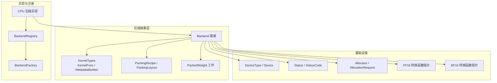
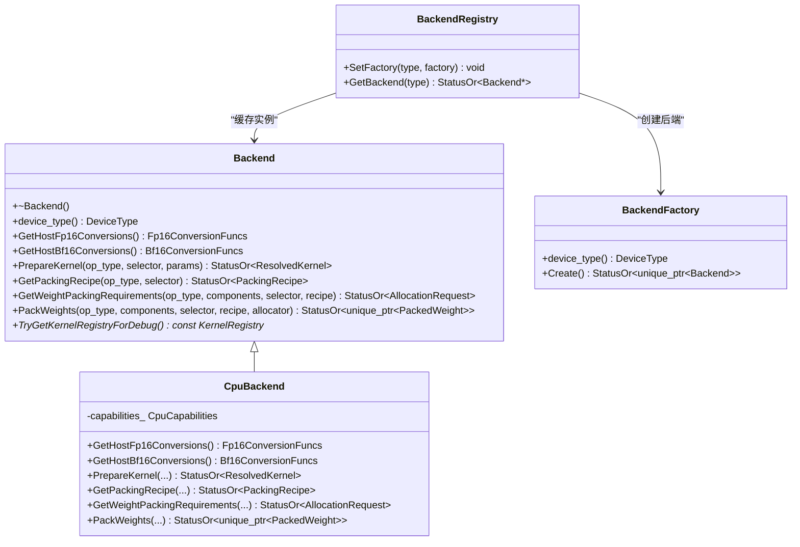
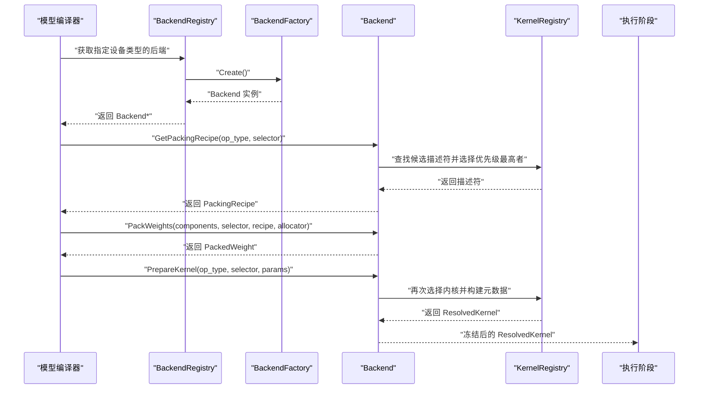
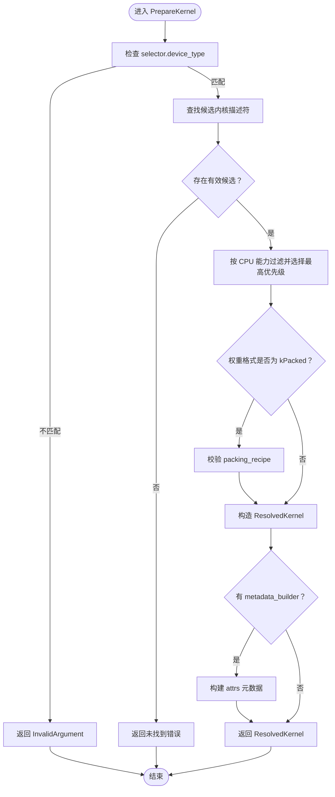
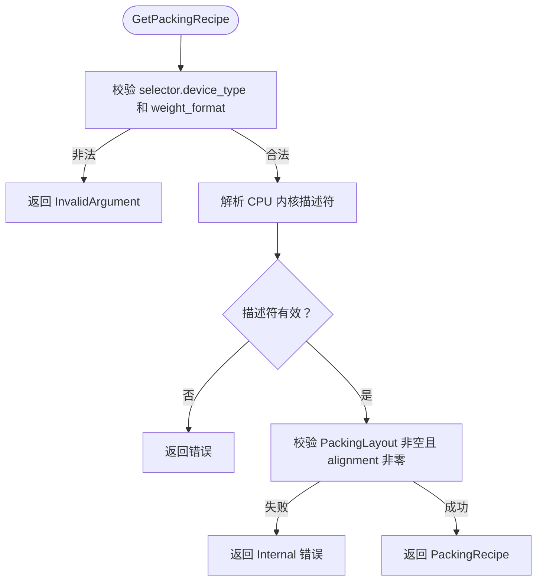
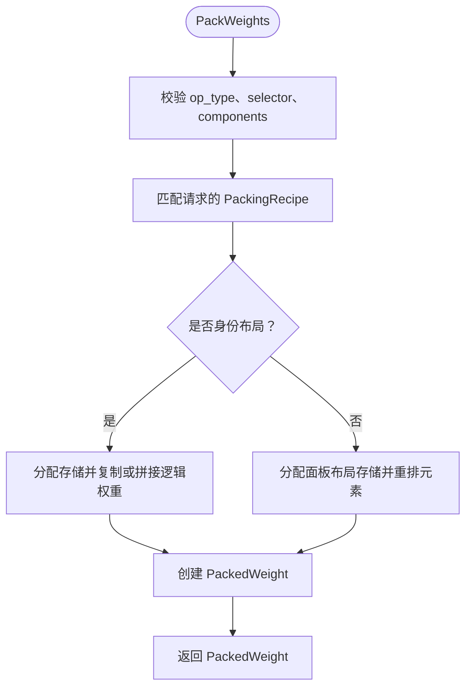
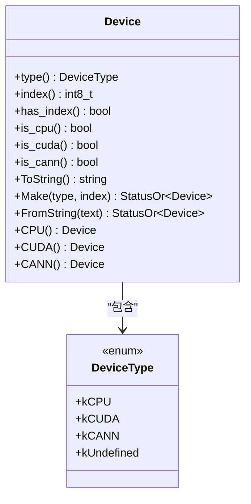
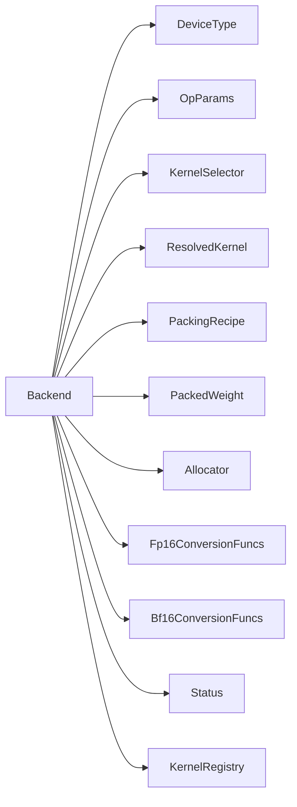

# 后端抽象接口（Backend Abstraction）

**本文引用的文件**
- [backend.h](../../../../include/aethermind/backend/backend.h)
- [kernel_types.h](../../../../include/aethermind/backend/kernel_types.h)
- [packing_recipe.h](../../../../include/aethermind/backend/packing_recipe.h)
- [packed_weight.h](../../../../include/aethermind/backend/packed_weight.h)
- [device.h](../../../../include/aethermind/base/device.h)
- [status.h](../../../../include/aethermind/base/status.h)
- [allocator.h](../../../../include/aethermind/memory/allocator.h)
- [fp16_conversion.h](../../../../include/aethermind/dtypes/fp16_conversion.h)
- [bf16_conversion.h](../../../../include/aethermind/dtypes/bf16_conversion.h)
- [backend_factory.h](../../../../include/aethermind/backend/backend_factory.h)
- [backend_registry.h](../../../../include/aethermind/backend/backend_registry.h)
- [backend_registry.cpp](../../../../src/backend/backend_registry.cpp)
- [cpu_backend.cpp](../../../../src/backend/cpu/cpu_backend.cpp)

## 目录
1. [简介](#简介)
2. [项目结构定位](#项目结构定位)
3. [核心组件总览](#核心组件总览)
4. [架构概览](#架构概览)
5. [详细组件分析](#详细组件分析)
6. [依赖关系分析](#依赖关系分析)
7. [性能与内存特性](#性能与内存特性)
8. [自定义后端实现指南](#自定义后端实现指南)
9. [故障排查](#故障排查)
10. [结论](#结论)

## 简介
AetherMind 的后端抽象层把“计划期内核选择”和“权重打包布局规划”从执行路径中剥离出来。`Backend` 基类不执行算子，而是负责：
- 声明自己服务的设备类型；
- 在模型编译或图准备阶段解析并冻结内核元数据；
- 根据运行时算子描述符决定权重打包配方；
- 将逻辑权重视图转换为后端物理布局的 `PackedWeight` 工件；
- 暴露主机侧 FP16/BF16 批量转换函数指针。

这个设计让上层运行时可以统一处理 CPU、CUDA、CANN 等多种后端，同时保留每个后端对硬件能力、ISA 特化和物理布局的完全控制权。

## 项目结构定位
后端抽象位于 `include/aethermind/backend/`，具体 CPU 后端实现位于 `src/backend/cpu/`。相关的基础设施包括设备枚举、状态类型、分配器、数据类型转换和注册表。

**图示来源**
- [backend.h:26-161](../../../../include/aethermind/backend/backend.h#L26-L161)
- [kernel_types.h:25-119](../../../../include/aethermind/backend/kernel_types.h#L25-L119)
- [packing_recipe.h:13-64](../../../../include/aethermind/backend/packing_recipe.h#L13-L64)
- [packed_weight.h:14-37](../../../../include/aethermind/backend/packed_weight.h#L14-L37)
- [device.h:21-187](../../../../include/aethermind/base/device.h#L21-L187)
- [status.h:29-199](../../../../include/aethermind/base/status.h#L29-L199)
- [allocator.h:19-113](../../../../include/aethermind/memory/allocator.h#L19-L113)
- [fp16_conversion.h:13-71](../../../../include/aethermind/dtypes/fp16_conversion.h#L13-L71)
- [bf16_conversion.h:13-74](../../../../include/aethermind/dtypes/bf16_conversion.h#L13-L74)
- [backend_factory.h:19-44](../../../../include/aethermind/backend/backend_factory.h#L19-L44)
- [backend_registry.h:20-63](../../../../include/aethermind/backend/backend_registry.h#L20-L63)
- [cpu_backend.cpp:501-544](../../../../src/backend/cpu/cpu_backend.cpp#L501-L544)

**章节来源**
- [backend.h:1-163](../../../../include/aethermind/backend/backend.h#L1-L163)
- [device.h:1-188](../../../../include/aethermind/base/device.h#L1-L188)

## 核心组件总览

### Backend 基类职责
`Backend` 是计划期的唯一扩展点。它不负责调用内核，而是返回一个已冻结的 `ResolvedKernel`，其中包含内核入口函数、参数构造器、元数据和工作空间需求。

关键虚函数：
- `device_type()`：声明后端服务的设备类型。
- `GetHostFp16Conversions()` / `GetHostBf16Conversions()`：返回主机侧 FP16/BF16 批量转换函数集合。
- `PrepareKernel()`：根据算子类型、选择器和语义参数解析内核并冻结元数据。
- `GetPackingRecipe()`：在模型准备阶段选择权重打包配方。
- `GetWeightPackingRequirements()`：查询打包后工件的最小存储大小和对齐要求。
- `PackWeights()`：执行逻辑权重到物理布局的转换。
- `TryGetKernelRegistryForDebug()`：暴露调试用的内核注册表。

默认实现中，只有 `device_type()` 和 `TryGetKernelRegistryForDebug()` 是纯虚函数；其余方法提供 `Unimplemented` 或空转换函数，便于逐步实现自定义后端。

**图示来源**
- [backend.h:26-161](../../../../include/aethermind/backend/backend.h#L26-L161)
- [cpu_backend.cpp:501-544](../../../../src/backend/cpu/cpu_backend.cpp#L501-L544)
- [backend_factory.h:19-44](../../../../include/aethermind/backend/backend_factory.h#L19-L44)
- [backend_registry.h:20-63](../../../../include/aethermind/backend/backend_registry.h#L20-L63)

**章节来源**
- [backend.h:26-161](../../../../include/aethermind/backend/backend.h#L26-L161)

### 生命周期与线程安全
- `Backend` 本身是轻量抽象，但 CPU 后端会在构造时冻结全局内核注册表，因此后端实例可能持有平台级初始化状态。
- `BackendRegistry` 明确说明不是线程安全的；当前注释指出计划构建阶段是单线程的，未来多线程构建时需要为内部映射添加互斥锁。
- `Device` 是不可变对象，构造完成后线程安全。
- `Status` 常量方法是线程安全的；`StatusOr` 的非常量修改不是线程安全的。
- `AllocatorRegistry` 也不是线程安全的，需要外部同步。

这意味着自定义后端应：
- 避免在 `PrepareKernel` 等热路径中进行昂贵或阻塞初始化；
- 将平台检测放在工厂或后端构造阶段；
- 不在后端实例上维护可变共享状态，除非自行保证同步；
- 错误通过 `Status` 返回，而不是抛出异常进入内核执行路径。

**章节来源**
- [backend_registry.cpp:1-48](../../../../src/backend/backend_registry.cpp#L1-L48)
- [device.h:27-33](../../../../include/aethermind/base/device.h#L27-L33)
- [status.h:12-21](../../../../include/aethermind/base/status.h#L12-L21)
- [allocator.h:89-113](../../../../include/aethermind/memory/allocator.h#L89-L113)

## 架构概览
后端抽象在整个推理管线中的位置如下：

**图示来源**
- [backend_registry.cpp:19-48](../../../../src/backend/backend_registry.cpp#L19-L48)
- [cpu_backend.cpp:501-544](../../../../src/backend/cpu/cpu_backend.cpp#L501-L544)

**章节来源**
- [backend_registry.h:20-63](../../../../include/aethermind/backend/backend_registry.h#L20-L63)
- [backend_registry.cpp:1-48](../../../../src/backend/backend_registry.cpp#L1-L48)
- [cpu_backend.cpp:501-544](../../../../src/backend/cpu/cpu_backend.cpp#L501-L544)

## 详细组件分析

### PrepareKernel：计划期内核解析流程
`PrepareKernel` 是后端在计划期的主要入口。以 CPU 后端为例，其流程为：

1. 校验选择器的设备类型是否匹配；
2. 使用内核注册表查找候选内核；
3. 过滤掉不支持所需 ISA 能力的描述符；
4. 选择优先级最高的描述符；
5. 如果权重格式为 `kPacked`，校验描述符中的打包配方；
6. 调用描述符提供的 `metadata_builder`，把语义参数冻结为字节数组；
7. 组装并返回 `ResolvedKernel`。

**图示来源**
- [cpu_backend.cpp:501-541](../../../../src/backend/cpu/cpu_backend.cpp#L501-L541)
- [kernel_types.h:94-119](../../../../include/aethermind/backend/kernel_types.h#L94-L119)

**章节来源**
- [backend.h:57-89](../../../../include/aethermind/backend/backend.h#L57-L89)
- [cpu_backend.cpp:501-541](../../../../src/backend/cpu/cpu_backend.cpp#L501-L541)

### GetPackingRecipe：权重打包配方选择机制
`GetPackingRecipe` 在模型准备阶段被调用，此时可能还没有完整的算子张量形状和语义参数，因此它只能基于 `OpType` 和 `KernelSelector` 选择配方。

CPU 后端的实现复用内核描述符选择逻辑：
1. 校验选择器必须是 CPU 且权重格式为 `kPacked`；
2. 调用与 `PrepareKernel` 相同的候选描述符选择过程；
3. 校验描述符中包含有效的 `PackingLayout` 和非零对齐值；
4. 返回该描述符绑定的 `PackingRecipe`。

**图示来源**
- [cpu_backend.cpp:543-544](../../../../src/backend/cpu/cpu_backend.cpp#L543-L544)
- [packing_recipe.h:13-64](../../../../include/aethermind/backend/packing_recipe.h#L13-L64)

**章节来源**
- [backend.h:91-106](../../../../include/aethermind/backend/backend.h#L91-L106)
- [cpu_backend.cpp:543-544](../../../../src/backend/cpu/cpu_backend.cpp#L543-L544)

### PackWeights：物理布局转换契约
`PackWeights` 是后端拥有权威性的权重布局转换入口。它的契约非常严格：

- 输入是逻辑权重视图序列：直接绑定对应单个视图，组合绑定对应多个视图；
- 后端必须验证秩、数据类型、特征维度一致性；
- 后端可以选择合并逻辑视图、填充、重排；
- 输出 `PackedWeight` 的物理布局由后端定义，调用方不能假设它是行主序；
- 存储必须由传入的 `Allocator` 分配，后端只借用；
- 返回的 `PackedWeight::recipe()` 必须与 `GetPackingRecipe` 选择的配方一致；
- 默认实现返回 `Unimplemented`，表示权重打包是可选功能。

CPU 后端目前支持两种布局：
- `CpuIdentityPackingRecipe`：基本身份布局，可直接复制连续视图或拼接多分量；
- `CpuBPanelF32Kc512Nr16Recipe`：面向 GEMM 的微批面板布局，用于高性能矩阵乘。

**图示来源**
- [cpu_backend.cpp:201-330](../../../../src/backend/cpu/cpu_backend.cpp#L201-L330)
- [packed_weight.h:14-37](../../../../include/aethermind/backend/packed_weight.h#L14-L37)
- [packing_recipe.h:13-64](../../../../include/aethermind/backend/packing_recipe.h#L13-L64)

**章节来源**
- [backend.h:108-150](../../../../include/aethermind/backend/backend.h#L108-L150)
- [cpu_backend.cpp:201-330](../../../../src/backend/cpu/cpu_backend.cpp#L201-L330)

### DeviceType 设备类型系统
`DeviceType` 是运行时可识别的计算设备枚举，包括：
- `kCPU`
- `kCUDA`
- `kCANN`
- `kUndefined`

`Device` 在其基础上增加设备索引，并提供工厂方法和字符串解析。CPU 设备索引限制为 `-1` 或 `0`，表示没有多 CPU 设备语义。

**图示来源**
- [device.h:21-187](../../../../include/aethermind/base/device.h#L21-L187)

**章节来源**
- [device.h:21-187](../../../../include/aethermind/base/device.h#L21-L187)

### Fp16/Bf16ConversionFuncs：类型转换函数指针
`Fp16ConversionFuncs` 和 `Bf16ConversionFuncs` 是后端可替换的主机侧批量类型转换函数集合。它们指向：
- 半精度到单精度的展宽函数；
- 单精度到半精度/低精度的压缩函数。

这些函数指针：
- 不接受后端生命周期；
- 默认值是便携式标量实现；
- 必须满足严格的数值契约：保持符号位、NaN 行为、舍入模式、浮点控制标志不变；
- 不得进行额外内存分配；
- 接受任意字节对齐的数据缓冲区。

后端可以在构造或能力探测阶段选择更高效的向量实现，并通过 `GetHostFp16Conversions()` / `GetHostBf16Conversions()` 暴露给上层。

**章节来源**
- [fp16_conversion.h:13-71](../../../../include/aethermind/dtypes/fp16_conversion.h#L13-L71)
- [bf16_conversion.h:13-74](../../../../include/aethermind/dtypes/bf16_conversion.h#L13-L74)
- [backend.h:34-55](../../../../include/aethermind/backend/backend.h#L34-L55)
- [cpu_backend.cpp:519-528](../../../../src/backend/cpu/cpu_backend.cpp#L519-L528)

### AllocationRequest：内存分配契约
`AllocationRequest` 表达后端或分配器需要的最小物理存储：
- `nbytes`：可见负载字节数，后端需自行包含布局填充；
- `alignment`：最小对齐要求，0 表示使用分配器默认策略，非零时必须为 2 的幂。

`Allocator` 的职责是验证请求、获得设备相关存储，并把所有权交给 `Buffer`。后端在 `PackWeights` 中必须通过 `Allocator` 分配，而不能直接使用设备特定分配原语，从而保证调用方的存储策略一致。

**章节来源**
- [allocator.h:19-87](../../../../include/aethermind/memory/allocator.h#L19-L87)
- [backend.h:108-150](../../../../include/aethermind/backend/backend.h#L108-L150)

## 依赖关系分析

**图示来源**
- [backend.h:12-161](../../../../include/aethermind/backend/backend.h#L12-L161)

**章节来源**
- [backend.h:12-161](../../../../include/aethermind/backend/backend.h#L12-L161)

## 性能与内存特性

### 计划期开销
- `PrepareKernel` 会查询内核注册表、选择描述符并可能构建元数据；
- CPU 后端在构造时会冻结全局内核注册表，这属于一次性初始化成本；
- `GetPackingRecipe` 复用描述符选择逻辑，避免重复计算，但仍依赖注册表状态。

### 打包阶段的内存行为
- `GetWeightPackingRequirements` 仅读取逻辑视图元数据，不访问实际权重负载；
- `PackWeights` 通过 `Allocator` 分配最终工件，后端只借用分配器；
- 返回值中的 `PackedWeight` 可跨后端生命周期使用，因为底层 `Buffer` 管理存储所有权；
- 对 CPU 后端而言，大权重可能触发多次拷贝或重排，尤其是面板布局。

### 并发建议
- 不要在热路径中创建后端实例；
- 不要在线程间共享可变后端状态；
- 如需多线程计划构建，需要为 `BackendRegistry` 增加同步；
- 分配器注册表也需要外部同步。

[本节为通用指导，不直接分析具体代码片段]

## 自定义后端实现指南

### 第一步：定义后端工厂
实现 `BackendFactory`，使其返回新后端实例。工厂负责能力检测和可能的设备初始化，失败时应返回 `Status` 而非中止进程。

参考接口：
- `device_type()`
- `Create()`

**章节来源**
- [backend_factory.h:19-44](../../../../include/aethermind/backend/backend_factory.h#L19-L44)

### 第二步：继承 Backend 并实现核心虚函数

#### 必须实现的函数
1. `device_type()`
   - 返回该后端处理的 `DeviceType`；
   - 应与工厂保持一致。

2. `TryGetKernelRegistryForDebug()`
   - 返回可调式的内核注册表指针；
   - 如果后端不提供，可返回 `nullptr`。

#### 推荐实现的函数
3. `PrepareKernel()`
   - 校验 `selector.device_type`；
   - 查找候选内核；
   - 应用设备能力过滤；
   - 选择最高优先级描述符；
   - 构建 `attrs` 元数据；
   - 设置期望的打包配方；
   - 返回 `ResolvedKernel`。

4. `GetPackingRecipe()`
   - 复用与 `PrepareKernel` 一致的候选选择和优先级规则；
   - 返回与描述符绑定的 `PackingRecipe`。

5. `PackWeights()`
   - 校验 `op_type`、`selector`、`components`；
   - 验证请求配方与后端选择一致；
   - 分配 `Allocator` 提供的存储；
   - 完成逻辑视图到物理布局的转换；
   - 返回带正确 `recipe()` 的 `PackedWeight`。

6. `GetWeightPackingRequirements()`
   - 先调用自己的 `GetPackingRecipe()`；
   - 校验传入配方是否与后端选择一致；
   - 返回不包含分配器元数据的可见负载大小和对齐。

7. `GetHostFp16Conversions()` / `GetHostBf16Conversions()`
   - 根据后端能力选择高效实现；
   - 确保函数指针非空；
   - 遵循数值和浮点环境契约。

**章节来源**
- [backend.h:26-161](../../../../include/aethermind/backend/backend.h#L26-L161)

### 第三步：注册后端
使用 `BackendRegistry::SetFactory()` 注册工厂。注册后会覆盖同设备类型的已有工厂，并清除缓存的后端实例。

典型流程：
1. 创建自定义 `BackendFactory`；
2. 调用 `BackendRegistry::SetFactory(device_type, factory)`；
3. 在首次 `GetBackend(device_type)` 时懒加载后端实例；
4. 后续调用直接返回缓存实例。

**章节来源**
- [backend_registry.h:20-63](../../../../include/aethermind/backend/backend_registry.h#L20-L63)
- [backend_registry.cpp:1-48](../../../../src/backend/backend_registry.cpp#L1-L48)

### 第四步：处理错误状态
所有可能失败的路径都应返回 `Status` 或 `StatusOr<T>`，常见错误包括：
- `InvalidArgument`：设备类型不匹配、选择器非法、权重视图无效；
- `NotFound`：没有符合条件的内核或后端工厂；
- `Internal`：描述符缺失打包配方或内部状态不一致；
- `ResourceExhausted`：内存分配失败；
- `Overflow`：形状、步长或字节数溢出；
- `Unimplemented`：后端尚未实现某项能力。

CPU 后端示例中，`std::bad_alloc` 会被捕获并转为 `ResourceExhausted`，这是后端包装分配失败的常见模式。

**章节来源**
- [status.h:29-199](../../../../include/aethermind/base/status.h#L29-L199)
- [cpu_backend.cpp:331-499](../../../../src/backend/cpu/cpu_backend.cpp#L331-L499)

### 第五步：线程安全注意事项
- 后端实例应避免持有可变全局状态；
- 若必须缓存能力检测结果，应在构造阶段完成；
- 不要在内核执行路径中加锁；
- 如需多线程计划构建，请在 `BackendRegistry` 层加锁，而不是在每个后端内部分散加锁。

**章节来源**
- [backend_registry.cpp:19-48](../../../../src/backend/backend_registry.cpp#L19-L48)
- [device.h:27-33](../../../../include/aethermind/base/device.h#L27-L33)

### 第六步：最小示例思路
虽然本仓库没有提供完整的外部自定义后端示例，但基于现有实现可以归纳出以下思路：

1. 定义一个新设备类型或复用现有类型；
2. 实现 `MyBackendFactory`，在 `Create()` 中构造 `MyBackend`；
3. 实现 `MyBackend::device_type()` 返回目标设备；
4. 实现 `MyBackend::PrepareKernel()`，复用或绕过内核注册表；
5. 实现 `MyBackend::GetPackingRecipe()`，返回支持的打包配方；
6. 实现 `MyBackend::PackWeights()`，使用 `Allocator` 分配并转换权重；
7. 实现 `MyBackend::TryGetKernelRegistryForDebug()`，返回调试信息或 `nullptr`；
8. 在程序启动阶段调用 `BackendRegistry::SetFactory()` 注册工厂；
9. 通过 `RuntimeBuilder` 或运行时配置间接使用该后端。

**章节来源**
- [backend_factory.h:19-44](../../../../include/aethermind/backend/backend_factory.h#L19-L44)
- [backend_registry.h:20-63](../../../../include/aethermind/backend/backend_registry.h#L20-L63)
- [cpu_backend.cpp:501-544](../../../../src/backend/cpu/cpu_backend.cpp#L501-L544)

## 故障排查

### 常见问题及原因

| 现象 | 可能原因 | 建议检查 |
|---|---|---|
| `PrepareKernel` 返回未找到错误 | 没有注册对应设备的后端工厂，或内核描述符不符合设备能力 | 检查 `BackendRegistry` 是否注册了工厂，以及内核描述符的 CPU 能力要求 |
| `GetPackingRecipe` 返回未实现 | 后端没有重写该方法，或描述符缺少打包配方 | 确认后端实现并检查描述符中的 `packing_recipe` |
| `PackWeights` 返回未实现 | 后端没有实现权重打包 | 实现 `PackWeights`，或使用默认布局 |
| 请求配方与实际选择不一致 | 调用方传入了错误的 `PackingRecipe` | 确保先调用 `GetPackingRecipe()`，再传给 `PackWeights()` |
| 内存分配失败 | 权重过大或对齐要求过高 | 检查 `AllocationRequest.nbytes` 和 `alignment` |
| 数值不正确 | FP16/BF16 转换函数未遵循数值契约 | 检查自定义转换函数的舍入、NaN 和符号行为 |
| 多线程崩溃 | 共享可变后端状态或并发访问注册表 | 避免共享可变状态，或在 `BackendRegistry` 层加锁 |

**章节来源**
- [cpu_backend.cpp:501-544](../../../../src/backend/cpu/cpu_backend.cpp#L501-L544)
- [backend_registry.cpp:1-48](../../../../src/backend/backend_registry.cpp#L1-L48)
- [allocator.h:19-87](../../../../include/aethermind/memory/allocator.h#L19-L87)

## 结论
AetherMind 的 `Backend` 抽象是一个清晰的计划期扩展点：它把内核选择、元数据冻结、权重布局规划和主机侧类型转换解耦成可测试、可替换的组件。CPU 后端展示了如何结合内核注册表、能力探测、打包配方和分配器完成完整链路。

实现自定义后端时，最重要的原则是：
- 严格区分计划期和执行期；
- 使用 `Status` 表达错误；
- 通过 `Allocator` 管理内存；
- 通过 `PackingRecipe` 固化物理布局；
- 通过 `KernelSelector` 和 `KernelRegistry` 保持调度一致性；
- 避免在热路径中进行不可逆初始化。

这样，新的硬件后端就能以最小侵入方式接入 AetherMind 的推理运行时。
