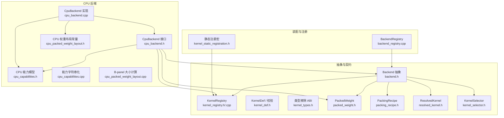
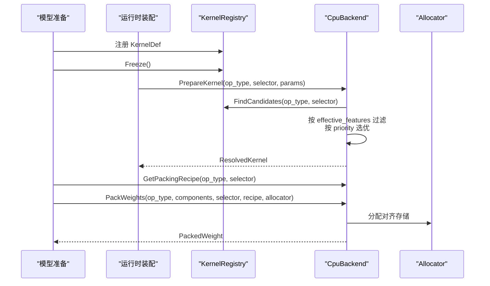
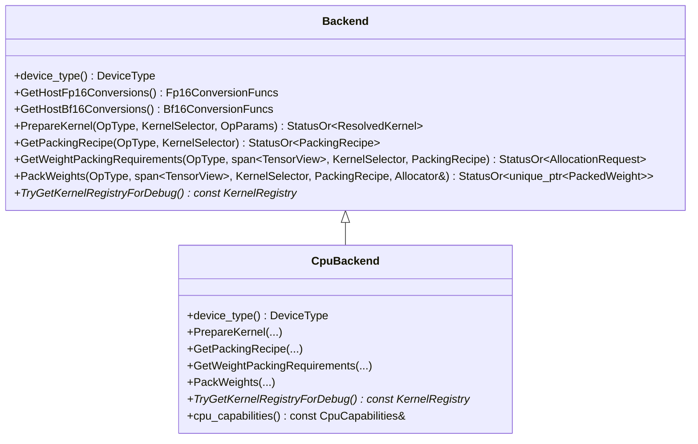
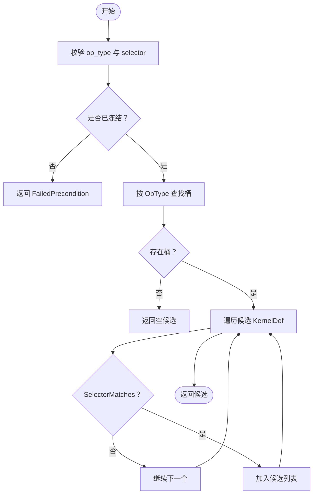
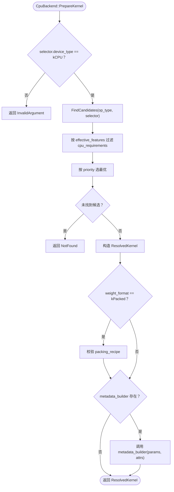
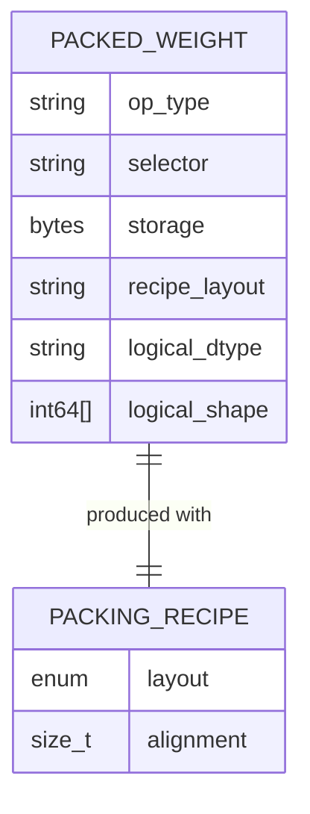
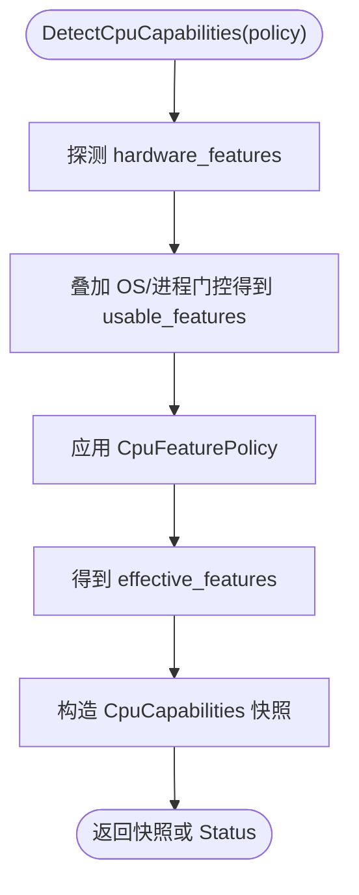
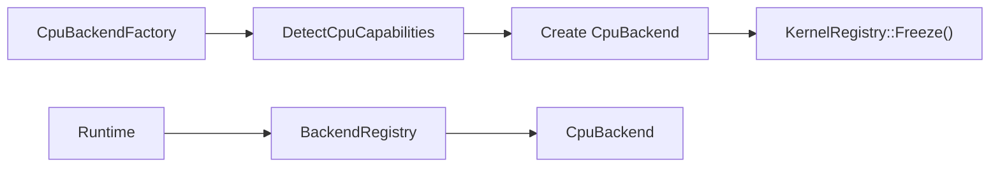
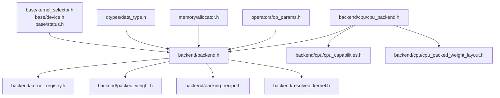

# 后端系统 (Backend)

**本文引用的文件**
- [backend.h](../../../../include/aethermind/backend/backend.h)
- [kernel_registry.h](../../../../include/aethermind/backend/kernel_registry.h)
- [kernel_def.h](../../../../include/aethermind/backend/kernel_def.h)
- [kernel_types.h](../../../../include/aethermind/backend/kernel_types.h)
- [packed_weight.h](../../../../include/aethermind/backend/packed_weight.h)
- [packing_recipe.h](../../../../include/aethermind/backend/packing_recipe.h)
- [resolved_kernel.h](../../../../include/aethermind/backend/resolved_kernel.h)
- [kernel_selector.h](../../../../include/aethermind/base/kernel_selector.h)
- [cpu_backend.h](../../../../include/aethermind/backend/cpu/cpu_backend.h)
- [cpu_capabilities.h](../../../../include/aethermind/backend/cpu/cpu_capabilities.h)
- [cpu_packed_weight_layout.h](../../../../include/aethermind/backend/cpu/cpu_packed_weight_layout.h)
- [backend_registry.cpp](../../../../src/backend/backend_registry.cpp)
- [kernel_registry.cpp](../../../../src/backend/kernel_registry.cpp)
- [cpu_backend.cpp](../../../../src/backend/cpu/cpu_backend.cpp)
- [cpu_capabilities.cpp](../../../../src/backend/cpu/cpu_capabilities.cpp)
- [cpu_packed_weight_layout.cpp](../../../../src/backend/cpu/cpu_packed_weight_layout.cpp)
- [kernel_static_registration.h](../../../../include/aethermind/backend/kernel_static_registration.h)
- [src/backend/](../../../../src/backend)

## 目录
1. [简介](#简介)
2. [项目结构](#项目结构)
3. [核心组件](#核心组件)
4. [架构总览](#架构总览)
5. [详细组件分析](#详细组件分析)
6. [依赖关系分析](#依赖关系分析)
7. [性能与扩展性](#性能与扩展性)
8. [故障排查指南](#故障排查指南)
9. [结论](#结论)
10. [附录：自定义后端开发指南](#附录自定义后端开发指南)

## 简介
AetherMind 的 Backend 层是设备族执行能力与内核目录的核心。它负责：
- 通过 `Backend` 抽象接口提供规划期的内核解析入口；
- 由 `CpuBackend` 实现 CPU 设备族的能力检测、候选内核选择与权重打包；
- 使用 `KernelRegistry` 维护全局内核定义，并通过 `PackingRecipe` 描述精确的物理权重布局身份；
- 将逻辑权重转换为后端专属的 `PackedWeight` 产物，供执行期算子消费。

本文件从架构、数据流、算法和扩展机制四个维度解释后端系统，并给出自定义后端开发和性能优化的完整指引。

## 项目结构
后端相关代码分布在以下位置：
- 公共抽象与契约：`include/aethermind/backend/*`
- CPU 后端实现：`src/backend/cpu/*`
- 后端装配与注册：`src/backend/backend_registry.cpp`、`src/backend/kernel_registry.cpp`
- 模块设计文档：本文

**图表来源**
- [backend.h:1-163](../../../../include/aethermind/backend/backend.h#L1-L163)
- [kernel_registry.h:1-90](../../../../include/aethermind/backend/kernel_registry.h#L1-L90)
- [kernel_def.h:1-133](../../../../include/aethermind/backend/kernel_def.h#L1-L133)
- [kernel_types.h:1-120](../../../../include/aethermind/backend/kernel_types.h#L1-L120)
- [packed_weight.h:1-38](../../../../include/aethermind/backend/packed_weight.h#L1-L38)
- [packing_recipe.h:1-65](../../../../include/aethermind/backend/packing_recipe.h#L1-L65)
- [resolved_kernel.h:1-63](../../../../include/aethermind/backend/resolved_kernel.h#L1-L63)
- [kernel_selector.h:1-107](../../../../include/aethermind/base/kernel_selector.h#L1-L107)
- [cpu_backend.h:1-157](../../../../include/aethermind/backend/cpu/cpu_backend.h#L1-L157)
- [cpu_capabilities.h:1-219](../../../../include/aethermind/backend/cpu/cpu_capabilities.h#L1-L219)
- [cpu_packed_weight_layout.h:1-55](../../../../include/aethermind/backend/cpu/cpu_packed_weight_layout.h#L1-L55)
- [backend_registry.cpp:1-48](../../../../src/backend/backend_registry.cpp#L1-L48)
- [kernel_registry.cpp:1-138](../../../../src/backend/kernel_registry.cpp#L1-L138)
- [cpu_backend.cpp:1-551](../../../../src/backend/cpu/cpu_backend.cpp#L1-L551)
- [cpu_capabilities.cpp:1-75](../../../../src/backend/cpu/cpu_capabilities.cpp#L1-L75)
- [cpu_packed_weight_layout.cpp:1-33](../../../../src/backend/cpu/cpu_packed_weight_layout.cpp#L1-L33)
- [kernel_static_registration.h:1-24](../../../../include/aethermind/backend/kernel_static_registration.h#L1-L24)
- [src/backend/](../../../../src/backend)

**章节来源**
- [src/backend/](../../../../src/backend)

## 核心组件
- `Backend`：规划期内核选择的抽象接口，不执行内核，只负责解析、冻结元数据与返回 `ResolvedKernel`。
- `CpuBackend`：CPU 后端实现，持有不可变的 `CpuCapabilities` 快照，按有效指令集过滤候选内核并按优先级选择。
- `KernelRegistry`：进程级内核定义目录，支持注册、冻结、按 `OpType` 桶索引查找候选。
- `KernelDef`：内核定义，绑定操作符、选择器、CPU 能力需求、函数指针、参数/元数据构建器与名称。
- `PackedWeight`：后端专属权重产物，携带逻辑 dtype、逻辑 shape、存储 Buffer 与 `PackingRecipe`。
- `PackingRecipe`：精确物理布局身份，包含 layout 枚举与对齐要求。
- `ResolvedKernel`：规划期冻结的内核句柄，包含函数指针、attrs、workspace 需求与期望的 packed recipe。
- `KernelSelector`：跨模块的执行请求描述，包括 device、dtype、weight_format、phase 等。

**章节来源**
- [backend.h:20-163](../../../../include/aethermind/backend/backend.h#L20-L163)
- [cpu_backend.h:24-157](../../../../include/aethermind/backend/cpu/cpu_backend.h#L24-L157)
- [kernel_registry.h:13-90](../../../../include/aethermind/backend/kernel_registry.h#L13-L90)
- [kernel_def.h:21-133](../../../../include/aethermind/backend/kernel_def.h#L21-L133)
- [packed_weight.h:15-38](../../../../include/aethermind/backend/packed_weight.h#L15-L38)
- [packing_recipe.h:14-65](../../../../include/aethermind/backend/packing_recipe.h#L14-L65)
- [resolved_kernel.h:23-63](../../../../include/aethermind/backend/resolved_kernel.h#L23-L63)
- [kernel_selector.h:22-107](../../../../include/aethermind/base/kernel_selector.h#L22-L107)

## 架构总览
后端系统的运行分为三个阶段：
1. **注册阶段**：各内核通过 `AM_REGISTER_KERNEL` 静态初始化时调用 `KernelRegistry::Register`，完成后调用 `Freeze()` 建立只读桶索引。
2. **规划阶段**：`CpuBackend::PrepareKernel` 根据 `KernelSelector` 找到候选，再用 `effective_features` 过滤并按 priority 选择最佳 `KernelDef`，最后生成 `ResolvedKernel`。
3. **准备与执行阶段**：模型准备期可查询 `GetPackingRecipe`，随后通过 `PackWeights` 生成 `PackedWeight`；执行期通过 `KernelContext` 调用已冻结的 `KernelFunc`。

**图表来源**
- [kernel_registry.cpp:31-138](../../../../src/backend/kernel_registry.cpp#L31-L138)
- [cpu_backend.cpp:360-551](../../../../src/backend/cpu/cpu_backend.cpp#L360-L551)
- [backend_registry.cpp:5-48](../../../../src/backend/backend_registry.cpp#L5-L48)

**章节来源**
- [kernel_registry.cpp:1-138](../../../../src/backend/kernel_registry.cpp#L1-L138)
- [cpu_backend.cpp:360-551](../../../../src/backend/cpu/cpu_backend.cpp#L360-L551)
- [backend_registry.cpp:1-48](../../../../src/backend/backend_registry.cpp#L1-L48)

## 详细组件分析

### Backend 抽象接口
`Backend` 暴露规划期唯一入口 `PrepareKernel`，以及可选的权重打包能力：
- `device_type()`：声明后端处理的设备类型。
- `GetHostFp16Conversions()` / `GetHostBf16Conversions()`：主机浮点转换函数表；默认标量实现，CPU 后端根据有效特征选择优化路径。
- `PrepareKernel()`：解析并冻结 `ResolvedKernel`，包含 attrs、params_builder、workspace_requirement 与 packed recipe。
- `GetPackingRecipe()`：模型准备期查询 exact packing recipe。
- `GetWeightPackingRequirements()`：只读查询打包存储需求。
- `PackWeights()`：唯一打包入口，按 logical binding 顺序处理 components。
- `TryGetKernelRegistryForDebug()`：调试自省接口。

**图表来源**
- [backend.h:20-163](../../../../include/aethermind/backend/backend.h#L20-L163)
- [cpu_backend.h:24-157](../../../../include/aethermind/backend/cpu/cpu_backend.h#L24-L157)

**章节来源**
- [backend.h:20-163](../../../../include/aethermind/backend/backend.h#L20-L163)
- [cpu_backend.h:24-157](../../../../include/aethermind/backend/cpu/cpu_backend.h#L24-L157)

### KernelRegistry 与内核发现流程
`KernelRegistry` 维护进程级内核目录：
- `Register()`：校验 `KernelDef`、去重、追加到 `kernels_`。
- `Freeze()`：构建 `buckets_` 桶索引并将 `frozen_` 置为 true。
- `FindCandidates()`：先按 `OpType` 取桶，再按 `SelectorMatches` 做结构匹配；不检查 CPU 指令集。
- `FindByOpType()`：调试用，不按 selector 过滤。

**图表来源**
- [kernel_registry.cpp:31-103](../../../../src/backend/kernel_registry.cpp#L31-L103)
- [kernel_selector.h:67-107](../../../../include/aethermind/base/kernel_selector.h#L67-L107)

**章节来源**
- [kernel_registry.h:13-90](../../../../include/aethermind/backend/kernel_registry.h#L13-L90)
- [kernel_registry.cpp:1-138](../../../../src/backend/kernel_registry.cpp#L1-L138)
- [kernel_selector.h:22-107](../../../../include/aethermind/base/kernel_selector.h#L22-L107)

### CPU 后端选择算法
`CpuBackend` 在 `PrepareKernel` 中完成最终选择：
1. 验证 selector 是否为 CPU。
2. 调用内部 `ResolveEligibleDescriptor`：
   - 获取 `FindCandidates`。
   - 用 `effective_features.ContainsAll(cpu_requirements)` 过滤。
   - 按 `priority` 选最高者。
3. 构造 `ResolvedKernel`，填充 attrs、name、params_builder、workspace_requirement。
4. 若 weight_format 为 packed，校验 descriptor 的 packing_recipe 并写入 `expected_packing_recipe`。
5. 若有 metadata_builder，调用其生成 attrs。

**图表来源**
- [cpu_backend.cpp:416-510](../../../../src/backend/cpu/cpu_backend.cpp#L416-L510)

**章节来源**
- [cpu_backend.cpp:360-510](../../../../src/backend/cpu/cpu_backend.cpp#L360-L510)

### PackedWeight 与权重打包格式
`PackedWeight` 是后端专属权重产物的抽象，包含：
- `op_type()`、`selector()`、`storage()`、`recipe()`、`logical_dtype()`、`logical_shape()`。

CPU 后端实现 `CpuPackedWeight`，并使用两种布局：
- `kCpuIdentity`：连续逻辑字节，单组件直接拷贝，多组件沿 axis 0 拼接。
- `kCpuBPanelF32Kc512Nr16`：FP32 `[N,K]` 权重转为物理轴序 `[K-panel][N-block][K-row][N-lane]`，其中 KC=512、NR=16，N lane 连续，padding 写 `+0.0F`，每个 panel block 起始 64 字节对齐。

**图表来源**
- [packed_weight.h:15-38](../../../../include/aethermind/backend/packed_weight.h#L15-L38)
- [packing_recipe.h:37-65](../../../../include/aethermind/backend/packing_recipe.h#L37-L65)
- [cpu_packed_weight_layout.h:20-55](../../../../include/aethermind/backend/cpu/cpu_packed_weight_layout.h#L20-L55)

**章节来源**
- [packed_weight.h:15-38](../../../../include/aethermind/backend/packed_weight.h#L15-L38)
- [packing_recipe.h:14-65](../../../../include/aethermind/backend/packing_recipe.h#L14-L65)
- [cpu_packed_weight_layout.h:20-55](../../../../include/aethermind/backend/cpu/cpu_packed_weight_layout.h#L20-L55)
- [cpu_packed_weight_layout.cpp:1-33](../../../../src/backend/cpu/cpu_packed_weight_layout.cpp#L1-L33)
- [cpu_backend.cpp:201-359](../../../../src/backend/cpu/cpu_backend.cpp#L201-L359)

### CPU 能力的动态检测
`CpuCapabilities` 保存三层能力：
- `hardware_features`：原始硬件位；
- `usable_features`：硬件与操作系统/进程上下文允许的能力；
- `effective_features`：应用 `CpuFeaturePolicy` 后的最终集合。

策略 `CpuFeaturePolicy` 只能禁用或要求特性，不能启用缺失特性。CPU 后端构造函数可选择：
- 直接使用已有快照；
- 使用策略检测；
- 工厂通过 `Status` 通道返回错误。

能力字符串化与命名由 `cpu_capabilities.cpp` 维护。

**图表来源**
- [cpu_capabilities.h:1-219](../../../../include/aethermind/backend/cpu/cpu_capabilities.h#L1-L219)
- [cpu_capabilities.cpp:1-75](../../../../src/backend/cpu/cpu_capabilities.cpp#L1-L75)
- [cpu_backend.cpp:45-57](../../../../src/backend/cpu/cpu_backend.cpp#L45-L57)

**章节来源**
- [cpu_capabilities.h:1-219](../../../../include/aethermind/backend/cpu/cpu_capabilities.h#L1-L219)
- [cpu_capabilities.cpp:1-75](../../../../src/backend/cpu/cpu_capabilities.cpp#L1-L75)
- [cpu_backend.h:24-157](../../../../include/aethermind/backend/cpu/cpu_backend.h#L24-L157)
- [cpu_backend.cpp:45-57](../../../../src/backend/cpu/cpu_backend.cpp#L45-L57)

### 后端装配与生命周期
`BackendRegistry` 按 `DeviceType` 管理 factory，懒创建并缓存 backend；`CpuBackendFactory::Create()` 每次重新检测能力并返回 `Status`。`KernelRegistry::Global()` 是进程级目录，首个 `CpuBackend` 构造时会尝试 `Freeze()`。

**图表来源**
- [backend_registry.cpp:5-48](../../../../src/backend/backend_registry.cpp#L5-L48)
- [cpu_backend.cpp:509-551](../../../../src/backend/cpu/cpu_backend.cpp#L509-L551)

**章节来源**
- [backend_registry.cpp:1-48](../../../../src/backend/backend_registry.cpp#L1-L48)
- [cpu_backend.cpp:509-551](../../../../src/backend/cpu/cpu_backend.cpp#L509-L551)

## 依赖关系分析
后端模块依赖方向严格分层：
- backend 依赖 base、dtypes、memory、operators 的纯数据契约；
- execution 与 model 可直接使用 backend 的纯数据头；
- backend 不反向依赖 graph、compiler、model、execution、inference。

**图表来源**
- [backend.h:10-163](../../../../include/aethermind/backend/backend.h#L10-L163)
- [cpu_backend.h:10-157](../../../../include/aethermind/backend/cpu/cpu_backend.h#L10-L157)
- [src/backend/](../../../../src/backend)

**章节来源**
- [src/backend/](../../../../src/backend)

## 性能与扩展性

### 性能特征
- 内核选择热路径在 `KernelRegistry::Freeze()` 后无锁读取桶索引；
- `SelectorMatches` 只做字段相等比较，避免字符串与复杂计算；
- `CpuFeatureSet` 使用两个 `uint64_t` 位集，`ContainsAll` 按字比较；
- CPU 权重打包对形状、stride、元素数进行溢出检查，避免危险乘法；
- B-panel 打包预清零并逐行映射到物理索引，减少额外中间缓冲；
- 默认 host FP16/BF16 转换退化为标量，CPU 后端根据有效特征选择优化实现。

### 扩展机制
- 新增后端需实现 `Backend` 接口并提供 `BackendFactory`；
- 新增内核通过 `AM_REGISTER_KERNEL` 静态注册 `KernelDef`；
- 新增 packed layout 应增加 `PackingLayout` 枚举值，并在 `IsValidPackingLayout` 与 `ToString` 中同步更新；
- 新增 CPU 指令集需在 `CpuFeature` 中 append-only 添加，并在 `cpu_capabilities.cpp` 名字表中同步。

### 优化建议
- 优先声明更具体的 selector 与 packing_recipe，减少候选数量；
- 合理设置 `priority`，让更高效内核优先被选；
- 使用 `CpuFeaturePolicy` 显式禁用不稳定或不可用的特性；
- 对大权重使用 B-panel 布局以获得更好的内存局部性与 SIMD 吞吐；
- 控制 `params_size`，避免超过 `kMaxKernelParamsSize`；
- 避免在 kernel 内持有宽对象或异步状态，保持单次调用语义。

**章节来源**
- [kernel_registry.cpp:31-103](../../../../src/backend/kernel_registry.cpp#L31-L103)
- [cpu_capabilities.h:60-180](../../../../include/aethermind/backend/cpu/cpu_capabilities.h#L60-L180)
- [cpu_backend.cpp:201-359](../../../../src/backend/cpu/cpu_backend.cpp#L201-L359)
- [kernel_def.h:21-133](../../../../include/aethermind/backend/kernel_def.h#L21-L133)
- [packing_recipe.h:14-65](../../../../include/aethermind/backend/packing_recipe.h#L14-L65)

## 故障排查指南

### 常见问题
- 注册重复：`KernelRegistry::Register` 对 `RegistrationKey` 去重，重复注册返回失败。
- 未冻结查询：`FindCandidates` 在未冻结时返回 `FailedPrecondition`。
- 无效 selector：`ValidateResolveArgs` 拒绝 `kUnknown` op_type 或 `kUndefined` device_type。
- 非 CPU 后端处理 CPU selector：`CpuBackend::PrepareKernel` 返回 `InvalidArgument`。
- 缺少 eligible kernel：按 effective_features 过滤后未找到候选，返回 `NotFound`。
- 打包 recipe 不匹配：`PackWeights` 与 `GetWeightPackingRequirements` 会校验 requested recipe 与 selected recipe。
- 非法 packed descriptor：`ValidateKernelDef` 拒绝未知 layout、非幂次对齐或 plain descriptor 声明 recipe。

### 定位方法
- 使用 `KernelRegistry::DebugDump()` 查看已注册内核的 op_type、selector、cpu_requirements 与 priority。
- 使用 `TryGetKernelRegistryForDebug()` 获取后端提供的调试入口。
- 检查 `CpuCapabilities.effective_features` 是否满足 `cpu_requirements`。
- 检查 `PackingRecipe.layout` 与 `alignment` 是否符合 `IsValidPackingLayout` 与幂次对齐要求。

**章节来源**
- [kernel_registry.cpp:1-138](../../../../src/backend/kernel_registry.cpp#L1-L138)
- [cpu_backend.cpp:360-551](../../../../src/backend/cpu/cpu_backend.cpp#L360-L551)
- [kernel_def.h:69-133](../../../../include/aethermind/backend/kernel_def.h#L69-L133)
- [packing_recipe.h:24-36](../../../../include/aethermind/backend/packing_recipe.h#L24-L36)

## 结论
AetherMind 的后端系统以 `Backend` 抽象为核心，通过 `KernelRegistry` 实现内核发现，通过 `CpuBackend` 完成 CPU 能力检测、内核选择与权重打包，并通过 `PackedWeight` 与 `PackingRecipe` 解耦逻辑权重与物理布局。该设计使后端扩展、指令集适配与权重优化路径清晰分离，同时保持执行期窄契约与低开销。

## 附录：自定义后端开发指南

### 步骤一：定义后端类
实现 `Backend`：
- 实现 `device_type()`；
- 实现 `PrepareKernel()`，返回 `ResolvedKernel`；
- 如需权重打包，实现 `GetPackingRecipe()`、`GetWeightPackingRequirements()`、`PackWeights()`；
- 实现 `TryGetKernelRegistryForDebug()`。

参考路径：
- [backend.h:20-163](../../../../include/aethermind/backend/backend.h#L20-L163)
- [cpu_backend.h:24-157](../../../../include/aethermind/backend/cpu/cpu_backend.h#L24-L157)

### 步骤二：定义内核定义
编写 `KernelDef`：
- 指定 `op_type`、`selector`、`kernel_func`、`name`；
- 如为 packed kernel，填写已知 `packing_recipe` 与合法 `alignment`；
- 如需要 CPU 指令集，填写 `cpu_requirements`；
- 可选填写 `params_builder`、`params_size`、`metadata_builder`。

参考路径：
- [kernel_def.h:21-133](../../../../include/aethermind/backend/kernel_def.h#L21-L133)

### 步骤三：静态注册内核
使用 `AM_REGISTER_KERNEL` 在编译单元内注册，注册失败会通过断言终止进程。

参考路径：
- [kernel_static_registration.h:1-24](../../../../include/aethermind/backend/kernel_static_registration.h#L1-L24)

### 步骤四：注册后端工厂
实现 `BackendFactory` 并通过 `BackendRegistry::SetFactory` 注册；factory 的 `Create()` 应通过 `Status` 传播初始化错误。

参考路径：
- [backend_registry.cpp:5-48](../../../../src/backend/backend_registry.cpp#L5-L48)
- [cpu_backend.h:114-157](../../../../include/aethermind/backend/cpu/cpu_backend.h#L114-L157)

### 步骤五：实现权重打包
如需 packed weight：
- 新增 `PackingLayout` 枚举值；
- 更新 `IsValidPackingLayout` 与 `ToString`；
- 定义布局常量、对齐与计算公式；
- 在 `PackWeights` 中实现 layout 到物理 buffer 的映射。

参考路径：
- [packing_recipe.h:14-65](../../../../include/aethermind/backend/packing_recipe.h#L14-L65)
- [cpu_packed_weight_layout.h:20-55](../../../../include/aethermind/backend/cpu/cpu_packed_weight_layout.h#L20-L55)
- [cpu_packed_weight_layout.cpp:1-33](../../../../src/backend/cpu/cpu_packed_weight_layout.cpp#L1-L33)
- [cpu_backend.cpp:201-359](../../../../src/backend/cpu/cpu_backend.cpp#L201-L359)

### 步骤六：测试与验证
- 验证 `KernelRegistry::Freeze()` 后能正确 `FindCandidates`；
- 验证 `PrepareKernel` 能返回 expected `ResolvedKernel`；
- 验证 `PackWeights` 生成的 `PackedWeight` 的 `recipe()` 与 `storage()` 符合预期；
- 验证 CPU 能力策略能正确限制或要求特性。

参考路径：
- [kernel_registry.cpp:31-138](../../../../src/backend/kernel_registry.cpp#L31-L138)
- [cpu_backend.cpp:416-551](../../../../src/backend/cpu/cpu_backend.cpp#L416-L551)
- [cpu_capabilities.h:120-219](../../../../include/aethermind/backend/cpu/cpu_capabilities.h#L120-L219)
