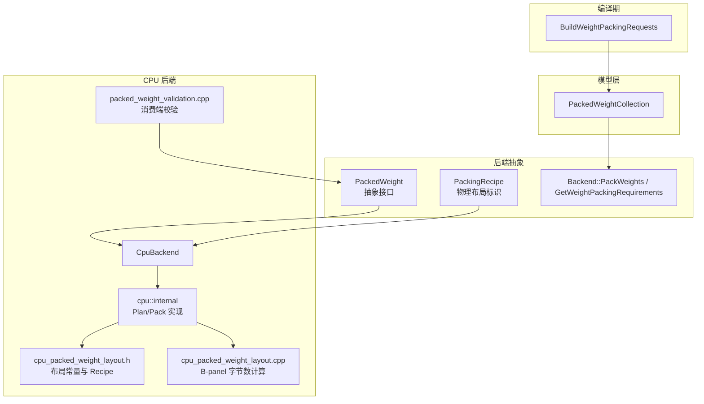
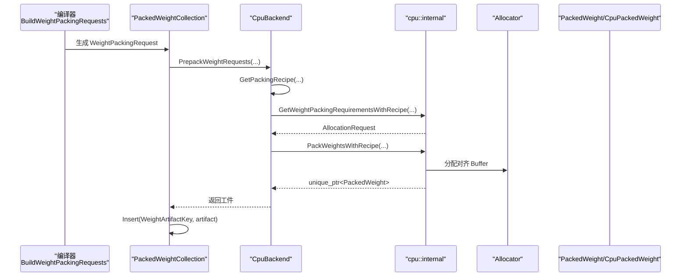
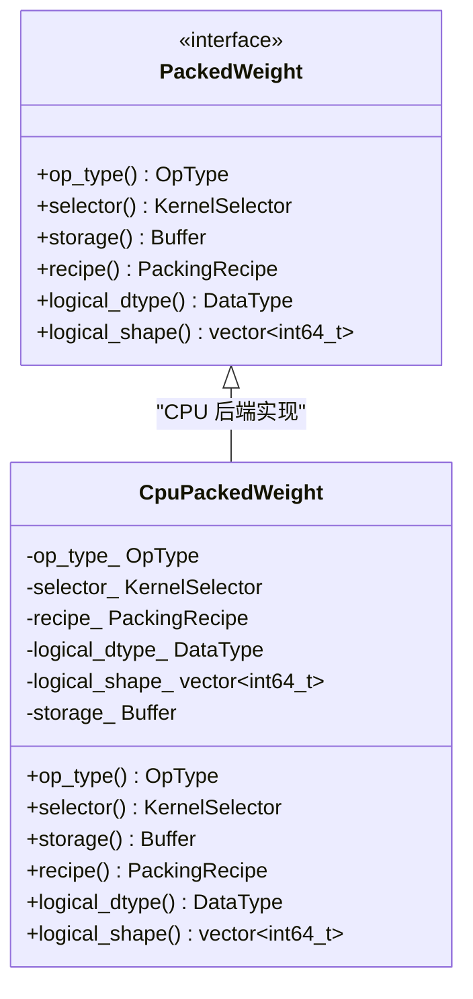
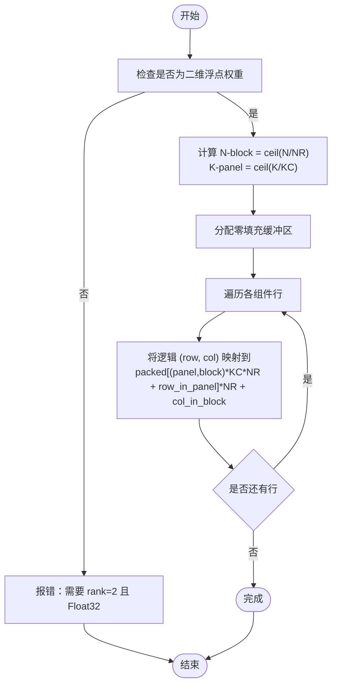
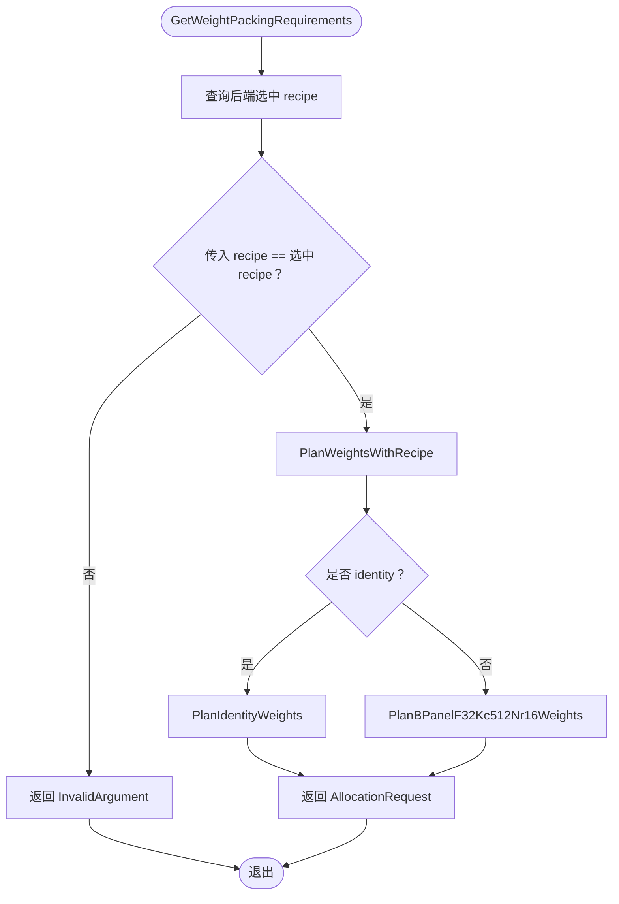
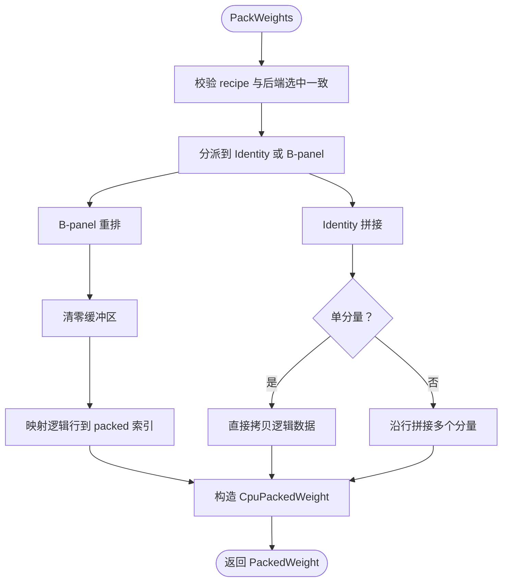
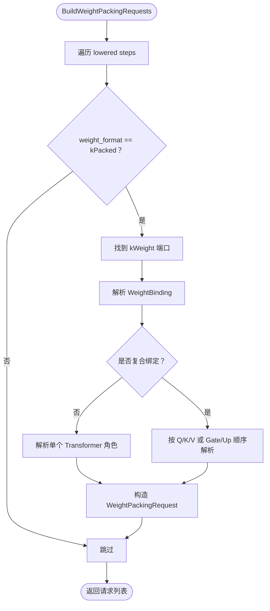
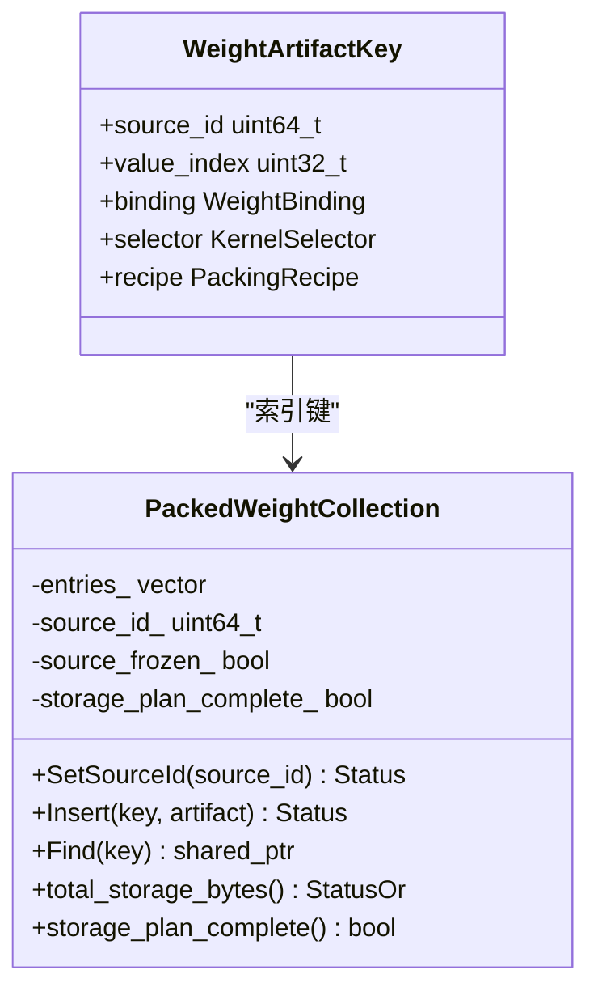
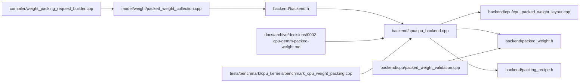
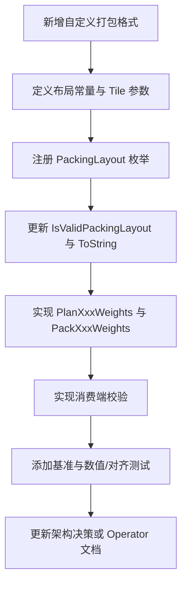

# 权重打包系统 (Packed Weight System)

**本文引用的文件**
- [packed_weight.h](../../../../include/aethermind/backend/packed_weight.h)
- [packing_recipe.h](../../../../include/aethermind/backend/packing_recipe.h)
- [cpu_packed_weight_layout.h](../../../../include/aethermind/backend/cpu/cpu_packed_weight_layout.h)
- [cpu_backend.h](../../../../include/aethermind/backend/cpu/cpu_backend.h)
- [weight_packing_request_builder.h](../../../../include/aethermind/compiler/weight_packing_request_builder.h)
- [packed_weight_collection.h](../../../../include/aethermind/model/weight/packed_weight_collection.h)
- [cpu_backend.cpp](../../../../src/backend/cpu/cpu_backend.cpp)
- [cpu_packed_weight_layout.cpp](../../../../src/backend/cpu/cpu_packed_weight_layout.cpp)
- [packed_weight_validation.cpp](../../../../src/backend/cpu/packed_weight_validation.cpp)
- [weight_packing_request_builder.cpp](../../../../src/compiler/weight_packing_request_builder.cpp)
- [packed_weight_collection.cpp](../../../../src/model/weight/packed_weight_collection.cpp)
- [0002-cpu-gemm-packed-weight.md](../../../archive/decisions/0002-cpu-gemm-packed-weight.md)
- [benchmark_cpu_weight_packing.cpp](../../../../tests/benchmark/cpu_kernels/benchmark_cpu_weight_packing.cpp)

## 目录
1. [引言](#引言)
2. [项目结构](#项目结构)
3. [核心组件](#核心组件)
4. [架构总览](#架构总览)
5. [详细组件分析](#详细组件分析)
6. [依赖关系分析](#依赖关系分析)
7. [性能与内存特性](#性能与内存特性)
8. [量化、混合精度与内存映射说明](#量化混合精度与内存映射说明)
9. [扩展指南：自定义打包格式](#扩展指南自定义打包格式)
10. [排错指南](#排错指南)
11. [结论](#结论)

## 引言
本文件面向 AetherMind 的权重打包子系统，围绕以下目标展开：
- 解释 `PackedWeight` 抽象接口的设计哲学。
- 说明 `CpuPackedWeight` 的具体实现职责与数据持有方式。
- 描述 `PackingRecipe` 的物理布局契约。
- 详解 `GetWeightPackingRequirements` 的存储需求预测机制。
- 剖析 `PackWeights` 的多组件拼接与 B-panel 重排算法。
- 解释 `ContiguousWeightByteSize` 的行优先连续内存验证规则。
- 梳理行优先布局约束、对齐要求、dtype 转换规则与形状推导机制。
- 说明量化权重压缩、FP16/BF16 混合精度支持及内存映射在系统中的位置。
- 提供自定义打包格式的扩展路径和性能调优实践。

## 项目结构
权重打包相关代码分布在后端抽象、CPU 后端实现、编译器请求构建、模型层集合以及布局常量中：

**图表来源**
- [packed_weight.h:1-38](../../../../include/aethermind/backend/packed_weight.h#L1-L38)
- [packing_recipe.h:1-65](../../../../include/aethermind/backend/packing_recipe.h#L1-L65)
- [cpu_backend.h:1-157](../../../../include/aethermind/backend/cpu/cpu_backend.h#L1-L157)
- [cpu_backend.cpp:25-544](../../../../src/backend/cpu/cpu_backend.cpp#L25-L544)
- [cpu_packed_weight_layout.h:1-55](../../../../include/aethermind/backend/cpu/cpu_packed_weight_layout.h#L1-L55)
- [cpu_packed_weight_layout.cpp:1-33](../../../../src/backend/cpu/cpu_packed_weight_layout.cpp#L1-L33)
- [packed_weight_validation.cpp:1-137](../../../../src/backend/cpu/packed_weight_validation.cpp#L1-L137)
- [weight_packing_request_builder.cpp:1-153](../../../../src/compiler/weight_packing_request_builder.cpp#L1-L153)
- [packed_weight_collection.h:1-168](../../../../include/aethermind/model/weight/packed_weight_collection.h#L1-L168)

**章节来源**
- [packed_weight.h:1-38](../../../../include/aethermind/backend/packed_weight.h#L1-L38)
- [packing_recipe.h:1-65](../../../../include/aethermind/backend/packing_recipe.h#L1-L65)
- [cpu_backend.h:1-157](../../../../include/aethermind/backend/cpu/cpu_backend.h#L1-L157)
- [cpu_backend.cpp:25-544](../../../../src/backend/cpu/cpu_backend.cpp#L25-L544)
- [cpu_packed_weight_layout.h:1-55](../../../../include/aethermind/backend/cpu/cpu_packed_weight_layout.h#L1-L55)
- [cpu_packed_weight_layout.cpp:1-33](../../../../src/backend/cpu/cpu_packed_weight_layout.cpp#L1-L33)
- [packed_weight_validation.cpp:1-137](../../../../src/backend/cpu/packed_weight_validation.cpp#L1-L137)
- [weight_packing_request_builder.cpp:1-153](../../../../src/compiler/weight_packing_request_builder.cpp#L1-L153)
- [packed_weight_collection.h:1-168](../../../../include/aethermind/model/weight/packed_weight_collection.h#L1-L168)

## 核心组件
本节聚焦三个关键抽象与契约：

### PackedWeight 抽象接口
`PackedWeight` 是后端无关的已打包权重工件抽象。它不暴露具体布局细节，而是对外提供：
- 所属算子类型。
- 选择该工件的 `KernelSelector`。
- 底层 `Buffer` 存储。
- 打包时使用的 `PackingRecipe`。
- 逻辑 dtype 与逻辑形状。

设计要点：
- 所有权语义明确：准备阶段将工件放入集合，执行计划共享引用；后端或预打包器负责生成格式，但不长期拥有返回对象。
- 通过 `selector` + `recipe` + 逻辑元数据，让 kernel 与执行路径可安全推断如何解释物理字节。

**章节来源**
- [packed_weight.h:1-38](../../../../include/aethermind/backend/packed_weight.h#L1-L38)

### PackingRecipe 物理布局契约
`PackingRecipe` 表示一个不可变的物理布局身份，包含：
- `layout`：具体的 `PackingLayout` 枚举值。
- `alignment`：布局块起始地址的对齐要求。

当前支持的显式布局包括：
- `kCpuIdentity`：保持逻辑顺序。
- `kCpuBPanelF32Kc512Nr16`：GEMM B-panel 重排布局。

此外还定义了 layout 有效性检查与字符串诊断名称，用于调试和错误信息。

**章节来源**
- [packing_recipe.h:1-65](../../../../include/aethermind/backend/packing_recipe.h#L1-L65)

### CPU 布局常量与 Recipe 工厂
CPU 布局常量位于 `cpu_packed_weight_layout.h`，提供：
- identity 布局常量与 64 字节对齐。
- B-panel 布局常量：`KC=512`、`NR=16`、64 字节对齐。
- `CpuIdentityPackingRecipe()` 与 `CpuBPanelF32Kc512Nr16Recipe()`。
- `CpuBPanelF32Kc512Nr16PackedByteSize(n, k)`，用于精确计算填充后的 packed 字节数。

**章节来源**
- [cpu_packed_weight_layout.h:1-55](../../../../include/aethermind/backend/cpu/cpu_packed_weight_layout.h#L1-L55)
- [cpu_packed_weight_layout.cpp:1-33](../../../../src/backend/cpu/cpu_packed_weight_layout.cpp#L1-L33)

## 架构总览
下图展示从编译器到 CPU 后端的权重打包流程，并标注关键函数与数据结构：

**图表来源**
- [weight_packing_request_builder.cpp:1-153](../../../../src/compiler/weight_packing_request_builder.cpp#L1-L153)
- [packed_weight_collection.h:1-168](../../../../include/aethermind/model/weight/packed_weight_collection.h#L1-L168)
- [cpu_backend.cpp:508-544](../../../../src/backend/cpu/cpu_backend.cpp#L508-L544)
- [cpu_backend.cpp:361-383](../../../../src/backend/cpu/cpu_backend.cpp#L361-L383)

## 详细组件分析

### PackedWeight 抽象接口设计哲学
`PackedWeight` 的核心目标是把“逻辑权重”和“物理布局”解耦：
- 逻辑层：dtype、shape、selector、op_type。
- 物理层：`Buffer` + `PackingRecipe`。
- 消费者只依赖这些稳定契约，无需感知后端内部重排、填充或 tile 策略。

这种设计允许：
- 同一逻辑权重根据 selector 和 descriptor 选择不同的 packing recipe。
- 共享权重按 `{source_id, value_index, binding, selector, recipe}` 做精确去重。
- 执行期 kernel 以 `expected_packing_recipe` 匹配工件，避免误读物理字节。

**章节来源**
- [packed_weight.h:1-38](../../../../include/aethermind/backend/packed_weight.h#L1-L38)
- [packed_weight_collection.h:24-168](../../../../include/aethermind/model/weight/packed_weight_collection.h#L24-L168)
- [cpu_backend.cpp:508-544](../../../../src/backend/cpu/cpu_backend.cpp#L508-L544)

### CpuPackedWeight 具体实现
`CpuPackedWeight` 是 `PackedWeight` 的唯一已知 CPU 实现，保存：
- `OpType`
- `KernelSelector`
- `PackingRecipe`
- `DataType logical_dtype`
- `std::vector<int64_t> logical_shape`
- `Buffer storage`

它不对 storage 做布局解释，仅作为后端产物载体。真正的布局语义由 `PackingRecipe` 和 `logical_shape`/`logical_dtype` 共同表达。

**图表来源**
- [packed_weight.h:1-38](../../../../include/aethermind/backend/packed_weight.h#L1-L38)
- [cpu_backend.cpp:25-78](../../../../src/backend/cpu/cpu_backend.cpp#L25-L78)

**章节来源**
- [cpu_backend.cpp:25-78](../../../../src/backend/cpu/cpu_backend.cpp#L25-L78)

### PackingRecipe 与 CPU 布局规范

#### Identity 布局
- 行为：直接复制逻辑数据，不做轴重排。
- 对齐：64 字节。
- 适用：单分量任意 rank 权重；多分量时沿行（axis 0）拼接。
- 形状：单分量保留原 shape；多分量输出合并后的 `[total_rows, in_features]`。

#### B-panel FP32 布局
- 逻辑形状：`[N, K]`，dtype 必须为 `Float32`。
- 物理形状：`[ceil(K/KC), ceil(N/NR), KC, NR]`，其中 `KC=512`、`NR=16`。
- 内存顺序：`[K-panel][N-block][K-row][N-lane]`。
- N lane 方向连续；尾部不足 KC 或 NR 的部分用零填充。
- 每个 panel block 起始地址需满足 64 字节对齐。
- 字节数：`ceil(N/NR) × ceil(K/KC) × KC × NR × sizeof(float)`。

**图表来源**
- [cpu_packed_weight_layout.h:16-55](../../../../include/aethermind/backend/cpu/cpu_packed_weight_layout.h#L16-L55)
- [cpu_backend.cpp:221-354](../../../../src/backend/cpu/cpu_backend.cpp#L221-L354)
- [cpu_packed_weight_layout.cpp:1-33](../../../../src/backend/cpu/cpu_packed_weight_layout.cpp#L1-L33)

**章节来源**
- [cpu_packed_weight_layout.h:16-55](../../../../include/aethermind/backend/cpu/cpu_packed_weight_layout.h#L16-L55)
- [cpu_backend.cpp:221-354](../../../../src/backend/cpu/cpu_backend.cpp#L221-L354)
- [cpu_packed_weight_layout.cpp:1-33](../../../../src/backend/cpu/cpu_packed_weight_layout.cpp#L1-L33)

### ContiguousWeightByteSize：行优先连续内存验证
`ContiguousWeightByteSize` 是 CPU 打包路径对输入 `TensorView` 的关键前置校验：

验证步骤：
1. 视图必须有效。
2. dtype 必须是固定位宽、正 lane 数的标量类型。
3. 从最右维度向左扫描，跳过值为 1 的维度。
4. 非 1 维度的 stride 必须等于当前后缀元素数，即行优先连续。
5. 使用有界乘法逐步累乘维度，防止 `int64_t` 溢出。
6. 最终元素数转 `size_t`，再乘以 element size，防止 `size_t` 溢出。

复杂度：
- 时间：O(rank)。
- 空间：O(1)。

这个函数确保所有后续打包操作都可以安全地按线性字节访问逻辑数据，而不需要逐元素解析 strides。

**章节来源**
- [cpu_backend.cpp:94-143](../../../../src/backend/cpu/cpu_backend.cpp#L94-L143)

### GetWeightPackingRequirements：存储需求预测
`CpuBackend::GetWeightPackingRequirements` 的职责是“不读取权重数据、不分配 artifact 存储”的前提下，预测打包所需的 `AllocationRequest`：

调用链：
1. 通过 `GetPackingRecipe(op_type, selector)` 查询后端在当前 CPU 能力下选中的 recipe。
2. 校验传入 recipe 与后端选中 recipe 完全一致。
3. 调用 `cpu::internal::GetWeightPackingRequirementsWithRecipe`。
4. 内部先 `PlanWeightsWithRecipe`，再返回 `plan.storage`。

`PlanWeightsWithRecipe` 的分派：
- `CpuIdentityPackingRecipe()` → `PlanIdentityWeights`。
- `CpuBPanelF32Kc512Nr16Recipe()` → `PlanBPanelF32Kc512Nr16Weights`。
- 其他 → 非法请求。

`PlanIdentityWeights`：
- 单分量：直接使用 `ContiguousWeightByteSize` 得到 bytes。
- 多分量：要求每个分量 rank=2、dtype 相同、K 列数相同；总行数相加，bytes 相加，alignment 取最大值。

`PlanBPanelF32Kc512Nr16Weights`：
- 要求每个分量 rank=2、dtype=`Float32`、K 列数相同。
- 总行数相加得到逻辑 N。
- 使用 `CpuBPanelF32Kc512Nr16PackedByteSize(total_rows, columns)` 计算精确 packed 字节数。
- alignment 至少为 64。

**图表来源**
- [cpu_backend.cpp:508-541](../../../../src/backend/cpu/cpu_backend.cpp#L508-L541)
- [cpu_backend.cpp:257-354](../../../../src/backend/cpu/cpu_backend.cpp#L257-L354)
- [cpu_packed_weight_layout.cpp:1-33](../../../../src/backend/cpu/cpu_packed_weight_layout.cpp#L1-L33)

**章节来源**
- [cpu_backend.h:79-120](../../../../include/aethermind/backend/cpu/cpu_backend.h#L79-L120)
- [cpu_backend.cpp:508-541](../../../../src/backend/cpu/cpu_backend.cpp#L508-L541)
- [cpu_backend.cpp:257-354](../../../../src/backend/cpu/cpu_backend.cpp#L257-L354)
- [cpu_packed_weight_layout.cpp:1-33](../../../../src/backend/cpu/cpu_packed_weight_layout.cpp#L1-L33)

### PackWeights：多组件拼接与重排算法
`CpuBackend::PackWeights` 同样先查询并校验 recipe，然后委托给 `cpu::internal::PackWeightsWithRecipe`：

- Identity 路径：
  - 单分量：直接 `memcpy` 逻辑数据到对齐 Buffer。
  - 多分量：依次沿 axis 0 拼接各分量数据。
  - 逻辑形状：单分量保留原 shape；多分量统一为 `[total_rows, in_features]`。

- B-panel FP32 路径：
  - 全缓冲先置零，保证 padding 区域为 `+0.0F`。
  - 遍历每个组件的每一逻辑行，计算其在 packed 数组中的 `(k_panel, k_in_panel, n_block, n_lane)` 索引。
  - 将逻辑 `(row, col)` 写入对应 packed 位置。
  - 多个组件按逻辑行顺序追加。

复杂度：
- Identity：O(总元素数)，主要是拷贝成本。
- B-panel：O(逻辑元素数)，但存在多次索引计算；由于 B-panel 主要服务于 GEMM 内核吞吐优化，其代价通常被内核访存局部性收益覆盖。

**图表来源**
- [cpu_backend.cpp:354-383](../../../../src/backend/cpu/cpu_backend.cpp#L354-L383)
- [cpu_backend.cpp:299-354](../../../../src/backend/cpu/cpu_backend.cpp#L299-L354)

**章节来源**
- [cpu_backend.cpp:537-544](../../../../src/backend/cpu/cpu_backend.cpp#L537-L544)
- [cpu_backend.cpp:299-383](../../../../src/backend/cpu/cpu_backend.cpp#L299-L383)

### BuildWeightPackingRequests：编译器侧请求构建
`BuildWeightPackingRequests` 从已 lowering 的图与解析后的原始权重中生成打包请求：

关键点：
- 只处理 `weight_format == kPacked` 的步骤。
- 每个 packed 消费者生成一个请求，直到准备阶段注入 recipe。
- 直接绑定：解析单个 Transformer 角色权重。
- 复合绑定：QKV 或 GateUp 会按固定顺序解析多个 raw weight 组件。
- 组件列表为空时会拒绝，确保 backend 不会收到无意义请求。
- 请求携带 `op_type`、`source_id`、`value_index`、`binding`、`selector`、空 `recipe`，并在后续阶段由后端注入。

**图表来源**
- [weight_packing_request_builder.cpp:1-153](../../../../src/compiler/weight_packing_request_builder.cpp#L1-L153)

**章节来源**
- [weight_packing_request_builder.h:1-34](../../../../include/aethermind/compiler/weight_packing_request_builder.h#L1-L34)
- [weight_packing_request_builder.cpp:1-153](../../../../src/compiler/weight_packing_request_builder.cpp#L1-L153)

### PackedWeightCollection：工件集合与一致性边界
`PackedWeightCollection` 是准备期的工件容器，承担以下职责：
- 维护 `WeightArtifactKey`：`{source_id, value_index, binding, selector, recipe}`。
- 绑定唯一 source artifact。
- 校验插入工件的 selector、recipe、alignment、storage size。
- 与执行计划共享 `shared_ptr<const PackedWeight>`，使计划可独立于 collection 存活。
- 支持批量 prepack 的“全部成功或全部失败”语义。

**图表来源**
- [packed_weight_collection.h:24-168](../../../../include/aethermind/model/weight/packed_weight_collection.h#L24-L168)

**章节来源**
- [packed_weight_collection.h:24-168](../../../../include/aethermind/model/weight/packed_weight_collection.h#L24-L168)
- [packed_weight_collection.cpp:1-200](../../../../src/model/weight/packed_weight_collection.cpp#L1-L200)

## 依赖关系分析

**图表来源**
- [weight_packing_request_builder.cpp:1-153](../../../../src/compiler/weight_packing_request_builder.cpp#L1-L153)
- [packed_weight_collection.cpp:1-200](../../../../src/model/weight/packed_weight_collection.cpp#L1-L200)
- [cpu_backend.cpp:25-544](../../../../src/backend/cpu/cpu_backend.cpp#L25-L544)
- [cpu_packed_weight_layout.cpp:1-33](../../../../src/backend/cpu/cpu_packed_weight_layout.cpp#L1-L33)
- [packed_weight_validation.cpp:1-137](../../../../src/backend/cpu/packed_weight_validation.cpp#L1-L137)
- [packed_weight.h:1-38](../../../../include/aethermind/backend/packed_weight.h#L1-L38)
- [packing_recipe.h:1-65](../../../../include/aethermind/backend/packing_recipe.h#L1-L65)
- [0002-cpu-gemm-packed-weight.md](../../../archive/decisions/0002-cpu-gemm-packed-weight.md)
- [benchmark_cpu_weight_packing.cpp:1-112](../../../../tests/benchmark/cpu_kernels/benchmark_cpu_weight_packing.cpp#L1-L112)

**章节来源**
- [weight_packing_request_builder.cpp:1-153](../../../../src/compiler/weight_packing_request_builder.cpp#L1-L153)
- [packed_weight_collection.cpp:1-200](../../../../src/model/weight/packed_weight_collection.cpp#L1-L200)
- [cpu_backend.cpp:25-544](../../../../src/backend/cpu/cpu_backend.cpp#L25-L544)
- [cpu_packed_weight_layout.cpp:1-33](../../../../src/backend/cpu/cpu_packed_weight_layout.cpp#L1-L33)
- [packed_weight_validation.cpp:1-137](../../../../src/backend/cpu/packed_weight_validation.cpp#L1-L137)
- [packed_weight.h:1-38](../../../../include/aethermind/backend/packed_weight.h#L1-L38)
- [packing_recipe.h:1-65](../../../../include/aethermind/backend/packing_recipe.h#L1-L65)
- [0002-cpu-gemm-packed-weight.md](../../../archive/decisions/0002-cpu-gemm-packed-weight.md)
- [benchmark_cpu_weight_packing.cpp:1-112](../../../../tests/benchmark/cpu_kernels/benchmark_cpu_weight_packing.cpp#L1-L112)

## 性能与内存特性

### 行优先布局与连续内存
- 输入权重必须是行优先连续视图。
- 非 1 维度的 stride 必须严格等于后缀元素数。
- 这样 identity 打包可直接 `memcpy`，避免逐元素拷贝。

### 对齐要求
- identity 与 B-panel 都要求 64 字节对齐。
- 实际 buffer 的 alignment 必须大于等于 recipe 要求的 alignment。
- 消费端校验还会检查指针地址是否满足对齐。

### dtype 与形状推导
- identity：逻辑 dtype 来自输入 TensorView；多分量必须 dtype 一致。
- B-panel：逻辑 dtype 强制为 `Float32`，逻辑形状为 `[N, K]`。
- 形状推导：
  - identity 单分量保留原 shape。
  - identity 多分量导出 `[total_rows, in_features]`。
  - B-panel 导出 `[sum(component.rows), component.columns]`。

### 溢出保护
- 维度乘积、元素数、字节数均使用溢出检查。
- 负维度、超大维度、zero-byte 情况均有专门分支。

### 量化权重压缩
- 当前仓库中量化权重（如 KV16、A16、W16）更多出现在推理测试与文档规划中，而非本文件分析的 CPU packed-weight 主路径。
- 量化权重的压缩、反量化与混合精度执行属于更高层的推理管线；本模块的重点是 CPU 后端对“已选定 recipe 的 packed 权重”的存储布局与验证。

### FP16/BF16 混合精度支持
- CPU 后端暴露 `GetHostFp16Conversions()` 与 `GetHostBf16Conversions()`，用于主机端 FP16/BF16 转换函数的选择。
- 这表示系统支持在 CPU 上选择不同精度的转换内核，但 B-panel packed weight 当前明确限制为 FP32 逻辑 dtype。
- FP16/BF16 更多出现在 activation、output dtype 或转换路径中，而不是 B-panel packed-B 权重本身。

### 内存映射优化
- `PackedWeight` 的底层存储是 `Buffer`，而系统还提供 `mmap_file` 等基础工具，可用于磁盘到内存的映射场景。
- 当前 packed-weight 准备路径通过 `Allocator` 分配；若上层集成 mmap 策略，应确保返回的 `Buffer` 满足 recipe 的 alignment 要求，否则消费端校验可能失败。

**章节来源**
- [cpu_backend.cpp:94-143](../../../../src/backend/cpu/cpu_backend.cpp#L94-L143)
- [cpu_backend.cpp:257-383](../../../../src/backend/cpu/cpu_backend.cpp#L257-L383)
- [cpu_packed_weight_layout.h:16-55](../../../../include/aethermind/backend/cpu/cpu_packed_weight_layout.h#L16-L55)
- [cpu_backend.cpp:120-157](../../../../include/aethermind/backend/cpu/cpu_backend.h#L120-L157)
- [packed_weight_validation.cpp:1-137](../../../../src/backend/cpu/packed_weight_validation.cpp#L1-L137)

## 量化、混合精度与内存映射说明

### 量化权重压缩
- 当前 CPU packed-weight 主路径针对 FP32 逻辑权重（identity 或 B-panel）。
- 量化权重压缩不在本文件的 packed-weight 核心实现内直接体现，而是更多体现在推理测试、参考生成脚本和模型加载策略中。
- 如果未来引入量化 packed layout，应遵循现有 `PackingLayout` 扩展模式：新增 enum、常量、recipe、字节数计算、plan 与 pack 实现。

### FP16/BF16 混合精度
- CPU 后端提供 FP16/BF16 转换函数选择接口。
- 这意味着系统可在主机端进行 dtype 转换，例如将激活或输出从 FP16/BF16 转换为 FP32，或反向。
- 对于 packed weight：
  - identity 可承载任意合法 dtype。
  - B-panel 当前限定为 FP32。
- 因此，“混合精度”主要体现在 activation/output dtype 和转换路径，而不是 B-panel packed-B 权重本身。

### 内存映射优化
- 系统提供 mmap 工具，适合大权重文件按需映射。
- 如果使用 mmap 作为 packed-weight 的 backing storage，需要注意：
  - 对齐要求必须由底层分配器或映射策略保证。
  - `Buffer` 的 alignment 必须不小于 recipe 要求。
  - 生命周期要覆盖 execution plan 的使用周期。

**章节来源**
- [cpu_backend.h:96-120](../../../../include/aethermind/backend/cpu/cpu_backend.h#L96-L120)
- [cpu_packed_weight_layout.h:16-55](../../../../include/aethermind/backend/cpu/cpu_packed_weight_layout.h#L16-L55)
- [cpu_backend.cpp:257-354](../../../../src/backend/cpu/cpu_backend.cpp#L257-L354)

## 扩展指南：自定义打包格式

### 何时添加新布局
根据架构决策文档，新增布局应满足：
- 改变 tile 维度、面板顺序或填充方式时，必须使用新的 `PackingLayout` 标识。
- 不能仅凭 selector 推导 layout，因为同一 selector 可能对应多个物理布局。
- 生产性能变化需要基准、break-even 门禁和实际机器验证。

### 扩展步骤

1. **定义布局常量**
   - 在 `cpu_packed_weight_layout.h` 中添加新布局常量、对齐要求和 tile 参数。
   - 如需精确字节数计算，新增类似 `CpuXxxPackedByteSize` 的函数。

2. **注册布局身份**
   - 在 `PackingLayout` 中添加新枚举值。
   - 更新 `IsValidPackingLayout`。
   - 更新 `ToString`。

3. **实现 plan 与 pack**
   - 在 `cpu_backend.cpp` 的 `PlanWeightsWithRecipe` 中增加新 recipe 分支。
   - 新增 `PlanXxxWeights` 和 `PackXxxWeights`。
   - 复用 `ContiguousWeightByteSize` 做输入校验。
   - 使用 `Allocator` 分配满足 alignment 的 Buffer。

4. **实现消费端校验**
   - 在 `packed_weight_validation.cpp` 中新增对应校验函数。
   - 校验 logical dtype、logical shape、recipe、alignment、nbytes。

5. **更新决策与文档**
   - 如有性能影响，补充 ADR 或 operator 文档。
   - 记录 benchmark、break-even 条件与回归测试。

**图表来源**
- [packing_recipe.h:1-65](../../../../include/aethermind/backend/packing_recipe.h#L1-L65)
- [cpu_packed_weight_layout.h:1-55](../../../../include/aethermind/backend/cpu/cpu_packed_weight_layout.h#L1-L55)
- [cpu_backend.cpp:257-383](../../../../src/backend/cpu/cpu_backend.cpp#L257-L383)
- [packed_weight_validation.cpp:1-137](../../../../src/backend/cpu/packed_weight_validation.cpp#L1-L137)
- [0002-cpu-gemm-packed-weight.md](../../../archive/decisions/0002-cpu-gemm-packed-weight.md)

**章节来源**
- [packing_recipe.h:1-65](../../../../include/aethermind/backend/packing_recipe.h#L1-L65)
- [cpu_packed_weight_layout.h:1-55](../../../../include/aethermind/backend/cpu/cpu_packed_weight_layout.h#L1-L55)
- [cpu_backend.cpp:257-383](../../../../src/backend/cpu/cpu_backend.cpp#L257-L383)
- [packed_weight_validation.cpp:1-137](../../../../src/backend/cpu/packed_weight_validation.cpp#L1-L137)
- [0002-cpu-gemm-packed-weight.md](../../../archive/decisions/0002-cpu-gemm-packed-weight.md)

## 排错指南

### 常见错误分类

| 错误类别 | 典型原因 | 定位建议 |
|---|---|---|
| 输入不是行优先连续 | stride 不等于后缀元素数 | 检查 TensorView 构造与 reshape 路径 |
| dtype 不合法 | undefined、zero-bit、scalable 或 lane 编码异常 | 检查 dtype 来源与转换路径 |
| 维度溢出 | 维度乘积超过 `int64_t` 或 `size_t` | 检查极端 shape，关注零维和超大维分支 |
| recipe 不匹配 | 传入 recipe 与后端选中不一致 | 检查 `GetPackingRecipe` 与 registry descriptor |
| 对齐不足 | buffer alignment 小于 recipe 要求 | 检查 Allocator 返回值和 mmap 映射策略 |
| B-panel 字节数不符 | 逻辑 N/K 与 packed 字节公式不一致 | 使用 `CpuBPanelF32Kc512Nr16PackedByteSize` 对照 |
| 多分量拼接失败 | 分量 rank、dtype 或 K 列数不一致 | 检查 composite binding 与 fused 组件来源 |

### 关键校验入口
- `ContiguousWeightByteSize`：输入视图合法性与连续内存。
- `PlanWeightsWithRecipe`：recipe 分派与 plan 构建。
- `CpuBackend::GetWeightPackingRequirements`：recipe 一致性与存储需求预测。
- `CpuBackend::PackWeights`：recipe 一致性与最终打包。
- `ValidateIdentityPackedWeight` / `ValidateBPanelF32PackedWeight`：消费端 packed weight 校验。
- `PackedWeightCollection::Insert`：artifact key、selector、recipe、alignment、storage size 一致性。

**章节来源**
- [cpu_backend.cpp:94-143](../../../../src/backend/cpu/cpu_backend.cpp#L94-L143)
- [cpu_backend.cpp:257-383](../../../../src/backend/cpu/cpu_backend.cpp#L257-L383)
- [cpu_backend.cpp:508-544](../../../../src/backend/cpu/cpu_backend.cpp#L508-L544)
- [packed_weight_validation.cpp:1-137](../../../../src/backend/cpu/packed_weight_validation.cpp#L1-L137)
- [packed_weight_collection.cpp:1-200](../../../../src/model/weight/packed_weight_collection.cpp#L1-L200)

## 结论
AetherMind 的权重打包系统以 `PackedWeight` 抽象为边界，以 `PackingRecipe` 为物理布局契约，通过 `CpuBackend` 实现 CPU 端 identity 与 B-panel 两种布局。系统在编译期生成打包请求，在准备期通过后端查询 recipe 并执行 packing，最终由 `PackedWeightCollection` 管理工件一致性。

核心优势：
- 逻辑与物理布局分离，便于扩展新 layout。
- recipe 与 descriptor 强绑定，避免 selector 歧义。
- 严格的行优先连续校验、溢出保护和对齐检查。
- 明确的 multi-component fusion 与 B-panel 重排实现。

注意事项：
- 当前 B-panel 仅限 FP32 逻辑 dtype。
- FP16/BF16 转换能力存在于 CPU 后端，但不是 B-panel packed weight 的逻辑 dtype。
- 量化权重压缩更多处于推理管线与测试生态中，不属于本模块的主 packed-weight 路径。
- 扩展新布局需要同时更新布局常量、recipe、plan/pack、消费端校验与基准测试。
