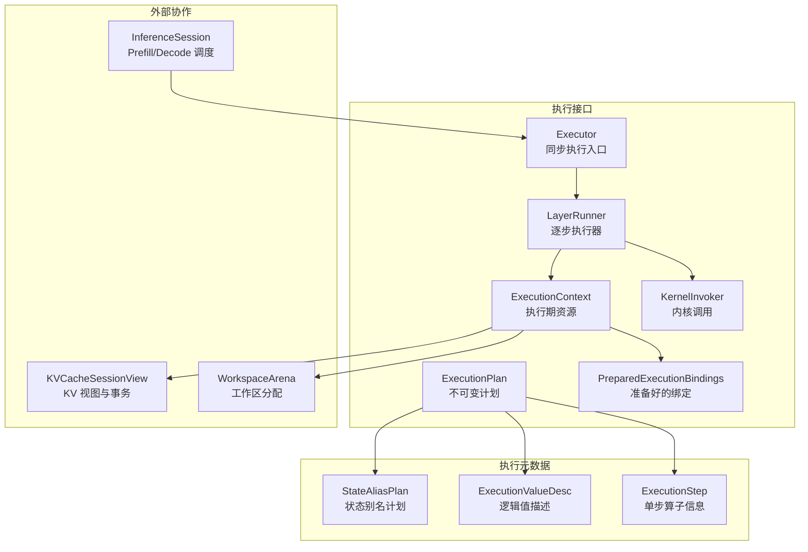
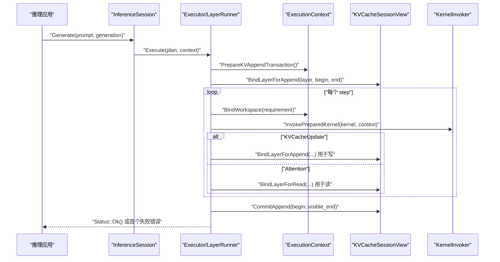
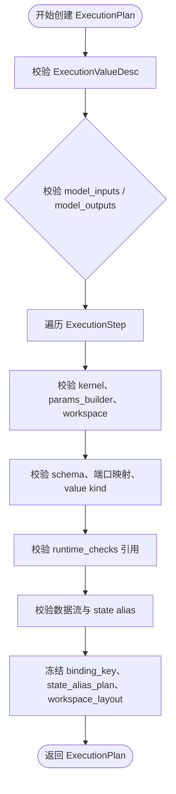
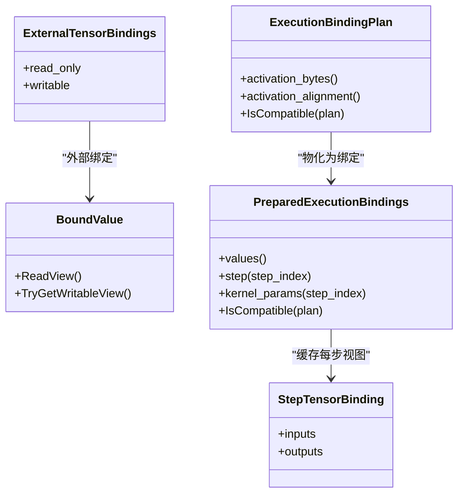
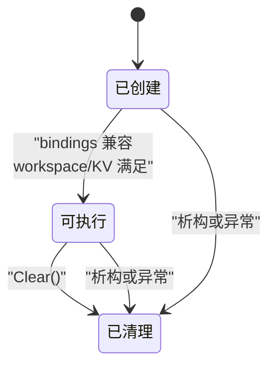
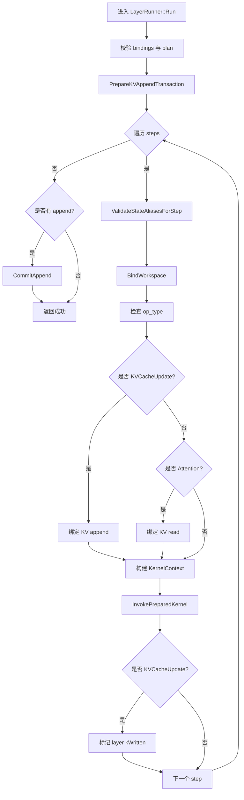
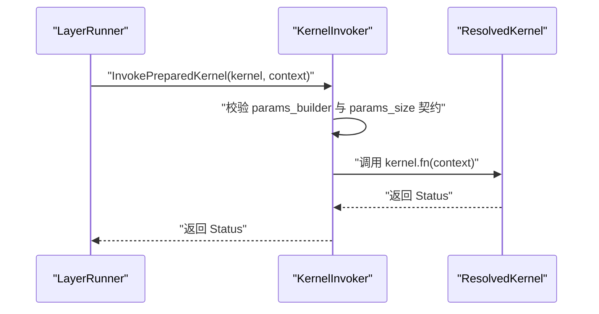
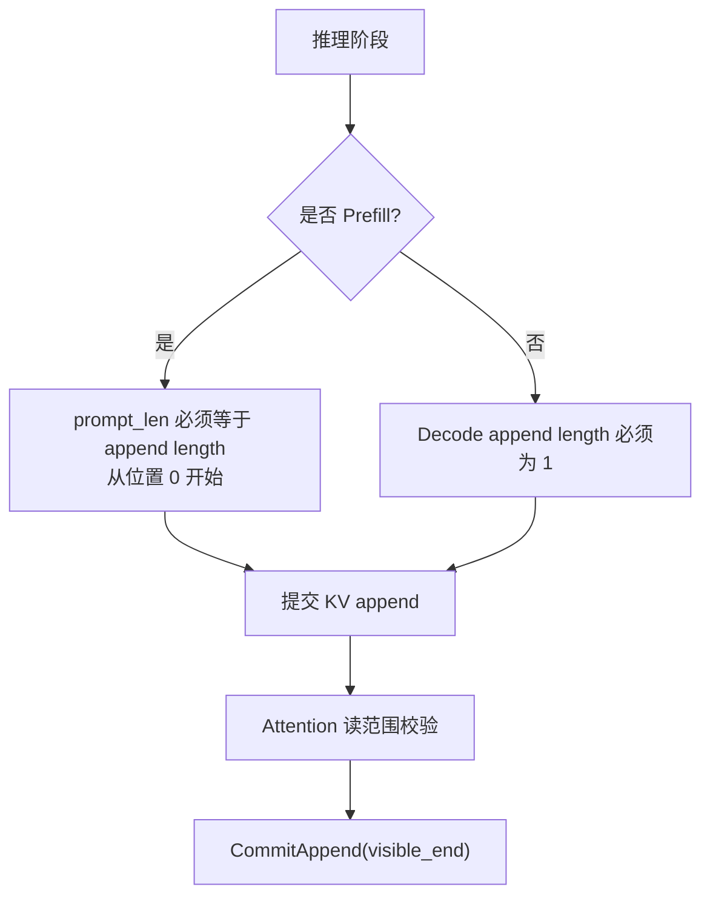
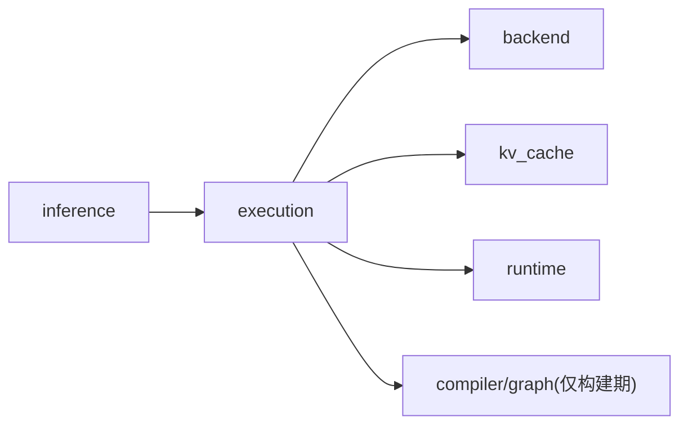

# 执行引擎 (Execution)

**本文引用的文件**
- [executor.h](../../../include/aethermind/execution/executor.h)
- [executor.cpp](../../../src/execution/executor.cpp)
- [execution_plan.h](../../../include/aethermind/execution/execution_plan.h)
- [execution_plan.cpp](../../../src/execution/execution_plan.cpp)
- [execution_context.h](../../../include/aethermind/execution/execution_context.h)
- [execution_context.cpp](../../../src/execution/execution_context.cpp)
- [kernel_invoker.h](../../../include/aethermind/execution/kernel_invoker.h)
- [kernel_invoker.cpp](../../../src/execution/kernel_invoker.cpp)
- [execution_bindings.h](../../../include/aethermind/execution/execution_bindings.h)
- [execution_bindings.cpp](../../../src/execution/execution_bindings.cpp)
- [layer_runner.h](../../../src/execution/layer_runner.h)
- [layer_runner.cpp](../../../src/execution/layer_runner.cpp)
- [state_alias_plan.h](../../../include/aethermind/execution/state_alias_plan.h)
- [state_alias_plan.cpp](../../../src/execution/state_alias_plan.cpp)
- [src/execution/](../../../src/execution)
- [inference_runner.cpp](../../../apps/inference/inference_runner.cpp)

## 目录
1. [引言](#引言)
2. [项目结构](#项目结构)
3. [核心组件](#核心组件)
4. [架构总览](#架构总览)
5. [详细组件分析](#详细组件分析)
6. [依赖关系分析](#依赖关系分析)
7. [性能与优化](#性能与优化)
8. [故障排查指南](#故障排查指南)
9. [结论](#结论)

## 引言
AetherMind 的执行模块是“执行数据契约层”，负责把编译后的图降阶结果冻结为不可变的 `ExecutionPlan`，在冷路径完成参数绑定和激活内存规划，再以 `ExecutionContext` 聚合执行期资源，按步骤顺序调用已解析的 kernel。它明确不负责 Prefill/Decode 高层调度、Argmax/EOS 停止逻辑、KV 物理存储实现、后端 kernel 选择及 WorkspaceArena 分配策略；这些职责分别属于 inference、kv_cache、backend 和 runtime 模块。

本文件围绕以下目标展开：
- 解释 Prefill 与 Decode 两个阶段如何借助 KVCacheSessionView 的状态与事务语义参与执行。
- 说明 ExecutionPlan 的构建、校验和执行流程。
- 描述 ExecutionContext 的状态管理、WorkspaceArena 绑定和 KV append 事务。
- 深入 KernelInvoker 的内核调用机制、ExecutionBindings 的参数绑定策略、LayerRunner 的逐步执行策略。
- 总结执行优化技术、并行化边界、内存管理与调优建议。

## 项目结构
执行相关代码主要位于 `include/aethermind/execution` 与 `src/execution`，并通过 inference 应用入口与运行时装配连接。

图表来源
- [executor.h:10-34](../../../include/aethermind/execution/executor.h#L10-L34)
- [execution_plan.h:20-200](../../../include/aethermind/execution/execution_plan.h#L20-L200)
- [execution_context.h:22-106](../../../include/aethermind/execution/execution_context.h#L22-L106)
- [execution_bindings.h:20-200](../../../include/aethermind/execution/execution_bindings.h#L20-L200)
- [kernel_invoker.h:12-55](../../../include/aethermind/execution/kernel_invoker.h#L12-L55)
- [layer_runner.h:19-68](../../../src/execution/layer_runner.h#L19-L68)
- [src/execution/](../../../src/execution)

章节来源
- [src/execution/](../../../src/execution)

## 核心组件
- `ExecutionPlan`：保存逻辑值、模型输入输出、执行步骤、状态别名计划和 workspace 布局。构造后只读，通过 `binding_key` 保证 bindings 与其兼容。
- `ExecutionStep`：描述一个已解析的 kernel 调用，包括 selector、resolved kernel、packed weight、workspace requirement、语义端口 id 和 compact kernel 端口映射。
- `PreparedExecutionBindings`：缓存每步的 TensorView、prepared kernel params、activation 布局和外部绑定快照。move 稳定，不拷贝。
- `ExecutionContext`：聚合 prepared bindings、WorkspaceArena、KVCacheSessionView，以及 per-layer KV append scratch。提供 `BindWorkspace` 和 KV 事务 scratch 重置。
- `LayerRunner`：顺序执行 plan 的所有 step，验证 state alias、绑定 workspace、组装 `KernelContext`、调用 kernel，并维护 KV append 事务一致性。
- `KernelInvoker`：低层 frozen kernel 调用入口；生产路径使用预先准备好的 params，测试路径栈上构造 params。
- `StateAliasPlan`：按 step_index 排序的 must-alias 记录，用于验证 KV cache 的 in-place 更新语义。

章节来源
- [execution_plan.h:20-200](../../../include/aethermind/execution/execution_plan.h#L20-L200)
- [execution_bindings.h:20-200](../../../include/aethermind/execution/execution_bindings.h#L20-L200)
- [execution_context.h:22-106](../../../include/aethermind/execution/execution_context.h#L22-L106)
- [layer_runner.h:19-68](../../../src/execution/layer_runner.h#L19-L68)
- [kernel_invoker.h:12-55](../../../include/aethermind/execution/kernel_invoker.h#L12-L55)
- [state_alias_plan.h:12-49](../../../include/aethermind/execution/state_alias_plan.h#L12-L49)

## 架构总览
执行引擎的职责分层清晰：

| 层次 | 职责 | 关键类型 |
|---|---|---|
| 高层调度 | Prefill/Decode 循环、EOS、token 生成 | `InferenceSession`（不在 execution 内） |
| 执行契约 | 冻结 plan、绑定外部 tensor、分配 activation | `ExecutionPlan`、`PreparedExecutionBindings` |
| 执行期资源 | 聚合 workspace、KV view、per-step 资源 | `ExecutionContext` |
| 步骤执行 | 顺序执行、state alias 校验、KV 事务 | `LayerRunner` |
| 内核调用 | 调用已解析 kernel | `KernelInvoker` |
| 状态别名 | must-alias KV 更新约束 | `StateAliasPlan` |

图表来源
- [inference_runner.cpp:44-115](../../../apps/inference/inference_runner.cpp#L44-L115)
- [executor.cpp:6-11](../../../src/execution/executor.cpp#L6-L11)
- [layer_runner.cpp:237-289](../../../src/execution/layer_runner.cpp#L237-L289)
- [layer_runner.cpp:291-551](../../../src/execution/layer_runner.cpp#L291-L551)
- [kernel_invoker.cpp:9-54](../../../src/execution/kernel_invoker.cpp#L9-L54)

章节来源
- [src/execution/](../../../src/execution)
- [inference_runner.cpp:44-115](../../../apps/inference/inference_runner.cpp#L44-L115)

## 详细组件分析

### ExecutionPlan 构建与校验
`ExecutionPlan::Create` 是计划的“发布点”。它接收逻辑值表、模型输入输出、步骤列表、状态别名计划和 workspace 布局，然后进行严格校验：

- 逻辑值校验：`kState` 必须有显式状态身份；非 state 不得携带状态身份。
- 模型输入输出校验：id 合法、无重复、kind 正确。
- 步骤校验：kernel op_type 非未知、函数指针非空、params_builder 与 params_size 契约一致且不超过最大限制。
- workspace 校验：alignment 必须是合法 2 的幂，step requirement 与 prepared kernel requirement 完全一致。
- schema 与端口校验：语义端口数量与 schema 端口一致；compact kernel 端口映射去掉 state 端口和 packed weight 端口。
- value kind 匹配：输入输出 value 的 kind 必须与 operator port kind 匹配。
- runtime checks：仅引用 inference 输入端口范围或 compact 输出端口范围，维度不越界。
- 数据流与 state alias：activation 有唯一生产者；state alias 的 step/port 在范围内并按 step_index 稳定排序。

图表来源
- [execution_plan.cpp:1-200](../../../src/execution/execution_plan.cpp#L1-L200)

章节来源
- [execution_plan.h:20-200](../../../include/aethermind/execution/execution_plan.h#L20-L200)
- [execution_plan.cpp:1-200](../../../src/execution/execution_plan.cpp#L1-L200)
- [src/execution/](../../../src/execution)

### ExecutionBindings 参数绑定
参数绑定分为两阶段：

1. **规划阶段 `PlanExecutionBindings`**
   - 校验 external read-only/writable 绑定的 value id、重复、kind 限制。
   - 对每个外部 tensor view 做 dtype、rank、静态维度、共享 shape symbol 的一致性校验。
   - 若存在 packed weight，检查其 logical dtype 与静态 shape 是否与对应 value spec 一致。
   - 计算 activation 形状：符号维度必须能从外部绑定解析；无 rank 或未约束维度被拒绝。
   - 生成连续 strides，并进行溢出检查；每个 activation 以固定对齐分配 offset。
   - 产出 `ExecutionBindingPlan`，此时不分配 activation 缓冲区，也不构造 kernel params。

2. **物化阶段 `MaterializeExecutionBindings`**
   - 校验 plan identity 与 step/value 计数兼容。
   - 一次分配 activation arena，按 offset 填充 `BoundValue`。
   - 为每步构建 compact 的 inputs/outputs 缓存。
   - 构建 prepared kernel params 并放入独立 arena。
   - 执行 shape/constraint 校验。

图表来源
- [execution_bindings.h:20-200](../../../include/aethermind/execution/execution_bindings.h#L20-L200)
- [execution_bindings.cpp:1-200](../../../src/execution/execution_bindings.cpp#L1-L200)

章节来源
- [execution_bindings.h:20-200](../../../include/aethermind/execution/execution_bindings.h#L20-L200)
- [execution_bindings.cpp:1-200](../../../src/execution/execution_bindings.cpp#L1-L200)
- [src/execution/](../../../src/execution)

### ExecutionContext 状态管理
`ExecutionContext` 是单次计划执行的资源聚合体：

- 创建时校验：
  - bindings 与 plan 兼容。
  - 如果 plan 需要 workspace，则必须提供 `WorkspaceArena*`。
  - 如果 plan 包含 state 值，则必须提供有效的 `KVCacheSessionView`。
- 运行时能力：
  - `BindWorkspace`：校验 alignment、委托 arena 分配；零字节返回空 binding。
  - `kv_cache_session_view` 与 `HasKVCacheSessionView`：访问 KV 视图。
  - `ResetKVLayerTransactionScratch`：预分配 per-layer append 状态，每次 Execute 前重置为 `kNotScheduled`。
  - `Clear`：释放 owned bindings 和 borrowed handles，但不 reset workspace 或释放 KV reservation。

图表来源
- [execution_context.h:22-106](../../../include/aethermind/execution/execution_context.h#L22-L106)
- [execution_context.cpp:10-96](../../../src/execution/execution_context.cpp#L10-L96)

章节来源
- [execution_context.h:22-106](../../../include/aethermind/execution/execution_context.h#L22-L106)
- [execution_context.cpp:10-96](../../../src/execution/execution_context.cpp#L10-L96)

### LayerRunner 层执行策略
`LayerRunner::Run` 是执行主循环：

1. 校验 prepared bindings 是否存在且与 plan 兼容。
2. 准备 KV append 事务：扫描所有 `KVCacheUpdate` 步骤，验证每层恰好一次 update、序列长度一致、prefill/decode 语义符合 KV 视图当前阶段。
3. 顺序执行每个 step：
   - 校验 state alias。
   - 绑定 workspace。
   - 校验每步 compact 输入输出数量与 kernel ports 一致。
   - 根据 op_type 设置 KV append/read binding：
     - `KVCacheUpdate`：绑定 append 视图，表示该层在该事务范围内写入。
     - `Attention`：绑定 read 视图；若同一计划有 append，则要求 query sequence length 等于 append length，否则纯读 query 不能超过可见 KV 范围。
   - 构建 `KernelContext` 并调用 `InvokePreparedKernel`。
   - 如果是 `KVCacheUpdate`，标记该层为 `kWritten`。
4. 所有步骤完成后，若存在 append，则校验所有层都已写入，再调用 `CommitAppend`。

图表来源
- [layer_runner.cpp:237-551](../../../src/execution/layer_runner.cpp#L237-L551)

章节来源
- [layer_runner.h:19-68](../../../src/execution/layer_runner.h#L19-L68)
- [layer_runner.cpp:200-551](../../../src/execution/layer_runner.cpp#L200-L551)

### KernelInvoker 内核调用机制
`KernelInvoker` 提供两类调用：

- `InvokePreparedKernel`：生产路径。假设 kernel 的 params 已在 `PreparedExecutionBindings` 构建时准备好；invoker 仅校验 params_builder 与 params_size 契约，然后直接调用 `kernel.fn(context)`。
- `BuildAndInvokeKernelForTesting`：测试/诊断专用。每次在栈上分配 params 缓冲区，调用 builder 构造 params，再调用 kernel。文档明确要求生产执行路径不得使用此函数。

图表来源
- [kernel_invoker.h:12-55](../../../include/aethermind/execution/kernel_invoker.h#L12-L55)
- [kernel_invoker.cpp:9-54](../../../src/execution/kernel_invoker.cpp#L9-L54)

章节来源
- [kernel_invoker.h:12-55](../../../include/aethermind/execution/kernel_invoker.h#L12-L55)
- [kernel_invoker.cpp:9-54](../../../src/execution/kernel_invoker.cpp#L9-L54)

### StateAliasPlan 与 KV 状态别名
`StateAliasPlan` 保存 resolved state alias 记录，每条记录用 step_index、input_port、output_port 表示 must-alias 更新。构造时对 aliases 按 step_index 排序，查询时使用二分查找返回 contiguous span。

在执行阶段，`ValidateStateAliasesForStep` 会：

- 要求存在有效的 `KVCacheSessionView`。
- 校验 input_spec 与 output_spec 完全相同。
- 校验 input/output 的 state identity 相同。
- 校验 dtype、rank=3、static kv_heads/head_dim，cache_len 允许 symbolic 但静态时必须与 KV view capacity 一致。

这保证了 KV cache 的 in-place 更新语义：operator 读取和写入的是同一个物理存储，executor 通过 KV view 作为 shared backing 的运行时不变量进行验证。

章节来源
- [state_alias_plan.h:12-49](../../../include/aethermind/execution/state_alias_plan.h#L12-L49)
- [state_alias_plan.cpp:1-41](../../../src/execution/state_alias_plan.cpp#L1-L41)
- [layer_runner.cpp:460-551](../../../src/execution/layer_runner.cpp#L460-L551)

### Prefill 与 Decode 阶段的调度机制
execution 模块本身不包含 `PrefillPath` 或 `DecodePath` 类型，也不负责 Generate 状态机。Prefill/Decode 调度由上层 inference 控制，execution 通过 `KVCacheSessionView` 的状态和 append 事务语义配合：

- Prefill 阶段：KV 视图处于 awaiting_prefill 状态，append 必须从位置 0 开始，写入长度等于 prompt_len。
- Decode 阶段：KV 视图不在 awaiting_prefill，append 必须恰好写入一个 token。
- Attention 在 append 同计划中读取时，query sequence length 必须等于 append length；纯读模式下 query length 不能超过可见 KV 范围。
- 所有层的 KV append 必须在全部层写入完成后才 commit，确保原子性。

图表来源
- [layer_runner.cpp:200-289](../../../src/execution/layer_runner.cpp#L200-L289)
- [src/execution/](../../../src/execution)

章节来源
- [layer_runner.cpp:200-289](../../../src/execution/layer_runner.cpp#L200-L289)
- [src/execution/](../../../src/execution)

## 依赖关系分析
执行模块依赖方向遵循“上层不依赖编译器/图”的原则：

- public headers 不 include compiler 头，仅前向声明 `LoweredGraph`。
- execution 不依赖 graph；state alias 使用 step/port 坐标而非 `GraphValueId`。
- execution 不持有 `Runtime*`；plan 通过 `ResolvedKernel` 借用 backend-owned 稳定存储，因此 Runtime 必须比 plan 活得久。
- execution 不承担跨请求状态；无 `SessionState`，也没有 Prefill/Decode 类型。

图表来源
- [src/execution/](../../../src/execution)

章节来源
- [src/execution/](../../../src/execution)

## 性能与优化
基于源码实现的执行优化要点如下：

- 冷路径与热路径分离
  - 冷路径：`ExecutionPlanBuilder`、`PrepareExecutionBindings`、`ExecutionContext::Create`。
  - 热路径：`LayerRunner::Run` 顺序执行 step，直接复用缓存的 `StepTensorBinding` 和 prepared kernel params。
- 激活内存一次性分配
  - `MaterializeExecutionBindings` 一次分配 activation arena，避免逐 step 分配。
  - activation 使用固定对齐，减少内存碎片和对齐开销。
- 参数预热
  - 生产路径使用 `InvokePreparedKernel`，params 在构建期准备好，避免每次调用都重建。
  - 测试路径 `BuildAndInvokeKernelForTesting` 明确禁止在生产中使用。
- KV append 事务批量处理
  - 扫描所有 `KVCacheUpdate`，统一校验层数、序列长度、容量，最后统一 commit，降低多次边界检查和潜在不一致风险。
- 紧凑端口映射
  - `ExecutionStep` 保留语义端口 id，同时维护 compact kernel 端口映射，减少运行时索引成本。
- 状态别名快速查询
  - `StateAliasPlan::ForStep` 使用二分查找返回 contiguous span，按 step_index 排序提升查询效率。

并行化策略：
- 当前执行是同步单线程的。`Executor::Execute` 明确说明执行是 single-threaded，并由 `LayerRunner` 顺序调用。
- 若未来引入并行，需要注意：
  - KV append 的事务一致性要求所有层写入后才 commit。
  - Attention 的 read/write 依赖 KV 可见范围，不能随意重排。
  - WorkspaceArena 的生命周期和绑定必须由执行期协调。

内存管理建议：
- 确保 external tensor backing 在 `PreparedExecutionBindings` 生命周期内稳定。
- 避免在 Execute 期间修改 external tensor 的地址、shape 或 stride。
- 合理设置 `context_tokens`，使 KV 容量足够覆盖 prompt 和生成长度。
- 使用 `ComputeExternalReadRequirements` 精确提供 read-only 绑定，避免多余绑定。

章节来源
- [execution_bindings.cpp:1-200](../../../src/execution/execution_bindings.cpp#L1-L200)
- [layer_runner.cpp:237-551](../../../src/execution/layer_runner.cpp#L237-L551)
- [executor.h:10-34](../../../include/aethermind/execution/executor.h#L10-L34)

## 故障排查指南
常见错误来源与定位方式：

| 现象 | 可能原因 | 定位依据 |
|---|---|---|
| `PreparedExecutionBindings` 与 plan 不兼容 | bindings 由不同 plan 或不同 plan key 构建 | `ExecutionContext::Create` 与 `LayerRunner::Run` 兼容性检查 |
| workspace 绑定失败 | 未提供 `WorkspaceArena` 或 arena 无法满足 requirement | `ExecutionContext::BindWorkspace` 的错误 |
| KV state 缺失 | plan 含 state 值但未提供有效 `KVCacheSessionView` | `ExecutionContext::Create` 与 `LayerRunner` 校验 |
| KV append 超过容量 | prompt 或 decode append 超出 token_capacity 或 max_tokens | `PrepareKVAppendTransaction` 越界检查 |
| KV 层重复更新 | 同一 decoder layer 出现多个 `KVCacheUpdate` | `PrepareKVAppendTransaction` 层状态检查 |
| Attention query 长度不匹配 | append 同计划中 query length 不等于 append length | `RunStep` 的 Attention 分支 |
| state alias 规格不匹配 | input/output spec 不同、dtype/rank/static dims 不匹配 KV view | `ValidateStateAliasesForStep` |
| kernel 调用失败 | params_builder/params_size 契约错误或 kernel.fn 返回错误 | `InvokePreparedKernel` 与 `BuildAndInvokeKernelForTesting` |

章节来源
- [execution_context.cpp:10-96](../../../src/execution/execution_context.cpp#L10-L96)
- [layer_runner.cpp:200-551](../../../src/execution/layer_runner.cpp#L200-L551)
- [kernel_invoker.cpp:9-54](../../../src/execution/kernel_invoker.cpp#L9-L54)

## 结论
AetherMind 的执行引擎以 `ExecutionPlan` 为核心契约，将编译期产物冻结为不可变计划，再通过 `PreparedExecutionBindings` 完成冷路径绑定，最终由 `LayerRunner` 在热路径顺序执行。它通过 `ExecutionContext` 统一管理 workspace 和 KV 视图，通过 `StateAliasPlan` 保证 KV cache 的 in-place 更新语义，并通过 `KernelInvoker` 安全地调用已解析 kernel。

Prefill 与 Decode 的调度由上层 inference 负责，execution 通过 KV 视图状态和 append 事务语义确保两个阶段的正确性与一致性。执行优化集中在冷/热路径分离、激活内存一次性分配、参数预热、紧凑端口映射和 KV append 事务批处理。当前执行是单线程顺序执行，未来若引入并行，必须以 KV 事务和 Attention 读写可见范围为约束。
