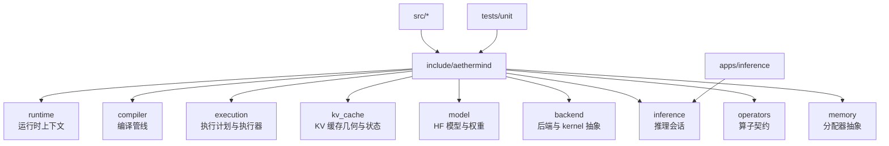
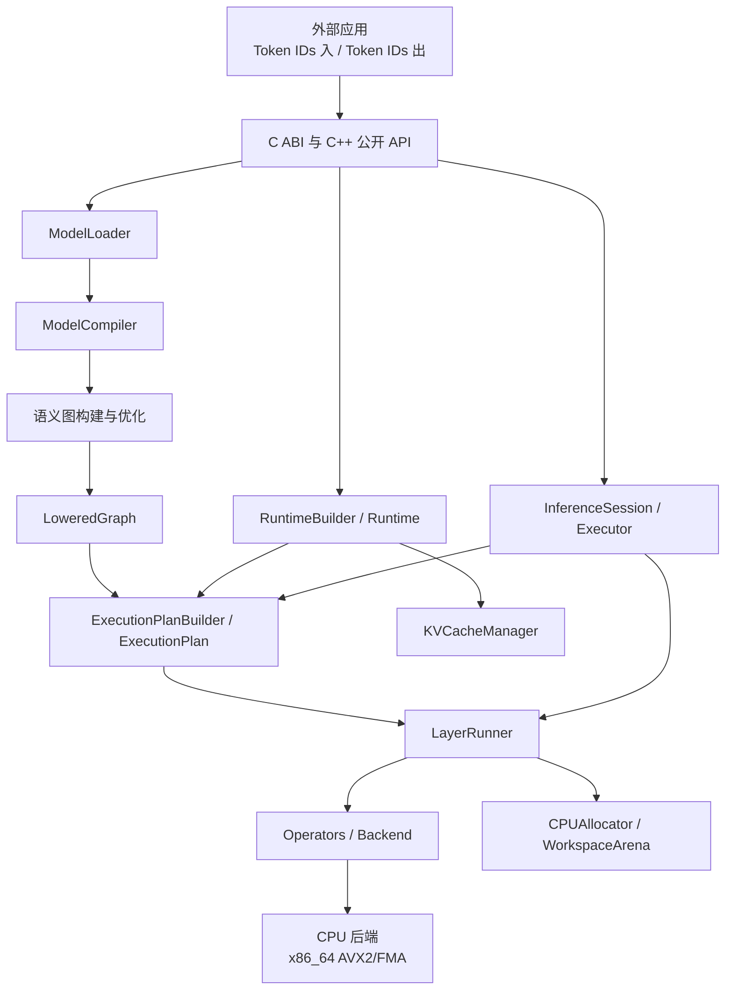
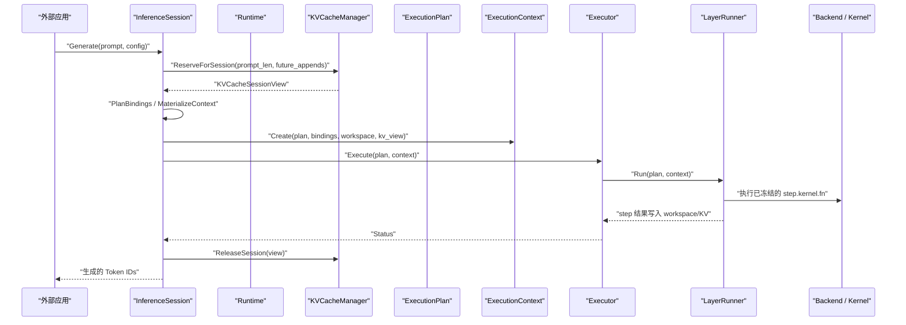
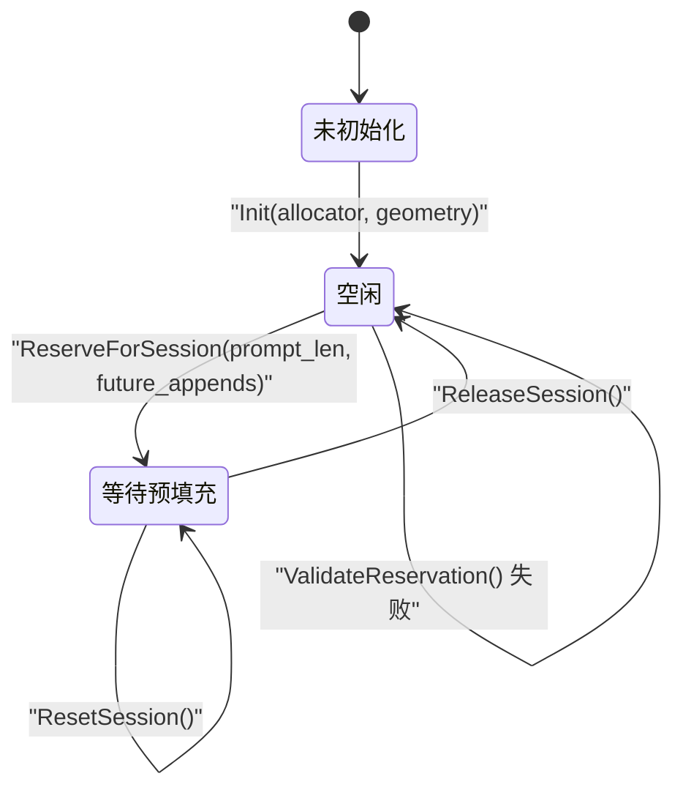
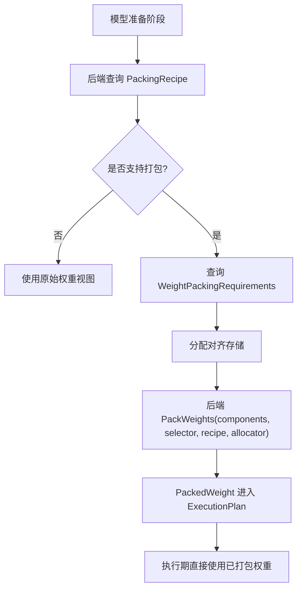
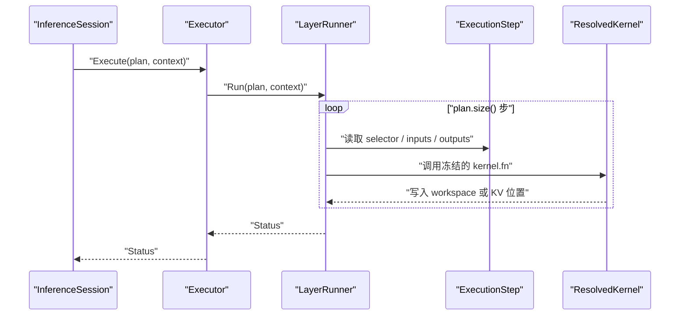
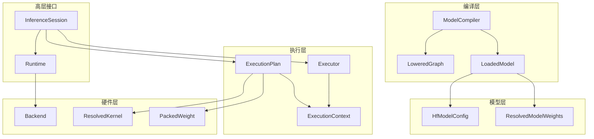

# 核心模块设计

**本文引用的文件**
- [README.md](../../../README.md)
- [系统架构总览](../../architecture.md)
- [运行时接口](../../../include/aethermind/runtime/runtime.h)
- [模型编译器接口](../../../include/aethermind/compiler/model_compiler.h)
- [执行器接口](../../../include/aethermind/execution/executor.h)
- [KV Cache 管理器接口](../../../include/aethermind/kv_cache/kv_cache_manager.h)
- [已加载模型接口](../../../include/aethermind/model/loaded_model.h)
- [后端抽象接口](../../../include/aethermind/backend/backend.h)
- [推理会话接口](../../../include/aethermind/inference/inference_session.h)
- [执行计划接口](../../../include/aethermind/execution/execution_plan.h)
- [KV Cache 布局接口](../../../include/aethermind/kv_cache/kv_cache_layout.h)
- [推理会话实现](../../../src/inference/inference_session.cpp)
- [模型编译器实现](../../../src/compiler/model_compiler.cpp)
- [执行器实现](../../../src/execution/executor.cpp)
- [CPU 后端实现](../../../src/backend/cpu/cpu_backend.cpp)
- [KV Cache 管理器实现](../../../src/kv_cache/kv_cache_manager.cpp)

## 目录

1. [引言](#引言)
2. [项目结构](#项目结构)
3. [核心组件](#核心组件)
4. [架构总览](#架构总览)
5. [详细组件分析](#详细组件分析)
6. [依赖关系分析](#依赖关系分析)
7. [性能与资源特性](#性能与资源特性)
8. [故障排查指南](#故障排查指南)
9. [结论](#结论)

## 引言

AetherMind 是一个面向 Llama Dense 模型的桌面与服务端 CPU 推理引擎。它通过 C++ 公开 API、独立 CLI 和稳定 C ABI，提供同步、单请求的贪心生成能力；当前实现以 FP32 激活为主，并支持显式 F16/BF16 到 FP32 的转换以及保留 W16 权重的执行策略。其关键边界是：不包含 HTTP/gRPC 服务、tokenizer、异步流式 API、多请求批处理或 GPU 卸载。

从调用顺序看，CLI 和高层组装路径遵循以下阶段：

`ModelLoader::Load → ModelCompiler::Compile → RuntimeBuilder::TryBuild → ExecutableModel::Prepare → InferenceSession::Create → Generate`

其中，编译发生在 KV 分配之前；已有 `Runtime` 的场景可使用 `ExecutableModel::Load`，它先完成权重准入与可选转换，再编译并准备执行计划。`Runtime` 必须从准备阶段开始保持地址稳定，并且生命周期要长于已准备的模型和执行会话。

本架构文档聚焦以下核心模块：

| 模块 | 主要职责 |
|---|---|
| 运行时系统 | 管理 Allocator、Backend、KVCacheManager、Workspace 限制等长期资源 |
| 计算图系统 | 构建 backend-independent 语义图，并执行常量折叠、融合与死代码消除等语义优化 |
| 编译器 | 将 `LoadedModel` 转换为不可变的 `LoweredGraph` 与 `LoweredModelArtifact` |
| 执行引擎 | 冻结 `ExecutionPlan`，绑定 workspace、KV cache 和外部 tensor，并顺序执行算子步骤 |
| KV Cache 管理 | 维护物理 KV 平面、单会话预约、提交位置、生命周期与越界保护 |
| 模型加载 | 读取 HuggingFace 配置与 safetensors，解析逻辑权重，并暴露给图构建与编译器 |
| 后端系统 | 在 planning-time 选择 kernel、报告 packing recipe、打包权重并暴露调试 registry |

**章节来源**
- [README.md](../../../README.md)
- [系统架构总览](../../architecture.md)

## 项目结构

仓库按“公共头文件 + 对应实现 + 测试 + 应用 + 文档”的方式组织：

该结构不是严格的一一对应层：例如 `compiler/` 负责 semantic graph 之后、execution plan 之前的编译产物与阶段编排；`graph/` 只拥有 IR、rewrite 框架和 backend-independent 的语义 pass；`execution/` 负责 execution planning 和热路径执行调度。

**图示来源**
- [系统架构总览](../../architecture.md)
- [README.md](../../../README.md)

**章节来源**
- [README.md](../../../README.md)
- [系统架构总览](../../architecture.md)

## 核心组件

### 运行时系统

`Runtime` 是长期资源所有者，持有：

- `AllocatorRegistry`：按设备类型返回或创建分配器
- `BackendRegistry`：按设备类型懒加载并缓存后端
- `KVCacheManager`：当启用 KV caching 时存在
- `workspace_limit_bytes_`：请求 workspace 负载上限

它不直接执行算子，也不持有单个请求的生命周期对象；它的主要契约是：

1. 所有通过它解析的 `ResolvedKernel` 都必须在其生命周期内有效。
2. 任何对 KVCacheManager 的变更（初始化、预约、重置、释放）都必须与借用的 session view 上的 `Execute()` 外部序列化。
3. 并发访问必须由调用方串行化，这与内部 registries 和 KVCacheManager 的线程安全约定一致。

`Runtime` 本身不是线程安全的；它的可变状态由 `RuntimeBuilder` 构造后交给上层装配流程。

**章节来源**
- [运行时接口:1-127](../../../include/aethermind/runtime/runtime.h#L1-L127)

### 计算图系统

计算图系统分为两个层次：

1. **模型图构建层**：由 `model` 模块提供，包括 `BuildModelGraph` 和 `BuildLlamaDense`，把已验证的 HuggingFace 配置与解析后的权重转为语义 DAG。
2. **语义优化层**：由 `graph` 模块提供，包含 `ModelGraph`、`GraphRewrite`、`GraphPassManager`，以及常量折叠、SiLU-Mul 融合、QKV Linear 融合、GateUp Linear 融合、死代码消除等 pass。

这些 pass 都是 backend-independent 的；它们不关心具体 kernel、内存布局或设备能力，只修改图的拓扑、形状和参数语义。

**章节来源**
- [系统架构总览](../../architecture.md)

### 编译器

`ModelCompiler` 是无状态的编译器门面，职责是组合三个阶段：

1. 构建语义图
2. 应用语义优化 pass
3. lowering 为 `LoweredGraph`

它不会 resolve kernel，也不会物化权重；这些工作推迟到 execution planning 阶段。其输出是 `LoweredModelArtifact`，包含已转移所有权的所有 `LoadedModel` 和不可变 `LoweredGraph`。

对于 F16/BF16 activation dtype，编译器会禁用保守基线之外的部分融合 pass，因为当前 P4-A A16 batch 只有独立的 A16 kernel 集合；显式 A16 融合需要单独的证据和内核集。

**章节来源**
- [模型编译器接口:1-64](../../../include/aethermind/compiler/model_compiler.h#L1-L64)
- [模型编译器实现:1-78](../../../src/compiler/model_compiler.cpp#L1-L78)

### 执行引擎

执行引擎由三个关键部分组成：

| 组件 | 职责 |
|---|---|
| `ExecutionPlan` | 冻结的步骤序列、值描述、workspace layout、state alias plan 和 binding key |
| `ExecutionContext` | 聚合 prepared bindings、borrowed workspace arena 和 KV session view |
| `Executor` | 同步入口，委托 `LayerRunner` 顺序执行步骤 |

`ExecutionPlan` 明确区分 model input、activation、weight、constant、state 等值类别，并把 KV state identity 映射到 decoder layer index 与 key/value slot。它还提供 deferred shape constraint 检查，使 packed semantic weight 可以参与推理输入索引，而不一定成为 kernel 的 TensorView。

**章节来源**
- [执行计划接口:1-200](../../../include/aethermind/execution/execution_plan.h#L1-L200)
- [执行器接口:1-34](../../../include/aethermind/execution/executor.h#L1-L34)

### KV Cache 管理

`KVCacheManager` 管理物理 KV 存储和单会话预约：

- 一次只能有一个 active session reservation
- 新预约在未释放旧会话时会失败
- `KVCacheSessionView` 借用 manager 的状态，会话释放后变为 stale
- 管理器自身不能被移动或赋值，只要任何 borrowed view 仍存在
- 所有对 manager 和其 views 的访问必须由调用方串行化

KV 写入采用 append transaction 语义：执行侧持有 commit 直到同步调用返回；kernel reentry 不能与 Init、ReserveForSession、ResetSession、ReleaseSession 交错。

**章节来源**
- [KV Cache 管理器接口:1-115](../../../include/aethermind/kv_cache/kv_cache_manager.h#L1-L115)
- [KV Cache 管理器实现:1-176](../../../src/kv_cache/kv_cache_manager.cpp#L1-L176)

### 模型加载

`LoadedModel` 是 HF I/O、验证和逻辑权重解析完成后的所有权边界。它包含：

- `HfModelConfig`
- `ResolvedModelWeights`
- 可选的 `RawWeightFp32ConversionUsage`

它刻意不包含 backend artifact；`ResolvedModelWeights` 保留 `RawWeightView` 共享 backing storage，直到后续编译阶段按需消费。

**章节来源**
- [已加载模型接口:1-45](../../../include/aethermind/model/loaded_model.h#L1-L45)

### 后端系统

`Backend` 是 planning-time 的 kernel 选择抽象：

- 每个后端处理一个 `DeviceType`
- 规划期唯一入口是 `PrepareKernel`，它将 op type、selector 和 typed params 冻结为 `ResolvedKernel`
- 后端拥有 capability 报告和 kernel lookup，但不执行 kernel
- 可选地暴露 packing recipe、packing requirements 和 `PackWeights`
- 可通过 `TryGetKernelRegistryForDebug` 暴露 kernel registry 用于调试

当前实现是 CPU 后端，基于 x86_64 AVX2/FMA，并在规划期完成 kernel resolution，避免热路径查找。

**章节来源**
- [后端抽象接口:1-163](../../../include/aethermind/backend/backend.h#L1-L163)

## 架构总览

下图展示从外部应用到 CPU 硬件的完整数据流。注意：图中省略了结果向上回传的虚线边，以便突出单一方向的数据流。

**图示来源**
- [系统架构总览](../../architecture.md)
- [推理会话接口:1-114](../../../include/aethermind/inference/inference_session.h#L1-L114)
- [执行计划接口:1-200](../../../include/aethermind/execution/execution_plan.h#L1-L200)

## 详细组件分析

### 模型加载与编译数据流

```mermaid
flowchart LR
    HF["HF 模型目录<br/>config.json + *.safetensors"] --> LOADER["ModelLoader::Load"]
    LOADER --> LM["LoadedModel<br/>配置 + 已解析权重"]
    LM --> COMP["ModelCompiler::Compile"]
    COMP --> BUILD["BuildModelGraph → BuildLlamaDense"]
    BUILD --> OPT["OptimizeModelGraph"]
    OPT --> LOWER["LowerModelGraph"]
    LOWER --> LG["LoweredGraph"]
    LG --> ART["LoweredModelArtifact"]
    ART --> PREP["ExecutableModel::Prepare"]
    PREP --> EP["ExecutionPlan"]
    EP --> GEN["InferenceSession::Generate"]
```

**图示来源**
- [系统架构总览](../../architecture.md)
- [模型编译器实现:1-78](../../../src/compiler/model_compiler.cpp#L1-L78)

#### 编译器关键行为

`ModelCompiler::Compile` 的顺序是：

1. 校验输入 `LoadedModel` 非空
2. 构建语义图
3. 根据 activation dtype 调整优化策略
4. 执行语义优化
5. lowering 得到 `LoweredGraph`
6. 将 `LoadedModel` 所有权转移进 `LoweredModelArtifact`

这保证了消费者在 execution planning 阶段仍可访问已加载模型的权重信息。

**章节来源**
- [模型编译器接口:1-64](../../../include/aethermind/compiler/model_compiler.h#L1-L64)
- [模型编译器实现:1-78](../../../src/compiler/model_compiler.cpp#L1-L78)

### 推理会话与生成流程

**图示来源**
- [推理会话接口:1-114](../../../include/aethermind/inference/inference_session.h#L1-L114)
- [推理会话实现:1-260](../../../src/inference/inference_session.cpp#L1-L260)
- [执行器接口:1-34](../../../include/aethermind/execution/executor.h#L1-L34)
- [KV Cache 管理器接口:1-115](../../../include/aethermind/kv_cache/kv_cache_manager.h#L1-L115)

#### 推理会话关键约束

- 空 prompt 无效
- `max_new_tokens == 0` 时返回空向量，不预留 KV 也不执行模型
- 正数 limit 下，Prefill 预测的第一个 token 就是第一个生成的 token
- 因此最多只需要 `max_new_tokens - 1` 次 Decode KV append
- 每次 `Generate` 都从 fresh Prefill 开始，并在返回前释放 KV 预约
- 多个共享同一 `Runtime` 的会话的 `Generate` 调用必须外部序列化

**章节来源**
- [推理会话接口:1-114](../../../include/aethermind/inference/inference_session.h#L1-L114)
- [推理会话实现:1-260](../../../src/inference/inference_session.cpp#L1-L260)

### KV Cache 状态机

- `Init` 先释放旧 storage 和 active reservation
- `ReserveForSession` 递增 generation，设置 capacity、prompt_len、committed_tokens 和 lifecycle
- `ResetSession` 清除 committed position，但保留 reservation
- `ReleaseSession` 清空生命周期字段、更新 generation 并使 view 失效

**图示来源**
- [KV Cache 管理器接口:1-115](../../../include/aethermind/kv_cache/kv_cache_manager.h#L1-L115)
- [KV Cache 管理器实现:1-176](../../../src/kv_cache/kv_cache_manager.cpp#L1-L176)

### 后端与权重打包流程

**图示来源**
- [后端抽象接口:1-163](../../../include/aethermind/backend/backend.h#L1-L163)
- [CPU 后端实现:1-220](../../../src/backend/cpu/cpu_backend.cpp#L1-L220)

#### CPU 后端权重打包要点

- 直接绑定接受任意合法 rank，包括标量和 norm 权重
- 复合绑定要求所有 component 具有相同 dtype 和特征维度
- 行号与字节数必须做溢出检查
- 逻辑权重必须是连续 row-major view
- 打包存储来自传入的 `Allocator`，而不是设备特定分配原语
- 后端仅借用 allocator，返回的 `Buffer` 在 allocator 销毁后仍有效

**章节来源**
- [后端抽象接口:1-163](../../../include/aethermind/backend/backend.h#L1-L163)
- [CPU 后端实现:1-220](../../../src/backend/cpu/cpu_backend.cpp#L1-L220)

### 执行器与 LayerRunner

`Executor::Execute` 的实现非常薄：它只做同步入口封装，并将实际执行委托给 `LayerRunner::Run`。这是有意设计的：执行器不感知模型拓扑，只保证在给定 ExecutionContext 上按 ExecutionPlan 中冻结的步骤顺序执行。

**图示来源**
- [执行器接口:1-34](../../../include/aethermind/execution/executor.h#L1-L34)
- [执行器实现:1-12](../../../src/execution/executor.cpp#L1-L12)
- [执行计划接口:1-200](../../../include/aethermind/execution/execution_plan.h#L1-L200)

**章节来源**
- [执行器接口:1-34](../../../include/aethermind/execution/executor.h#L1-L34)
- [执行器实现:1-12](../../../src/execution/executor.cpp#L1-L12)

## 依赖关系分析

**图示来源**
- [推理会话接口:1-114](../../../include/aethermind/inference/inference_session.h#L1-L114)
- [运行时接口:1-127](../../../include/aethermind/runtime/runtime.h#L1-L127)
- [执行计划接口:1-200](../../../include/aethermind/execution/execution_plan.h#L1-L200)
- [模型编译器接口:1-64](../../../include/aethermind/compiler/model_compiler.h#L1-L64)
- [已加载模型接口:1-45](../../../include/aethermind/model/loaded_model.h#L1-L45)
- [后端抽象接口:1-163](../../../include/aethermind/backend/backend.h#L1-L163)

### 耦合与扩展点

| 模块 | 耦合方向 | 扩展点 |
|---|---|---|
| `Runtime` | 向下依赖 AllocatorRegistry、BackendRegistry、KVCacheManager | 新增设备类型、自定义 allocator/provider |
| `ModelCompiler` | 依赖 model 和 graph 模块 | 新增优化 pass、lowering 规则 |
| `ExecutionPlan` | 依赖 backend、shape_inference、runtime workspace planner | 新增 execution value kind、state identity |
| `KVCacheManager` | 依赖 memory allocator 和 kv_cache_layout | 新增 KV layout 或容量策略 |
| `Backend` | 依赖 OpType、KernelSelector、OpParams、Allocator | 新增 CPU/GPU/CANN 后端 |
| `InferenceSession` | 依赖 Runtime、ExecutableModel、KVCacheManager | 新增采样策略、多 phase 控制 |

**章节来源**
- [运行时接口:1-127](../../../include/aethermind/runtime/runtime.h#L1-L127)
- [执行计划接口:1-200](../../../include/aethermind/execution/execution_plan.h#L1-L200)
- [后端抽象接口:1-163](../../../include/aethermind/backend/backend.h#L1-L163)

## 性能与资源特性

### 静态 KV Cache

当前 KV cache 是静态预分配的，而非 PagedAttention 或 continuous batching。它通过 `KVCacheLayout` 计算每 plane 的字节大小、token stride、head stride、layer stride 和对齐方式。这样做的优点是：

- 热路径不需要动态分配
- KV append 可转换为确定性偏移计算
- 与 CPU SIMD kernel 的行对齐需求兼容

缺点是：最大 token 容量在初始化时确定，无法像分页方案那样动态复用远小于容量的历史片段。

### Workspace 预算

`Runtime` 暴露 `workspace_limit_bytes()`，而 `InferenceSessionOptions` 暴露 `max_request_payload_bytes`。推理会话会将 workspace 与 prefill/decode activation payload 合并计算峰值，并在溢出时返回 ResourceExhausted。

### Planning-time Kernel Resolution

`ExecutionPlanBuilder` 在 plan-build-time 调用 `Backend::PrepareKernel`，将 kernel 选择结果冻结到 `ExecutionStep` 中。这意味着热路径执行不需要再做 registry/hash/string lookup 或虚函数 dispatch。

### 权重打包

对于支持的 backend，packed weight 可以在模型准备阶段一次性打包，随后被 `ExecutionPlan` 持有并多次复用。这样可以减少重复转置、拼接和布局计算的开销，同时让 kernel 直接消费对齐的物理布局。

**章节来源**
- [KV Cache 布局接口:1-104](../../../include/aethermind/kv_cache/kv_cache_layout.h#L1-L104)
- [运行时接口:1-127](../../../include/aethermind/runtime/runtime.h#L1-L127)
- [推理会话接口:1-114](../../../include/aethermind/inference/inference_session.h#L1-L114)
- [后端抽象接口:1-163](../../../include/aethermind/backend/backend.h#L1-L163)

## 故障排查指南

### KV Cache 相关错误

| 现象 | 可能原因 | 处理建议 |
|---|---|---|
| `FailedPrecondition("KVCacheManager is not initialized")` | 未调用 `Init` 就尝试预约或使用 view | 先构造 `KVCacheLayout` 并调用 `Init` |
| `already has an active session reservation` | 上一个会话尚未 `ReleaseSession` | 确保每次 `Generate` 结束后释放预约 |
| `KV session reservation exceeds physical KV capacity` | `prompt_len + future_kv_appends > max_tokens` | 增大 KV capacity 或减少生成长度 |
| `KVCacheSessionView does not belong to this manager` | 用错误的 manager 操作 view | 确保 view 来自当前 runtime 的 KV manager |
| `Cannot reset/release an invalid or stale view` | view 已被释放或过期 | 重新预约新的 session |

**章节来源**
- [KV Cache 管理器实现:1-176](../../../src/kv_cache/kv_cache_manager.cpp#L1-L176)

### 执行期资源不足

推理会话文档明确说明：如果从 request buffer、binding、workspace 或 activation 分配传播出 `std::bad_alloc`，则包装为 ResourceExhausted，且消息为空，以避免报错过程再次分配内存。

排查建议：

1. 先用 `PlanResources` 估算 workspace、prefill activation、decode activation 和 peak payload。
2. 检查 `InferenceSessionOptions::max_request_payload_bytes` 是否过小。
3. 检查 `Runtime::workspace_limit_bytes()` 是否限制了 workspace。
4. 确认 KV capacity 足够容纳 prompt 和最大生成长度。
5. 避免在同一 `Runtime` 上并发调用多个 `Generate`。

**章节来源**
- [推理会话接口:1-114](../../../include/aethermind/inference/inference_session.h#L1-L114)
- [推理会话实现:1-260](../../../src/inference/inference_session.cpp#L1-L260)

### 编译期优化异常

当 activation dtype 为 F16 或 BF16 时，编译器会禁用 QKV fusion、GateUp fusion 和 fused add-rmsnorm。如果预期出现融合 kernel 但未见融合，应检查：

- 是否启用了非默认 activation dtype
- 是否使用了保守基线 preset
- 是否缺少对应 fused kernel 的证据或实现

**章节来源**
- [模型编译器实现:1-78](../../../src/compiler/model_compiler.cpp#L1-L78)

## 结论

AetherMind 的核心架构围绕六个概念责任层展开：API 服务层、调度控制层、计算图语义层、编译器层、执行规划层和硬件执行层。各层之间的边界清晰：

- `model` 负责模型 I/O 与逻辑权重
- `graph` 负责 backend-independent 语义图与 pass
- `compiler` 负责语义图到 lowered artifact 的转换
- `execution` 负责冻结 plan、绑定资源并顺序执行
- `kv_cache` 负责物理 KV 平面和单会话生命周期
- `backend` 负责 planning-time kernel 选择与权重打包
- `runtime` 负责长期资源所有权和跨模块资源协调

这种设计使得热路径尽可能少做决策：kernel 在 plan-build-time 选定，workspace 和 KV 布局在准备阶段冻结，session 在执行期只做状态推进和资源释放。未来扩展新后端、新 operator 或新量化策略时，应优先遵守现有接口契约，而不是绕过 ExecutionPlan 和 Backend 抽象。
