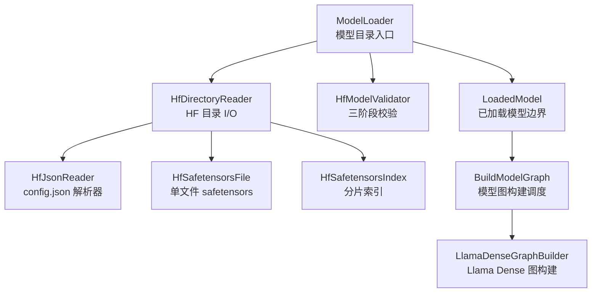
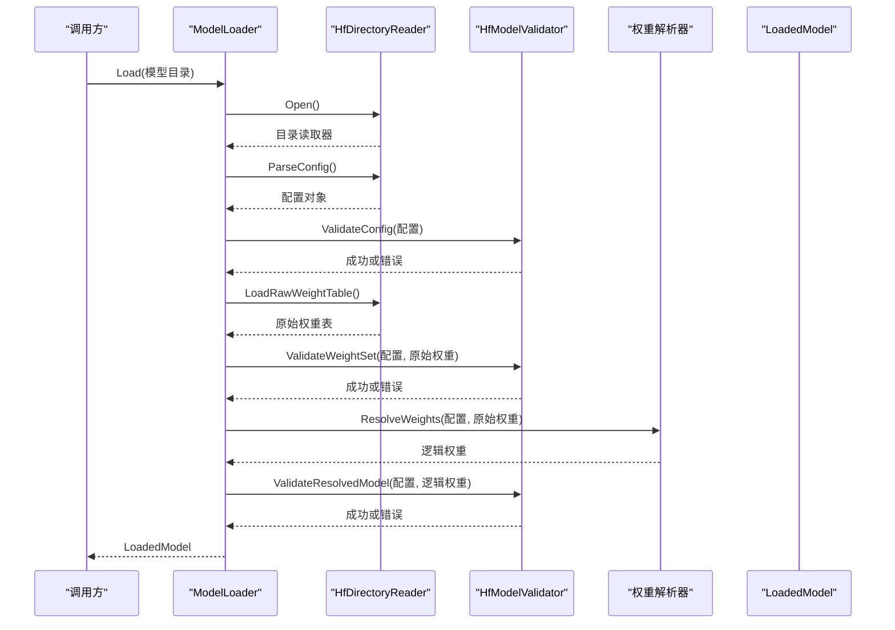
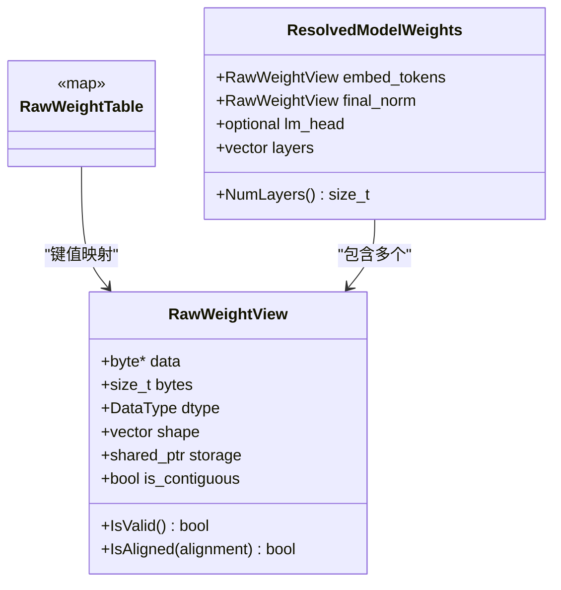
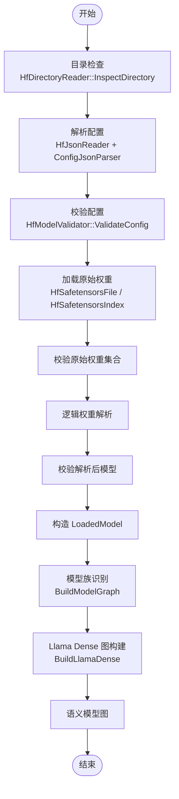
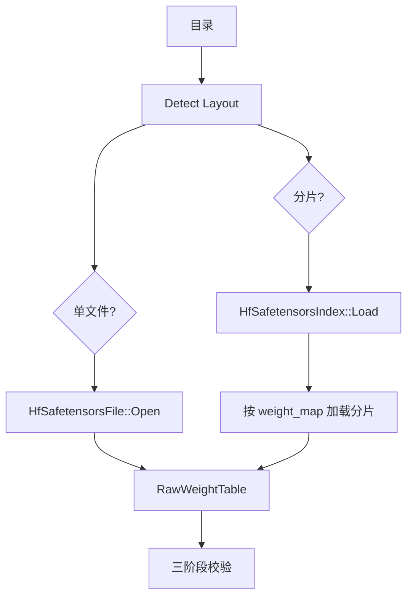
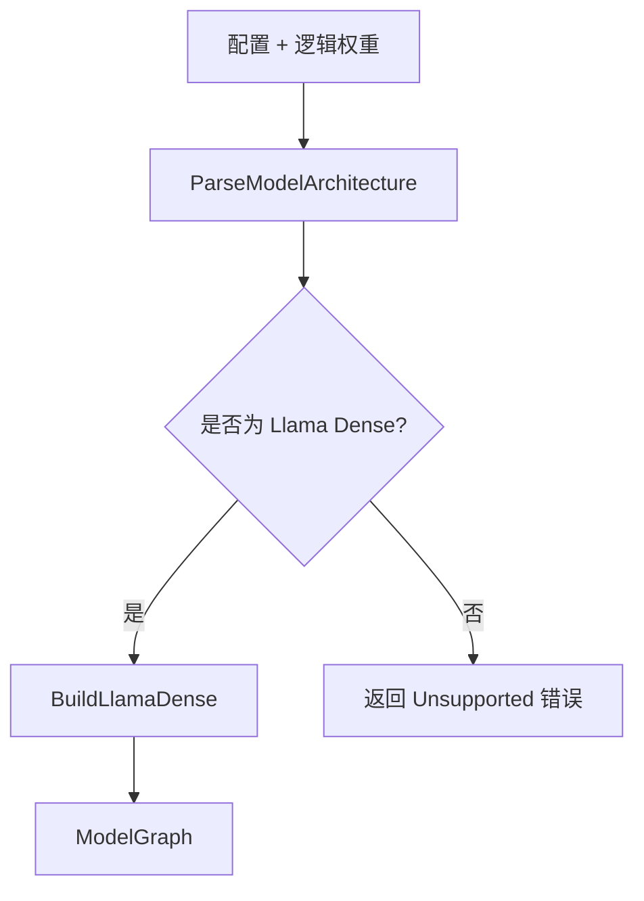
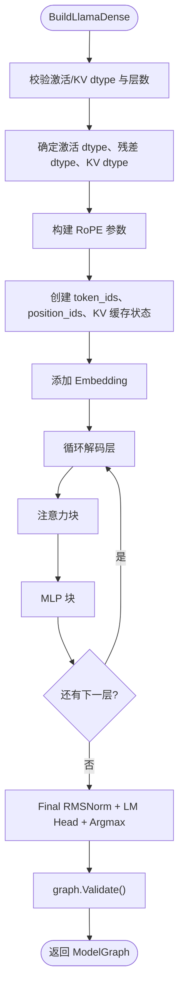
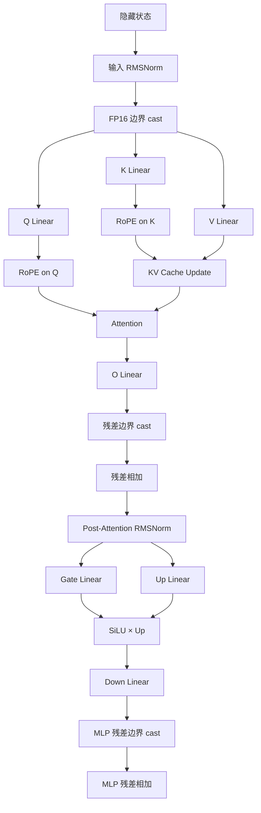
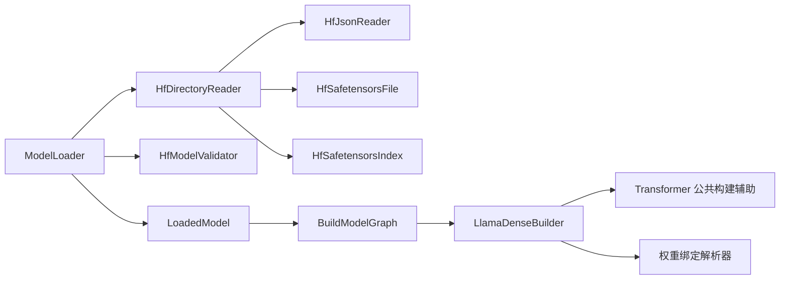
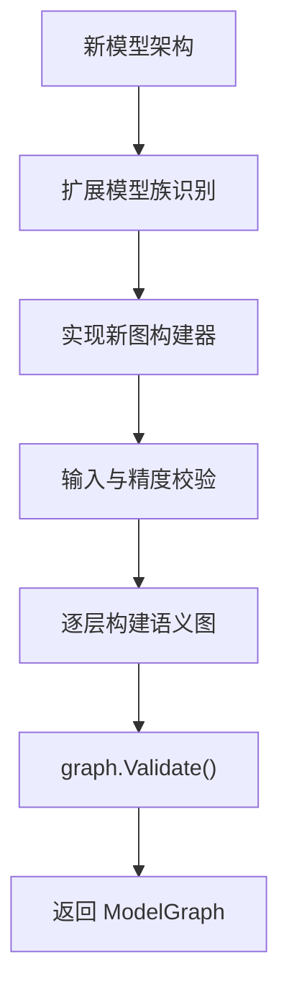

# 模型系统 (Model)

**本文引用的文件**
- [include/aethermind/model/model_loader.h](../../../include/aethermind/model/model_loader.h)
- [src/model/model_loader.cpp](../../../src/model/model_loader.cpp)
- [include/aethermind/model/formats/hf/hf_directory_reader.h](../../../include/aethermind/model/formats/hf/hf_directory_reader.h)
- [src/model/formats/hf/hf_directory_reader.cpp](../../../src/model/formats/hf/hf_directory_reader.cpp)
- [include/aethermind/model/formats/hf/hf_json_reader.h](../../../include/aethermind/model/formats/hf/hf_json_reader.h)
- [src/model/formats/hf/hf_json_reader.cpp](../../../src/model/formats/hf/hf_json_reader.cpp)
- [include/aethermind/model/formats/hf/hf_safetensors_file.h](../../../include/aethermind/model/formats/hf/hf_safetensors_file.h)
- [src/model/formats/hf/hf_safetensors_file.cpp](../../../src/model/formats/hf/hf_safetensors_file.cpp)
- [include/aethermind/model/formats/hf/hf_safetensors_index.h](../../../include/aethermind/model/formats/hf/hf_safetensors_index.h)
- [src/model/formats/hf/hf_safetensors_index.cpp](../../../src/model/formats/hf/hf_safetensors_index.cpp)
- [include/aethermind/model/formats/hf/hf_model_validator.h](../../../include/aethermind/model/formats/hf/hf_model_validator.h)
- [src/model/formats/hf/hf_model_validator.cpp](../../../src/model/formats/hf/hf_model_validator.cpp)
- [include/aethermind/model/raw_weight.h](../../../include/aethermind/model/raw_weight.h)
- [src/model/raw_weight.cpp](../../../src/model/raw_weight.cpp)
- [include/aethermind/model/resolved_model_weights.h](../../../include/aethermind/model/resolved_model_weights.h)
- [src/model/resolved_model_weights.cpp](../../../src/model/resolved_model_weights.cpp)
- [include/aethermind/model/loaded_model.h](../../../include/aethermind/model/loaded_model.h)
- [src/model/loaded_model.cpp](../../../src/model/loaded_model.cpp)
- [include/aethermind/model/build_model_graph.h](../../../include/aethermind/model/build_model_graph.h)
- [src/model/build_model_graph.cpp](../../../src/model/build_model_graph.cpp)
- [include/aethermind/model/llama_dense_graph_builder.h](../../../include/aethermind/model/llama_dense_graph_builder.h)
- [src/model/llama_dense_graph_builder.cpp](../../../src/model/llama_dense_graph_builder.cpp)

## 目录
1. [引言](#引言)
2. [项目结构](#项目结构)
3. [核心组件](#核心组件)
4. [架构总览](#架构总览)
5. [详细组件分析](#详细组件分析)
6. [依赖关系分析](#依赖关系分析)
7. [性能与内存特性](#性能与内存特性)
8. [故障排查指南](#故障排查指南)
9. [扩展新模型架构指南](#扩展新模型架构指南)
10. [结论](#结论)

## 引言
本设计文档聚焦 AetherMind 的模型系统，覆盖 HuggingFace 格式模型的解析流程、权重表构建、模型图构建算法以及 Llama Dense 架构支持。该系统的目标是把本地 HF 模型目录安全地转换为后端无关的语义图，并保留零拷贝或共享存储的原始权重视图，以便后续编译器、执行器与算子层复用。

关键设计原则包括：
- I/O、校验、逻辑权重解析与图构建严格分层。
- 所有外部错误通过 `Status` 返回，不抛出异常。
- Safetensors 使用内存映射实现零拷贝视图。
- 模型族识别由配置驱动，当前仅显式支持 Llama Dense。
- 激活精度和 KV 缓存精度可通过构建选项控制，但不会反向改写源权重或配置。

## 项目结构
模型相关代码集中在以下位置：
- `include/aethermind/model/`：模型加载、图构建、Llama Dense 构建器、权重抽象等对外接口。
- `src/model/`：上述接口的实现。
- `include/aethermind/model/formats/hf/` 与 `src/model/formats/hf/`：HF 目录、JSON、safetensors 单文件、分片索引、校验器等具体格式实现。

**图示来源**
- [include/aethermind/model/model_loader.h:16-37](../../../include/aethermind/model/model_loader.h#L16-L37)
- [src/model/model_loader.cpp:1-43](../../../src/model/model_loader.cpp#L1-L43)
- [include/aethermind/model/formats/hf/hf_directory_reader.h:23-107](../../../include/aethermind/model/formats/hf/hf_directory_reader.h#L23-L107)
- [include/aethermind/model/build_model_graph.h:17-45](../../../include/aethermind/model/build_model_graph.h#L17-L45)
- [include/aethermind/model/llama_dense_graph_builder.h:13-26](../../../include/aethermind/model/llama_dense_graph_builder.h#L13-L26)

**章节来源**
- [include/aethermind/model/model_loader.h:16-37](../../../include/aethermind/model/model_loader.h#L16-L37)
- [include/aethermind/model/formats/hf/hf_directory_reader.h:23-107](../../../include/aethermind/model/formats/hf/hf_directory_reader.h#L23-L107)
- [include/aethermind/model/build_model_graph.h:17-45](../../../include/aethermind/model/build_model_graph.h#L17-L45)

## 核心组件
本节按数据流顺序说明模型系统中的主要组件及其职责。

### ModelLoader
`ModelLoader` 是 HF 模型目录的无状态门面，只负责 I/O、配置解析、校验与逻辑权重解析；它明确不承担图构建、内核选择或权重预打包。

典型调用链：
1. 打开目录并检测 safetensors 布局。
2. 解析 `config.json`。
3. 校验配置。
4. 加载原始权重表。
5. 校验原始权重集合。
6. 将物理张量名解析为逻辑权重。
7. 校验解析后的模型完整性。
8. 构造 `LoadedModel`。

**图示来源**
- [src/model/model_loader.cpp:12-42](../../../src/model/model_loader.cpp#L12-L42)

**章节来源**
- [include/aethermind/model/model_loader.h:16-37](../../../include/aethermind/model/model_loader.h#L16-L37)
- [src/model/model_loader.cpp:1-43](../../../src/model/model_loader.cpp#L1-L43)

### HfDirectoryReader
`HfDirectoryReader` 负责 HF 模型目录级别的 I/O：
- 检测目录是否包含 `config.json` 及 safetensors 布局。
- 支持单文件 safetensors 与 `model.safetensors.index.json` 分片布局。
- 拒绝混合布局，确保后续加载路径唯一。
- 提供 `ParseConfig()` 与 `LoadRawWeightTable()`。

其内部组合了 JSON 解析器、safetensors 文件解析器和分片索引解析器，并在目录层级完成路径安全性检查。

**章节来源**
- [include/aethermind/model/formats/hf/hf_directory_reader.h:23-107](../../../include/aethermind/model/formats/hf/hf_directory_reader.h#L23-L107)
- [src/model/formats/hf/hf_directory_reader.cpp:1-200](../../../src/model/formats/hf/hf_directory_reader.cpp#L1-L200)

### HfJsonReader
`HfJsonReader` 是一个基于借用字符串视图的顺序 JSON 解析基类：
- 单游标前进，不回退。
- 提供字符串、整数、浮点数、布尔值、数组和跳过值的通用方法。
- 对 UTF-16 surrogate pair、转义序列、控制字符、数字范围进行严格校验。
- 失败时返回带字节偏移的 `InvalidArgument`。

`ConfigJsonParser` 继承该基类，只消费 Phase 1 需要的字段，未知字段被跳过以兼容上游 HF 配置。

**章节来源**
- [include/aethermind/model/formats/hf/hf_json_reader.h:12-75](../../../include/aethermind/model/formats/hf/hf_json_reader.h#L12-L75)
- [src/model/formats/hf/hf_json_reader.cpp:1-200](../../../src/model/formats/hf/hf_json_reader.cpp#L1-L200)

### HfSafetensorsFile
`HfSafetensorsFile` 是单个 safetensors 文件的零拷贝读取器：
- 使用内存映射文件作为底层存储。
- 解析头部的 JSON 元信息，得到每个张量的名称、数据类型、形状和数据区偏移。
- 校验所有张量数据段连续覆盖整个数据区域。
- 暴露 `Find(tensor_name)` 查找张量条目。
- 要求 safetensors 文件在映射生命周期内不被原地修改，否则可能触发 SIGBUS。

**章节来源**
- [include/aethermind/model/formats/hf/hf_safetensors_file.h:12-81](../../../include/aethermind/model/formats/hf/hf_safetensors_file.h#L12-L81)
- [src/model/formats/hf/hf_safetensors_file.cpp:1-200](../../../src/model/formats/hf/hf_safetensors_file.cpp#L1-L200)

### HfSafetensorsIndex
`HfSafetensorsIndex` 解析 `model.safetensors.index.json`：
- 提取 `weight_map`，将张量名映射到分片文件名。
- 可选解析 `metadata.total_size`。
- 校验分片文件名相对性，禁止 URI scheme、绝对路径和 `..`。
- 返回去重排序后的分片文件名列表。

**章节来源**
- [include/aethermind/model/formats/hf/hf_safetensors_index.h:12-71](../../../include/aethermind/model/formats/hf/hf_safetensors_index.h#L12-L71)
- [src/model/formats/hf/hf_safetensors_index.cpp:1-200](../../../src/model/formats/hf/hf_safetensors_index.cpp#L1-L200)

### HfModelValidator
`HfModelValidator` 提供三阶段结构校验：
1. `ValidateConfig`：校验配置语义，例如隐藏维度、注意力头数、RoPE 参数、激活函数等。
2. `ValidateWeightSet`：校验原始权重表是否符合模型 schema，检查必填张量、不支持的 MoE/Lora/Bias 模式、非连续形状等。
3. `ValidateResolvedModel`：校验逻辑权重完整性，例如 tied embeddings、dtype 一致性等。

该校验器不访问执行层内核，只在加载与构建前保证输入一致。

**章节来源**
- [include/aethermind/model/formats/hf/hf_model_validator.h:12-56](../../../include/aethermind/model/formats/hf/hf_model_validator.h#L12-L56)
- [src/model/formats/hf/hf_model_validator.cpp:1-200](../../../src/model/formats/hf/hf_model_validator.cpp#L1-L200)

### RawWeightView 与 ResolvedModelWeights
- `RawWeightView` 表示一个后端无关的原始权重视图，包含指针、字节数、数据类型、形状、共享存储和连续性标记。
- `RawWeightTable` 是张量名到 `RawWeightView` 的无序映射。
- `ResolvedModelWeights` 是逻辑权重结构体，包含词嵌入、最终归一化、可选 LM head 和各解码层的注意力、MLP、RMSNorm 权重。
- `ValidateRawWeightView` 校验元素大小、形状乘积、字节大小一致性，防止越界或破坏复合布局。

**图示来源**
- [include/aethermind/model/raw_weight.h:20-92](../../../include/aethermind/model/raw_weight.h#L20-L92)
- [include/aethermind/model/resolved_model_weights.h:12-45](../../../include/aethermind/model/resolved_model_weights.h#L12-L45)
- [src/model/raw_weight.cpp:5-44](../../../src/model/raw_weight.cpp#L5-L44)
- [src/model/resolved_model_weights.cpp:1-9](../../../src/model/resolved_model_weights.cpp#L1-L9)

**章节来源**
- [include/aethermind/model/raw_weight.h:20-92](../../../include/aethermind/model/raw_weight.h#L20-L92)
- [src/model/raw_weight.cpp:5-44](../../../src/model/raw_weight.cpp#L5-L44)
- [include/aethermind/model/resolved_model_weights.h:12-45](../../../include/aethermind/model/resolved_model_weights.h#L12-L45)
- [src/model/resolved_model_weights.cpp:1-9](../../../src/model/resolved_model_weights.cpp#L1-L9)

### LoadedModel
`LoadedModel` 是 HF I/O、校验与逻辑权重解析完成后的所有权边界：
- 持有 `HfModelConfig` 与 `ResolvedModelWeights`。
- 可携带 FP32 转换使用统计。
- 不包含任何后端工件，直到进入编译阶段。

**章节来源**
- [include/aethermind/model/loaded_model.h:12-44](../../../include/aethermind/model/loaded_model.h#L12-L44)
- [src/model/loaded_model.cpp:1-33](../../../src/model/loaded_model.cpp#L1-L33)

## 架构总览
下图展示从 HF 模型目录到语义图的完整流水线。

**图示来源**
- [src/model/model_loader.cpp:12-42](../../../src/model/model_loader.cpp#L12-L42)
- [src/model/build_model_graph.cpp:9-26](../../../src/model/build_model_graph.cpp#L9-L26)
- [src/model/llama_dense_graph_builder.cpp:233-414](../../../src/model/llama_dense_graph_builder.cpp#L233-L414)

## 详细组件分析

### HF 模型解析流程
HF 模型解析分为目录检测、配置解析、原始权重加载与三阶段校验。

#### 目录检测
`HfDirectoryReader::InspectDirectory` 验证：
- 存在 `config.json`。
- 存在且仅存在一种支持的 safetensors 布局。
- 单文件或分片索引二选一，拒绝混合。

#### 配置解析
`ConfigJsonParser` 解析关键字段，如 `model_type`、`hidden_size`、`num_hidden_layers`、`num_attention_heads`、`num_key_value_heads`、`vocab_size`、`head_dim`、`sliding_window`、`rms_norm_eps`、`tie_word_embeddings`、`attention_bias`、`mlp_bias`、`rope_theta` 等 RoPE 扩展字段。未知字段被忽略。

#### 原始权重加载
- 单文件：`HfSafetensorsFile::Open` 使用内存映射加载整个文件，并解析头部张量表。
- 分片：`HfSafetensorsIndex::Load` 解析 `weight_map`，然后按文件名逐个加载对应 safetensors 文件。

#### 三阶段校验
- `ValidateConfig`：限制 Phase 1 支持的模型语义。
- `ValidateWeightSet`：检查必填张量、不支持的 MoE/Lora/Bias、非连续形状、非法 dtype 等。
- `ValidateResolvedModel`：检查逻辑权重完整性，例如 tied embeddings、dtype 约束。

**图示来源**
- [include/aethermind/model/formats/hf/hf_directory_reader.h:23-107](../../../include/aethermind/model/formats/hf/hf_directory_reader.h#L23-L107)
- [src/model/formats/hf/hf_safetensors_file.cpp:1-200](../../../src/model/formats/hf/hf_safetensors_file.cpp#L1-L200)
- [src/model/formats/hf/hf_safetensors_index.cpp:1-200](../../../src/model/formats/hf/hf_safetensors_index.cpp#L1-L200)
- [src/model/formats/hf/hf_model_validator.cpp:1-200](../../../src/model/formats/hf/hf_model_validator.cpp#L1-L200)

**章节来源**
- [src/model/formats/hf/hf_directory_reader.cpp:1-200](../../../src/model/formats/hf/hf_directory_reader.cpp#L1-L200)
- [src/model/formats/hf/hf_safetensors_file.cpp:1-200](../../../src/model/formats/hf/hf_safetensors_file.cpp#L1-L200)
- [src/model/formats/hf/hf_safetensors_index.cpp:1-200](../../../src/model/formats/hf/hf_safetensors_index.cpp#L1-L200)
- [src/model/formats/hf/hf_model_validator.cpp:1-200](../../../src/model/formats/hf/hf_model_validator.cpp#L1-L200)

### 模型图构建算法
`BuildModelGraph` 是 HF 配置与逻辑权重到语义图的统一入口：
- 使用 `ParseModelArchitecture` 识别模型族。
- 当前仅支持 `kLlamaDense`。
- 其他模型类型直接返回错误，避免上层编译器接触 HF 家族拼写。

**图示来源**
- [src/model/build_model_graph.cpp:9-26](../../../src/model/build_model_graph.cpp#L9-L26)
- [include/aethermind/model/build_model_graph.h:29-45](../../../include/aethermind/model/build_model_graph.h#L29-L45)

**章节来源**
- [include/aethermind/model/build_model_graph.h:17-45](../../../include/aethermind/model/build_model_graph.h#L17-L45)
- [src/model/build_model_graph.cpp:1-27](../../../src/model/build_model_graph.cpp#L1-L27)

### Llama Dense 图构建实现
`BuildLlamaDense` 将 Llama 密集解码器转换为语义图，主要包括以下步骤：

1. **输入校验**
   - 校验激活 dtype 与 KV dtype 只能是 Float32、Float16 或 BFloat16。
   - 校验层数可表示为 `uint32_t`。
   - 再次调用 `ValidateConfig` 与 `ValidateResolvedModel`。

2. **精度策略**
   - 若未指定激活 dtype，则优先使用配置的权重 dtype hint，默认回退为 Float32。
   - 当激活 dtype 为 Float16 时，启用 FP32 residual 分支，以确保残差在 FP32 中累加。
   - Embedding 输出 dtype 与残差 dtype 必须一致。
   - FP16 激活要求 Embedding 权重与 KV 存储均为 FP16。

3. **RoPE 参数转换**
   - 在图构建前完成 RoPE 语义转换，不支持的 HF RoPE 变体会被拒绝，避免产生部分图。

4. **输入与状态定义**
   - 输入：`token_ids`、`position_ids`。
   - KV 缓存状态：每层一个 key cache 和一个 value cache。

5. **Embedding**
   - 添加词嵌入节点，绑定 `embed_tokens`。

6. **解码层循环**
   - 每层包含注意力块与 MLP 块。
   - 注意力块：RMSNorm → Q/K/V Linear → RoPE → KV Cache Update → Attention → O Linear → 残差相加。
   - MLP 块：RMSNorm → Gate/Up Linear → SiLU × Up → Down Linear → 残差相加。
   - 每次残差边界可按 FP32 插入 cast。

7. **输出阶段**
   - 最终 RMSNorm。
   - LM Head Linear。
   - Argmax 得到 token 输出。
   - 最后调用 `graph.Validate()`。

**图示来源**
- [src/model/llama_dense_graph_builder.cpp:233-414](../../../src/model/llama_dense_graph_builder.cpp#L233-L414)

#### 注意力块与 MLP 块结构

**图示来源**
- [src/model/llama_dense_graph_builder.cpp:47-220](../../../src/model/llama_dense_graph_builder.cpp#L47-L220)

**章节来源**
- [include/aethermind/model/llama_dense_graph_builder.h:13-26](../../../include/aethermind/model/llama_dense_graph_builder.h#L13-L26)
- [src/model/llama_dense_graph_builder.cpp:1-414](../../../src/model/llama_dense_graph_builder.cpp#L1-L414)

## 依赖关系分析
模型系统的关键依赖如下：

**图示来源**
- [src/model/model_loader.cpp:1-43](../../../src/model/model_loader.cpp#L1-L43)
- [src/model/build_model_graph.cpp:1-27](../../../src/model/build_model_graph.cpp#L1-L27)
- [src/model/llama_dense_graph_builder.cpp:1-30](../../../src/model/llama_dense_graph_builder.cpp#L1-L30)

耦合特点：
- `ModelLoader` 与具体 HF 格式解耦，仅依赖 `HfDirectoryReader`、`HfModelValidator` 与 `LoadedModel`。
- `BuildModelGraph` 通过模型族识别与 switch 分发，避免上层知道 HF 模型类型细节。
- `LlamaDenseGraphBuilder` 依赖图构建辅助函数、权重绑定解析器与 RoPE 参数构建器。
- 原始权重通过 `RawWeightView` 共享底层存储，减少中间拷贝。

**章节来源**
- [src/model/model_loader.cpp:1-43](../../../src/model/model_loader.cpp#L1-L43)
- [src/model/build_model_graph.cpp:1-27](../../../src/model/build_model_graph.cpp#L1-L27)
- [src/model/llama_dense_graph_builder.cpp:1-30](../../../src/model/llama_dense_graph_builder.cpp#L1-L30)

## 性能与内存特性
- **零拷贝权重视图**：safetensors 使用内存映射，张量视图直接共享映射存储，避免复制整个 checkpoint。
- **紧凑描述符**：目录布局描述符使用固定宽度枚举和路径，保持轻量。
- **顺序解析**：JSON 解析器使用单游标，避免重复扫描；skip 操作限制最大深度以防止恶意输入栈爆炸。
- **内存映射保护**：文档明确指出映射文件不可原地截断或修改，否则可能导致 SIGBUS。
- **图构建前的 RoPE 转换**：不支持的 RoPE 变体会在图变更前被拒绝，避免浪费图构建资源。
- **精度优化**：FP16 激活时使用 FP32 残差，有助于数值稳定性；LM head 输出在特定精度策略下保持 FP32 logits。

[本节为一般性能讨论，不直接分析具体源码行]

## 故障排查指南
常见错误与定位方式：

| 问题类别 | 典型错误原因 | 定位建议 |
|---|---|---|
| 目录格式错误 | 缺少 `config.json`、safetensors 布局冲突、混合布局 | 检查 `HfDirectoryReader::InspectDirectory` 返回值 |
| JSON 解析错误 | `config.json` 语法错误、非法 UTF-16 surrogate、未知控制字符 | 查看 `HfJsonReader` 报错中的字节偏移 |
| safetensors 头损坏 | 头部不是 JSON、键重复、数据偏移不连续、末尾未覆盖完整数据区 | 检查 `HfSafetensorsFile` 解析结果 |
| 分片索引错误 | 分片文件名含 URI、绝对路径、`..`、`weight_map` 缺失或为空 | 检查 `HfSafetensorsIndex` 校验逻辑 |
| 配置不一致 | 负维度、不支持的激活、RoPE 参数异常 | 检查 `HfModelValidator::ValidateConfig` |
| 权重缺失或不合法 | 必填张量缺失、MoE/Lora/Bias、非连续形状、shape/bytes 不一致 | 检查 `ValidateWeightSet` 与 `ValidateRawWeightView` |
| 逻辑权重不完整 | tied embeddings、dtype 不一致 | 检查 `ValidateResolvedModel` |
| 图构建失败 | 不支持的模型族、激活/KV dtype 不匹配、FP16 激活要求 FP16 embedding 与 KV | 检查 `BuildModelGraph` 与 `BuildLlamaDense` 错误消息 |

**章节来源**
- [src/model/formats/hf/hf_json_reader.cpp:1-200](../../../src/model/formats/hf/hf_json_reader.cpp#L1-L200)
- [src/model/formats/hf/hf_safetensors_file.cpp:1-200](../../../src/model/formats/hf/hf_safetensors_file.cpp#L1-L200)
- [src/model/formats/hf/hf_safetensors_index.cpp:1-200](../../../src/model/formats/hf/hf_safetensors_index.cpp#L1-L200)
- [src/model/formats/hf/hf_model_validator.cpp:1-200](../../../src/model/formats/hf/hf_model_validator.cpp#L1-L200)
- [src/model/raw_weight.cpp:5-44](../../../src/model/raw_weight.cpp#L5-L44)
- [src/model/build_model_graph.cpp:9-26](../../../src/model/build_model_graph.cpp#L9-L26)
- [src/model/llama_dense_graph_builder.cpp:233-414](../../../src/model/llama_dense_graph_builder.cpp#L233-L414)

## 扩展新模型架构指南
要为新模型架构添加支持，应遵循现有“配置识别 + 独立图构建器”的模式。

### 步骤一：新增模型族识别
当前 `BuildModelGraph` 根据 `ParseModelArchitecture` 的结果分发到不同构建器。若新架构属于已有家族，可直接复用；否则需要扩展模型族识别逻辑，并在 `BuildModelGraph` 中添加新的 switch 分支。

参考点：
- 模型族识别与分发位于 `BuildModelGraph`。
- 当前仅支持 Llama Dense，其他类型返回错误。

**章节来源**
- [src/model/build_model_graph.cpp:9-26](../../../src/model/build_model_graph.cpp#L9-L26)

### 步骤二：实现新的图构建器
新建类似 `LlamaDenseGraphBuilder` 的构建器，建议遵循以下结构：

1. **公开接口**
   - 提供无选项重载与带 `ModelGraphBuildOptions` 的重载。
   - 输入为 `HfModelConfig` 与 `ResolvedModelWeights`。
   - 返回 `StatusOr<ModelGraph>`。

2. **输入校验**
   - 校验 dtype 选项合法性。
   - 校验层数、维度、RoPE 等配置。
   - 调用 `HfModelValidator::ValidateConfig` 与 `ValidateResolvedModel`。

3. **精度策略**
   - 根据激活 dtype 与 KV dtype 决定残差 dtype、embedding 输出 dtype、logits dtype。
   - 对不支持的组合提前返回错误。

4. **图构建**
   - 定义输入、状态与常量。
   - 逐层构建注意力、MLP、归一化等子块。
   - 使用统一的权重绑定命名与调试名。
   - 在最后调用 `graph.Validate()`。

5. **错误处理**
   - 所有失败返回 `Status`，不返回部分图。
   - 对不支持的 HF 变体拒绝而非降级。

**图示来源**
- [include/aethermind/model/build_model_graph.h:29-45](../../../include/aethermind/model/build_model_graph.h#L29-L45)
- [src/model/build_model_graph.cpp:9-26](../../../src/model/build_model_graph.cpp#L9-L26)
- [include/aethermind/model/llama_dense_graph_builder.h:13-26](../../../include/aethermind/model/llama_dense_graph_builder.h#L13-L26)
- [src/model/llama_dense_graph_builder.cpp:233-414](../../../src/model/llama_dense_graph_builder.cpp#L233-L414)

### 步骤三：适配权重解析与校验
如果新架构引入新的张量命名或权重结构：
- 更新 `ResolvedModelWeights` 或新增专用逻辑权重结构。
- 更新权重解析逻辑，将物理张量名映射到逻辑权重。
- 更新 `HfModelValidator`，增加对新张量的必填校验与不支持模式检测。

**章节来源**
- [include/aethermind/model/resolved_model_weights.h:12-45](../../../include/aethermind/model/resolved_model_weights.h#L12-L45)
- [src/model/formats/hf/hf_model_validator.cpp:1-200](../../../src/model/formats/hf/hf_model_validator.cpp#L1-L200)

## 结论
AetherMind 模型系统通过清晰的层次划分实现了从 HF 模型目录到语义图的可靠转换：
- `ModelLoader` 封装目录 I/O、配置解析、权重加载与三阶段校验。
- `HfDirectoryReader`、`HfJsonReader`、`HfSafetensorsFile`、`HfSafetensorsIndex` 共同构成零拷贝、安全的 HF 格式读取层。
- `HfModelValidator` 在配置、原始权重与逻辑权重三个层面保证输入一致性。
- `BuildModelGraph` 提供模型族分发入口，当前仅支持 Llama Dense。
- `LlamaDenseGraphBuilder` 是 Llama 密集解码器的权威图构建实现，涵盖注意力、RoPE、KV 缓存、MLP、归一化与输出头。

扩展新模型时，应保持 I/O 与图构建分离、使用明确的校验阶段、在图构建前拒绝不支持的变体，并通过一致的精度策略和权重绑定机制保证可维护性与可测试性。
