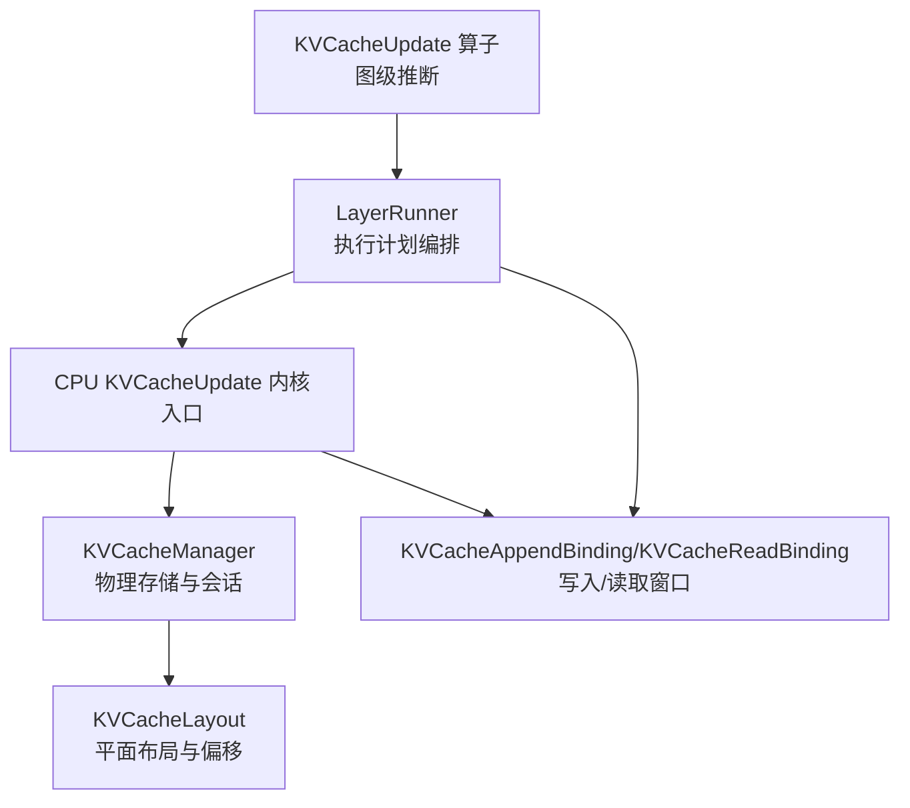
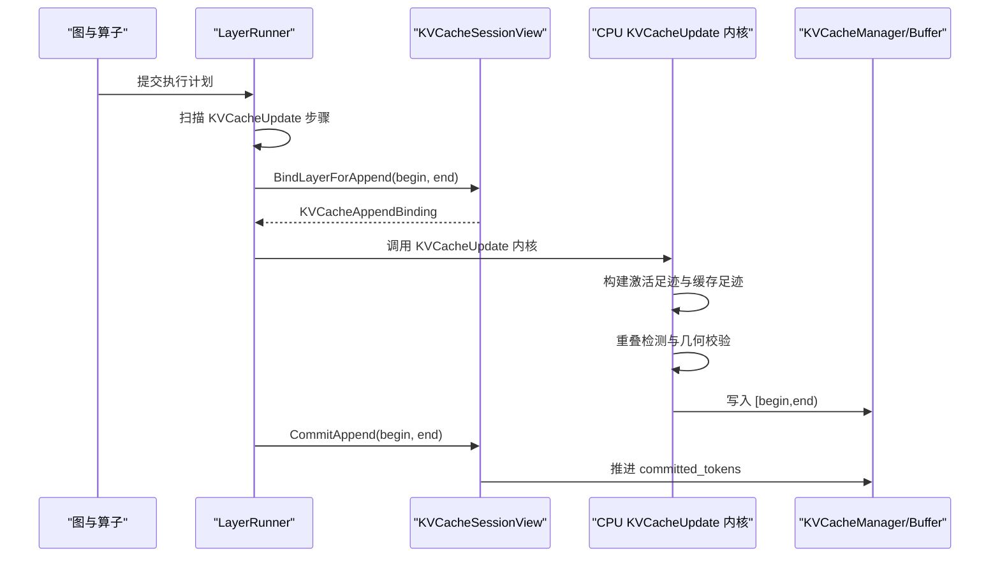
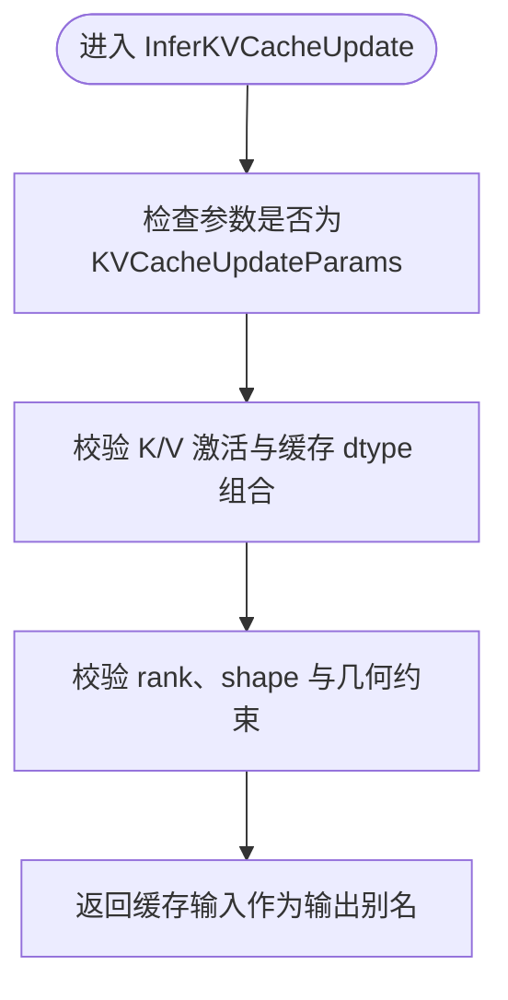
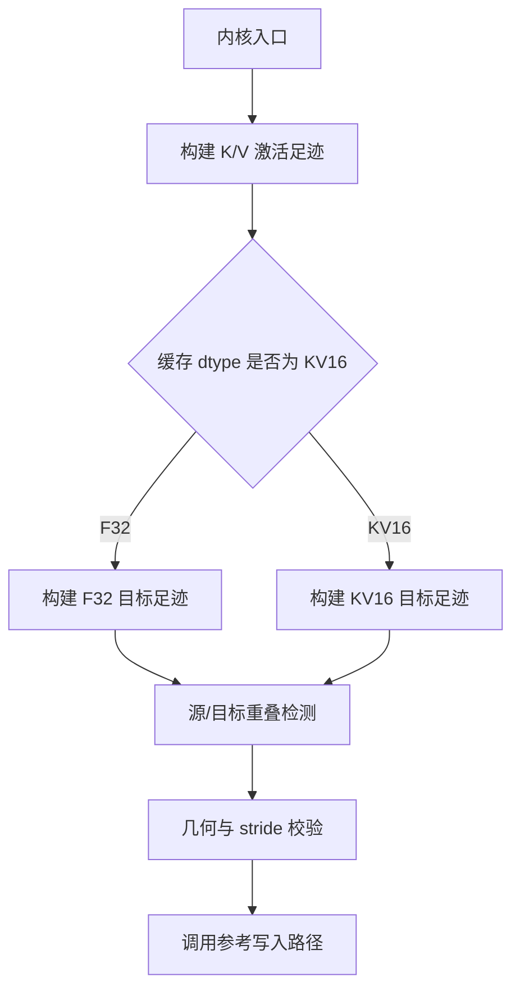
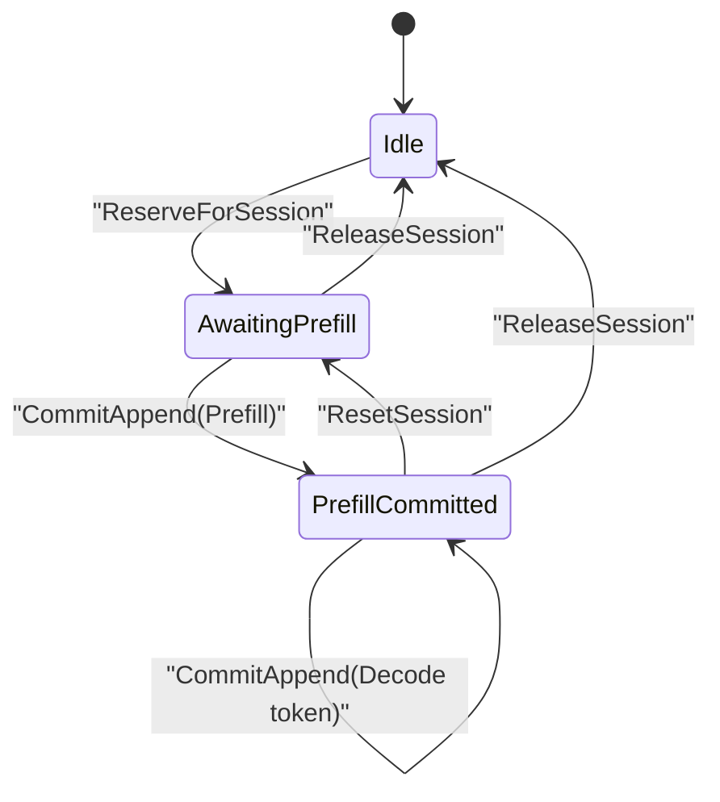
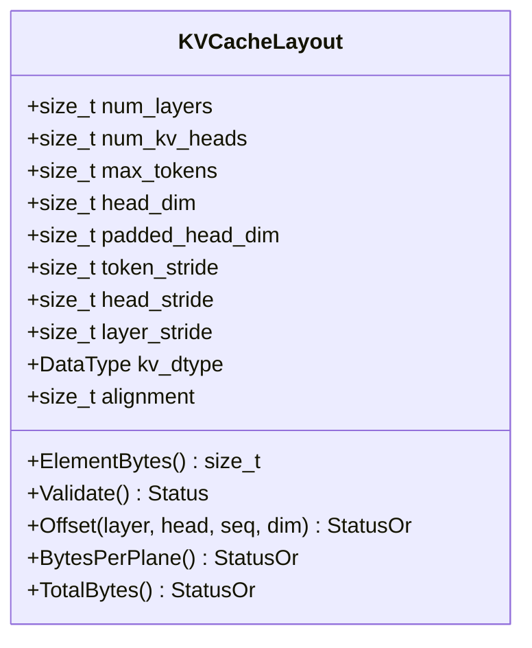
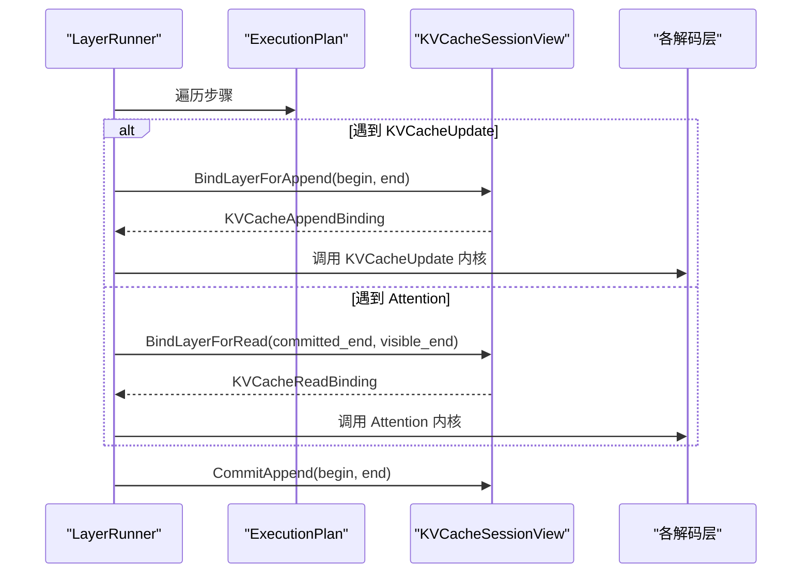
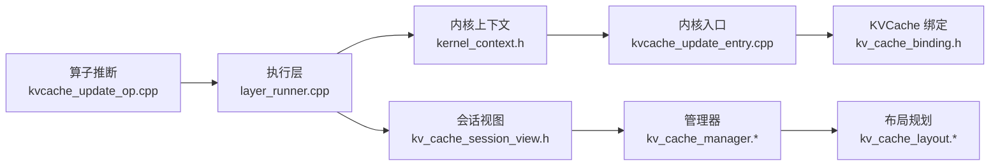
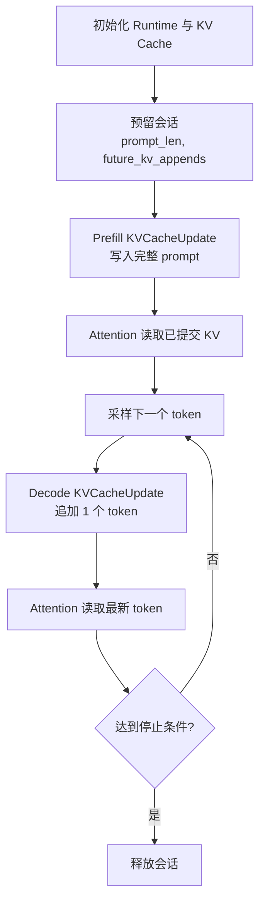

# KV Cache 管理算子

**本文引用的文件**
- [README.md](../../../operators/kv_cache_update/README.md)
- [kvcache_update_op.cpp](../../../../src/operators/ops/kvcache_update_op.cpp)
- [op_params.h](../../../../include/aethermind/operators/op_params.h)
- [kvcache_update_entry.cpp](../../../../src/backend/cpu/kernels/kvcache_update/kvcache_update_entry.cpp)
- [kvcache_update_internal.h](../../../../src/backend/cpu/kernels/kvcache_update/kvcache_update_internal.h)
- [kv_cache_manager.h](../../../../include/aethermind/kv_cache/kv_cache_manager.h)
- [kv_cache_manager.cpp](../../../../src/kv_cache/kv_cache_manager.cpp)
- [kv_cache_layout.h](../../../../include/aethermind/kv_cache/kv_cache_layout.h)
- [kv_cache_layout.cpp](../../../../src/kv_cache/kv_cache_layout.cpp)
- [kv_cache_session_view.h](../../../../include/aethermind/kv_cache/kv_cache_session_view.h)
- [kv_cache_binding.h](../../../../include/aethermind/base/kv_cache_binding.h)
- [layer_runner.cpp](../../../../src/execution/layer_runner.cpp)
- [test_kvcache_update_kernel.cpp](../../../../tests/unit/execution/test_kvcache_update_kernel.cpp)

## 目录
1. [引言](#引言)
2. [项目结构](#项目结构)
3. [核心组件](#核心组件)
4. [架构总览](#架构总览)
5. [详细组件分析](#详细组件分析)
6. [依赖关系分析](#依赖关系分析)
7. [性能与内存优化](#性能与内存优化)
8. [自回归生成中的使用方式](#自回归生成中的使用方式)
9. [故障排查](#故障排查)
10. [结论](#结论)

## 引言
本文围绕 AetherMind 的 KV Cache 管理算子，系统说明 `KVCacheUpdate` 在增量推理中的作用：它把每层注意力所需的键值激活写入 KV 缓存，并通过事务提交机制保证跨层、跨计划的数据一致性。文档重点覆盖以下方面：
- 增量推理时的 KV 状态管理与滑动窗口更新语义；
- KV Cache 连续平面布局设计与分页存储（按层/头/序列切分）的差异；
- 算子的数据类型契约、形状约束与关键参数；
- 内存分配、对齐、重叠检测与边界检查；
- F32 与 KV16（F16/BF16）两种后端路径的数值与实现差异；
- 在自回归 Prefill/Decode 流程中的调用顺序、可见性规则与优化建议。

## 项目结构
KV Cache 相关代码分布在运算符、执行器、KV 管理器、布局规划与 CPU 内核几个层次：
- 运算符定义与图级推断位于 `src/operators/ops/kvcache_update_op.cpp`；
- 运行时执行编排位于 `src/execution/layer_runner.cpp`；
- KV 物理存储与会话生命周期由 `include/aethermind/kv_cache/kv_cache_manager.*` 管理；
- KV 平面几何与偏移计算由 `include/aethermind/kv_cache/kv_cache_layout.*` 提供；
- 内核入口与参考实现位于 `src/backend/cpu/kernels/kvcache_update/*`；
- 测试用例位于 `tests/unit/execution/test_kvcache_update_kernel.cpp`；
- 算子语义与 P3 行为说明位于 `docs/operators/kv_cache_update/README.md`。

**图表来源**
- [kvcache_update_op.cpp:1-191](../../../../src/operators/ops/kvcache_update_op.cpp#L1-L191)
- [layer_runner.cpp:1-551](../../../../src/execution/layer_runner.cpp#L1-L551)
- [kvcache_update_entry.cpp:1-420](../../../../src/backend/cpu/kernels/kvcache_update/kvcache_update_entry.cpp#L1-L420)
- [kv_cache_manager.h:1-115](../../../../include/aethermind/kv_cache/kv_cache_manager.h#L1-L115)
- [kv_cache_layout.h:1-104](../../../../include/aethermind/kv_cache/kv_cache_layout.h#L1-L104)
- [kv_cache_binding.h:1-60](../../../../include/aethermind/base/kv_cache_binding.h#L1-L60)

**章节来源**
- [kvcache_update_op.cpp:1-191](../../../../src/operators/ops/kvcache_update_op.cpp#L1-L191)
- [layer_runner.cpp:1-551](../../../../src/execution/layer_runner.cpp#L1-L551)
- [kvcache_update_entry.cpp:1-420](../../../../src/backend/cpu/kernels/kvcache_update/kvcache_update_entry.cpp#L1-L420)

## 核心组件
- **KVCacheUpdate 算子**：负责校验输入 K/V 激活与 KV 缓存的状态规格，并返回“原样复用”的 cache 输出视图，实际写入发生在后端内核通过 `kv_append` 绑定完成。
- **KVCacheManager**：拥有 KV 缓存的物理缓冲和单会话保留；负责初始化、容量验证、会话预留、重置、释放以及暴露布局与容量信息。
- **KVCacheSessionView**：借指 manager 内的物理存储与会话状态，提供写入范围校验、append/read 绑定、提交追加等接口。
- **KVCacheLayout**：描述一个 key/value 平面的几何形状、步长、对齐、元素大小及字节偏移计算。
- **KVCacheLayerStorageBinding / KVCacheAppendBinding / KVCacheReadBinding**：内核单次调用期间使用的轻量存储与窗口契约。
- **CPU KVCacheUpdate 内核入口**：构建激活视图、目标缓存足迹、重叠检测，并调度 F32 或 KV16/A16 参考路径。

**章节来源**
- [kvcache_update_op.cpp:1-191](../../../../src/operators/ops/kvcache_update_op.cpp#L1-L191)
- [kv_cache_manager.h:1-115](../../../../include/aethermind/kv_cache/kv_cache_manager.h#L1-L115)
- [kv_cache_session_view.h:1-200](../../../../include/aethermind/kv_cache/kv_cache_session_view.h#L1-L200)
- [kv_cache_layout.h:1-104](../../../../include/aethermind/kv_cache/kv_cache_layout.h#L1-L104)
- [kv_cache_binding.h:1-60](../../../../include/aethermind/base/kv_cache_binding.h#L1-L60)
- [kvcache_update_entry.cpp:1-200](../../../../src/backend/cpu/kernels/kvcache_update/kvcache_update_entry.cpp#L1-L200)

## 架构总览
KVCacheUpdate 的端到端流程分为三层：
1. **图级与参数层**：算子推断接受 K/V 激活与 K/V 缓存输入，校验 dtype 与 shape，并声明输出为缓存输入的别名。
2. **执行层**：LayerRunner 扫描计划中的 KVCacheUpdate 步骤，聚合出一次 append 事务；对每个解码层构造 `KVCacheAppendBinding`，并在所有层写完后统一提交。
3. **内核层**：CPU 内核根据激活 dtype 与缓存 dtype 选择 F32 或 KV16 路径，做地址足迹构建、重叠检测与数据写入。

**图表来源**
- [layer_runner.cpp:180-350](../../../../src/execution/layer_runner.cpp#L180-L350)
- [kvcache_update_entry.cpp:200-420](../../../../src/backend/cpu/kernels/kvcache_update/kvcache_update_entry.cpp#L200-L420)
- [kv_cache_session_view.h:120-200](../../../../include/aethermind/kv_cache/kv_cache_session_view.h#L120-L200)

## 详细组件分析

### KVCacheUpdate 算子与参数契约
- 支持两类类型组合：
  - 同型：K/V 激活与 K/V 缓存共享同一支持类型；
  - P3 mixed KV16：激活为 F32，缓存为 F16 或 BF16，窄化发生在写入边界。
- 形状契约要求：
  - K/V 激活为 rank 2，形状 `[seq_len, hidden]`；
  - K/V 缓存为 rank 3，形状 `[num_kv_heads, cache_len, head_dim]`；
  - K 与 V 形状一致，缓存 k/v 形状一致，`hidden == num_kv_heads * head_dim`；
  - 静态维度必须为正，且静态 `seq_len` 不超过静态 `cache_len`。
- 输出语义：输出是缓存输入的别名，不复制数据；窄化只在后端内核写入时发生。
- 参数对象：`KVCacheUpdateParams` 当前为空结构体，实际语义由输入 TensorSpec 与 selector/state_dtype 决定。

**图表来源**
- [kvcache_update_op.cpp:1-191](../../../../src/operators/ops/kvcache_update_op.cpp#L1-L191)
- [op_params.h:220-245](../../../../include/aethermind/operators/op_params.h#L220-L245)

**章节来源**
- [kvcache_update_op.cpp:1-191](../../../../src/operators/ops/kvcache_update_op.cpp#L1-L191)
- [op_params.h:220-245](../../../../include/aethermind/operators/op_params.h#L220-L245)
- [README.md](../../../operators/kv_cache_update/README.md)

### 后端内核与 KV16 窄化策略
CPU 内核入口承担以下职责：
- 校验激活张量有效性、rank、正维度、正 stride、非空指针与 float 对齐；
- 构建激活的 StridedAddressFootprint；
- 根据缓存 dtype 分别构建目标缓存足迹；
- 证明 K/V 源与 K/V 目标之间无重叠；
- 校验 append 范围、head_dim 几何、stride 覆盖性与容量边界；
- 调度 F32 参考路径或 KV16 窄化路径。

KV16 路径的关键点：
- 激活仍为 F32，但缓存元素类型为 F16 或 BF16；
- 缓存 stride 必须是两字节倍数，但不要求 float 对齐；
- 转换遵循固定“四舍六入取偶”、渐进下溢、符号零保留、溢出到同号无穷大、NaN 强制 quiet bit 等合同；
- 每次只写逻辑 `head_dim`，不触碰 padding 或窗口外数据。

**图表来源**
- [kvcache_update_entry.cpp:1-200](../../../../src/backend/cpu/kernels/kvcache_update/kvcache_update_entry.cpp#L1-L200)
- [kvcache_update_entry.cpp:200-420](../../../../src/backend/cpu/kernels/kvcache_update/kvcache_update_entry.cpp#L200-L420)
- [kvcache_update_internal.h:1-75](../../../../src/backend/cpu/kernels/kvcache_update/kvcache_update_internal.h#L1-L75)
- [README.md](../../../operators/kv_cache_update/README.md)

**章节来源**
- [kvcache_update_entry.cpp:1-420](../../../../src/backend/cpu/kernels/kvcache_update/kvcache_update_entry.cpp#L1-L420)
- [kvcache_update_internal.h:1-75](../../../../src/backend/cpu/kernels/kvcache_update/kvcache_update_internal.h#L1-L75)
- [README.md](../../../operators/kv_cache_update/README.md)

### KVCacheManager 与会话生命周期
KVCacheManager 维护：
- 一次活跃的会话保留；
- 多层 KV 平面布局；
- key/value 两个 Buffer；
- 会话状态：generation、capacity、prompt_len、committed_tokens、lifecycle。

生命周期要点：
- Init 会重建 layout 并分配 key/value 缓冲；失败时清空已初始化的布局与容量；
- ReserveForSession 检查 prompt_len、future_kv_appends 是否超过 max_tokens，并递增 generation；
- ResetSession 清零 committed_tokens 并回到等待 Prefill 状态；
- ReleaseSession 清空 session state 并失效 view。

**图表来源**
- [kv_cache_manager.h:30-115](../../../../include/aethermind/kv_cache/kv_cache_manager.h#L30-L115)
- [kv_cache_manager.cpp:1-176](../../../../src/kv_cache/kv_cache_manager.cpp#L1-L176)

**章节来源**
- [kv_cache_manager.h:1-115](../../../../include/aethermind/kv_cache/kv_cache_manager.h#L1-L115)
- [kv_cache_manager.cpp:1-176](../../../../src/kv_cache/kv_cache_manager.cpp#L1-L176)

### KVCacheLayout 与内存布局设计
KVCacheLayout 描述单个 key 或 value 平面的几何：
- `num_layers`、`num_kv_heads`、`max_tokens`、`head_dim`；
- `padded_head_dim` 允许在每个 token 行末尾增加对齐填充；
- `token_stride`、`head_stride`、`layer_stride` 表示字节步长；
- `alignment` 确保每个 token 行相对平面基址对齐；
- `Offset` 方法在层索引、头索引、序列位置、维度索引上计算字节偏移；
- `PlanKVCacheLayout` 在无分配情况下规划布局并校验 stride 覆盖性与对齐。

这种布局是**连续平面存储**：每个层内，KV 缓存按 `[num_kv_heads][max_tokens][padded_head_dim]` 组织，而不是按 token 分页分散到多个小块。分页式 KV 通常意味着按 token 或按块分配多个 Buffer，而本实现以整平面 Buffers 为主，通过 stride 表达多维访问。

**图表来源**
- [kv_cache_layout.h:10-104](../../../../include/aethermind/kv_cache/kv_cache_layout.h#L10-L104)
- [kv_cache_layout.cpp:1-200](../../../../src/kv_cache/kv_cache_layout.cpp#L1-L200)

**章节来源**
- [kv_cache_layout.h:1-104](../../../../include/aethermind/kv_cache/kv_cache_layout.h#L1-L104)
- [kv_cache_layout.cpp:1-200](../../../../src/kv_cache/kv_cache_layout.cpp#L1-L200)

### 写入与读取绑定契约
- `KVCacheLayerStorageBinding`：描述单层 K/V 物理数据、dtype、几何与 stride；
- `KVCacheAppendBinding`：描述一次计划本地追加写入的 `[begin, end)` 范围；
- `KVCacheReadBinding`：描述跨计划的 `committed_end` 与本次计划局部可见的 `visible_end`，并包含 attention 查询区间。

这些结构是内核调用的唯一数据通道，避免在 prepared 参数中持有易过期的 KV 指针。

**章节来源**
- [kv_cache_binding.h:1-60](../../../../include/aethermind/base/kv_cache_binding.h#L1-L60)

### LayerRunner 的事务提交与一致性
LayerRunner 在运行执行计划时：
1. 扫描所有 KVCacheUpdate 步骤，聚合为一次 append 事务；
2. 若处于预填充阶段，要求首次写入长度等于 prompt_len，且从位置 0 开始；
3. 若处于解码阶段，要求每次追加长度为 1；
4. 为每一层调用 `BindLayerForAppend`，得到 append binding；
5. 调用所有层内核后，再统一调用 `CommitAppend`；
6. Attention 在读取时，根据是否在本次 append 中，决定 query_begin/query_end 与 visible_end。

这保证了：
- 一个 plan 内未提交的 KV 不会被其他 plan 看到；
- 所有层要么全部写入成功，要么都不发布 watermark；
- Attention 不会读到未完成的 KV 片段。

**图表来源**
- [layer_runner.cpp:120-551](../../../../src/execution/layer_runner.cpp#L120-L551)

**章节来源**
- [layer_runner.cpp:120-551](../../../../src/execution/layer_runner.cpp#L120-L551)

## 依赖关系分析
KVCacheUpdate 的依赖链如下：
- 算子推断依赖 `TensorSpec`、`OpParams`、`InferenceResult`；
- 执行层依赖 `ExecutionContext`、`PreparedExecutionBindings`、`StateAliasPlan`；
- 内核依赖 `KernelContext`、`TensorView`、`StridedAddressFootprint`、`KVCacheAppendBinding`；
- 存储依赖 `Allocator`、`Buffer`、`KVCacheLayout`、`KVCacheSessionView`。

**图表来源**
- [kvcache_update_op.cpp:1-191](../../../../src/operators/ops/kvcache_update_op.cpp#L1-L191)
- [layer_runner.cpp:1-551](../../../../src/execution/layer_runner.cpp#L1-L551)
- [kvcache_update_entry.cpp:1-420](../../../../src/backend/cpu/kernels/kvcache_update/kvcache_update_entry.cpp#L1-L420)
- [kv_cache_binding.h:1-60](../../../../include/aethermind/base/kv_cache_binding.h#L1-L60)
- [kv_cache_session_view.h:1-200](../../../../include/aethermind/kv_cache/kv_cache_session_view.h#L1-L200)
- [kv_cache_manager.h:1-115](../../../../include/aethermind/kv_cache/kv_cache_manager.h#L1-L115)
- [kv_cache_layout.h:1-104](../../../../include/aethermind/kv_cache/kv_cache_layout.h#L1-L104)

**章节来源**
- [kvcache_update_op.cpp:1-191](../../../../src/operators/ops/kvcache_update_op.cpp#L1-L191)
- [layer_runner.cpp:1-551](../../../../src/execution/layer_runner.cpp#L1-L551)
- [kvcache_update_entry.cpp:1-420](../../../../src/backend/cpu/kernels/kvcache_update/kvcache_update_entry.cpp#L1-L420)

## 性能与内存优化
- **连续平面布局减少碎片**：KVCacheLayout 使用固定的层/头/序列步长，避免逐 token 分配带来的内存碎片与间接寻址开销。
- **对齐提升 SIMD 效率**：layout 的 `alignment` 要求 token 行按字节对齐，使内核可以安全地按 float 或 16-bit 向量加载。
- **一次窄化原则**：P3 mixed KV16 只在写入边界将 F32 激活转换为 F16/BF16，后续 Attention 始终读取已窄化的缓存，避免重复转换。
- **批量写入与原子提交**：LayerRunner 在一个 plan 内聚合所有 KVCacheUpdate，最后一次性提交，减少 watermark 竞争与中间态可见风险。
- **重叠检测避免冗余拷贝**：内核通过构建源/目标足迹并做字节范围重叠判断，拒绝不安全布局，从而避免隐式临时拷贝。
- **资源记账准确**：文档指出 KVCacheLayout 与 allocator 的请求记账要正确反映两字节逻辑元素不等于任何对齐下物理字节恰好减半的事实。
- **优化方向**：
  - 优先使用与硬件向量宽度匹配的 `head_dim` 与 `alignment`；
  - 尽量保持 `padded_head_dim` 接近 `head_dim`，减少 padding 浪费；
  - 在 Decode 阶段控制 `future_kv_appends`，避免过度预留导致 capacity 浪费；
  - 在 Prefill 阶段合并尽可能多的 token，减少计划次数；
  - 使用真实生产 kernel 路径前，先用 reference 路径完成数值验收。

[本节为通用优化建议，不直接分析具体代码行]

## 自回归生成中的使用方式
典型自回归流程包括：
1. 创建 Runtime 并配置 KV Cache 参数：层数、KV 头数、最大 token 数、head_dim、dtype、alignment；
2. 预留会话：传入 prompt_len 与 future_kv_appends；
3. Prefill：第一次 KVCacheUpdate 必须写入完整 prompt 长度，从位置 0 开始；
4. Attention：读取已提交的 KV 历史；
5. Decode：每次生成一个新 token，KVCacheUpdate 追加 1 个位置，随后 Attention 仅关注该新 token；
6. 循环直到停止条件满足；
7. 释放会话，使 KV 缓存可被下一轮使用。

测试用例展示了如何构建 KVCacheUpdate 图、准备执行上下文、注册 KVCacheUpdate 与 Attention 内核，并验证 KV 写入与读取的一致性。

**图表来源**
- [test_kvcache_update_kernel.cpp:1-220](../../../../tests/unit/execution/test_kvcache_update_kernel.cpp#L1-L220)
- [layer_runner.cpp:200-350](../../../../src/execution/layer_runner.cpp#L200-L350)

**章节来源**
- [test_kvcache_update_kernel.cpp:1-220](../../../../tests/unit/execution/test_kvcache_update_kernel.cpp#L1-L220)
- [layer_runner.cpp:200-350](../../../../src/execution/layer_runner.cpp#L200-L350)

## 故障排查
常见错误及其含义：
- **不支持的 dtype 组合**：K/V 激活与缓存不是同型，也不是 F32 激活加 F16/BF16 缓存；
- **形状不匹配**：K/V 激活 rank 不为 2，缓存 rank 不为 3，或 `hidden != num_kv_heads * head_dim`；
- **静态容量不足**：静态 `seq_len > cache_len`；
- **append 越界**：append 范围超出 token_capacity；
- **stride 不合法**：stride 不能覆盖 head_dim 或 token/head/layer 几何；
- **源与目标重叠**：激活与缓存写入区域无法证明不相交；
- **未提交就读取**：Attention 尝试读取尚未提交的 KV 范围；
- **Query 长度不一致**：本次 plan 内 KVCacheUpdate 的序列长度与 Attention 的 query 长度不一致；
- **会话状态错误**：在 AwaitingPrefill 阶段没有写入完整 prompt，或在 Decode 阶段写入多于 1 个 token。

定位建议：
- 先检查 `KVCacheUpdateParams` 与 selector/state_dtype；
- 再检查 K/V 激活 shape 与 KV 缓存 shape；
- 确认 KVCacheManager 的 `num_layers`、`num_kv_heads`、`max_tokens`、`head_dim`、`kv_dtype`、`alignment`；
- 查看 LayerRunner 是否在同一个 plan 中聚合了正确的 KVCacheUpdate 步骤；
- 检查内核是否收到有效的 `kv_append` 或 `kv_read` 绑定；
- 使用测试用例中的 fixture 模式对比预期 spec 与绑定。

**章节来源**
- [kvcache_update_op.cpp:1-191](../../../../src/operators/ops/kvcache_update_op.cpp#L1-L191)
- [kvcache_update_entry.cpp:1-420](../../../../src/backend/cpu/kernels/kvcache_update/kvcache_update_entry.cpp#L1-L420)
- [layer_runner.cpp:120-551](../../../../src/execution/layer_runner.cpp#L120-L551)

## 结论
AetherMind 的 KV Cache 管理算子通过清晰的职责分层实现了增量推理所需的高效 KV 写入：
- 算子层只做规格与语义校验，避免在图级做出错误的内存假设；
- 执行层用事务模型统一 KV 写入与提交，保证跨层一致性；
- 内核层聚焦于激活视图、缓存足迹与数值窄化；
- KVCacheManager 与 KVCacheLayout 提供连续、对齐、可计量的物理存储；
- KVCacheSessionView 提供严格的写入/读取窗口与可见性控制。

对于实际部署，应优先使用稳定的 KV Cache 几何与 dtype，合理设置最大缓存长度与批大小，并确保 Prefill 与 Decode 严格遵循首写完整 prompt、后续每次追加一 token 的规则。数值上，P3 mixed KV16 路径提供了明确的 F32→F16/BF16 转换合同，应在生产 kernel 之前完成独立 oracle 与 fixture 验收。
