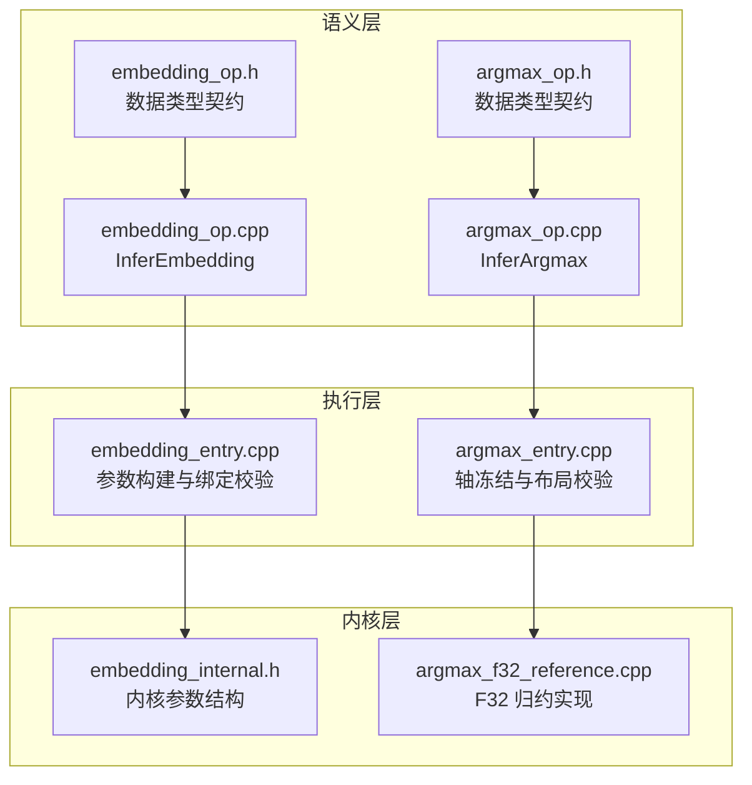
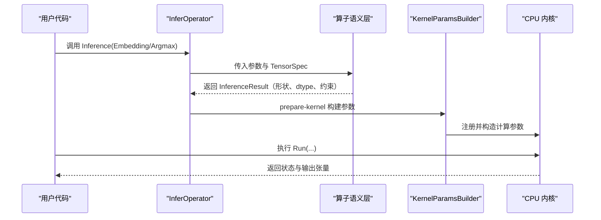
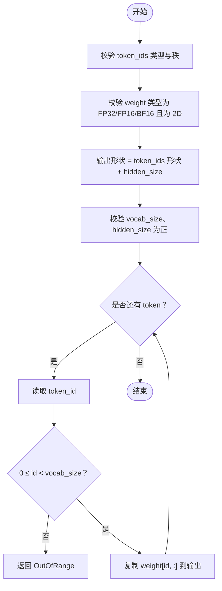
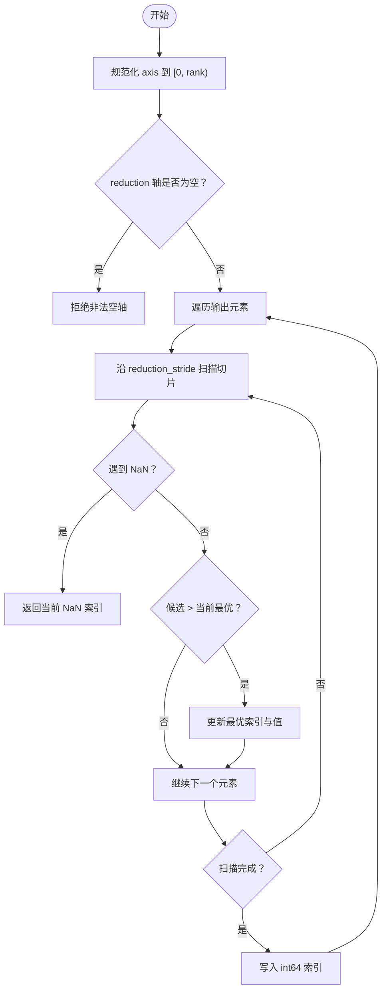
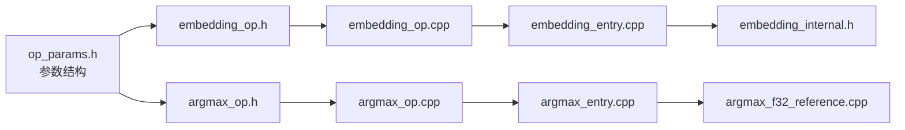

# 嵌入与查找算子

**本文引用的文件**
- [embedding_op.cpp](../../../../src/operators/ops/embedding_op.cpp)
- [embedding_op.h](../../../../include/aethermind/operators/ops/embedding_op.h)
- [argmax_op.cpp](../../../../src/operators/ops/argmax_op.cpp)
- [argmax_op.h](../../../../include/aethermind/operators/ops/argmax_op.h)
- [embedding_entry.cpp](../../../../src/backend/cpu/kernels/embedding/embedding_entry.cpp)
- [embedding_internal.h](../../../../src/backend/cpu/kernels/embedding/embedding_internal.h)
- [argmax_entry.cpp](../../../../src/backend/cpu/kernels/argmax/argmax_entry.cpp)
- [argmax_f32_reference.cpp](../../../../src/backend/cpu/kernels/argmax/argmax_f32_reference.cpp)
- [op_params.h](../../../../include/aethermind/operators/op_params.h)
- [README.md](../../../operators/embedding/README.md)
- [test_embedding_inference.cpp](../../../../tests/unit/operators/ops/test_embedding_inference.cpp)
- [test_argmax_inference.cpp](../../../../tests/unit/operators/ops/test_argmax_inference.cpp)

## 目录
1. [引言](#引言)
2. [项目结构](#项目结构)
3. [核心组件](#核心组件)
4. [架构总览](#架构总览)
5. [详细组件分析](#详细组件分析)
6. [依赖关系分析](#依赖关系分析)
7. [性能考虑](#性能考虑)
8. [故障排查指南](#故障排查指南)
9. [结论](#结论)

## 引言
本文聚焦 AetherMind 中的两个关键推理算子：**Embedding（词向量嵌入）** 与 **ArgMax（最大值索引查找）**。文档从语义契约、形状推断、CPU 内核实现、内存访问模式、边界检查和数值行为五个层面进行解析，并结合 Transformer 模型中的典型使用场景，说明如何在预填充阶段读取 Token 嵌入、在生成阶段选择下一个 Token。文末给出面向 CPU 实现的优化建议与内存使用最佳实践。

## 项目结构
Embedding 与 ArgMax 的实现遵循 AetherMind 的算子分层：
- 语义层定义参数类型、数据类型契约和形状推断函数。
- 执行层通过 KernelParamsBuilder 构建内核参数，并注册到 CPU backend。
- 内核层提供 reference 实现及按后端能力分发的优化路径。

**图表来源**
- [embedding_op.h:1-99](../../../../include/aethermind/operators/ops/embedding_op.h#L1-L99)
- [embedding_op.cpp:1-89](../../../../src/operators/ops/embedding_op.cpp#L1-L89)
- [argmax_op.h:1-50](../../../../include/aethermind/operators/ops/argmax_op.h#L1-L50)
- [argmax_op.cpp:1-55](../../../../src/operators/ops/argmax_op.cpp#L1-L55)
- [embedding_entry.cpp:1-200](../../../../src/backend/cpu/kernels/embedding/embedding_entry.cpp#L1-L200)
- [embedding_internal.h:1-90](../../../../src/backend/cpu/kernels/embedding/embedding_internal.h#L1-L90)
- [argmax_entry.cpp:1-200](../../../../src/backend/cpu/kernels/argmax/argmax_entry.cpp#L1-L200)
- [argmax_f32_reference.cpp:1-60](../../../../src/backend/cpu/kernels/argmax/argmax_f32_reference.cpp#L1-L60)

**章节来源**
- [embedding_op.h:1-99](../../../../include/aethermind/operators/ops/embedding_op.h#L1-L99)
- [embedding_op.cpp:1-89](../../../../src/operators/ops/embedding_op.cpp#L1-L89)
- [argmax_op.h:1-50](../../../../include/aethermind/operators/ops/argmax_op.h#L1-L50)
- [argmax_op.cpp:1-55](../../../../src/operators/ops/argmax_op.cpp#L1-L55)

## 核心组件
本节分别描述 Embedding 与 ArgMax 的输入输出契约、索引映射方式、批量处理策略以及边界检查机制。

### Embedding 算子
- 输入张量：
  - `token_ids`：至少一维的连续整数张量，支持 int32、int64、uint32。
  - `weight`：二维连续权重张量 `[vocab_size, hidden_size]`，支持 float32、float16、bfloat16。
- 输出张量：
  - 保持所有 `token_ids` 维度，并在末尾追加 `hidden_size`，即 `[token_axes..., hidden_size]`。
  - 默认输出数据类型跟随 weight；若显式指定 output_dtype，则必须为标量 float32。
- 索引映射：
  - 对每个 token 位置 i，读取 `weight[token_ids[i], :]` 作为输出行。
  - 对于多维 `token_ids`，先展平 token 序列，逐 token 查表后按原 shape 广播隐藏维度。
- 批量处理：
  - 内核以 token_count 为外层循环，每次读取一个 token 的行数据；W16 权重走行级 widening 到 F32。
- 边界检查：
  - 静态形状中 vocab_size 与 hidden_size 必须为正；符号维度在运行时通过约束检查。
  - 运行时逐 token 检查 vocabulary bounds；越界返回 OutOfRange，已写入行保留。
- 内存访问：
  - token_ids、weight、output 均要求连续布局且互不重叠。
  - W16 路径采用 byte-safe batch conversion，保留有限值、次正规数、有符号零位精确性，NaN 保留符号与有效负载并按 quiet 语义处理。

**章节来源**
- [embedding_op.h:1-99](../../../../include/aethermind/operators/ops/embedding_op.h#L1-L99)
- [embedding_op.cpp:1-89](../../../../src/operators/ops/embedding_op.cpp#L1-L89)
- [embedding_entry.cpp:1-200](../../../../src/backend/cpu/kernels/embedding/embedding_entry.cpp#L1-L200)
- [embedding_internal.h:1-90](../../../../src/backend/cpu/kernels/embedding/embedding_internal.h#L1-L90)
- [README.md](../../../operators/embedding/README.md)
- [test_embedding_inference.cpp:1-200](../../../../tests/unit/operators/ops/test_embedding_inference.cpp#L1-L200)

### ArgMax 算子
- 输入张量：
  - 单输入浮点张量，支持 float32、float16、bfloat16。
  - 支持任意 rank ≥ 1；axis 可为负数，表示从末尾计数的轴。
- 输出张量：
  - 数据类型为 int64。
  - 形状移除 reduction axis，其余维度保持不变。
- 最大值查找算法：
  - Reference 实现沿 reduction_stride 扫描切片，严格大于才更新最优索引；相等最大值保留最低索引。
  - NaN 行为：第一个 NaN 立即获胜，后续比较停止，保证确定性结果且不依赖无序 NaN 比较。
- 并行归约策略：
  - 当前 Reference 实现按输出元素顺序串行遍历；实际并行归约由更底层微内核或调度器决定，本参考路径未内嵌线程化归约。
- 数值比较优化：
  - 比较使用严格大于；遇到 NaN 提前终止该切片扫描，避免多余比较。
- 索引数组与边界条件：
  - 运行期 axis 需规范化到 `[0, input_rank)`；reduction 轴长度必须非空。
  - 输出 strides 必须为正；input 与 output 的字节范围不能重叠。

**章节来源**
- [argmax_op.h:1-50](../../../../include/aethermind/operators/ops/argmax_op.h#L1-L50)
- [argmax_op.cpp:1-55](../../../../src/operators/ops/argmax_op.cpp#L1-L55)
- [argmax_entry.cpp:1-200](../../../../src/backend/cpu/kernels/argmax/argmax_entry.cpp#L1-L200)
- [argmax_f32_reference.cpp:1-60](../../../../src/backend/cpu/kernels/argmax/argmax_f32_reference.cpp#L1-L60)
- [test_argmax_inference.cpp:1-91](../../../../tests/unit/operators/ops/test_argmax_inference.cpp#L1-L91)

## 架构总览
下图展示从算子语义到 CPU 内核执行的完整调用链。

**图表来源**
- [embedding_op.cpp:1-89](../../../../src/operators/ops/embedding_op.cpp#L1-L89)
- [argmax_op.cpp:1-55](../../../../src/operators/ops/argmax_op.cpp#L1-L55)
- [embedding_entry.cpp:1-200](../../../../src/backend/cpu/kernels/embedding/embedding_entry.cpp#L1-L200)
- [argmax_entry.cpp:1-200](../../../../src/backend/cpu/kernels/argmax/argmax_entry.cpp#L1-L200)

## 详细组件分析

### Embedding 算子详解
#### 索引映射与内存布局
- `token_ids` 可以是任意 rank ≥ 1 的连续张量。
- 输出形状为 `input_ids.shape + [hidden_size]`。
- 权重按行存储：第 `token_ids[i]` 行的隐藏向量直接复制到输出对应行。

**图表来源**
- [embedding_op.cpp:1-89](../../../../src/operators/ops/embedding_op.cpp#L1-L89)
- [embedding_entry.cpp:1-200](../../../../src/backend/cpu/kernels/embedding/embedding_entry.cpp#L1-L200)

#### 批量处理与 widening
- F32 权重路径直接按行拷贝。
- W16 权重路径在读取时进行行级 widening，将 FP16/BF16 转为 FP32，减少计算精度损失。
- A16×W16 路径可无舍入地复制 16-bit payload，适合冻结量化权重的快速通道。

#### 错误与边界
- 不支持的 token dtype、weight dtype 会立即失败。
- 静态形状中负或零的 weight 维度被拒绝；符号维度延迟到运行时约束检查。
- 越界 token 返回 OutOfRange；已写入的输出行不被回滚。

**章节来源**
- [embedding_op.h:1-99](../../../../include/aethermind/operators/ops/embedding_op.h#L1-L99)
- [embedding_op.cpp:1-89](../../../../src/operators/ops/embedding_op.cpp#L1-L89)
- [embedding_entry.cpp:1-200](../../../../src/backend/cpu/kernels/embedding/embedding_entry.cpp#L1-L200)
- [embedding_internal.h:1-90](../../../../src/backend/cpu/kernels/embedding/embedding_internal.h#L1-L90)
- [README.md](../../../operators/embedding/README.md)

### ArgMax 算子详解
#### 轴归一化与形状推导
- axis 负值会被规范化为 `rank + axis`。
- 输出形状去掉 reduction axis，其他维度保持不变。
- 若 reduction 轴静态大小为 0，语义推断阶段直接拒绝。

#### 最大值查找流程

**图表来源**
- [argmax_op.cpp:1-55](../../../../src/operators/ops/argmax_op.cpp#L1-L55)
- [argmax_entry.cpp:1-200](../../../../src/backend/cpu/kernels/argmax/argmax_entry.cpp#L1-L200)
- [argmax_f32_reference.cpp:1-60](../../../../src/backend/cpu/kernels/argmax/argmax_f32_reference.cpp#L1-L60)

#### 数值行为与比较优化
- 严格大于更新最优索引，确保相等最大值返回最低索引。
- 首个 NaN 直接获胜，避免后续比较的不确定性。
- 当前参考实现按输出元素的 flat 顺序迭代，内部切片扫描为线性复杂度 O(reduction_size)。

**章节来源**
- [argmax_op.h:1-50](../../../../include/aethermind/operators/ops/argmax_op.h#L1-L50)
- [argmax_op.cpp:1-55](../../../../src/operators/ops/argmax_op.cpp#L1-L55)
- [argmax_entry.cpp:1-200](../../../../src/backend/cpu/kernels/argmax/argmax_entry.cpp#L1-L200)
- [argmax_f32_reference.cpp:1-60](../../../../src/backend/cpu/kernels/argmax/argmax_f32_reference.cpp#L1-L60)
- [test_argmax_inference.cpp:1-91](../../../../tests/unit/operators/ops/test_argmax_inference.cpp#L1-L91)

### 参数与算子契约
- EmbeddingParams 与 ArgmaxParams 在统一参数结构中定义，并通过算子类型分发。
- 支持的 dtype 集合集中维护，便于消息一致性与未来扩展。

**章节来源**
- [op_params.h:26-242](../../../../include/aethermind/operators/op_params.h#L26-L242)
- [embedding_op.h:1-99](../../../../include/aethermind/operators/ops/embedding_op.h#L1-L99)
- [argmax_op.h:1-50](../../../../include/aethermind/operators/ops/argmax_op.h#L1-L50)

## 依赖关系分析
Embedding 与 ArgMax 的依赖链如下：

**图表来源**
- [op_params.h:26-242](../../../../include/aethermind/operators/op_params.h#L26-L242)
- [embedding_op.h:1-99](../../../../include/aethermind/operators/ops/embedding_op.h#L1-L99)
- [argmax_op.h:1-50](../../../../include/aethermind/operators/ops/argmax_op.h#L1-L50)
- [embedding_op.cpp:1-89](../../../../src/operators/ops/embedding_op.cpp#L1-L89)
- [argmax_op.cpp:1-55](../../../../src/operators/ops/argmax_op.cpp#L1-L55)
- [embedding_entry.cpp:1-200](../../../../src/backend/cpu/kernels/embedding/embedding_entry.cpp#L1-L200)
- [argmax_entry.cpp:1-200](../../../../src/backend/cpu/kernels/argmax/argmax_entry.cpp#L1-L200)
- [embedding_internal.h:1-90](../../../../src/backend/cpu/kernels/embedding/embedding_internal.h#L1-L90)
- [argmax_f32_reference.cpp:1-60](../../../../src/backend/cpu/kernels/argmax/argmax_f32_reference.cpp#L1-L60)

## 性能考虑
### Embedding
- 优先使用连续布局的 token_ids、weight 与 output，避免跨步访问带来的缓存失效。
- 大批量 token 场景下，W16→F32 的行级 widening 应尽可能利用后端特性（如 F16C/AVX2），以减少 widening 开销。
- 避免频繁的小批次调用；尽量合并 batch 与 sequence 维度以降低参数构建与调度开销。
- 越界 token 会导致 OutOfRange 分支，建议在应用层做词表边界预处理，减少运行时越界概率。

### ArgMax
- 输出 strides 必须为正，且与 input 布局解耦；避免在紧耦合内存上产生额外拷贝。
- 对于大 reduction 轴，可在更高层引入任务并行；Reference 路径本身为线性扫描。
- 当存在大量 NaN 时，早期终止可减少比较次数，但应避免滥用 NaN 作为控制信号。

### 内存使用最佳实践
- 明确区分输入、权重与输出缓冲区，禁止重叠。
- 对 Embedding，output 与 token_ids、weight 不得共享同一地址区间。
- 对 ArgMax，由于 dtype 与 rank 变化，不允许 output 成为 input 的精确 in-place alias。
- 对 zero-element 张量，允许 null data 与零 strides，但应在上层确保逻辑正确。

[本节为通用指导，不直接分析具体文件]

## 故障排查指南
### Embedding 常见问题
- 不支持的 token dtype：仅接受 int32、int64、uint32。
- 不支持的 weight dtype：仅接受 float32、float16、bfloat16。
- 形状不符：weight 必须为 2D；output 必须是 token_ids 秩加一，且前 n 维与 token_ids 一致。
- 越界 token：运行时逐 token 检查，返回 OutOfRange；检查词表大小与 token 值范围。
- 指针为空：非零元素张量要求 data() 非空；zero-token 情况除外。

**章节来源**
- [embedding_op.h:1-99](../../../../include/aethermind/operators/ops/embedding_op.h#L1-L99)
- [embedding_op.cpp:1-89](../../../../src/operators/ops/embedding_op.cpp#L1-L89)
- [embedding_entry.cpp:1-200](../../../../src/backend/cpu/kernels/embedding/embedding_entry.cpp#L1-L200)
- [README.md](../../../operators/embedding/README.md)

### ArgMax 常见问题
- axis 越界：规范化后必须在 `[0, rank)`。
- reduction 轴为空：静态零维度在语义推断阶段拒绝；动态零维度由绑定阶段内核处理。
- 输出形状错误：必须为输入形状去掉 reduction axis。
- strides 非法：要求正 strides，且 input/output 字节范围不相交。

**章节来源**
- [argmax_op.cpp:1-55](../../../../src/operators/ops/argmax_op.cpp#L1-L55)
- [argmax_entry.cpp:1-200](../../../../src/backend/cpu/kernels/argmax/argmax_entry.cpp#L1-L200)

## 结论
AetherMind 的 Embedding 与 ArgMax 算子在语义层明确了 dtype 与形状契约，在执行层完成了严格的参数构建与内存布局校验，在内核层提供了清晰、可验证的 reference 实现。Embedding 以行查表为核心，结合 W16 widening 与后端特性优化；ArgMax 以稳定、确定性的最大值查找为核心，优先保证 NaN 行为一致性与最低索引稳定性。在实际使用中，应优先保证连续内存布局、批量聚合调用、合理的词表边界检查，以获得更可预测的性能与更低的调试成本。
