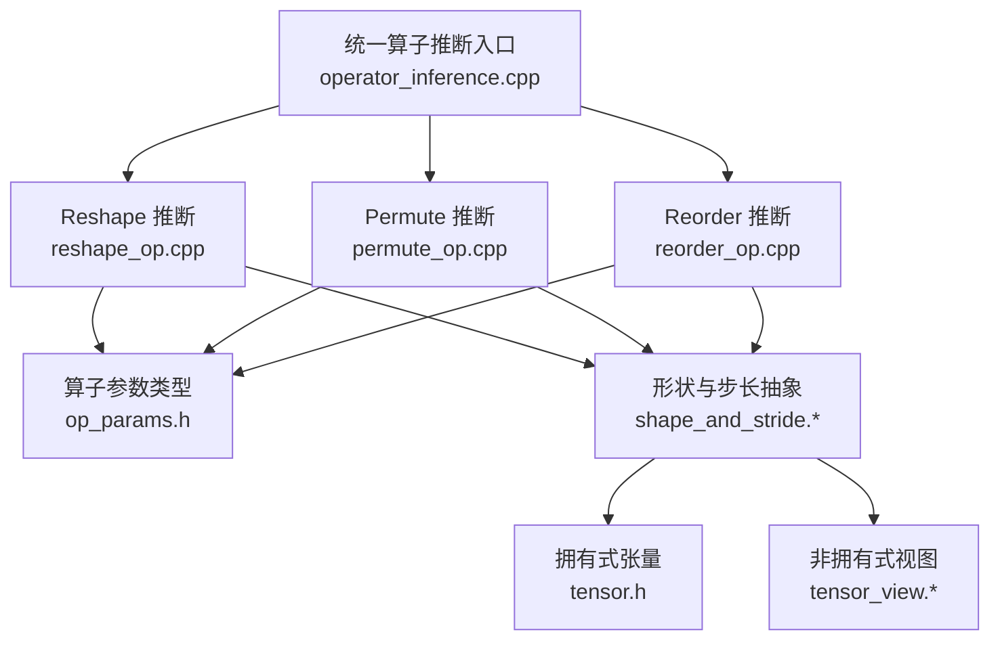
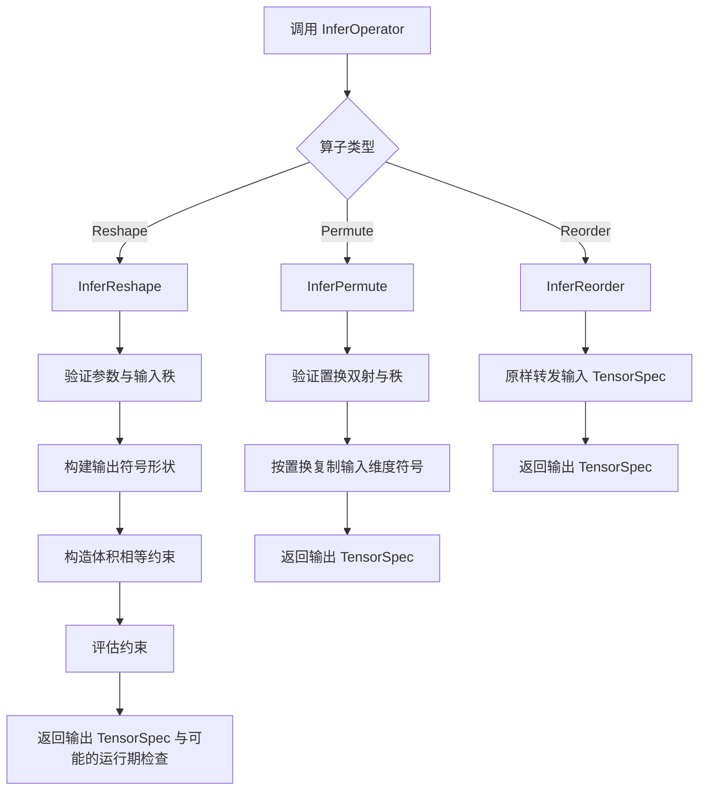
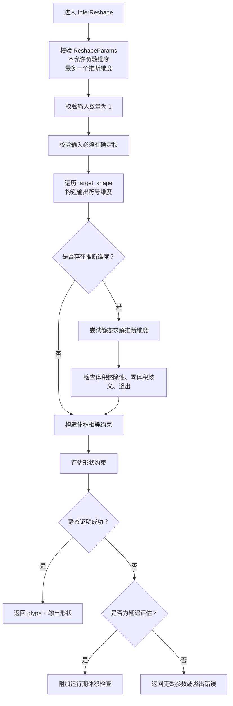
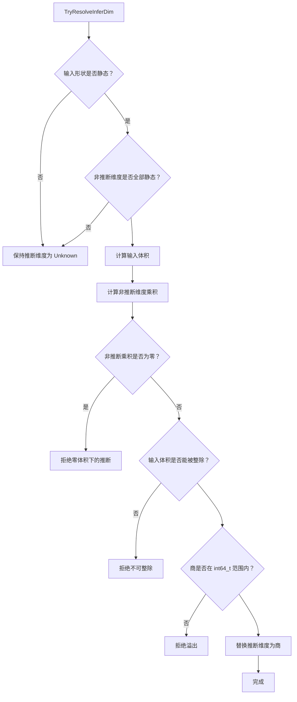
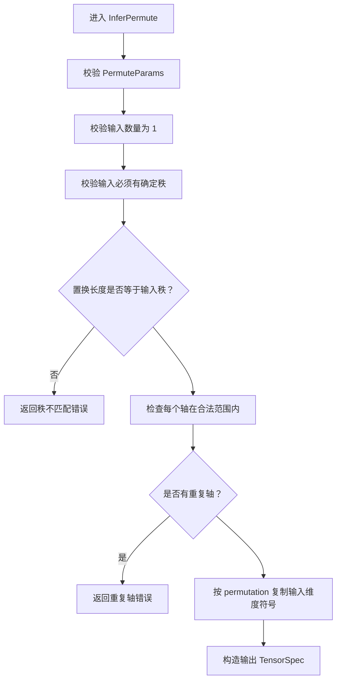
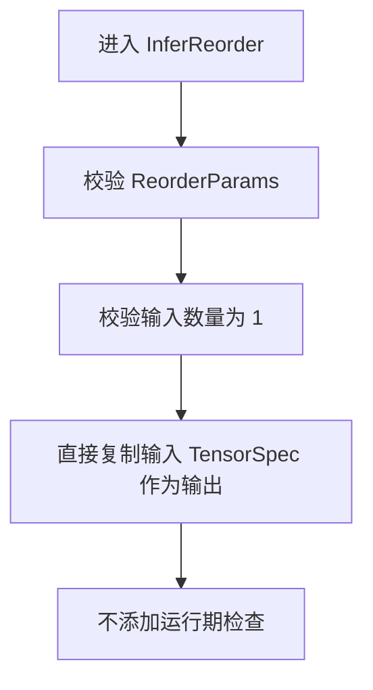
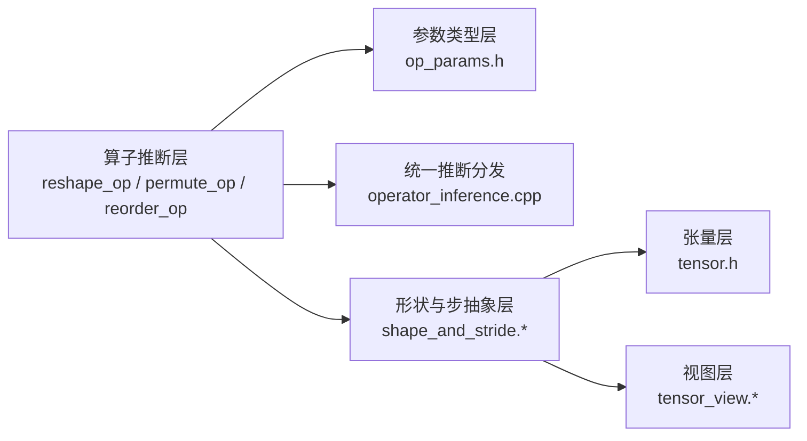
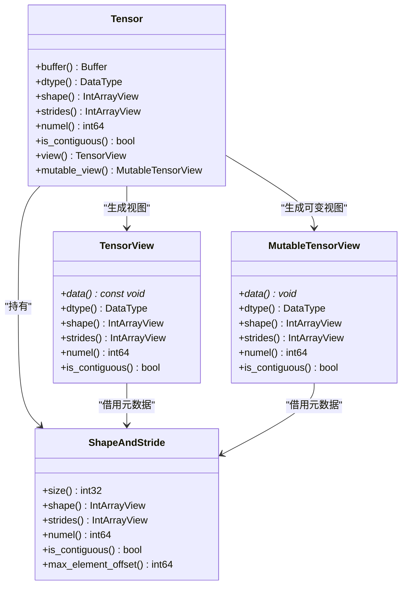

# 张量变换算子

**本文引用的文件**
- [reshape_op.cpp](../../../../src/operators/ops/reshape_op.cpp)
- [permute_op.cpp](../../../../src/operators/ops/permute_op.cpp)
- [reorder_op.cpp](../../../../src/operators/ops/reorder_op.cpp)
- [op_params.h](../../../../include/aethermind/operators/op_params.h)
- [operator_inference.cpp](../../../../src/operators/operator_inference.cpp)
- [tensor.h](../../../../include/aethermind/base/tensor.h)
- [tensor_view.h](../../../../include/aethermind/base/tensor_view.h)
- [shape_and_stride.h](../../../../include/aethermind/base/shape_and_stride.h)
- [shape_and_stride.cpp](../../../../src/base/shape_and_stride.cpp)
- [tensor_view.cpp](../../../../src/base/tensor_view.cpp)
- [test_reshape_inference.cpp](../../../../tests/unit/operators/ops/test_reshape_inference.cpp)
- [test_permute_inference.cpp](../../../../tests/unit/operators/ops/test_permute_inference.cpp)
- [test_reorder_inference.cpp](../../../../tests/unit/operators/ops/test_reorder_inference.cpp)

## 目录
1. [引言](#引言)
2. [项目结构定位](#项目结构定位)
3. [核心组件](#核心组件)
4. [架构总览](#架构总览)
5. [详细组件分析](#详细组件分析)
6. [依赖关系分析](#依赖关系分析)
7. [性能与内存特性](#性能与内存特性)
8. [使用示例](#使用示例)
9. [故障排查](#故障排查)
10. [结论](#结论)

## 引言
本文面向 AetherMind 的张量变换算子，系统性梳理 Reshape、Reorder 和 Permute 三个算子的语义、形状推断、约束检查、内存布局含义及执行期行为。重点包括：
- Reshape 的体积相等约束、`*` 维度推断、溢出保护与零拷贝视图策略。
- Reorder 的物理存储意图声明、逻辑不变性与零拷贝语义。
- Permute 的轴置换校验、多维维度重排列与符号形状身份保持。
- 各算子在注意力机制与解码阶段中的典型形状变换用法。

## 项目结构定位
三个张量变换算子的实现位于 `src/operators/ops`，参数类型定义在 `include/aethermind/operators/op_params.h`，并通过 `src/operators/operator_inference.cpp` 注册到统一算子推断入口。张量元数据、连续性与索引访问能力由 `base` 层的 `Tensor`、`TensorView`、`ShapeAndStride` 提供。

**图表来源**
- [operator_inference.cpp:65-83](../../../../src/operators/operator_inference.cpp#L65-L83)
- [reshape_op.cpp:1-226](../../../../src/operators/ops/reshape_op.cpp#L1-L226)
- [permute_op.cpp:1-61](../../../../src/operators/ops/permute_op.cpp#L1-L61)
- [reorder_op.cpp:1-22](../../../../src/operators/ops/reorder_op.cpp#L1-L22)
- [op_params.h:258-324](../../../../include/aethermind/operators/op_params.h#L258-L324)
- [shape_and_stride.h:1-167](../../../../include/aethermind/base/shape_and_stride.h#L1-L167)
- [tensor.h:1-200](../../../../include/aethermind/base/tensor.h#L1-L200)
- [tensor_view.h:1-200](../../../../include/aethermind/base/tensor_view.h#L1-L200)

**章节来源**
- [operator_inference.cpp:65-83](../../../../src/operators/operator_inference.cpp#L65-L83)
- [op_params.h:258-324](../../../../include/aethermind/operators/op_params.h#L258-L324)

## 核心组件
| 算子 | 参数结构 | 主要职责 | 输出形状推导 | 是否改变逻辑值 |
|---|---|---|---|---|
| Reshape | `ReshapeParams` | 重构逻辑维度；保证输入输出元素总数相等；支持字面量、输入轴引用和唯一推断维度 | 通过体积约束与可选推断维度计算 | 否 |
| Permute | `PermuteParams` | 按轴置换重新解释多维数组维度 | 将输入维度按置换顺序重排 | 否 |
| Reorder | `ReorderParams` | 声明目标物理存储为规范行优先连续布局 | 完全保留输入 `TensorSpec` | 否 |

关键数据结构：
- `ReshapeDim` 是三种目标维度的强变体：固定字面量、输入轴引用、推断维度。
- `PermuteParams::permutation` 描述输出轴 `j` 来自输入轴 `permutation[j]`，必须是 `[0, rank)` 的双射。
- `ReorderParams` 为空参数对象，表示“逻辑不变但目标物理布局为连续”的语义。

**章节来源**
- [op_params.h:258-324](../../../../include/aethermind/operators/op_params.h#L258-L324)

## 架构总览
三个算子共享统一的推断契约：接收 `OpParams` 和输入 `TensorSpec` 列表，返回 `InferenceResult`。其中：
- Reshape 可能产生一个“体积相等”的形状约束，并在静态可证明时消除运行期检查。
- Permute 只构造置换后的形状，不产生运行期约束。
- Reorder 直接转发输入规格，不进行逻辑或形状检查。

**图表来源**
- [operator_inference.cpp:65-83](../../../../src/operators/operator_inference.cpp#L65-L83)
- [reshape_op.cpp:1-226](../../../../src/operators/ops/reshape_op.cpp#L1-L226)
- [permute_op.cpp:1-61](../../../../src/operators/ops/permute_op.cpp#L1-L61)
- [reorder_op.cpp:1-22](../../../../src/operators/ops/reorder_op.cpp#L1-L22)

## 详细组件分析

### Reshape 算子：维度重构与体积约束
Reshape 的核心不是简单重排内存，而是对逻辑形状进行等价重构，并确保所有元素的集合不变。其处理流程如下：

关键实现要点：
- **参数校验优先于输入校验**：错误的 `target_shape`（如负数维度、多个 `*`）会先被拒绝。
- **输入轴引用**：当目标维度引用输入轴时，代码直接复制该位置的 `ShapeSymbol`，从而保留符号身份，而不仅是静态数值。
- **推断维度解析**：仅在所有其他维度静态已知且非零乘积不为零时，才用输入体积除以非推断维度乘积。若输入体积为零，则拒绝以避免歧义。
- **体积相等约束**：通过 `VolumeEqualConstraint` 把输入所有维度与输出所有维度关联起来，最终由形状约束评估器判断静态满足、延迟检查或违反。
- **溢出保护**：体积乘法、商值和 `int64_t` 范围都经过显式溢出检查。

**图表来源**
- [reshape_op.cpp:1-226](../../../../src/operators/ops/reshape_op.cpp#L1-L226)

**章节来源**
- [reshape_op.cpp:1-226](../../../../src/operators/ops/reshape_op.cpp#L1-L226)
- [op_params.h:258-293](../../../../include/aethermind/operators/op_params.h#L258-L293)
- [test_reshape_inference.cpp:10-231](../../../../tests/unit/operators/ops/test_reshape_inference.cpp#L10-L231)

### Permute 算子：轴置换与维度重排列
Permute 的语义是“重新解释维度”，而不是直接移动元素。它根据 `permutation` 向量重新组织输出形状，同时要求置换是一个完整双射。

核心规则：
- `permutation` 长度必须等于输入秩。
- 每个轴必须在 `[0, rank)` 内。
- 不能出现重复轴，因此排序后检测相邻重复即可判定非法。
- 输出维度是按 `permutation[j]` 从输入维度复制而来，并保留符号身份。

**图表来源**
- [permute_op.cpp:1-61](../../../../src/operators/ops/permute_op.cpp#L1-L61)

**章节来源**
- [permute_op.cpp:1-61](../../../../src/operators/ops/permute_op.cpp#L1-L61)
- [op_params.h:295-309](../../../../include/aethermind/operators/op_params.h#L295-L309)
- [test_permute_inference.cpp:10-202](../../../../tests/unit/operators/ops/test_permute_inference.cpp#L10-L202)

### Reorder 算子：物理存储意图与零拷贝语义
Reorder 与其他两个算子不同：它不改变逻辑形状、数据类型或坐标值，只表达“逻辑张量应被视为规范行优先连续存储”的目标意图。

关键语义：
- 输入数量必须为 1。
- 输出 `TensorSpec` 完全复用输入，不做 dtype、rank、维度或符号身份检查。
- 不产生任何运行期形状检查。
- 这使 Reorder 成为连接“任意布局张量”与“需要连续布局的后续算子”之间的语义桥梁。

**图表来源**
- [reorder_op.cpp:1-22](../../../../src/operators/ops/reorder_op.cpp#L1-L22)

**章节来源**
- [reorder_op.cpp:1-22](../../../../src/operators/ops/reorder_op.cpp#L1-L22)
- [op_params.h:311-324](../../../../include/aethermind/operators/op_params.h#L311-L324)
- [test_reorder_inference.cpp:12-119](../../../../tests/unit/operators/ops/test_reorder_inference.cpp#L12-L119)

## 依赖关系分析
三个算子依赖的基础设施可分为三层：

- 参数层提供强类型参数，避免字符串键和运行时反射。
- 推断分发层把 `OpType` 路由到具体 `InferXxx` 函数。
- 形状层负责张量元数据的连续性、元素数、最大偏移等基础语义。
- 视图层提供热路径的非拥有式张量视图，用于内核和高效读取。

**图表来源**
- [operator_inference.cpp:65-83](../../../../src/operators/operator_inference.cpp#L65-L83)
- [op_params.h:258-324](../../../../include/aethermind/operators/op_params.h#L258-L324)
- [shape_and_stride.h:1-167](../../../../include/aethermind/base/shape_and_stride.h#L1-L167)
- [tensor.h:1-200](../../../../include/aethermind/base/tensor.h#L1-L200)
- [tensor_view.h:1-200](../../../../include/aethermind/base/tensor_view.h#L1-L200)

**章节来源**
- [operator_inference.cpp:65-83](../../../../src/operators/operator_inference.cpp#L65-L83)
- [op_params.h:258-324](../../../../include/aethermind/operators/op_params.h#L258-L324)

## 性能与内存特性

### 零拷贝视图与连续布局
AetherMind 明确区分“拥有式张量”和“非拥有式视图”：
- `Tensor` 持有 `Buffer`、字节偏移、数据类型和 `ShapeAndStride`。
- `TensorView` / `MutableTensorView` 只借用数据指针、形状、步长和对齐信息。
- `ShapeAndStride` 以固定最大秩和内联数组存储形状与步长，避免堆分配。

**图表来源**
- [shape_and_stride.h:1-167](../../../../include/aethermind/base/shape_and_stride.h#L1-L167)
- [tensor.h:1-200](../../../../include/aethermind/base/tensor.h#L1-L200)
- [tensor_view.h:1-200](../../../../include/aethermind/base/tensor_view.h#L1-L200)

### 连续性与索引边界
`ShapeAndStride` 提供：
- 从形状计算行优先连续步长。
- 从步长判断是否连续。
- 安全计算元素总数。
- 计算最大可达元素偏移，用于缓冲大小估计和范围检查。

`TensorView` 的验证逻辑进一步确保：
- 数据类型有效。
- 形状与步长秩一致。
- 维度非负。
- 元素数乘积不溢出。
- 对齐是 2 的幂或未知。
- 非空逻辑形状需要非空数据指针。

这些特性为 Reshape、Permute、Reorder 提供了底层索引、布局和内存边界保障。

**章节来源**
- [shape_and_stride.cpp:1-168](../../../../src/base/shape_and_stride.cpp#L1-L168)
- [tensor_view.cpp:1-200](../../../../src/base/tensor_view.cpp#L1-L200)
- [shape_and_stride.h:1-167](../../../../include/aethermind/base/shape_and_stride.h#L1-L167)
- [tensor.h:1-200](../../../../include/aethermind/base/tensor.h#L1-L200)
- [tensor_view.h:1-200](../../../../include/aethermind/base/tensor_view.h#L1-L200)

## 使用示例

### 注意力机制中的张量形状变换
在多头注意力中，常见步骤包括：
- 将 Q、K、V 投影结果重塑为 `(batch, seq_len, num_heads, head_dim)`。
- 对头维度进行置换，得到 `(batch, num_heads, seq_len, head_dim)`，以便按头并行计算注意力分数。
- 注意力输出再置换回 `(batch, seq_len, num_heads, head_dim)`，最后重塑为 `(batch, seq_len, hidden)` 供后续线性层使用。

映射到算子：
- Reshape：把二维或三维激活展开为带 head 维度的四维张量。
- Permute：交换序列维度和头维度。
- Reorder：在进入某些需要连续存储的算子前，声明期望的连续物理布局。

### 解码阶段的维度调整
解码阶段通常逐 token 生成，常见模式：
- 将上一步隐藏状态重塑为 `(1, 1, hidden)`，便于位置嵌入或 RoPE。
- 将注意力得分矩阵重塑为标量或单 token 向量。
- 在 softmax 或采样之前，可能需要 Reorder 确保权重或激活处于连续布局。

这些操作均不需要改变张量值，只改变逻辑解释或物理布局意图。

### 推荐实践
- 如果只需要逻辑形状变化且不关心物理布局，优先使用 Reshape 和 Permute。
- 如果下游算子明确要求连续存储，插入 Reorder 表达目标布局。
- 对于大型注意力或 MLP 激活，尽量组合多次 Reshape/Permute，减少中间内存拷贝。
- 避免在无必要的情况下频繁切换布局，因为连续化可能触发内存拷贝。

[本节为概念性说明，不直接分析具体源码文件]

## 故障排查

### Reshape 常见问题
| 现象 | 可能原因 | 处理方式 |
|---|---|---|
| 报错体积不匹配 | 输入元素总数与目标形状不一致 | 检查目标形状乘积是否与输入元素数相同 |
| 报错推断维度模糊 | 非推断维度乘积为零 | 调整形状，避免零维导致 `*` 无法唯一确定 |
| 报错不可整除 | 输入体积不能被非推断维度乘积整除 | 修正目标形状 |
| 报错溢出 | 体积乘积或商超出 `int64_t` | 减小形状或使用更高层调度避免超大张量 |

**章节来源**
- [reshape_op.cpp:1-226](../../../../src/operators/ops/reshape_op.cpp#L1-L226)
- [test_reshape_inference.cpp:73-102](../../../../tests/unit/operators/ops/test_reshape_inference.cpp#L73-L102)

### Permute 常见问题
| 现象 | 可能原因 | 处理方式 |
|---|---|---|
| 重复轴错误 | `permutation` 中存在重复维度 | 确保每个输入轴恰好出现一次 |
| 秩不匹配 | 置换长度不等于输入秩 | 检查模型层输出的维度数 |
| 轴越界 | 置换值不在 `[0, rank)` 内 | 修正轴索引 |
| 形状不符合预期 | 误解了 `permutation[j]` 的含义 | 确认输出轴 `j` 对应输入轴 `permutation[j]` |

**章节来源**
- [permute_op.cpp:1-61](../../../../src/operators/ops/permute_op.cpp#L1-L61)
- [test_permute_inference.cpp:43-67](../../../../tests/unit/operators/ops/test_permute_inference.cpp#L43-L67)

### Reorder 常见问题
| 现象 | 可能原因 | 处理方式 |
|---|---|---|
| 下游算子报非连续布局 | 未插入 Reorder 或上游布局不连续 | 在需要连续布局的算子前插入 Reorder |
| 推理输出与输入完全一致 | Reorder 本身不改变逻辑形状 | 这是预期行为，应在执行后端检查实际物理布局 |
| 多输入或多输出错误 | Reorder 只接受一个输入、产生一个输出 | 检查调用方是否正确传入单个张量 |

**章节来源**
- [reorder_op.cpp:1-22](../../../../src/operators/ops/reorder_op.cpp#L1-L22)
- [test_reorder_inference.cpp:20-31](../../../../tests/unit/operators/ops/test_reorder_inference.cpp#L20-L31)

## 结论
AetherMind 的张量变换算子围绕“逻辑语义”和“物理布局”两个层面设计：
- Reshape 负责维度重构，并以体积相等约束保证元素集合不变。
- Permute 负责多维轴置换，通过双射校验保持形状合法性。
- Reorder 负责声明目标物理存储为连续布局，而不改变逻辑张量。

三者共同依赖 `Tensor`、`TensorView` 和 `ShapeAndStride` 提供的元数据、连续性和索引语义，使得算子可以在编译期和运行期尽早发现形状错误，同时为高性能内核提供零拷贝视图和清晰的内存布局假设。在实际模型中，尤其是注意力机制和解码阶段，正确组合这三个算子可以显著减少不必要的内存拷贝，并提升整体执行效率。
