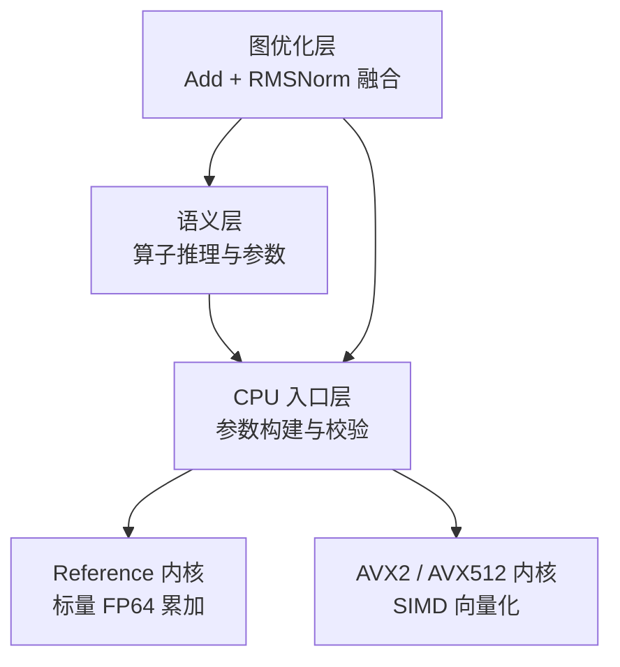
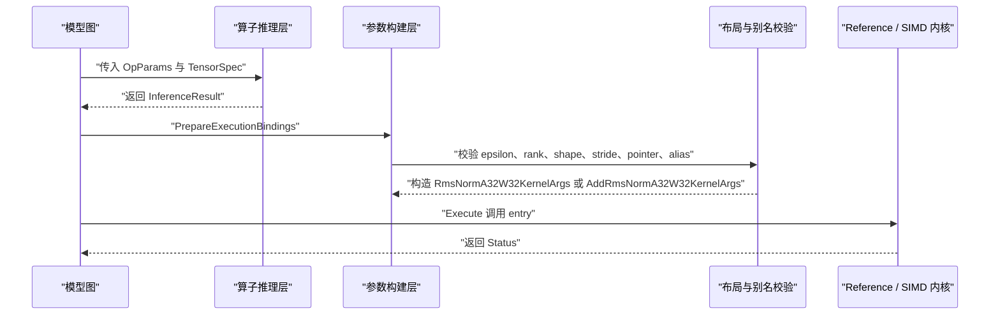
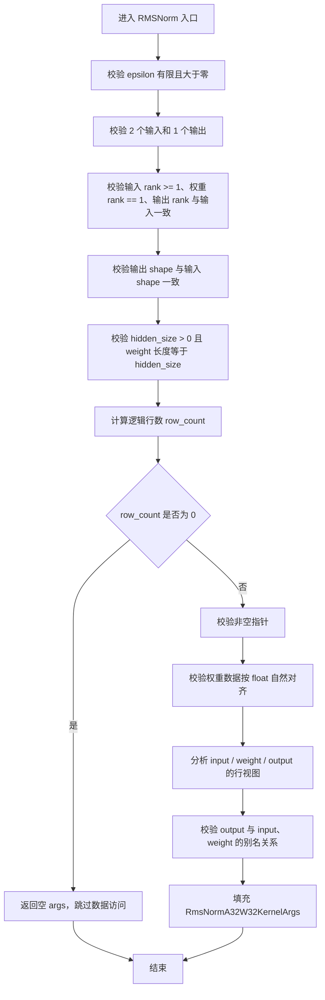
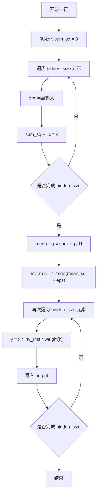
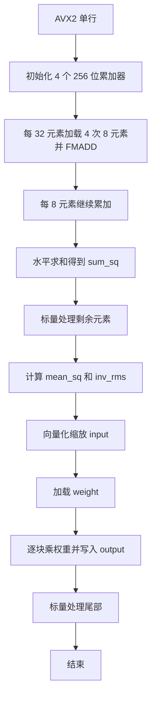
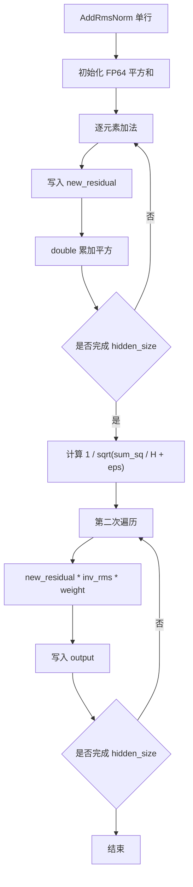
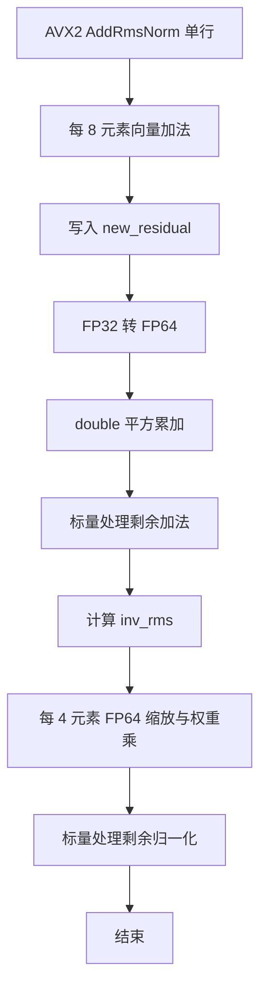
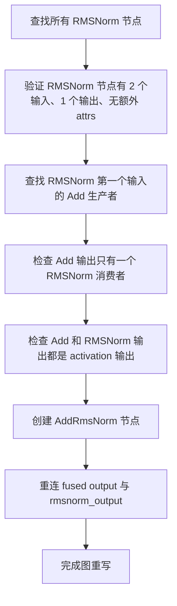
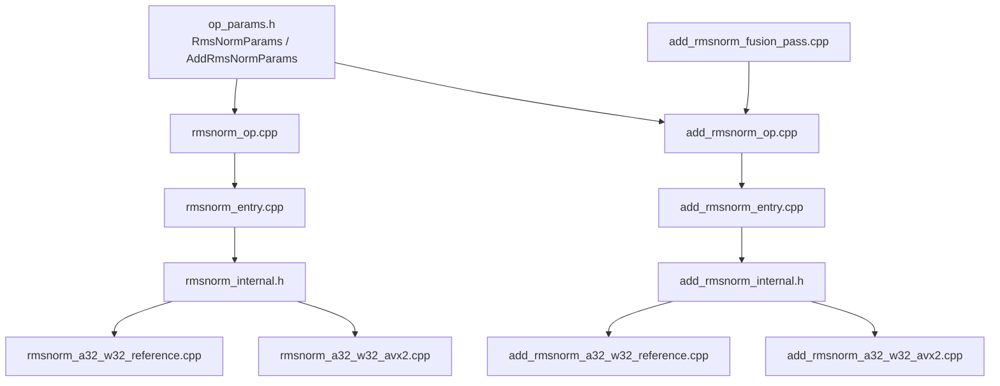

# 归一化算子

**本文引用的文件**
- [RMSNorm 算子契约](../../../operators/rmsnorm/RMSNorm算子契约.md)
- [CPU AddRmsNorm 说明](../../../operators/add_rmsnorm/README.md)
- [AddRmsNorm FP32 SIMD 优化方案](../../../operators/add_rmsnorm/add-rmsnorm-optimization.md)
- [RMSNorm 语义实现](../../../../src/operators/ops/rmsnorm_op.cpp)
- [AddRmsNorm 语义实现](../../../../src/operators/ops/add_rmsnorm_op.cpp)
- [算子参数定义](../../../../include/aethermind/operators/op_params.h)
- [RMSNorm CPU 内核内部接口](../../../../src/backend/cpu/kernels/rmsnorm/rmsnorm_internal.h)
- [RMSNorm CPU 入口与参数构建](../../../../src/backend/cpu/kernels/rmsnorm/rmsnorm_entry.cpp)
- [RMSNorm FP32 Reference 内核](../../../../src/backend/cpu/kernels/rmsnorm/rmsnorm_a32_w32_reference.cpp)
- [RMSNorm AVX2+FMA 内核](../../../../src/backend/cpu/kernels/rmsnorm/rmsnorm_a32_w32_avx2.cpp)
- [AddRmsNorm CPU 内核内部接口](../../../../src/backend/cpu/kernels/add_rmsnorm/add_rmsnorm_internal.h)
- [AddRmsNorm CPU 入口与参数构建](../../../../src/backend/cpu/kernels/add_rmsnorm/add_rmsnorm_entry.cpp)
- [AddRmsNorm FP32 Reference 内核](../../../../src/backend/cpu/kernels/add_rmsnorm/add_rmsnorm_a32_w32_reference.cpp)
- [AddRmsNorm AVX2 内核](../../../../src/backend/cpu/kernels/add_rmsnorm/add_rmsnorm_a32_w32_avx2.cpp)
- [AddRmsNorm 融合 Pass](../../../../src/graph/optimization/add_rmsnorm_fusion_pass.cpp)

## 目录

1. [引言](#引言)
2. [项目结构](#项目结构)
3. [核心组件](#核心组件)
4. [架构总览](#架构总览)
5. [详细组件分析](#详细组件分析)
6. [依赖关系分析](#依赖关系分析)
7. [性能与数值特性](#性能与数值特性)
8. [故障排查指南](#故障排查指南)
9. [结论](#结论)

## 引言

本文面向 AetherMind 中的归一化算子，重点覆盖以下能力：

- RMSNorm 的数学定义、维度约定和数值稳定实现。
- CPU 参考路径与 AVX2/FMA 向量化路径的差异。
- AddRmsNorm 融合算子的输入输出语义、内存访问顺序和优化策略。
- 归一化维度、epsilon 值、缩放权重等参数的约束与验证流程。
- SIMD 实现中的向量化累加、FP32 到 FP64 转换、尾部标量处理及内存对齐要求。
- 在 LLaMA 模型图构建与融合过程中的角色，以及未融合、融合标量和融合 SIMD 的性能对比方法。

RMSNorm 是 LLaMA 风格 Transformer 中常用的层归一化变体；AddRmsNorm 则是将前一层残差加法与 RMSNorm 融合为一个算子，减少中间激活写入和读取次数，从而降低访存压力并提升吞吐。

## 项目结构

归一化相关代码横跨语义层、后端内核层和图优化层：

| 层次 | 主要职责 | 关键文件 |
|---|---|---|
| 语义层 | 定义算子参数、推理阶段形状与类型约束 | `src/operators/ops/rmsnorm_op.cpp`、`src/operators/ops/add_rmsnorm_op.cpp`、`include/aethermind/operators/op_params.h` |
| 内核契约文档 | 描述 CPU FP32 RMSNorm 的 row 模型、布局、别名、ISA 行为和验证要求 | `docs/operators/rmsnorm/RMSNorm算子契约.md` |
| CPU 内核层 | 准备可执行参数、校验 layout 与 aliasing、调用 reference 或 SIMD 微内核 | `src/backend/cpu/kernels/rmsnorm/*`、`src/backend/cpu/kernels/add_rmsnorm/*` |
| 图优化层 | 将相邻的 Add + RMSNorm 合并为 AddRmsNorm | `src/graph/optimization/add_rmsnorm_fusion_pass.cpp` |
| 优化方案文档 | 说明 AddRmsNorm 的 SIMD 两遍算法、精度合同和 benchmark 策略 | `docs/operators/add_rmsnorm/add-rmsnorm-optimization.md`、`docs/operators/add_rmsnorm/README.md` |

**图示来源**
- [RMSNorm 语义实现:1-95](../../../../src/operators/ops/rmsnorm_op.cpp#L1-L95)
- [AddRmsNorm 语义实现:1-134](../../../../src/operators/ops/add_rmsnorm_op.cpp#L1-L134)
- [RMSNorm CPU 内核内部接口:1-118](../../../../src/backend/cpu/kernels/rmsnorm/rmsnorm_internal.h#L1-L118)
- [AddRmsNorm CPU 内核内部接口:1-47](../../../../src/backend/cpu/kernels/add_rmsnorm/add_rmsnorm_internal.h#L1-L47)
- [AddRmsNorm 融合 Pass:1-237](../../../../src/graph/optimization/add_rmsnorm_fusion_pass.cpp#L1-L237)

**章节来源**
- [RMSNorm 算子契约](../../../operators/rmsnorm/RMSNorm算子契约.md)
- [CPU AddRmsNorm 说明](../../../operators/add_rmsnorm/README.md)
- [AddRmsNorm FP32 SIMD 优化方案](../../../operators/add_rmsnorm/add-rmsnorm-optimization.md)

## 核心组件

### RMSNorm 算子

RMSNorm 对输入的最后一个维度独立做归一化，再乘以对应位置的权重向量。它不包含 bias、beta、残差融合或布局变换。

#### 数学公式

设输入张量为 \(X\)，最后一个维度长度为 \(H\)。对于逻辑行 \(r\)：

\[
\text{mean\_square}_r = \frac{1}{H} \sum_{h=0}^{H-1} X_{r,h}^2
\]

\[
Y_{r,h} = X_{r,h} \cdot \frac{1}{\sqrt{\text{mean\_square}_r + \varepsilon}} \cdot \gamma_h
\]

其中：

- \(r\) 是将所有 leading dimensions 按行主序展平后的逻辑行。
- \(\gamma\) 是与 hidden dimension 对齐的一维权重。
- \(\varepsilon\) 是防止除零的正数。

#### 语义与参数

| 参数或属性 | 含义 | 默认值或约束 |
|---|---|---|
| `eps` | 归一化分母中的稳定性常数 | `1.0e-5f`，必须有限且大于零 |
| 输入 rank | 至少为 1 | rank-0 被拒绝 |
| 最后一维 | 归一化维度，即 hidden size | 必须为正 |
| 权重 shape | 一维张量 | 长度必须等于 hidden size |
| 输出 shape | 与输入相同 | dtype 由后端 kernel 决定 |

语义层会检查：

- `eps` 是否有限且正。
- 输入 rank 是否不小于 1。
- 静态 hidden size 是否为正。
- 权重是否为 rank-1。
- 权重长度是否与 hidden size 相等；动态不匹配时生成运行时约束。

**章节来源**
- [RMSNorm 算子契约](../../../operators/rmsnorm/RMSNorm算子契约.md)
- [RMSNorm 语义实现:1-95](../../../../src/operators/ops/rmsnorm_op.cpp#L1-L95)
- [算子参数定义:30-35](../../../../include/aethermind/operators/op_params.h#L30-L35)

### AddRmsNorm 融合算子

AddRmsNorm 接收三个输入：`input`、`residual`、`weight`，产生两个输出：`output` 和 `new_residual`。

其语义等价于：

\[
\text{temp} = \text{input} + \text{residual}
\]

\[
\text{output} = \operatorname{RMSNorm}(\text{temp}, \text{weight}, \varepsilon)
\]

\[
\text{new\_residual} = \text{temp}
\]

#### 为什么需要两个输出

- `output` 是当前层的归一化结果，供后续 MLP 或其他子层使用。
- `new_residual` 保存逐元素相加的结果，用于下一层残差连接。
- 融合后不需要把 `input + residual` 写回原来的 residual 位置，而是显式写出新 residual，便于执行期做 buffer reuse 和 aliasing 校验。

#### 输入输出约束

| 条目 | 约束 |
|---|---|
| `input` 与 `residual` | dtype 必须相同，shape 必须完全一致，不支持广播 |
| rank | 至少为 1 |
| hidden size | 最后一维必须为正 |
| `weight` | 一维，dtype 受 RMSNorm 支持集限制，长度等于 hidden size |
| `output` | dtype 和 shape 与 `input` 相同 |
| `new_residual` | dtype 和 shape 与 `input` 相同 |

语义层还会为每个轴生成 `DimEqualConstraint`，确保动态情况下 input 与 residual 的形状一致。

**章节来源**
- [AddRmsNorm 语义实现:1-134](../../../../src/operators/ops/add_rmsnorm_op.cpp#L1-L134)
- [算子参数定义:362-391](../../../../include/aethermind/operators/op_params.h#L362-L391)

## 架构总览

RMSNorm 与 AddRmsNorm 的执行路径遵循“语义推理 → 参数构建 → 内核调度”的分层设计。

**图示来源**
- [RMSNorm 算子契约](../../../operators/rmsnorm/RMSNorm算子契约.md)
- [RMSNorm CPU 入口与参数构建:1-200](../../../../src/backend/cpu/kernels/rmsnorm/rmsnorm_entry.cpp#L1-L200)
- [AddRmsNorm CPU 入口与参数构建:1-200](../../../../src/backend/cpu/kernels/add_rmsnorm/add_rmsnorm_entry.cpp#L1-L200)

### 关键设计点

1. **语义层与执行层分离**
   语义层只关心 dtype、rank、shape 和维度一致性；layout、stride、pointer aliasing 和 ISA 选择放在 CPU 内核入口。

2. **Prepared 参数缓存**
   `RmsNormA32W32KernelArgs` 和 `AddRmsNormA32W32KernelArgs` 是在 Prepare 阶段构造的一次性 compute-ready 对象，hot path 只需执行 entry。

3. **Reference 与 SIMD 解耦**
   Reference 路径提供稳定的数值参考；SIMD 路径通过 ISA 检测自动切换，并在不可用或 layout 不满足条件时回退。

4. **融合 Pass 位于图优化层**
   AddRmsNorm 不是简单地在执行期拼接两个算子，而是在图重写阶段把 Add + RMSNorm 子图替换成单一节点。

**章节来源**
- [RMSNorm 算子契约](../../../operators/rmsnorm/RMSNorm算子契约.md)
- [AddRmsNorm FP32 SIMD 优化方案](../../../operators/add_rmsnorm/add-rmsnorm-optimization.md)

## 详细组件分析

### RMSNorm 参数构建与校验

RMSNorm 的 CPU 入口负责把高层 TensorView 转换为低层 micro-kernel 能直接消费的 `RmsNormA32W32KernelArgs`。

#### 校验步骤

**图示来源**
- [RMSNorm CPU 入口与参数构建:1-200](../../../../src/backend/cpu/kernels/rmsnorm/rmsnorm_entry.cpp#L1-L200)

#### 重要约束

| 类别 | 规则 |
|---|---|
| 数据类型 | CPU FP32 kernel 要求 input、weight、output 均为 Float32 |
| 布局 | 支持每行带 padding 的折叠 leading dimensions；列 stride 可为任意正整数 |
| AVX2 路径 | 要求 input、weight、output 的 inner column stride 均为 1 |
| 别名 | exact in-place 允许；output 与 weight 重叠直接拒绝；output 与 input 仅 exact 映射时可豁免 overlap 检查 |
| 零行 | row_count 为 0 时成功 no-op，data pointer 可为 null |
| workspace | 不分配堆内存，workspace requirement 为空 |

**章节来源**
- [RMSNorm CPU 内核内部接口:21-48](../../../../src/backend/cpu/kernels/rmsnorm/rmsnorm_internal.h#L21-L48)
- [RMSNorm CPU 入口与参数构建:1-200](../../../../src/backend/cpu/kernels/rmsnorm/rmsnorm_entry.cpp#L1-L200)
- [RMSNorm 算子契约](../../../operators/rmsnorm/RMSNorm算子契约.md)

### RMSNorm Reference 内核

Reference 内核以标量方式逐行处理，并使用 double 累加平方和，保证数值参考稳定性。

#### 单行处理流程

**图示来源**
- [RMSNorm FP32 Reference 内核:1-49](../../../../src/backend/cpu/kernels/rmsnorm/rmsnorm_a32_w32_reference.cpp#L1-L49)

#### 复杂度

- 时间复杂度：\(O(\text{row\_count} \times H)\)，其中 \(H\) 是 hidden size。
- 空间复杂度：\(O(1)\)，只使用少量标量累加器。
- 数值行为：double 累加，避免 FP32 累加误差放大；最终结果写回 FP32。

**章节来源**
- [RMSNorm FP32 Reference 内核:1-49](../../../../src/backend/cpu/kernels/rmsnorm/rmsnorm_a32_w32_reference.cpp#L1-L49)

### RMSNorm AVX2+FMA 内核

AVX2+FMA 路径使用 256 位寄存器一次处理多个 FP32 元素，并通过 FMA 指令同时完成乘法与累加。

#### 关键 SIMD 技巧

| 技巧 | 目的 |
|---|---|
| 四组 8 元素累加器 | 提高平方和计算的并行度 |
| `_mm256_fmadd_ps` | 单次指令完成 \(a \times b + c\)，减少中间存储 |
| 水平求和函数 | 将 4 个 256 位向量归约为一个 FP32 标量 |
| 32、8、1 三段循环 | 分别处理大块、小块和尾部剩余元素 |
| 标量 tail | 保证任意 hidden size 都能正确归一化 |

#### 数值差异

AVX2+FMA 路径使用 FP32 归约，并且 FMA 分组改变了累加顺序，因此与 Reference 比较时使用 tolerance equal，而不是 bitwise equal。

**图示来源**
- [RMSNorm AVX2+FMA 内核:1-114](../../../../src/backend/cpu/kernels/rmsnorm/rmsnorm_a32_w32_avx2.cpp#L1-L114)

**章节来源**
- [RMSNorm AVX2+FMA 内核:1-114](../../../../src/backend/cpu/kernels/rmsnorm/rmsnorm_a32_w32_avx2.cpp#L1-L114)
- [RMSNorm 算子契约](../../../operators/rmsnorm/RMSNorm算子契约.md)

### AddRmsNorm 融合内核

AddRmsNorm 的核心思想是把“先加后归一化”的两步融合到一个 kernel 中，并保留 intermediate residual。

#### 两遍算法

第一遍：

- 逐元素计算 `input + residual`。
- 写入 `new_residual`。
- 将结果转成 double 并累加平方和。

第二遍：

- 从 `new_residual` 读取。
- 计算逆 RMS 缩放因子。
- 逐元素乘以权重。
- 写回 `output`。

**图示来源**
- [AddRmsNorm FP32 Reference 内核:1-43](../../../../src/backend/cpu/kernels/add_rmsnorm/add_rmsnorm_a32_w32_reference.cpp#L1-L43)

#### AVX2 路径优化

AVX2 实现：

- 每次处理 8 个 FP32 元素。
- 使用 `_mm256_add_ps` 做逐元素加法。
- 使用 `_mm256_cvtps_pd` 和 `_mm256_extractf128_ps` 将 FP32 转为 FP64。
- 使用 double 数组保存平方值并按原列顺序累加。
- 第二遍使用 4 个元素的 FP64 向量路径计算缩放和权重乘积。
- 尾部使用标量循环。

**图示来源**
- [AddRmsNorm AVX2 内核:1-60](../../../../src/backend/cpu/kernels/add_rmsnorm/add_rmsnorm_a32_w32_avx2.cpp#L1-L60)

#### 内存与别名约束

- 两个 activation `input` 和 `residual` 可以共享存储。
- 两个输出 `output` 与 `new_residual` 必须互斥。
- 两个输出都必须与 `input`、`residual`、`weight` 或 packed weight 不重叠。
- 支持合法的行 padding 和列 stride。
- zero-row 路径直接返回成功。

**章节来源**
- [AddRmsNorm CPU 内核内部接口:1-47](../../../../src/backend/cpu/kernels/add_rmsnorm/add_rmsnorm_internal.h#L1-L47)
- [AddRmsNorm CPU 入口与参数构建:1-200](../../../../src/backend/cpu/kernels/add_rmsnorm/add_rmsnorm_entry.cpp#L1-L200)
- [AddRmsNorm FP32 Reference 内核:1-43](../../../../src/backend/cpu/kernels/add_rmsnorm/add_rmsnorm_a32_w32_reference.cpp#L1-L43)
- [AddRmsNorm AVX2 内核:1-60](../../../../src/backend/cpu/kernels/add_rmsnorm/add_rmsnorm_a32_w32_avx2.cpp#L1-L60)
- [CPU AddRmsNorm 说明](../../../operators/add_rmsnorm/README.md)

### AddRmsNorm 图融合 Pass

AddRmsNorm 融合不是在执行期临时拼接，而是在图优化阶段识别“Add → RMSNorm”模式，并将子图重写为单个 AddRmsNorm 节点。

**图示来源**
- [AddRmsNorm 融合 Pass:13-237](../../../../src/graph/optimization/add_rmsnorm_fusion_pass.cpp#L13-L237)

#### 融合准入条件

| 条件 | 说明 |
|---|---|
| 目标节点 | 必须是 `OpType::kRmsNorm` |
| 输入数量 | 恰好 2 个输入 |
| 输出数量 | 恰好 1 个输出 |
| attrs | 不能携带多余字节 attrs |
| Add 生产者 | 必须存在且唯一 |
| 消费关系 | Add 的输出只能被该 RMSNorm 消费 |
| 输出可见性 | Add 和 RMSNorm 的输出必须是 activation 输出 |
| 参数传递 | fused 节点的 eps 继承自 RMSNorm 的 eps |

**章节来源**
- [AddRmsNorm 融合 Pass:13-237](../../../../src/graph/optimization/add_rmsnorm_fusion_pass.cpp#L13-L237)

## 依赖关系分析

### 算子依赖图

**图示来源**
- [算子参数定义:30-35](../../../../include/aethermind/operators/op_params.h#L30-L35)
- [算子参数定义:362-391](../../../../include/aethermind/operators/op_params.h#L362-L391)
- [RMSNorm 语义实现:1-95](../../../../src/operators/ops/rmsnorm_op.cpp#L1-L95)
- [AddRmsNorm 语义实现:1-134](../../../../src/operators/ops/add_rmsnorm_op.cpp#L1-L134)
- [RMSNorm CPU 内核内部接口:1-118](../../../../src/backend/cpu/kernels/rmsnorm/rmsnorm_internal.h#L1-L118)
- [AddRmsNorm CPU 内核内部接口:1-47](../../../../src/backend/cpu/kernels/add_rmsnorm/add_rmsnorm_internal.h#L1-L47)
- [AddRmsNorm 融合 Pass:1-237](../../../../src/graph/optimization/add_rmsnorm_fusion_pass.cpp#L1-L237)

### 耦合性与内聚性

- 语义层只依赖 dtype、shape 和 inference 工具，不感知 backend layout。
- CPU 内核层高度内聚：每个算子有独立的 internal header、entry、reference 和 avx2 实现。
- 融合 Pass 与语义层弱耦合，只通过 `OpType`、`OpParams` 和 `GraphValueDesc` 进行交互。
- Reference 与 SIMD 内核通过统一 kernel args 解耦，便于单独测试和基准测试。

**章节来源**
- [RMSNorm 语义实现:1-95](../../../../src/operators/ops/rmsnorm_op.cpp#L1-L95)
- [AddRmsNorm 语义实现:1-134](../../../../src/operators/ops/add_rmsnorm_op.cpp#L1-L134)
- [RMSNorm CPU 内核内部接口:1-118](../../../../src/backend/cpu/kernels/rmsnorm/rmsnorm_internal.h#L1-L118)
- [AddRmsNorm CPU 内核内部接口:1-47](../../../../src/backend/cpu/kernels/add_rmsnorm/add_rmsnorm_internal.h#L1-L47)
- [AddRmsNorm 融合 Pass:1-237](../../../../src/graph/optimization/add_rmsnorm_fusion_pass.cpp#L1-L237)

## 性能与数值特性

### 数值稳定性

| 路径 | 累加类型 | 特点 |
|---|---|---|
| RMSNorm Reference | double | 高精度参考，适合对拍 |
| RMSNorm AVX2+FMA | FP32 | 更快但累加顺序不同，使用 tolerance equal |
| AddRmsNorm Reference | double | 先加法，再 double 平方累加 |
| AddRmsNorm AVX2 | double 累加，但 FP32 向量化中间结果 | 保持列顺序 double 累加以匹配 reference |

关键点：

- epsilon 始终加入根号分母，防止除以零。
- Reference 路径使用 double 累加，避免大 hidden size 下的 FP32 累积误差。
- SIMD 路径可能改变累加顺序，因此数值比较应采用容忍误差而非严格位相等。

**章节来源**
- [RMSNorm 算子契约](../../../operators/rmsnorm/RMSNorm算子契约.md)
- [AddRmsNorm FP32 SIMD 优化方案](../../../operators/add_rmsnorm/add-rmsnorm-optimization.md)

### SIMD 优化要点

| 技术 | RMSNorm | AddRmsNorm |
|---|---|---|
| 向量化宽度 | 256 位，每 8 个 FP32 元素一组 | 256 位加法，8 个元素一批 |
| 平方累加 | 4 个 256 位向量并行 FMADD | 转 FP64 后按列顺序累加 |
| 尾部处理 | 32 → 8 → 1 三段循环 | 8 元素向量化 + 标量 tail |
| 权重加载 | 每块同步加载 weight | 第二遍从 new_residual 读取并乘 weight |
| 内存对齐 | weight 必须按 float 自然对齐 | 支持任意合法 stride，SIMD 路径偏好 unit column stride |

### 内存访问优化

- 融合算子减少了一次 activation 写入：普通路径通常先写 add 输出，再读入 RMSNorm；融合后直接把加法结果暂存到 `new_residual`。
- 两遍算法仍然需要读取 `new_residual`，但避免了多余的中间 tensor 生命周期管理。
- row-wise aliasing 校验允许 safe in-place 场景，减少不必要的 buffer 拷贝。

### LLaMA 应用示例与对比方法

LLaMA 风格模型中，RMSNorm 常用于：

- Attention 子层前的归一化。
- MLP 子层前的归一化。
- 有时也出现在 residual 加法之后。

当前仓库中，AddRmsNorm 的融合 Pass 明确捕获 Add + RMSNorm 模式；具体 LLaMA 层图构建是否触发该模式，取决于上层 graph builder 生成的算子顺序。

性能对比应包含三类：

| 配置 | 说明 |
|---|---|
| 未融合 | Add 和 RMSNorm 作为两个独立算子执行 |
| 融合标量 | 使用 scalar reference 执行 AddRmsNorm |
| 融合 SIMD | 使用 AVX2 路径执行 AddRmsNorm |

benchmark 应在计时循环外完成 kernel prepare 和 params 构造，循环内只执行 entry，以保证 hot path 测量准确。

**章节来源**
- [CPU AddRmsNorm 说明](../../../operators/add_rmsnorm/README.md)
- [AddRmsNorm FP32 SIMD 优化方案](../../../operators/add_rmsnorm/add-rmsnorm-optimization.md)
- [AddRmsNorm 融合 Pass:196-237](../../../../src/graph/optimization/add_rmsnorm_fusion_pass.cpp#L196-L237)

## 故障排查指南

### 常见错误分类

| 错误类型 | 典型原因 | 处理建议 |
|---|---|---|
| `InvalidArgument: eps must be finite and positive` | epsilon 为 NaN、Inf 或非正数 | 检查模型配置或前端参数赋值 |
| `rank < 1` | 输入是标量 | RMSNorm 和 AddRmsNorm 都要求 rank ≥ 1 |
| `last dimension must be positive` | hidden size ≤ 0 | 检查 embedding、linear 或 attention 输出形状 |
| `weight length must equal input last dimension` | weight 与 hidden size 不匹配 | 检查 RMSNorm 权重加载和 packing |
| `input and residual must have the same shape` | AddRmsNorm 中 broadcast 不被支持 | 确保 residual 与 input 完全同形 |
| `requires naturally aligned float32 weight data` | weight pointer 未按 float 对齐 | 检查内存分配器和 packed weight 布局 |
| `output overlaps with input or weight` | 非法 in-place 或 aliasing | 调整 buffer reuse 策略，避免读写冲突 |
| `Unimplemented: higher-rank view cannot be folded` | leading dimensions 不可折叠 | 调整上游 reshape/permute 或使用支持的 layout |

### 调试步骤

1. **确认语义层是否通过**
   如果 shape 或 dtype 在 `Infer*` 阶段失败，问题通常在上游图构建或权重加载。

2. **确认 PreparedExecutionBindings 是否成功**
   大多数 layout、stride、pointer 和 aliasing 错误在 Prepare 阶段返回，而不是 Execute 阶段。

3. **检查 epsilon**
   所有归一化路径都要求 epsilon 有限且大于零。

4. **检查 hidden size**
   hidden size 必须为正；zero leading dimensions 是允许的，但 hidden size 不行。

5. **区分 Reference 与 SIMD 差异**
   如果 Reference 正确而 SIMD 出现数值偏差，优先检查 tolerance 设置和累加顺序差异。

6. **检查融合是否生效**
   若预期融合但未生效，检查是否存在多个 RMSNorm 消费者、attrs 不兼容或 Add 输出不可观测。

**章节来源**
- [RMSNorm 语义实现:1-95](../../../../src/operators/ops/rmsnorm_op.cpp#L1-L95)
- [AddRmsNorm 语义实现:1-134](../../../../src/operators/ops/add_rmsnorm_op.cpp#L1-L134)
- [RMSNorm CPU 入口与参数构建:1-200](../../../../src/backend/cpu/kernels/rmsnorm/rmsnorm_entry.cpp#L1-L200)
- [AddRmsNorm CPU 入口与参数构建:1-200](../../../../src/backend/cpu/kernels/add_rmsnorm/add_rmsnorm_entry.cpp#L1-L200)
- [RMSNorm 算子契约](../../../operators/rmsnorm/RMSNorm算子契约.md)

## 结论

AetherMind 的归一化算子实现了清晰的语义—布局—内核分层：

- RMSNorm 以最后一个维度为归一化轴，使用 epsilon 保障数值稳定，并提供高可读性的 Reference 路径和高性能的 AVX2+FMA 路径。
- AddRmsNorm 通过融合 Add 和 RMSNorm，减少中间 activation 写入，并以两遍算法保证与 Reference 的可比数值行为。
- 参数构建阶段承担大部分安全校验，使 hot path 尽量简洁。
- 图优化层能够识别 Add + RMSNorm 模式，将其替换为单一融合节点，便于端到端性能优化。
- Benchmark 应分别评估未融合、融合标量和融合 SIMD 三种情况，并结合 LLaMA 模型的热点分布判断融合收益。

未来扩展可以在不破坏现有 contract 的前提下增加新的 ISA 内核、更精细的 layout 支持或混合精度路径，但应保持 epsilon、hidden dimension 语义和 reference 数值行为的一致性。
