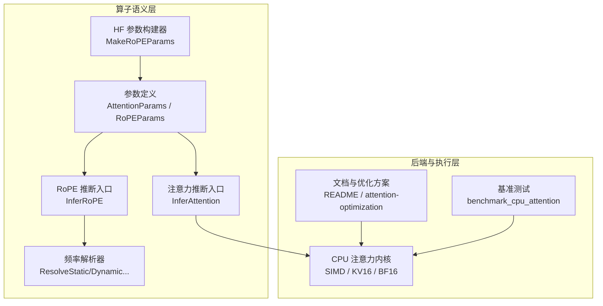
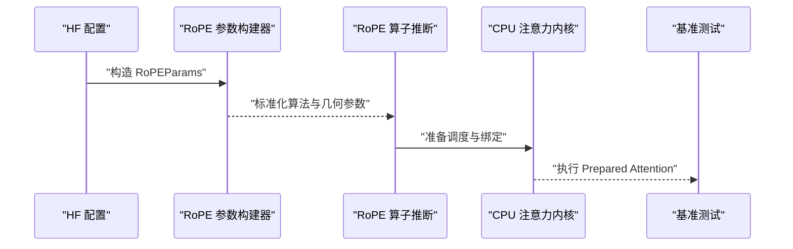
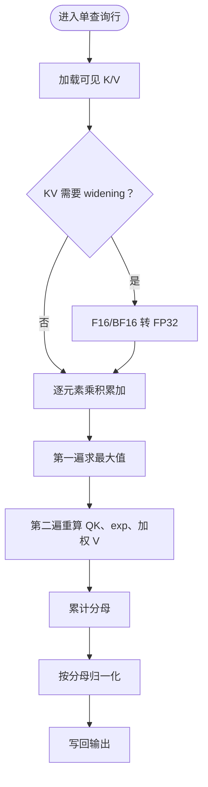
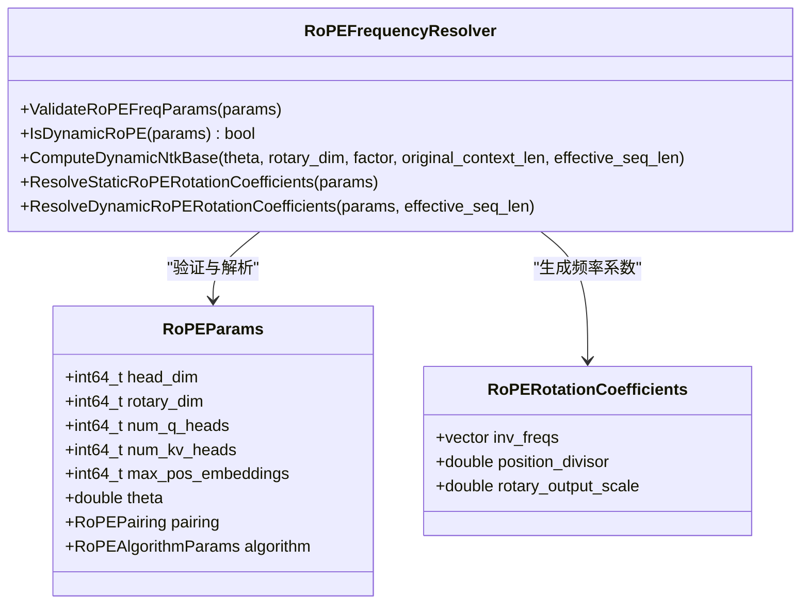
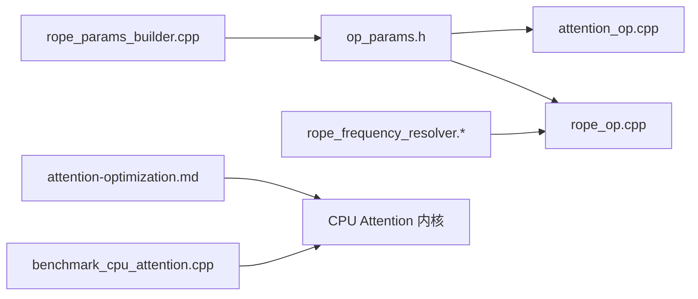
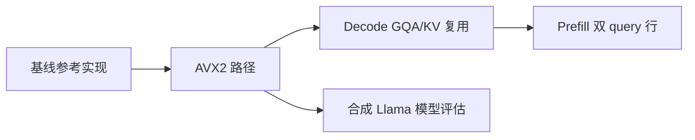

# 注意力与旋转位置编码

**本文引用的文件**
- [attention_op.cpp](../../../../src/operators/ops/attention_op.cpp)
- [rope_op.cpp](../../../../src/operators/ops/rope_op.cpp)
- [op_params.h](../../../../include/aethermind/operators/op_params.h)
- [rope_frequency_resolver.h](../../../../include/aethermind/operators/rope_frequency_resolver.h)
- [rope_frequency_resolver.cpp](../../../../src/operators/rope_frequency_resolver.cpp)
- [rope_params_builder.h](../../../../src/model/rope_params_builder.h)
- [rope_params_builder.cpp](../../../../src/model/rope_params_builder.cpp)
- [README.md](../../../operators/attention/README.md)
- [attention-optimization.md](../../../operators/attention/attention-optimization.md)
- [desktop-qhihogq-attention.md](../../../operators/attention/benchmarks/desktop-qhihogq-attention.md)
- [benchmark_cpu_attention.cpp](../../../../tests/benchmark/cpu_kernels/benchmark_cpu_attention.cpp)

## 目录
1. [引言](#引言)
2. [项目结构](#项目结构)
3. [核心组件](#核心组件)
4. [架构总览](#架构总览)
5. [详细组件分析](#详细组件分析)
6. [依赖关系分析](#依赖关系分析)
7. [性能与优化](#性能与优化)
8. [故障排查](#故障排查)
9. [结论](#结论)
10. [附录：参数、布局与基准对照](#附录参数布局与基准对照)

## 引言
本文件面向 AetherMind 中的注意力算子与旋转位置编码（RoPE）实现，聚焦以下目标：
- 解释多头注意力的 QKV 投影语义、注意力分数计算和上下文向量聚合流程。
- 详细说明 RoPE 的数学原理、频率表构建、配对方式以及位置信息如何注入 Q/K。
- 整理 AttentionParams 与 RoPEParams 等关键参数及其约束。
- 总结内存布局、SIMD 优化、两遍扫描策略、GQA/KV 复用、Prefill 双行分块等工程优化。
- 给出在 LLaMA 模型中的应用场景、参数来源和基准结果范围。

## 项目结构
AetherMind 将注意力与 RoPE 分为两层：
- 算子语义层：定义参数、输入输出类型、形状推断和运行时约束。
- 后端执行层：CPU 路径提供 F32 reference、AVX2 SIMD、KV16/BF16 widening、Decode GQA/KV 复用与 Prefill 双行分块。

**图表来源**
- [op_params.h:200-391](../../../../include/aethermind/operators/op_params.h#L200-L391)
- [attention_op.cpp:1-189](../../../../src/operators/ops/attention_op.cpp#L1-L189)
- [rope_op.cpp:1-202](../../../../src/operators/ops/rope_op.cpp#L1-L202)
- [rope_frequency_resolver.h:1-89](../../../../include/aethermind/operators/rope_frequency_resolver.h#L1-L89)
- [rope_params_builder.cpp:1-167](../../../../src/model/rope_params_builder.cpp#L1-L167)

**章节来源**
- [attention_op.cpp:1-189](../../../../src/operators/ops/attention_op.cpp#L1-L189)
- [rope_op.cpp:1-202](../../../../src/operators/ops/rope_op.cpp#L1-L202)
- [op_params.h:200-391](../../../../include/aethermind/operators/op_params.h#L200-L391)

## 核心组件
### 注意力算子参数与契约
- AttentionParams 包含三个关键几何字段：`num_q_heads`、`num_kv_heads`、`head_dim`。
- 输入张量约定为：
  - `q`：形状 `[seq_len, num_q_heads * head_dim]`。
  - `k_cache` / `v_cache`：形状 `[num_kv_heads, cache_len, head_dim]`。
  - 输出形状跟随 `q`。
- 数值精度契约支持同 dtype 或 P3 混合 KV16：Q 为 Float32 时，K/V cache 可为 Float16 或 BFloat16；K/V cache dtype 必须一致。
- 运行前校验包括头数正性、可整除关系、隐藏维溢出检查、rank 与静态维度方程、K/V cache 形状一致性、序列长度非零与非负约束。

**章节来源**
- [op_params.h:200-391](../../../../include/aethermind/operators/op_params.h#L200-L391)
- [attention_op.cpp:1-189](../../../../src/operators/ops/attention_op.cpp#L1-L189)
- [README.md](../../../operators/attention/README.md)

### RoPE 算子参数与频率解析
- RoPEParams 包含 `head_dim`、`rotary_dim`、`num_q_heads`、`num_kv_heads`、`max_pos_embeddings`、`theta`、`pairing` 以及一个算法变体 `algorithm`。
- 支持的 RoPE 算法包括 Standard、Linear、DynamicNtk、Yarn、Llama3、LongRope。
- 频率解析器负责把语义参数转换为每对频率表 `inv_freqs`、可选的位置缩放 `position_divisor` 和输出振幅缩放 `rotary_output_scale`。
- Dynamic NTK 与 LongRope 需要执行时的有效序列长度；其他算法可在图阶段或调用前解析。

**章节来源**
- [op_params.h:200-391](../../../../include/aethermind/operators/op_params.h#L200-L391)
- [rope_frequency_resolver.h:1-89](../../../../include/aethermind/operators/rope_frequency_resolver.h#L1-L89)
- [rope_frequency_resolver.cpp:1-288](../../../../src/operators/rope_frequency_resolver.cpp#L1-L288)

## 架构总览
注意力与 RoPE 在 LLaMA 推理管线中的典型顺序是：
1. 模型加载器读取 HuggingFace 配置，生成 RoPEParams。
2. 解码层对 Q/K 分别执行 RoPE，将绝对位置以旋转形式注入。
3. Attention 从 KV cache 读取历史 K/V，计算注意力分数并聚合上下文向量。
4. CPU 后端根据数据类型、序列长度、ISA 能力选择 reference 或 SIMD 路径。

**图表来源**
- [rope_params_builder.cpp:1-167](../../../../src/model/rope_params_builder.cpp#L1-L167)
- [rope_op.cpp:1-202](../../../../src/operators/ops/rope_op.cpp#L1-L202)
- [attention_op.cpp:1-189](../../../../src/operators/ops/attention_op.cpp#L1-L189)
- [benchmark_cpu_attention.cpp:1-158](../../../../tests/benchmark/cpu_kernels/benchmark_cpu_attention.cpp#L1-L158)

## 详细组件分析

### 多头注意力计算流程
#### QKV 投影语义
- 当前 Attention 算子的参数仅描述多头几何：查询头数、键值头数和头维度。
- Q/K/V 的实际线性投影由上层图构建或融合算子完成；Attention 接收的是已经按 `num_q_heads * head_dim` 排列的 Q，以及已写入 KV cache 的 K/V。
- 对于 GQA/MQA，多个查询头共享同一个 KV 头，映射规则由调用方和可见性边界保证。

#### 注意力分数计算
- 每个查询行对可见 token 计算点积，使用 `1.0 / sqrt(head_dim)` 作为缩放因子。
- 第一遍扫描可见 K，求局部最大值。
- 第二遍重新计算 QK，计算 `exp(score - max)`，同时累加分母和加权 V。
- 最终每个输出分量除以对应分母，得到注意力输出。

#### 上下文向量聚合
- 加权 V 在每个 token 上按头内元素累加，再按输出宽度写出。
- 输出 dtype 跟随 q；P3 场景中 Q 为 Float32，K/V cache 可为 Float16 或 BFloat16，但内部归约保持 FP32 精度合同。

**图表来源**
- [README.md](../../../operators/attention/README.md)
- [attention_op.cpp:1-189](../../../../src/operators/ops/attention_op.cpp#L1-L189)

**章节来源**
- [README.md](../../../operators/attention/README.md)
- [attention_op.cpp:1-189](../../../../src/operators/ops/attention_op.cpp#L1-L189)

### RoPE 数学原理与实现细节
#### 复数旋转矩阵视角
RoPE 对每个 head 的向量按偶奇或相邻偶奇成对处理。第 i 对可以看作二维平面上的旋转：
- 角度由位置索引 p、基础频率 inv_freq[i] 决定。
- 旋转等价于复数乘法，实部对应 cos，虚部对应 sin。
- 实现上通常不显式构造复数对象，而是用 `(x1*cos - x2*sin, x1*sin + x2*cos)` 的方式更新每对元素。

#### 频率表构建
- 基础频率由 theta 和 rotary_dim 推导，长度为 `rotary_dim / 2`。
- Linear RoPE 通过 `position_divisor` 调整位置步长。
- Yarn 与 Llama3 对低频和高频范围做不同缩放，LongRope 根据短上下文或长上下文因子选择 factor 表。
- Dynamic NTK 在执行时根据有效序列长度缩放 theta 基频。

#### 位置信息注入
- 输入 q/k 的形状为 `[seq_len, hidden]`，hidden 等于 `num_heads * head_dim`。
- position_ids 为 `[seq_len]`，类型为 Int64。
- RoPE 推断要求 q 与 k 的 seq_len 相等，且与 position_ids 长度一致。
- 输出 q_rope 与 k_rope 保留原 dtype 与原 shape。

**图表来源**
- [op_params.h:200-391](../../../../include/aethermind/operators/op_params.h#L200-L391)
- [rope_frequency_resolver.h:1-89](../../../../include/aethermind/operators/rope_frequency_resolver.h#L1-L89)
- [rope_frequency_resolver.cpp:1-288](../../../../src/operators/rope_frequency_resolver.cpp#L1-L288)

**章节来源**
- [rope_op.cpp:1-202](../../../../src/operators/ops/rope_op.cpp#L1-L202)
- [rope_frequency_resolver.cpp:1-288](../../../../src/operators/rope_frequency_resolver.cpp#L1-L288)
- [rope_params_builder.cpp:1-167](../../../../src/model/rope_params_builder.cpp#L1-L167)

### 参数配置要点
#### AttentionParams
| 字段 | 含义 | 约束 |
|---|---|---|
| `num_q_heads` | 查询头数 | 正整数 |
| `num_kv_heads` | 键值头数 | 正整数 |
| `head_dim` | 头维度 | 正整数 |
| 隐式约束 | `num_q_heads % num_kv_heads == 0` | GQA/MQA 分组合法 |
| 隐式约束 | `num_q_heads * head_dim` 不得溢出 int64 | 防止形状计算溢出 |

**章节来源**
- [op_params.h:200-391](../../../../include/aethermind/operators/op_params.h#L200-L391)
- [attention_op.cpp:1-189](../../../../src/operators/ops/attention_op.cpp#L1-L189)

#### RoPEParams
| 字段 | 含义 | 约束 |
|---|---|---|
| `head_dim` | 头维度 | 正整数 |
| `rotary_dim` | 实际参与旋转的维度 | 正、偶数且不大于 `head_dim`；零表示全维 |
| `num_q_heads` / `num_kv_heads` | 头数 | 正整数 |
| `max_pos_embeddings` | 最大位置嵌入长度 | 正整数 |
| `theta` | 基础频率参数 | 有限正数 |
| `pairing` | 元素配对方式 | split_half 或 interleaved |
| `algorithm` | RoPE 算法变体 | Standard / Linear / DynamicNtk / Yarn / Llama3 / LongRope |

**章节来源**
- [op_params.h:200-391](../../../../include/aethermind/operators/op_params.h#L200-L391)
- [rope_op.cpp:1-202](../../../../src/operators/ops/rope_op.cpp#L1-L202)
- [rope_frequency_resolver.cpp:1-288](../../../../src/operators/rope_frequency_resolver.cpp#L1-L288)

### 内存布局与可见性
- Q 的逻辑形状为 `[seq_len, hidden]`，允许既有合法正 stride；output 行不允许重叠，且地址需满足 float 自然对齐。
- K/V cache 逻辑形状为 `[num_kv_heads, cache_len, head_dim]`，采用 byte pointer 与 byte stride；head 内元素连续，token/head stride 必须是元素大小的整数倍。
- 可见性由 KVCacheReadBinding 控制：committed_end、visible_end、query_begin、query_end 决定每个查询行能读到的历史区间。
- output、q、可见 K cache、可见 V cache 之间不得重叠；alias 证明保守处理，无法证明不相交时可拒绝。

**章节来源**
- [README.md](../../../operators/attention/README.md)
- [attention_op.cpp:1-189](../../../../src/operators/ops/attention_op.cpp#L1-L189)

### 计算图融合技术
- Attention 本身没有 weight port；其权重来源由 activation 决定，KV dtype 不写入 weight_dtype。
- 项目中存在 QKV linear 融合、gate/up linear 融合、add+rmsnorm 融合等机制，用于减少中间激活与 kernel 调用次数。
- RoPE 当前 schema 为三输入两输出，不直接携带 cos/sin cache；预计算缓存属于后续优化方向。

**章节来源**
- [README.md](../../../operators/attention/README.md)
- [op_params.h:200-391](../../../../include/aethermind/operators/op_params.h#L200-L391)
- [rope_op.cpp:1-202](../../../../src/operators/ops/rope_op.cpp#L1-L202)

## 依赖关系分析

**图表来源**
- [op_params.h:200-391](../../../../include/aethermind/operators/op_params.h#L200-L391)
- [attention_op.cpp:1-189](../../../../src/operators/ops/attention_op.cpp#L1-L189)
- [rope_op.cpp:1-202](../../../../src/operators/ops/rope_op.cpp#L1-L202)
- [rope_params_builder.cpp:1-167](../../../../src/model/rope_params_builder.cpp#L1-L167)
- [rope_frequency_resolver.cpp:1-288](../../../../src/operators/rope_frequency_resolver.cpp#L1-L288)
- [attention-optimization.md](../../../operators/attention/attention-optimization.md)
- [benchmark_cpu_attention.cpp:1-158](../../../../tests/benchmark/cpu_kernels/benchmark_cpu_attention.cpp#L1-L158)

**章节来源**
- [attention_op.cpp:1-189](../../../../src/operators/ops/attention_op.cpp#L1-L189)
- [rope_op.cpp:1-202](../../../../src/operators/ops/rope_op.cpp#L1-L202)
- [rope_frequency_resolver.cpp:1-288](../../../../src/operators/rope_frequency_resolver.cpp#L1-L288)

## 性能与优化
### 内存布局优化
- 避免额外 workspace：Attention 两遍扫描直接使用绑定的输出或栈累积空间。
- KV widening 批量处理：FP16/BF16 在 FP32 循环前转换，减少重复转换。
- stride 兼容：SIMD 只读完整元素组，尾部走 scalar，不强制 contiguous。

### 计算图与内核优化
- AVX2 首段：替换 compute body，保持归约顺序，禁用 FMA contraction 与 fast-math。
- Decode GQA/KV 复用：一对 query heads 共享一次 K/V load 与 widening，减少重复访存。
- Prefill 双 query 行：相邻两行共享公共 K/V 前缀，避免重复 QK 重算。

### 基准测试结果
- 硬件环境：Intel Core i9-12900H，WSL2，GCC Release，启用 AVX2/FMA/F16C，无 AVX-512。
- 单测关注 Prepared Attention 的 Decode 与 Prefill 路径，覆盖 F32、A32/KV FP16、A32/KV BF16、BF16 A16。
- 模型级评估使用合成 1-layer Llama GQA，对比 Compile/Prepare/ExecutionPlan 与公开 Generate。

**图表来源**
- [attention-optimization.md](../../../operators/attention/attention-optimization.md)
- [desktop-qhihogq-attention.md](../../../operators/attention/benchmarks/desktop-qhihogq-attention.md)

**章节来源**
- [attention-optimization.md](../../../operators/attention/attention-optimization.md)
- [desktop-qhihogq-attention.md](../../../operators/attention/benchmarks/desktop-qhihogq-attention.md)
- [benchmark_cpu_attention.cpp:1-158](../../../../tests/benchmark/cpu_kernels/benchmark_cpu_attention.cpp#L1-L158)

## 故障排查
### 常见参数错误
- Attention：
  - 头数为非正数。
  - `num_q_heads` 不能被 `num_kv_heads` 整除。
  - `num_q_heads * head_dim` 溢出。
  - q rank 不是 2，k_cache/v_cache rank 不是 3。
  - q hidden 不等于 `num_q_heads * head_dim`。
  - k_cache 与 v_cache 形状不一致。
  - 静态 seq_len 为零或非正。
  - cache_len 静态为零。
- RoPE：
  - head_dim、num_q_heads、num_kv_heads、max_pos_embeddings 非正。
  - rotary_dim 非正、奇数或超过 head_dim。
  - pairing 无效。
  - theta 非有限或非正。
  - q/k dtype 不一致或不在支持集合。
  - position_ids 不是 Int64。
  - q/k seq_len 不等或与 position_ids 长度不等。

### 数值行为注意事项
- Attention 不使用 clamp 或 NaN/Inf 特殊值兜底，NaN/Inf 按固定 FP32 算术传播。
- softmax 可能产生 NaN，成功返回不负责把非有限输出转为 metadata 错误。
- KV widening 自身需满足 FP16/BF16 转换环境合同。
- RoPE 动态算法需传入正的有效序列长度；Static 解析器会拒绝需要执行时长度的算法。

**章节来源**
- [attention_op.cpp:1-189](../../../../src/operators/ops/attention_op.cpp#L1-L189)
- [rope_op.cpp:1-202](../../../../src/operators/ops/rope_op.cpp#L1-L202)
- [README.md](../../../operators/attention/README.md)
- [rope_frequency_resolver.cpp:1-288](../../../../src/operators/rope_frequency_resolver.cpp#L1-L288)

## 结论
AetherMind 的注意力与 RoPE 实现以强类型参数、严格推断约束和清晰的数值契约为基础，并在 CPU 后端提供了从 reference 到 AVX2 SIMD、KV16/BF16 widening、Decode GQA/KV 复用以及 Prefill 双行分块的渐进优化路径。RoPE 的频率解析将 HF 配置规范化为语义参数，使标准、线性、Dynamic NTK、YaRN、Llama3 和 LongRope 共用同一套执行接口。基准结果显示，在给定机器与构建条件下，SIMD 与调度优化对 Decode 与 Prefill 有显著收益，但性能结论应限定于实际测试环境与工作负载。

## 附录：参数、布局与基准对照

### 注意力端口与布局摘要
- q：scalar F32，形状 `[seq_len, num_q_heads * head_dim]`。
- k_cache / v_cache：同一 scalar F16 或 BF16，形状 `[num_kv_heads, cache_len, head_dim]`。
- output：scalar F32，形状跟随 q。
- 可见性由 committed_end、visible_end、query_begin、query_end 控制。

**章节来源**
- [README.md](../../../operators/attention/README.md)

### RoPE 参数来源
- HF 配置中的 rope 字段被转换为 RoPEParams。
- partial_rotary_factor 与 rotary_dim 冲突时会报错。
- YaRN、Llama3、LongRope 需要 original_context_length 与对应 factor。
- 最终参数会再次调用频率解析器的参数校验。

**章节来源**
- [rope_params_builder.cpp:1-167](../../../../src/model/rope_params_builder.cpp#L1-L167)
- [rope_frequency_resolver.cpp:1-288](../../../../src/operators/rope_frequency_resolver.cpp#L1-L288)

### LLaMA 应用示例说明
- 每个 DecoderLayer 在 Q/K 投影后、Attention 之前执行 RoPE。
- 推理 session 中，Prefill 阶段一次性处理 prompt，Decode 阶段每次新增一个 token。
- 基准测试使用合成 Llama GQA 模型，验证 O2/packed 路径下的 Prepare、ExecutionPlan 与 Generate。

**章节来源**
- [README.md](../../../operators/attention/README.md)
- [attention-optimization.md](../../../operators/attention/attention-optimization.md)
- [desktop-qhihogq-attention.md](../../../operators/attention/benchmarks/desktop-qhihogq-attention.md)
