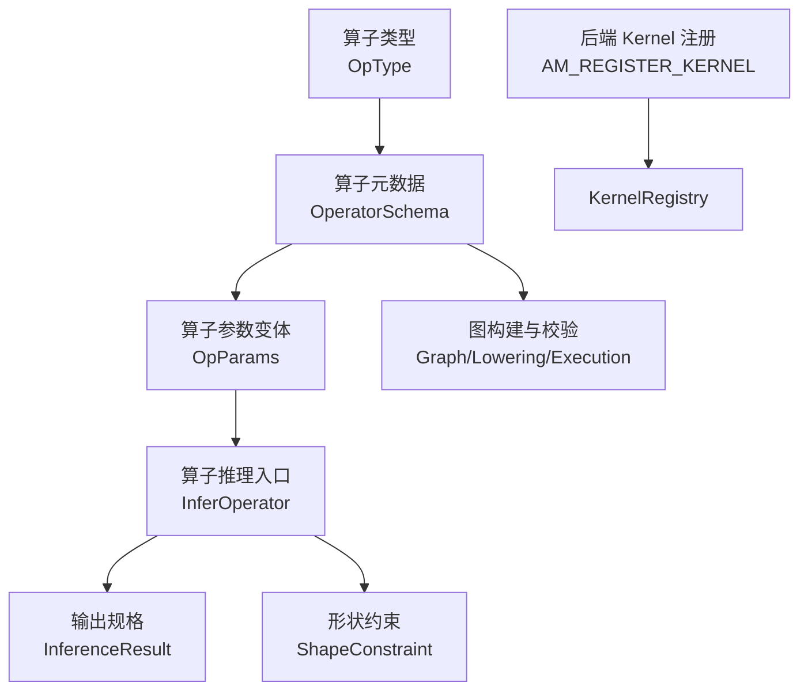
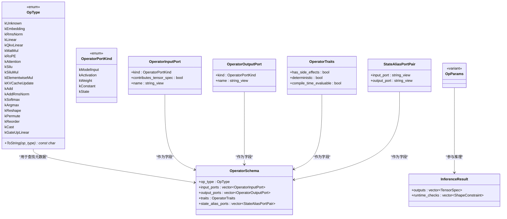
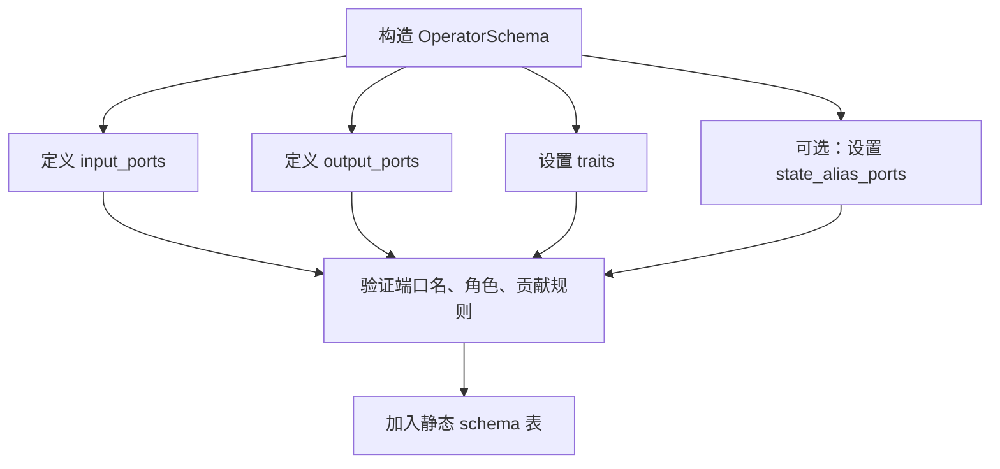
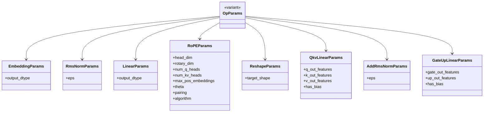
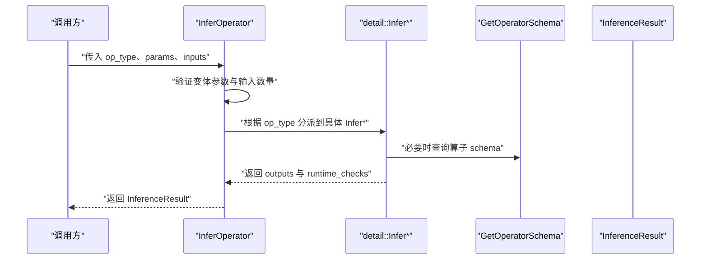
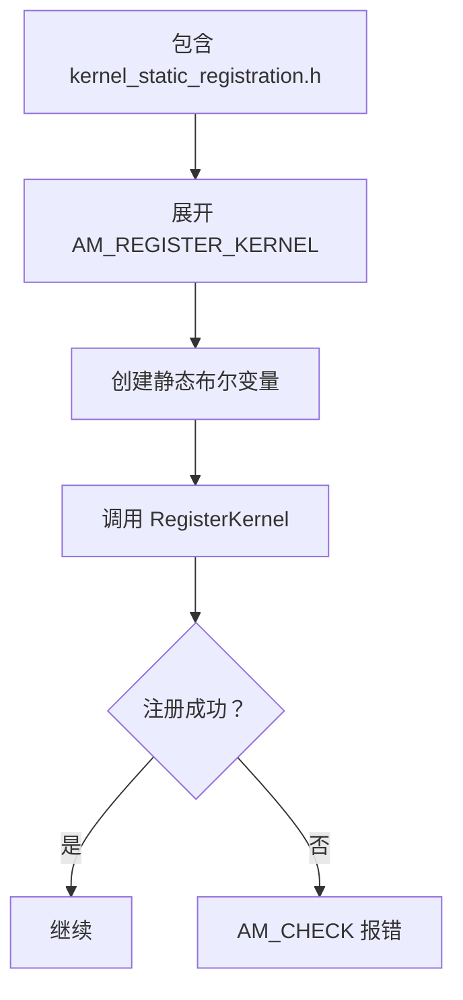
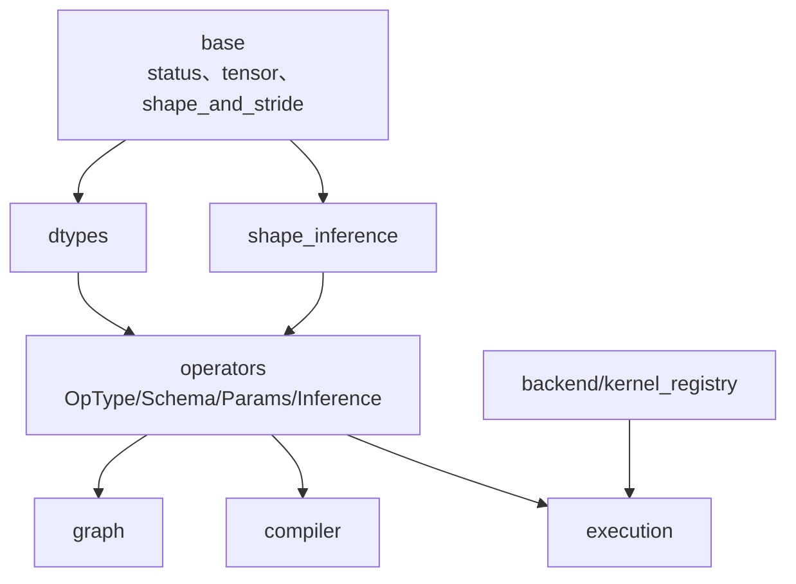

# 算子契约与元数据

**本文引用的文件**
- [operator_schema.h](../../../../include/aethermind/operators/operator_schema.h)
- [op_type.h](../../../../include/aethermind/operators/op_type.h)
- [op_params.h](../../../../include/aethermind/operators/op_params.h)
- [operator_inference.h](../../../../include/aethermind/operators/operator_inference.h)
- [inference_result.h](../../../../include/aethermind/operators/inference_result.h)
- [operator_schema.cpp](../../../../src/operators/operator_schema.cpp)
- [op_type.cpp](../../../../src/operators/op_type.cpp)
- [operator_inference.cpp](../../../../src/operators/operator_inference.cpp)
- [kernel_static_registration.h](../../../../include/aethermind/backend/kernel_static_registration.h)
- [include/aethermind/shape_inference/](../../../../include/aethermind/shape_inference)
- [operator_contract_design.md](../../../operators/operator_contract_design.md)

## 目录
1. [引言](#引言)
2. [项目结构](#项目结构)
3. [核心组件](#核心组件)
4. [架构总览](#架构总览)
5. [详细组件分析](#详细组件分析)
6. [依赖关系分析](#依赖关系分析)
7. [性能特性与优化机会](#性能特性与优化机会)
8. [故障排查指南](#故障排查指南)
9. [结论](#结论)
10. [附录：新算子契约实现清单](#附录新算子契约实现清单)

## 引言
AetherMind 的算子系统通过“算子类型 + 算子语义 + 参数变体 + 形状推导 + 执行约束”的分层设计，把模型图构建、编译期 lowering、执行期调度与后端 kernel 选择解耦。其核心是：

- `OpType`：稳定、稳定的算子类型标签。
- `OperatorSchema`：算子的端口 ABI、输入输出角色、纯函数性、可编译期求值性等元数据。
- `OpParams`：每个算子的强类型参数变体。
- `InferOperator` 及其 `detail::Infer*`：算子语义验证、输出 shape/dtype 推导与运行时约束生成。
- `AM_REGISTER_KERNEL`：后端 kernel 的静态注册机制。

本文重点解释 `OperatorSchema` 的设计、`OpType` 枚举语义、`OpParams` 继承关系、算子注册机制、元数据规范，以及如何定义一个新算子的契约、进行参数验证和形状推断。

## 项目结构
算子契约相关代码主要分布在以下位置：

- 头文件位于 `include/aethermind/operators/`：声明 `OpType`、`OperatorSchema`、`OpParams`、`InferOperator` 等。
- 实现文件位于 `src/operators/`：实现算子 schema 表、字符串转换、推理分发与 dtype 推导。
- 后端 kernel 注册宏位于 `include/aethermind/backend/kernel_static_registration.h`。
- 形状推导基础设施位于 `include/aethermind/shape_inference/`，并由文档 [形状推断系统](../../形状推断系统.md) 统一说明。
- 算子契约总体设计由 `docs/operators/operator_contract_design.md` 冻结。

**图示来源**
- [op_type.h:12-64](../../../../include/aethermind/operators/op_type.h#L12-L64)
- [operator_schema.h:23-167](../../../../include/aethermind/operators/operator_schema.h#L23-L167)
- [op_params.h:20-391](../../../../include/aethermind/operators/op_params.h#L20-L391)
- [operator_inference.h:18-138](../../../../include/aethermind/operators/operator_inference.h#L18-L138)
- [inference_result.h:12-26](../../../../include/aethermind/operators/inference_result.h#L12-L26)
- [kernel_static_registration.h:10-24](../../../../include/aethermind/backend/kernel_static_registration.h#L10-L24)

**章节来源**
- [op_type.h:1-64](../../../../include/aethermind/operators/op_type.h#L1-L64)
- [operator_schema.h:1-167](../../../../include/aethermind/operators/operator_schema.h#L1-L167)
- [op_params.h:1-391](../../../../include/aethermind/operators/op_params.h#L1-L391)
- [operator_inference.h:1-138](../../../../include/aethermind/operators/operator_inference.h#L1-L138)
- [inference_result.h:1-26](../../../../include/aethermind/operators/inference_result.h#L1-L26)
- [kernel_static_registration.h:1-24](../../../../include/aethermind/backend/kernel_static_registration.h#L1-L24)
- [include/aethermind/shape_inference/](../../../../include/aethermind/shape_inference)
- [operator_contract_design.md](../../../operators/operator_contract_design.md)

## 核心组件
本节从用户视角总结五个关键概念：

| 概念 | 作用 | 关键类型或接口 |
|---|---|---|
| 算子类型 | 标识图中节点属于哪种算子，并驱动 kernel 选择 | `OpType`、`ToString` |
| 算子元数据 | 描述算子的端口名称、顺序、角色、副作用与可优化性 | `OperatorSchema`、`OperatorInputPort`、`OperatorOutputPort`、`OperatorTraits` |
| 算子参数 | 为每个算子提供强类型参数对象 | `OpParams` 及 `EmbeddingParams`、`RmsNormParams`、`RoPEParams`、`ReshapeParams` 等 |
| 算子推理 | 校验参数、推导输出张量规格、生成延迟执行期检查 | `InferOperator`、`detail::Infer*`、`InferenceResult` |
| Kernel 注册 | 将具体 CPU/GPU kernel 注册到全局 kernel 注册表 | `AM_REGISTER_KERNEL` |

**章节来源**
- [op_type.h:12-64](../../../../include/aethermind/operators/op_type.h#L12-L64)
- [operator_schema.h:23-167](../../../../include/aethermind/operators/operator_schema.h#L23-L167)
- [op_params.h:20-391](../../../../include/aethermind/operators/op_params.h#L20-L391)
- [operator_inference.h:18-138](../../../../include/aethermind/operators/operator_inference.h#L18-L138)
- [inference_result.h:12-26](../../../../include/aethermind/operators/inference_result.h#L12-L26)
- [kernel_static_registration.h:10-24](../../../../include/aethermind/backend/kernel_static_registration.h#L10-L24)

## 架构总览
算子契约体系不是单一类，而是由多个相互协作的类型组成：

**图示来源**
- [op_type.h:12-64](../../../../include/aethermind/operators/op_type.h#L12-L64)
- [operator_schema.h:23-167](../../../../include/aethermind/operators/operator_schema.h#L23-L167)
- [inference_result.h:12-26](../../../../include/aethermind/operators/inference_result.h#L12-L26)

## 详细组件分析

### 算子类型枚举 `OpType`
`OpType` 是算子语义层的稳定类型标签。它的作用包括：

- 在图中标识节点。
- 驱动 `GetOperatorSchema` 获取算子元数据。
- 驱动 `InferOperator` 分派到对应 `detail::Infer*`。
- 被 kernel 选择逻辑用于匹配后端 kernel。

当前枚举值及其语义如下：

| 枚举值 | 语义说明 |
|---|---|
| `kUnknown` | 无效或未知算子，不应出现在已验证图中 |
| `kEmbedding` | 词嵌入查找 |
| `kRmsNorm` | RMS 归一化 |
| `kLinear` | 线性投影 |
| `kQkvLinear` | Q/K/V 融合线性投影 |
| `kMatMul` | 矩阵乘法 |
| `kRoPE` | 旋转位置编码 |
| `kAttention` | 注意力计算 |
| `kSilu` | SiLU 激活 |
| `kSiluMul` | Gate/Up 与 SiLU 融合乘 |
| `kElementwiseMul` | 逐元素乘法 |
| `kKVCacheUpdate` | KV Cache 更新 |
| `kAdd` | 逐元素加法 |
| `kAddRmsNorm` | Add + RMSNorm 融合 |
| `kSoftmax` | Softmax |
| `kArgmax` | ArgMax 归约 |
| `kReshape` | 重排逻辑形状 |
| `kPermute` | 轴置换 |
| `kReorder` | 物理布局重排意图 |
| `kCast` | 存储格式类型转换 |
| `kGateUpLinear` | Gate/Up 融合线性投影 |

`ToString` 对所有已知枚举值返回人类可读名称；对 `kUnknown` 或越界值返回 `"Unknown"`，因此该函数对任意 `uint8_t` 转换结果都是安全的。

```mermaid
flowchart TD
    Start(["调用 ToString"]) --> Switch{"枚举值"}
    Switch -->|"kEmbedding"| Embedding["返回 Embedding"]
    Switch -->|"kRmsNorm"| RmsNorm["返回 RmsNorm"]
    Switch -->|"kLinear"| Linear["返回 Linear"]
    Switch -->|"kQkvLinear"| Qkv["返回 QkvLinear"]
    Switch -->|"kGateUpLinear"| GateUp["返回 GateUpLinear"]
    Switch -->|"kMatMul"| Matmul["返回 MatMul"]
    Switch -->|"kRoPE"| Rope["返回 RoPE"]
    Switch -->|"kAttention"| Attn["返回 Attention"]
    Switch -->|"kSilu"| Silu["返回 Silu"]
    Switch -->|"kSiluMul"| SiluMul["返回 SiluMul"]
    Switch -->|"kElementwiseMul"| ElemMul["返回 ElementwiseMul"]
    Switch -->|"kKVCacheUpdate"| Kvcache["返回 KVCacheUpdate"]
    Switch -->|"kAdd"| Add["返回 Add"]
    Switch -->|"kAddRmsNorm"| AddRms["返回 AddRmsNorm"]
    Switch -->|"kSoftmax"| Softmax["返回 Softmax"]
    Switch -->|"kArgmax"| Argmax["返回 Argmax"]
    Switch -->|"kReshape"| Reshape["返回 Reshape"]
    Switch -->|"kPermute"| Permute["返回 Permute"]
    Switch -->|"kReorder"| Reorder["返回 Reorder"]
    Switch -->|"kCast"| Cast["返回 Cast"]
    Switch -->|"其他或 kUnknown"| Unknown["返回 Unknown"]
```

**图示来源**
- [op_type.cpp:1-56](../../../../src/operators/op_type.cpp#L1-L56)

**章节来源**
- [op_type.h:12-64](../../../../include/aethermind/operators/op_type.h#L12-L64)
- [op_type.cpp:1-56](../../../../src/operators/op_type.cpp#L1-L56)

### 算子端口与 `OperatorSchema`
`OperatorSchema` 是算子语义 ABI 的核心。它不关心具体 kernel 实现，只关心：

- 这个算子有哪些输入端口和输出端口。
- 每个端口的名称是什么。
- 每个端口的语义角色是什么。
- 这个算子是否带副作用、是否确定、是否可编译期求值。
- 这个算子是否需要跨步骤共享状态。

#### 端口角色 `OperatorPortKind`
| 角色 | 含义 |
|---|---|
| `kModelInput` | 由模型入口提供，例如 token ids、position ids |
| `kActivation` | 图中激活张量，由前驱算子产生并被后继消费 |
| `kWeight` | 加载时绑定的静态权重 |
| `kConstant` | 可在编译期折叠的常量 |
| `kState` | 跨步骤持久状态，例如 KV cache |

#### 输入端口 `OperatorInputPort`
关键字段：

- `kind`：端口角色。
- `contributes_tensor_spec`：是否参与输出张量规格推导。例如 KV Cache 的状态输入不参与常规 shape 推导，因为它的布局由算子自身决定。
- `name`：端口名称，由静态 schema 定义中的字面量借用。

#### 输出端口 `OperatorOutputPort`
关键字段：

- `kind`：端口角色。
- `name`：端口名称。

#### 算子特性 `OperatorTraits`
| 字段 | 含义 |
|---|---|
| `has_side_effects` | 是否修改持久状态 |
| `deterministic` | 相同输入是否总是产生相同输出 |
| `compile_time_evaluable` | 是否允许图 lowering 阶段在编译期求值 |

辅助谓词：

- `HasStatefulOutput`：是否存在状态输出。
- `IsPureOperator`：无副作用且确定性。
- `IsCompileTimeEvaluable`：既是纯函数又标记为可编译期求值。

#### 状态别名端口对 `StateAliasPortPair`
用于 KV Cache 等需要输入状态与输出状态绑定到同一物理缓冲区的算子。例如 KVCacheUpdate 的 `k_cache_in` 与 `k_cache_out` 必须映射到同一个运行时状态缓冲区。

#### 静态 schema 表
所有已注册算子的 schema 集中在 `kOperatorSchemas` 数组中，并通过 `GetOperatorSchema` 按 `OpType` 查找。新增算子时，必须同时添加 `OpType` 枚举值和对应的 schema 条目。

**图示来源**
- [operator_schema.h:23-167](../../../../include/aethermind/operators/operator_schema.h#L23-L167)
- [operator_schema.cpp:1-200](../../../../src/operators/operator_schema.cpp#L1-L200)
- [operator_schema.cpp:200-324](../../../../src/operators/operator_schema.cpp#L200-L324)

**章节来源**
- [operator_schema.h:23-167](../../../../include/aethermind/operators/operator_schema.h#L23-L167)
- [operator_schema.cpp:1-200](../../../../src/operators/operator_schema.cpp#L1-L200)
- [operator_schema.cpp:200-324](../../../../src/operators/operator_schema.cpp#L200-L324)

### 算子参数 `OpParams`
`OpParams` 是一个 `std::variant`，每个算子对应一个强类型参数结构体。系统明确不使用 `std::any` 或字符串键访问参数，从而避免“字符串式类型”。

#### 基类与继承关系
当前实现没有面向参数的抽象基类，也没有虚函数继承树。参数结构体之间是并列关系，全部聚合进 `OpParams` 变体。可以把它们理解为“语义上等价于基类 + 派生类的多态”，但语言层面是组合式变体。

| 参数结构体 | 所属算子 | 主要职责 |
|---|---|---|
| `EmbeddingParams` | `kEmbedding` | 指定 embedding 输出 dtype |
| `RmsNormParams` | `kRmsNorm` | RMSNorm 的 epsilon |
| `LinearParams` | `kLinear` | 指定线性输出 dtype |
| `RoPEParams` | `kRoPE` | 旋转位置编码配置，含 head_dim、rotary_dim、head 数、频率算法等 |
| `MatMulParams` | `kMatMul` | 控制 rhs 是否转置 |
| `SoftmaxParams` | `kSoftmax` | softmax 轴 |
| `AddParams` | `kAdd` | 无额外参数 |
| `SiluParams` | `kSilu` | 无额外参数 |
| `SiluMulParams` | `kSiluMul` | 无额外参数 |
| `ElementwiseMulParams` | `kElementwiseMul` | 无额外参数 |
| `KVCacheUpdateParams` | `kKVCacheUpdate` | 无额外参数 |
| `AttentionParams` | `kAttention` | num_q_heads、num_kv_heads、head_dim |
| `ArgmaxParams` | `kArgmax` | axis |
| `ReshapeParams` | `kReshape` | target_shape，支持字面量维度、输入轴引用、推断维度 |
| `PermuteParams` | `kPermute` | permutation 双射 |
| `ReorderParams` | `kReorder` | 无参数，表示物理连续布局意图 |
| `CastParams` | `kCast` | target_dtype |
| `QkvLinearParams` | `kQkvLinear` | q/k/v 输出特征数与 bias 开关 |
| `AddRmsNormParams` | `kAddRmsNorm` | fusion 加法的 epsilon |
| `GateUpLinearParams` | `kGateUpLinear` | gate/up 输出特征数与 bias 开关 |

#### RoPE 参数变体
`RoPEAlgorithmParams` 是另一个重要变体，用于表达不同 RoPE 缩放策略：

| 替代类型 | 语义 |
|---|---|
| `StandardRoPE` | 标准 RoPE |
| `LinearRoPE` | 线性缩放 |
| `DynamicNtkRoPE` | Dynamic NTK |
| `YarnRoPE` | YARN |
| `Llama3RoPE` | LLaMA3 风格 |
| `LongRoPE` | Long RoPE |

`GetRoPEAlgorithm` 根据当前活跃替代类型返回对应 `RoPEAlgorithm`。

**图示来源**
- [op_params.h:20-391](../../../../include/aethermind/operators/op_params.h#L20-L391)

**章节来源**
- [op_params.h:20-391](../../../../include/aethermind/operators/op_params.h#L20-L391)

### 算子推理与形状推导
`InferOperator` 是算子语义推理的统一入口。它接收：

- `op_type`
- `params`：与 `op_type` 匹配的 `OpParams` 变体
- `inputs`：按 schema 端口顺序排列的输入 `TensorSpec`

然后分派到 `detail::Infer*`，返回 `InferenceResult`：

- `outputs`：推导出的输出张量规格。
- `runtime_checks`：无法在 plan 阶段证明、需要在运行期验证的形状约束。

#### 推理流程

**图示来源**
- [operator_inference.h:18-138](../../../../include/aethermind/operators/operator_inference.h#L18-L138)
- [operator_inference.cpp:1-197](../../../../src/operators/operator_inference.cpp#L1-L197)
- [inference_result.h:12-26](../../../../include/aethermind/operators/inference_result.h#L12-L26)

#### dtype 推导规则
`DeriveSelectorDTypes` 定义了 selector dtype 的唯一权威规则：

1. `act_dtype`：来自参与 spec 推导的 activation 输入端口；若无 activation 输入，则回退到 activation 输出端口。
2. `weight_dtype`：来自 weight 输入端口；若没有 weight 端口，则回退到 `act_dtype`。
3. `state_dtype`：来自所有 `kState` 输入/输出端口，独立于 `contributes_tensor_spec`。
4. `output_dtype`：来自所有 activation 输出端口；若没有 activation 输出，则为 undefined。

这些规则保证 compiler 和 execution 可以交叉校验 selector dtype。

#### 输入数量校验
`ValidateInferenceInputCount` 通过 `GetOperatorSchema` 获取期望输入数量，并与实际输入数量比较。

#### 形状推导基础设施
形状推导基础设施由 `shape_inference` 模块提供，包括：

- `ShapeSymbol` / `SymbolicShape`：静态维度、符号维度、join/unify。
- `TensorSpec`：dtype 与 symbolic shape。
- `ShapeConstraint`：六种约束条件。
- `InferenceResult`：输出 specs 与延迟检查。
- `SymbolConstraintSolver`：plan-time union-find 等式事实库。

**章节来源**
- [operator_inference.h:18-138](../../../../include/aethermind/operators/operator_inference.h#L18-L138)
- [operator_inference.cpp:1-197](../../../../src/operators/operator_inference.cpp#L1-L197)
- [inference_result.h:12-26](../../../../include/aethermind/operators/inference_result.h#L12-L26)
- [include/aethermind/shape_inference/](../../../../include/aethermind/shape_inference)

### 算子注册机制
这里要区分两个概念：

| 概念 | 目的 | 实现位置 |
|---|---|---|
| 算子 schema 注册 | 声明算子端口、角色、特性 | `kOperatorSchemas` + `GetOperatorSchema` |
| kernel 注册 | 将具体 CPU/GPU kernel 实现注册到 backend kernel 注册表 | `AM_REGISTER_KERNEL` + `KernelRegistry` |

#### 算子 schema 注册
算子 schema 是静态数组，编译期固定。新增算子时：

1. 在 `OpType` 中添加枚举值。
2. 在 `operator_schema.cpp` 的 `kOperatorSchemas` 中添加对应 schema。
3. 如需推理，添加 `detail::Infer*` 并在 `InferOperator` 中分派。
4. 如有必要，补充 `OpParams` 结构体。

`GetOperatorSchema` 遍历静态表；未注册类型返回 `NotFound`。

#### kernel 注册
`AM_REGISTER_KERNEL` 是一个宏，用于在翻译单元加载时调用 `KernelRegistry::Global().Register`。如果注册失败，会触发 `AM_CHECK` 错误。典型使用方式是在每个 kernel entry 文件中注册若干 kernel 实例。

**图示来源**
- [kernel_static_registration.h:10-24](../../../../include/aethermind/backend/kernel_static_registration.h#L10-L24)

**章节来源**
- [operator_schema.cpp:276-324](../../../../src/operators/operator_schema.cpp#L276-L324)
- [kernel_static_registration.h:10-24](../../../../include/aethermind/backend/kernel_static_registration.h#L10-L24)

## 依赖关系分析
算子系统内部依赖方向遵循“语义层向前端下游暴露，但不反向依赖执行细节”的原则。

**图示来源**
- [operator_contract_design.md](../../../operators/operator_contract_design.md)
- [operator_schema.h:1-167](../../../../include/aethermind/operators/operator_schema.h#L1-L167)
- [operator_inference.h:1-138](../../../../include/aethermind/operators/operator_inference.h#L1-L138)

### 耦合与内聚
- `OpType` 高度内聚，仅承担类型标签和字符串转换。
- `OperatorSchema` 集中封装算子端口与特性，降低图构建、lowering、execution 对具体算子实现的耦合。
- `OpParams` 通过强类型变体避免运行时字符串解析。
- `InferOperator` 集中参数校验和形状推导入口，便于扩展。
- `AM_REGISTER_KERNEL` 将 kernel 注册逻辑收敛到 backend 层，不影响 operators 层。

### 潜在循环依赖
- operators 不依赖 graph/compiler/execution/backend。
- shape_inference 不反向依赖 operators。
- 当前设计中没有明显的循环依赖。

**章节来源**
- [operator_contract_design.md](../../../operators/operator_contract_design.md)
- [include/aethermind/shape_inference/](../../../../include/aethermind/shape_inference)

## 性能特性与优化机会
- 静态 schema 表适合编译期固定数据，`GetOperatorSchema` 当前是线性扫描；对于当前算子数量开销很小，但若未来枚举增长较多，可考虑以 `OpType` 为索引的哈希或查找表。
- `MakeCompactInputSpecs` 过滤 `contributes_tensor_spec == false` 的端口，避免 KV cache 等状态端口污染常规 shape 推导。
- `DeriveSelectorDTypes` 一次性推导 act/weight/state/output dtype，减少后续 lowering 和 execution 的重复判断。
- `IsPureOperator` 和 `IsCompileTimeEvaluable` 帮助优化 pass 决定是否启用常数折叠、CSE、fusion。
- `AM_REGISTER_KERNEL` 使用静态初始化器，注册发生在进程启动阶段，热路径无动态分配。

[本节为通用性能讨论，不直接分析具体代码片段]

## 故障排查指南
常见错误与定位方式：

| 现象 | 可能原因 | 排查方法 |
|---|---|---|
| 推理时报“未知算子类型” | `OpType::kUnknown` 或未在 `InferOperator` 中分派 | 检查枚举值与 switch 分支 |
| 输入数量不匹配 | schema 期望输入数与实际不同 | 使用 `ValidateInferenceInputCount` |
| dtype 不一致 | activation、weight、state 或 output 端口 dtype 冲突 | 检查 `DeriveSelectorDTypes` 的规则 |
| KV cache 状态未正确绑定 | 缺少 `state_alias_ports` 或端口名不一致 | 检查 KVCacheUpdate/Attention schema |
| kernel 启动失败 | kernel 未注册或注册宏参数错误 | 检查 `AM_REGISTER_KERNEL` |
| 算子不能被常数折叠 | `traits.compile_time_evaluable` 未设置 | 检查 `OperatorTraits` |

**章节来源**
- [operator_inference.cpp:1-197](../../../../src/operators/operator_inference.cpp#L1-L197)
- [operator_schema.cpp:276-324](../../../../src/operators/operator_schema.cpp#L276-L324)
- [kernel_static_registration.h:10-24](../../../../include/aethermind/backend/kernel_static_registration.h#L10-L24)

## 结论
AetherMind 的算子契约通过 `OpType`、`OperatorSchema`、`OpParams`、`InferOperator` 和 `AM_REGISTER_KERNEL` 形成清晰分层：

- `OpType` 提供稳定类型。
- `OperatorSchema` 冻结端口 ABI 和优化属性。
- `OpParams` 提供强类型参数。
- `InferOperator` 负责语义验证、形状推导和延迟检查。
- `AM_REGISTER_KERNEL` 负责后端 kernel 注册。

这种设计使模型图构建、编译期 lowering、执行期调度和后端 kernel 选择彼此解耦，既适合 Phase 1 的 CPU 推理场景，也为后续 CUDA 后端和更多算子演进预留了空间。

[本节为总结性内容，不直接分析具体文件]

## 附录：新算子契约实现清单
如果要新增一个算子，建议按以下步骤操作：

1. **添加算子类型**
   - 在 `OpType` 枚举中添加新值。
   - 在 `ToString` 中添加可读名称。

2. **定义算子参数**
   - 新建参数结构体，放在 `OpParams` 变体末尾。
   - 保持参数为强类型值对象，不使用字符串键。

3. **定义算子 schema**
   - 在 `kOperatorSchemas` 中添加 schema。
   - 填写输入端口、输出端口、端口名、端口角色。
   - 设置 `OperatorTraits`。
   - 如果是状态算子，填写 `state_alias_ports`。

4. **实现算子推理**
   - 在 `detail::InferXxx` 中实现参数校验、输入 rank/dtype 校验、输出 `TensorSpec` 推导。
   - 将无法静态证明的约束放入 `InferenceResult::runtime_checks`。
   - 在 `InferOperator` 中增加对应分派分支。

5. **补充 dtype 推导兼容性**
   - 如果算子有 activation/weight/state/output dtype 规则，确保 `DeriveSelectorDTypes` 的规则仍然适用。
   - 如需要特殊行为，优先通过端口角色和 schema 表达，而不是破坏现有推导规则。

6. **注册后端 kernel（可选）**
   - 在 kernel entry 文件中用 `AM_REGISTER_KERNEL` 注册 reference 或 optimized kernel。
   - 确保 kernel 的输入输出语义与 schema 一致。

7. **编写测试**
   - 验证 schema 查找、端口索引、dtype 推导、形状推导、运行时约束。
   - 覆盖边界情况：unknown type、空输入、rank 不匹配、dtype 冲突。

**章节来源**
- [op_type.h:12-64](../../../../include/aethermind/operators/op_type.h#L12-L64)
- [op_type.cpp:1-56](../../../../src/operators/op_type.cpp#L1-L56)
- [op_params.h:20-391](../../../../include/aethermind/operators/op_params.h#L20-L391)
- [operator_schema.cpp:1-324](../../../../src/operators/operator_schema.cpp#L1-L324)
- [operator_inference.h:18-138](../../../../include/aethermind/operators/operator_inference.h#L18-L138)
- [operator_inference.cpp:1-197](../../../../src/operators/operator_inference.cpp#L1-L197)
- [kernel_static_registration.h:10-24](../../../../include/aethermind/backend/kernel_static_registration.h#L10-L24)
