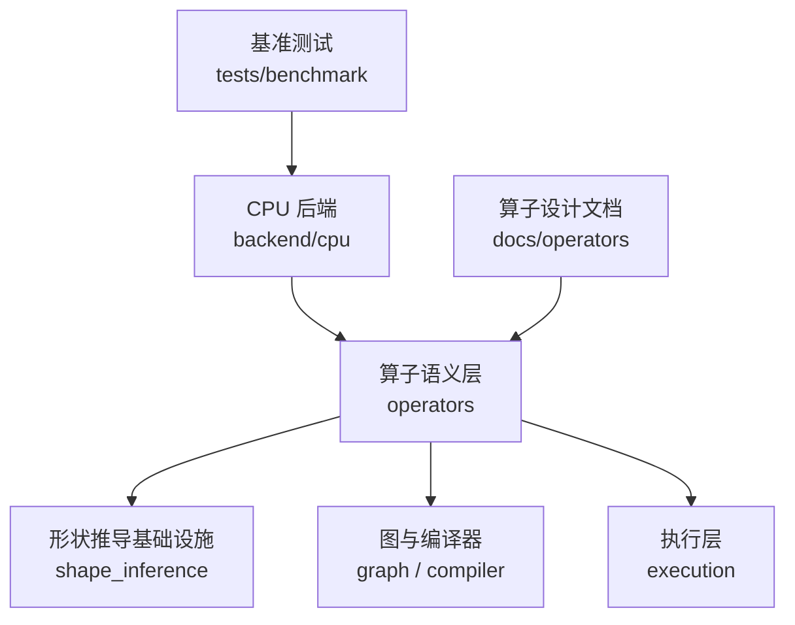
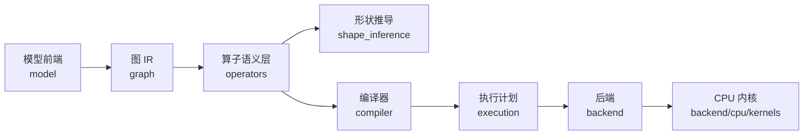
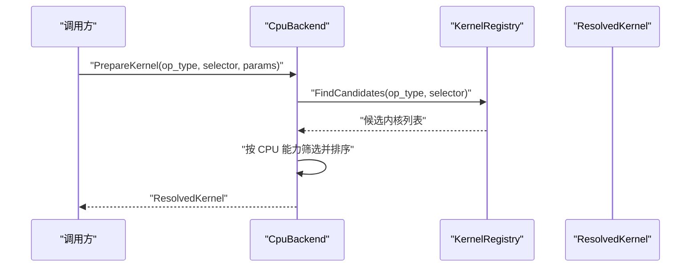
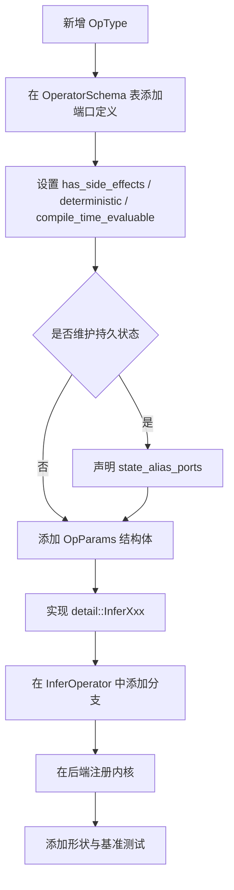
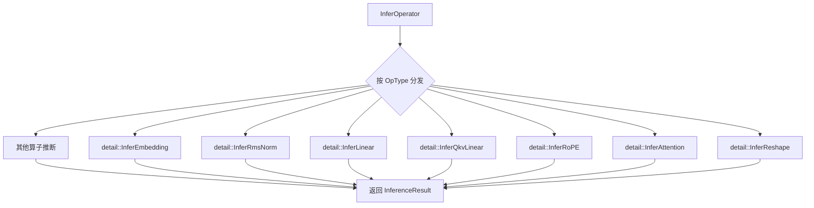
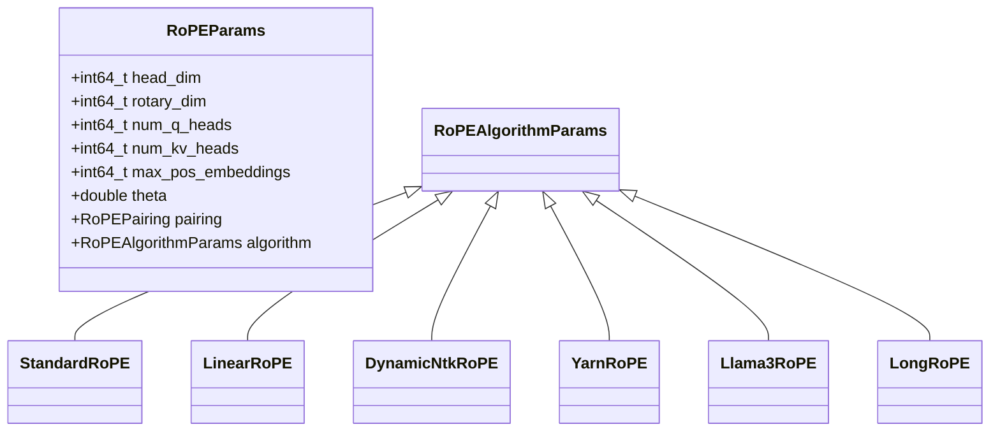
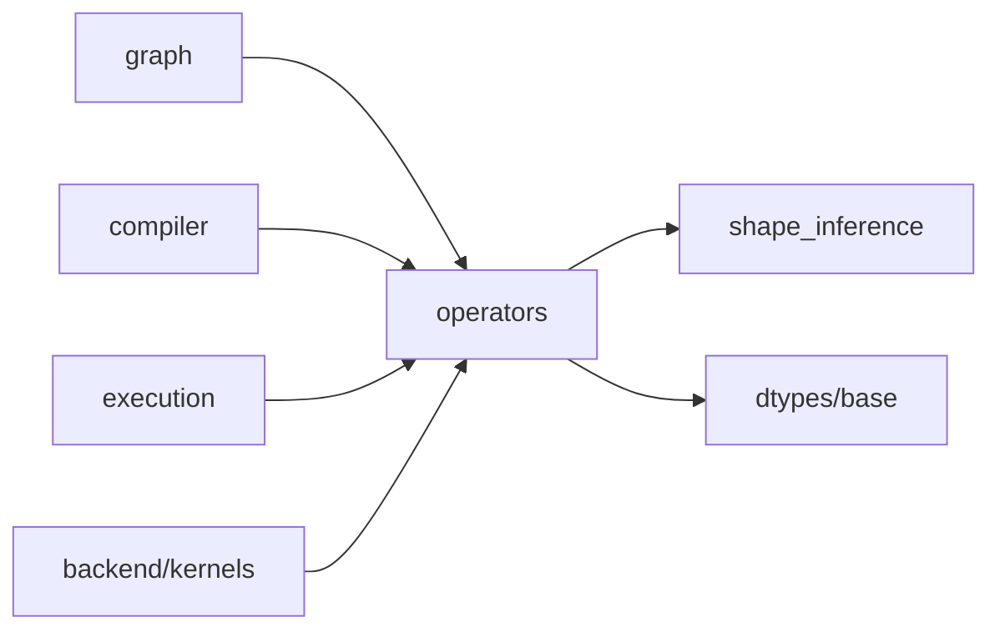
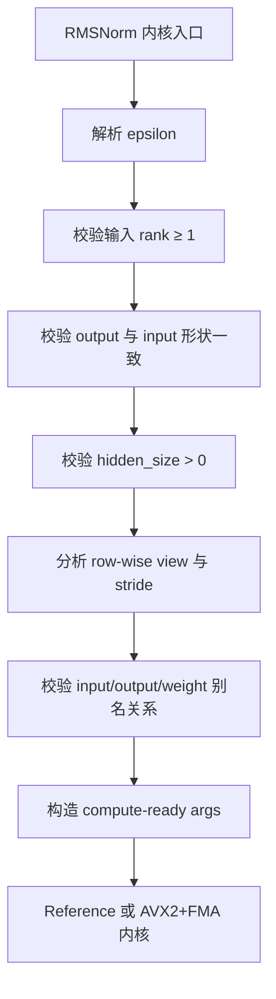
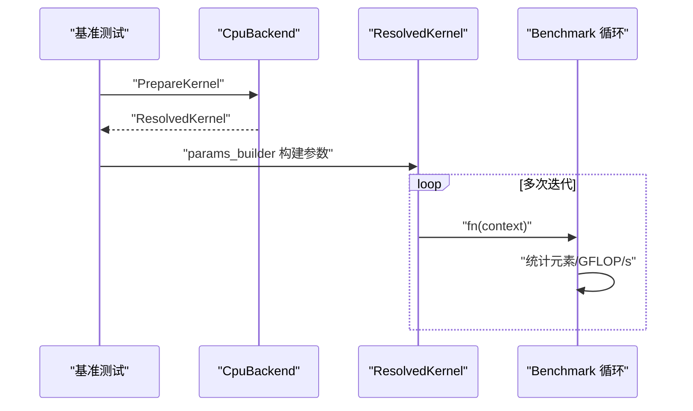

# 算子系统 (Operators)

**本文引用的文件**
- [op_type.h](../../../../include/aethermind/operators/op_type.h)
- [op_type.cpp](../../../../src/operators/op_type.cpp)
- [op_params.h](../../../../include/aethermind/operators/op_params.h)
- [operator_schema.h](../../../../include/aethermind/operators/operator_schema.h)
- [operator_schema.cpp](../../../../src/operators/operator_schema.cpp)
- [operator_inference.h](../../../../include/aethermind/operators/operator_inference.h)
- [operator_inference.cpp](../../../../src/operators/operator_inference.cpp)
- [inference_result.h](../../../../include/aethermind/operators/inference_result.h)
- [rope_frequency_resolver.h](../../../../include/aethermind/operators/rope_frequency_resolver.h)
- [kernel_registry.h](../../../../include/aethermind/backend/kernel_registry.h)
- [cpu_backend.h](../../../../include/aethermind/backend/cpu/cpu_backend.h)
- [rmsnorm_entry.cpp](../../../../src/backend/cpu/kernels/rmsnorm/rmsnorm_entry.cpp)
- [benchmark_cpu_rmsnorm_kernel.cpp](../../../../tests/benchmark/cpu_kernels/benchmark_cpu_rmsnorm_kernel.cpp)
- [operator_contract_design.md](../../../operators/operator_contract_design.md)
- [RMSNorm算子契约.md](../../../operators/rmsnorm/RMSNorm算子契约.md)
- [include/aethermind/shape_inference/](../../../../include/aethermind/shape_inference)

## 目录

1. [引言](#引言)
2. [项目结构](#项目结构)
3. [核心组件](#核心组件)
4. [架构总览](#架构总览)
5. [详细组件分析](#详细组件分析)
6. [依赖关系分析](#依赖关系分析)
7. [性能与 SIMD 优化](#性能与-simd-优化)
8. [基准测试与性能基准](#基准测试与性能基准)
9. [故障排查指南](#故障排查指南)
10. [新算子开发流程与最佳实践](#新算子开发流程与最佳实践)
11. [结论](#结论)

## 引言

AetherMind 的算子系统是推理流水线中连接模型语义、图构建、编译与后端执行的核心层。它负责：

- 定义稳定的算子类型 `OpType`；
- 用强类型参数 `OpParams` 描述每个算子的语义；
- 通过 `OperatorSchema` 冻结算子的端口顺序、端口角色和可优化性；
- 提供集中式形状推导入口 `InferOperator` 及每算子 `detail::Infer*`；
- 将形状结果与运行时约束交给 `InferenceResult`，供图与执行阶段消费；
- 为 RoPE 等复杂算子提供后端无关的频率解析接口；
- 为 CPU 后端提供算子注册、内核选择、SIMD 内核入口与基准测试。

本设计文档聚焦算子元数据、注册机制、形状推导和执行边界。按执行链阅读见 [算子系统总览](../../算子系统/算子系统.md)，具体算子的契约与验证证据见 [算子文档](../../../operators/README.md)。

## 项目结构

算子系统横跨以下目录：

| 目录 | 职责 |
|---|---|
| `include/aethermind/operators/` | 算子类型、参数变体、算子元数据、推断入口、RoPE 频率解析、推断结果 |
| `src/operators/` | `OpType` 名称映射、静态算子模式表、推断调度器、RoPE 频率解析实现、参数序列化 |
| `src/backend/cpu/kernels/*` | 各算子的 CPU Reference 与 SIMD 内核实现 |
| `include/aethermind/backend/` | 内核注册表、CPU 后端、KernelSelector、PackingRecipe 等执行期抽象 |
| `tests/benchmark/cpu_kernels/` | 算子级性能基准 |
| `docs/operators/` | 算子契约、RMSNorm 契约、注意力优化、线性优化等算子设计文档 |
| [形状推断系统](../../形状推断系统.md) | 形状推导基础设施的职责说明与接口索引 |

**图表来源**
- [op_type.h:10-64](../../../../include/aethermind/operators/op_type.h#L10-L64)
- [operator_schema.h:24-167](../../../../include/aethermind/operators/operator_schema.h#L24-L167)
- [operator_inference.h:12-138](../../../../include/aethermind/operators/operator_inference.h#L12-L138)
- [include/aethermind/shape_inference/](../../../../include/aethermind/shape_inference)

**章节来源**
- [op_type.h:10-64](../../../../include/aethermind/operators/op_type.h#L10-L64)
- [operator_schema.h:24-167](../../../../include/aethermind/operators/operator_schema.h#L24-L167)
- [operator_inference.h:12-138](../../../../include/aethermind/operators/operator_inference.h#L12-L138)
- [include/aethermind/shape_inference/](../../../../include/aethermind/shape_inference)

## 核心组件

### 算子类型枚举 `OpType`

`OpType` 是一个 `uint8_t` 级别的稳定标签，用于：

- 执行图中算子节点的类型标识；
- `OperatorSchema` 的元数据匹配；
- `KernelRegistry` 的内核选择；
- `ExecutionPlanBuilder` 构造执行步骤；
- `ToString` 生成人类可读名称；
- 作为 `std::hash` 键参与哈希容器。

以下是算子类型及其语义类别。枚举值以 [op_type.h](../../../../include/aethermind/operators/op_type.h) 为准。

| 编号 | 枚举值 | 语义类别 |
|---|---|---|
| 1 | `kEmbedding` | 词嵌入查找 |
| 2 | `kRmsNorm` | RMS 归一化 |
| 3 | `kLinear` | 稠密投影 |
| 4 | `kQkvLinear` | Q/K/V 融合投影 |
| 5 | `kMatMul` | 矩阵乘 |
| 6 | `kRoPE` | 旋转位置编码 |
| 7 | `kAttention` | 注意力计算 |
| 8 | `kSilu` | SiLU 激活 |
| 9 | `kSiluMul` | Gate × SiLU 门控乘法 |
| 10 | `kElementwiseMul` | 逐元素乘法 |
| 11 | `kKVCacheUpdate` | KV Cache 写入更新 |
| 12 | `kAdd` | 残差相加 |
| 13 | `kAddRmsNorm` | 融合 Add + RMSNorm |
| 14 | `kSoftmax` | Softmax |
| 15 | `kArgmax` | ArgMax 归约 |
| 16 | `kReshape` | 逻辑重排形状 |
| 17 | `kPermute` | 轴置换 |
| 18 | `kReorder` | 物理布局规整 |
| 19 | `kCast` | 存储格式转换 |
| 20 | `kGateUpLinear` | MLP Gate/Up 融合投影 |

其中 `kUnknown = 0` 是保留哨兵，`ToString` 对越界值也安全返回 `"Unknown"`。

**章节来源**
- [op_type.h:18-64](../../../../include/aethermind/operators/op_type.h#L18-L64)
- [op_type.cpp:7-56](../../../../src/operators/op_type.cpp#L7-L56)

### 参数系统 `OpParams`

`OpParams` 是覆盖全部算子的强类型 `std::variant`。其关键原则是：

- 不使用 `std::any`；
- 不使用字符串字段传递参数；
- 每个算子有独立的参数结构体；
- 参数是值对象，便于跨模块传递；
- 参数校验发生在对应 `detail::Infer*` 函数开头。

代表性参数结构包括：

| 参数结构 | 所属算子 | 关键语义 |
|---|---|---|
| `EmbeddingParams` | `kEmbedding` | 可选输出 dtype，默认沿用 table dtype |
| `RmsNormParams` | `kRmsNorm` | `eps` 默认 `1e-5f` |
| `LinearParams` | `kLinear` | 可选输出 dtype，支持混合输出投影 |
| `RoPEParams` | `kRoPE` | head_dim、rotary_dim、头数、theta、pairing、算法变体 |
| `MatMulParams` | `kMatMul` | 是否转置右操作数 |
| `SoftmaxParams` | `kSoftmax` | axis |
| `AddParams` / `SiluParams` / `SiluMulParams` / `ElementwiseMulParams` | 对应算子 | 无额外语义字段 |
| `KVCacheUpdateParams` | `kKVCacheUpdate` | 无额外语义字段 |
| `AttentionParams` | `kAttention` | num_q_heads、num_kv_heads、head_dim |
| `ArgmaxParams` | `kArgmax` | axis，含 NaN 与相等最大值规则 |
| `ReshapeParams` | `kReshape` | target_shape，支持字面量、输入轴引用、推断维度 |
| `PermuteParams` | `kPermute` | 全排列 |
| `ReorderParams` | `kReorder` | 空结构，表示目标总是规范行优先连续布局 |
| `CastParams` | `kCast` | 目标 dtype |
| `QkvLinearParams` | `kQkvLinear` | q/k/v out_features、是否有 bias |
| `GateUpLinearParams` | `kGateUpLinear` | gate/up out_features、是否有 bias |
| `AddRmsNormParams` | `kAddRmsNorm` | eps，语义为 RmsNorm(input + residual, weight, eps) |

**章节来源**
- [op_params.h:25-391](../../../../include/aethermind/operators/op_params.h#L25-L391)

### 算子元数据 `OperatorSchema`

`OperatorSchema` 是算子语义 ABI 的权威定义，包含：

- `op_type`：关联的算子类型；
- `input_ports`：按固定顺序声明的输入端口；
- `output_ports`：按固定顺序声明的输出端口；
- `traits`：副作用、确定性、可编译期求值等优化属性；
- `state_alias_ports`：状态输入到状态输出的物理缓冲区别名对。

端口分类包括：

| 端口角色 | 含义 |
|---|---|
| `kModelInput` | 由模型入口提供，例如 token_ids、position_ids |
| `kActivation` | 在图内产生并被消费的张量激活 |
| `kWeight` | 加载时绑定的静态权重 |
| `kConstant` | 可编译期折叠常量 |
| `kState` | 跨步持久状态，如 KV Cache |

每个输入端口还有 `contributes_tensor_spec` 标志，控制该端口是否参与输出张量规格推导。状态端口通常不参与 shape 推导，但参与 selector dtype 推导。

**章节来源**
- [operator_schema.h:24-132](../../../../include/aethermind/operators/operator_schema.h#L24-L132)

### 推断结果 `InferenceResult`

`InferenceResult` 是算子推断的纯数据产出：

- `outputs`：推断出的输出 `TensorSpec`；
- `runtime_checks`：无法在 plan 阶段完全证明、需要运行期验证的形状约束。

它不持有符号求解器，也不持有输入 spec，因此可在 graph、compiler、execution 之间自由复制。

**章节来源**
- [inference_result.h:12-26](../../../../include/aethermind/operators/inference_result.h#L12-L26)
- [include/aethermind/shape_inference/](../../../../include/aethermind/shape_inference)

## 架构总览

算子系统处于“语义层”，向上被 model/graph/compiler 消费，向下由 backend/kernel 使用。

**图表来源**
- [operator_contract_design.md](../../../operators/operator_contract_design.md)
- [operator_schema.h:24-167](../../../../include/aethermind/operators/operator_schema.h#L24-L167)
- [operator_inference.h:12-138](../../../../include/aethermind/operators/operator_inference.h#L12-L138)

**章节来源**
- [operator_contract_design.md](../../../operators/operator_contract_design.md)

## 详细组件分析

### 算子注册与内核选择

内核注册由 `KernelRegistry` 承担，它以 `RegistrationKey` 为键，组合：

- `OpType`；
- `KernelSelector`；
- `CpuFeatureSet`；
- `PackingRecipe`。

注册完成后，可通过 `FindCandidates` 获取能匹配给定 selector 的内核候选集，并支持 `Freeze()` 防止运行时修改。

CPU 后端 `CpuBackend` 基于进程内 CPU 能力快照进行内核选择：

1. 根据 `OpType`、`KernelSelector`、`OpParams` 调用后端；
2. 过滤注册表中的候选内核；
3. 将选中内核冻结为 `ResolvedKernel`；
4. 同时暴露 packing recipe 和重量打包接口。

**图表来源**
- [kernel_registry.h:17-90](../../../../include/aethermind/backend/kernel_registry.h#L17-L90)
- [cpu_backend.h:44-120](../../../../include/aethermind/backend/cpu/cpu_backend.h#L44-L120)

**章节来源**
- [kernel_registry.h:17-90](../../../../include/aethermind/backend/kernel_registry.h#L17-L90)
- [cpu_backend.h:44-120](../../../../include/aethermind/backend/cpu/cpu_backend.h#L44-L120)

### 算子模式表与端口契约

所有已注册算子的端口布局集中在 `operator_schema.cpp` 的静态数组 `kOperatorSchemas` 中。新增算子必须在此添加条目，否则 `GetOperatorSchema` 会返回未找到错误。

重要算子模式要点：

| 算子 | 输入端口 | 输出端口 | 状态或融合语义 |
|---|---|---|---|
| `kEmbedding` | tokens、weight | output | 纯运行时算子 |
| `kRmsNorm` | input、weight | output | 纯运行时算子 |
| `kLinear` | input、weight | output | 纯运行时算子 |
| `kQkvLinear` | input、qkv_weight | q、k、v | 融合投影 |
| `kGateUpLinear` | input、gate_up_weight | gate、up | 融合 MLP |
| `kRoPE` | q、k、position_ids | q_rope、k_rope | 纯运行时算子 |
| `kMatMul` | lhs、rhs | output | 纯运行时算子 |
| `kSoftmax` | input | output | 纯运行时算子 |
| `kAdd` | lhs、rhs | output | 可编译期求值 |
| `kAddRmsNorm` | input、residual、weight | output、new_residual | 融合 Add+RMSNorm |
| `kSiluMul` | gate、up | output | 可编译期求值 |
| `kSilu` | input | output | 可编译期求值 |
| `kElementwiseMul` | lhs、rhs | output | 可编译期求值 |
| `kKVCacheUpdate` | k、v、k_cache_in、v_cache_in | k_cache_out、v_cache_out | 状态更新 |
| `kAttention` | q、k_cache、v_cache | output | 读取 KV 状态 |
| `kReshape` | input | output | 纯语义变换 |
| `kPermute` | input | output | 纯语义变换 |
| `kReorder` | input | output | 物理布局意图 |
| `kCast` | input | output | 可编译期求值 |
| `kArgmax` | logits | output | 纯运行时算子 |

KV Cache 的状态别名由 `state_alias_ports` 声明，确保输入状态与输出状态映射到同一物理缓冲。

**图表来源**
- [operator_schema.cpp:66-275](../../../../src/operators/operator_schema.cpp#L66-L275)
- [operator_inference.cpp:31-110](../../../../src/operators/operator_inference.cpp#L31-L110)

**章节来源**
- [operator_schema.cpp:66-324](../../../../src/operators/operator_schema.cpp#L66-L324)

### 算子推断调度器 `InferOperator`

`InferOperator` 是公共推断入口，接收：

- `OpType`；
- `OpParams`；
- 按 schema 端口顺序排列的输入 `TensorSpec`。

它首先按 `op_type` 分派到 `detail::Infer*`，再由具体算子完成参数校验、dtype/rank 校验、输出 spec 推导和 deferred runtime checks。

此外，`ValidateInferenceInputCount` 检查输入数量是否与 schema 一致；`MakeCompactInputSpecs` 过滤掉不参与 tensor spec 推导的端口；`DeriveSelectorDTypes` 从 spec 推导 act/weight/state/output dtype，供 lowering 与 execution 交叉校验。

**图表来源**
- [operator_inference.cpp:31-110](../../../../src/operators/operator_inference.cpp#L31-L110)
- [operator_inference.h:22-138](../../../../include/aethermind/operators/operator_inference.h#L22-L138)

**章节来源**
- [operator_inference.cpp:1-197](../../../../src/operators/operator_inference.cpp#L1-L197)
- [operator_inference.h:12-138](../../../../include/aethermind/operators/operator_inference.h#L12-L138)

### RoPE 参数与频率解析

RoPE 的参数系统非常典型地体现了“强类型 + variant + 后端无关”的设计：

- `RoPEPairing`：`split_half` 与 `interleaved`；
- `RoPEAlgorithm`：standard、linear、dynamic_ntk、yarn、llama3、longrope；
- `RoPEAlgorithmParams`：六种算法 payload 的 variant；
- `RoPEParams`：保存 head_dim、rotary_dim、头数、max_pos_embeddings、theta、pairing、active algorithm；
- `EffectiveRoPERotaryDim`：兼容 legacy 零 rotary_dim；
- `RoPERotationCoefficients`：后端执行所需的逆频率表、position_divisor、amplitude scale。

频率解析分为两类：

1. 静态算法：`ResolveStaticRoPERotationCoefficients`；
2. 动态算法：`ResolveDynamicRoPERotationCoefficients`，需要执行期序列长度。

`ValidateRoPEFreqParams` 只校验算法 payload 的语义约束，几何维度约束由 `InferRoPE` 处理。

**图表来源**
- [op_params.h:48-210](../../../../include/aethermind/operators/op_params.h#L48-L210)
- [rope_frequency_resolver.h:18-89](../../../../include/aethermind/operators/rope_frequency_resolver.h#L18-L89)

**章节来源**
- [op_params.h:48-210](../../../../include/aethermind/operators/op_params.h#L48-L210)
- [rope_frequency_resolver.h:18-89](../../../../include/aethermind/operators/rope_frequency_resolver.h#L18-L89)

### 算子实现要点

由于实现分散在多文件中，这里以“语义层 + 后端入口”的方式总结关键点。

#### 嵌入与归一化类

| 算子 | 语义重点 |
|---|---|
| `kEmbedding` | 从 tokens 查表，输出 dtype 可由 `EmbeddingParams.output_dtype` 控制 |
| `kRmsNorm` | 最后一维归一化，`eps` 有限且为正，Reference 使用 double 累加 |
| `kAddRmsNorm` | 融合 Add + RMSNorm，第二个输出携带下一块 residual |

#### 线性与注意力类

| 算子 | 语义重点 |
|---|---|
| `kLinear` | 可选输出 dtype，支持 A16/LMHead 等混合输出 |
| `kQkvLinear` | 一次性切分 Q/K/V，bias 全有或全无 |
| `kGateUpLinear` | Gate/Up 两路输出，packed weight 顺序为 Gate 在前 |
| `kMatMul` | 支持转置 rhs |
| `kAttention` | 读取 KV 状态，输出 attention 激活 |

#### 激活与逐元素类

| 算子 | 语义重点 |
|---|---|
| `kSilu` | 可编译期求值 |
| `kSiluMul` | Gate × SiLU，可编译期求值 |
| `kElementwiseMul` | 广播与逐元素乘法，可编译期求值 |

#### 控制流与形状类

| 算子 | 语义重点 |
|---|---|
| `kSoftmax` | axis 参数 |
| `kArgmax` | axis 可为负，NaN 行为明确 |
| `kReshape` | 支持字面量、输入轴引用、推断维度 |
| `kPermute` | 全排列 bijection |
| `kReorder` | 记录物理连续意图，但不改变逻辑 dtype/shape |
| `kCast` | 存储格式转换，可编译期求值 |

#### KV Cache 与 RoPE

| 算子 | 语义重点 |
|---|---|
| `kKVCacheUpdate` | 状态输入输出别名，seq_len ≤ cache_len 的图级约束 |
| `kRoPE` | 多频率算法，位置编码与 pairing 分离 |

**章节来源**
- [op_params.h:25-391](../../../../include/aethermind/operators/op_params.h#L25-L391)
- [operator_schema.cpp:66-275](../../../../src/operators/operator_schema.cpp#L66-L275)
- [operator_inference.h:55-138](../../../../include/aethermind/operators/operator_inference.h#L55-L138)

## 依赖关系分析

算子层的依赖方向被契约严格冻结：

- `operators` 不得依赖 graph、model、compiler、execution、backend；
- `graph` 消费 operators 的 `Infer*`；
- `compiler` 组装 lowering pipeline，拥有 lowered step spec；
- `execution` 消费 operators 的 `OpParams`、`OpType`、selector dtype；
- `backend/kernels` 通过 `OpParams`/`OpType` 访问算子语义。

**图表来源**
- [operator_contract_design.md](../../../operators/operator_contract_design.md)
- [include/aethermind/shape_inference/](../../../../include/aethermind/shape_inference)

**章节来源**
- [operator_contract_design.md](../../../operators/operator_contract_design.md)
- [include/aethermind/shape_inference/](../../../../include/aethermind/shape_inference)

## 性能与 SIMD 优化

### CPU 后端能力检测与内核选择

`CpuBackend` 在构造时持有不可变的 `CpuCapabilities` 快照，并在 `PrepareKernel` 中依据 `effective_features` 过滤内核。这意味着：

- Reference 内核始终可用；
- AVX2、FMA、AVX512 等路径仅在硬件支持时注册；
- 不支持的目标特性不会导致崩溃，而是回退到 Reference 或更保守路径。

### RMSNorm 的 SIMD 内核示例

RMSNorm 是仓库中最完整的算子契约示例之一：

- Reference 路径保证数值正确性；
- AVX2+FMA 路径要求 inner stride 为 1；
- 非空 tensor 的最大地址偏移必须可由 `int64_t` 表示；
- 输出 row 必须物理不重叠；
- exact in-place 允许 input/output 完全相同映射；
- weight 会被重复读取，因此不允许 output 与 weight 重叠；
- kernel 内部不分配 heap memory；
- 不在热路径创建线程；
- 不在 kernel 内修改浮点环境。

**图表来源**
- [rmsnorm_entry.cpp:18-180](../../../../src/backend/cpu/kernels/rmsnorm/rmsnorm_entry.cpp#L18-L180)
- [RMSNorm算子契约.md](../../../operators/rmsnorm/RMSNorm算子契约.md)

**章节来源**
- [cpu_backend.h:44-120](../../../../include/aethermind/backend/cpu/cpu_backend.h#L44-L120)
- [rmsnorm_entry.cpp:18-180](../../../../src/backend/cpu/kernels/rmsnorm/rmsnorm_entry.cpp#L18-L180)
- [RMSNorm算子契约.md](../../../operators/rmsnorm/RMSNorm算子契约.md)

### GEMM 与注意力内核

代码库中存在大量针对 GEMM、attention、projection 的 SIMD 实现，常见特征包括：

- AVX2、AVX512FP16、AVX512BF16 等 ISA 路径；
- packed weight 布局；
- W16/WBF16/F16/A16 等量化或半精度路径；
- dot product micro-kernel；
- prefill/decode 不同注意力路径。

这些内容属于后端内核层，不是算子语义层，但它们的调度仍依赖 `OpType`、`KernelSelector`、`OpParams` 和 selector dtype。

**章节来源**
- [op_type.h:18-64](../../../../include/aethermind/operators/op_type.h#L18-L64)
- [kernel_registry.h:17-90](../../../../include/aethermind/backend/kernel_registry.h#L17-L90)

## 基准测试与性能基准

RMSNorm 基准测试展示了 AetherMind 算子基准的典型模式：

1. 构造 `KernelSelector`；
2. 构造 `CpuBackend`；
3. 通过 `PrepareKernel` 得到 `ResolvedKernel`；
4. 准备 TensorView；
5. 预构建 params arena；
6. 循环中仅调用 `resolved->fn`；
7. 统计元素数、字节数和 GFLOP/s。

基准区分三种模式：

| 模式 | 目的 |
|---|---|
| Prepared | 计时 kernel 实际执行 |
| LegacyBuildAndInvoke | 对比每次 build+invoke 的开销 |
| BindingSpecialization | 测量 binding specialization 成本 |

**图表来源**
- [benchmark_cpu_rmsnorm_kernel.cpp:20-180](../../../../tests/benchmark/cpu_kernels/benchmark_cpu_rmsnorm_kernel.cpp#L20-L180)

**章节来源**
- [benchmark_cpu_rmsnorm_kernel.cpp:20-217](../../../../tests/benchmark/cpu_kernels/benchmark_cpu_rmsnorm_kernel.cpp#L20-L217)

## 故障排查指南

### 推断失败

常见问题包括：

- `OpType` 为 `kUnknown`；
- 输入数量与 schema 不一致；
- `OpParams` 变体与 `OpType` 不匹配；
- activation、weight 或 state dtype 不一致；
- undefined dtype 出现在必须确定的 role 中。

定位建议：

1. 先检查 `OpType` 是否已注册；
2. 再检查 `ValidateInferenceInputCount`；
3. 查看对应 `detail::Infer*` 的参数校验；
4. 最后检查 `DeriveSelectorDTypes` 是否导出一致的 selector dtype。

**章节来源**
- [operator_inference.cpp:31-197](../../../../src/operators/operator_inference.cpp#L31-L197)

### 形状约束失败

`ShapeConstraint` 支持多种条件：

- 维度相等；
- 维度可广播；
- volume 相等；
- rank 相等或至少；
- 维度正数。

当 plan 阶段无法证明时，约束进入 `runtime_checks`，由执行期验证。若 concrete 运行时出现 violated，则返回 `InvalidArgument`，并使用 `error_context` 定位发出约束的算子。

**章节来源**
- [inference_result.h:12-26](../../../../include/aethermind/operators/inference_result.h#L12-L26)
- [include/aethermind/shape_inference/](../../../../include/aethermind/shape_inference)

### 内核绑定失败

RMSNorm 内核入口会拒绝：

- epsilon 非有限或非正；
- 输入数量不正确；
- rank 不合法；
- hidden_size 非正；
- weight 长度不匹配；
- 指针为空；
- weight 未自然对齐；
- output layout 非法；
- output 与 input 或 weight 可证明重叠；
- column stride 空隙导致无法判定的 alias。

这些校验发生在 `PrepareExecutionBindings` 阶段，而不是 `Execute` 热路径。

**章节来源**
- [rmsnorm_entry.cpp:18-180](../../../../src/backend/cpu/kernels/rmsnorm/rmsnorm_entry.cpp#L18-L180)
- [RMSNorm算子契约.md](../../../operators/rmsnorm/RMSNorm算子契约.md)

## 新算子开发流程与最佳实践

### 开发清单

| 步骤 | 文件位置 | 动作 |
|---|---|---|
| 1 | `include/aethermind/operators/op_type.h` | 在 `OpType` 末尾新增枚举值 |
| 2 | `src/operators/op_type.cpp` | 在 `ToString` 中新增可读名称 |
| 3 | `include/aethermind/operators/op_params.h` | 新增强类型参数结构体 |
| 4 | `include/aethermind/operators/op_params.h` | 将新结构加入 `OpParams` variant |
| 5 | `include/aethermind/operators/operator_schema.h` | 如需新端口常量，扩展命名空间 |
| 6 | `src/operators/operator_schema.cpp` | 在 `kOperatorSchemas` 中定义端口、trait、state_alias |
| 7 | `include/aethermind/operators/operator_inference.h` | 声明 `detail::InferXxx` |
| 8 | `src/operators/operator_inference.cpp` | 实现推断、参数校验、输出 spec、deferred constraint |
| 9 | `src/operators/operator_inference.cpp` | 在 `InferOperator` 中增加分支 |
| 10 | `src/backend/cpu/kernels/<name>/...` | 实现 Reference 与 SIMD 内核入口 |
| 11 | `include/aethermind/backend/cpu/cpu_backend.h` | 确认后端能 resolve 该算子 |
| 12 | `tests/unit/operators/...` | 添加单元与形状推断测试 |
| 13 | `tests/benchmark/...` | 添加 prepared benchmark |

### 最佳实践

1. **保持端口顺序稳定**
   `input_ports` 和 `output_ports` 的位置就是语义 ABI 索引，不能随意调换。

2. **参数必须是强类型**
   不要使用字符串字段或 `std::any`。

3. **把语义约束放在 `Infer*` 中**
   不要把 dtype、rank、范围校验推迟到 kernel 内部。

4. **区分语义与物理布局**
   `Reshape`、`Permute`、`Reorder`、`Cast` 分别表达逻辑变换、轴变换、物理布局和 dtype 转换。

5. **状态算子要声明别名**
   KV Cache 类算子必须使用 `state_alias_ports` 表明输入状态与输出状态共享物理缓冲。

6. **避免热路径分配**
   kernel 不应在 Decode 热路径申请堆内存。

7. **Reference 先行**
   Reference 保证正确性与数值稳定性，Optimized 只能优化实现，不能改变语义。

8. **ISA 特性要显式声明**
   SIMD 内核应通过 `CpuFeatureSet` 声明所需指令集，并由后端自动回退。

9. **基准测试要分离 prepare 与 execute**
   使用 prepared kernel 模式，避免把参数构建计入热点。

10. **错误信息要可定位**
    使用清晰的 error context，使形状推断和内核绑定失败能够追溯到具体算子。

**章节来源**
- [operator_contract_design.md](../../../operators/operator_contract_design.md)
- [RMSNorm算子契约.md](../../../operators/rmsnorm/RMSNorm算子契约.md)
- [include/aethermind/shape_inference/](../../../../include/aethermind/shape_inference)

## 结论

AetherMind 的算子系统以 `OpType` 为稳定锚点，以 `OpParams` 为强类型语义载体，以 `OperatorSchema` 为端口 ABI，以 `InferOperator` 为集中式形状推导入口，并以 `KernelRegistry` 与 `CpuBackend` 完成内核注册与选择。

这套设计的关键优势是：

- 语义层与执行层解耦；
- 算子端口顺序和角色成为稳定 ABI；
- 参数校验集中在推断阶段；
- 形状约束既能在 plan 阶段证明，也能延迟到运行期；
- RoPE 等复杂算子通过 variant 和频率解析器保持后端无关；
- CPU 内核通过 ISA 能力检测实现 Reference 与 SIMD 的安全共存；
- 基准测试覆盖 prepared、legacy 和 binding specialization 三类场景。

对于新算子开发者而言，最重要的不是直接写 kernel，而是先明确算子的语义契约：输入输出端口、参数结构、dtype/rank 约束、输出 spec、是否需要状态、是否可编译期求值，然后再补充 Reference、SIMD 内核与基准测试。
