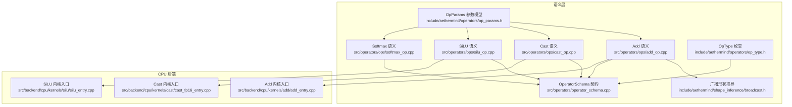
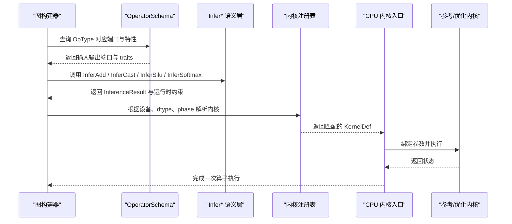
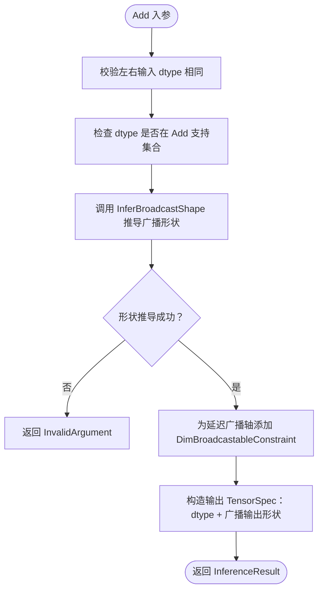
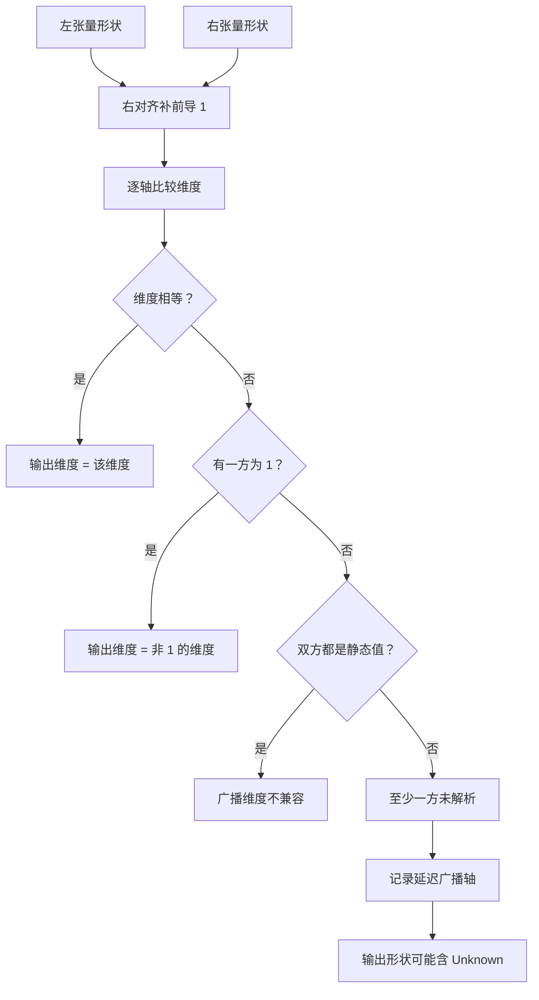
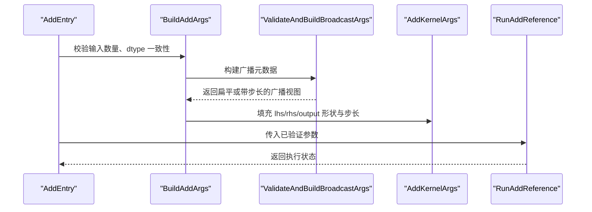
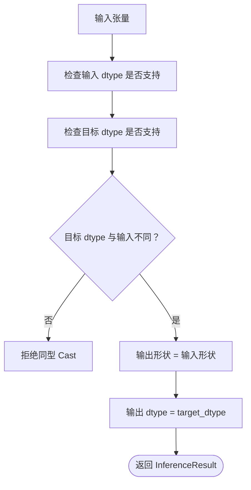
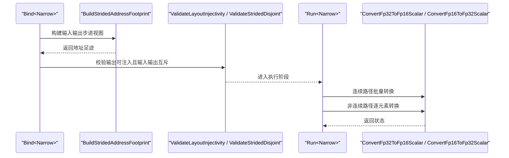
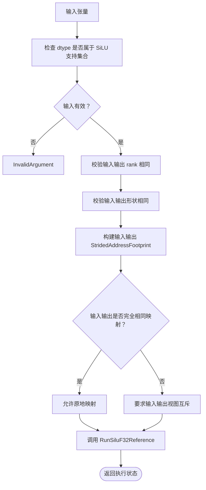
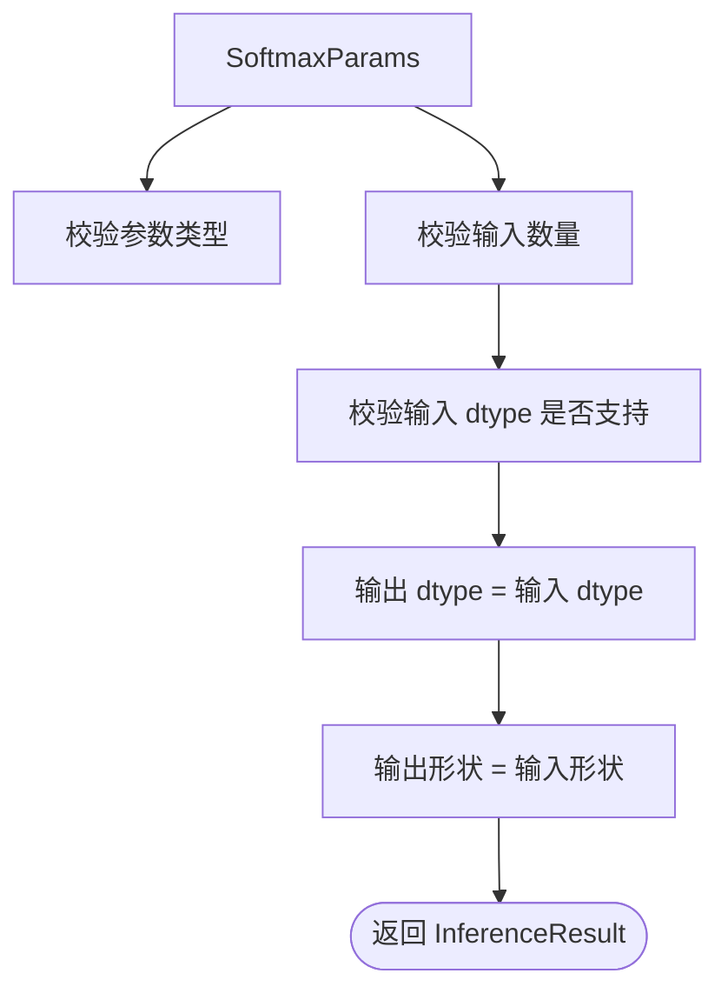
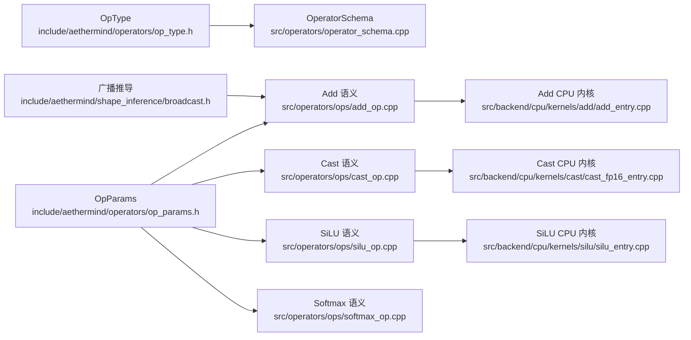

# 算术运算算子

**本文引用的文件**
- [add_op.cpp](../../../../src/operators/ops/add_op.cpp)
- [add_op.h](../../../../include/aethermind/operators/ops/add_op.h)
- [cast_op.cpp](../../../../src/operators/ops/cast_op.cpp)
- [cast_op.h](../../../../include/aethermind/operators/ops/cast_op.h)
- [silu_op.cpp](../../../../src/operators/ops/silu_op.cpp)
- [silu_op.h](../../../../include/aethermind/operators/ops/silu_op.h)
- [softmax_op.cpp](../../../../src/operators/ops/softmax_op.cpp)
- [softmax_op.h](../../../../include/aethermind/operators/ops/softmax_op.h)
- [op_params.h](../../../../include/aethermind/operators/op_params.h)
- [op_type.h](../../../../include/aethermind/operators/op_type.h)
- [operator_schema.h](../../../../include/aethermind/operators/operator_schema.h)
- [operator_schema.cpp](../../../../src/operators/operator_schema.cpp)
- [broadcast.h](../../../../include/aethermind/shape_inference/broadcast.h)
- [broadcast.cpp](../../../../src/shape_inference/broadcast.cpp)
- [add_entry.cpp](../../../../src/backend/cpu/kernels/add/add_entry.cpp)
- [add_internal.h](../../../../src/backend/cpu/kernels/add/add_internal.h)
- [cast_fp16_entry.cpp](../../../../src/backend/cpu/kernels/cast/cast_fp16_entry.cpp)
- [silu_entry.cpp](../../../../src/backend/cpu/kernels/silu/silu_entry.cpp)
- [README.md](../../../operators/cast/README.md)

## 目录
1. [引言](#引言)
2. [项目结构](#项目结构)
3. [核心算子总览](#核心算子总览)
4. [架构总览](#架构总览)
5. [详细组件分析](#详细组件分析)
6. [依赖关系分析](#依赖关系分析)
7. [性能特征与优化策略](#性能特征与优化策略)
8. [故障排查指南](#故障排查指南)
9. [结论](#结论)

## 引言
本文面向 AetherMind 推理框架中的算术运算算子系列，重点覆盖以下四个算子：
- 加法算子 Add：广播语义、张量对齐、CPU 内核注册与参考实现。
- Cast 算子：数据类型转换规则、精度合同、连续与非连续视图处理。
- SiLU 激活函数：支持的数值类型、输入输出约束、参考内核流程。
- Softmax 算子：形状与类型推断、图级语义契约。

文档从语义层（Infer*）、参数模型、形状推导、调度层到 CPU 后端内核逐层展开，并给出调用时序、数据流和错误路径说明。需要特别指出的是，当前仓库中 Softmax 的语义推断存在，但尚未在 CPU kernel 目录中出现独立的 Softmax 内核注册；SiLU 当前仅注册了 FP32 reference 内核；Add 提供五种数据类型的 reference 路径；Cast 提供 FP32↔FP16 双向路径。因此，关于 Softmax 数值稳定性与并行优化的深入实现细节不能直接由当前代码证实，将在相应章节明确标注。

## 项目结构
AetherMind 将算子的“语义契约”与“后端执行”解耦：
- 语义层位于 `src/operators/ops` 与 `include/aethermind/operators`，负责参数校验、形状推断、支持的数据类型检查。
- 形状推导集中在 `include/aethermind/shape_inference`，为广播等通用形状问题提供符号化能力。
- CPU 后端内核位于 `src/backend/cpu/kernels`，按算子划分目录，并通过静态注册机制接入执行系统。
- 图级端口布局、操作符特征与纯性标记在 `src/operators/operator_schema.cpp` 中集中定义。

**图示来源**
- [add_op.cpp:1-49](../../../../src/operators/ops/add_op.cpp#L1-L49)
- [cast_op.cpp:1-38](../../../../src/operators/ops/cast_op.cpp#L1-L38)
- [silu_op.cpp:1-27](../../../../src/operators/ops/silu_op.cpp#L1-L27)
- [softmax_op.cpp:1-23](../../../../src/operators/ops/softmax_op.cpp#L1-L23)
- [broadcast.h:1-97](../../../../include/aethermind/shape_inference/broadcast.h#L1-L97)
- [operator_schema.cpp:140-195](../../../../src/operators/operator_schema.cpp#L140-L195)
- [add_entry.cpp:1-173](../../../../src/backend/cpu/kernels/add/add_entry.cpp#L1-L173)
- [cast_fp16_entry.cpp:1-139](../../../../src/backend/cpu/kernels/cast/cast_fp16_entry.cpp#L1-L139)
- [silu_entry.cpp:1-124](../../../../src/backend/cpu/kernels/silu/silu_entry.cpp#L1-L124)

**分节来源**
- [op_type.h:1-64](../../../../include/aethermind/operators/op_type.h#L1-L64)
- [operator_schema.h:1-167](../../../../include/aethermind/operators/operator_schema.h#L1-L167)
- [operator_schema.cpp:140-195](../../../../src/operators/operator_schema.cpp#L140-L195)

## 核心算子总览
| 算子 | 输入数量 | 输出数量 | 主要参数 | 形状行为 | 支持的数据类型 | 图级特性 |
|---|---:|---:|---|---|---|---|
| Add | 2 | 1 | `AddParams`（空） | NumPy 风格广播；左右输入 dtype 必须相同 | Float32、Float64、BFloat16、Int32、Int64 | 可编译期求值 |
| Cast | 1 | 1 | `CastParams.target_dtype` | 输出形状等于输入形状 | Float32、Float16、BFloat16 | 非纯转换，语义层禁止同型 Cast |
| SiLU | 1 | 1 | `SiluParams`（空） | 输出形状等于输入形状 | Float32、Float16、BFloat16、Float8E4M3FN、Float8E5M2 | 可编译期求值 |
| Softmax | 1 | 1 | `SoftmaxParams.axis` | 输出形状等于输入形状；当前语义不改变形状 | Float32、Float16、BFloat16 | 运行时算子 |

上述信息来自各算子的 Infer* 实现、参数定义、支持类型声明以及 OperatorSchema 属性。

**分节来源**
- [add_op.cpp:1-49](../../../../src/operators/ops/add_op.cpp#L1-L49)
- [add_op.h:1-57](../../../../include/aethermind/operators/ops/add_op.h#L1-L57)
- [cast_op.cpp:1-38](../../../../src/operators/ops/cast_op.cpp#L1-L38)
- [cast_op.h:1-44](../../../../include/aethermind/operators/ops/cast_op.h#L1-L44)
- [silu_op.cpp:1-27](../../../../src/operators/ops/silu_op.cpp#L1-L27)
- [silu_op.h:1-52](../../../../include/aethermind/operators/ops/silu_op.h#L1-L52)
- [softmax_op.cpp:1-23](../../../../src/operators/ops/softmax_op.cpp#L1-L23)
- [softmax_op.h:1-49](../../../../include/aethermind/operators/ops/softmax_op.h#L1-L49)
- [op_params.h:216-224](../../../../include/aethermind/operators/op_params.h#L216-L224)
- [op_params.h:353-357](../../../../include/aethermind/operators/op_params.h#L353-L357)
- [op_params.h:368-391](../../../../include/aethermind/operators/op_params.h#L368-L391)
- [operator_schema.cpp:145-190](../../../../src/operators/operator_schema.cpp#L145-L190)

## 架构总览
算子执行分为三层：
1. **语义推断层**：通过 `InferAdd`、`InferCast`、`InferSilu`、`InferSoftmax` 校验参数、dtype 和形状。
2. **调度与注册层**：通过 `OpType`、`KernelSelector` 和静态宏 `AM_REGISTER_KERNEL` 选择具体 CPU 内核。
3. **内核实现层**：Add、Cast、SiLU 的 reference 或优化路径完成实际元素计算。

**图示来源**
- [op_type.h:15-50](../../../../include/aethermind/operators/op_type.h#L15-L50)
- [operator_schema.cpp:140-195](../../../../src/operators/operator_schema.cpp#L140-L195)
- [add_op.cpp:1-49](../../../../src/operators/ops/add_op.cpp#L1-L49)
- [cast_op.cpp:1-38](../../../../src/operators/ops/cast_op.cpp#L1-L38)
- [silu_op.cpp:1-27](../../../../src/operators/ops/silu_op.cpp#L1-L27)
- [softmax_op.cpp:1-23](../../../../src/operators/ops/softmax_op.cpp#L1-L23)
- [add_entry.cpp:1-173](../../../../src/backend/cpu/kernels/add/add_entry.cpp#L1-L173)
- [cast_fp16_entry.cpp:1-139](../../../../src/backend/cpu/kernels/cast/cast_fp16_entry.cpp#L1-L139)
- [silu_entry.cpp:1-124](../../../../src/backend/cpu/kernels/silu/silu_entry.cpp#L1-L124)

## 详细组件分析

### Add 算子：广播机制与张量对齐
Add 算子的语义职责是验证两个输入具有相同 dtype，并使用广播规则推导输出形状。其关键设计如下：

- **dtype 一致性**：左右输入 dtype 必须一致，且必须是 Add 支持集合中的一个。
- **广播形状推导**：使用符号化广播接口 `InferBroadcastShape`，得到输出形状和延迟轴记录。
- **运行时约束**：对于广播维度不一致的情况，会生成 `DimBroadcastableConstraint`，把形状兼容性推迟到运行期检查。
- **CPU 内核入口**：`add_entry.cpp` 通过 `ValidateAndBuildBroadcastArgs` 准备广播参数，然后调用参考实现 `RunAddReference`。
- **内核参数结构**：`AddKernelArgs` 包含左右输入、输出指针、dtype、元素总数、是否平坦、各秩的形状与步长。

**图示来源**
- [add_op.cpp:1-49](../../../../src/operators/ops/add_op.cpp#L1-L49)
- [broadcast.h:60-97](../../../../include/aethermind/shape_inference/broadcast.h#L60-L97)
- [broadcast.cpp:88-173](../../../../src/shape_inference/broadcast.cpp#L88-L173)

Add 的广播语义遵循右对齐规则：
- 缺失的高维等价于 size=1。
- 相同维度保留原维度。
- 一方为 1 时取另一方维度。
- 不同静态维度报错。
- 一个静态 N 与未解析维度配对时保留 N，并记录延迟轴。
- 两个均未解析时退化为 Unknown，并记录延迟轴。

**图示来源**
- [broadcast.cpp:88-173](../../../../src/shape_inference/broadcast.cpp#L88-L173)

Add 的 CPU 执行路径如下：

**图示来源**
- [add_entry.cpp:1-173](../../../../src/backend/cpu/kernels/add/add_entry.cpp#L1-L173)
- [add_internal.h:1-61](../../../../src/backend/cpu/kernels/add/add_internal.h#L1-L61)

**分节来源**
- [add_op.cpp:1-49](../../../../src/operators/ops/add_op.cpp#L1-L49)
- [add_op.h:1-57](../../../../include/aethermind/operators/ops/add_op.h#L1-L57)
- [broadcast.h:1-97](../../../../include/aethermind/shape_inference/broadcast.h#L1-L97)
- [broadcast.cpp:1-173](../../../../src/shape_inference/broadcast.cpp#L1-L173)
- [add_entry.cpp:1-173](../../../../src/backend/cpu/kernels/add/add_entry.cpp#L1-L173)
- [add_internal.h:1-61](../../../../src/backend/cpu/kernels/add/add_internal.h#L1-L61)

### Cast 算子：数据类型转换规则与精度控制
Cast 算子在语义层被定义为“存储格式转换”，而非通用数值转换器。其规则如下：

- **支持类型**：Float32、Float16、BFloat16。
- **目标 dtype 必须不同**：同型 Cast 不被允许，因为图转换应显式表达，不应退化为无操作节点。
- **输出形状等于输入形状**：Cast 不改变逻辑形状。
- **CPU 内核方向**：当前注册了两个方向：FP32→FP16 与 FP16→FP32。
- **精度合同**：文档说明转换采用固定舍入合同，包括 RNE、gradual underflow、signed zero 和 quiet NaN。

**图示来源**
- [cast_op.cpp:1-38](../../../../src/operators/ops/cast_op.cpp#L1-L38)
- [cast_op.h:1-44](../../../../include/aethermind/operators/ops/cast_op.h#L1-L44)

CPU 内核层面，Cast 的参数结构 `CastArgs` 保存源指针、目的指针、元素计数、rank、是否连续以及形状和步长。连续路径调用批量转换函数；非连续路径按坐标计算偏移后逐个元素转换。

**图示来源**
- [cast_fp16_entry.cpp:1-139](../../../../src/backend/cpu/kernels/cast/cast_fp16_entry.cpp#L1-L139)

**分节来源**
- [cast_op.cpp:1-38](../../../../src/operators/ops/cast_op.cpp#L1-L38)
- [cast_op.h:1-44](../../../../include/aethermind/operators/ops/cast_op.h#L1-L44)
- [cast_fp16_entry.cpp:1-139](../../../../src/backend/cpu/kernels/cast/cast_fp16_entry.cpp#L1-L139)
- [README.md](../../../operators/cast/README.md)

### SiLU 激活函数：数学语义、实现约束与优化方向
SiLU 的语义层只验证输入 dtype 和支持集合，并让输出保持与输入相同的 TensorSpec。当前注册的内核是 FP32 reference。

- **支持 dtype**：Float32、Float16、BFloat16、Float8E4M3FN、Float8E5M2。
- **形状不变**：输出形状等于输入形状。
- **CPU 内核约束**：要求输入输出 rank 相同、形状相同、数据指针非空，且对原地映射有额外限制。
- **内存访问约束**：reference 循环先读输入再写对应输出，因此如果输入输出逻辑映射完全相同，则视为原地；否则要求输入输出视图互斥。

**图示来源**
- [silu_op.cpp:1-27](../../../../src/operators/ops/silu_op.cpp#L1-L27)
- [silu_op.h:1-52](../../../../include/aethermind/operators/ops/silu_op.h#L1-L52)
- [silu_entry.cpp:1-124](../../../../src/backend/cpu/kernels/silu/silu_entry.cpp#L1-L124)

注意：SiLU 的数学公式 `x * sigmoid(x)` 不在本仓库的语义推断文件中体现；该文档只能依据现有代码描述其类型与形状约束。若需要数值稳定性或 SIMD 实现细节，应以后端优化内核为准，而当前 SiLU 仅注册了 FP32 reference。

**分节来源**
- [silu_op.cpp:1-27](../../../../src/operators/ops/silu_op.cpp#L1-L27)
- [silu_op.h:1-52](../../../../include/aethermind/operators/ops/silu_op.h#L1-L52)
- [silu_entry.cpp:1-124](../../../../src/backend/cpu/kernels/silu/silu_entry.cpp#L1-L124)

### Softmax 算子：语义契约与实现现状
Softmax 的语义推断非常简洁：
- 校验参数类型为 `SoftmaxParams`。
- 校验输入数量为 1。
- 校验输入 dtype 属于 Softmax 支持集合：Float32、Float16、BFloat16。
- 输出形状与输入形状相同。

图级 schema 将 Softmax 标记为运行时算子，而不是编译期可求值算子。

**图示来源**
- [softmax_op.cpp:1-23](../../../../src/operators/ops/softmax_op.cpp#L1-L23)
- [softmax_op.h:1-49](../../../../include/aethermind/operators/ops/softmax_op.h#L1-L49)
- [operator_schema.cpp:145-150](../../../../src/operators/operator_schema.cpp#L145-L150)

需要特别说明：**当前仓库中没有找到独立的 Softmax CPU 内核注册**。虽然注意力相关内部头文件提到 softmax 概念，但不能据此推断 Softmax 已有完整 CPU 内核实现。因此，“Softmax 数值稳定性处理和并行计算优化”的实现细节在当前代码中无法直接确认。

**分节来源**
- [softmax_op.cpp:1-23](../../../../src/operators/ops/softmax_op.cpp#L1-L23)
- [softmax_op.h:1-49](../../../../include/aethermind/operators/ops/softmax_op.h#L1-L49)
- [operator_schema.cpp:145-150](../../../../src/operators/operator_schema.cpp#L145-L150)

## 依赖关系分析
算子之间的依赖主要集中在三类：
1. **OpType 与 OperatorSchema**：所有算子都依赖稳定的 OpType 枚举和统一的 schema 定义。
2. **OpParams**：Add、Cast、Silu、Softmax 的参数结构统一纳入 `OpParams` variant。
3. **形状推导**：Add 依赖广播形状推导模块；Cast 和 SiLU 依赖形状不变的语义假设；Softmax 同样依赖形状不变。

**图示来源**
- [op_type.h:15-50](../../../../include/aethermind/operators/op_type.h#L15-L50)
- [op_params.h:368-391](../../../../include/aethermind/operators/op_params.h#L368-L391)
- [operator_schema.cpp:145-190](../../../../src/operators/operator_schema.cpp#L145-L190)
- [broadcast.h:1-97](../../../../include/aethermind/shape_inference/broadcast.h#L1-L97)
- [add_op.cpp:1-49](../../../../src/operators/ops/add_op.cpp#L1-L49)
- [cast_op.cpp:1-38](../../../../src/operators/ops/cast_op.cpp#L1-L38)
- [silu_op.cpp:1-27](../../../../src/operators/ops/silu_op.cpp#L1-L27)
- [softmax_op.cpp:1-23](../../../../src/operators/ops/softmax_op.cpp#L1-L23)
- [add_entry.cpp:1-173](../../../../src/backend/cpu/kernels/add/add_entry.cpp#L1-L173)
- [cast_fp16_entry.cpp:1-139](../../../../src/backend/cpu/kernels/cast/cast_fp16_entry.cpp#L1-L139)
- [silu_entry.cpp:1-124](../../../../src/backend/cpu/kernels/silu/silu_entry.cpp#L1-L124)

**分节来源**
- [op_type.h:1-64](../../../../include/aethermind/operators/op_type.h#L1-L64)
- [op_params.h:216-224](../../../../include/aethermind/operators/op_params.h#L216-L224)
- [op_params.h:353-391](../../../../include/aethermind/operators/op_params.h#L353-L391)
- [operator_schema.cpp:140-195](../../../../src/operators/operator_schema.cpp#L140-L195)
- [broadcast.h:1-97](../../../../include/aethermind/shape_inference/broadcast.h#L1-L97)

## 性能特征与优化策略

### Add 算子
- **当前实现**：Add 的五个注册内核全部指向参考实现，分别覆盖 Float32、Float64、BFloat16、Int32、Int64。
- **扁平路径优化**：当广播元数据标记 `is_flat=true` 时，内核可以走更简单的线性循环。
- **广播路径**：非扁平路径使用形状与步长数组遍历，以支持多维广播。
- **SIMD 指令集**：当前 Add 注册内核名称均为 reference，未见 AVX2/F16C 专用注册项；因此不能断言当前 Add 内核已实现 AVX2 向量化。
- **性能建议**：适合优先优化大张量连续内存场景；广播步长路径应避免每元素分支，可将广播维度合并到外层循环。

**分节来源**
- [add_entry.cpp:1-173](../../../../src/backend/cpu/kernels/add/add_entry.cpp#L1-L173)
- [add_internal.h:1-61](../../../../src/backend/cpu/kernels/add/add_internal.h#L1-L61)
- [add_op.h:1-57](../../../../include/aethermind/operators/ops/add_op.h#L1-L57)

### Cast 算子
- **连续路径**：当输入输出均连续时，调用批量转换函数，减少索引计算开销。
- **非连续路径**：按坐标还原 source_offset 与 destination_offset，逐个元素转换。
- **布局校验**：输出布局必须可证明 injective，且输入输出存储必须互斥。
- **SIMD 指令集**：Cast 内核使用标量转换函数，没有看到 F16C 或 AVX2 专用内核注册；AVX2/F16C 的使用应以后端优化版本为准，当前代码未直接体现。
- **精度控制**：文档明确指出转换合同包含 RNE、gradual underflow、signed zero 和 quiet NaN，这比一般编译器默认转换更稳定。

**分节来源**
- [cast_fp16_entry.cpp:1-139](../../../../src/backend/cpu/kernels/cast/cast_fp16_entry.cpp#L1-L139)
- [cast_op.h:1-44](../../../../include/aethermind/operators/ops/cast_op.h#L1-L44)
- [README.md](../../../operators/cast/README.md)

### SiLU 算子
- **当前实现**：仅注册 FP32 reference 内核。
- **原地安全**：reference 实现先读输入再写输出，因此如果输入输出逻辑映射完全相同，则视为原地；否则要求视图互斥。
- **SIMD 指令集**：当前 SiLU 注册名是 reference，没有 AVX2/FMA 专用注册项。文档中提到 SiluMul 的 AVX2/FMA prepared kernel，但这属于 fused SiLU+Mul 路径，不是当前独立 SiLU 算子的证据。
- **数值稳定性**：当前代码未暴露 Softmax 那样的 log-sum-exp 类稳定化实现；SiLU 的数值稳定性应由内核实现保证，语义层不涉及。

**分节来源**
- [silu_entry.cpp:1-124](../../../../src/backend/cpu/kernels/silu/silu_entry.cpp#L1-L124)
- [silu_op.h:1-52](../../../../include/aethermind/operators/ops/silu_op.h#L1-L52)

### Softmax 算子
- **当前实现状态**：只有语义推断和 schema 定义，未发现独立 CPU 内核注册。
- **axis 参数**：`SoftmaxParams` 包含 axis 字段，但当前 InferSoftmax 并未使用该字段进行形状推导或约束检查。
- **数值稳定性**：当前代码没有 Softmax reference 内核或 log-sum-exp 稳定化实现可见，因此不能声称已实现数值稳定性处理。
- **并行优化**：当前代码也没有 Softmax 并行内核注册，无法确认是否使用线程并行或 SIMD 优化。

**分节来源**
- [softmax_op.cpp:1-23](../../../../src/operators/ops/softmax_op.cpp#L1-L23)
- [softmax_op.h:1-49](../../../../include/aethermind/operators/ops/softmax_op.h#L1-L49)
- [op_params.h:216-224](../../../../include/aethermind/operators/op_params.h#L216-L224)
- [operator_schema.cpp:145-150](../../../../src/operators/operator_schema.cpp#L145-L150)

## 故障排查指南

### Add 常见错误
- **左右输入 dtype 不同**：语义层直接返回 InvalidArgument。
- **不支持的 dtype**：消息会列出 Float32、Float64、BFloat16、Int32、Int64。
- **广播维度不兼容**：符号广播推导失败，或运行期约束检测到维度不可广播。
- **内核参数不匹配**：内核入口要求两个输入和一个输出，且三者 dtype 一致。

**分节来源**
- [add_op.cpp:10-49](../../../../src/operators/ops/add_op.cpp#L10-L49)
- [add_op.h:12-57](../../../../include/aethermind/operators/ops/add_op.h#L12-L57)
- [add_entry.cpp:14-44](../../../../src/backend/cpu/kernels/add/add_entry.cpp#L14-L44)

### Cast 常见错误
- **输入 dtype 不支持**：只接受 Float32、Float16、BFloat16。
- **目标 dtype 不支持**：target_dtype 也必须属于支持集合。
- **同型 Cast**：语义层显式拒绝输入与目标 dtype 相同的情况。
- **布局无效**：输出布局不可注入，或输入输出存储重叠。
- **形状或 dtype 不匹配**：CPU 内核要求输入输出形状相同、dtype 与注册内核方向一致。

**分节来源**
- [cast_op.cpp:1-38](../../../../src/operators/ops/cast_op.cpp#L1-L38)
- [cast_op.h:12-44](../../../../include/aethermind/operators/ops/cast_op.h#L12-L44)
- [cast_fp16_entry.cpp:26-88](../../../../src/backend/cpu/kernels/cast/cast_fp16_entry.cpp#L26-L88)

### SiLU 常见错误
- **输入 dtype 不支持**：当前语义支持 Float32、Float16、BFloat16、Float8E4M3FN、Float8E5M2。
- **内核输入输出 dtype 不匹配**：注册的 FP32 reference 内核要求输入输出均为 Float32。
- **rank 或形状不匹配**：内核要求输入输出 rank 和 shape 完全相同。
- **原地映射冲突**：如果输入输出逻辑映射完全相同但内核不允许原地，则需要确保视图互斥。

**分节来源**
- [silu_op.cpp:10-27](../../../../src/operators/ops/silu_op.cpp#L10-L27)
- [silu_op.h:12-52](../../../../include/aethermind/operators/ops/silu_op.h#L12-L52)
- [silu_entry.cpp:18-103](../../../../src/backend/cpu/kernels/silu/silu_entry.cpp#L18-L103)

### Softmax 常见错误
- **参数类型错误**：InferSoftmax 要求参数为 SoftmaxParams。
- **输入数量错误**：当前语义层要求恰好一个输入。
- **输入 dtype 不支持**：只接受 Float32、Float16、BFloat16。
- **缺少内核实现**：当前未发现 Softmax CPU 内核注册，调用链可能在后端解析阶段失败。

**分节来源**
- [softmax_op.cpp:1-23](../../../../src/operators/ops/softmax_op.cpp#L1-L23)
- [softmax_op.h:12-49](../../../../include/aethermind/operators/ops/softmax_op.h#L12-L49)

## 结论
AetherMind 的算术运算算子采用清晰的“语义推断 + 后端内核”分层设计：
- Add 实现了完整的广播形状推导和延迟约束，并在 CPU 后端注册了五种数据类型的 reference 路径。
- Cast 明确限定为存储格式转换，禁止同型 Cast，并提供 FP32↔FP16 的 CPU 内核路径，同时强调固定的浮点转换精度合同。
- SiLU 的语义层支持多种浮点类型，但当前 CPU 后端仅注册了 FP32 reference 内核，并对输入输出映射做了严格的安全检查。
- Softmax 目前仅有语义推断和 schema 定义，尚未出现独立 CPU 内核注册，因此其数值稳定性和并行优化不能从当前代码中直接确认。

未来扩展时，建议：
- 为 Add 增加 AVX2/F16C 专用内核，并优先优化广播步长路径。
- 为 Cast 补充 BF16 和 SIMD 优化路径，复用现有连续批量转换思路。
- 为 SiLU 增加 FP16/BF16 内核，并保持与 SiluMul 优化路径一致的数值稳定性策略。
- 为 Softmax 实现 log-sum-exp 稳定化内核，并显式处理 axis 参数与 broadcast 场景。
