# 线性变换算子

**本文引用的文件**
- [linear_op.cpp](../../../../src/operators/ops/linear_op.cpp)
- [linear_op.h](../../../../include/aethermind/operators/ops/linear_op.h)
- [gate_up_linear_op.cpp](../../../../src/operators/ops/gate_up_linear_op.cpp)
- [qkv_linear_op.cpp](../../../../src/operators/ops/qkv_linear_op.cpp)
- [op_params.h](../../../../include/aethermind/operators/op_params.h)
- [matmul_op.cpp](../../../../src/operators/ops/matmul_op.cpp)
- [matmul_op.h](../../../../include/aethermind/operators/ops/matmul_op.h)
- [linear_a32_w16_reference.cpp](../../../../src/backend/cpu/kernels/linear/linear_a32_w16_reference.cpp)
- [gemm_a32_w32_avx2.cpp](../../../../src/backend/cpu/kernels/gemm/gemm_a32_w32_avx2.cpp)
- [GEMM 内核](../../算子系统/算子实现详解/GEMM%20内核.md)
- [cpu-gemm-packed-weight.md](../../../operators/gemm/cpu-gemm-packed-weight.md)
- [cpu-gemm-optimization.md](../../../operators/gemm/cpu-gemm-optimization.md)
- [linear-optimization.md](../../../operators/linear/linear-optimization.md)
- [README.md](../../../operators/linear/README.md)
- [cpu-coverage-baseline.md](../../../operators/cpu-coverage-baseline.md)
- [benchmark_cpu_linear.cpp](../../../../tests/benchmark/cpu_kernels/benchmark_cpu_linear.cpp)

## 目录

1. [引言](#引言)
2. [项目结构](#项目结构)
3. [核心算子与语义契约](#核心算子与语义契约)
4. [架构总览](#架构总览)
5. [详细组件分析](#详细组件分析)
6. [依赖关系分析](#依赖关系分析)
7. [性能特征与内存模式](#性能特征与内存模式)
8. [配置参数与权重格式要求](#配置参数与权重格式要求)
9. [故障排查指南](#故障排查指南)
10. [结论](#结论)

## 引言

AetherMind 的线性变换算子系列围绕 CPU 推理中的矩阵乘法和注意力前馈路径构建，覆盖以下关键算子：

- **Linear**：通用线性投影，将输入张量的最后一个维度映射到输出特征数。
- **GateUpLinear**：LLaMLP 中 Gate 和 Up 两条路径的融合投影，使用拼接后的权重行。
- **QKVLinear**：注意力查询、键、值三个投影的融合投影，使用拼接后的权重行。
- **MatMul**：通用批量矩阵乘法，是 Linear 等算子的底层数学语义基础。

这些算子在语义层定义形状、数据类型和广播规则；在 CPU 后端实现中，它们最终调用 GEMM driver、SIMD microkernel、W16/A32  widening 逻辑或 packed weight 消费路径。文档重点解释权重打包格式、GEMM 内核调用链、SIMD 优化、并行策略、配置约束、基准方法与内存布局。

## 项目结构

线性变换相关代码分布在四个层次：

| 层次 | 职责 | 代表性文件 |
|---|---|---|
| 算子语义层 | 定义支持的 dtype、形状推断、运行时检查 | `linear_op.h`、`linear_op.cpp`、`gate_up_linear_op.cpp`、`qkv_linear_op.cpp`、`matmul_op.h`、`matmul_op.cpp` |
| 算子参数层 | 描述 fused Linear 的参数字段 | `op_params.h` |
| CPU 后端实现层 | W16/A32 reference、AVX2 FMA microkernel、blocked GEMM、packed B 消费 | `linear_a32_w16_reference.cpp`、`gemm_a32_w32_avx2.cpp` |
| 设计与基准文档 | 优化方案、CPU 覆盖台账、机器基准入口 | `linear-optimization.md`、`cpu-gemm-optimization.md`、`cpu-gemm-packed-weight.md`、`cpu-coverage-baseline.md`、`benchmark_cpu_linear.cpp` |

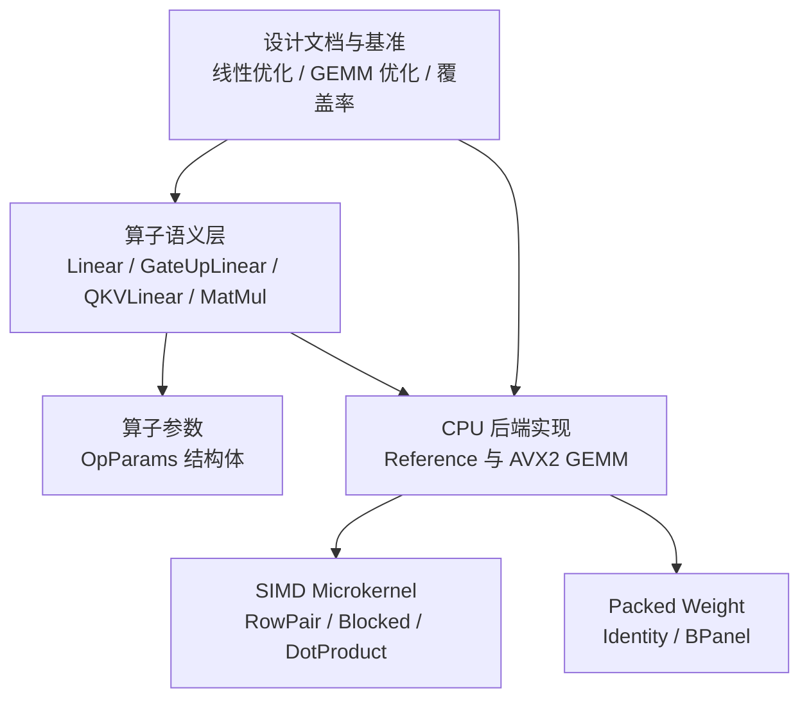

**图示来源**
- [linear_op.cpp:1-92](../../../../src/operators/ops/linear_op.cpp#L1-L92)
- [gate_up_linear_op.cpp:1-107](../../../../src/operators/ops/gate_up_linear_op.cpp#L1-L107)
- [qkv_linear_op.cpp:1-120](../../../../src/operators/ops/qkv_linear_op.cpp#L1-L120)
- [matmul_op.cpp:1-120](../../../../src/operators/ops/matmul_op.cpp#L1-L120)
- [gemm_a32_w32_avx2.cpp:1-511](../../../../src/backend/cpu/kernels/gemm/gemm_a32_w32_avx2.cpp#L1-L511)

**章节来源**
- [linear_op.cpp:1-92](../../../../src/operators/ops/linear_op.cpp#L1-L92)
- [matmul_op.cpp:1-120](../../../../src/operators/ops/matmul_op.cpp#L1-L120)
- [cpu-coverage-baseline.md](../../../operators/cpu-coverage-baseline.md)

## 核心算子与语义契约

### Linear 算子

Linear 算子表示 `output = input × weight^T`，其中 input 的秩至少为 1，weight 的秩为 2，形状为 `[N, K]`。输出形状的最后一个维度是 `N`，其余维度与输入相同。

支持的数据类型分为两类：

| 输入角色 | 支持的数据类型 |
|---|---|
| 激活输入 | Float32、Float16、BFloat16、Float8E4M3FN、Float8E5M2 |
| 权重 | Float32、Float16、BFloat16、Float8E4M3FN、Float8E5M2、Int8、Int4 |

形状推断的核心逻辑如下：

1. 校验输入秩不小于 1。
2. 校验权重秩等于 2。
3. 校验激活 dtype 和权重 dtype 是否在支持集合内。
4. 比较输入最后一维与权重的第二维；若静态不可证相等，则添加运行时维度相等约束。
5. 输出 dtype 由参数决定，未指定时继承激活 dtype。
6. 输出形状复制输入除最后一维外的所有维度，并在末尾追加权重的第一维。

零尺寸 M/N 与 NumPy/PyTorch 语义一致：Linear 在语义上等价于 MatMul，模型权重正性由图构建层保证，不在算子语义层强制。

**章节来源**
- [linear_op.cpp:1-92](../../../../src/operators/ops/linear_op.cpp#L1-L92)
- [linear_op.h:1-91](../../../../include/aethermind/operators/ops/linear_op.h#L1-L91)

### GateUpLinear 算子

GateUpLinear 用于 LLaMA MLP 中 Gate 和 Up 路径的融合计算。它接收一个输入张量和一个拼接后的权重张量，权重行按 Gate 行在前、Up 行在后的顺序排列。

当前实现的限制包括：

- 不支持 bias 输入。
- 权重必须是秩 2。
- `gate_out_features` 和 `up_out_features` 必须非负且相加不溢出 int64。
- 当权重行数静态已知时，必须等于 `gate_out_features + up_out_features`。
- 输入最后一维必须与权重的第二维匹配。
- 输出有两个：Gate 路径和 Up 路径，形状仅在最后一个维度不同。

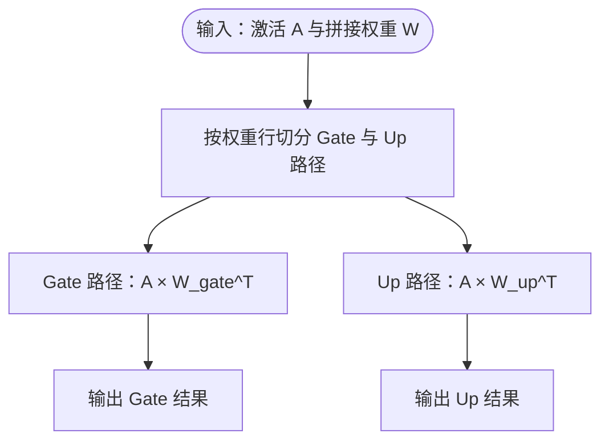

**图示来源**
- [gate_up_linear_op.cpp:1-107](../../../../src/operators/ops/gate_up_linear_op.cpp#L1-L107)
- [op_params.h:339-347](../../../../include/aethermind/operators/op_params.h#L339-L347)

**章节来源**
- [gate_up_linear_op.cpp:1-107](../../../../src/operators/ops/gate_up_linear_op.cpp#L1-L107)
- [op_params.h:339-347](../../../../include/aethermind/operators/op_params.h#L339-L347)

### QKVLinear 算子

QKVLinear 用于注意力层的查询、键、值投影融合。权重行按 Q、K、V 的顺序拼接，输出包含三个独立投影结果。

当前实现限制包括：

- 不支持 bias 输入。
- 权重必须是秩 2。
- `q_out_features`、`k_out_features`、`v_out_features` 必须非负且相加不溢出 int64。
- 当权重行数静态已知时，必须等于三者之和。
- 输入最后一维必须与权重的第二维匹配。
- 三个输出分别对应 Q、K、V，形状仅在最后一个维度不同。

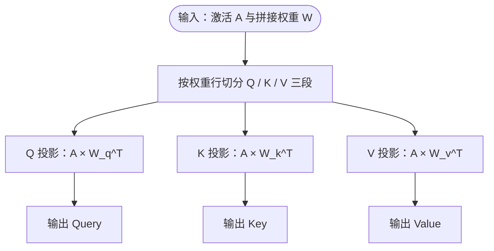

**图示来源**
- [qkv_linear_op.cpp:1-120](../../../../src/operators/ops/qkv_linear_op.cpp#L1-L120)
- [op_params.h:332-337](../../../../include/aethermind/operators/op_params.h#L332-L337)

**章节来源**
- [qkv_linear_op.cpp:1-120](../../../../src/operators/ops/qkv_linear_op.cpp#L1-L120)
- [op_params.h:332-337](../../../../include/aethermind/operators/op_params.h#L332-L337)

### MatMul 算子

MatMul 提供通用的批量矩阵乘法语义。其有效右操作数由 `transpose_rhs` 决定：

- `transpose_rhs == false`：右操作数形状为 `[..., K, N]`。
- `transpose_rhs == true`：右操作数形状为 `[..., N, K]`。

两个输入都必须具有至少 2 的秩，尾部两维是矩阵轴，前面维度按广播规则对齐。输出形状为广播后的 batch 维度加上 `[M, N]`。

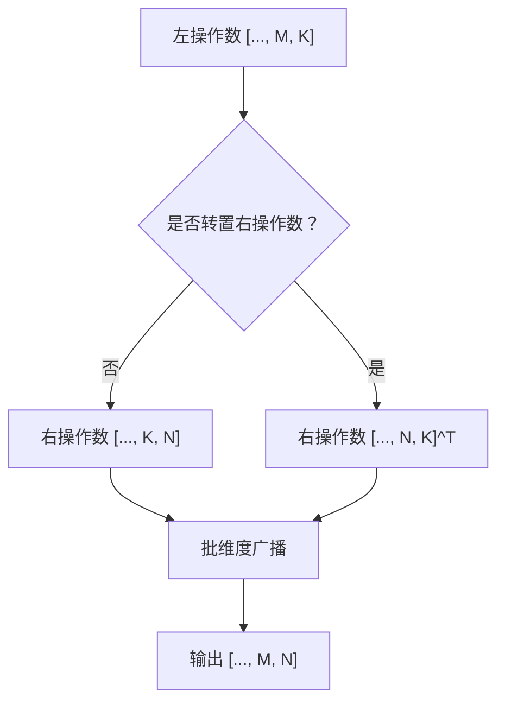

**图示来源**
- [matmul_op.cpp:1-120](../../../../src/operators/ops/matmul_op.cpp#L1-L120)
- [matmul_op.h:1-66](../../../../include/aethermind/operators/ops/matmul_op.h#L1-L66)

**章节来源**
- [matmul_op.cpp:1-120](../../../../src/operators/ops/matmul_op.cpp#L1-L120)
- [matmul_op.h:1-66](../../../../include/aethermind/operators/ops/matmul_op.h#L1-L66)

## 架构总览

线性变换算子的执行路径可以划分为语义推断、绑定准备、驱动选择和内核计算四个阶段。

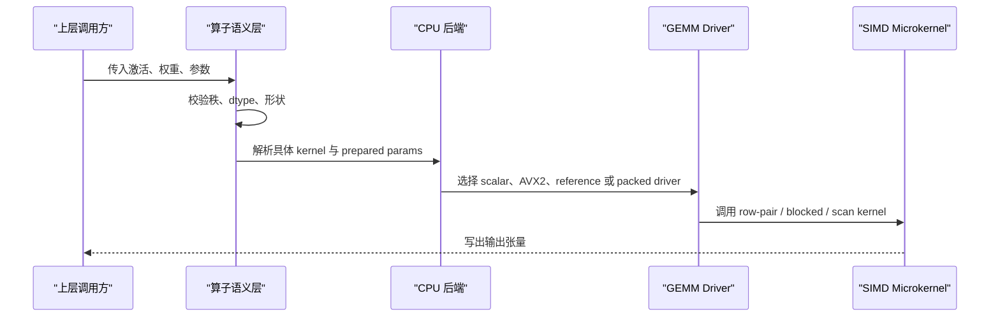

**图示来源**
- [linear_op.cpp:1-92](../../../../src/operators/ops/linear_op.cpp#L1-L92)
- [gemm_a32_w32_avx2.cpp:1-511](../../../../src/backend/cpu/kernels/gemm/gemm_a32_w32_avx2.cpp#L1-L511)
- [cpu-gemm-optimization.md](../../../operators/gemm/cpu-gemm-optimization.md)

该架构的关键原则是：

- 算子语义层只关心形状、dtype 和输出规范。
- 后端负责 ISA、layout、packing、driver 选择和数值 fallback。
- binding 冷路径冻结 driver 指针和 tile 参数，热路径不分配、不调度器查找。
- Linear、GateUpLinear、QKVLinear 复用同一底层 GEMM engine。

**章节来源**
- [cpu-gemm-optimization.md](../../../operators/gemm/cpu-gemm-optimization.md)
- [linear-optimization.md](../../../operators/linear/linear-optimization.md)

## 详细组件分析

### Linear 算子的矩阵乘法实现

Linear 的语义等价于 MatMul，但生产路径通常直接调用 Linear 专用的 backend driver。根据 CPU 覆盖台账，F32 和 W16/A32 的 Linear 在 AVX2/FMA 平台上默认选择 optimized 或 identity-packed driver，而不是通用 MatMul reference。

Linear 的参考实现以 W16 为例，行为如下：

1. 如果行数为 0 或输出特征数为 0，直接返回成功状态。
2. 如果输入特征数 `in_features` 为 0，按行写出正零。
3. 对每个输出行，遍历列方向输出通道。
4. 对每个输出通道，按 K 升序读取 W16/BF16 权重并转换为 F32。
5. 用激活的 F32 精度参与点积累加。
6. 写回 output 列。

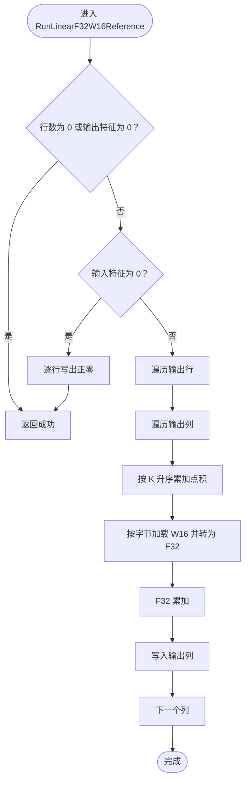

**图示来源**
- [linear_a32_w16_reference.cpp:1-57](../../../../src/backend/cpu/kernels/linear/linear_a32_w16_reference.cpp#L1-L57)

权重读取采用 `memcpy` 从 byte 指针读取 16 位元素，再根据 dtype 选择 Half 或 BFloat16 构造 F32 值。这种实现强调正确性而非 SIMD 吞吐，因此适合用作数值 oracle 和回归测试基线。

**章节来源**
- [linear_a32_w16_reference.cpp:1-57](../../../../src/backend/cpu/kernels/linear/linear_a32_w16_reference.cpp#L1-L57)
- [linear-optimization.md](../../../operators/linear/linear-optimization.md)

### GEMM 内核调用链与 SIMD 优化

CPU GEMM 以 `GemmArgs` 为统一边界，按 dtype、权重布局和 CPU 能力分成多条 driver。完整实现、参数合同、性能数据与逐项 trade-off 见 [GEMM 内核](../../算子系统/算子实现详解/GEMM%20内核.md)。

| 内核路径 | 典型场景 | 关键结构 |
|---|---|---|
| RowPairAvx2 | Decode、`M=1..8`、RHS K 连续 | 2 行 × 4 列 × K 展开 8；8 个累加器 + 2 个 A 向量 = 10 YMM |
| Blocked 6×16 | Prefill、`M>=9` | 6/4/2 行分解；KC=512、NR=16；12 条 FMA 链、K 展开 4；direct A + 32 KiB B panel |
| Scalar optimized | 无 AVX2、非单位布局、AVX2 fallback | K-contiguous 4 列块、32×128 转置 panel、N-contiguous NC/KC=128 |
| packed-B | identity 之外的 candidate | `[K-panel][N-block][K-row][N-lane]` artifact；scan 与 6/4/2 blocked |
| A32/W16、A16/W16 | F16/BF16 权重或同型激活 | widening + 同一 6×16 tile；A16 另用 48×128 FP32 输出块 |

RowPairAvx2 的实现要点：

- 外层按 4 列块遍历 N，内层按 8 个 K 步展开。
- 两个 A 行向量常驻寄存器，4 列权重流式读取；每个 K 步发 8 条 FMA。
- K 主循环后做 8 次水平归约，剩余 K 走标量；剩余 N 列走多目标 dot product。
- K-panel cache blocking 曾实现并测量，因面板级归约成本大于复用收益而移除。

Blocked 6×16 的实现要点：

- `m_full = m - m%2`、`n_full = n - n%16`；核心先清零，再按 K panel 累加。
- 外层按 KC=512 切 K，中层按 NR=16 切 N；每个 `(kb, nb)` 打包一次 B panel。
- 行循环用 6/4/2 贪心分解，4×16/2×16 变体共享同一 B panel。
- A 不打包，直接从行主序 `broadcast_ss`；N 尾和 1 行 M 尾由行对/多目标点积覆盖写。
- 6 行是 16 个 YMM 下的最大满 tile；8 行需要 16 个累加器，必然 spill。

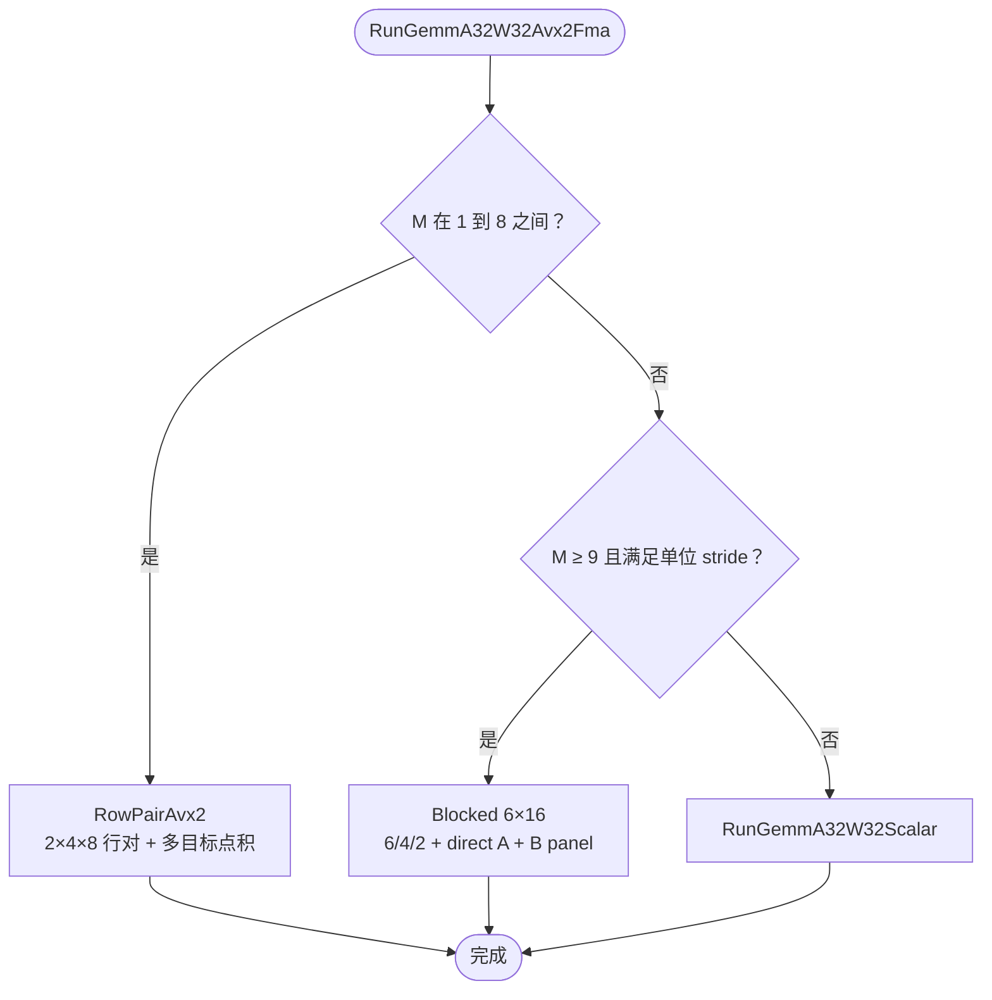

**图示来源**
- [gemm_a32_w32_avx2.cpp:314-386](../../../../src/backend/cpu/kernels/gemm/gemm_a32_w32_avx2.cpp#L314-L386)
- [gemm_avx2_internal.h:133-208](../../../../src/backend/cpu/kernels/gemm/gemm_avx2_internal.h#L133-L208)

**章节来源**
- [gemm_a32_w32_avx2.cpp:314-386](../../../../src/backend/cpu/kernels/gemm/gemm_a32_w32_avx2.cpp#L314-L386)
- [gemm_avx2_internal.h:133-208](../../../../src/backend/cpu/kernels/gemm/gemm_avx2_internal.h#L133-L208)
- [GEMM 内核](../../算子系统/算子实现详解/GEMM%20内核.md)

### GateUpLinear 的并行计算策略

GateUpLinear 的并行策略不是在同一 GEMM 调用中并行计算 Gate 和 Up，而是通过权重拼接减少一次输入读取和一次 shape 校验成本。当前实现明确保留 Gate 和 Up 作为独立输出，并且说明 QKV/GateUp 复用 Linear engine，但不宣称已实现跨 projection 的 input-tile 复用。

这意味着：

- 权重在准备期或模型装载期被拼接为 `[gate_out + up_out, in_features]`。
- 运行时按 `gate_out_features` 切分输出。
- 底层仍可能按 projection 调用 Linear engine。
- 优势在于减少图节点数量、减少重复校验和潜在重复数据访问，而不是在单个 GEMM 内核中并行合并 Gate 与 Up 的累加。

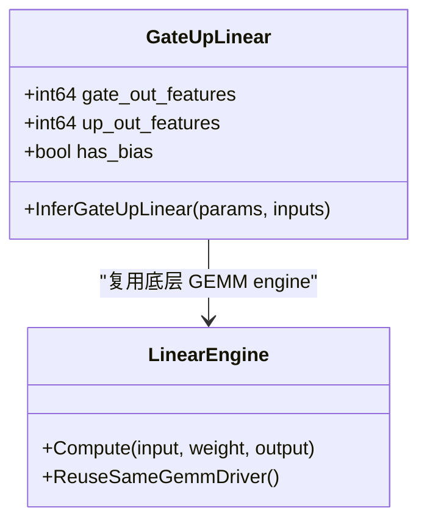

**图示来源**
- [gate_up_linear_op.cpp:1-107](../../../../src/operators/ops/gate_up_linear_op.cpp#L1-L107)
- [linear-optimization.md](../../../operators/linear/linear-optimization.md)

**章节来源**
- [gate_up_linear_op.cpp:1-107](../../../../src/operators/ops/gate_up_linear_op.cpp#L1-L107)
- [linear-optimization.md](../../../operators/linear/linear-optimization.md)

### QKVLinear 的融合优化技术

QKVLinear 的融合技术与 GateUpLinear 类似：权重按 Q、K、V 顺序拼接，运行时按三个输出特征数切分。由于 Q、K、V 都来自同一个输入激活，融合的主要收益是：

1. 避免三次独立的 Linear 图节点。
2. 减少多次 shape/dtype 校验。
3. 降低 activation 重复读取带来的带宽压力。
4. 复用同一 Linear engine 的 prepared params。

当前实现仍未声明跨 projection 的 input-tile 复用。也就是说，虽然语义上是“一次输入、三次投影”，但底层 driver 仍可分别对 Q、K、V 切片调用 GEMM。未来若实现真正的 fused GEMM，需要额外处理三种不同的输出 stride 和可能的不同 head_dim 组合。

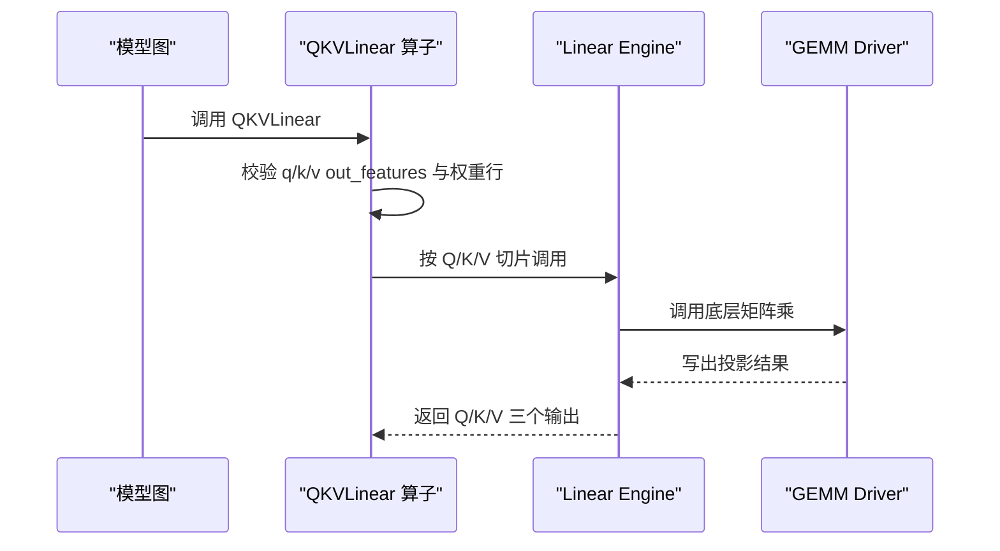

**图示来源**
- [qkv_linear_op.cpp:1-120](../../../../src/operators/ops/qkv_linear_op.cpp#L1-L120)
- [cpu-gemm-packed-weight.md](../../../operators/gemm/cpu-gemm-packed-weight.md)

**章节来源**
- [qkv_linear_op.cpp:1-120](../../../../src/operators/ops/qkv_linear_op.cpp#L1-L120)
- [cpu-gemm-packed-weight.md](../../../operators/gemm/cpu-gemm-packed-weight.md)

### MatMul 的底层 GEMM 实现与调度

MatMul 在当前代码库中主要负责通用语义：batch broadcast、`transpose_rhs`、inner dimension 一致性校验以及输出形状推导。CPU 覆盖台账显示，F32 MatMul 的生产路径是 reference 实现，而实际的矩阵优化主要由 Linear 和 fused Linear 的生产入口承担。

因此，MatMul 的定位是“通用语义适配器”，不是当前 CPU 侧的高性能 GEMM 主战场。其重要性体现在：

- 为 Linear 等算子提供可复用的数学语义。
- 统一广播和转置语义。
- 为未来扩展（例如 CUDA GEMM）提供统一的调用接口。

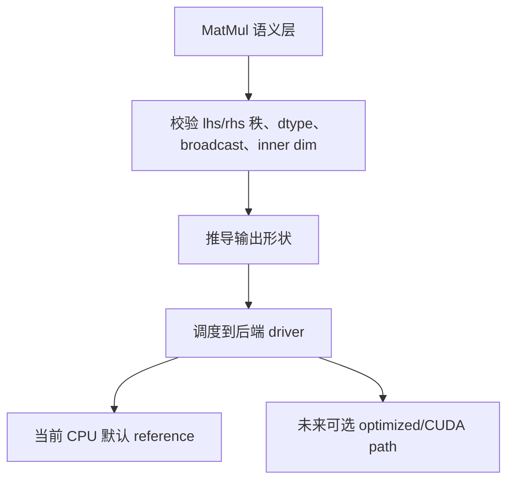

**图示来源**
- [matmul_op.cpp:1-120](../../../../src/operators/ops/matmul_op.cpp#L1-L120)
- [cpu-coverage-baseline.md](../../../operators/cpu-coverage-baseline.md)

**章节来源**
- [matmul_op.cpp:1-120](../../../../src/operators/ops/matmul_op.cpp#L1-L120)
- [cpu-coverage-baseline.md](../../../operators/cpu-coverage-baseline.md)

## 依赖关系分析

线性变换算子之间的依赖关系如下：

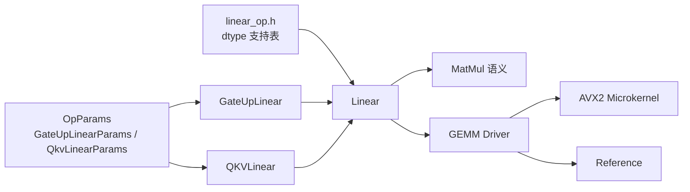

**图示来源**
- [op_params.h:332-347](../../../../include/aethermind/operators/op_params.h#L332-L347)
- [linear_op.h:1-91](../../../../include/aethermind/operators/ops/linear_op.h#L1-L91)
- [gate_up_linear_op.cpp:1-107](../../../../src/operators/ops/gate_up_linear_op.cpp#L1-L107)
- [qkv_linear_op.cpp:1-120](../../../../src/operators/ops/qkv_linear_op.cpp#L1-L120)
- [gemm_a32_w32_avx2.cpp:1-511](../../../../src/backend/cpu/kernels/gemm/gemm_a32_w32_avx2.cpp#L1-L511)

耦合关系总结：

- 算子语义层依赖 dtype 支持和 shape inference 工具。
- fused Linear 依赖 Linear 语义和底层 GEMM engine。
- GEMM driver 依赖 SIMD utility 和 microkernel。
- 设计和基准文档依赖源码、backend 行为和真实机器记录。
- 目前没有明显的循环依赖：语义层不引用 backend，backend 不反向依赖高层图语义。

**章节来源**
- [linear_op.cpp:1-92](../../../../src/operators/ops/linear_op.cpp#L1-L92)
- [gate_up_linear_op.cpp:1-107](../../../../src/operators/ops/gate_up_linear_op.cpp#L1-L107)
- [qkv_linear_op.cpp:1-120](../../../../src/operators/ops/qkv_linear_op.cpp#L1-L120)
- [matmul_op.cpp:1-120](../../../../src/operators/ops/matmul_op.cpp#L1-L120)

## 性能特征与内存模式

### 权重打包格式

文档中存在两种与权重打包相关的概念：

1. **Identity packed weight**：逻辑权重与物理存储一致，但带有 recipe 元数据，用于 execution plan 的 exact-key 匹配。
2. **B-panel packed weight**：将 GEMM 的 B 权重按 KC=512、NR=16 的 layout 预先打包，以减少运行时的面板重打包成本。

对于 Linear、QKVLinear、GateUpLinear：

- plain 和 identity-packed 的物理权重格式保持不变。
- identity-packed 的 key 包含 recipe、selector、binding 等信息。
- B-panel 的布局是 `[K panel][N block][K row][N lane]`，K/N 尾部补零。
- 当前默认选核中，identity optimized 优先级高于 B-panel candidate。

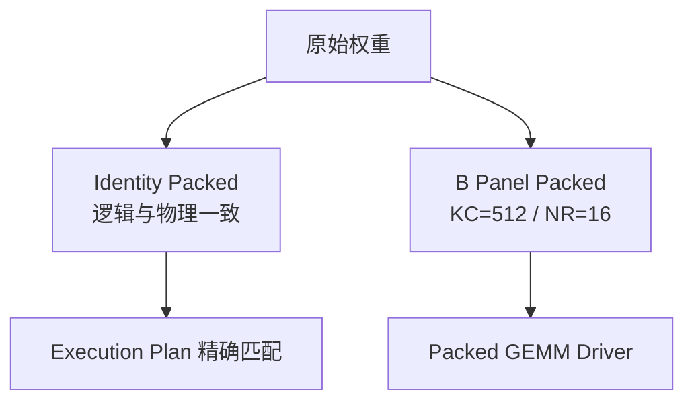

**图示来源**
- [cpu-gemm-packed-weight.md](../../../operators/gemm/cpu-gemm-packed-weight.md)
- [cpu-gemm-optimization.md](../../../operators/gemm/cpu-gemm-optimization.md)

**章节来源**
- [cpu-gemm-packed-weight.md](../../../operators/gemm/cpu-gemm-packed-weight.md)
- [cpu-gemm-optimization.md](../../../operators/gemm/cpu-gemm-optimization.md)

### SIMD 优化技巧

AVX2/FMA 路径使用了以下优化技巧：

| 技巧 | 说明 |
|---|---|
| 双行共享权重流 | RowPairAvx2 让两行 A 共享同一组 B 流；每 4 列、每 8 个 K 发 8 条 FMA |
| K 展开 | 行对展开 8，6×16 blocked 展开 4；用独立累加器打断依赖链 |
| 6×16 microkernel | 12 条 FMA 链覆盖 96 个输出 lane；4×16/2×16 变体按 6/4/2 覆盖 M 尾 |
| direct A | F32 blocked 不打包 A；W16 长 Prefill 直接读 A。省一次 A 打包遍历（DupA 候选需要 384 KiB A panel）；代价是每行每 K 一次广播 |
| B panel k-major | 8×8 寄存器转置，把 N 方向变成连续 16 lane；8 行一组降低 L1 set 冲突 |
| 固定栈缓存 | F32 32 KiB、W16 32/128 KiB、A16 152 KiB；热路径零 heap |
| Tail 分支分离 | 偶数行/整 16 列走 6×16；N 尾走行对，1 行 M 尾走多目标点积 |
| 数值安全门 | W16/A16 用幅值上界判定 F32 不溢出；不安全时完整 reference 重算 |
| packed-B artifact | 准备期固化 `[K-panel][N-block][K-row][N-lane]`，运行期只打包 A |
| scalar 转置 panel | `M>=3,N>=32,K>=32` 时一次转置 32×128 B，跨全部 M 行复用 |

**章节来源**
- [gemm_a32_w32_avx2.cpp:1-511](../../../../src/backend/cpu/kernels/gemm/gemm_a32_w32_avx2.cpp#L1-L511)
- [linear-optimization.md](../../../operators/linear/linear-optimization.md)

### 内存使用模式

Linear 和 fused Linear 的内存模式具有以下特点：

- Activation 通常是 rank ≥ 1 的张量，最后维度是 K。
- 权重通常是 `[N, K]`，plain 或 identity-packed。
- 输出形状复制输入的非尾维度，尾维度为 N。
- Decode/small-M 路径倾向于让 A 驻留寄存器或 L1，B 流式读取。
- Prefill/blocked 路径使用临时 B panel，必要时也使用 A panel。
- W16 权重按 byte-safe 方式读取，不依赖 view 的自然对齐标签。
- 零 K 路径仍需校验输出，但不要求未读取的 input 对齐。

**章节来源**
- [README.md](../../../operators/linear/README.md)
- [cpu-gemm-optimization.md](../../../operators/gemm/cpu-gemm-optimization.md)

### 性能基准与分析方法

基准入口 `benchmark_cpu_linear.cpp` 定义了多种测量模式：

| 模式 | 目的 |
|---|---|
| PreparedHot | 重用已 prepared 的调用，测量稳态热路径 |
| PreparedStreaming | 旋转多个 prepared invocation，模拟 256 MiB 权重工作集 |
| BindingSpecialization | 仅测量 cold-path params 构造 |

它还提供了 correctness guard：使用 GEMM reference 计算期望输出，并与实际 Linear driver 输出比较绝对误差和相对误差。

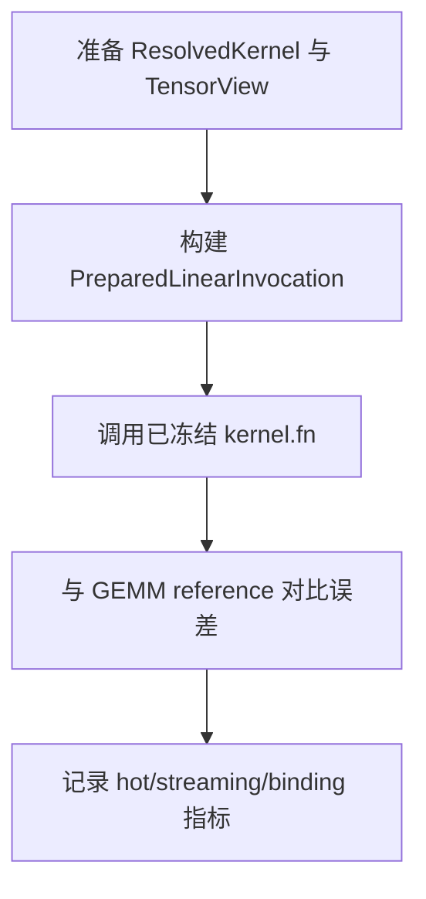

**图示来源**
- [benchmark_cpu_linear.cpp:1-200](../../../../tests/benchmark/cpu_kernels/benchmark_cpu_linear.cpp#L1-L200)

**章节来源**
- [benchmark_cpu_linear.cpp:1-200](../../../../tests/benchmark/cpu_kernels/benchmark_cpu_linear.cpp#L1-L200)

## 配置参数与权重格式要求

### 支持的 dtype 组合

| 算子 | 激活 dtype | 权重 dtype | 输出 dtype |
|---|---|---|---|
| Linear | Float32、Float16、BFloat16、Float8E4M3FN、Float8E5M2 | Float32、Float16、BFloat16、Float8E4M3FN、Float8E5M2、Int8、Int4 | 由参数决定，默认跟随激活 dtype |
| GateUpLinear | 同 Linear | 同 Linear | 同激活 dtype |
| QKVLinear | 同 Linear | 同 Linear | 同激活 dtype |
| MatMul | Float32、Float16、BFloat16、Float8E4M3FN、Float8E5M2、Int8 | 同左操作数 | 跟随左操作数 dtype |

### 形状约束

| 算子 | 输入约束 | 权重约束 | 输出 |
|---|---|---|---|
| Linear | 秩 ≥ 1 | 秩 2，形状 `[N, K]` | 形状与输入相同，尾维度为 N |
| GateUpLinear | 秩 ≥ 1 | 秩 2，行数等于 `gate_out + up_out` | 两个输出，形状仅在尾维度不同 |
| QKVLinear | 秩 ≥ 1 | 秩 2，行数等于 `q_out + k_out + v_out` | 三个输出，形状仅在尾维度不同 |
| MatMul | 秩 ≥ 2 | 秩 ≥ 2 | `broadcast(batch) + [M, N]` |

### 当前不支持的功能

| 功能 | 当前状态 |
|---|---|
| GateUpLinear bias | 尚未支持 |
| QKVLinear bias | 尚未支持 |
| QKV/GateUp 跨 projection 的 input-tile 复用 | 当前未宣称实现 |
| F32 MatMul optimized | 当前默认 reference |
| 线程池并行化 | 当前产品边界为单请求、单线程 |

**章节来源**
- [linear_op.h:1-91](../../../../include/aethermind/operators/ops/linear_op.h#L1-L91)
- [matmul_op.h:1-66](../../../../include/aethermind/operators/ops/matmul_op.h#L1-L66)
- [gate_up_linear_op.cpp:1-107](../../../../src/operators/ops/gate_up_linear_op.cpp#L1-L107)
- [qkv_linear_op.cpp:1-120](../../../../src/operators/ops/qkv_linear_op.cpp#L1-L120)
- [cpu-coverage-baseline.md](../../../operators/cpu-coverage-baseline.md)

## 故障排查指南

### 常见错误与原因

| 错误信息 | 可能原因 | 处理建议 |
|---|---|---|
| Linear 节点需要 LinearParams | 传入的 OpParams 不是 LinearParams | 检查算子构建路径 |
| GateUpLinear bias 尚未支持 | 参数设置了 `has_bias` | 移除 bias 或等待后续实现 |
| QKVLinear bias 尚未支持 | 参数设置了 `has_bias` | 移除 bias 或等待后续实现 |
| 输入秩小于 1 | 输入张量是标量或空形状 | 检查上游 reshape/embedding |
| 权重秩不是 2 | fused Linear 权重未按 `[out, in]` 组织 | 检查模型权重装载或 packing |
| 输入最后一维不等于权重输入维度 | K 不匹配 | 检查 hidden_size、intermediate_size 或 head_dim |
| 输出 dtype 非法 | 指定了不支持的输出 dtype | 使用 Float32、Float16 或 BFloat16 |
| inner dimensions must be equal | MatMul 的 K 维度不一致 | 检查 transpose_rhs 和权重形状 |

### 数值异常排查

- 如果输出出现 NaN 或 Inf，优先检查是否触发了 optimized path 的安全域回退。
- Linear/W16 的 reference 实现会按字节安全读取权重，并使用 F32 累加。
- benchmark 中的 correctness guard 会显式检查 actual/reference 是否均为有限值。
- 高优先级 optimized descriptor 一旦 resolve，就必须覆盖其声明的完整 layout 合同；不适合 fast path 的合法输入应回退到 compatible driver。

**章节来源**
- [linear_op.cpp:1-92](../../../../src/operators/ops/linear_op.cpp#L1-L92)
- [gate_up_linear_op.cpp:1-107](../../../../src/operators/ops/gate_up_linear_op.cpp#L1-L107)
- [qkv_linear_op.cpp:1-120](../../../../src/operators/ops/qkv_linear_op.cpp#L1-L120)
- [matmul_op.cpp:1-120](../../../../src/operators/ops/matmul_op.cpp#L1-L120)
- [cpu-gemm-optimization.md](../../../operators/gemm/cpu-gemm-optimization.md)

## 结论

AetherMind 的线性变换算子系列以清晰的语义层为基础，将 Linear、GateUpLinear、QKVLinear 和 MatMul 的统一数学语义与 CPU 后端的高性能实现解耦。其核心设计价值在于：

- Linear 作为通用线性投影，语义等价于 MatMul，但生产路径可直接调用 optimized Linear driver。
- GateUpLinear 和 QKVLinear 通过权重拼接实现融合语义，减少图节点和数据访问，但当前未宣称跨 projection 的 input-tile 复用。
- GEMM 内核在 AVX2/FMA 平台上使用 2×4 行对、6×16 blocked microkernel、direct A 和 B panel 预打包提升吞吐；`M>=9` 的 Prefill 由 6/4/2 行分解覆盖，细节见 [GEMM 内核](../../算子系统/算子实现详解/GEMM%20内核.md)。
- W16/A32 优化方案明确了 safe contract、fallback、stack scratch 和 benchmark promotion 流程。
- MatMul 当前承担通用语义职责，实际矩阵优化由 Linear/fused Linear 生产入口承载。

未来改进方向包括：完善 MatMul optimized 路径、评估 B-panel 是否晋升为默认布局、探索真正跨 projection 的 fused GEMM、补充同型 A16 Prefill 证据，并按目标硬件验证 AVX-512、AMX 或多线程路径。
