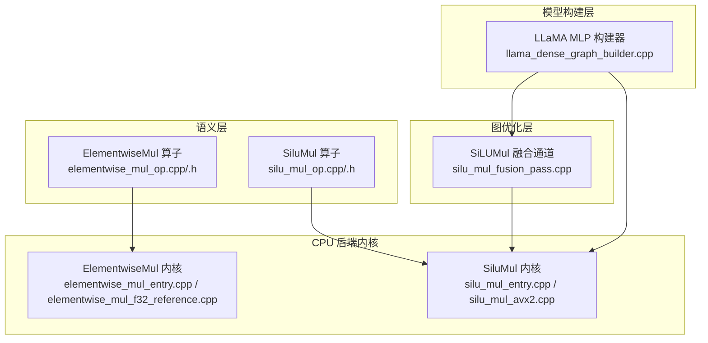
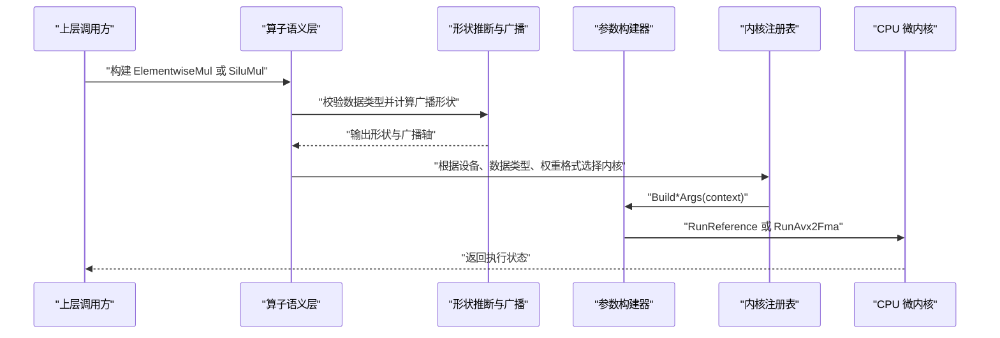
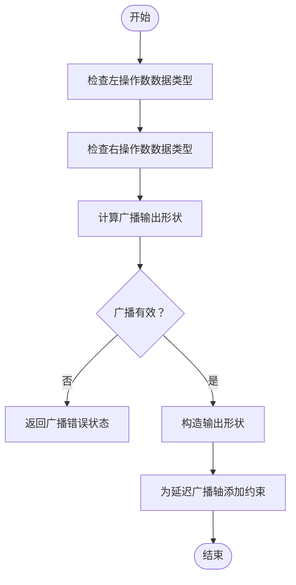
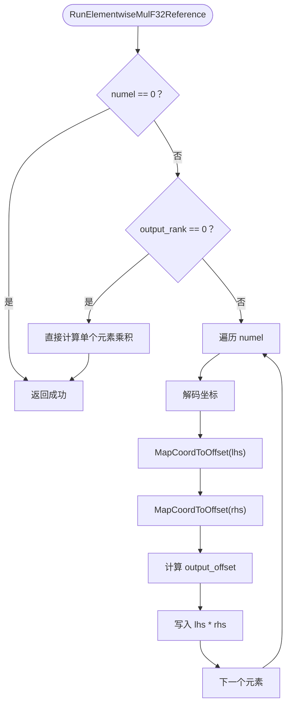
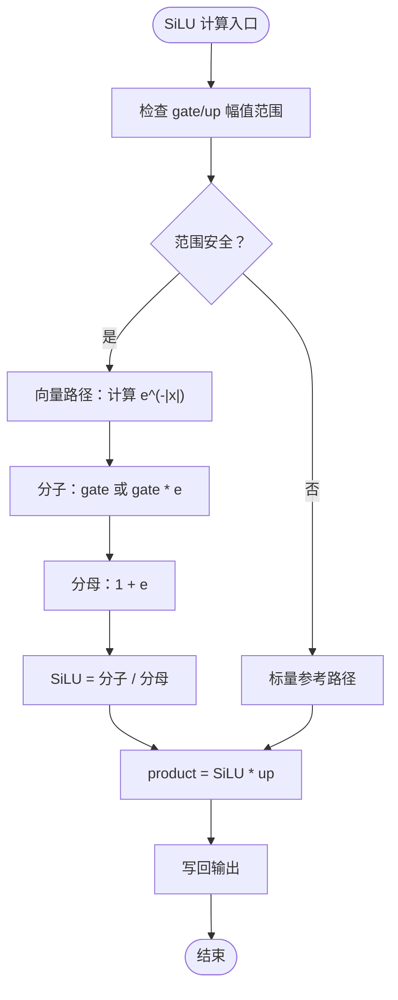
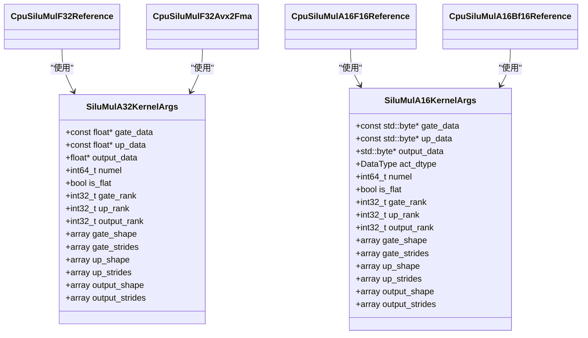
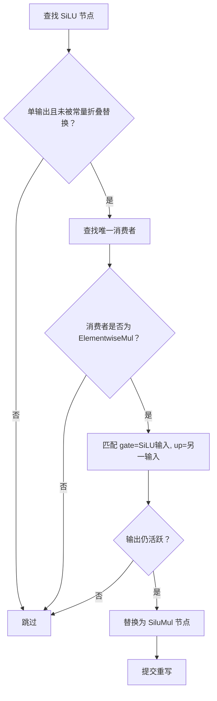
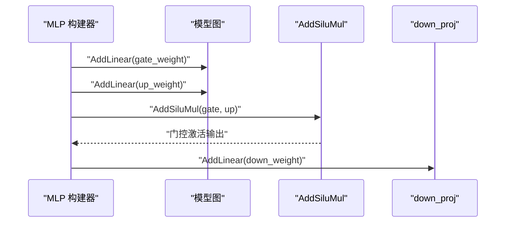
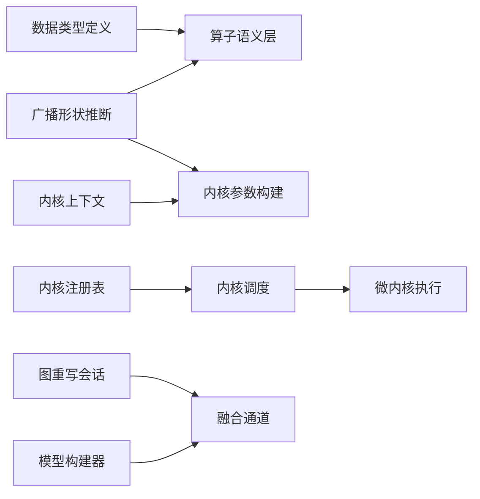

# 逐元素运算算子

**本文引用的文件**
- [elementwise_mul_op.cpp](../../../../src/operators/ops/elementwise_mul_op.cpp)
- [elementwise_mul_op.h](../../../../include/aethermind/operators/ops/elementwise_mul_op.h)
- [silu_mul_op.cpp](../../../../src/operators/ops/silu_mul_op.cpp)
- [silu_mul_op.h](../../../../include/aethermind/operators/ops/silu_mul_op.h)
- [elementwise_mul_internal.h](../../../../src/backend/cpu/kernels/elementwise_mul/elementwise_mul_internal.h)
- [elementwise_mul_entry.cpp](../../../../src/backend/cpu/kernels/elementwise_mul/elementwise_mul_entry.cpp)
- [elementwise_mul_f32_reference.cpp](../../../../src/backend/cpu/kernels/elementwise_mul/elementwise_mul_f32_reference.cpp)
- [silu_mul_internal.h](../../../../src/backend/cpu/kernels/silu_mul/silu_mul_internal.h)
- [silu_mul_entry.cpp](../../../../src/backend/cpu/kernels/silu_mul/silu_mul_entry.cpp)
- [silu_mul_avx2.cpp](../../../../src/backend/cpu/kernels/silu_mul/silu_mul_avx2.cpp)
- [silu_mul_fusion_pass.cpp](../../../../src/graph/optimization/silu_mul_fusion_pass.cpp)
- [llama_dense_graph_builder.cpp](../../../../src/model/llama_dense_graph_builder.cpp)
- [op_type.h](../../../../include/aethermind/operators/op_type.h)

## 目录
1. [引言](#引言)
2. [项目结构](#项目结构)
3. [核心组件](#核心组件)
4. [架构总览](#架构总览)
5. [详细组件分析](#详细组件分析)
6. [依赖关系分析](#依赖关系分析)
7. [性能与优化](#性能与优化)
8. [故障排查](#故障排查)
9. [结论](#结论)

## 引言
本文聚焦 AetherMind 中两个关键逐元素运算算子：ElementwiseMul（逐元素乘法）和 SiluMul（SiLU 激活与乘法的融合算子）。文档从语义契约、形状推断与广播规则，到 CPU 后端内核实现、SIMD 向量化路径、图优化融合策略，以及在 LLaMA MLP 门控机制中的具体应用进行系统化说明。目标是帮助读者理解这些算子在推理流水线中的职责、数据流、内存访问模式及性能调优要点。

## 项目结构
与逐元素运算相关的代码分布在语义层、CPU 后端内核层、图优化层和模型构建层：
- 语义层定义算子的数据类型约束、错误消息和形状推断逻辑。
- CPU 后端提供 FP32 参考微内核以及 AVX2/FMA 向量化变体。
- 图优化层将 SiLU + Mul 模式替换为 SiluMul 融合算子。
- 模型构建层在 LLaMA 的 MLP 中直接调用融合算子完成门控激活。

**图表来源**
- [elementwise_mul_op.cpp:1-51](../../../../src/operators/ops/elementwise_mul_op.cpp#L1-L51)
- [silu_mul_op.cpp:1-52](../../../../src/operators/ops/silu_mul_op.cpp#L1-L52)
- [elementwise_mul_entry.cpp:1-86](../../../../src/backend/cpu/kernels/elementwise_mul/elementwise_mul_entry.cpp#L1-L86)
- [elementwise_mul_f32_reference.cpp:1-49](../../../../src/backend/cpu/kernels/elementwise_mul/elementwise_mul_f32_reference.cpp#L1-L49)
- [silu_mul_entry.cpp:1-208](../../../../src/backend/cpu/kernels/silu_mul/silu_mul_entry.cpp#L1-L208)
- [silu_mul_avx2.cpp:1-129](../../../../src/backend/cpu/kernels/silu_mul/silu_mul_avx2.cpp#L1-L129)
- [silu_mul_fusion_pass.cpp:1-158](../../../../src/graph/optimization/silu_mul_fusion_pass.cpp#L1-L158)
- [llama_dense_graph_builder.cpp:1-200](../../../../src/model/llama_dense_graph_builder.cpp#L1-L200)

**章节来源**
- [elementwise_mul_op.cpp:1-51](../../../../src/operators/ops/elementwise_mul_op.cpp#L1-L51)
- [silu_mul_op.cpp:1-52](../../../../src/operators/ops/silu_mul_op.cpp#L1-L52)
- [elementwise_mul_entry.cpp:1-86](../../../../src/backend/cpu/kernels/elementwise_mul/elementwise_mul_entry.cpp#L1-L86)
- [silu_mul_entry.cpp:1-208](../../../../src/backend/cpu/kernels/silu_mul/silu_mul_entry.cpp#L1-L208)
- [silu_mul_fusion_pass.cpp:1-158](../../../../src/graph/optimization/silu_mul_fusion_pass.cpp#L1-L158)
- [llama_dense_graph_builder.cpp:1-200](../../../../src/model/llama_dense_graph_builder.cpp#L1-L200)

## 核心组件
本节梳理 ElementwiseMul 与 SiluMul 的核心职责、输入输出语义和调度入口。

- ElementwiseMul
  - 语义输入：左操作数张量与右操作数张量。
  - 支持数据类型：float32、float16、bfloat16。
  - 广播规则：基于形状推断模块计算广播输出形状，并在运行时对需要广播的轴添加维度可广播约束。
  - CPU 内核：注册名为 `cpu::elementwise_mul_f32_reference` 的内核，仅接受 float32 TensorView；参数构建阶段复用通用的广播参数构造工具，最终调用参考微内核按坐标映射计算逐元素乘积。

- SiluMul
  - 语义输入：gate 张量和 up 张量；gate 先经过 SiLU 激活，再与 up 相乘。
  - 支持数据类型：float32、float16、bfloat16、float8_e4m3fn、float8_e5m2。
  - 数据类型约束：当前融合算子要求 gate 与 up 使用相同的数据类型，不做隐式转换。
  - 广播规则：与 ElementwiseMul 一致，通过共享广播推断模块得到输出形状与延迟广播轴。
  - CPU 内核：注册多个变体，包括 FP32 参考内核、AVX2+FMA 优化内核，以及针对 float16/bfloat16 的 A16 参考与优化路径。FP32 优化路径要求启用 AVX2 和 FMA 特性，且仅在数据平坦且长度不小于 32 时进入向量路径。

**章节来源**
- [elementwise_mul_op.h:1-52](../../../../include/aethermind/operators/ops/elementwise_mul_op.h#L1-L52)
- [elementwise_mul_op.cpp:1-51](../../../../src/operators/ops/elementwise_mul_op.cpp#L1-L51)
- [silu_mul_op.h:1-52](../../../../include/aethermind/operators/ops/silu_mul_op.h#L1-L52)
- [silu_mul_op.cpp:1-52](../../../../src/operators/ops/silu_mul_op.cpp#L1-L52)
- [elementwise_mul_entry.cpp:1-86](../../../../src/backend/cpu/kernels/elementwise_mul/elementwise_mul_entry.cpp#L1-L86)
- [silu_mul_entry.cpp:1-208](../../../../src/backend/cpu/kernels/silu_mul/silu_mul_entry.cpp#L1-L208)

## 架构总览
ElementwiseMul 与 SiluMul 在 AetherMind 中遵循统一的“语义 → 形状推断 → 参数构建 → 内核选择 → 微内核执行”流程。

**图表来源**
- [elementwise_mul_op.cpp:1-51](../../../../src/operators/ops/elementwise_mul_op.cpp#L1-L51)
- [silu_mul_op.cpp:1-52](../../../../src/operators/ops/silu_mul_op.cpp#L1-L52)
- [elementwise_mul_entry.cpp:1-86](../../../../src/backend/cpu/kernels/elementwise_mul/elementwise_mul_entry.cpp#L1-L86)
- [silu_mul_entry.cpp:1-208](../../../../src/backend/cpu/kernels/silu_mul/silu_mul_entry.cpp#L1-L208)

## 详细组件分析

### ElementwiseMul 算子
ElementwiseMul 负责两个同构或可广播张量的逐元素乘法。其语义层首先校验左右操作数的数据类型是否属于支持集合，然后调用广播形状推断模块计算输出形状，并为每个需要广播的轴添加运行时维度约束。

**图表来源**
- [elementwise_mul_op.cpp:1-51](../../../../src/operators/ops/elementwise_mul_op.cpp#L1-L51)

#### 内核实现与广播微内核
ElementwiseMul 的 CPU 后端只注册了 float32 参考内核。参数构建阶段验证输入输出均为 float32，并复用通用广播参数构造工具生成 lhs/rhs/output 的形状、步长和数据指针。参考微内核以标量方式遍历输出元素，对每个元素：
1. 将线性索引解码为多维坐标。
2. 分别映射到 lhs 与 rhs 的偏移。
3. 计算 output 偏移并写入乘积。

该实现强调正确性和可维护性，是后续 SIMD 优化的基准。

**图表来源**
- [elementwise_mul_f32_reference.cpp:1-49](../../../../src/backend/cpu/kernels/elementwise_mul/elementwise_mul_f32_reference.cpp#L1-L49)

**章节来源**
- [elementwise_mul_op.h:1-52](../../../../include/aethermind/operators/ops/elementwise_mul_op.h#L1-L52)
- [elementwise_mul_op.cpp:1-51](../../../../src/operators/ops/elementwise_mul_op.cpp#L1-L51)
- [elementwise_mul_internal.h:1-49](../../../../src/backend/cpu/kernels/elementwise_mul/elementwise_mul_internal.h#L1-L49)
- [elementwise_mul_entry.cpp:1-86](../../../../src/backend/cpu/kernels/elementwise_mul/elementwise_mul_entry.cpp#L1-L86)
- [elementwise_mul_f32_reference.cpp:1-49](../../../../src/backend/cpu/kernels/elementwise_mul/elementwise_mul_f32_reference.cpp#L1-L49)

### SiluMul 融合算子
SiluMul 将 SiLU 激活与逐元素乘法融合，避免中间结果写回内存，减少带宽占用。语义层要求 gate 与 up 数据类型相同，并属于支持集合；随后同样使用广播推断模块得到输出形状和广播轴。

#### 融合策略与 SiLU 计算
SiLU 的数学形式为 x · σ(x)，其中 σ(x) = 1 / (1 + exp(−x))。在数值上，为避免溢出和精度问题，实现采用以下策略：
- 对负值分支进行指数近似：通过泰勒多项式近似 exp(r)，并结合浮点偏置恢复 2^n。
- 对正值的分子部分直接使用 x，分母统一为 1 + e^{|x|}。
- 在 AVX2 路径中，对每个 8 元组判断数值范围是否安全；不安全时退化为标量参考实现。

**图表来源**
- [silu_mul_avx2.cpp:1-129](../../../../src/backend/cpu/kernels/silu_mul/silu_mul_avx2.cpp#L1-L129)

#### 数据类型与内核变体
SiluMul 的 CPU 后端注册了多种内核变体：
- FP32 参考内核：通用路径，适用于任意形状和步长。
- FP32 AVX2+FMA 优化内核：要求舍入模式为最近舍入，数据平坦且元素数不少于 32；每 8 个元素尝试向量路径，否则回退到标量。
- A16 参考与优化路径：对 float16/bfloat16，先将 16 位存储展宽为 FP32，执行 SiLU 与乘法后再窄化回目标类型。

**图表来源**
- [silu_mul_internal.h:1-86](../../../../src/backend/cpu/kernels/silu_mul/silu_mul_internal.h#L1-L86)
- [silu_mul_entry.cpp:1-208](../../../../src/backend/cpu/kernels/silu_mul/silu_mul_entry.cpp#L1-L208)

**章节来源**
- [silu_mul_op.h:1-52](../../../../include/aethermind/operators/ops/silu_mul_op.h#L1-L52)
- [silu_mul_op.cpp:1-52](../../../../src/operators/ops/silu_mul_op.cpp#L1-L52)
- [silu_mul_internal.h:1-86](../../../../src/backend/cpu/kernels/silu_mul/silu_mul_internal.h#L1-L86)
- [silu_mul_entry.cpp:1-208](../../../../src/backend/cpu/kernels/silu_mul/silu_mul_entry.cpp#L1-L208)
- [silu_mul_avx2.cpp:1-129](../../../../src/backend/cpu/kernels/silu_mul/silu_mul_avx2.cpp#L1-L129)

### 图优化中的 SiLUMul 融合
在图优化阶段，系统会寻找“SiLU → ElementwiseMul”的子图模式，并将其重写为单一的 SiluMul 节点。融合条件包括：
- SiLU 节点只有一个输入和一个输出。
- SiLU 的输出仅被一个 ElementwiseMul 消费。
- ElementwiseMul 的两个输入之一等于 SiLU 的输出，另一个为 up。
- 两个节点的 decoder_layer_index 一致。
- 融合后的输出仍具有活跃消费者或为图输出，避免引入孤儿节点。

**图表来源**
- [silu_mul_fusion_pass.cpp:1-158](../../../../src/graph/optimization/silu_mul_fusion_pass.cpp#L1-L158)

**章节来源**
- [silu_mul_fusion_pass.cpp:1-158](../../../../src/graph/optimization/silu_mul_fusion_pass.cpp#L1-L158)

### LLaMA 门控机制中的应用
在 LLaMA 模型的 MLP 块中，门控前馈网络由 gate_proj、up_proj、激活和 down_proj 组成。AetherMind 直接在 MLP 构建阶段调用融合算子 AddSiluMul，将 gate 和 up 的线性输出融合为门控激活，从而减少中间张量写回与内存带宽压力。

**图表来源**
- [llama_dense_graph_builder.cpp:1-200](../../../../src/model/llama_dense_graph_builder.cpp#L1-L200)

**章节来源**
- [llama_dense_graph_builder.cpp:1-200](../../../../src/model/llama_dense_graph_builder.cpp#L1-L200)

## 依赖关系分析
ElementwiseMul 与 SiluMul 的依赖关系如下：
- 语义层依赖数据类型定义、算子参数和广播形状推断模块。
- CPU 后端依赖通用广播工具、内核上下文、内核静态注册表和内核选择器。
- 图优化层依赖算子类型、图重写会话和子图构建器。
- 模型构建层依赖图构建接口与融合算子。

**图表来源**
- [elementwise_mul_op.cpp:1-51](../../../../src/operators/ops/elementwise_mul_op.cpp#L1-L51)
- [silu_mul_op.cpp:1-52](../../../../src/operators/ops/silu_mul_op.cpp#L1-L52)
- [elementwise_mul_entry.cpp:1-86](../../../../src/backend/cpu/kernels/elementwise_mul/elementwise_mul_entry.cpp#L1-L86)
- [silu_mul_entry.cpp:1-208](../../../../src/backend/cpu/kernels/silu_mul/silu_mul_entry.cpp#L1-L208)
- [silu_mul_fusion_pass.cpp:1-158](../../../../src/graph/optimization/silu_mul_fusion_pass.cpp#L1-L158)

**章节来源**
- [elementwise_mul_op.cpp:1-51](../../../../src/operators/ops/elementwise_mul_op.cpp#L1-L51)
- [silu_mul_op.cpp:1-52](../../../../src/operators/ops/silu_mul_op.cpp#L1-L52)
- [elementwise_mul_entry.cpp:1-86](../../../../src/backend/cpu/kernels/elementwise_mul/elementwise_mul_entry.cpp#L1-L86)
- [silu_mul_entry.cpp:1-208](../../../../src/backend/cpu/kernels/silu_mul/silu_mul_entry.cpp#L1-L208)
- [silu_mul_fusion_pass.cpp:1-158](../../../../src/graph/optimization/silu_mul_fusion_pass.cpp#L1-L158)

## 性能与优化
本节总结内存访问模式、计算流水线设计以及性能调优技巧。

- 广播与内存布局
  - 参考实现使用坐标解码与 MapCoordToOffset 计算 lhs/rhs 偏移，保证广播语义正确，但逐元素循环存在坐标解码开销。
  - 当广播维度较大且步长不连续时，应避免频繁跨块访问；可通过 reshape/contiguous 预处理使热点路径更连续。

- 计算流水线
  - ElementwiseMul 参考内核适合小规模或调试场景；生产路径建议优先使用融合算子以减少中间写回。
  - SiluMul 的 AVX2+FMA 路径每次处理 8 个元素，内部并行计算指数近似、SiLU 和乘法，并做数值范围检查，超出范围时回退标量路径。

- 数据类型与向量化
  - FP32 优化路径要求最近舍入模式和 AVX2/FMA 特性；非连续或短尾数据会退化到标量。
  - A16 路径通过 16 位存储降低带宽，但在 FP32 中执行 SiLU 与乘法，最后窄化回目标类型；对于接近 BF16 中点的值，采用容差判断决定是否向量写回。

- 图级优化
  - 启用 SwiGLU 融合通道后，SiLU + Mul 子图会被替换为 SiluMul，减少显存带宽与内核启动次数。
  - 确保融合后的输出仍有活跃消费者，避免产生孤儿节点。

- 调优建议
  - 控制 batch 维度和序列长度，使热点路径满足 is_flat 且 numel ≥ 32，以便进入 AVX2 向量主体。
  - 对齐张量布局，避免不必要的转置与拷贝。
  - 在混合精度场景中，合理选择 float16/bfloat16，权衡数值稳定性与带宽。

[本节为通用性能指导，未直接分析特定源码文件]

## 故障排查
常见错误与定位方法：
- 数据类型不支持
  - ElementwiseMul 仅支持 float32、float16、bfloat16；若传入其他类型，语义层会返回不支持的数据类型错误消息。
  - SiluMul 当前要求 gate 与 up 数据类型相同；若不一致，会返回数据类型不匹配错误。

- 广播失败
  - 形状不可广播时，形状推断模块返回错误状态；需检查输入形状是否符合 NumPy 风格广播规则。

- 内核参数构建失败
  - CPU 后端内核要求固定数量的输入输出与数据类型；例如 ElementwiseMulF32Reference 要求两个 float32 输入和一个 float32 输出。

- 向量路径回退
  - 舍入模式非最近舍入、数据不连续或元素数量不足时，SiluMul AVX2 路径会回退到标量参考实现；这是预期行为，用于保证数值正确性。

**章节来源**
- [elementwise_mul_op.h:1-52](../../../../include/aethermind/operators/ops/elementwise_mul_op.h#L1-L52)
- [silu_mul_op.h:1-52](../../../../include/aethermind/operators/ops/silu_mul_op.h#L1-L52)
- [elementwise_mul_entry.cpp:1-86](../../../../src/backend/cpu/kernels/elementwise_mul/elementwise_mul_entry.cpp#L1-L86)
- [silu_mul_entry.cpp:1-208](../../../../src/backend/cpu/kernels/silu_mul/silu_mul_entry.cpp#L1-L208)
- [silu_mul_avx2.cpp:1-129](../../../../src/backend/cpu/kernels/silu_mul/silu_mul_avx2.cpp#L1-L129)

## 结论
ElementwiseMul 提供了基础且可靠的逐元素乘法语义，而 SiluMul 则面向 SwiGLU 架构，将 SiLU 激活与乘法融合，显著降低内存带宽压力并提升吞吐。两者均依赖统一的广播形状推断机制，并在 CPU 后端提供从标量参考到 AVX2+FMA 向量化的完整路径。在 LLaMA 模型中，MLP 的门控机制直接利用融合算子完成高效计算；图优化进一步将常见的 SiLU + Mul 模式替换为 SiluMul，确保推理阶段的性能与数值一致性。

[本节为总结性内容，未直接分析特定源码文件]
