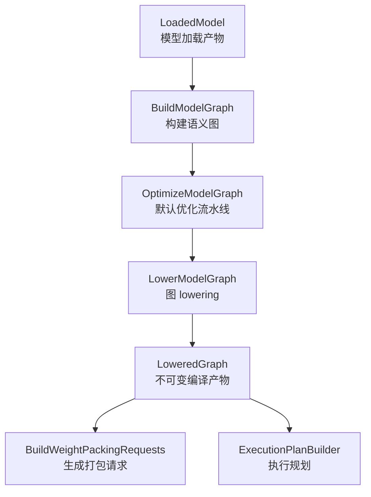
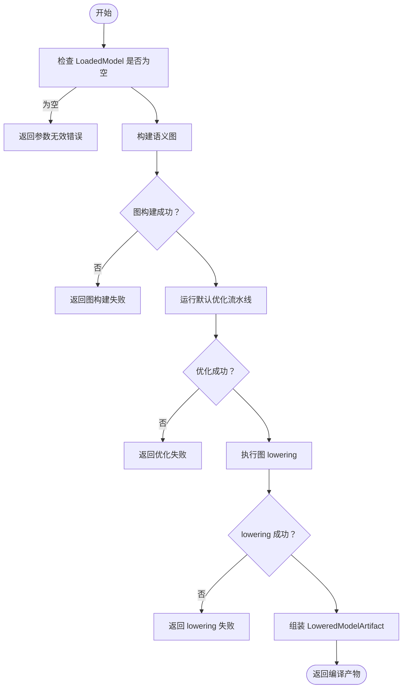
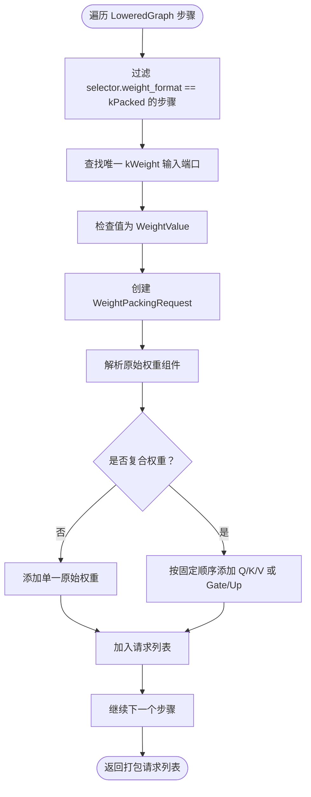
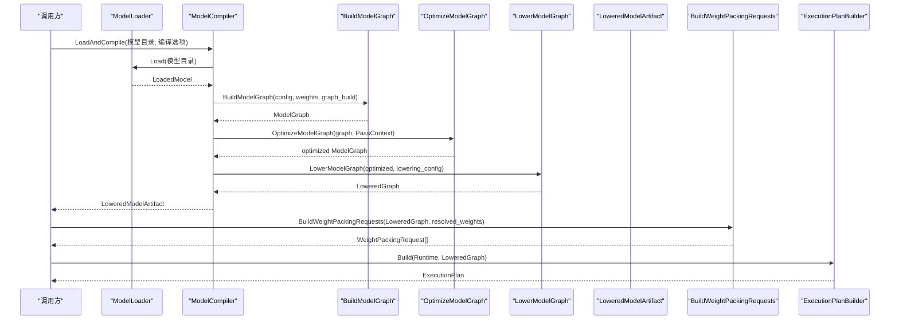
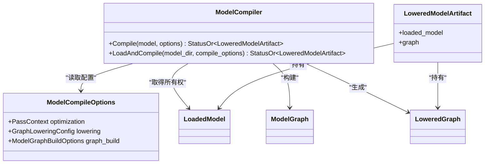
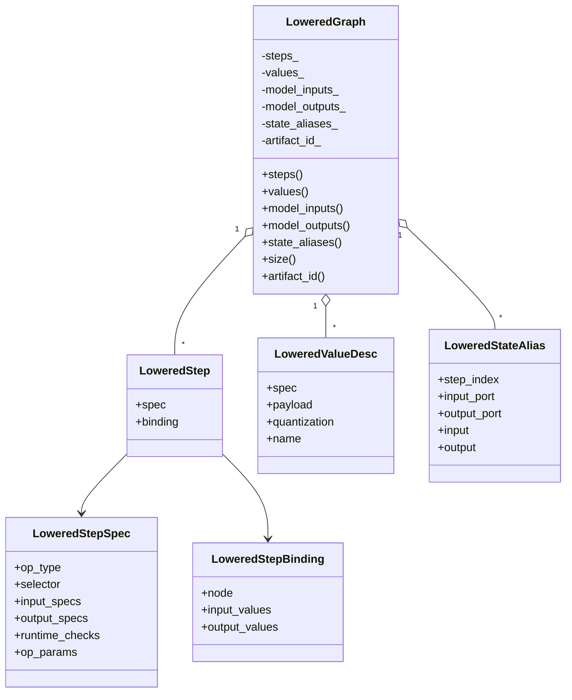
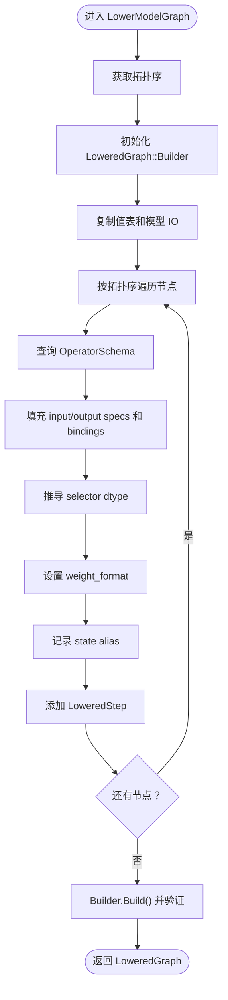
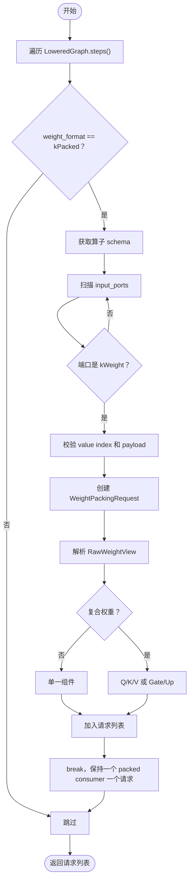
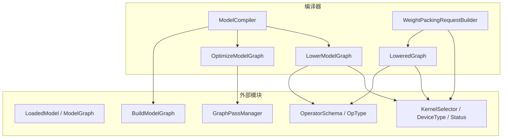

# 编译器系统（Compiler）

**本文引用的文件**
- [model_compiler.h](../../../include/aethermind/compiler/model_compiler.h)
- [model_compiler.cpp](../../../src/compiler/model_compiler.cpp)
- [graph_lowering.h](../../../include/aethermind/compiler/graph_lowering.h)
- [graph_lowering.cpp](../../../src/compiler/graph_lowering.cpp)
- [lowered_graph.h](../../../include/aethermind/compiler/lowered_graph.h)
- [lowered_graph.cpp](../../../src/compiler/lowered_graph.cpp)
- [weight_packing_request_builder.h](../../../include/aethermind/compiler/weight_packing_request_builder.h)
- [weight_packing_request_builder.cpp](../../../src/compiler/weight_packing_request_builder.cpp)
- [optimize_graph.h](../../../include/aethermind/compiler/optimize_graph.h)
- [optimize_graph.cpp](../../../src/compiler/optimize_graph.cpp)
- [graph_pass_manager.h](../../../include/aethermind/graph/optimization/graph_pass_manager.h)
- [build_model_graph.h](../../../include/aethermind/model/build_model_graph.h)
- [inference_options.h](../../../include/aethermind/inference/inference_options.h)
- [src/compiler/](../../../src/compiler)
- [graph_lowering_design.md](../../archive/designs/graph_lowering_design.md)
- [graph_compilation_flow.md](../../archive/designs/graph_compilation_flow.md)

## 目录

1. [简介](#简介)
2. [项目结构](#项目结构)
3. [核心组件](#核心组件)
4. [架构总览](#架构总览)
5. [详细组件分析](#详细组件分析)
6. [依赖关系分析](#依赖关系分析)
7. [性能与优化策略](#性能与优化策略)
8. [使用示例](#使用示例)
9. [扩展开发指南](#扩展开发指南)
10. [故障排查](#故障排查)
11. [结论](#结论)

## 简介

AetherMind 的编译器系统负责把已加载的模型从高层语义图转换为可被执行规划阶段消费的不可变中间表示。其设计目标很明确：

- 将 `LoadedModel` 编译为 `LoweredModelArtifact`；
- 不解析具体 kernel、不分配运行时缓冲区、不选择 workspace 布局；
- 通过 `KernelSelector` 表达设备、数据类型、权重格式和执行阶段等跨模块契约；
- 通过 `LoweredGraph` 保存步骤语义、值表、模型输入输出和状态别名；
- 通过 `WeightPackingRequestBuilder` 生成权重打包请求，而不是直接执行打包；
- 提供可配置的语义优化流水线，包括常量折叠、QKV/GateUp/SiluMul/AddRmsNorm 融合以及死代码消除。

编译器位于“语义图”和“执行计划”之间：它回答“需要哪些执行步骤”，但不回答“每个步骤用哪个具体 kernel 实现”。

## 项目结构

编译器相关代码集中在 `include/aethermind/compiler` 和 `src/compiler`，并与 model、graph、operators、base、execution 等模块交互：



**图示来源**
- [model_compiler.cpp:28-78](../../../src/compiler/model_compiler.cpp#L28-L78)
- [optimize_graph.cpp:17-40](../../../src/compiler/optimize_graph.cpp#L17-L40)
- [graph_lowering.cpp:24-136](../../../src/compiler/graph_lowering.cpp#L24-L136)
- [weight_packing_request_builder.cpp:73-153](../../../src/compiler/weight_packing_request_builder.cpp#L73-L153)

| 目录 | 主要职责 |
|---|---|
| `include/aethermind/compiler` | 编译器公共接口：`ModelCompiler`、`LoweredGraph`、`LoweredStepSpec`、`GraphLoweringConfig`、打包请求构建器 |
| `src/compiler` | 编译器实现：主流程编排、图 lowering、artifact 校验、打包请求映射 |
| `include/aethermind/graph/optimization` | 图优化 pass 框架和 pass 注册入口 |
| `include/aethermind/model` | 模型配置、语义图构建选项、模型加载入口 |
| `include/aethermind/inference` | 高层编译预设、CPU 运行时装配选项 |
| `include/aethermind/base` | `KernelSelector`、`DeviceType`、`Status` 等底层契约 |
| `include/aethermind/execution` | 消费 `LoweredGraph` 的执行规划层（不在 compiler 职责内） |

**章节来源**
- [model_compiler.h:12-64](../../../include/aethermind/compiler/model_compiler.h#L12-L64)
- [lowered_graph.h:12-200](../../../include/aethermind/compiler/lowered_graph.h#L12-L200)
- [src/compiler/](../../../src/compiler)

## 核心组件

### ModelCompiler：编译流程编排

`ModelCompiler` 是无状态的编译器门面，负责串联三个阶段：

1. 构建语义图；
2. 应用语义优化 passes；
3. 将优化后的图 lowering 为 `LoweredGraph`。

它返回 `LoweredModelArtifact`，其中包含：

- 原 `LoadedModel` 的所有权；
- 已验证且冻结的 `LoweredGraph`。

关键点：

- `Compile(nullptr, ...)` 返回 `InvalidArgument`；
- 各阶段失败会通过上下文包装函数加上阶段名称，例如“模型图构建失败”“模型图优化失败”“模型图 lowering 失败”；
- `LoadAndCompile` 先调用 `ModelLoader::Load`，再复用 `Compile`；
- 针对 FP16/BF16 激活类型，编译器会禁用 QKV、GateUp、AddRmsNorm 融合，因为当前 P4-A A16 batch 只保留保守基线内核集合。



**图示来源**
- [model_compiler.cpp:28-78](../../../src/compiler/model_compiler.cpp#L28-L78)

**章节来源**
- [model_compiler.h:12-64](../../../include/aethermind/compiler/model_compiler.h#L12-L64)
- [model_compiler.cpp:12-78](../../../src/compiler/model_compiler.cpp#L12-L78)

### LoweredGraph：不可变执行语义中间表示

`LoweredGraph` 是编译器最重要的产物。它不是执行计划，也不是模型语义图的简单拷贝，而是：

- 按拓扑序排列的步骤序列；
- 与步骤一一对应的值绑定；
- 独立的值元数据表；
- 模型输入输出 value id；
- 由算子 schema 声明的状态别名；
- 一次构建分配的 artifact 身份标识。

重要不变量：

| 不变量 | 含义 |
|---|---|
| 一个语义节点对应一个 lowered 步骤 | 不拆分、不展开、不折叠算子 |
| 步骤类型为 `OpType` | 保持与算子语义同构 |
| 端口顺序等于 schema 端口顺序 | 下游通过 compact 视图派生运行时张量绑定 |
| selector dtype 来自共享推导规则 | lowering 与执行路径保持一致 |
| `kPacked` 步骤只能有一个 kWeight 输入 | 防止打包语义与多权重步骤冲突 |
| 构造后不可变 | 并发只读安全，访问器返回借用 span |

**章节来源**
- [lowered_graph.h:12-200](../../../include/aethermind/compiler/lowered_graph.h#L12-L200)
- [lowered_graph.cpp:12-297](../../../src/compiler/lowered_graph.cpp#L12-L297)
- [graph_lowering_design.md](../../archive/designs/graph_lowering_design.md)

### WeightPackingRequestBuilder：打包请求生成

`BuildWeightPackingRequests` 是一个纯数据映射函数，职责非常清晰：

- 扫描 `LoweredGraph` 中所有 `selector.weight_format == kPacked` 的步骤；
- 找到该步骤的唯一 kWeight 输入；
- 要求该值的 payload 是 `WeightValue`；
- 根据权重 binding 解析原始权重组件；
- 生成 `WeightPackingRequest`，但 `recipe` 字段留空；
- 不调用 backend、不执行预打包、不分配 packed weight 存储。

复合权重支持两种逻辑角色：

| 权重绑定类型 | 组件顺序 |
|---|---|
| QKV 权重 | Q、K、V |
| Gate-Up 权重 | Gate、Up |

复合绑定必须携带 `decoder_layer_index`，否则返回内部错误。



**图示来源**
- [weight_packing_request_builder.cpp:12-153](../../../src/compiler/weight_packing_request_builder.cpp#L12-L153)

**章节来源**
- [weight_packing_request_builder.h:12-34](../../../include/aethermind/compiler/weight_packing_request_builder.h#L12-L34)
- [weight_packing_request_builder.cpp:12-153](../../../src/compiler/weight_packing_request_builder.cpp#L12-L153)
- [src/compiler/](../../../src/compiler)

### 优化流水线：OptimizeModelGraph

`OptimizeModelGraph` 不负责实现具体 pass，而是决定默认 pass 顺序：

| 优化等级 | 注册的 pass 顺序 |
|---|---|
| 0 | 无 pass |
| 1 | 常量折叠 → 死代码消除 |
| 2+ | 常量折叠 → QKV 线性融合 → GateUp 线性融合 → SiluMul 融合 → AddRmsNorm 融合 → 死代码消除 |

`PassContext` 还控制：

- `enable_qkv_fusion`
- `enable_gate_up_fusion`
- `enable_swiglu_fusion`
- `enable_dce`
- `enable_constant_folding`
- `enable_fused_add_rms_norm`
- `const_eval_policy`
- `checkpoint_every`

这些标志不会改变 pass 注册顺序，而是在 pass 运行时决定是否跳过自身逻辑。这使得优化管线可观察、可预测。

**章节来源**
- [optimize_graph.h:12-20](../../../include/aethermind/compiler/optimize_graph.h#L12-L20)
- [optimize_graph.cpp:12-40](../../../src/compiler/optimize_graph.cpp#L12-L40)
- [graph_pass_manager.h:19-129](../../../include/aethermind/graph/optimization/graph_pass_manager.h#L19-L129)

## 架构总览

从 `LoadedModel` 到执行计划的完整链路如下：



**图示来源**
- [model_compiler.cpp:28-78](../../../src/compiler/model_compiler.cpp#L28-L78)
- [graph_lowering.cpp:24-136](../../../src/compiler/graph_lowering.cpp#L24-L136)
- [weight_packing_request_builder.cpp:73-153](../../../src/compiler/weight_packing_request_builder.cpp#L73-L153)
- [graph_compilation_flow.md](../../archive/designs/graph_compilation_flow.md)

### 编译阶段边界

编译器明确区分“编译期语义”和“执行期实现”：

| 阶段 | 责任 | 不属于 compiler |
|---|---|---|
| 模型加载 | 读取 HF 配置、safetensors、解析权重 | 由 model 模块处理 |
| 语义图构建 | 把模型家族映射为语义算子 | 由 `BuildModelGraph` 分发 |
| 语义优化 | 常量折叠、融合、DCE | pass 实现在 graph 模块 |
| lowering | 生成 `LoweredGraph` | 不选择 kernel、workspace、物理 layout |
| 打包请求生成 | 描述需要 packed 权重的逻辑绑定 | 不执行 prepack |
| 执行规划 | 选择 backend/kernel、规划 workspace、绑定 packed weight | 属于 execution 模块 |

**章节来源**
- [src/compiler/](../../../src/compiler)
- [graph_lowering_design.md](../../archive/designs/graph_lowering_design.md)

## 详细组件分析

### ModelCompiler 编译流程编排

`ModelCompiler::Compile` 的实现遵循严格顺序：

1. 校验 `LoadedModel` 非空；
2. 调用 `BuildModelGraph` 构建语义图；
3. 调用 `OptimizeModelGraph` 应用优化 pass；
4. 调用 `LowerModelGraph` 生成 lowering 结果；
5. 把 `LoadedModel` 所有权移入 `LoweredModelArtifact.loaded_model`；
6. 把 `LoweredGraph` 移入 `LoweredModelArtifact.graph`。

FP16/BF16 激活类型下，编译器会主动关闭三类融合：

- QKV 线性融合；
- GateUp 线性融合；
- AddRmsNorm 融合。

这是因为当前 P4-A A16 batch 只有未融合的保守基线内核集合。



**图示来源**
- [model_compiler.h:12-64](../../../include/aethermind/compiler/model_compiler.h#L12-L64)
- [model_compiler.cpp:28-78](../../../src/compiler/model_compiler.cpp#L28-L78)

**章节来源**
- [model_compiler.h:12-64](../../../include/aethermind/compiler/model_compiler.h#L12-L64)
- [model_compiler.cpp:12-78](../../../src/compiler/model_compiler.cpp#L12-L78)

### LoweredGraph 执行语义

`LoweredGraph` 的核心数据结构分为五类：

| 类别 | 类型 | 作用 |
|---|---|---|
| 步骤规格 | `LoweredStepSpec` | 算子类型、selector、input/output specs、runtime_checks、op_params |
| 步骤绑定 | `LoweredStepBinding` | 原始语义 node 与 input/output `GraphValueId` |
| 步骤对 | `LoweredStep` | spec 与 binding 的 1:1 组合 |
| 值描述 | `LoweredValueDesc` | spec、payload、quantization、name |
| 状态别名 | `LoweredStateAlias` | step/port 坐标及输入输出 value id |

`LoweredGraph::Builder` 负责累积这些数据，并在 `Build()` 时调用 `ValidateLoweredGraph` 冻结对象并分配 `artifact_id`。



**图示来源**
- [lowered_graph.h:12-200](../../../include/aethermind/compiler/lowered_graph.h#L12-L200)

**章节来源**
- [lowered_graph.h:12-200](../../../include/aethermind/compiler/lowered_graph.h#L12-L200)
- [lowered_graph.cpp:12-297](../../../src/compiler/lowered_graph.cpp#L12-L297)

### Graph Lowering 过程

`LowerModelGraph` 完成以下转换：

1. 调用 `ValidateAndTopologicalOrder` 确保拓扑序；
2. 复制所有值、模型输入、模型输出；
3. 按拓扑序遍历语义节点；
4. 查询 `OperatorSchema`；
5. 以 schema 端口顺序填充 input/output specs 和 bindings；
6. 调用共享 dtype 推导函数设置 `act_dtype`、`weight_dtype`、`state_dtype`、`output_dtype`；
7. 根据是否有 kWeight 输入和 `enable_packed_weights` 设置 `weight_format`；
8. 记录 `runtime_checks`；
9. 解析 schema 中的 state alias 端口对并写入 `LoweredStateAlias`；
10. 最后构建并验证 `LoweredGraph`。

dtype 推导规则的关键点是：

- activation dtype 优先来自 contributes 的 activation 输入；
- 若无 activation 输入，则回退到 activation 输出；
- weight dtype 优先来自 weight 输入；
- state dtype 要求所有 state 端口具有相同 dtype；
- output dtype 要与 activation 输出一致。



**图示来源**
- [graph_lowering.cpp:24-136](../../../src/compiler/graph_lowering.cpp#L24-L136)

**章节来源**
- [graph_lowering.h:12-47](../../../include/aethermind/compiler/graph_lowering.h#L12-L47)
- [graph_lowering.cpp:12-136](../../../src/compiler/graph_lowering.cpp#L12-L136)

### 权重打包请求生成策略

`BuildWeightPackingRequests` 的策略可以概括为“按需生成、逻辑绑定、延迟 recipe”。

关键行为：

- 仅处理 `selector.weight_format == kPacked` 的步骤；
- 每个 packed consumer 最多生成一个请求；
- 如果 kWeight 端口超出 binding 范围，返回内部错误；
- 如果对应 value 不是 `WeightValue`，返回内部错误；
- 如果 raw weight 缺失，返回内部错误；
- 如果 raw weight 无效，返回参数无效错误；
- 复合权重必须有 `decoder_layer_index`；
- `WeightPackingRequest.recipe` 在编译期为空；
- `source_id` 使用 `LoweredGraph.artifact_id()`，用于把 packed weight 工件和对应 lowering 结果绑定。



**图示来源**
- [weight_packing_request_builder.cpp:12-153](../../../src/compiler/weight_packing_request_builder.cpp#L12-L153)

**章节来源**
- [weight_packing_request_builder.h:12-34](../../../include/aethermind/compiler/weight_packing_request_builder.h#L12-L34)
- [weight_packing_request_builder.cpp:12-153](../../../src/compiler/weight_packing_request_builder.cpp#L12-L153)
- [src/compiler/](../../../src/compiler)

## 依赖关系分析

编译器模块的依赖方向是单向的：compiler 依赖 model、graph、operators、shape_inference 和 base，但不反向依赖 execution 或 backend。



**图示来源**
- [model_compiler.cpp:1-78](../../../src/compiler/model_compiler.cpp#L1-L78)
- [graph_lowering.cpp:1-136](../../../src/compiler/graph_lowering.cpp#L1-L136)
- [optimize_graph.cpp:1-40](../../../src/compiler/optimize_graph.cpp#L1-L40)
- [weight_packing_request_builder.cpp:1-153](../../../src/compiler/weight_packing_request_builder.cpp#L1-L153)

### 耦合度与内聚性

- `ModelCompiler` 高内聚地管理编译阶段顺序；
- `LowerModelGraph` 专注 lowering 语义转换；
- `LoweredGraph` 封装不可变 artifact 结构和校验；
- `WeightPackingRequestBuilder` 是纯数据映射，不引入 backend 耦合；
- `OptimizeModelGraph` 低耦合地组合 graph 模块的 pass；
- 编译器避免直接依赖 backend、kernel registry、workspace planner 和 execution plan。

潜在风险点：

- lowering 强依赖 `OperatorSchema` 的稳定性；
- dtype 推导一致性依赖共享规则；
- `WeightPackingRequestBuilder` 强依赖 `ResolvedModelWeights` 的 binding 语义；
- 如果新增有状态算子，必须同时更新 schema 的 state alias 声明和 lowering 的 alias 收集逻辑。

**章节来源**
- [src/compiler/](../../../src/compiler)
- [graph_lowering_design.md](../../archive/designs/graph_lowering_design.md)

## 性能与优化策略

### 语义优化等级

| 等级 | 效果 | 适用场景 |
|---|---|---|
| 0 | 不运行任何 pass | 调试或基准测试原始图 |
| 1 | 常量折叠 + 死代码消除 | 基础优化，减少计算和内存压力 |
| 2+ | 融合 + DCE | 推理生产路径 |

融合 pass 的目标是减少中间激活、合并内存访问、提高缓存局部性，并为后端提供更易优化的算子组合。

### 激活类型与融合开关

当 `activation_dtype` 是 FP16 或 BF16 时，编译器自动关闭三类融合。这是为了匹配当前 P4-A A16 batch 的内核能力约束，避免因图级融合产生未被实现的 fused kernel。

### Lowering 的性能特性

- lowering 复杂度近似为 O(N)，N 为拓扑排序后的节点数；
- 每个节点做一次 schema 查询和少量向量追加；
- dtype 推导使用共享规则，避免重复推断；
- `LoweredGraph::Build()` 的校验复杂度高于线性，因为它需要去重、范围检查和 payload 类型断言；
- artifact 不可变，降低执行期锁竞争和拷贝成本。

### 权重打包请求的性能特性

- 仅扫描 `kPacked` 步骤；
- 每个 packed consumer 最多 break 一次；
- 复合权重按固定角色顺序解析；
- 不执行实际打包，因此没有重量级内存分配；
- `source_id` 让执行期能快速关联 packed weight collection。

**章节来源**
- [optimize_graph.cpp:17-40](../../../src/compiler/optimize_graph.cpp#L17-L40)
- [model_compiler.cpp:18-26](../../../src/compiler/model_compiler.cpp#L18-L26)
- [graph_lowering.cpp:24-136](../../../src/compiler/graph_lowering.cpp#L24-L136)
- [weight_packing_request_builder.cpp:73-153](../../../src/compiler/weight_packing_request_builder.cpp#L73-L153)

## 使用示例

### 示例一：从 LoadedModel 编译

推荐用法是构造 `ModelCompileOptions`，然后调用 `ModelCompiler::Compile`：

```text
1. 准备 HfModelConfig 和 ResolvedModelWeights
2. 构造 ModelGraphBuildOptions
3. 构造 PassContext
4. 构造 GraphLoweringConfig
5. 调用 ModelCompiler::Compile
6. 检查 StatusOr<LoweredModelArtifact>
7. 从 artifact 中读取 LoweredGraph
```

典型配置项：

| 配置位置 | 字段 | 说明 |
|---|---|---|
| `ModelCompileOptions.optimization` | `opt_level` | 0=无 pass，1=基础优化，2+=融合优化 |
| `ModelCompileOptions.optimization` | `enable_*` | 控制具体 pass 行为 |
| `ModelCompileOptions.graph_build` | `activation_dtype` | 控制激活 dtype 策略 |
| `ModelCompileOptions.graph_build` | `kv_dtype` | 控制 KV dtype 策略 |
| `ModelCompileOptions.lowering` | `selector.device_type` | 目标设备类型 |
| `ModelCompileOptions.lowering` | `selector.weight_format` | 默认权重格式 |
| `ModelCompileOptions.lowering` | `enable_packed_weights` | 是否启用 packed 权重路径 |

**章节来源**
- [model_compiler.h:12-64](../../../include/aethermind/compiler/model_compiler.h#L12-L64)
- [model_compiler.cpp:28-78](../../../src/compiler/model_compiler.cpp#L28-L78)
- [build_model_graph.h:12-46](../../../include/aethermind/model/build_model_graph.h#L12-L46)

### 示例二：从模型目录加载并编译

`ModelCompiler::LoadAndCompile` 适合顶层应用入口：

```text
1. 传入模型目录路径
2. 可选传入 CompilePreset 或 MakeCompileOptions
3. 内部调用 ModelLoader::Load
4. 内部调用 ModelCompiler::Compile
5. 返回 LoweredModelArtifact
```

这种方式隐藏了 model loading 和 compilation 之间的错误传播细节。

**章节来源**
- [model_compiler.cpp:63-78](../../../src/compiler/model_compiler.cpp#L63-L78)
- [inference_options.h:12-61](../../../include/aethermind/inference/inference_options.h#L12-L61)

### 示例三：生成权重打包请求

适用于执行规划前的准备阶段：

```text
1. 已有 LoweredGraph
2. 已有 ResolvedModelWeights
3. 调用 BuildWeightPackingRequests
4. 得到 WeightPackingRequest[]
5. 交给上层 prepack 或 packed weight collection 构建流程
```

注意：此函数不选择 packing recipe，也不执行 backend 打包。

**章节来源**
- [weight_packing_request_builder.h:12-34](../../../include/aethermind/compiler/weight_packing_request_builder.h#L12-L34)
- [weight_packing_request_builder.cpp:73-153](../../../src/compiler/weight_packing_request_builder.cpp#L73-L153)

## 扩展开发指南

### 新增算子

如果新增一个算子，编译器侧通常需要关注：

1. 在 operators 模块注册 `OperatorSchema`；
2. 确保 schema 正确声明 input/output/state port 的 kind；
3. 如果算子有状态别名，填写 `state_alias_ports`；
4. 确认 `DeriveSelectorDTypes` 能推导新算子的 dtype；
5. 如果是带 kWeight 输入的算子，确认 `WeightPackingRequestBuilder` 能识别其 binding；
6. 如果需要融合，在 graph 模块新增 fusion pass，并通过 `PassContext` 暴露开关；
7. 验证 `ValidateLoweredGraph` 是否覆盖新不变量。

### 新增融合 pass

fusion pass 应遵循以下原则：

- 使用 `GraphRewriteSession`，不直接修改 `ModelGraph`；
- 状态less；
- 通过 `Name()` 提供稳定名称；
- 通过 `Run(session, ctx)` 返回 `Status`；
- 尊重 `PassContext.enable_*` 标志；
- 不选择 kernel；
- 不分配运行时资源；
- 失败时使用 `Status` 表达，不抛异常。

### 新增有状态算子

对于 KV cache 这类有状态算子：

- 在 schema 中标记 state 端口；
- 在 `state_alias_ports` 中声明 must-alias 的输入输出端口对；
- lowering 会自动记录 `LoweredStateAlias`；
- execution 会把 state alias 转为 `StateAliasPlan`；
- compiler 不直接持有执行期 state 句柄。

### 自定义编译选项

用户可以通过 `ModelCompileOptions` 调整：

- 优化等级；
- 具体 pass 开关；
- 激活 dtype；
- KV dtype；
- lowering 的 selector 前缀；
- 是否启用 packed 权重。

不建议在 compiler 层增加 backend-specific 决策。若某项能力受后端限制，应在 execution/backend 层处理。

**章节来源**
- [graph_pass_manager.h:19-129](../../../include/aethermind/graph/optimization/graph_pass_manager.h#L19-L129)
- [graph_lowering.cpp:12-60](../../../src/compiler/graph_lowering.cpp#L12-L60)
- [src/compiler/](../../../src/compiler)

## 故障排查

### 常见错误分类

| 错误场景 | 可能原因 | 定位建议 |
|---|---|---|
| `ModelCompiler::Compile` 参数无效 | 传入空 `LoadedModel` | 检查调用方所有权转移逻辑 |
| 模型图构建失败 | 模型配置或权重不一致 | 检查 `BuildModelGraph` 返回消息 |
| 模型图优化失败 | pass 内部重写失败 | 检查 `PassContext` 和 pass 日志 |
| 模型图 lowering 失败 | schema 缺失或 dtype 推导失败 | 检查 operator schema 注册 |
| `ValidateLoweredGraph` 失败 | artifact 结构不一致 | 检查 step arity、value id、state alias |
| 打包请求缺少 raw weight | `ResolvedModelWeights` 未解析对应 binding | 检查权重绑定和 layer index |
| 打包请求 raw weight 无效 | 权重视图损坏或未就绪 | 检查模型加载和校验流程 |

### 调试建议

1. 使用较低优化等级隔离融合问题；
2. 打印 `LoweredGraph.steps()` 数量与 `ModelGraph` 节点数量是否一致；
3. 检查每个 step 的 `selector.dtype` 是否符合预期；
4. 检查 `kPacked` 步骤是否只有一个 kWeight 输入；
5. 检查 state alias 的 step index、port index、payload 类型是否合法；
6. 检查 `artifact_id` 是否与 packed weight collection 键一致；
7. 对 `BuildWeightPackingRequests` 的输出检查 `components` 是否为空或非空是否符合权重类型。

**章节来源**
- [model_compiler.cpp:28-78](../../../src/compiler/model_compiler.cpp#L28-L78)
- [lowered_graph.cpp:12-297](../../../src/compiler/lowered_graph.cpp#L12-L297)
- [weight_packing_request_builder.cpp:12-153](../../../src/compiler/weight_packing_request_builder.cpp#L12-L153)

## 结论

AetherMind 编译器系统的核心贡献在于建立了一个清晰的三层 IR 边界：

- `ModelGraph` 描述模型语义；
- `LoweredGraph` 描述可执行的步骤语义，但不绑定具体实现；
- `ExecutionPlan` 描述 kernel、workspace、buffer 和调度等执行细节。

`ModelCompiler` 保证编译流程的可观测性和错误定位；`LoweredGraph` 提供不可变的中间表示；`WeightPackingRequestBuilder` 把 packed 权重需求表达为编译期可消费的请求；`OptimizeModelGraph` 把 graph 模块的 pass 组织成确定性优化流水线。

这套设计的优势是解耦：compiler 不需要知道 backend 的具体实现，backend 也不需要理解模型框架语义，execution 可以在信任边界外重新验证 untrusted 执行请求。未来扩展时应尽量保持这一分层约定，避免把 kernel 选择、workspace 规划或 packed weight 物化下沉到 compiler 模块。
