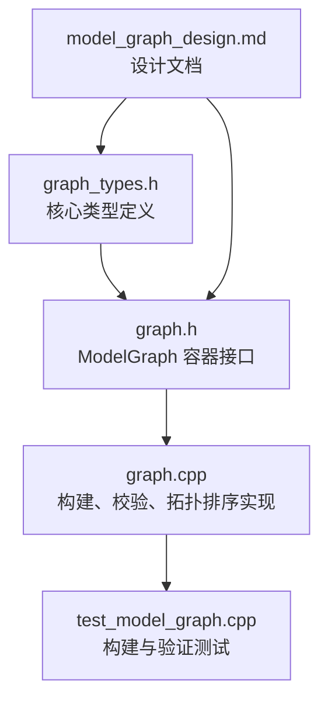
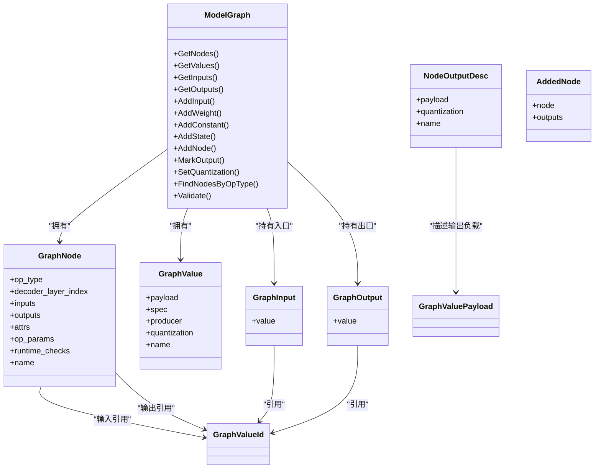
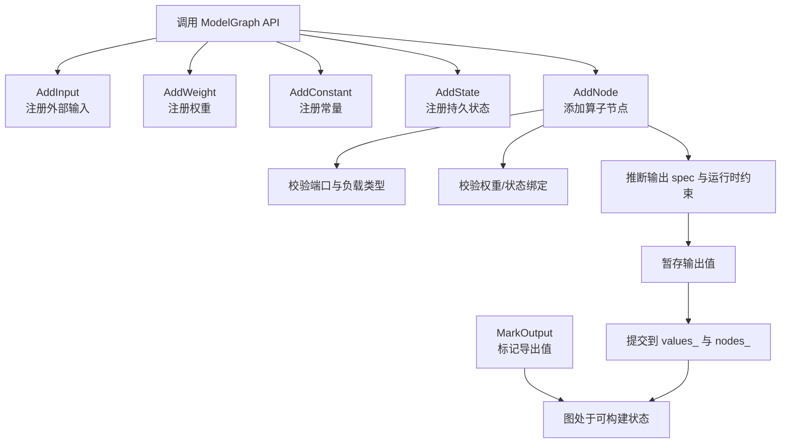
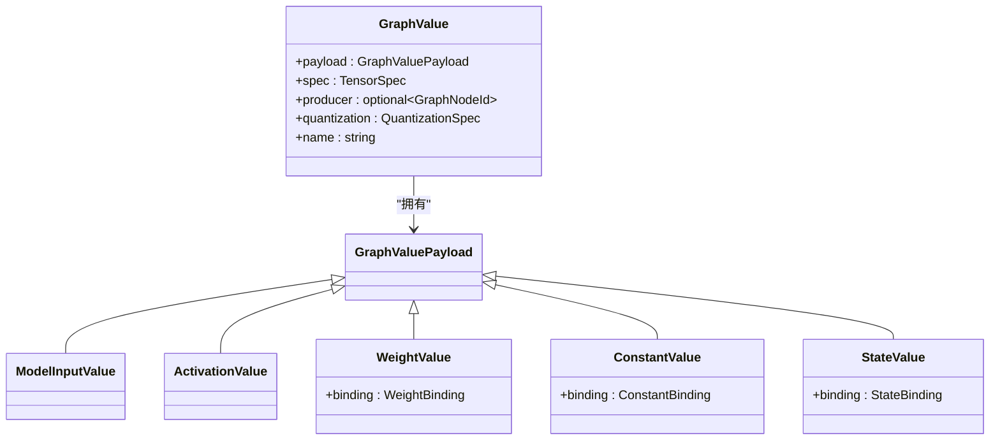
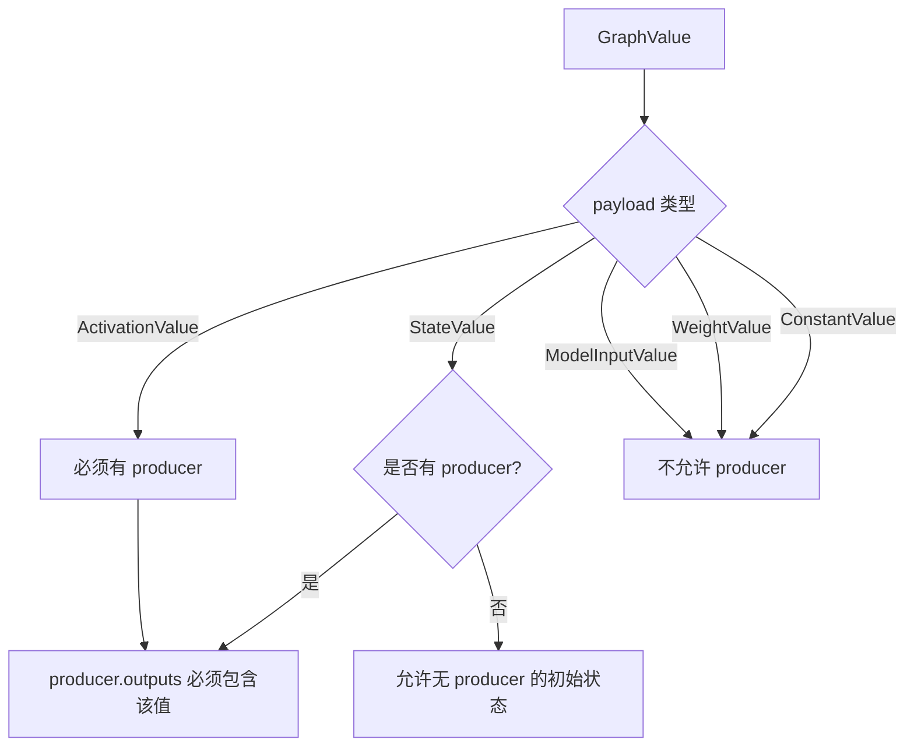
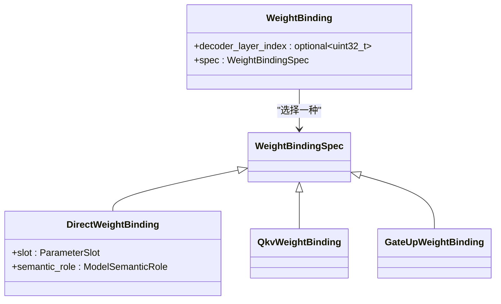
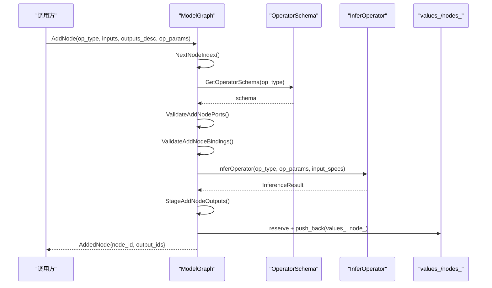
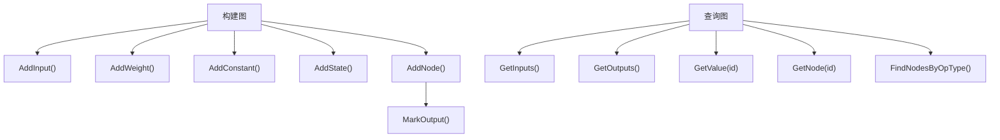
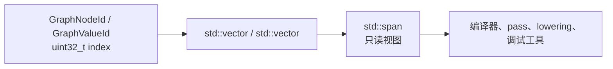
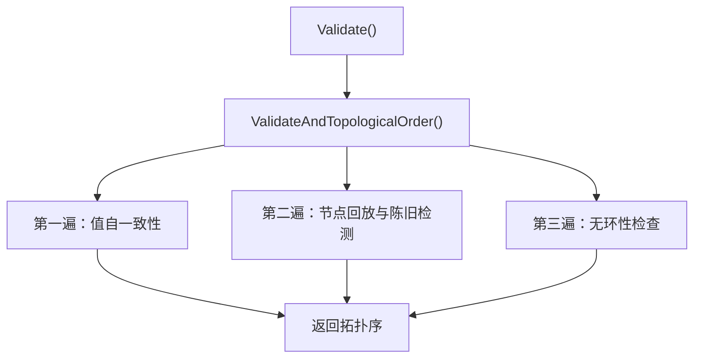

# 图 IR 核心数据结构

**本文引用的文件**
- [include/aethermind/graph/graph.h](../../../../include/aethermind/graph/graph.h)
- [include/aethermind/graph/graph_types.h](../../../../include/aethermind/graph/graph_types.h)
- [src/graph/graph.cpp](../../../../src/graph/graph.cpp)
- [tests/unit/graph/test_model_graph.cpp](../../../../tests/unit/graph/test_model_graph.cpp)
- [docs/archive/designs/model_graph_design.md](../../../archive/designs/model_graph_design.md)

## 目录
1. [引言](#引言)
2. [项目结构定位](#项目结构定位)
3. [核心类型总览](#核心类型总览)
4. [架构与所有权模型](#架构与所有权模型)
5. [值变体语义](#值变体语义)
6. [生产者—消费者关系模型](#生产者消费者关系模型)
7. [权重逻辑绑定机制](#权重逻辑绑定机制)
8. [节点生命周期与构建流程](#节点生命周期与构建流程)
9. [输入、输出与依赖查询](#输入输出与依赖查询)
10. [标识符设计与内存布局优化](#标识符设计与内存布局优化)
11. [快照与验证语义](#快照与验证语义)
12. [使用示例路径](#使用示例路径)
13. [性能特性](#性能特性)
14. [故障排查指南](#故障排查指南)
15. [结论](#结论)

## 引言
AetherMind 的图 IR 以 `ModelGraph` 为核心容器，表达“由算子节点连接张量值构成的有向无环图”。它描述模型的语义计算结构、值的生产消费关系、权重/常量/状态的逻辑引用方式，以及 shape、dtype、量化等元信息。执行侧的设备选择、内核调度、缓冲区分配等内容不属于该图 IR，而是由后续 lowering、计划与执行层处理。

本文件聚焦以下目标：
- 解释 `GraphNode`、`GraphValue`、`GraphInput`、`GraphOutput` 的职责和字段。
- 说明 `GraphValuePayload` 的变体语义及其五种有效负载类型。
- 分析 producer-consumer 关系如何编码在值与节点中。
- 说明直接权重绑定、QKV 权重绑定、Gate-Up 权重绑定的设计意图。
- 解释 `ModelGraph` 的所有权模型、生命周期管理、快照语义。
- 提供构建图、添加算子、注册输入输出、查询依赖关系的代码位置参考。
- 分析 `GraphNodeId` / `GraphValueId` 的设计与内存布局优化策略。

## 项目结构定位
图 IR 的核心定义位于 `include/aethermind/graph/graph_types.h`，容器 API 位于 `include/aethermind/graph/graph.h`，实现与校验逻辑位于 `src/graph/graph.cpp`。测试用例位于 `tests/unit/graph/test_model_graph.cpp`，高层设计文档位于 `docs/archive/designs/model_graph_design.md`。

**图表来源**
- [include/aethermind/graph/graph_types.h:1-441](../../../../include/aethermind/graph/graph_types.h#L1-L441)
- [include/aethermind/graph/graph.h:1-242](../../../../include/aethermind/graph/graph.h#L1-L242)
- [src/graph/graph.cpp:1-1115](../../../../src/graph/graph.cpp#L1-L1115)
- [tests/unit/graph/test_model_graph.cpp:1-2013](../../../../tests/unit/graph/test_model_graph.cpp#L1-L2013)
- [docs/archive/designs/model_graph_design.md](../../../archive/designs/model_graph_design.md)

**章节来源**
- [include/aethermind/graph/graph.h:1-40](../../../../include/aethermind/graph/graph.h#L1-L40)
- [include/aethermind/graph/graph_types.h:1-40](../../../../include/aethermind/graph/graph_types.h#L1-L40)

## 核心类型总览
图 IR 的核心类型可分为四类：

| 类别 | 类型 | 职责 |
|---|---|---|
| 容器 | `ModelGraph` | 拥有节点和值的存储，提供注册输入、权重、常量、状态、算子节点，以及查询、标记输出、验证、拓扑排序等 API。 |
| 节点 | `GraphNode` | 表示一个算子实例，包含操作类型、可选解码器层索引、输入值 ID 列表、输出值 ID 列表、属性、参数和运行时形状约束。 |
| 值 | `GraphValue` | 表示图中流动或驻留的张量值，包含 payload、TensorSpec、producer、量化方案和名称。 |
| 端口绑定 | `GraphInput` / `GraphOutput` | 分别表示从外部进入图的值和从图导出的值，仅保存被引用的 `GraphValueId`。 |
| 构造辅助 | `NodeOutputDesc` / `AddedNode` | 描述新增节点的输出声明和新增结果。 |

**图表来源**
- [include/aethermind/graph/graph.h:41-242](../../../../include/aethermind/graph/graph.h#L41-L242)
- [include/aethermind/graph/graph_types.h:317-441](../../../../include/aethermind/graph/graph_types.h#L317-L441)

**章节来源**
- [include/aethermind/graph/graph_types.h:317-441](../../../../include/aethermind/graph/graph_types.h#L317-L441)
- [include/aethermind/graph/graph.h:41-242](../../../../include/aethermind/graph/graph.h#L41-L242)

## 架构与所有权模型
`ModelGraph` 是 DAG IR 的唯一所有者。它内部维护三个主要容器：

| 容器 | 内容 | 生命周期语义 |
|---|---|---|
| `nodes_` | `std::vector<GraphNode>` | 追加式存储；通过 `GetNodes()` 返回只读 span。 |
| `values_` | `std::vector<GraphValue>` | 追加式存储；通过 `GetValues()` 返回只读 span。 |
| `inputs_` / `outputs_` | `std::vector<GraphInput>` / `std::vector<GraphOutput>` | 记录外部入口和导出出口的值 ID。 |

所有变更必须通过公开 API 进行，例如 `AddInput`、`AddWeight`、`AddConstant`、`AddState`、`AddNode`、`MarkOutput`、`SetQuantization`。这些方法负责维持内部一致性；而全局不变量（如 producer→output 往返一致性、无环性）由 `Validate()` 或 `ValidateAndTopologicalOrder()` 检查。

**图表来源**
- [src/graph/graph.cpp:630-867](../../../../src/graph/graph.cpp#L630-L867)
- [src/graph/graph.cpp:519-629](../../../../src/graph/graph.cpp#L519-L629)

**章节来源**
- [include/aethermind/graph/graph.h:41-130](../../../../include/aethermind/graph/graph.h#L41-L130)
- [src/graph/graph.cpp:630-867](../../../../src/graph/graph.cpp#L630-L867)

## 值变体语义
`GraphValue` 的数据流实体类型由 `GraphValuePayload` 表达，其底层是 `std::variant`。变体的类型本身充当 tag，不需要额外枚举。

| 变体成员 | 含义 | producer 是否应有值 |
|---|---|---|
| `std::monostate` | 构造期非法哨兵 | 否，`Validate()` 应拒绝 |
| `ModelInputValue` | 外部输入张量，例如 token ids | 否 |
| `ActivationValue` | 算子产生的中间激活 | 是 |
| `WeightValue` | 模型权重的逻辑引用 | 否 |
| `ConstantValue` | 编译期常量或命名常量 | 否 |
| `StateValue` | 跨执行步骤的持久状态 | 可能为否（初始状态），也可能为是（更新后的状态） |

**图表来源**
- [include/aethermind/graph/graph_types.h:360-405](../../../../include/aethermind/graph/graph_types.h#L360-L405)
- [include/aethermind/graph/graph_types.h:406-423](../../../../include/aethermind/graph/graph_types.h#L406-L423)

**章节来源**
- [include/aethermind/graph/graph_types.h:360-423](../../../../include/aethermind/graph/graph_types.h#L360-L423)
- [src/graph/graph.cpp:392-483](../../../../src/graph/graph.cpp#L392-L483)

## 生产者—消费者关系模型
图 IR 显式维护 producer 关系，而不是隐式推导消费者集合：

- `GraphValue.producer` 保存生产该值的节点 ID。
- `GraphNode.outputs` 保存该节点产出的所有值 ID。
- 对于 `ActivationValue`，`producer` 必须有值，且该节点必须将该值列入 `outputs`。
- 对于 `StateValue`，如果值是某个算子输出的更新后状态，则同样需要有效的 producer 和 output 列表项。
- `ModelInputValue`、`WeightValue`、`ConstantValue` 不能有 producer。

**图表来源**
- [src/graph/graph.cpp:392-483](../../../../src/graph/graph.cpp#L392-L483)
- [include/aethermind/graph/graph_types.h:406-423](../../../../include/aethermind/graph/graph_types.h#L406-L423)

**章节来源**
- [src/graph/graph.cpp:392-483](../../../../src/graph/graph.cpp#L392-L483)
- [include/aethermind/graph/graph_types.h:406-423](../../../../include/aethermind/graph/graph_types.h#L406-L423)

## 权重逻辑绑定机制
权重不是图 IR 中的物理数据，而是逻辑引用。`WeightBinding` 通过 `WeightBindingSpec` 表达三种绑定形式：

| 绑定类型 | 适用场景 | 关键规则 |
|---|---|---|
| `DirectWeightBinding` | 单个可直接寻址的权重，例如嵌入表、线性核、RMSNorm scale。 | 可选择携带 Transformer 语义角色；若角色要求每层，则必须有 `decoder_layer_index`。 |
| `QkvWeightBinding` | Q、K、V 拼接核。 | 固定为 Q/K/V 顺序；必须有 `decoder_layer_index`。 |
| `GateUpWeightBinding` | Gate、Up 拼接核。 | 固定为 Gate/Up 顺序；必须有 `decoder_layer_index`。 |

**图表来源**
- [include/aethermind/graph/graph_types.h:62-145](../../../../include/aethermind/graph/graph_types.h#L62-L145)
- [include/aethermind/graph/graph_types.h:146-200](../../../../include/aethermind/graph/graph_types.h#L146-L200)

权重绑定还会经历三层校验：

1. **自一致性**：直接绑定需满足 slot 与语义角色一致；每层角色必须正确携带或省略 `decoder_layer_index`；复合绑定必须携带 `decoder_layer_index`。
2. **算子兼容性**：某些算子要求直连绑定，某些算子要求特定复合绑定。
3. **层作用域匹配**：如果权重绑定指定了 `decoder_layer_index`，则消耗它的节点也必须具有相同层索引。

此外，对部分算子存在期望的 `ParameterSlot` 约束，例如 Embedding 期望 embedding table，RMSNorm/AddRmsNorm 期望 scale，Linear/QkvLinear/GateUpLinear 期望 kernel。

**章节来源**
- [include/aethermind/graph/graph_types.h:62-200](../../../../include/aethermind/graph/graph_types.h#L62-L200)
- [src/graph/graph.cpp:200-391](../../../../src/graph/graph.cpp#L200-L391)

## 节点生命周期与构建流程
`ModelGraph::AddNode` 是唯一可信的节点创建入口。它采用“先完全校验、再一次性提交”的流程，确保失败时图不被修改。

### 构建阶段
1. **Schema 查找与属性拒绝**：不允许使用未类型化的 attrs，必须使用 typed op params。
2. **端口校验**：输入数量、输出数量、输入 value ID 有效性、每个端口的 payload 类型必须匹配。
3. **绑定校验**：权重绑定自一致性、算子兼容性、层作用域；状态绑定合法性与算子特定的 KV cache 规则。
4. **规格推断**：调用 `InferOperator` 推导输出 spec 和运行时形状约束。
5. **输出暂存**：生成新的 `GraphValueId`，将 monostate 输出规范化为 `ActivationValue`，设置 producer 为当前节点。
6. **提交**：预构建完整 `GraphNode` 与 `AddedNode`，reserve 容器后移动写入。

**图表来源**
- [src/graph/graph.cpp:630-867](../../../../src/graph/graph.cpp#L630-L867)
- [src/graph/graph.cpp:519-629](../../../../src/graph/graph.cpp#L519-L629)

**章节来源**
- [src/graph/graph.cpp:630-867](../../../../src/graph/graph.cpp#L630-L867)

## 输入、输出与依赖查询
### 注册输入与导出输出
- `AddInput(TensorSpec, name)` 创建 `ModelInputValue`，并加入 `inputs_`。
- `MarkOutput(GraphValueId)` 将某个值标记为图导出端口。
- 图导出值必须是 `ActivationValue` 或 `ConstantValue`；如果是 activation，则必须有 producer。

### 查询依赖
- `GetInputs()` 返回外部输入端口。
- `GetOutputs()` 返回导出输出端口。
- `GetValue(id)` 获取具体值，用于检查 payload、spec、producer、quantization、name。
- `GetNode(id)` 获取节点，用于读取 inputs、outputs、op_type、op_params、name。
- `FindNodesByOpType(op_type)` 按操作类型扫描节点，适合 pass 级低频查询。

**图表来源**
- [include/aethermind/graph/graph.h:41-130](../../../../include/aethermind/graph/graph.h#L41-L130)
- [src/graph/graph.cpp:718-756](../../../../src/graph/graph.cpp#L718-L756)

**章节来源**
- [include/aethermind/graph/graph.h:41-130](../../../../include/aethermind/graph/graph.h#L41-L130)
- [src/graph/graph.cpp:718-756](../../../../src/graph/graph.cpp#L718-L756)

## 标识符设计与内存布局优化
### 标识符
`GraphNodeId` 和 `GraphValueId` 都是轻量结构体，内部仅有一个 `uint32_t index`。它们不封装容器指针，也不承担所有权，因此可以安全复制、比较、存入节点和值数组。

### 内存布局
- 节点和值存储在连续 `std::vector` 中，ID 直接作为下标。
- `GetNodes()` 与 `GetValues()` 返回 `std::span<const ...>`，避免拷贝。
- `GraphValue`、`GraphNode`、`AddedNode` 均声明为 nothrow move constructible/assignable，使 `AddNode` 的提交阶段具备逻辑上的异常安全保证。
- 常量值可使用共享指针内联数据，以便图拷贝时只增加引用计数而不深拷贝。
- `ModelGraphAttrs` 使用字节序列承载扩展属性，保持核心类型稳定。

**图表来源**
- [include/aethermind/graph/graph_types.h:317-359](../../../../include/aethermind/graph/graph_types.h#L317-L359)
- [include/aethermind/graph/graph_types.h:406-441](../../../../include/aethermind/graph/graph_types.h#L406-L441)
- [include/aethermind/graph/graph.h:57-100](../../../../include/aethermind/graph/graph.h#L57-L100)
- [src/graph/graph.cpp:758-765](../../../../src/graph/graph.cpp#L758-L765)

**章节来源**
- [include/aethermind/graph/graph_types.h:317-359](../../../../include/aethermind/graph/graph_types.h#L317-L359)
- [include/aethermind/graph/graph.h:57-100](../../../../include/aethermind/graph/graph.h#L57-L100)
- [src/graph/graph.cpp:758-765](../../../../src/graph/graph.cpp#L758-L765)

## 快照与验证语义
### 快照语义
`ModelGraph` 没有内置“不可变快照对象”。快照语义通常由上层通过以下方式实现：
- 保留旧 `ModelGraph` 副本，构建新图。
- 重写会话提交时复制图状态。
- 通过只读 span 暴露当前图状态给 pass、lowering 和调试工具。

### 验证语义
`Validate()` 委托给 `ValidateAndTopologicalOrder()`，后者完成三遍检查：

1. **值自一致性**：外部输入/输出引用合法；activation/state 的 producer 与 output 列表一致；weight/constant 无 producer；weight binding 自一致。
2. **节点回放与陈旧检测**：重新查找 schema、校验 arity、payload 类型、权重 slot、state 绑定；重新推断输出 spec 与 runtime_checks，并与存储值严格比较。
3. **无环性检查**：基于 Kahn 算法遍历 activation 边与已产生 state 边；权重和外部输入边不参与成环判断。

**图表来源**
- [src/graph/graph.cpp:868-1115](../../../../src/graph/graph.cpp#L868-L1115)

**章节来源**
- [src/graph/graph.cpp:868-1115](../../../../src/graph/graph.cpp#L868-L1115)

## 使用示例路径
以下示例不展示源码内容，仅提供实现与测试中的参考路径。

| 任务 | 参考位置 | 说明 |
|---|---|---|
| 构建 Embedding 图并注册输出 | [tests/unit/graph/test_model_graph.cpp:60-120](../../../../tests/unit/graph/test_model_graph.cpp#L60-L120) | 展示 `AddInput`、`AddWeight`、`AddNode`、`MarkOutput`。 |
| 添加 RmsNorm 节点 | [tests/unit/graph/test_model_graph.cpp:120-180](../../../../tests/unit/graph/test_model_graph.cpp#L120-L180) | 展示带 decoder layer index 的权重绑定。 |
| 注册 KV cache 状态 | [tests/unit/graph/test_model_graph.cpp:280-360](../../../../tests/unit/graph/test_model_graph.cpp#L280-L360) | 展示 `AddState`、`KVCacheStateBinding`、`KVCacheSlot`。 |
| 注册常量值 | [tests/unit/graph/test_model_graph.cpp:360-420](../../../../tests/unit/graph/test_model_graph.cpp#L360-L420) | 展示 `ConstantBinding` 的 inline data 与 name。 |
| 设置量化方案 | [tests/unit/graph/test_model_graph.cpp:420-460](../../../../tests/unit/graph/test_model_graph.cpp#L420-L460) | 展示 `SetQuantization`。 |
| 添加 KVCacheUpdate 节点 | [tests/unit/graph/test_model_graph.cpp:500-580](../../../../tests/unit/graph/test_model_graph.cpp#L500-L580) | 展示 state 输入输出与状态族校验。 |
| 错误路径：不同层的状态族 | [tests/unit/graph/test_model_graph.cpp:580-660](../../../../tests/unit/graph/test_model_graph.cpp#L580-L660) | 展示跨层 KV cache 绑定被拒绝。 |
| 错误路径：K/V slot 交换 | [tests/unit/graph/test_model_graph.cpp:660-740](../../../../tests/unit/graph/test_model_graph.cpp#L660-L740) | 展示 slot 不匹配被拒绝。 |

**章节来源**
- [tests/unit/graph/test_model_graph.cpp:60-120](../../../../tests/unit/graph/test_model_graph.cpp#L60-L120)
- [tests/unit/graph/test_model_graph.cpp:120-180](../../../../tests/unit/graph/test_model_graph.cpp#L120-L180)
- [tests/unit/graph/test_model_graph.cpp:280-360](../../../../tests/unit/graph/test_model_graph.cpp#L280-L360)
- [tests/unit/graph/test_model_graph.cpp:360-420](../../../../tests/unit/graph/test_model_graph.cpp#L360-L420)
- [tests/unit/graph/test_model_graph.cpp:420-460](../../../../tests/unit/graph/test_model_graph.cpp#L420-L460)
- [tests/unit/graph/test_model_graph.cpp:500-580](../../../../tests/unit/graph/test_model_graph.cpp#L500-L580)
- [tests/unit/graph/test_model_graph.cpp:580-660](../../../../tests/unit/graph/test_model_graph.cpp#L580-L660)
- [tests/unit/graph/test_model_graph.cpp:660-740](../../../../tests/unit/graph/test_model_graph.cpp#L660-L740)

## 性能特性
- **ID 访问成本低**：`GraphValueId` 和 `GraphNodeId` 是单整型，适合高频查找与序列化。
- **构建期零拷贝视图**：`GetNodes()`、`GetValues()`、`GetInputs()`、`GetOutputs()` 返回 span，避免重复分配。
- **提交阶段异常安全**：通过 nothrow move 断言保证提交不会留下半写状态。
- **扫描成本明确**：`FindNodesByOpType` 是线性扫描，注释明确指出不适合热路径。
- **常量值引用共享**：`ConstantBinding.inline_data` 使用共享指针，便于图拷贝时减少内存压力。
- **值与节点分离存储**：DAG 依赖通过 ID 引用，而非指针或嵌套对象，有利于序列化、重写和 pass 框架。

[本节为通用性能讨论，不直接分析具体代码片段]

## 故障排查指南
常见错误与对应诊断：

| 问题 | 典型原因 | 诊断依据 |
|---|---|---|
| 添加节点失败 | 输入数量或输出数量与 schema 不一致 | `ValidateAddNodePorts` |
| 输入端口类型不匹配 | 传入值 payload 与端口 `OperatorPortKind` 不一致 | `PayloadMatchesPort` |
| 权重绑定不合法 | 直连绑定 slot 与语义角色不一致，或缺少必要层索引 | `ValidateWeightBindingSelfConsistency` |
| 算子不支持复合权重 | 算子要求直连绑定但传入了 QKV/GateUp | `ValidateWeightBindingForOp` |
| 权重层索引与节点层不一致 | `decoder_layer_index` 不匹配 | `ValidateWeightBindingLayerForNode` |
| KV cache slot 错误 | K/V 输入或输出使用了错误的 slot | `ValidateStateBindingsForNode` |
| 状态族不一致 | K/V 状态属于不同 decoder layer 或不同 family | `SameStateCollection` |
| 导出值不是 activation 或 constant | 导出端口指向 weight/input/state | `ValidateAndTopologicalOrder` |
| activation 没有 producer | 值不是由任何节点产出 | `ValidateValueSelfConsistency` |
| 常量或权重有 producer | 外部值不应被节点产出 | `ValidateValueSelfConsistency` |

**章节来源**
- [src/graph/graph.cpp:200-391](../../../../src/graph/graph.cpp#L200-L391)
- [src/graph/graph.cpp:392-483](../../../../src/graph/graph.cpp#L392-L483)
- [src/graph/graph.cpp:519-629](../../../../src/graph/graph.cpp#L519-L629)
- [src/graph/graph.cpp:868-1115](../../../../src/graph/graph.cpp#L868-L1115)

## 结论
AetherMind 的图 IR 核心数据结构围绕 `ModelGraph`、`GraphNode`、`GraphValue` 构建，以轻量 ID、连续向量存储、span 视图和 variant payload 为基础，形成语义清晰、可扩展、易于 pass 和 lowering 消费的 DAG。值变体语义将数据分类与绑定元信息解耦；权重绑定机制区分直连权重与固定复合权重；producer-consumer 关系通过显式字段表达；构建流程通过多阶段校验与一次性提交保证内部一致性；验证流程通过回放推断和无环检查保障图的可执行语义。

**章节来源**
- [include/aethermind/graph/graph_types.h:62-441](../../../../include/aethermind/graph/graph_types.h#L62-L441)
- [include/aethermind/graph/graph.h:41-242](../../../../include/aethermind/graph/graph.h#L41-L242)
- [src/graph/graph.cpp:200-1115](../../../../src/graph/graph.cpp#L200-L1115)
- [docs/archive/designs/model_graph_design.md](../../../archive/designs/model_graph_design.md)
