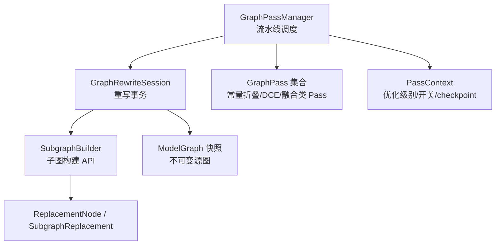
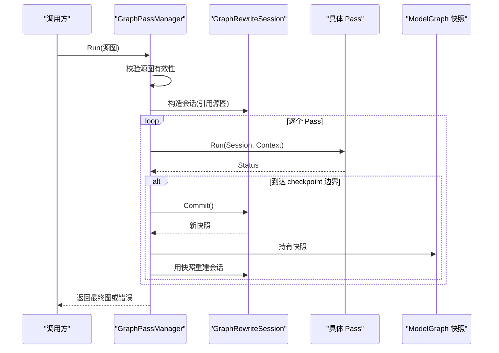
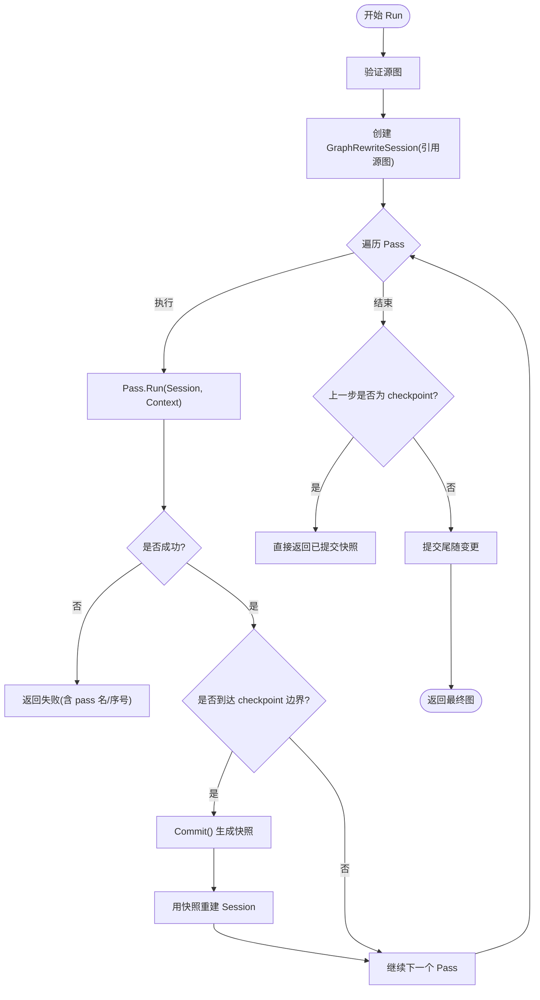
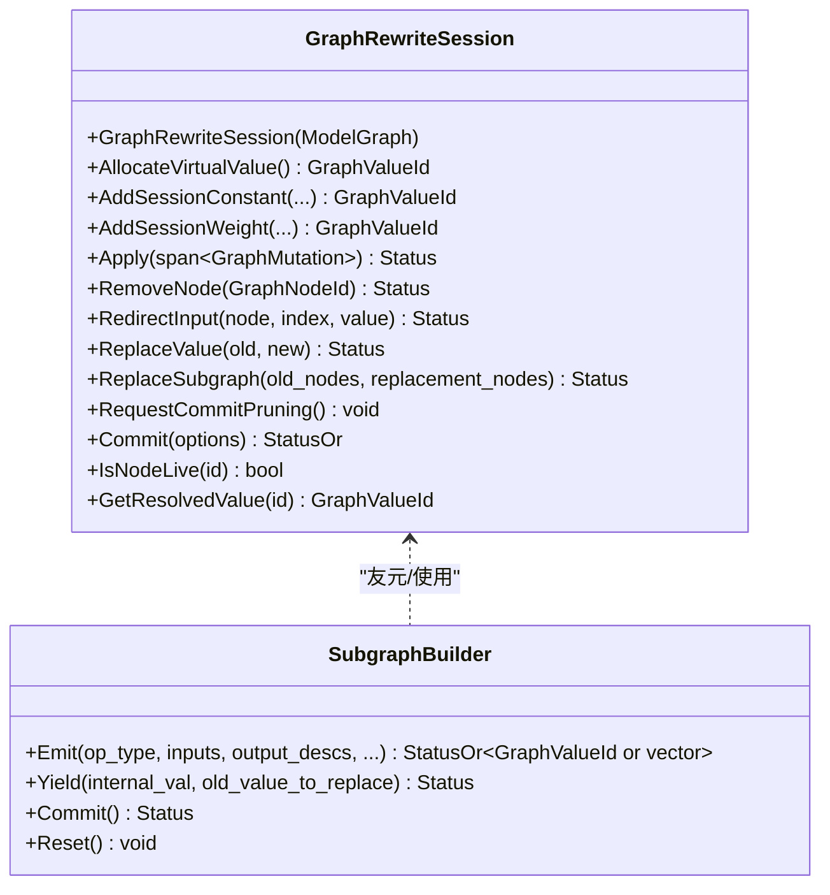
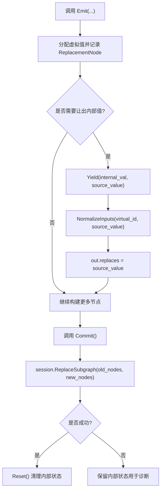
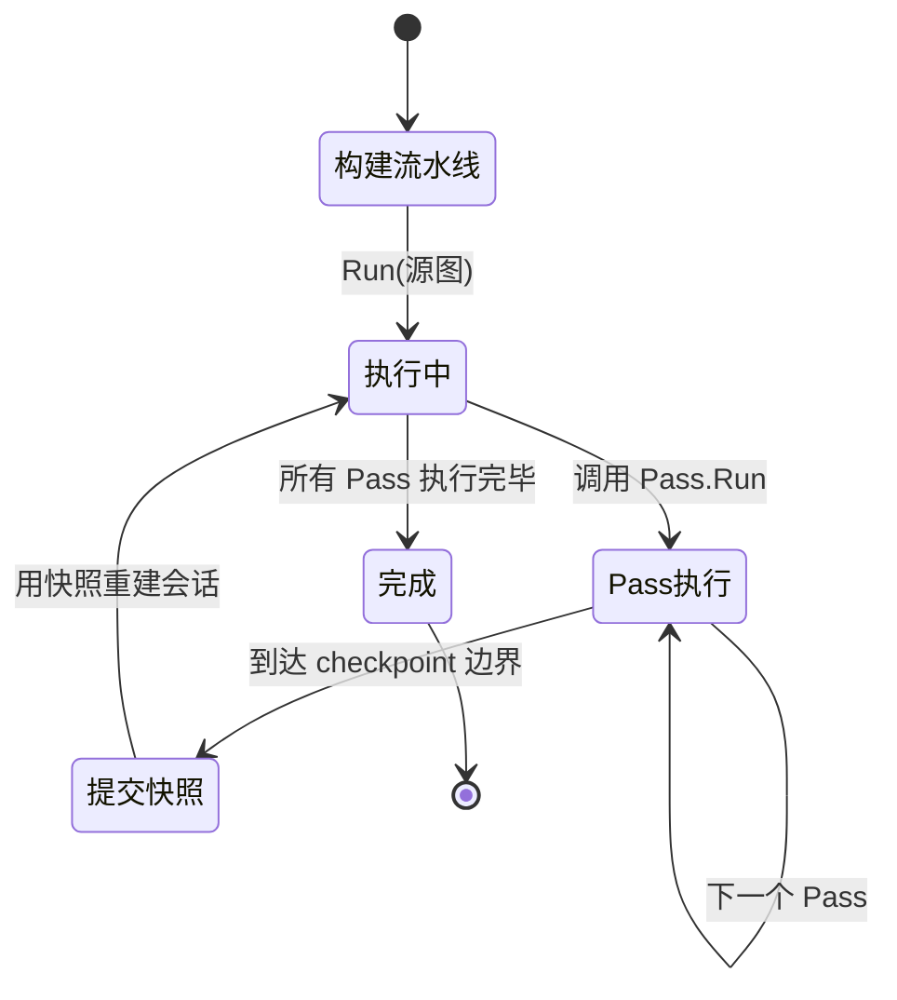
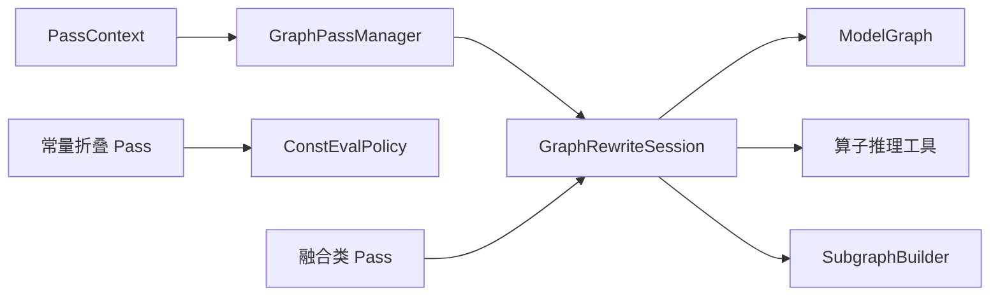

# 图优化框架

**本文引用的文件**
- [graph_pass_manager.h](../../../../include/aethermind/graph/optimization/graph_pass_manager.h)
- [graph_pass_manager.cpp](../../../../src/graph/optimization/graph_pass_manager.cpp)
- [graph_rewrite.h](../../../../include/aethermind/graph/optimization/graph_rewrite.h)
- [graph_rewrite.cpp](../../../../src/graph/optimization/graph_rewrite.cpp)
- [const_evaluator.h](../../../../include/aethermind/graph/optimization/const_evaluator.h)
- [add_rmsnorm_fusion_pass.cpp](../../../../src/graph/optimization/add_rmsnorm_fusion_pass.cpp)
- [gate_up_linear_fusion_pass.cpp](../../../../src/graph/optimization/gate_up_linear_fusion_pass.cpp)
- [qkv_linear_fusion_pass.cpp](../../../../src/graph/optimization/qkv_linear_fusion_pass.cpp)
- [silu_mul_fusion_pass.cpp](../../../../src/graph/optimization/silu_mul_fusion_pass.cpp)
- [constant_folding_pass.cpp](../../../../src/graph/optimization/constant_folding_pass.cpp)
- [dead_code_elimination_pass.cpp](../../../../src/graph/optimization/dead_code_elimination_pass.cpp)
- [test_graph_pass_manager.cpp](../../../../tests/unit/graph/optimization/test_graph_pass_manager.cpp)
- [test_graph_rewrite.cpp](../../../../tests/unit/graph/optimization/test_graph_rewrite.cpp)
- [test_commit_pruning.cpp](../../../../tests/unit/graph/optimization/test_commit_pruning.cpp)

## 目录
1. [引言](#引言)
2. [项目结构](#项目结构)
3. [核心组件](#核心组件)
4. [架构总览](#架构总览)
5. [详细组件分析](#详细组件分析)
6. [依赖关系分析](#依赖关系分析)
7. [性能与可扩展性](#性能与可扩展性)
8. [故障排查指南](#故障排查指南)
9. [结论](#结论)
10. [附录：自定义 Pass 开发指南](#附录自定义-pass-开发指南)

## 引言
AetherMind 的图优化框架围绕“有向无环图上的可组合重写”展开。其核心思想是：将图优化拆分为多个有序、状态无关的 Pass，通过 GraphPassManager 执行流水线；每个 Pass 在 GraphRewriteSession 提供的会话视图中对不可变源图进行增量改写，最终由 Commit 原子性地提交为新的 ModelGraph。SubgraphBuilder 提供面向子图替换的高级构建 API，帮助融合类 Pass 表达复杂的多节点替换语义。

该设计强调以下目标：
- 可观测、可恢复：Pass 顺序固定，支持周期性 checkpoint 快照。
- 原子性保证：Commit 前只记录增量，失败不会污染已提交快照。
- 增量更新：以值空间划分和映射表实现输入重定向、值替换与外部常量/权重复用。
- 扩展友好：自定义 Pass 只需实现 GraphPass 接口，并通过 PassContext 控制行为。

## 项目结构
图优化相关代码集中在 `include/aethermind/graph/optimization` 与 `src/graph/optimization` 中，按“基础设施 + 内置 Pass”的方式组织：
- 基础设施
  - GraphPass、PassContext、GraphPassManager：Pass 接口、配置与流水线调度。
  - GraphRewriteSession、SubgraphBuilder：重写事务、子图构建与提交。
- 内置 Pass
  - 常量折叠、死代码消除、QKV 线性融合、GateUp 线性融合、SiluMul 融合、Add+RMSNorm 融合等。

**图表来源**
- [graph_pass_manager.h:1-129](../../../../include/aethermind/graph/optimization/graph_pass_manager.h#L1-L129)
- [graph_rewrite.h:1-200](../../../../include/aethermind/graph/optimization/graph_rewrite.h#L1-L200)

**章节来源**
- [graph_pass_manager.h:1-129](../../../../include/aethermind/graph/optimization/graph_pass_manager.h#L1-L129)
- [graph_rewrite.h:1-200](../../../../include/aethermind/graph/optimization/graph_rewrite.h#L1-L200)

## 核心组件
- GraphPass：无状态优化步骤，暴露 Name() 与 Run(session, ctx)。
- PassContext：控制优化级别、各 Pass 开关、checkpoint 频率与常量求值策略。
- GraphPassManager：维护 Pass 列表与上下文，Run(graph) 返回新图或错误。
- GraphRewriteSession：基于不可变源图的增量重写视图，支持删除节点、重连输入、替换值、批量 Apply、提交 Commit。
- SubgraphBuilder：封装 ReplaceSubgraph，提供 Emit/Yield/Commit/Reset 的便捷 API。

**章节来源**
- [graph_pass_manager.h:24-129](../../../../include/aethermind/graph/optimization/graph_pass_manager.h#L24-L129)
- [graph_rewrite.h:68-200](../../../../include/aethermind/graph/optimization/graph_rewrite.h#L68-L200)

## 架构总览
GraphPassManager 负责编排；GraphRewriteSession 负责隔离读写；SubgraphBuilder 提升复杂替换的可读性与安全性。

**图表来源**
- [graph_pass_manager.cpp:31-94](../../../../src/graph/optimization/graph_pass_manager.cpp#L31-L94)

**章节来源**
- [graph_pass_manager.cpp:1-94](../../../../src/graph/optimization/graph_pass_manager.cpp#L1-L94)

## 详细组件分析

### GraphPassManager：Pass 执行流水线与 checkpoint 恢复
- 注册阶段
  - Add/AddSequential/SetCheckpointEvery 用于构建流水线。
  - 空 Pass 会被 AM_CHECK 快速拒绝，避免延迟到运行期才崩溃。
- 执行阶段
  - 先调用源图 Validate，确保拓扑与算子语义有效。
  - 依次调用各 Pass::Run，并在 checkpoint_every 边界提交会话到快照。
  - 若最后一步不是 checkpoint，则提交尾随的非 checkpoint 变更。
- 线程安全
  - 构造完成后，多个线程可对不同源图并发调用 Run。
- 错误处理
  - 每个 Pass 失败都会被包装为带 pass 名称与序号的错误信息。

**图表来源**
- [graph_pass_manager.cpp:31-94](../../../../src/graph/optimization/graph_pass_manager.cpp#L31-L94)

**章节来源**
- [graph_pass_manager.h:24-129](../../../../include/aethermind/graph/optimization/graph_pass_manager.h#L24-L129)
- [graph_pass_manager.cpp:1-94](../../../../src/graph/optimization/graph_pass_manager.cpp#L1-L94)

### GraphRewriteSession：重写事务机制与原子性
- 值空间模型
  - 源图值：index < 源图值数量。
  - 会话外部值：通过 AddSessionConstant/AddSessionWeight 添加，index >= 源图值数量。
  - 虚拟值：SubgraphBuilder 内部边，不持久化。
- 修改类型
  - RemoveNode：删除节点及其输出。
  - RedirectInput：重连某节点的某个输入端口。
  - ReplaceValue：将所有消费者从旧值切换到新值。
  - ReplaceSubgraph：整体替换一组节点为新节点集合。
- Apply 语义
  - 批量应用多种修改，非原子：若第 N 个失败，前面 0..N-1 已生效。
- 提交 Commit
  - 校验编辑合法性后，按拓扑序发射节点，处理重写与保留掩码。
  - 可选剪枝：RequestCommitPruning 或 options.force_prune_unreachable 时计算可达节点并丢弃不可达残留。
  - 最终再次 Validate 并提交新图。
- 缓存与一致性
  - 消费端索引缓存会在结构性变更后失效，下次按需重建。

**图表来源**
- [graph_rewrite.h:68-200](../../../../include/aethermind/graph/optimization/graph_rewrite.h#L68-L200)
- [graph_rewrite.h:683-750](../../../../include/aethermind/graph/optimization/graph_rewrite.h#L683-L750)

**章节来源**
- [graph_rewrite.h:1-200](../../../../include/aethermind/graph/optimization/graph_rewrite.h#L1-L200)
- [graph_rewrite.cpp:1-200](../../../../src/graph/optimization/graph_rewrite.cpp#L1-L200)
- [graph_rewrite.cpp:1408-1560](../../../../src/graph/optimization/graph_rewrite.cpp#L1408-L1560)

### SubgraphBuilder：子图构建 API
- Emit
  - 创建替换节点，分配虚拟值作为输出，供后续节点消费或 Yield 绑定。
  - 支持单输出和多输出两种重载。
- Yield
  - 将一个内部虚拟值“让出”给外部源图值，使消费者最终消费新节点输出。
  - 自动规范化后续仍引用该虚拟值的输入。
- NormalizeInputs
  - 统一把尚未绑定的虚拟值引用替换为对应源值，保证提交一致性。
- Commit
  - 调用 session.ReplaceSubgraph 提交累积的新节点；成功后 Reset 内部状态以便复用。
- Reset
  - 清空 builder 内部状态，便于重试；不影响已成功提交的会话效果。

**图表来源**
- [graph_rewrite.h:683-750](../../../../include/aethermind/graph/optimization/graph_rewrite.h#L683-L750)
- [graph_rewrite.cpp:2156-2314](../../../../src/graph/optimization/graph_rewrite.cpp#L2156-L2314)

**章节来源**
- [graph_rewrite.h:683-750](../../../../include/aethermind/graph/optimization/graph_rewrite.h#L683-L750)
- [graph_rewrite.cpp:2156-2314](../../../../src/graph/optimization/graph_rewrite.cpp#L2156-L2314)

### Pass 生命周期与上下文传递
- 生命周期
  - 构造 GraphPassManager 时收集 Pass 指针与 PassContext。
  - 每次 Run(graph) 重新执行流水线，Pass 实例本身保持无状态。
- 上下文传递
  - PassContext.opt_level 决定默认管线；enable_* 开关由各 Pass 在 Run 内自行判断。
  - const_eval_policy 通过 ConstEvalPolicy 控制常量求值策略，被常量折叠相关 Pass 使用。
- 检查点恢复
  - checkpoint_every 控制每 N 个 Pass 提交一次快照；失败 Pass 不会污染之前的快照。
  - 每次提交后重建 GraphRewriteSession，使其始终指向最新快照。

**图表来源**
- [graph_pass_manager.h:24-129](../../../../include/aethermind/graph/optimization/graph_pass_manager.h#L24-L129)
- [graph_pass_manager.cpp:31-94](../../../../src/graph/optimization/graph_pass_manager.cpp#L31-L94)

**章节来源**
- [graph_pass_manager.h:24-129](../../../../include/aethermind/graph/optimization/graph_pass_manager.h#L24-L129)
- [graph_pass_manager.cpp:1-94](../../../../src/graph/optimization/graph_pass_manager.cpp#L1-L94)

### 原子性、增量更新与依赖跟踪
- 原子性
  - GraphRewriteSession 在 Commit 之前仅记录增量（重写、重连、替换），不会直接修改源图。
  - GraphPassManager 的 checkpoint 机制保证失败 Pass 无法破坏已有快照。
- 增量更新
  - ReplaceValue 通过 value_map 映射消费者；RedirectInput 安装镜像重写节点以保持拓扑一致。
  - Apply 非原子：建议将一组强相关的修改放入同一 Apply 调用。
- 依赖跟踪
  - node_to_rewrite_ 与 rewrites_ 维护节点到改写的映射。
  - consumer_cache_ 缓存消费端索引，结构性变更后 InvalidateConsumerCache 失效。
  - Commit 阶段根据保留掩码与拓扑序输出节点，保证依赖关系正确。

**章节来源**
- [graph_rewrite.cpp:1-200](../../../../src/graph/optimization/graph_rewrite.cpp#L1-L200)
- [graph_rewrite.cpp:1408-1560](../../../../src/graph/optimization/graph_rewrite.cpp#L1408-L1560)

## 依赖关系分析
GraphPassManager 依赖 GraphRewriteSession；GraphRewriteSession 依赖 ModelGraph 及算子推理工具；SubgraphBuilder 是 GraphRewriteSession 的友元辅助对象。内置 Pass 依赖 PassContext 中的开关与常量求值策略。

**图表来源**
- [graph_pass_manager.h:1-129](../../../../include/aethermind/graph/optimization/graph_pass_manager.h#L1-L129)
- [graph_rewrite.h:1-200](../../../../include/aethermind/graph/optimization/graph_rewrite.h#L1-L200)

**章节来源**
- [graph_pass_manager.h:1-129](../../../../include/aethermind/graph/optimization/graph_pass_manager.h#L1-L129)
- [graph_rewrite.h:1-200](../../../../include/aethermind/graph/optimization/graph_rewrite.h#L1-L200)

## 性能与可扩展性
- 减少不必要的深拷贝
  - GraphPassManager 初始会话直接引用源图，仅在 checkpoint 时复制快照。
- 合理设置 checkpoint_every
  - 过小的 checkpoint 频率会增加提交开销；过大则失败回滚范围更大。
- 使用 RequestCommitPruning
  - 当存在大量不可达重写残留时启用剪枝，可减少提交后的无效节点。
- 批量 Apply
  - 将多个相关修改合并为一次 Apply，降低多次遍历和缓存失效成本。
- 避免虚拟值泄露
  - SubgraphBuilder 的虚拟值应在 Commit 前全部通过 Yield 绑定到源值，否则提交会报错。
- 谨慎使用 ReplaceValue
  - 该操作影响所有消费者，应确认语义等价后再使用；优先使用更局部的 RedirectInput 或 ReplaceSubgraph。

[本节为通用性能建议，未直接分析具体文件]

## 故障排查指南
- Pass 失败定位
  - GraphPassManager 会将失败 Pass 的名称与序号附加到错误消息中，便于定位流水线位置。
- 值 ID 越界或类型错误
  - CheckSourceValueId、CheckNonVirtualValueId、CheckKnownValueId 提供明确的 InvalidArgument 诊断。
- 虚拟值未绑定
  - SubgraphBuilder::Yield 会拒绝重复让出或未产生的虚拟值，并给出明确错误。
- 提交阶段错误
  - Commit 会先 ValidateEdits，再拓扑发射节点，任何映射缺失或不活跃重写都会导致失败。
- 测试参考
  - graph_pass_manager、graph_rewrite、commit_pruning 单元测试覆盖常见路径与异常分支。

**章节来源**
- [graph_pass_manager.cpp:31-94](../../../../src/graph/optimization/graph_pass_manager.cpp#L31-L94)
- [graph_rewrite.cpp:1408-1560](../../../../src/graph/optimization/graph_rewrite.cpp#L1408-L1560)
- [graph_rewrite.cpp:2156-2314](../../../../src/graph/optimization/graph_rewrite.cpp#L2156-L2314)
- [test_graph_pass_manager.cpp](../../../../tests/unit/graph/optimization/test_graph_pass_manager.cpp)
- [test_graph_rewrite.cpp](../../../../tests/unit/graph/optimization/test_graph_rewrite.cpp)
- [test_commit_pruning.cpp](../../../../tests/unit/graph/optimization/test_commit_pruning.cpp)

## 结论
AetherMind 图优化框架通过 GraphPassManager、GraphRewriteSession 与 SubgraphBuilder 的组合，实现了“有序 Pass + 原子提交 + 子图构建”的可扩展优化体系。Pass 无状态、上下文集中管理、checkpoint 保障失败隔离，使得复杂融合优化既安全又高效。遵循本文的开发指南与性能建议，可以稳步扩展新的优化 Pass 并维持系统的稳定性与可观测性。

[本节为总结性内容，未直接分析具体文件]

## 附录：自定义 Pass 开发指南

### 实现 GraphPass 接口
- 继承 GraphPass，实现 Name() 与 Run(session, ctx)。
- 在 Run 中使用 GraphRewriteSession 的 API 进行查询与修改，不要直接访问底层 ModelGraph。
- 使用 ctx.enable_* 开关控制本 Pass 的行为，即使未启用也应留在管线中但返回成功。

**章节来源**
- [graph_pass_manager.h:44-100](../../../../include/aethermind/graph/optimization/graph_pass_manager.h#L44-L100)

### 使用 GraphRewriteSession 进行重写
- 删除节点：RemoveNode。
- 重连输入：RedirectInput。
- 值级替换：ReplaceValue。
- 批量修改：Apply。
- 提交：Commit 由 GraphPassManager 控制；Pass 内通常不需要手动提交。

**章节来源**
- [graph_rewrite.h:68-200](../../../../include/aethermind/graph/optimization/graph_rewrite.h#L68-L200)

### 使用 SubgraphBuilder 构建复杂替换
- 使用 Emit 创建新节点，得到虚拟值。
- 使用 Yield 将虚拟值绑定到要替换的源图值。
- 使用 Commit 提交替换，必要时 Reset 以复用。

**章节来源**
- [graph_rewrite.h:683-750](../../../../include/aethermind/graph/optimization/graph_rewrite.h#L683-L750)
- [graph_rewrite.cpp:2156-2314](../../../../src/graph/optimization/graph_rewrite.cpp#L2156-L2314)

### 条件判断与上下文使用
- 通过 PassContext 中的 opt_level 与各 enable_* 字段决定是否执行优化逻辑。
- 常量求值策略通过 ConstEvalPolicy 控制，可在常量折叠 Pass 中依据策略选择求值路径。

**章节来源**
- [graph_pass_manager.h:24-60](../../../../include/aethermind/graph/optimization/graph_pass_manager.h#L24-L60)
- [const_evaluator.h](../../../../include/aethermind/graph/optimization/const_evaluator.h)

### 内置 Pass 参考实现
- 常量折叠：constant_folding_pass.cpp
- 死代码消除：dead_code_elimination_pass.cpp
- QKV 线性融合：qkv_linear_fusion_pass.cpp
- GateUp 线性融合：gate_up_linear_fusion_pass.cpp
- SiluMul 融合：silu_mul_fusion_pass.cpp
- Add+RMSNorm 融合：add_rmsnorm_fusion_pass.cpp

**章节来源**
- [constant_folding_pass.cpp](../../../../src/graph/optimization/constant_folding_pass.cpp)
- [dead_code_elimination_pass.cpp](../../../../src/graph/optimization/dead_code_elimination_pass.cpp)
- [qkv_linear_fusion_pass.cpp](../../../../src/graph/optimization/qkv_linear_fusion_pass.cpp)
- [gate_up_linear_fusion_pass.cpp](../../../../src/graph/optimization/gate_up_linear_fusion_pass.cpp)
- [silu_mul_fusion_pass.cpp](../../../../src/graph/optimization/silu_mul_fusion_pass.cpp)
- [add_rmsnorm_fusion_pass.cpp](../../../../src/graph/optimization/add_rmsnorm_fusion_pass.cpp)
