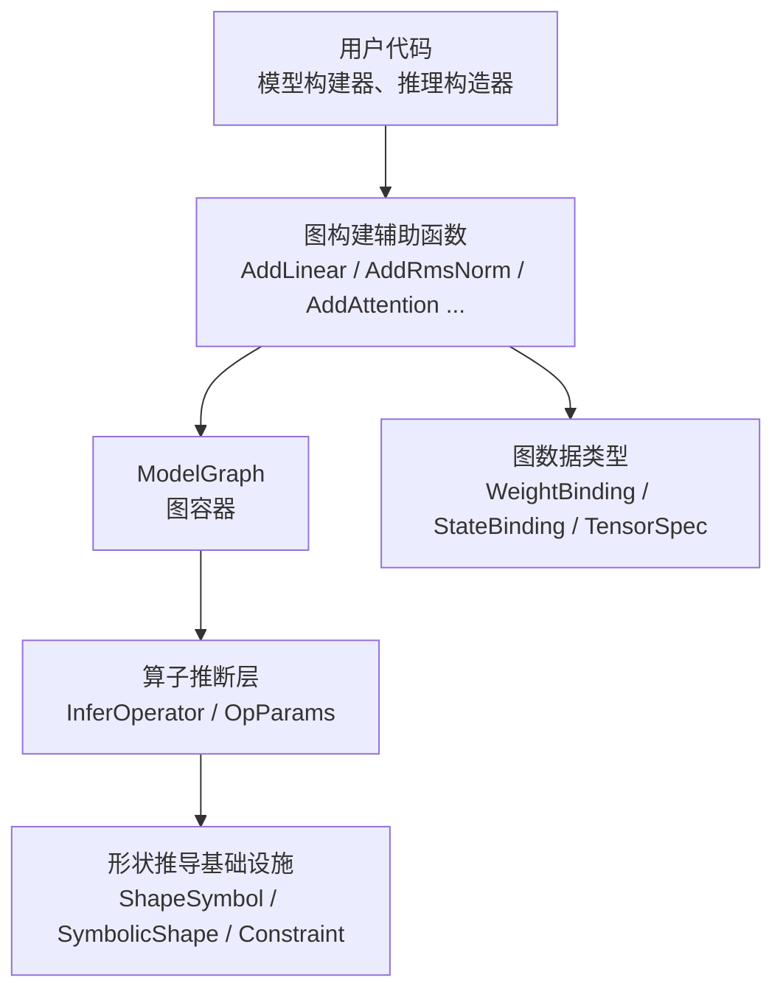
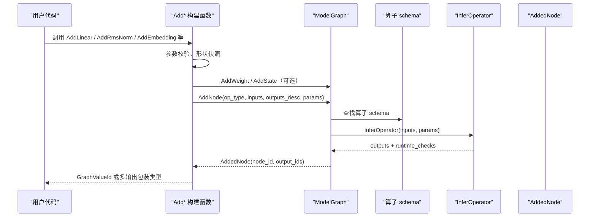
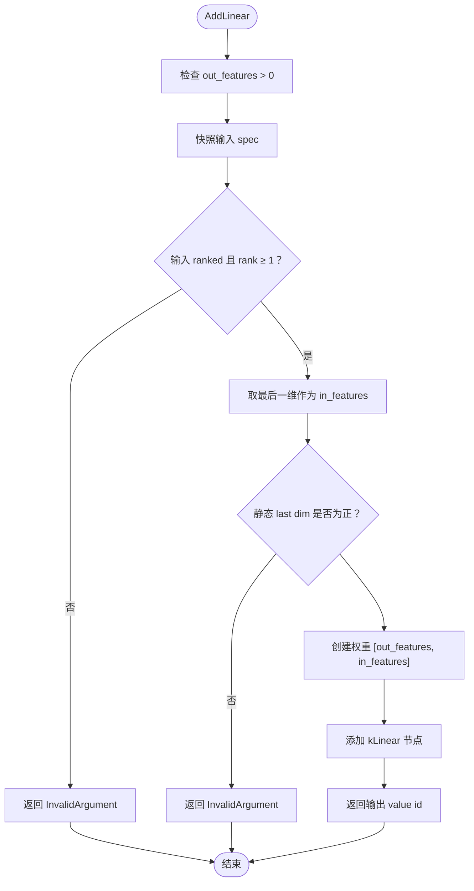
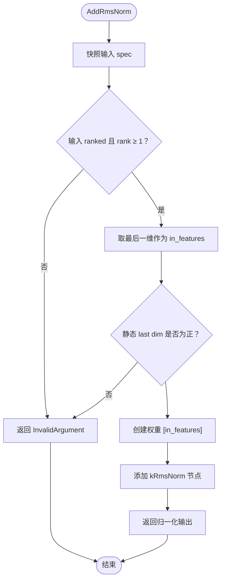
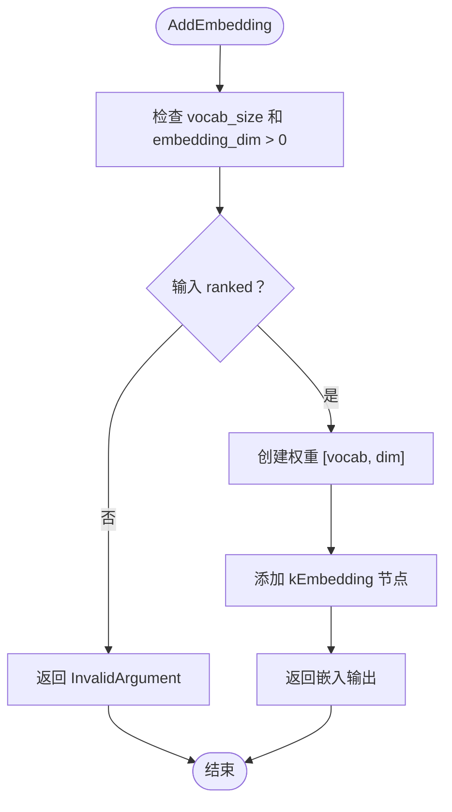
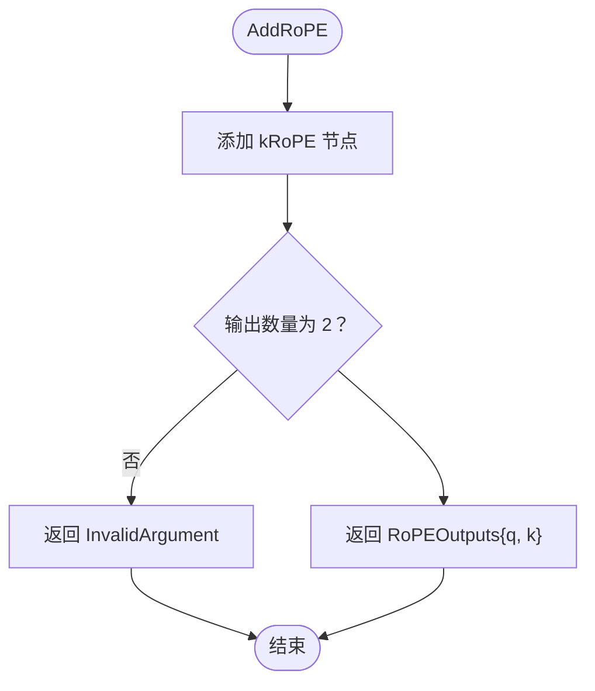
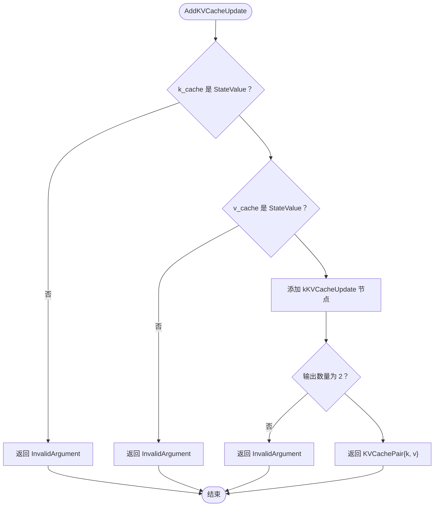
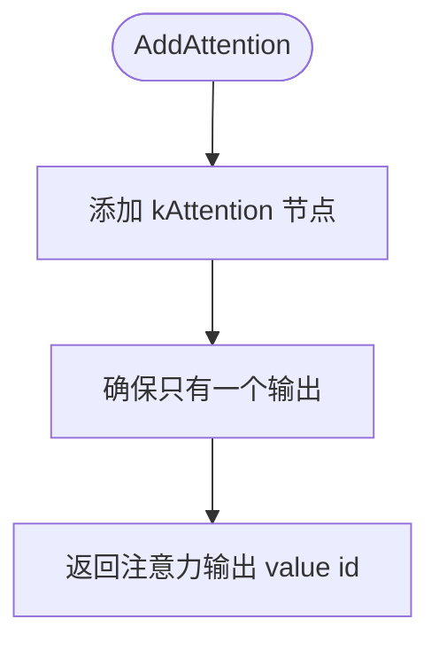
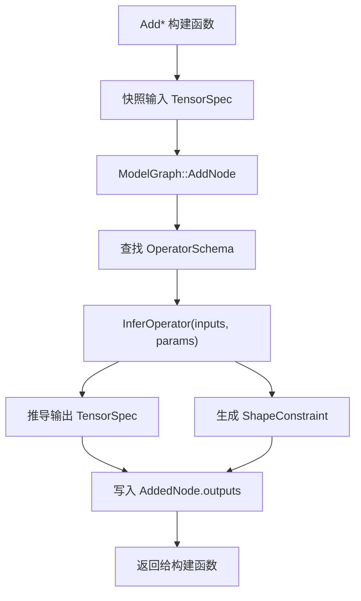
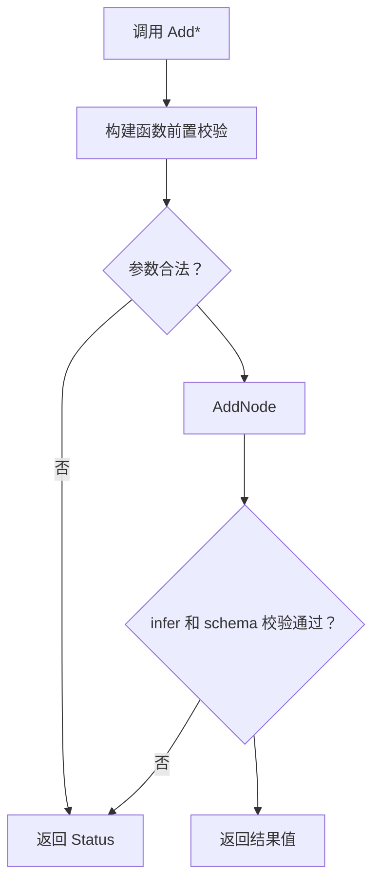

# 图构建 API

**本文引用的文件**
- [graph_op_builder.h](../../../../include/aethermind/graph/graph_op_builder.h)
- [graph_op_builder.cpp](../../../../src/graph/graph_op_builder.cpp)
- [graph_types.h](../../../../include/aethermind/graph/graph_types.h)
- [graph.h](../../../../include/aethermind/graph/graph.h)
- [op_params.h](../../../../include/aethermind/operators/op_params.h)
- [include/aethermind/shape_inference/](../../../../include/aethermind/shape_inference)
- [src/graph/](../../../../src/graph)
- [status.h](../../../../include/aethermind/base/status.h)
- [test_graph_op_builder.cpp](../../../../tests/unit/graph/test_graph_op_builder.cpp)

## 目录

1. [引言](#引言)
2. [项目结构定位](#项目结构定位)
3. [核心组件总览](#核心组件总览)
4. [架构与数据流](#架构与数据流)
5. [算子构建函数详解](#算子构建函数详解)
6. [高层构图 API 设计](#高层构图-api-设计)
7. [形状推导与自动连接机制](#形状推导与自动连接机制)
8. [错误处理与调试工具](#错误处理与调试工具)
9. [性能考虑因素](#性能考虑因素)
10. [最佳实践与常见模式](#最佳实践与常见模式)
11. [故障排查指南](#故障排查指南)
12. [结论](#结论)

## 引言

AetherMind 的图构建 API 围绕 `ModelGraph` 语义计算图展开，其目标是让使用者以接近模型语义的方式描述 Transformer、注意力、嵌入、归一化、KV Cache 等结构，而不必手动管理张量 ID、权重注册、节点输入输出声明和形状推导。

`GraphOpBuilder` 提供一组以 `Add` 前缀开头的高层构建函数，例如：

- `AddInput` / `AddState`：注册外部输入和持久状态；
- `AddLinear`：线性投影；
- `AddRmsNorm`：均方根归一化；
- `AddEmbedding`：词表嵌入查找；
- `AddRoPE`：旋转位置编码；
- `AddKVCacheUpdate`：KV Cache 增量更新；
- `AddAttention`：缩放点积注意力；
- `AddElementwiseAdd` / `AddElementwiseMul`：逐元素加法与乘法；
- `AddSiluMul` / `AddSilu`：激活组合；
- `AddCast` / `AddArgmax` / `AddReshape` / `AddPermute` / `AddReorder`：存储格式转换、索引选择和数据重排。

这些函数的共同职责是：

1. 验证输入参数、张量秩、dtype 和必要常量；
2. 创建或复用权重值；
3. 调用底层 `ModelGraph::AddNode` 添加算子节点；
4. 委托 `operators` 模块进行 dtype 与形状推导；
5. 返回结果张量的 `GraphValueId` 或多输出包装类型；
6. 在失败时保持图不变并返回 `Status`。

## 项目结构定位

图构建 API 位于 AetherMind 的 `graph` 模块中，属于 backend-independent 的语义 IR 层。它不决定具体设备、kernel、内存布局或执行计划，而是回答“模型由哪些算子和张量组成”。

**图表来源**
- [graph_op_builder.h:1-60](../../../../include/aethermind/graph/graph_op_builder.h#L1-L60)
- [graph.h:1-40](../../../../include/aethermind/graph/graph.h#L1-L40)
- [graph_types.h:1-30](../../../../include/aethermind/graph/graph_types.h#L1-L30)
- [include/aethermind/shape_inference/](../../../../include/aethermind/shape_inference)

**章节来源**
- [src/graph/](../../../../src/graph)
- [include/aethermind/shape_inference/](../../../../include/aethermind/shape_inference)

## 核心组件总览

| 组件 | 主要职责 | 关键接口或类型 |
|---|---|---|
| `ModelGraph` | 保存有向无环图、输入、输出、节点、张量值 | `AddInput`、`AddWeight`、`AddState`、`AddConstant`、`AddNode`、`MarkOutput`、`Validate` |
| `GraphOpBuilder` | 封装常用算子的语义构建流程 | `AddLinear`、`AddRmsNorm`、`AddEmbedding`、`AddAttention`、`AddRoPE`、`AddKVCacheUpdate` 等 |
| `TensorSpec` | 描述 dtype 和符号形状 | `dtype`、`shape` |
| `WeightBinding` | 逻辑权重绑定 | `decoder_layer_index`、`WeightBindingSpec` |
| `StateBinding` | 持久状态绑定 | KV Cache、解码状态、流式状态 |
| `OpParams` | 算子语义参数变体 | `LinearParams`、`RmsNormParams`、`AttentionParams`、`RoPEParams` 等 |
| `ShapeSymbol` / `SymbolicShape` | 静态维度、未知维度和符号维度 | `Create`、`CreateFromValue`、`Unknown`、`Join`、`Unify` |
| `ShapeConstraint` | 计划期无法证明、需运行期检查的形状约束 | `DimEqualConstraint`、`DimBroadcastableConstraint`、`DimPositiveConstraint` 等 |

**章节来源**
- [graph.h:1-120](../../../../include/aethermind/graph/graph.h#L1-L120)
- [graph_types.h:1-120](../../../../include/aethermind/graph/graph_types.h#L1-L120)
- [op_params.h:1-80](../../../../include/aethermind/operators/op_params.h#L1-L80)
- [include/aethermind/shape_inference/](../../../../include/aethermind/shape_inference)

## 架构与数据流

图构建的整体数据流如下：

**图表来源**
- [graph.h:60-120](../../../../include/aethermind/graph/graph.h#L60-L120)
- [graph_op_builder.cpp:1-60](../../../../src/graph/graph_op_builder.cpp#L1-L60)
- [include/aethermind/shape_inference/](../../../../include/aethermind/shape_inference)

### 关键设计要点

1. **语义优先**：API 描述的是模型语义，而不是 kernel ABI。
2. **原子性**：`ModelGraph::AddNode` 失败时图保持不变。
3. **延迟形状推导**：输出 `TensorSpec` 由 `InferOperator` 推导，调用者通常不需要显式指定输出形状。
4. **运行时约束**：计划期无法证明的形状关系会生成 `ShapeConstraint`，在执行阶段检查。
5. **逻辑绑定**：权重通过 `WeightBinding` 表达语义角色，而不是直接绑定到后端内存布局。

**章节来源**
- [src/graph/](../../../../src/graph)
- [graph.h:80-120](../../../../include/aethermind/graph/graph.h#L80-L120)

## 算子构建函数详解

### `AddInput` 与 `AddState`

`AddInput` 用于注册模型的外部输入张量，返回一个无 producer 的 `GraphValueId`。
`AddState` 用于注册持久状态，例如 KV Cache 的 K/V 缓存。

| 参数 | 含义 |
|---|---|
| `graph` | 要修改的图对象 |
| `spec` | 张量规格，包含 dtype 和形状 |
| `binding` | 状态绑定，例如 KV Cache 的 layer index 和 slot |
| `name` | 调试名称 |

典型用途包括：

- 输入 token IDs；
- 初始 KV Cache；
- 后续由注意力或 RoPE 消费的状态。

**章节来源**
- [graph_op_builder.h:14-40](../../../../include/aethermind/graph/graph_op_builder.h#L14-L40)
- [graph.h:40-80](../../../../include/aethermind/graph/graph.h#L40-L80)
- [test_graph_op_builder.cpp:450-485](../../../../tests/unit/graph/test_graph_op_builder.cpp#L450-L485)

### `AddLinear`

`AddLinear` 构建一个无偏置的线性算子，对应常见的密集投影。

#### 参数说明

| 参数 | 含义 |
|---|---|
| `input` | 激活输入值 ID |
| `out_features` | 输出特征数，即权重的行数 |
| `weight_dtype` | 权重 dtype |
| `binding` | 权重逻辑绑定，包含 decoder layer index 和语义角色 |
| `name` | 权重调试名称，内部追加 `.weight` |
| `output_dtype` | 可选输出 dtype，用于混合精度输出，如 LM Head 输出 FP32 |

#### 形状规则

- 输入必须是 ranked；
- 输入 rank 至少为 1；
- 最后一维若为静态值，必须为正；
- 权重形状为 `[out_features, in_features]`；
- `in_features` 使用输入最后一维的 `ShapeSymbol`，从而支持动态或符号维度；
- 输出 batch 维度保留，最后一维替换为 `out_features`。

#### 示例场景

- 注意力 Q/K/V 投影；
- MLP gate/up/down 投影；
- LM Head。

**图表来源**
- [graph_op_builder.cpp:40-120](../../../../src/graph/graph_op_builder.cpp#L40-L120)

**章节来源**
- [graph_op_builder.h:42-85](../../../../include/aethermind/graph/graph_op_builder.h#L42-L85)
- [graph_op_builder.cpp:40-120](../../../../src/graph/graph_op_builder.cpp#L40-L120)
- [test_graph_op_builder.cpp:220-310](../../../../tests/unit/graph/test_graph_op_builder.cpp#L220-L310)

### `AddRmsNorm`

`AddRmsNorm` 构建均方根归一化节点，并注册 scale 权重。

#### 参数说明

| 参数 | 含义 |
|---|---|
| `input` | 需要归一化的激活 |
| `weight_dtype` | scale 权重 dtype |
| `binding` | 权重绑定，例如 input norm、post attention norm、final norm |
| `eps` | 数值稳定性常数 |
| `name` | 权重调试名称 |

#### 形状规则

- 输入必须 ranked；
- 输入 rank 至少为 1；
- 最后一维若为静态值，必须为正；
- 权重形状为 `[in_features]`；
- 支持未知维度或符号维度，但最后维度的 identity 会被复制到权重 shape。

#### 典型用法

- Llama 风格的 RMSNorm；
- Transformer block 的前置或后置归一化。

**图表来源**
- [graph_op_builder.cpp:120-L170](../../../../src/graph/graph_op_builder.cpp#L120-L170)

**章节来源**
- [graph_op_builder.h:87-L115](../../../../include/aethermind/graph/graph_op_builder.h#L87-L115)
- [graph_op_builder.cpp:120-L170](../../../../src/graph/graph_op_builder.cpp#L120-L170)
- [test_graph_op_builder.cpp:270-L340](../../../../tests/unit/graph/test_graph_op_builder.cpp#L270-L340)

### `AddEmbedding`

`AddEmbedding` 构建词表嵌入查找节点。

#### 参数说明

| 参数 | 含义 |
|---|---|
| `token_ids` | 词表索引输入 |
| `vocab_size` | 词表大小 |
| `embedding_dim` | 嵌入维度 |
| `weight_dtype` | 嵌入表 dtype |
| `binding` | 语义绑定，通常为 token embedding |
| `params.output_dtype` | 可选输出 dtype，例如从 FP16 权重输出 FP32 |
| `name` | 权重调试名称 |

#### 形状规则

- `vocab_size` 和 `embedding_dim` 必须为正；
- 输入必须 ranked；
- 权重形状为 `[vocab_size, embedding_dim]`；
- 默认输出 dtype 跟随权重 dtype；
- 显式设置 `output_dtype` 时可实现混合精度查找输出。

**图表来源**
- [graph_op_builder.cpp:170-L205](../../../../src/graph/graph_op_builder.cpp#L170-L205)

**章节来源**
- [graph_op_builder.h:117-L145](../../../../include/aethermind/graph/graph_op_builder.h#L117-L145)
- [graph_op_builder.cpp:170-L205](../../../../src/graph/graph_op_builder.cpp#L170-L205)
- [test_graph_op_builder.cpp:20-L75](../../../../tests/unit/graph/test_graph_op_builder.cpp#L20-L75)
- [test_graph_op_builder.cpp:90-L110](../../../../tests/unit/graph/test_graph_op_builder.cpp#L90-L110)

### `AddRoPE`

`AddRoPE` 对 query 和 key 应用旋转位置编码，返回两个输出。

#### 参数说明

| 参数 | 含义 |
|---|---|
| `decoder_layer_index` | 所属 decoder layer |
| `q` | query |
| `k` | key |
| `position_ids` | 位置索引 |
| `params` | RoPE 参数，包含 head_dim、num_q_heads、num_kv_heads、算法配置等 |
| `name` | 节点调试名称 |

#### 返回值

返回 `RoPEOutputs`，包含旋转后的 q 和 k。

**图表来源**
- [graph_op_builder.cpp:205-L240](../../../../src/graph/graph_op_builder.cpp#L205-L240)

**章节来源**
- [graph_op_builder.h:147-L175](../../../../include/aethermind/graph/graph_op_builder.h#L147-L175)
- [graph_op_builder.cpp:205-L240](../../../../src/graph/graph_op_builder.cpp#L205-L240)
- [op_params.h:120-L220](../../../../include/aethermind/operators/op_params.h#L120-L220)
- [test_graph_op_builder.cpp:340-L410](../../../../tests/unit/graph/test_graph_op_builder.cpp#L340-L410)

### `AddKVCacheUpdate`

`AddKVCacheUpdate` 将新的 K/V 追加到持久 KV Cache，并返回更新后的状态。

#### 参数说明

| 参数 | 含义 |
|---|---|
| `decoder_layer_index` | 所属 decoder layer |
| `k_new` | 新 key |
| `v_new` | 新 value |
| `k_cache` | 现有 K 缓存 state |
| `v_cache` | 现有 V 缓存 state |
| `name` | 节点调试名称 |

#### 行为

- K/V cache 输入必须是 `StateValue`；
- 输出是两个新的 state value，分别继承 K/V 的 `StateBinding`；
- 如果任一缓存输入不是 state，返回错误。

**图表来源**
- [graph_op_builder.cpp:240-L285](../../../../src/graph/graph_op_builder.cpp#L240-L285)

**章节来源**
- [graph_op_builder.h:177-L200](../../../../include/aethermind/graph/graph_op_builder.h#L177-L200)
- [graph_op_builder.cpp:240-L285](../../../../src/graph/graph_op_builder.cpp#L240-L285)
- [test_graph_op_builder.cpp:340-L410](../../../../tests/unit/graph/test_graph_op_builder.cpp#L340-L410)
- [test_graph_op_builder.cpp:410-L450](../../../../tests/unit/graph/test_graph_op_builder.cpp#L410-L450)

### `AddAttention`

`AddAttention` 构建缩放点积注意力节点，接收 q、k、v，返回单个 activation。

#### 参数说明

| 参数 | 含义 |
|---|---|
| `decoder_layer_index` | 所属 decoder layer |
| `q` | query |
| `k` | key |
| `v` | value |
| `params` | 注意力参数，包含 num_q_heads、num_kv_heads、head_dim |
| `name` | 节点调试名称 |

**图表来源**
- [graph_op_builder.cpp:285-L310](../../../../src/graph/graph_op_builder.cpp#L285-L310)

**章节来源**
- [graph_op_builder.h:202-L220](../../../../include/aethermind/graph/graph_op_builder.h#L202-L220)
- [graph_op_builder.cpp:285-L310](../../../../src/graph/graph_op_builder.cpp#L285-L310)
- [op_params.h:220-L260](../../../../include/aethermind/operators/op_params.h#L220-L260)

### 逐元素与激活算子

| 函数 | 输入要求 | 输出行为 |
|---|---|---|
| `AddElementwiseAdd` | lhs 与 rhs dtype 相同 | NumPy 风格尾随广播；形状由 infer 推导 |
| `AddElementwiseMul` | lhs 与 rhs 的完整 `TensorSpec` 相等 | 逐元素乘积 |
| `AddSiluMul` | gate 与 up 的 `TensorSpec` 完全相等 | `silu(gate) * up` |
| `AddSilu` | 单输入 | SiLU 激活 |
| `AddCast` | target dtype 必须是标量 Float32、Float16 或 BFloat16，且不同于输入 dtype | 存储格式转换，形状不变 |
| `AddArgmax` | 单输入 | 输出 int64，减少轴被移除 |
| `AddReshape` | 目标形状由 `InferReshape` 推导 | 复制 quantization，保持元素顺序 |
| `AddPermute` | permutation 合法 | 复制 quantization |
| `AddReorder` | 单输入 | 记录行优先连续存储意图，形状和 quantization 不变 |

**章节来源**
- [graph_op_builder.h:222-L344](../../../../include/aethermind/graph/graph_op_builder.h#L222-L344)
- [graph_op_builder.cpp:310-L477](../../../../src/graph/graph_op_builder.cpp#L310-L477)
- [test_graph_op_builder.cpp:200-L270](../../../../tests/unit/graph/test_graph_op_builder.cpp#L200-L270)

## 高层构图 API 设计

### 为什么需要高层 API

如果没有 `GraphOpBuilder`，构建一个简单 Transformer 层可能需要：

1. 手动注册权重 tensor；
2. 手动命名权重；
3. 手动声明节点输入和输出；
4. 手动填充 `OpParams`；
5. 手动处理 shape 推导和 dtype 兼容性；
6. 手动处理多输出节点；
7. 手动维护 layer index 和 weight binding。

高层 API 把这些样板步骤封装起来，使调用者只关心模型语义。

### 对比思路

| 低层方式 | 高层 `Add*` 方式 |
|---|---|
| 直接调用 `AddNode` | 调用 `AddLinear`、`AddRmsNorm` 等 |
| 自己创建权重值 | 构建函数内部调用 `AddWeight` |
| 自己写 dtype 和 shape 检查 | 构建函数做前置检查，底层再做 schema 和 infer 校验 |
| 自己处理多输出 | 返回 `GraphValueId`、`RoPEOutputs`、`KVCachePair` |
| 容易遗漏 binding 或 layer index | 从 `WeightBinding` 或参数读取 |

### 原子性与一致性

`ModelGraph::AddNode` 的设计保证了：

- 先校验 schema、输入、输出、参数；
- 调用 `InferOperator` 推导输出 spec；
- 暂存输出值，再提交到节点和值存储；
- 任何失败都不会污染图状态。

这使得上层构建函数可以安全地分步验证，而不会留下半构造图。

**章节来源**
- [graph.h:60-L120](../../../../include/aethermind/graph/graph.h#L60-L120)
- [src/graph/](../../../../src/graph)

## 形状推导与自动连接机制

### 形状推导流程

**图表来源**
- [graph.h:60-L120](../../../../include/aethermind/graph/graph.h#L60-L120)
- [include/aethermind/shape_inference/](../../../../include/aethermind/shape_inference)

### 符号维度与自动连接

对于 `AddLinear` 和 `AddRmsNorm`，最后一维 `in_features` 不一定是静态整数，它可以是：

- 已知静态维度；
- 未知维度；
- 命名的符号维度。

构建函数会把输入的 `ShapeSymbol` 复用到权重 shape 中，从而建立输入与权重的维度等式。如果计划期无法证明相等，系统会在运行时检查该约束。

这带来以下好处：

- 支持 batch 维度和序列长度动态变化；
- 支持不同模型共享同一套构建逻辑；
- 避免调用者手写广播和 reshape；
- 把“能否确定”推迟到计划期或运行期。

### 广播与逐元素操作

`AddElementwiseAdd` 使用 NumPy 风格尾随广播：

- 标量可以与任意形状相加；
- `[2, 1]` 与 `[1, 3]` 可广播到 `[2, 3]`；
- dtype 必须在构建函数层面一致；
- 静态维度冲突会在 infer 阶段报错。

**章节来源**
- [graph_op_builder.cpp:310-L360](../../../../src/graph/graph_op_builder.cpp#L310-L360)
- [include/aethermind/shape_inference/](../../../../include/aethermind/shape_inference)
- [test_graph_op_builder.cpp:485-L518](../../../../tests/unit/graph/test_graph_op_builder.cpp#L485-L518)

## 错误处理与调试工具

### 错误处理模型

AetherMind 使用基于 `StatusCode` 的显式错误模型，而不是异常驱动的主控流。大多数 `Add*` 函数返回 `StatusOr<T>`：

- 成功时返回 `GraphValueId` 或包装类型；
- 失败时返回带错误码和消息的 `Status`；
- 失败时图保持不变。

常见错误码包括：

- `kInvalidArgument`：参数非法、形状不匹配、dtype 不支持；
- `kOutOfRange`：越界访问；
- `kInternal`：内部不一致；
- `kResourceExhausted`：资源不足；
- `kFailedPrecondition`：前置条件未满足。

**图表来源**
- [graph_op_builder.cpp:1-L60](../../../../src/graph/graph_op_builder.cpp#L1-L60)
- [status.h:1-L60](../../../../include/aethermind/base/status.h#L1-L60)

### 常见错误分类

| 错误类型 | 触发场景 | 建议修复 |
|---|---|---|
| Linear/RMSNorm 输入非 ranked | 传入 unranked 张量 | 确保输入有明确 rank |
| Linear/RMSNorm 最后一维静态为非正 | 最后一维为 0 或负数 | 修正 hidden size |
| Embedding vocab/embedding_dim 非正 | 词表或维度为 0 或负数 | 修正模型配置 |
| ElementwiseAdd dtype 不同 | 左右操作数 dtype 不一致 | 统一 dtype |
| SiluMul/ElementwiseMul spec 不匹配 | 形状或 dtype 不完全相等 | 对齐形状 |
| KVCacheUpdate 输入不是 state | 传入 activation 而非 KV state | 使用 `AddState` 注册缓存 |
| Cast target dtype 不受支持 | target 不是 Float32/Float16/BFloat16 | 改用受支持的 dtype |
| Cast 目标等于输入 dtype | 没有实际转换 | 删除冗余 cast |

### 调试工具

| 工具 | 用途 |
|---|---|
| `Status::ToString()` | 打印可读错误信息 |
| `Status::ok()` | 判断是否成功 |
| `graph.Validate()` | 检查图不变量、schema、producer 一致性、无环 |
| `graph.GetNodes()` / `GetValues()` | 检查已注册的节点和张量 |
| `graph.GetValue(id)` | 查询某个 value 的 spec、producer、payload |
| `graph_dump` | 文本形式 dump 图结构（诊断用途） |

**章节来源**
- [status.h:1-L120](../../../../include/aethermind/base/status.h#L1-L120)
- [graph.h:120-L200](../../../../include/aethermind/graph/graph.h#L120-L200)
- [src/graph/](../../../../src/graph)

## 性能考虑因素

### 构图阶段

- 构建函数会快照输入 spec，避免 `AddWeight` 或 `AddNode` 扩容后引用失效；
- `AddNode` 在提交前暂存输出，减少中间状态；
- 大量小图的频繁构建应避免不必要的重复解析；
- 不应在热路径中反复构造大型 `std::vector` 或字符串。

### 形状推导

- 符号维度允许 plan-time 延迟推导；
- 不可证明的等式会以 `ShapeConstraint` 形式延后到运行期；
- 广播推导可能产生 deferred axis，需要运行期协调；
- 过度依赖运行时 shape 校验会增加执行开销，应尽可能在 plan-time 固定形状。

### 图优化机会

AetherMind 的 graph 模块支持多种语义 pass，例如：

- 常量折叠；
- 死代码消除；
- QKV linear 融合；
- Gate-Up linear 融合；
- SiLU-Mul 融合；
- Add-RMSNorm 融合。

这些融合可以在编译期减少算子数量、合并内存访问和降低内核启动开销。

**章节来源**
- [graph_op_builder.cpp:1-L60](../../../../src/graph/graph_op_builder.cpp#L1-L60)
- [src/graph/](../../../../src/graph)
- [include/aethermind/shape_inference/](../../../../include/aethermind/shape_inference)

## 最佳实践与常见模式

### 构建 Transformer 层

推荐模式：

1. 输入经过归一化；
2. 注意力残差相加；
3. 第二个归一化；
4. MLP 使用 gate/up/down 投影；
5. 最终输出可接 LM Head。

对应的构建步骤通常是：

- `AddRmsNorm` → `AddLinear(Q)` / `AddLinear(K)` / `AddLinear(V)`；
- `AddRoPE` → `AddKVCacheUpdate` → `AddAttention`；
- `AddElementwiseAdd(hidden, attention)`；
- `AddRmsNorm` → `AddLinear(Gate)` → `AddLinear(Up)` → `AddLinear(Down)`；
- 可选：`AddSiluMul` 融合 gate 与 up。

**章节来源**
- [test_graph_op_builder.cpp:20-L110](../../../../tests/unit/graph/test_graph_op_builder.cpp#L20-L110)
- [graph_op_builder.h:42-L220](../../../../include/aethermind/graph/graph_op_builder.h#L42-L220)

### 构建注意力模块

推荐模式：

1. Q/K/V 来自独立的线性投影；
2. Q/K 应用 RoPE；
3. K/V 写入 KV Cache；
4. Attention 输出与输入残差相加；
5. 输出 dtype 可由上游控制，必要时用 `AddCast`。

注意：

- `AddRoPE` 返回两个输出；
- `AddKVCacheUpdate` 返回两个 state；
- `AddAttention` 只接受 q/k/v 三个输入。

**章节来源**
- [graph_op_builder.cpp:205-L310](../../../../src/graph/graph_op_builder.cpp#L205-L310)
- [test_graph_op_builder.cpp:340-L410](../../../../tests/unit/graph/test_graph_op_builder.cpp#L340-L410)

### 构建前馈网络

推荐模式：

- 使用两个线性投影分别表示 gate 和 up；
- 如果需要，使用 `AddSiluMul` 表达 `silu(gate) * up`；
- 再用 down projection 得到隐藏表示；
- 最终可通过 `AddReshape`、`AddPermute`、`AddReorder` 调整下游期望布局。

**章节来源**
- [graph_op_builder.cpp:360-L420](../../../../src/graph/graph_op_builder.cpp#L360-L420)
- [op_params.h:260-L391](../../../../include/aethermind/operators/op_params.h#L260-L391)

### 使用混合精度

- 权重可以是 FP16、BFloat16 或其他后端支持的格式；
- 激活输出可以通过 `output_dtype` 或 `AddCast` 转换为 FP32；
- Embedding 和 Linear 都支持显式 `output_dtype`；
- 注意 dtype 必须在构建函数和 infer 层都合法。

**章节来源**
- [graph_op_builder.h:60-L85](../../../../include/aethermind/graph/graph_op_builder.h#L60-L85)
- [graph_op_builder.h:117-L145](../../../../include/aethermind/graph/graph_op_builder.h#L117-L145)
- [graph_op_builder.cpp:420-L477](../../../../src/graph/graph_op_builder.cpp#L420-L477)

### 命名规范

- 为每个重要 value 设置 `name`；
- 权重名称通常附加 `.weight`；
- 输入、state、node 名称有助于调试 dump 和错误信息；
- name 不参与语义等价性，但影响可读性和诊断能力。

**章节来源**
- [graph_op_builder.cpp:170-L205](../../../../src/graph/graph_op_builder.cpp#L170-L205)
- [test_graph_op_builder.cpp:60-L110](../../../../tests/unit/graph/test_graph_op_builder.cpp#L60-L110)

## 故障排查指南

### 问题：构建函数返回 InvalidArgument

**常见原因**

- `out_features` 非正；
- 输入未标注 rank；
- 输入最后一维静态值为 0 或负数；
- Embedding 的 vocab 或 embedding_dim 非正；
- 逐元素操作 dtype 或 shape 不匹配；
- KV Cache 输入不是 state；
- Cast target dtype 不受支持或与输入相同。

**排查步骤**

1. 检查 `Status::ToString()` 的输出；
2. 确认输入 `TensorSpec` 是否 ranked；
3. 确认所有常量参数为正；
4. 确认 dtype 一致；
5. 对 KV Cache 使用 `AddState`；
6. 调用 `graph.Validate()` 检查整体图。

**章节来源**
- [graph_op_builder.cpp:40-L60](../../../../src/graph/graph_op_builder.cpp#L40-L60)
- [graph_op_builder.cpp:120-L205](../../../../src/graph/graph_op_builder.cpp#L120-L205)
- [graph_op_builder.cpp:310-L477](../../../../src/graph/graph_op_builder.cpp#L310-L477)

### 问题：形状推导失败

**常见原因**

- 广播维度冲突；
- 符号维度未能在 plan-time 统一；
- 输入 rank 与算子假设不一致；
- 目标 reshape 体积不等于输入体积。

**排查步骤**

1. 打印输入 spec；
2. 检查是否有符号维度；
3. 查看是否生成了运行时约束；
4. 对广播操作单独构造最小测试用例；
5. 使用 `AddReshape` / `AddPermute` 显式对齐形状。

**章节来源**
- [include/aethermind/shape_inference/](../../../../include/aethermind/shape_inference)
- [test_graph_op_builder.cpp:485-L518](../../../../tests/unit/graph/test_graph_op_builder.cpp#L485-L518)

### 问题：KV Cache 行为不符合预期

**常见原因**

- KV Cache 输入不是 `StateValue`；
- K/V state 绑定的 layer index 不一致；
- 误把 activation 当作 cache；
- RoPE 输出的 k 没有正确传给 KV Cache update。

**排查步骤**

1. 确认 `AddState` 注册了 K/V；
2. 确认 `AddKVCacheUpdate` 的 k_cache/v_cache 是 state；
3. 确认输出 state 继续传给下一层；
4. 检查 `StateBinding` 中的 slot 和 layer index。

**章节来源**
- [graph_op_builder.cpp:240-L285](../../../../src/graph/graph_op_builder.cpp#L240-L285)
- [test_graph_op_builder.cpp:340-L450](../../../../tests/unit/graph/test_graph_op_builder.cpp#L340-L450)

## 结论

AetherMind 的图构建 API 通过 `GraphOpBuilder` 把常用的 Transformer 构件抽象为一组语义清晰的 `Add*` 函数。它承担了参数验证、权重注册、形状推导、自动连接和错误传播的职责，使调用者能够以模型语义为中心构建图，而不是陷入底层节点、端口和形状的样板代码。

正确使用这套 API 的关键是：

- 理解每个构建函数的输入形状、dtype 和语义假设；
- 合理使用 `WeightBinding` 和 `StateBinding`；
- 信任 infer 推导，但在边界情况中主动校验；
- 使用 `Status` 和 `graph.Validate()` 尽早发现错误；
- 利用图优化 pass 减少运行时代价；
- 通过命名和调试工具提高可观测性。
