# 计算图系统 (Graph)

**本文引用的文件**
- [graph.h](../../../../include/aethermind/graph/graph.h)
- [graph_types.h](../../../../include/aethermind/graph/graph_types.h)
- [graph_op_builder.h](../../../../include/aethermind/graph/graph_op_builder.h)
- [graph.cpp](../../../../src/graph/graph.cpp)
- [graph_op_builder.cpp](../../../../src/graph/graph_op_builder.cpp)
- [optimize_graph.h](../../../../include/aethermind/compiler/optimize_graph.h)
- [optimize_graph.cpp](../../../../src/compiler/optimize_graph.cpp)
- [graph_pass_manager.h](../../../../include/aethermind/graph/optimization/graph_pass_manager.h)
- [graph_pass_manager.cpp](../../../../src/graph/optimization/graph_pass_manager.cpp)
- [graph_rewrite.h](../../../../include/aethermind/graph/optimization/graph_rewrite.h)
- [graph_rewrite.cpp](../../../../src/graph/optimization/graph_rewrite.cpp)
- [const_evaluator.h](../../../../include/aethermind/graph/optimization/const_evaluator.h)
- [const_evaluator.cpp](../../../../src/graph/optimization/const_evaluator.cpp)
- [constant_folding_pass.h](../../../../include/aethermind/graph/optimization/constant_folding_pass.h)
- [constant_folding_pass.cpp](../../../../src/graph/optimization/constant_folding_pass.cpp)
- [dead_code_elimination_pass.cpp](../../../../src/graph/optimization/dead_code_elimination_pass.cpp)
- [add_rmsnorm_fusion_pass.h](../../../../include/aethermind/graph/optimization/add_rmsnorm_fusion_pass.h)
- [add_rmsnorm_fusion_pass.cpp](../../../../src/graph/optimization/add_rmsnorm_fusion_pass.cpp)
- [op_removability_internal.cpp](../../../../src/graph/optimization/op_removability_internal.cpp)
- [architecture.md](../../../architecture.md)
- [src/graph/](../../../../src/graph)

## 目录
1. [引言](#引言)
2. [项目结构](#项目结构)
3. [核心数据结构](#核心数据结构)
4. [架构总览](#架构总览)
5. [详细组件分析](#详细组件分析)
6. [依赖与关系分析](#依赖与关系分析)
7. [性能与复杂度特征](#性能与复杂度特征)
8. [图构建、修改与优化示例](#图构建修改与优化示例)
9. [自定义优化 pass 开发指南](#自定义优化-pass-开发指南)
10. [故障排查](#故障排查)
11. [结论](#结论)

## 引言
AetherMind 的计算图系统以 `ModelGraph` 为中心，提供 backend-independent 的语义计算图 IR、节点与值的强类型表示、算子端口契约、以及基于重写会话的编译期优化框架。它不负责具体设备执行、内存分配或 kernel 调度；这些职责由 compiler、execution 和 backend 层承担。

本设计文档聚焦以下目标：
- 解释 Graph IR 的数据结构、节点与值模型、边关系。
- 说明算子注册、形状推导、常量折叠、死代码消除等编译期优化机制。
- 描述图遍历、依赖分析、拓扑排序等核心技术。
- 给出图构建、修改、优化的实现路径与参考位置。
- 提供扩展自定义优化 pass 的指导。

## 项目结构
计算图相关代码主要分布在 `include/aethermind/graph`、`src/graph`、`src/graph/optimization` 以及 `include/aethermind/compiler/optimize_graph.h` 中。

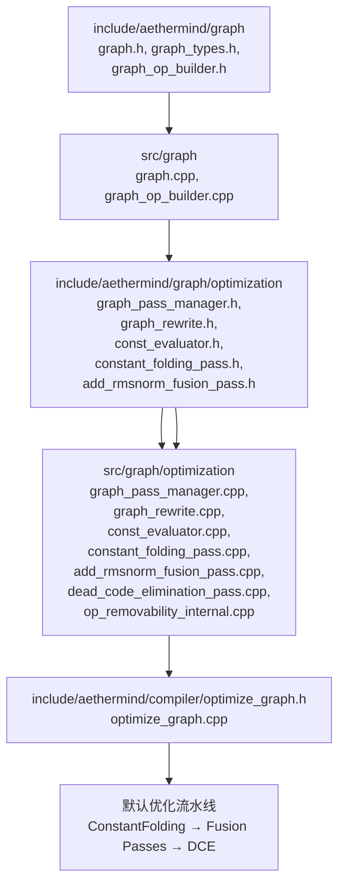

**图表来源**
- [graph.h:1-200](../../../../include/aethermind/graph/graph.h#L1-L200)
- [graph_types.h:201-441](../../../../include/aethermind/graph/graph_types.h#L201-L441)
- [graph_pass_manager.h:1-129](../../../../include/aethermind/graph/optimization/graph_pass_manager.h#L1-L129)
- [optimize_graph.cpp:1-40](../../../../src/compiler/optimize_graph.cpp#L1-L40)

**章节来源**
- [src/graph/](../../../../src/graph)
- [architecture.md](../../../architecture.md)

## 核心数据结构
### 标识符与基本容器
- `GraphNodeId` 与 `GraphValueId` 是轻量索引型标识符，不携带额外状态。
- `ModelGraph` 拥有节点向量、值向量、外部输入集合和输出标记集合。
- 查询接口返回 const span，保证在下次修改前有效。

关键职责：
- 提供添加输入、权重、常量、状态的入口。
- 提供添加算子节点的原子入口。
- 提供图校验、拓扑排序、按算子类型查找节点的能力。

**章节来源**
- [graph.h:1-200](../../../../include/aethermind/graph/graph.h#L1-L200)
- [graph.cpp:1-100](../../../../src/graph/graph.cpp#L1-L100)

### 值与节点
- `GraphValuePayload` 是五种 payload 的变体：空、模型输入、激活值、权重值、常量值、状态值。
- `GraphValue` 包含 payload、`TensorSpec`、可选 producer、量化规格和名称。
- `GraphNode` 包含算子类型、可选解码器层索引、输入值 id 列表、输出值 id 列表、属性、参数、运行时 shape 约束和名称。

重要规则：
- 激活值必须有有效的 producer，且 producer 必须将其列入 outputs。
- 权重值和常量值不能有 producer。
- 外部输入值也不能有 producer。
- state 值可以无 producer（初始状态），也可以由节点产生更新版本。

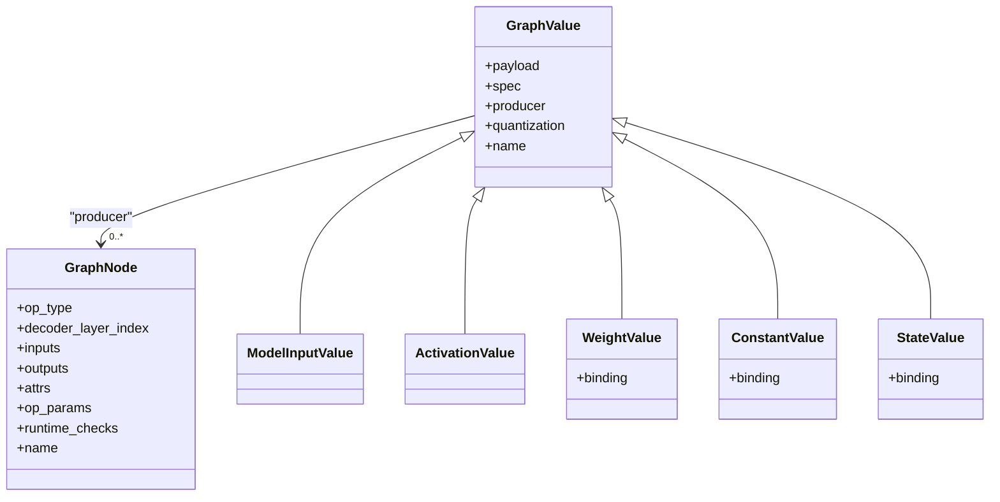

**图表来源**
- [graph_types.h:201-441](../../../../include/aethermind/graph/graph_types.h#L201-L441)

**章节来源**
- [graph_types.h:201-441](../../../../include/aethermind/graph/graph_types.h#L201-L441)
- [src/graph/](../../../../src/graph)

### 边与依赖模型
图的边不是显式存储为邻接表，而是通过两种方式表达依赖：
- def-use：`GraphValue::producer` 指向生产该激活值或状态值的节点。
- use-def：`GraphNode::inputs` 引用被消费的值 id。

消费者索引不是持久存储，而是在需要时从原图中按需派生，避免维护双向边的复杂性和一致性成本。

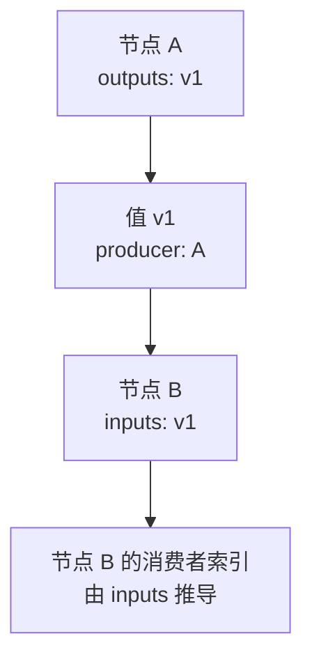

**图表来源**
- [graph_types.h:201-441](../../../../include/aethermind/graph/graph_types.h#L201-L441)
- [graph.cpp:201-350](../../../../src/graph/graph.cpp#L201-L350)

**章节来源**
- [src/graph/](../../../../src/graph)
- [graph.cpp:201-350](../../../../src/graph/graph.cpp#L201-L350)

## 架构总览
AetherMind 的系统架构将计算图语义层放在模型加载之后、compiler lowering 之前。图模块负责语义 DAG、重写框架和 semantic passes；compiler 负责优化流水线组合、lowering 和编译产物。

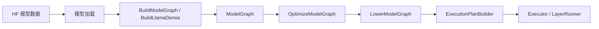

**图表来源**
- [architecture.md](../../../architecture.md)
- [optimize_graph.cpp:1-40](../../../../src/compiler/optimize_graph.cpp#L1-L40)

**章节来源**
- [architecture.md](../../../architecture.md)
- [src/graph/](../../../../src/graph)

## 详细组件分析

### ModelGraph 与算子添加流程
`ModelGraph::AddNode` 是添加算子的唯一原子入口。其核心流程如下：

1. 拒绝非空图级属性字节。
2. 查找算子 schema。
3. 校验输入数量、输出描述数量。
4. 校验每个输入的 value id 是否有效，以及 payload kind 是否与 schema 端口 kind 匹配。
5. 归一化 monostate 输出为 ActivationValue。
6. 校验 weight binding 自洽性、recipe 兼容性、slot 匹配和 layer 匹配。
7. 校验 state binding 自洽性，并对 KVCacheUpdate 和 Attention 做 slot、layer、family、collection 检查。
8. 收集输入 spec，调用 `InferOperator` 推导输出 spec 和运行时 shape 约束。
9. 暂存输出值与 id，再提交节点与值。

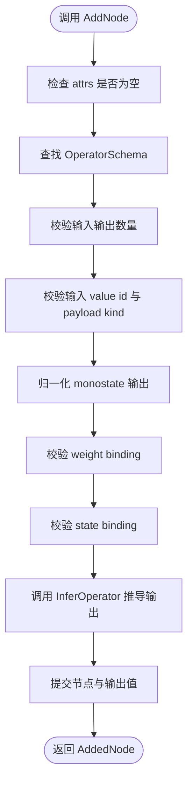

**图表来源**
- [graph.cpp:1-200](../../../../src/graph/graph.cpp#L1-L200)
- [graph.cpp:201-518](../../../../src/graph/graph.cpp#L201-L518)

**章节来源**
- [graph.h:1-200](../../../../include/aethermind/graph/graph.h#L1-L200)
- [graph.cpp:1-200](../../../../src/graph/graph.cpp#L1-L200)
- [graph.cpp:201-518](../../../../src/graph/graph.cpp#L201-L518)

### 值与节点的生命周期及不变量
`Validate()` 对图进行整体不变量检查，包括：
- 所有 value id 有效。
- 每个值的 payload 合法。
- 生产者与输出列表一致。
- 权重绑定自洽。
- 常量值和权重值没有 producer。
- 外部输入没有 producer。
- 图无环。

对于 KV cache 状态，验证逻辑确保：
- K 输入使用 Key slot。
- V 输入使用 Value slot。
- 输入与输出状态共享 state family。
- 层索引与节点层索引匹配。
- K/V 输入属于同一 state collection。

**章节来源**
- [graph.cpp:1-200](../../../../src/graph/graph.cpp#L1-L200)
- [graph.cpp:201-518](../../../../src/graph/graph.cpp#L201-L518)

### 构图辅助函数
构图辅助函数位于 `graph_op_builder.h` 与 `graph_op_builder.cpp`，封装常见算子的构造细节：

- `AddLinear`：要求 out_features 为正，输入 ranked，最后一维 static 时为正；weight 形状为 `[out_features, in_features]`。
- `AddRmsNorm`：要求输入 ranked，weight 形状为 `[in_features]`。
- `AddEmbedding`：vocab_size 与 embedding_dim 必须为正。
- `AddRoPE`：返回旋转后的 q 和 k。
- `AddKVCacheUpdate`：返回更新后的 k/v 状态。
- `AddAttention`：接收 q/k/v，返回注意力输出。
- `AddElementwiseAdd`：要求 lhs/rhs dtype 相同。
- `AddSiluMul`、`AddElementwiseMul`、`AddSilu`、`AddCast`、`AddArgmax`、`AddReshape`、`AddPermute`、`AddReorder`：分别处理对应算子并复制输入 quantization 到输出。

这些 helper 会在修改图之前快照输入 spec，避免扩容导致引用失效；失败时保持图不变。

**章节来源**
- [graph_op_builder.h:1-200](../../../../include/aethermind/graph/graph_op_builder.h#L1-L200)
- [graph_op_builder.cpp:1-200](../../../../src/graph/graph_op_builder.cpp#L1-L200)
- [graph_op_builder.cpp:201-477](../../../../src/graph/graph_op_builder.cpp#L201-L477)

### 图重写与会话
`GraphRewriteSession` 是优化 pass 修改图的统一视图。它不直接修改原始 `ModelGraph`，而是记录重写字段并提交增量。

支持的 mutation：
- `SubgraphReplacement`：替换一组旧节点为一组新节点。
- `NodeRemoval`：删除单个节点。
- `InputRedirection`：重定向某个节点的某个输入。
- `ReplaceValue`：将旧值重定向到新值。

会话管理三类值 id：
- source values：原始图中的值。
- session external values：通过 `AddSessionConstant` / `AddSessionWeight` 添加的值。
- virtual values：replacement 子图内部使用的虚拟值。

Commit 时会生成新的 `ModelGraph`，并可裁剪不可达残留。

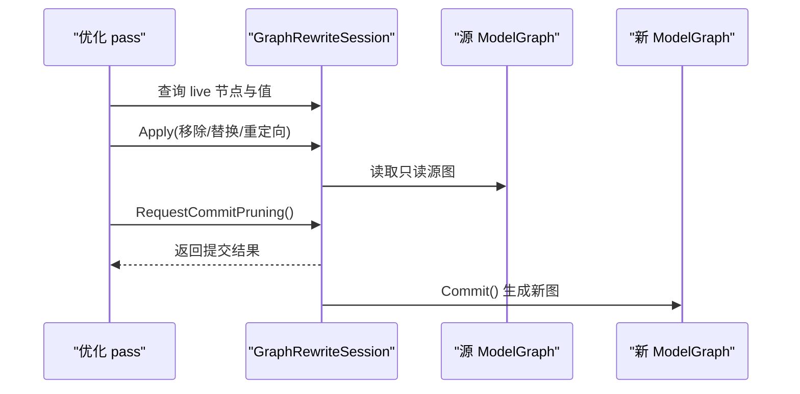

**图表来源**
- [graph_rewrite.h:1-200](../../../../include/aethermind/graph/optimization/graph_rewrite.h#L1-L200)
- [graph_rewrite.cpp:1-200](../../../../src/graph/optimization/graph_rewrite.cpp#L1-L200)

**章节来源**
- [graph_rewrite.h:1-200](../../../../include/aethermind/graph/optimization/graph_rewrite.h#L1-L200)
- [graph_rewrite.cpp:1-200](../../../../src/graph/optimization/graph_rewrite.cpp#L1-L200)
- [src/graph/](../../../../src/graph)

### 优化 pass 框架
`GraphPass` 是无状态接口，`GraphPassManager` 管理 pass 顺序和 checkpoint。

关键特性：
- `Run()` 是 `const noexcept`，pass 通过返回 `Status` 报告错误。
- `PassContext` 控制 opt_level、checkpoint 频率和各 pass 开关。
- `GraphPassManager::Run()` 先调用 `Validate()`，再顺序执行 pass。
- 支持 checkpoint：每 N 个 pass 提交一次 immutable snapshot，失败不会污染前面结果。

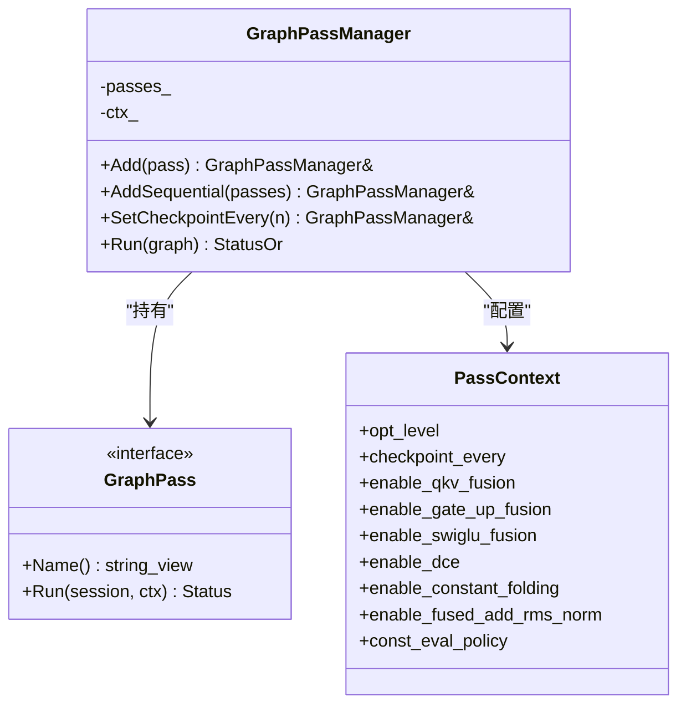

**图表来源**
- [graph_pass_manager.h:1-129](../../../../include/aethermind/graph/optimization/graph_pass_manager.h#L1-L129)

**章节来源**
- [graph_pass_manager.h:1-129](../../../../include/aethermind/graph/optimization/graph_pass_manager.h#L1-L129)
- [graph_pass_manager.cpp:1-94](../../../../src/graph/optimization/graph_pass_manager.cpp#L1-L94)

### 常量折叠优化
常量折叠 pass 遍历拓扑序中的节点，筛选满足条件的可折叠算子：
- 算子 schema 标记为可编译期求值。
- 找到注册的 `ConstEvaluator`。
- 所有输入都是内联常量值。
- evaluator 的 Plan 成功且未超过预算。

常量求值采用两阶段合约：
- `Plan(inputs, outputs, params, policy)`：可行性检查、布局描述、成本估计。
- `Evaluate(inputs, outputs, params)`：写入实际字节。

当前注册的 evaluator 包括 Add、ElementwiseMul、Silu、SiluMul、Cast。

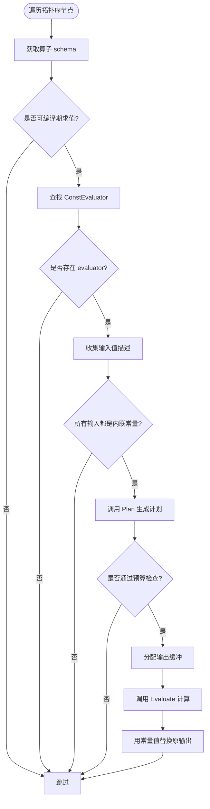

**图表来源**
- [constant_folding_pass.cpp:1-200](../../../../src/graph/optimization/constant_folding_pass.cpp#L1-L200)
- [const_evaluator.h:1-189](../../../../include/aethermind/graph/optimization/const_evaluator.h#L1-L189)
- [const_evaluator.cpp:1-36](../../../../src/graph/optimization/const_evaluator.cpp#L1-L36)

**章节来源**
- [constant_folding_pass.h:1-32](../../../../include/aethermind/graph/optimization/constant_folding_pass.h#L1-L32)
- [constant_folding_pass.cpp:1-200](../../../../src/graph/optimization/constant_folding_pass.cpp#L1-L200)
- [const_evaluator.h:1-189](../../../../include/aethermind/graph/optimization/const_evaluator.h#L1-L189)
- [const_evaluator.cpp:1-36](../../../../src/graph/optimization/const_evaluator.cpp#L1-L36)

### 死代码消除
死代码消除 pass 根据图输出反向追踪 liveness：
- 如果输出已被 earlier pass 替换，则从当前生产者视角视为 dead。
- 如果输出是已解析的图输出 terminal，则必须保留。
- 如果没有 live consumers，并且算子允许删除，则删除节点。
- 重复固定点迭代直到不再变化。

可删除算子由 schema 决定：没有 side effects 且没有 stateful output 的算子可删除。

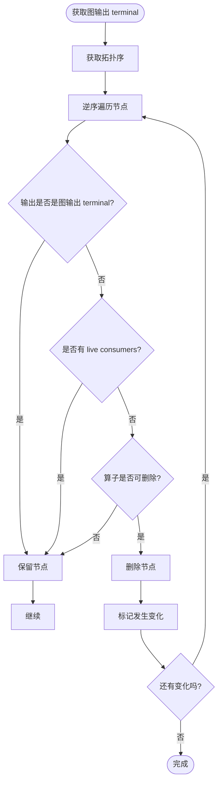

**图表来源**
- [dead_code_elimination_pass.cpp:1-92](../../../../src/graph/optimization/dead_code_elimination_pass.cpp#L1-L92)
- [op_removability_internal.cpp:1-14](../../../../src/graph/optimization/op_removability_internal.cpp#L1-L14)

**章节来源**
- [dead_code_elimination_pass.cpp:1-92](../../../../src/graph/optimization/dead_code_elimination_pass.cpp#L1-L92)
- [op_removability_internal.cpp:1-14](../../../../src/graph/optimization/op_removability_internal.cpp#L1-L14)

### Add-RMSNorm 融合
Add-RMSNorm 融合 pass 寻找如下模式：
- `RmsNorm(Add(input, residual), weight)`
- Add 只有一个消费者 RmsNorm。
- Add 的两个输入都是 activation。
- RmsNorm 的权重是 weight。
- Add 的输出和 RmsNorm 的输出都有 observable use。
- 融合后算子 `InferOperator` 推断结果与原输出 spec 一致，且没有延迟 runtime checks。

融合后保留两个可观察输出：
- 第一个接管 RmsNorm 输出。
- 第二个接管 Add 输出，避免破坏其他 consumer 或后续层 norm。

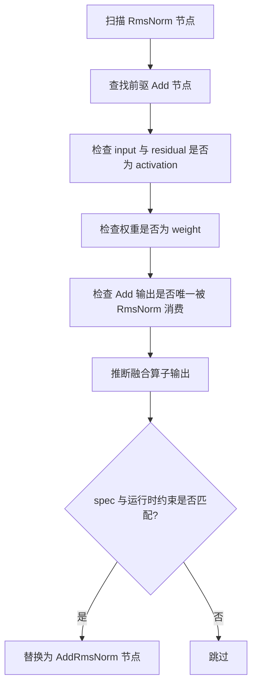

**图表来源**
- [add_rmsnorm_fusion_pass.cpp:1-200](../../../../src/graph/optimization/add_rmsnorm_fusion_pass.cpp#L1-L200)
- [add_rmsnorm_fusion_pass.h:1-32](../../../../include/aethermind/graph/optimization/add_rmsnorm_fusion_pass.h#L1-L32)

**章节来源**
- [add_rmsnorm_fusion_pass.h:1-32](../../../../include/aethermind/graph/optimization/add_rmsnorm_fusion_pass.h#L1-L32)
- [add_rmsnorm_fusion_pass.cpp:1-200](../../../../src/graph/optimization/add_rmsnorm_fusion_pass.cpp#L1-L200)

### 默认优化流水线
compiler 层的 `OptimizeModelGraph` 根据 `PassContext::opt_level` 选择 pass：

- O0：不运行任何 pass。
- O1：常量折叠 → 死代码消除。
- O2+：常量折叠 → QkvLinear 融合 → GateUpLinear 融合 → SiluMul 融合 → AddRmsNorm 融合 → 死代码消除。

**章节来源**
- [optimize_graph.h:1-20](../../../../include/aethermind/compiler/optimize_graph.h#L1-L20)
- [optimize_graph.cpp:1-40](../../../../src/compiler/optimize_graph.cpp#L1-L40)

## 依赖与关系分析

### 组件耦合
- `ModelGraph` 依赖 `operators` 的 schema 和 inference 能力，用于 AddNode 时的语义校验。
- `GraphRewriteSession` 依赖 `ModelGraph` 作为只读源，并在 Commit 时生成新图。
- Optimization passes 依赖 `GraphPassManager`、`GraphRewriteSession` 和 `ConstEvaluator`。
- Compiler 层依赖 graph optimization pass manager，但不直接访问 graph internals。

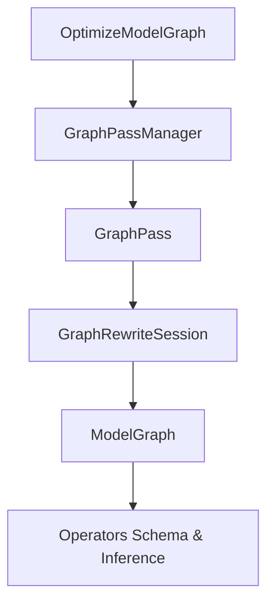

**图表来源**
- [graph.h:1-200](../../../../include/aethermind/graph/graph.h#L1-L200)
- [graph_pass_manager.h:1-129](../../../../include/aethermind/graph/optimization/graph_pass_manager.h#L1-L129)
- [graph_rewrite.h:1-200](../../../../include/aethermind/graph/optimization/graph_rewrite.h#L1-L200)
- [optimize_graph.cpp:1-40](../../../../src/compiler/optimize_graph.cpp#L1-L40)

**章节来源**
- [src/graph/](../../../../src/graph)
- [architecture.md](../../../architecture.md)

### 算子注册与常量求值注册
- 算子 schema 由 operators 模块定义。
- 常量求值器通过静态数组注册，`FindConstEvaluator` 线性查找。
- 新增算子若需参与常量折叠，需在 evaluator 表中注册，并实现 `Plan` 与 `Evaluate`。

**章节来源**
- [const_evaluator.cpp:1-36](../../../../src/graph/optimization/const_evaluator.cpp#L1-L36)
- [const_evaluator.h:1-189](../../../../include/aethermind/graph/optimization/const_evaluator.h#L1-L189)

## 性能与复杂度特征

### 图查询与遍历
- `FindNodesByOpType` 是线性扫描，适合 pass 场景但不应放在热路径。
- Consumer index 按需派生，避免每次修改都维护全局消费者表。
- 拓扑排序使用 Kahn 算法，检测环时返回错误。

### 常量折叠
- 常量折叠遍历拓扑序，对每个可求值算子尝试 Plan/Evaluate。
- 预算控制通过 `ConstEvalPolicy` 限制输出字节数和估计标量操作数。
- 不支持动态 shape 或溢出字节计数时跳过折叠，避免 pass 失败。

### 死代码消除
- 每次迭代重新拓扑排序并逆序扫描。
- 使用 fixed-point 策略直到不再删除节点。
- 最终请求 commit pruning，清理不可达残留。

### 重写会话
- 值替换链带路径压缩缓存，提升 `GetResolvedValue` 查询效率。
- Commit 可能复制图，但常量 inline_data 通过 shared_ptr 共享，减少深拷贝。

**章节来源**
- [graph.h:1-200](../../../../include/aethermind/graph/graph.h#L1-L200)
- [graph.cpp:1-200](../../../../src/graph/graph.cpp#L1-L200)
- [graph_rewrite.cpp:1-200](../../../../src/graph/optimization/graph_rewrite.cpp#L1-L200)
- [const_evaluator.h:1-189](../../../../include/aethermind/graph/optimization/const_evaluator.h#L1-L189)

## 图构建、修改与优化示例

### 构建线性层与 RMSNorm
参考路径：
- 添加输入：`AddInput`
- 添加 Linear 层：`AddLinear`
- 添加 RMSNorm：`AddRmsNorm`
- 标记输出：`MarkOutput`

实现要点：
- `AddLinear` 会创建 weight 值并调用 `ModelGraph::AddNode`。
- `AddRmsNorm` 同样创建 weight 值并添加节点。
- 两者均复用输入 last dimension 的 shape symbol，使 hidden dimension 相等关系在符号层面跟踪。

参考位置：
- [graph_op_builder.cpp:1-200](../../../../src/graph/graph_op_builder.cpp#L1-L200)
- [graph_op_builder.cpp:201-477](../../../../src/graph/graph_op_builder.cpp#L201-L477)
- [graph.h:1-200](../../../../include/aethermind/graph/graph.h#L1-L200)

### 修改图：替换值或删除节点
参考路径：
- 获取 session：通过 pass 的 `GraphRewriteSession&`。
- 删除节点：`RemoveNode`。
- 替换值：`ReplaceValue`。
- 重定向输入：`RedirectInput`。
- 批量修改：`Apply`。

参考位置：
- [graph_rewrite.h:1-200](../../../../include/aethermind/graph/optimization/graph_rewrite.h#L1-L200)
- [graph_rewrite.cpp:1-200](../../../../src/graph/optimization/graph_rewrite.cpp#L1-L200)

### 优化图：常量折叠与 DCE
参考路径：
- 常量折叠 pass：`ConstantFoldingPass`。
- 死代码消除 pass：`DeadCodeEliminationPass`。
- 默认优化流水线：`OptimizeModelGraph`。

参考位置：
- [constant_folding_pass.cpp:1-200](../../../../src/graph/optimization/constant_folding_pass.cpp#L1-L200)
- [dead_code_elimination_pass.cpp:1-92](../../../../src/graph/optimization/dead_code_elimination_pass.cpp#L1-L92)
- [optimize_graph.cpp:1-40](../../../../src/compiler/optimize_graph.cpp#L1-L40)

## 自定义优化 pass 开发指南

### 步骤一：继承 GraphPass
实现两个方法：
- `Name()`：返回稳定可读的 pass 名称。
- `Run(GraphRewriteSession&, const PassContext&)`：执行优化逻辑，返回 `Status`。

注意事项：
- pass 必须无状态。
- 不要直接修改 `ModelGraph`，只能通过 session 提供的 API。
- 不要抛出异常，使用 `Status` 返回错误。

参考位置：
- [graph_pass_manager.h:1-129](../../../../include/aethermind/graph/optimization/graph_pass_manager.h#L1-L129)

### 步骤二：使用 GraphRewriteSession 查询图
常用查询：
- `GetTopologicalOrder()`：获取拓扑序。
- `GetNodeView(id)`：获取 live 节点快照。
- `GetValueOutputMetadata(value)`：获取含 spec 的值描述。
- `FindNodesByOpType(op_type)`：按算子类型查找节点。
- `HasLiveConsumers(value)`：判断是否有 live consumers。
- `IsGraphOutput(value)`：判断是否为图输出。
- `GetResolvedValue(value)`：沿替换链解析终端值。

参考位置：
- [graph_rewrite.h:1-200](../../../../include/aethermind/graph/optimization/graph_rewrite.h#L1-L200)

### 步骤三：提交图修改
可选修改方式：
- `RemoveNode(node_id)`：删除节点。
- `ReplaceValue(old_value, new_value)`：重定向消费者。
- `RedirectInput(node, input_index, new_value)`：重定向输入。
- `ReplaceSubgraph(old_nodes, replacement_nodes)`：子图替换。
- `Apply(mutations)`：批量应用 mutation。

参考位置：
- [graph_rewrite.h:1-200](../../../../include/aethermind/graph/optimization/graph_rewrite.h#L1-L200)

### 步骤四：注册到优化流水线
有两种方式：
1. 在 compiler 层修改默认 pipeline。
2. 在用户侧构建自己的 `GraphPassManager`，按顺序添加 pass。

参考位置：
- [optimize_graph.cpp:1-40](../../../../src/compiler/optimize_graph.cpp#L1-L40)
- [graph_pass_manager.cpp:1-94](../../../../src/graph/optimization/graph_pass_manager.cpp#L1-L94)

### 步骤五：如需常量折叠支持
实现 `ConstEvaluator`：
- `Plan(inputs, outputs, params, policy)`：检查可行性，描述输出布局，估算成本。
- `Evaluate(inputs, outputs, params)`：写入输出 buffer。
- 在 `FindConstEvaluator` 注册表中注册。

参考位置：
- [const_evaluator.h:1-189](../../../../include/aethermind/graph/optimization/const_evaluator.h#L1-L189)
- [const_evaluator.cpp:1-36](../../../../src/graph/optimization/const_evaluator.cpp#L1-L36)

## 故障排查

### AddNode 失败常见原因
- 输入数量与 schema 不匹配。
- 输出描述数量与 schema 不匹配。
- 输入 payload kind 与端口 kind 不匹配。
- weight binding 自洽性检查失败。
- weight binding recipe 与算子不兼容。
- weight binding 的 layer index 与节点 layer index 不一致。
- state binding slot 不正确。
- KV cache 输入输出不属于同一 family 或 collection。
- 推断输出 spec 与期望不一致。

参考位置：
- [graph.cpp:201-518](../../../../src/graph/graph.cpp#L201-L518)

### 常量折叠无法生效
- 算子未标记为可编译期求值。
- 没有注册的 ConstEvaluator。
- 输入不是内联常量值。
- Plan 返回 Unimplemented。
- 超出预算限制。
- 动态 shape 或字节计数溢出。

参考位置：
- [constant_folding_pass.cpp:1-200](../../../../src/graph/optimization/constant_folding_pass.cpp#L1-L200)
- [const_evaluator.h:1-189](../../../../include/aethermind/graph/optimization/const_evaluator.h#L1-L189)

### 死代码消除未删除节点
- 节点输出是图输出 terminal。
- 节点仍有 live consumers。
- 算子有 side effects 或 stateful output。
- 节点尚未进入可删除的 fixed-point 收敛状态。

参考位置：
- [dead_code_elimination_pass.cpp:1-92](../../../../src/graph/optimization/dead_code_elimination_pass.cpp#L1-L92)
- [op_removability_internal.cpp:1-14](../../../../src/graph/optimization/op_removability_internal.cpp#L1-L14)

### 重写会话提交失败
- value id 映射缺失。
- 替换链形成环。
- virtual value 被用作跨 replacement 边界的外部连接。
- 输入 dtype 与重定向目标不一致。
- 源图未通过 `Validate()`。

参考位置：
- [graph_rewrite.cpp:1-200](../../../../src/graph/optimization/graph_rewrite.cpp#L1-L200)
- [graph_pass_manager.cpp:1-94](../../../../src/graph/optimization/graph_pass_manager.cpp#L1-L94)

## 结论
AetherMind 的计算图系统以 `ModelGraph` 为核心 IR，通过强类型的值 payload、节点输入输出、schema 驱动的算子语义和重写会话，实现了安全、可观测、可扩展的编译期优化框架。常量折叠、死代码消除和多种融合 pass 构成默认优化流水线；GraphRewriteSession 提供了统一的图修改视图；GraphPassManager 保证了 pass 执行的顺序性与容错性。

对于开发者而言：
- 构建图应优先使用 `graph_op_builder` 的辅助函数。
- 修改图应通过 `GraphRewriteSession`，而不是直接操作底层存储。
- 自定义 pass 应遵循无状态、基于 session、返回 Status 的设计原则。
- 如需常量折叠支持，应实现 `ConstEvaluator` 的两阶段合约并注册到 evaluator 表。
