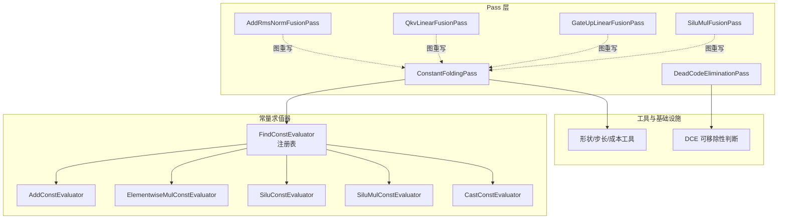
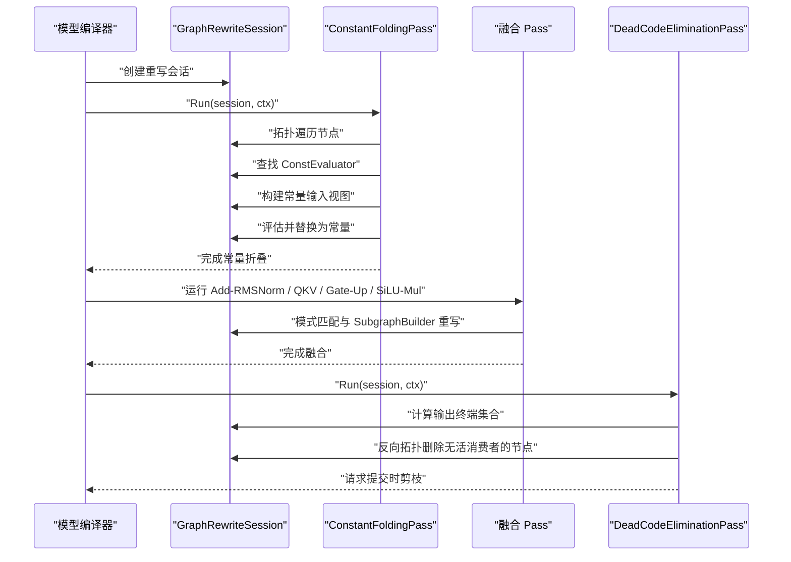
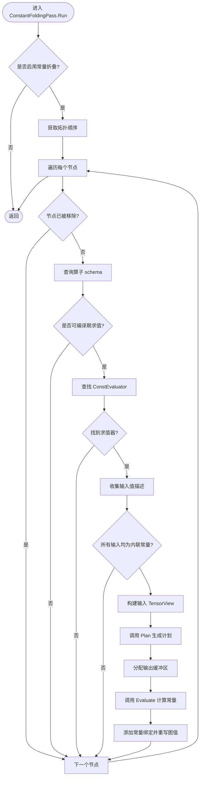
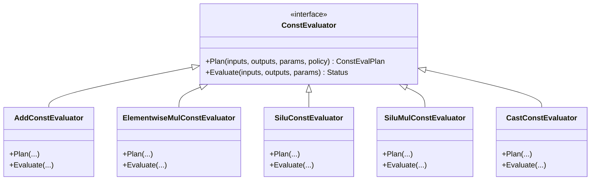
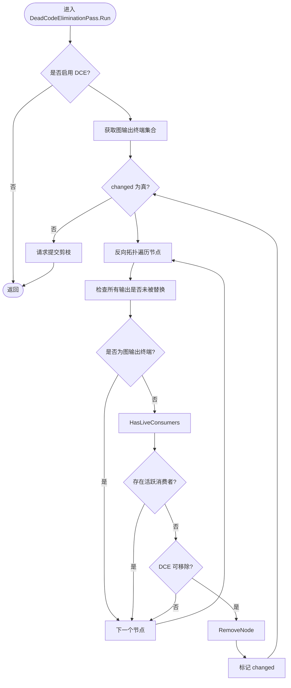
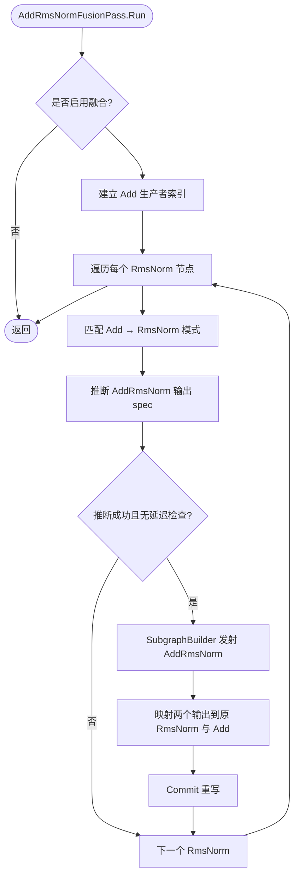
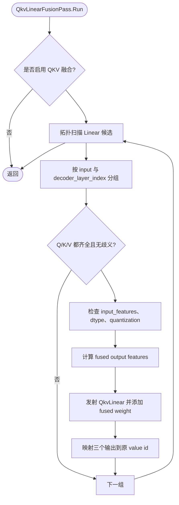
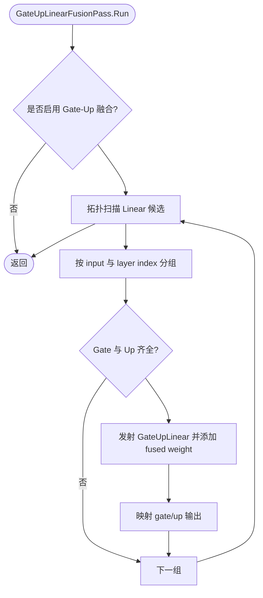
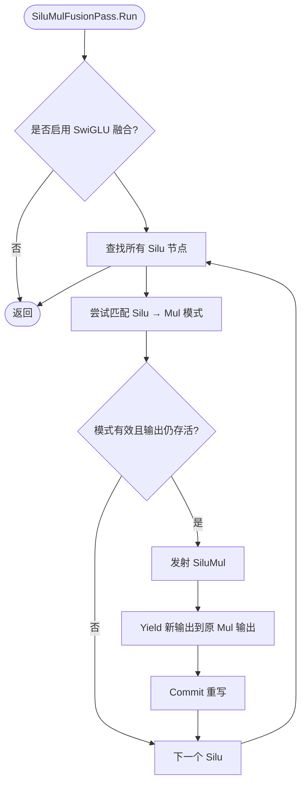
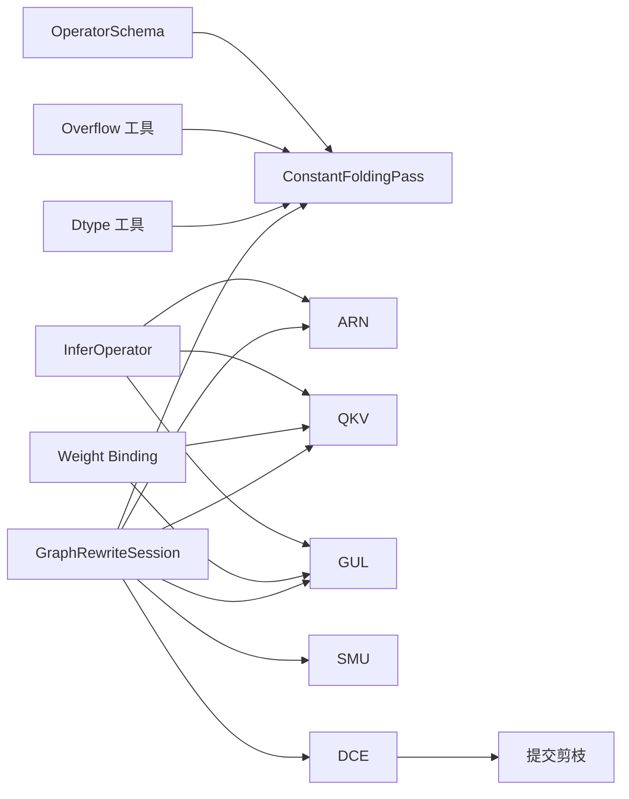

# 语义优化 Pass

**本文引用的文件**
- [const_evaluator.cpp](../../../../src/graph/optimization/const_evaluator.cpp)
- [constant_folding_pass.cpp](../../../../src/graph/optimization/constant_folding_pass.cpp)
- [dead_code_elimination_pass.cpp](../../../../src/graph/optimization/dead_code_elimination_pass.cpp)
- [add_rmsnorm_fusion_pass.cpp](../../../../src/graph/optimization/add_rmsnorm_fusion_pass.cpp)
- [qkv_linear_fusion_pass.cpp](../../../../src/graph/optimization/qkv_linear_fusion_pass.cpp)
- [gate_up_linear_fusion_pass.cpp](../../../../src/graph/optimization/gate_up_linear_fusion_pass.cpp)
- [silu_mul_fusion_pass.cpp](../../../../src/graph/optimization/silu_mul_fusion_pass.cpp)
- [const_eval_add.cpp](../../../../src/graph/optimization/const_eval_add.cpp)
- [const_eval_cast.cpp](../../../../src/graph/optimization/const_eval_cast.cpp)
- [const_eval_mul.cpp](../../../../src/graph/optimization/const_eval_mul.cpp)
- [const_eval_silu.cpp](../../../../src/graph/optimization/const_eval_silu.cpp)
- [const_eval_silu_mul.cpp](../../../../src/graph/optimization/const_eval_silu_mul.cpp)
- [const_eval_utils.cpp](../../../../src/graph/optimization/const_eval_utils.cpp)
- [op_removability_internal.cpp](../../../../src/graph/optimization/op_removability_internal.cpp)
- [const_evaluator.h](../../../../include/aethermind/graph/optimization/const_evaluator.h)
- [constant_folding_pass.h](../../../../include/aethermind/graph/optimization/constant_folding_pass.h)
- [dead_code_elimination_pass.h](../../../../include/aethermind/graph/optimization/dead_code_elimination_pass.h)
- [add_rmsnorm_fusion_pass.h](../../../../include/aethermind/graph/optimization/add_rmsnorm_fusion_pass.h)

## 目录
1. [引言](#引言)
2. [项目结构](#项目结构)
3. [核心组件](#核心组件)
4. [架构总览](#架构总览)
5. [详细组件分析](#详细组件分析)
6. [依赖关系分析](#依赖关系分析)
7. [性能与调优建议](#性能与调优建议)
8. [故障排查指南](#故障排查指南)
9. [结论](#结论)

## 引言
AetherMind 的语义优化层围绕“常量折叠”和“图重写融合”两条主线展开：前者在编译期把可确定输入的算子计算结果直接物化为常量，后者将多个相邻小算子合并为更少的专用算子，减少内核启动、内存读写和中间激活开销。本文件聚焦以下实现：
- 常量折叠 pass：表达式求值、预算控制、布局规划、错误回退。
- 死代码消除 pass：基于 liveness 的节点移除策略。
- 融合 pass：Add-RMSNorm、QKV Linear、Gate-Up Linear、SiLU-Mul 的匹配规则与重写流程。
- ConstEvaluator 体系：两阶段 Plan/Evaluate 契约、操作符语义保持、数值精度与溢出保护。

## 项目结构
优化相关代码集中在 `src/graph/optimization` 下，按“pass + evaluator”划分：
- Pass 层：每个优化目标一个 pass 类，暴露统一的 `Name()` 与 `Run(session, ctx)`。
- 常量求值器层：每个被折叠算子一个 `ConstEvaluator` 实现，由 `FindConstEvaluator` 注册表分发。
- 工具层：形状/步长/成本估计、DCE 可移除性判断。

**图表来源**
- [const_evaluator.cpp:1-36](../../../../src/graph/optimization/const_evaluator.cpp#L1-L36)
- [constant_folding_pass.h:10-30](../../../../include/aethermind/graph/optimization/constant_folding_pass.h#L10-L30)
- [dead_code_elimination_pass.h:10-24](../../../../include/aethermind/graph/optimization/dead_code_elimination_pass.h#L10-L24)
- [add_rmsnorm_fusion_pass.h:10-30](../../../../include/aethermind/graph/optimization/add_rmsnorm_fusion_pass.h#L10-L30)

**章节来源**
- [const_evaluator.cpp:1-36](../../../../src/graph/optimization/const_evaluator.cpp#L1-L36)
- [constant_folding_pass.h:10-30](../../../../include/aethermind/graph/optimization/constant_folding_pass.h#L10-L30)
- [dead_code_elimination_pass.h:10-24](../../../../include/aethermind/graph/optimization/dead_code_elimination_pass.h#L10-L24)
- [add_rmsnorm_fusion_pass.h:10-30](../../../../include/aethermind/graph/optimization/add_rmsnorm_fusion_pass.h#L10-L30)

## 核心组件
本节从接口契约入手，说明常量折叠与融合 pass 如何协作。

### 常量求值器契约
`ConstEvaluator` 定义两阶段接口：
- `Plan(inputs, outputs, params, policy)`：校验 dtype/shape/params，输出计划布局与保守成本估计；不能分配输出内存。
- `Evaluate(inputs, outputs, params)`：纯函数式地读取输入视图、写入输出视图；无状态、线程安全。

调度入口是静态数组驱动的 `FindConstEvaluator`，当前支持：
- Add
- ElementwiseMul
- SiLU
- SiLU×Mul（SwiGLU 的 fused 形式）
- Cast

预算控制由 `ConstEvalPolicy` 集中管理，包含：
- `max_output_bytes`：单次折叠允许的最大输出字节数。
- `max_compute_ops`：单次折叠允许的最大标量运算估算上限。

**章节来源**
- [const_evaluator.h:20-189](../../../../include/aethermind/graph/optimization/const_evaluator.h#L20-L189)
- [const_evaluator.cpp:1-36](../../../../src/graph/optimization/const_evaluator.cpp#L1-L36)

### Pass 生命周期
所有 pass 统一继承 `GraphPass`，通过 `Run(GraphRewriteSession&, const PassContext&)` 执行。上下文开关包括：
- `enable_constant_folding`
- `enable_dce`
- `enable_swiglu_fusion`
- `enable_fused_add_rms_norm`
- `enable_qkv_fusion`
- `enable_gate_up_fusion`

**章节来源**
- [constant_folding_pass.h:10-30](../../../../include/aethermind/graph/optimization/constant_folding_pass.h#L10-L30)
- [dead_code_elimination_pass.h:10-24](../../../../include/aethermind/graph/optimization/dead_code_elimination_pass.h#L10-L24)
- [silu_mul_fusion_pass.cpp:136-158](../../../../src/graph/optimization/silu_mul_fusion_pass.cpp#L136-L158)
- [add_rmsnorm_fusion_pass.cpp:218-242](../../../../src/graph/optimization/add_rmsnorm_fusion_pass.cpp#L218-L242)
- [qkv_linear_fusion_pass.cpp:328-353](../../../../src/graph/optimization/qkv_linear_fusion_pass.cpp#L328-L353)
- [gate_up_linear_fusion_pass.cpp:287-323](../../../../src/graph/optimization/gate_up_linear_fusion_pass.cpp#L287-L323)

## 架构总览
下图展示一次典型优化流程：先进行常量折叠，再进行多种融合 pass，最后做死代码消除。

**图表来源**
- [constant_folding_pass.cpp:120-200](../../../../src/graph/optimization/constant_folding_pass.cpp#L120-L200)
- [silu_mul_fusion_pass.cpp:136-158](../../../../src/graph/optimization/silu_mul_fusion_pass.cpp#L136-L158)
- [add_rmsnorm_fusion_pass.cpp:218-242](../../../../src/graph/optimization/add_rmsnorm_fusion_pass.cpp#L218-L242)
- [qkv_linear_fusion_pass.cpp:328-353](../../../../src/graph/optimization/qkv_linear_fusion_pass.cpp#L328-L353)
- [gate_up_linear_fusion_pass.cpp:287-323](../../../../src/graph/optimization/gate_up_linear_fusion_pass.cpp#L287-L323)
- [dead_code_elimination_pass.cpp:62-92](../../../../src/graph/optimization/dead_code_elimination_pass.cpp#L62-L92)

## 详细组件分析

### 常量折叠 Pass：表达式求值与控制流
`ConstantFoldingPass` 的核心行为如下：
1. 检查 `ctx.enable_constant_folding`，关闭则直接返回。
2. 获取拓扑顺序，逐个节点处理；跳过已移除节点。
3. 查询算子 schema，仅对标记为 `compile_time_evaluable` 的算子尝试折叠。
4. 通过 `FindConstEvaluator` 取得具体求值器；若无则跳过。
5. 收集输入值描述，要求所有输入都是内联常量。
6. 构造输入 `TensorView`：静态 shape、连续 stride、从 `ConstantValue::inline_data` 借用数据。
7. 调用 evaluator 的 `Plan`，再根据计划分配输出 buffer，验证 spec/nbytes/stride rank。
8. 调用 `Evaluate` 写出常量数据，并通过 session 添加常量绑定并重写图值。

关键边界情况：
- 动态 shape 或无法计算字节数时，不中断 pass，直接跳过该节点。
- 整数加法/乘法溢出时，求值器返回 `Status::Overflow`，pass 不会继续折叠。
- 输出 layout 不匹配计划时，pass 报告内部错误。

**图表来源**
- [constant_folding_pass.cpp:120-200](../../../../src/graph/optimization/constant_folding_pass.cpp#L120-L200)
- [const_evaluator.h:110-189](../../../../include/aethermind/graph/optimization/const_evaluator.h#L110-L189)

**章节来源**
- [constant_folding_pass.cpp:1-200](../../../../src/graph/optimization/constant_folding_pass.cpp#L1-L200)
- [const_evaluator.h:20-189](../../../../include/aethermind/graph/optimization/const_evaluator.h#L20-L189)

### 常量求值器实现：操作符语义与精度保证
#### Add 求值器
- 支持广播兼容的静态 shape，输出始终为连续布局。
- 整数路径使用溢出检查；浮点路径保留 inf 等合法值。
- 当两个输入与输出 shape 一致且都连续时走快速 flat 路径，否则走 strided broadcast 路径。

#### Mul 求值器
- 不支持广播，要求 lhs、rhs、output 三者 shape 完全相同。
- 同样对整数乘法的溢出进行检查。
- 连续输入走 flat 路径，否则走 strided 路径。

#### Cast 求值器
- 支持 Float32、Half、BFloat16 之间的六种转换对。
- 窄化转换经过 float 中间表示，复用类型头文件的舍入与 NaN 语义。
- 要求输入输出 dtype 不同且静态 shape 相同。

#### SiLU 求值器
- 使用稳定公式：正分支为 `x / (1 + exp(-x))`，负分支为 `x * exp(x) / (1 + exp(x))`，避免大负数时的 exp 溢出。
- Half/BFloat16/fp8 先提升到 float 计算，输出时只舍入一次。
- 支持 Float32、Half、BFloat16、Float8_e4m3fn、Float8_e5m2。

#### SiLU×Mul 求值器
- 直接计算 `silu(gate) × up`，分支逻辑与 SiLU 保持一致。
- 同样采用 float 中间计算，保证 fp16/bf16/fp8 的精度一致性。

#### 共享工具
- `ExtractStaticShape`：拒绝动态或无秩 shape。
- `CountElements`：带溢出的元素计数。
- `CountBytes`：链式检查 shape→numel→element_bytes。
- `MakeContiguousStrides`：行优先 stride，带溢出保护。
- `EstimateCost`：保守上界，用于 pass 层预算判断。
- `CheckFoldingBudget`：比较 output_bytes 与 compute_ops 与策略上限。

**图表来源**
- [const_evaluator.h:110-189](../../../../include/aethermind/graph/optimization/const_evaluator.h#L110-L189)
- [const_eval_add.cpp:1-150](../../../../src/graph/optimization/const_eval_add.cpp#L1-L150)
- [const_eval_mul.cpp:1-136](../../../../src/graph/optimization/const_eval_mul.cpp#L1-L136)
- [const_eval_silu.cpp:1-185](../../../../src/graph/optimization/const_eval_silu.cpp#L1-L185)
- [const_eval_silu_mul.cpp:1-194](../../../../src/graph/optimization/const_eval_silu_mul.cpp#L1-L194)
- [const_eval_cast.cpp:1-152](../../../../src/graph/optimization/const_eval_cast.cpp#L1-L152)

**章节来源**
- [const_eval_add.cpp:1-150](../../../../src/graph/optimization/const_eval_add.cpp#L1-L150)
- [const_eval_mul.cpp:1-136](../../../../src/graph/optimization/const_eval_mul.cpp#L1-L136)
- [const_eval_cast.cpp:1-152](../../../../src/graph/optimization/const_eval_cast.cpp#L1-L152)
- [const_eval_silu.cpp:1-185](../../../../src/graph/optimization/const_eval_silu.cpp#L1-L185)
- [const_eval_silu_mul.cpp:1-194](../../../../src/graph/optimization/const_eval_silu_mul.cpp#L1-L194)
- [const_eval_utils.cpp:1-121](../../../../src/graph/optimization/const_eval_utils.cpp#L1-L121)

### 死代码消除 Pass：liveness 分析与节点移除
`DeadCodeEliminationPass` 的行为：
1. 若未启用则直接返回。
2. 获取图输出的“解析后终端”集合；该集合在一次 pass 中稳定不变。
3. 反复扫描拓扑逆序，判断节点是否满足：
   - 所有输出均未被替换；
   - 不是图输出终端；
   - 没有活跃消费者；
   - 属于 DCE 可移除算子。
4. 移除节点并标记 changed；循环直到不再变化。
5. 成功后请求提交阶段剪枝，清理可能残留的重写产物。

DCE 可移除性由 `IsDceRemovableOp` 决定：算子 schema 无副作用且无有状态输出。

**图表来源**
- [dead_code_elimination_pass.cpp:1-92](../../../../src/graph/optimization/dead_code_elimination_pass.cpp#L1-L92)
- [op_removability_internal.cpp:1-14](../../../../src/graph/optimization/op_removability_internal.cpp#L1-L14)

**章节来源**
- [dead_code_elimination_pass.cpp:1-92](../../../../src/graph/optimization/dead_code_elimination_pass.cpp#L1-L92)
- [op_removability_internal.cpp:1-14](../../../../src/graph/optimization/op_removability_internal.cpp#L1-L14)

### Add-RMSNorm 融合 Pass
触发条件：
- `ctx.enable_fused_add_rms_norm` 开启。
- 存在 `RmsNorm(Add(input, residual), weight)` 子图。
- RmsNorm 只有两个输入、一个输出、无额外 attrs。
- Add 的输出只有一个 RmsNorm 消费者。
- input 与 residual 为激活值，weight 为权重值。
- 融合后的 AddRmsNorm 推断结果必须产生两个输出：RmsNorm 输出与 Add 输出，且无延迟运行时检查。

融合效果：
- 用一个 AddRmsNorm 节点替代 Add 与 RmsNorm。
- 同时保留 Add 的原始值身份，以便其他消费者不受影响。
- 减少一次激活存储与一次 RMSNorm 内核启动。

**图表来源**
- [add_rmsnorm_fusion_pass.cpp:1-242](../../../../src/graph/optimization/add_rmsnorm_fusion_pass.cpp#L1-L242)

**章节来源**
- [add_rmsnorm_fusion_pass.cpp:1-242](../../../../src/graph/optimization/add_rmsnorm_fusion_pass.cpp#L1-L242)
- [add_rmsnorm_fusion_pass.h:10-30](../../../../include/aethermind/graph/optimization/add_rmsnorm_fusion_pass.h#L10-L30)

### QKV Linear 融合 Pass
触发条件：
- `ctx.enable_qkv_fusion` 开启。
- 同一 decoder layer 中，三个 Linear 节点共享同一个激活输入。
- 三个权重角色分别为 AttentionQ、AttentionK、AttentionV。
- 权重来自 Transformer 权重绑定，slot 为 kernel，layer index 一致。
- 权重 shape 为二维，输出 features 为静态正值。
- 三个权重的 dtype 与量化规格一致，最后一个维度即 input_features 相等。
- 每个 Linear 的输出 dtype 与输入 activation dtype 一致，且 metadata 自洽。
- 三个投影齐全且无歧义。

融合效果：
- 将三个 Linear 合并为一个 QkvLinear。
- 生成一个 fused weight binding，对应 `layers.<idx>.self_attn.qkv_proj.weight`。
- 输出分别映射到原 query/key/value 的值身份，避免下游依赖断裂。

**图表来源**
- [qkv_linear_fusion_pass.cpp:1-353](../../../../src/graph/optimization/qkv_linear_fusion_pass.cpp#L1-L353)

**章节来源**
- [qkv_linear_fusion_pass.cpp:1-353](../../../../src/graph/optimization/qkv_linear_fusion_pass.cpp#L1-L353)

### Gate-Up Linear 融合 Pass
触发条件：
- `ctx.enable_gate_up_fusion` 开启。
- 同一 decoder layer 中，两个 Linear 节点共享激活输入。
- 权重角色为 MLP Gate 与 MLP Up。
- 权重绑定、dtype、quantization、input_features 一致。
- 输出 dtype 与 activation dtype 一致，且 Linear metadata 自洽。
- gate/up 都齐全且无歧义。

融合效果：
- 用 GateUpLinear 替代两个 Linear。
- 生成 fused weight binding，对应 `layers.<idx>.mlp.gate_up_proj.weight`。
- 输出分别映射到原 gate/up 值身份。

**图表来源**
- [gate_up_linear_fusion_pass.cpp:1-323](../../../../src/graph/optimization/gate_up_linear_fusion_pass.cpp#L1-L323)

**章节来源**
- [gate_up_linear_fusion_pass.cpp:1-323](../../../../src/graph/optimization/gate_up_linear_fusion_pass.cpp#L1-L323)

### SiLU-Mul 融合 Pass
触发条件：
- `ctx.enable_swiglu_fusion` 开启。
- 存在 `Mul(Silu(gate), up)` 或 `Mul(up, Silu(gate))`。
- Silu 输出只有一个消费者，且该消费者是 Mul。
- Silu 与 Mul 的 decoder_layer_index 一致。
- Mul 输出是图输出或有活跃消费者，避免融合后引入孤儿 fused kernel。
- 更早的 pass（例如常量折叠）没有把 Silu 或 Mul 的输出替换掉。

融合效果：
- 将 SiLU 与逐元素乘法合并为 SiluMul。
- 减少一次激活存储与一次逐元素算子内核。

**图表来源**
- [silu_mul_fusion_pass.cpp:1-158](../../../../src/graph/optimization/silu_mul_fusion_pass.cpp#L1-L158)

**章节来源**
- [silu_mul_fusion_pass.cpp:1-158](../../../../src/graph/optimization/silu_mul_fusion_pass.cpp#L1-L158)

## 依赖关系分析
优化 pass 之间通过 `GraphRewriteSession` 共享图状态，彼此耦合较弱但顺序敏感：
- 常量折叠依赖 operator schema、dtype 工具、overflow 工具。
- 融合 pass 依赖 operator inference、weight binding、session 的拓扑与消费关系查询。
- DCE 依赖 DCE 可移除性判断，并在结束后请求 commit-time pruning。

**图表来源**
- [constant_folding_pass.cpp:1-200](../../../../src/graph/optimization/constant_folding_pass.cpp#L1-L200)
- [add_rmsnorm_fusion_pass.cpp:1-242](../../../../src/graph/optimization/add_rmsnorm_fusion_pass.cpp#L1-L242)
- [qkv_linear_fusion_pass.cpp:1-353](../../../../src/graph/optimization/qkv_linear_fusion_pass.cpp#L1-L353)
- [gate_up_linear_fusion_pass.cpp:1-323](../../../../src/graph/optimization/gate_up_linear_fusion_pass.cpp#L1-L323)
- [silu_mul_fusion_pass.cpp:1-158](../../../../src/graph/optimization/silu_mul_fusion_pass.cpp#L1-L158)
- [dead_code_elimination_pass.cpp:1-92](../../../../src/graph/optimization/dead_code_elimination_pass.cpp#L1-L92)

**章节来源**
- [constant_folding_pass.cpp:1-200](../../../../src/graph/optimization/constant_folding_pass.cpp#L1-L200)
- [add_rmsnorm_fusion_pass.cpp:1-242](../../../../src/graph/optimization/add_rmsnorm_fusion_pass.cpp#L1-L242)
- [qkv_linear_fusion_pass.cpp:1-353](../../../../src/graph/optimization/qkv_linear_fusion_pass.cpp#L1-L353)
- [gate_up_linear_fusion_pass.cpp:1-323](../../../../src/graph/optimization/gate_up_linear_fusion_pass.cpp#L1-L323)
- [silu_mul_fusion_pass.cpp:1-158](../../../../src/graph/optimization/silu_mul_fusion_pass.cpp#L1-L158)
- [dead_code_elimination_pass.cpp:1-92](../../../../src/graph/optimization/dead_code_elimination_pass.cpp#L1-L92)

## 性能与调优建议
### 常量折叠
- 适合场景：权重附近的小算子常量表达式、cast 链、激活附近的常数偏置。
- 收益：减少运行时计算、消除中间激活、降低内核启动次数。
- 风险：过大的常量会占用权重缓存；因此 `ConstEvalPolicy` 的 output_bytes 与 compute_ops 是关键调参项。
- 调优建议：
  - 如果模型频繁出现超大激活图常量，适当降低 `max_output_bytes`。
  - 如果 CPU 侧常量求值成为瓶颈，降低 `max_compute_ops`，让 pass 更保守。
  - 对 FP16/BF16/fp8 模型，注意 SiLU/SiLU×Mul 的 float 中间计算会引入少量额外精度提升，但也增加标量运算；可在 benchmark 中对比开启/关闭常量折叠的端到端吞吐。

### 融合 Pass
- Add-RMSNorm：适用于残差连接后紧接 RMSNorm 的结构；可减少一次激活写入与一次归一化内核。
- QKV Linear：适用于注意力前缀的三个 Linear；能合并权重访问与矩阵乘，显著减少访存碎片。
- Gate-Up Linear：适用于 SwiGLU MLP 的前半部分；合并 gate/up 线性变换。
- SiLU-Mul：适用于 SwiGLU 的 silu×mul 模式；减少逐元素算子数量。
- 调优建议：
  - 如果模型中没有对应的 pattern，这些 pass 会被跳过，不影响正确性。
  - 如果融合导致后续 graph 难以被 DCE 清理，应检查 fusion 是否保留了必要的输出 identity；现有实现已通过 yield 映射避免孤儿值。
  - 对于多后端部署，应分别验证 fused add-rmsnorm、qkv-linear、gate-up-linear 的 kernel dispatch 是否可用。

### 死代码消除
- 适合场景：常量折叠或融合后产生的不可达子图。
- 收益：减少待执行节点数量、缩小执行计划、降低提交阶段的图复杂度。
- 注意事项：DCE 只在节点输出既不是图输出也没有活跃消费者时才移除；若融合产物的 identity 映射不正确，可能导致节点被误删或保留。

[本节提供通用指导，不直接分析具体代码行]

## 故障排查指南
### 常量折叠失败
常见原因：
- 输入不是内联常量：pass 会跳过该节点。
- shape 动态或无法计算字节数：pass 以 Unimplemented 或 Overflow 回退，不中断整体流程。
- dtype 不被支持：具体 evaluator 返回 Unimplemented。
- 预算超限：`CheckFoldingBudget` 返回 Unimplemented，pass 跳过该机会。

排查步骤：
1. 确认参与计算的张量是否由权重或常量初始化。
2. 检查 tensor spec 是否为静态 shape。
3. 调整 `ConstEvalPolicy` 的 budget。
4. 对整数加法/乘法，确认是否存在溢出。

**章节来源**
- [constant_folding_pass.cpp:1-200](../../../../src/graph/optimization/constant_folding_pass.cpp#L1-L200)
- [const_eval_utils.cpp:1-121](../../../../src/graph/optimization/const_eval_utils.cpp#L1-L121)
- [const_eval_add.cpp:1-150](../../../../src/graph/optimization/const_eval_add.cpp#L1-L150)
- [const_eval_mul.cpp:1-136](../../../../src/graph/optimization/const_eval_mul.cpp#L1-L136)

### 融合 Pass 不生效
常见原因：
- 上下文开关关闭。
- pattern 不匹配：例如 RmsNorm 有多个消费者、QKV 缺少某一投影、Gate-Up 权重 role 不一致。
- 更早 pass 已经替换了相关值，导致模式不再存在于运行时图。
- 推断失败或输出 spec 不一致。

排查步骤：
1. 确认 `PassContext` 中对应融合开关为 true。
2. 检查 model graph builder 是否生成预期 pattern。
3. 查看 fusion 是否保留了正确的输出 identity。
4. 对 QKV/Gate-Up，检查权重绑定、dtype、quantization、decoder_layer_index 是否一致。

**章节来源**
- [add_rmsnorm_fusion_pass.cpp:1-242](../../../../src/graph/optimization/add_rmsnorm_fusion_pass.cpp#L1-L242)
- [qkv_linear_fusion_pass.cpp:1-353](../../../../src/graph/optimization/qkv_linear_fusion_pass.cpp#L1-L353)
- [gate_up_linear_fusion_pass.cpp:1-323](../../../../src/graph/optimization/gate_up_linear_fusion_pass.cpp#L1-L323)
- [silu_mul_fusion_pass.cpp:1-158](../../../../src/graph/optimization/silu_mul_fusion_pass.cpp#L1-L158)

### DCE 后图异常
常见原因：
- 某个融合 pass 没有正确 yield 输出，导致下游依赖丢失。
- 节点输出仍是图输出终端，但被误判为 dead。
- 图中存在环，`HasLiveConsumers` 报错。

排查步骤：
1. 确认 DCE 启用的前提下，检查图输出终端集合。
2. 检查被移除节点的输出是否仍有消费者。
3. 若出现环检测错误，优先修复图构建逻辑，而不是禁用 DCE。

**章节来源**
- [dead_code_elimination_pass.cpp:1-92](../../../../src/graph/optimization/dead_code_elimination_pass.cpp#L1-L92)
- [op_removability_internal.cpp:1-14](../../../../src/graph/optimization/op_removability_internal.cpp#L1-L14)

## 结论
AetherMind 的语义优化 pass 以清晰的契约与稳健的错误处理为基础：
- 常量折叠通过两阶段 evaluator 分离“可行性与成本估计”和“实际求值”，在保持操作符语义的同时，严格控制内存与计算预算。
- 多种融合 pass 针对 Transformer 常见子图进行模式匹配与重写，减少内核启动与中间激活。
- DCE 在 pass 结束后清理不可达节点，配合提交阶段剪枝，保证最终执行图的紧凑性。

在实际工程中，推荐以模型 benchmark 为依据，逐步开启常量折叠、各融合 pass 与 DCE，观察吞吐、延迟与显存占用变化，并根据模型特征调整 `ConstEvalPolicy` 与 fusion 开关。对于数值敏感的模型，应特别关注 SiLU 系列求值器的 float 中间计算路径，确保端到端数值误差在可接受范围内。

[本节为总结性内容，不直接分析具体文件]
