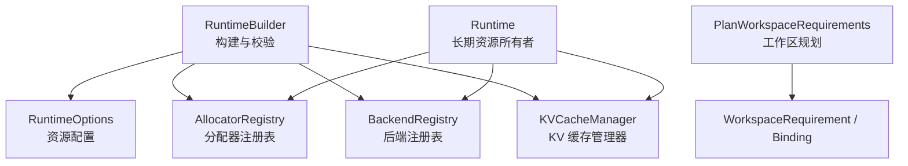
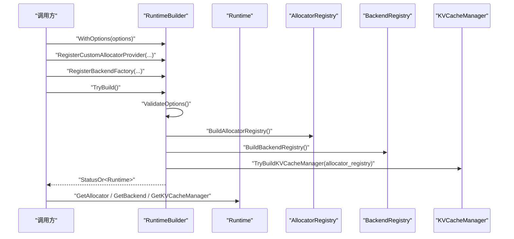
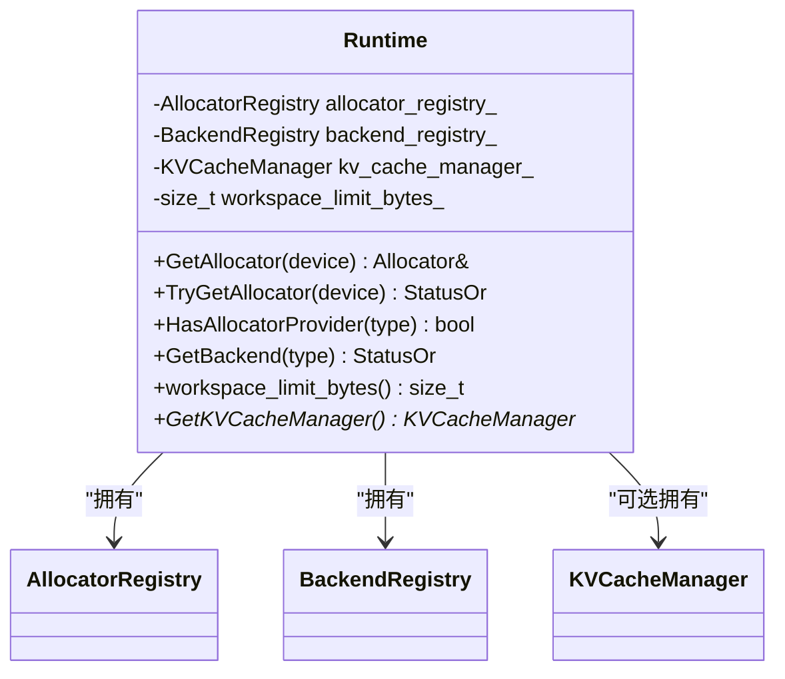
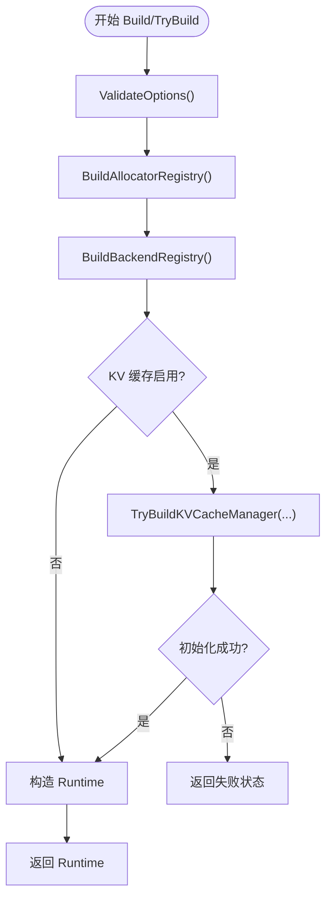
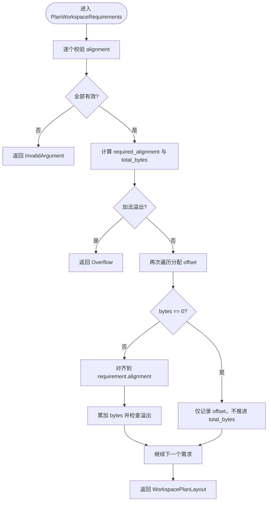
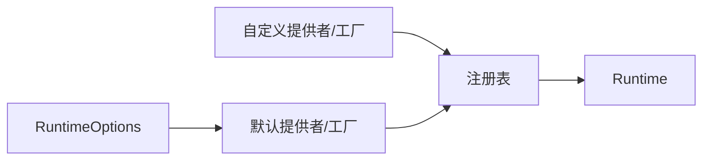
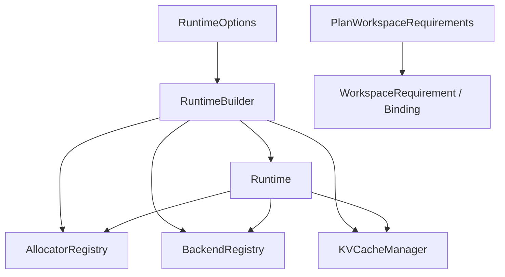
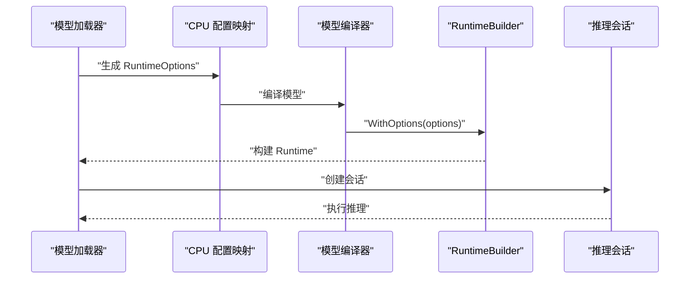

# 运行时系统（Runtime）

**本文引用的文件**
- [runtime.h](../../../include/aethermind/runtime/runtime.h)
- [runtime_builder.h](../../../include/aethermind/runtime/runtime_builder.h)
- [runtime_options.h](../../../include/aethermind/runtime/runtime_options.h)
- [workspace_planner.h](../../../include/aethermind/runtime/workspace_planner.h)
- [runtime_builder.cpp](../../../src/runtime/runtime_builder.cpp)
- [workspace_planner.cpp](../../../src/runtime/workspace_planner.cpp)
- [kv_cache_manager.h](../../../include/aethermind/kv_cache/kv_cache_manager.h)
- [workspace_types.h](../../../include/aethermind/base/workspace_types.h)
- [allocator.h](../../../include/aethermind/memory/allocator.h)
- [resource-budgeting.md](../../guides/resource-budgeting.md)
- [runtime-configuration.md](../../guides/runtime-configuration.md)

## 目录
1. [引言](#引言)
2. [项目结构](#项目结构)
3. [核心组件](#核心组件)
4. [架构总览](#架构总览)
5. [详细组件分析](#详细组件分析)
6. [依赖关系分析](#依赖关系分析)
7. [性能与资源预算](#性能与资源预算)
8. [故障排查指南](#故障排查指南)
9. [结论](#结论)
10. [附录：使用示例与最佳实践](#附录使用示例与最佳实践)

## 引言
AetherMind 的 Runtime 是后端、分配器与 KV 缓存等长期资源的拥有者，也是推理会话和执行计划的生命周期边界。它通过 `RuntimeBuilder` 以构建模式装配，借助 `RuntimeOptions` 集中表达分配器、后端、执行策略、工作区预算、跟踪与 KV 缓存配置。运行时还负责工作区规划、KV 平面布局与容量准入，以及请求级 workspace payload 上限控制。

本技术文档面向希望理解并正确配置 AetherMind 运行时的开发者，覆盖生命周期管理、资源聚合机制、Workspace 规划算法、配置选项语义、初始化流程、内存预算控制、错误处理与性能调优建议。

## 项目结构
与 Runtime 直接相关的头文件和实现主要分布在以下位置：
- 公开接口：`include/aethermind/runtime/`
- 实现逻辑：`src/runtime/`
- 共享基础类型：`include/aethermind/base/workspace_types.h`
- 内存分配：`include/aethermind/memory/allocator.h`
- KV 缓存管理：`include/aethermind/kv_cache/kv_cache_manager.h`
- 使用指南：`docs/guides/runtime-configuration.md`、`docs/guides/resource-budgeting.md`

**图示来源**
- [runtime_builder.h:12-112](../../../include/aethermind/runtime/runtime_builder.h#L12-L112)
- [runtime_builder.cpp:1-204](../../../src/runtime/runtime_builder.cpp#L1-L204)
- [runtime.h:15-127](../../../include/aethermind/runtime/runtime.h#L15-L127)
- [workspace_planner.h:12-77](../../../include/aethermind/runtime/workspace_planner.h#L12-L77)
- [workspace_types.h:1-84](../../../include/aethermind/base/workspace_types.h#L1-L84)

**章节来源**
- [runtime_builder.h:12-112](../../../include/aethermind/runtime/runtime_builder.h#L12-L112)
- [runtime.h:15-127](../../../include/aethermind/runtime/runtime.h#L15-L127)
- [workspace_planner.h:12-77](../../../include/aethermind/runtime/workspace_planner.h#L12-L77)

## 核心组件
- **Runtime**：长期拥有 AllocatorRegistry、BackendRegistry 与可选 KVCacheManager；提供设备分配器查询、后端查询、workspace 限制查询与 KV 缓存访问。
- **RuntimeBuilder**：将 `RuntimeOptions`、自定义分配器提供者、自定义后端工厂组装为 `Runtime`；支持可恢复失败的 `TryBuild()`。
- **RuntimeOptions**：六组配置，分别控制分配器、后端、执行策略、工作区、跟踪与 KV 缓存。
- **Workspace 规划**：`PlanWorkspaceRequirements` 对一组 `WorkspaceRequirement` 进行对齐、溢出检查与统一偏移分配。
- **KVCacheManager**：管理 KV 物理存储、单会话预留、重置与释放。

**章节来源**
- [runtime.h:15-127](../../../include/aethermind/runtime/runtime.h#L15-L127)
- [runtime_builder.h:12-112](../../../include/aethermind/runtime/runtime_builder.h#L12-L112)
- [runtime_options.h:8-69](../../../include/aethermind/runtime/runtime_options.h#L8-L69)
- [workspace_planner.h:12-77](../../../include/aethermind/runtime/workspace_planner.h#L12-L77)
- [kv_cache_manager.h:17-115](../../../include/aethermind/kv_cache/kv_cache_manager.h#L17-L115)

## 架构总览
Runtime 不是线程安全的；并发访问必须由调用方串行化。其典型生命周期如下：
1. 从模型配置生成 `RuntimeOptions`。
2. 创建 `RuntimeBuilder` 并设置选项与可选自定义提供者。
3. 调用 `Build()` 或 `TryBuild()` 组装 Runtime。
4. 在 Runtime 上准备可执行模型和推理会话。
5. 会话执行期间通过 Runtime 获取分配器、后端和 KV 缓存。

**图示来源**
- [runtime_builder.cpp:12-43](../../../src/runtime/runtime_builder.cpp#L12-L43)
- [runtime_builder.cpp:45-117](../../../src/runtime/runtime_builder.cpp#L45-L117)
- [runtime_builder.cpp:119-204](../../../src/runtime/runtime_builder.cpp#L119-L204)
- [runtime.h:33-108](../../../include/aethermind/runtime/runtime.h#L33-L108)

## 详细组件分析

### Runtime 生命周期与资源聚合
`Runtime` 持有三类长期资源：
- **分配器注册表**：按设备类型缓存 `AllocatorProvider` 和 `Allocator`。
- **后端注册表**：按设备类型缓存后端实例。
- **KV 缓存管理器**：可选；启用后由 Runtime 拥有。

关键行为：
- `GetAllocator(device)`：首次使用时创建并缓存分配器；未注册提供者时会中止。
- `TryGetAllocator(device)`：返回可用状态而非中止。
- `GetBackend(type)`：惰性创建后端并缓存。
- `workspace_limit_bytes()`：返回请求级 workspace payload 上限；0 表示无限制。
- `GetKVCacheManager()`：返回已初始化的 KV 管理器指针或未启用时的空指针。

**图示来源**
- [runtime.h:21-127](../../../include/aethermind/runtime/runtime.h#L21-L127)

**章节来源**
- [runtime.h:21-127](../../../include/aethermind/runtime/runtime.h#L21-L127)

### RuntimeBuilder 构建模式
`RuntimeBuilder` 维护当前 `RuntimeOptions` 与待处理的自定义提供者列表。构建流程包括：
1. 验证选项。
2. 构建分配器注册表。
3. 构建后端注册表。
4. 根据 KV 缓存选项尝试初始化 `KVCacheManager`。
5. 构造 `Runtime`。

`Build()` 会调用 `TryBuild()` 并在失败时中止；`TryBuild()` 捕获异常并将分配失败转换为 `ResourceExhausted`。

**图示来源**
- [runtime_builder.cpp:12-43](../../../src/runtime/runtime_builder.cpp#L12-L43)
- [runtime_builder.cpp:45-117](../../../src/runtime/runtime_builder.cpp#L45-L117)
- [runtime_builder.cpp:119-204](../../../src/runtime/runtime_builder.cpp#L119-L204)

**章节来源**
- [runtime_builder.h:12-112](../../../include/aethermind/runtime/runtime_builder.h#L12-L112)
- [runtime_builder.cpp:12-204](../../../src/runtime/runtime_builder.cpp#L12-L204)

### RuntimeOptions 配置参数
`RuntimeOptions` 包含六组配置：

| 配置组 | 关键字段 | 语义 |
|---|---|---|
| `AllocatorRuntimeOptions` | `enable_cpu`、`enable_cuda`、`enable_cann` | 是否启用内置分配器提供者。 |
| `BackendRuntimeOptions` | `enable_cpu`、`enable_cuda`、`enable_cann`、`cpu_feature_policy` | 是否启用后端；GPU/CANN 需要自定义后端工厂。 |
| `ExecutionRuntimeOptions` | `enable_default_stream`、`enable_graph_executor` | 当前仅接受默认流；图执行器未实现。 |
| `WorkspaceRuntimeOptions` | `enable_workspace_manager`、`default_workspace_limit_bytes` | 工作区管理器未启用；payload 上限可在 Session arena 层面生效。 |
| `TracingRuntimeOptions` | `enable_profiling`、`enable_memory_profiling` | 当前均被拒绝。 |
| `KVCacheRuntimeOptions` | `enable_manager`、`num_layers`、`num_kv_heads`、`max_tokens`、`head_dim`、`kv_dtype`、`alignment`、`max_bytes` | 控制 KV 缓存几何、对齐、可见 payload 上限。 |

部分配置在构建前会被显式拒绝：
- 关闭默认流、开启图执行器、开启工作区管理器、开启 profiling 或 memory profiling。
- 启用 CUDA/CANN 后端但未注册对应自定义后端工厂。

**章节来源**
- [runtime_options.h:8-69](../../../include/aethermind/runtime/runtime_options.h#L8-L69)
- [runtime_builder.cpp:45-117](../../../src/runtime/runtime_builder.cpp#L45-L117)
- [runtime-configuration.md](../../guides/runtime-configuration.md)

### WorkspacePlanner 工作区规划算法
Workspace 是算子和内核执行的临时暂存空间。`PlanWorkspaceRequirements` 接收一组 `WorkspaceRequirement`，输出统一布局 `WorkspacePlanLayout`。

算法要点：
1. 对所有需求校验 alignment 是否为非零 2 的幂。
2. 计算全局 `required_alignment` 和总字节数 `total_bytes`，并进行溢出检查。
3. 第二次遍历为每个需求分配 `offset`；零字节需求作为位置标记，不推进总大小但仍参与 alignment 统计。
4. 所有验证先于偏移写入完成，避免部分修改导致不一致。
5. 异常路径将分配失败转换为 `ResourceExhausted`。

**图示来源**
- [workspace_planner.cpp:1-71](../../../src/runtime/workspace_planner.cpp#L1-L71)
- [workspace_types.h:15-84](../../../include/aethermind/base/workspace_types.h#L15-L84)

**章节来源**
- [workspace_planner.h:12-77](../../../include/aethermind/runtime/workspace_planner.h#L12-L77)
- [workspace_planner.cpp:1-71](../../../src/runtime/workspace_planner.cpp#L1-L71)
- [workspace_types.h:15-84](../../../include/aethermind/base/workspace_types.h#L15-L84)

### KV 缓存管理与资源聚合
`RuntimeBuilder::TryBuildKVCacheManager` 根据 `KVCacheRuntimeOptions` 决定是否初始化 KV 缓存：
- 若未启用，返回默认空管理器。
- 否则计算 KV 布局、比较 `max_bytes`、获取 CPU 分配器并调用 `KVCacheManager::Init`。
- 超出限制时返回 `ResourceExhausted`；分配失败保留原始状态语义。

`KVCacheManager` 保证：
- 同一时刻最多一个活动会话预留。
- 调用方必须序列化初始化、预留、重置、释放和执行访问。
- 视图借用管理器状态，必须在 Runtime 存活且未移动时使用。

**章节来源**
- [runtime_builder.cpp:119-204](../../../src/runtime/runtime_builder.cpp#L119-L204)
- [kv_cache_manager.h:17-115](../../../include/aethermind/kv_cache/kv_cache_manager.h#L17-L115)

### 分配器与后端聚合
- **分配器注册表**：默认提供 CPU、CUDA、CANN 分配器提供者；自定义提供者可以替换默认项。
- **后端注册表**：默认提供 CPU 后端；CUDA/CANN 需要用户注册自定义后端工厂。
- 自定义提供者优先于默认提供者；构建过程中会将 pending 列表转移至注册表。

**图示来源**
- [runtime_builder.cpp:119-170](../../../src/runtime/runtime_builder.cpp#L119-L170)
- [allocator.h:66-114](../../../include/aethermind/memory/allocator.h#L66-L114)

**章节来源**
- [runtime_builder.cpp:119-170](../../../src/runtime/runtime_builder.cpp#L119-L170)
- [allocator.h:66-114](../../../include/aethermind/memory/allocator.h#L66-L114)

## 依赖关系分析
Runtime 相关模块之间的依赖如下：

**图示来源**
- [runtime_builder.h:12-112](../../../include/aethermind/runtime/runtime_builder.h#L12-L112)
- [runtime.h:21-127](../../../include/aethermind/runtime/runtime.h#L21-L127)
- [workspace_planner.h:12-77](../../../include/aethermind/runtime/workspace_planner.h#L12-L77)
- [workspace_types.h:15-84](../../../include/aethermind/base/workspace_types.h#L15-L84)

耦合特征：
- `RuntimeBuilder` 与 `RuntimeOptions` 强耦合，用于装配期校验和资源创建。
- `Runtime` 与三个注册类弱耦合但拥有其生命周期。
- Workspace 规划与执行绑定分离，便于复用统一缓冲区。
- KV 缓存初始化依赖分配器注册表，但不持有分配器引用，避免循环依赖。

**章节来源**
- [runtime_builder.h:12-112](../../../include/aethermind/runtime/runtime_builder.h#L12-L112)
- [runtime.h:21-127](../../../include/aethermind/runtime/runtime.h#L21-L127)
- [workspace_planner.h:12-77](../../../include/aethermind/runtime/workspace_planner.h#L12-L77)

## 性能与资源预算
当前资源预算机制聚焦于“分配前的可确定上界”，而不是进程 RSS 或全局内存账本。

关键点：
- `KVCacheRuntimeOptions::max_bytes`：限制 KV 两个 plane 的可见 payload 加上布局填充。
- `WorkspaceRuntimeOptions::default_workspace_limit_bytes`：限制 Session 拥有的 workspace payload；0 表示无限制。
- Request 级预算还涉及 activation 峰值，但不在 Runtime 层直接分配。
- `PlanWorkspaceRequirements` 通过严格对齐和溢出检查，避免运行时动态扩容带来的不确定性和潜在分配失败。

性能建议：
- 尽量精确设置 KV 几何和 `max_tokens`，避免过度预留。
- 将 `default_workspace_limit_bytes` 设置为典型 Prefill/Decode 峰值，减少大对象频繁分配。
- 保持 CPU feature policy 与实际硬件一致，避免内核选择回退到低效路径。
- 不要同时启用未实现的 tracing 或工作区管理器，以免提前失败。

**章节来源**
- [resource-budgeting.md](../../guides/resource-budgeting.md)
- [workspace_planner.cpp:1-71](../../../src/runtime/workspace_planner.cpp#L1-L71)
- [runtime_options.h:8-69](../../../include/aethermind/runtime/runtime_options.h#L8-L69)

## 故障排查指南

常见错误及定位方式：

| 现象 | 可能原因 | 处理建议 |
|---|---|---|
| 构建失败并报告 Unimplemented | 启用了不支持的执行策略、工作区管理器或 tracing | 改用默认值；禁用 graph executor、workspace manager、profiling、memory profiling。 |
| 构建失败并提示需要自定义后端工厂 | 启用了 CUDA 或 CANN 后端但未注册对应工厂 | 调用 `RegisterBackendFactory` 注册自定义后端。 |
| KV 缓存初始化失败 | KV 几何过大、`max_bytes` 不足或分配失败 | 减小 `num_layers`、`num_kv_heads`、`max_tokens`、`head_dim`，或增大 `max_bytes`。 |
| Workspace 规划失败 | alignment 不是 2 的幂，或 total_bytes 溢出 | 修正 `WorkspaceRequirement.alignment`；检查需求数量与单个需求大小。 |
| 分配失败 | 底层内存不足 | 降低 KV 容量、workspace 上限或 activation 预算；确认设备分配器可用。 |

调试建议：
- 优先使用 `TryBuild()` 获取 `StatusOr<Runtime>`，以便区分未实现、资源耗尽和其他错误。
- 使用 `HasAllocatorProvider` 和 `TryGetAllocator` 检查设备分配器可用性。
- 使用 `GetKVCacheManager()` 判断 KV 缓存是否启用，再决定是否需要序列化管理器访问。
- 对于 OOM，注意 API 常返回带空消息的 `ResourceExhausted`，以避免在错误报告中再次分配内存。

**章节来源**
- [runtime_builder.cpp:45-117](../../../src/runtime/runtime_builder.cpp#L45-L117)
- [runtime_builder.cpp:119-204](../../../src/runtime/runtime_builder.cpp#L119-L204)
- [workspace_planner.cpp:1-71](../../../src/runtime/workspace_planner.cpp#L1-L71)
- [allocator.h:66-114](../../../include/aethermind/memory/allocator.h#L66-L114)

## 结论
AetherMind 的 Runtime 通过 `RuntimeBuilder` 和 `RuntimeOptions` 将分配器、后端、KV 缓存与工作区预算集中在装配阶段确定。Workspace 规划采用两阶段验证与偏移分配，确保统一缓冲区的安全布局。KV 缓存管理提供明确的会话生命周期约束，适合静态 KV 场景下的推理流水线。配合文档中的资源预算指南，开发者可以在不引入全局内存拦截的前提下，获得更可靠的分配前准入和可预测的资源消耗。

## 附录：使用示例与最佳实践

### 推荐的使用顺序
1. 加载并验证模型。
2. 使用推理层的配置映射生成 `RuntimeOptions`。
3. 编译模型得到可执行 artifact。
4. 使用 `RuntimeBuilder` 构建 Runtime。
5. 准备可执行模型并创建推理会话。
6. 执行推理，必要时先查询资源规划结果。

**图示来源**
- [runtime-configuration.md](../../guides/runtime-configuration.md)
- [resource-budgeting.md](../../guides/resource-budgeting.md)

### 配置与使用要点
- 始终优先使用 `TryBuild()` 并处理可能的 `Unimplemented` 或 `ResourceExhausted`。
- 不要假设 Runtime 线程安全；外部调用必须串行化。
- 如果启用了 KV 缓存，确保调用方序列化 KV 管理器与视图上的执行操作。
- 将 `default_workspace_limit_bytes` 设置为典型请求峰值，避免每次执行都触发大型重新分配。
- 如需 GPU 或 CANN 能力，必须注册对应的自定义后端工厂；仅启用选项不会自动启用内置 GPU 后端。

**章节来源**
- [runtime.h:21-127](../../../include/aethermind/runtime/runtime.h#L21-L127)
- [runtime_builder.h:12-112](../../../include/aethermind/runtime/runtime_builder.h#L12-L112)
- [runtime_builder.cpp:12-204](../../../src/runtime/runtime_builder.cpp#L12-L204)
- [runtime-configuration.md](../../guides/runtime-configuration.md)
- [resource-budgeting.md](../../guides/resource-budgeting.md)
